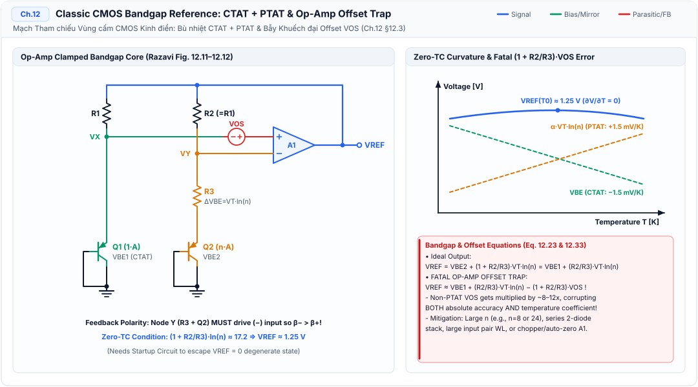

---
{
  "id": "law-ctat-ptat-temperature-cancellation",
  "kind": "law",
  "domain": "references-and-biasing",
  "title_vi": "Quy luật bù trừ hệ số nhiệt âm (CTAT) và dương (PTAT) trong tham chiếu vùng cấm",
  "title_en": "CTAT and PTAT Temperature-Coefficient Cancellation Law",
  "summary": "Định luật vật lý nền tảng kết hợp điện áp gốc-phát VBE có hệ số nhiệt âm (~ -1.5 mV/K) của BJT pnp đế trong CMOS với hiệu điện áp ΔVBE = VT·ln(n) có hệ số nhiệt dương thuần khiết (+0.087·ln(n) mV/K) theo trọng số α·ln(n) ≈ 17.2 để triệt tiêu đạo hàm bậc nhất theo nhiệt độ tại VREF ≈ Eg/q + (4+m)VT ≈ 1.25 V.",
  "diagram": "../../diagrams/bandgap-reference-core.svg",
  "razavi_refs": [
    {
      "chapter": 12,
      "section": "12.3.1-12.3.3",
      "pages": "513-522",
      "equations": ["12.8", "12.9", "12.12", "12.13", "12.14", "12.16", "12.17", "12.19", "12.20", "12.21", "12.31", "12.47", "12.48", "12.50"]
    }
  ],
  "glossary_codes": [
    "T011",
    "T013",
    "T084",
    "T2010",
    "T2013",
    "T2029",
    "T2030",
    "T2031",
    "T2032",
    "T2033",
    "T2034",
    "T2037",
    "T2039",
    "T2040",
    "T2041",
    "T2042",
    "T2045",
    "T2047",
    "T2051",
    "T2052",
    "T2062",
    "T2067",
    "T2068",
    "T2071",
    "T2072"
  ],
  "process_agnostic": true,
  "roles": {
    "substrate_pnp_junction": "Transistor lưỡng cực pnp ký sinh (vùng p+ làm cực phát, giếng n làm cực gốc, đế loại p nối đất làm cực góp) tạo quan hệ hàm mũ IC = IS·exp(VBE/VT) tái lập cao trên mọi tiến trình CMOS",
    "ctat_generator": "Điện áp gốc-phát VBE giảm theo nhiệt độ do dòng bão hòa IS tăng bùng nổ theo exp(-Eg/kT), đóng góp hệ số nhiệt âm khoảng -1.5 mV/K ở 300 K",
    "ptat_generator": "Hiệu điện áp gốc-phát ΔVBE = VT·ln(m·n) giữa hai BJT hoạt động ở tỉ số mật độ dòng m·n khác nhau, đóng góp hệ số nhiệt dương hằng định (k/q)·ln(m·n)",
    "weighting_summation": "Mạng tỉ số điện trở nhân trọng số thành phần PTAT để tổng đại số đạt đạo hàm ∂VREF/∂T = 0 tại nhiệt độ chuẩn T0"
  },
  "symptoms_addressed": [
    "mos-threshold-and-mobility-strong-temperature-drift",
    "process-spread-of-mos-reference-voltages",
    "first-order-temperature-drift-of-vref"
  ],
  "limitations": [
    "second-order-logarithmic-temperature-curvature",
    "substrate-pnp-collector-permanently-tied-to-ground",
    "low-beta-current-gain-of-native-cmos-pnp",
    "fixed-1p25v-output-incompatible-with-sub1v-vdd"
  ],
  "checklists": [
    "bandgap-and-bias",
    "layout-and-matching"
  ]
}
---

## 1. Bản chất Nguyên lý, Sơ đồ Mạch & Vai trò Từng Nhánh Cấu trúc

Để tạo ra một **tham chiếu độc lập nhiệt độ (temperature-independent reference)**, nguyên lý toán học tổng quát là cộng có trọng số hai đại lượng điện áp có **các hệ số nhiệt dương và âm (positive and negative temperature coefficients — PTAT & CTAT)** trái dấu nhau:

$$V_{REF}(T) = \alpha_1 V_{CTAT}(T) + \alpha_2 V_{PTAT}(T) \quad \text{sao cho} \quad \alpha_1 \frac{\partial V_{CTAT}}{\partial T} + \alpha_2 \frac{\partial V_{PTAT}}{\partial T} = 0$$

Tại sao mọi thiết kế CMOS công nghiệp từ $180\text{nm}$ xuống $45\text{nm}$ và nhỏ hơn vẫn dựa vào **transistor lưỡng cực (bipolar transistor, BJT)** thay vì dùng $V_{TH}$ của MOSFET? Razavi chỉ rõ trong §12.3: điện áp ngưỡng $V_{TH}$ và độ linh động $\mu$ của MOSFET chịu phân tán mạnh theo pha tạp kênh, chiều dày oxit và các hiệu ứng kênh ngắn (`law-short-channel-effects`), khiến điểm hệ số nhiệt bằng không trôi dạt hỗn loạn giữa các lô wafer. Ngược lại, tiếp giáp $pn$ của silicon bị chi phối trực tiếp bởi hằng số vật lý nền tảng là **năng lượng vùng cấm (bandgap energy, $E_g \approx 1,12\text{ eV}$)**, cho đặc tính tái lập cao nhất trong công nghệ bán dẫn.

Trong một **công nghệ giếng n (n-well process)** tiêu chuẩn mà không cần thêm mặt nạ chế tạo đặc biệt nào (Hình 12.10 của Razavi), một **transistor pnp ký sinh của công nghệ (native/substrate pnp transistor)** luôn hình thành tự nhiên từ ba lớp vật lý:
- **Cực phát (Emitter — E):** Vùng khuếch tán pha tạp `p+` (chính là lớp tạo cực nguồn/máng của PMOS) nằm bên trong lòng giếng n.
- **Cực gốc (Base — B):** Chính vùng **giếng n (n-well)** bao quanh vùng `p+`, được dẫn ra ngoài qua tiếp xúc `n+` trong giếng.
- **Cực góp (Collector — C):** Toàn bộ **đế bán dẫn loại p (p-type substrate)** nằm bên dưới giếng n — do đó cực góp **bắt buộc phải nối cứng xuống nguồn âm nhất (thường là đất GND)**!

---

## 2. Hệ Phương trình Cốt lõi & Tư duy "Nhìn Mạch Đọc Nhanh" (Analysis by Inspection)

### 2.1. Đạo hàm chính xác của điện áp hệ số nhiệt âm — CTAT ($V_{BE}$, Phương trình 12.8–12.13)
Trong vùng tích cực thuận (bỏ qua dòng cực gốc nhỏ), dòng cực góp (collector current) của BJT tuân theo luật hàm mũ $I_C = I_S \exp(V_{BE}/V_T)$, với **điện áp nhiệt (thermal voltage)** $V_T = kT/q$ ($\approx 25,85\text{ mV}$ tại $T = 300\text{ K}$, độ dốc $\partial V_T/\partial T = k/q \approx +0,08617\text{ mV/K}$, Razavi làm tròn tiện tính nhanh là $+0,087\text{ mV/K}$).

Dòng bão hòa (saturation current) $I_S \propto \mu k T n_i^2$. Thay sự phụ thuộc nhiệt độ của độ linh động hạt tải thiểu số $\mu \propto \mu_0 T^m$ (với **số mũ phụ thuộc nhiệt độ của độ linh động** $m \approx -3/2$) và nồng độ hạt tải nội tại $n_i^2 \propto T^3 \exp[-E_g/(kT)]$ vào, ta thu được phương trình (12.8):

$$I_S(T) = b \, T^{4+m} \exp\left(-\frac{E_g}{kT}\right)$$

Từ $V_{BE} = V_T \ln(I_C / I_S)$, nếu giả sử tạm thời dòng cực góp $I_C$ được giữ không đổi theo nhiệt độ ($\partial I_C / \partial T = 0$), lấy đạo hàm theo $T$:

$$\frac{\partial V_{BE}}{\partial T} = \frac{\partial V_T}{\partial T} \ln\frac{I_C}{I_S} - \frac{V_T}{I_S} \frac{\partial I_S}{\partial T}$$

Tính đạo hàm logarit của (12.8):

$$\frac{1}{I_S}\frac{\partial I_S}{\partial T} = \frac{4+m}{T} + \frac{E_g}{kT^2} \implies \frac{V_T}{I_S}\frac{\partial I_S}{\partial T} = (4+m)\frac{V_T}{T} + \frac{E_g / q}{T}$$

Thế ngược lại và nhận diện $V_T \ln(I_C/I_S) = V_{BE}$, ta thu được **phương trình kinh điển (12.13)**:

$$\frac{\partial V_{BE}}{\partial T} = \frac{V_{BE} - (4+m)V_T - E_g/q}{T}$$

- **Thay số kiểm tra ngay bằng mắt:** Tại $T = 300\text{ K}$, $E_g/q \approx 1,12\text{ V}$, $(4+m)V_T = 2,5 \times 26\text{ mV} \approx 65\text{ mV}$. Với BJT kích thước nhỏ hiện đại hoạt động ở mật độ dòng cao có $V_{BE} \approx 750\text{–}800\text{ mV}$:
  $$\frac{\partial V_{BE}}{\partial T} \approx \frac{0,750 - 0,065 - 1,120}{300\text{ K}} \approx -1,45 \text{ đến } -1,5\text{ mV/K}$$
  (Ở quy trình lưỡng cực cổ điển mật độ dòng thấp với $V_{BE} \approx 700\text{ mV}$, độ dốc âm hơn, khoảng $-1,9\text{ mV/K}$).
- **Hiệu chỉnh cực kỳ quan trọng khi $I_C$ là dòng PTAT (Phương trình 12.29–12.31):** Trong hầu hết các mạch tham chiếu vùng cấm thực tế (`topo-bandgap-reference-core`), bản thân các BJT được phân cực bởi dòng PTAT $I_C \propto T$, tức $\frac{1}{I_C}\frac{\partial I_C}{\partial T} = \frac{1}{T}$. Khi cộng thêm số hạng $+V_T/T$ này vào (12.13), hệ số $(4+m)$ giảm xuống còn **$(3+m)$**:
  $$\left.\frac{\partial V_{BE}}{\partial T}\right|_{I_C \propto T} = \frac{V_{BE} - (3+m)V_T - E_g/q}{T}$$
  Làm cho độ dốc âm của $V_{BE}$ bớt âm đi khoảng $+0,087\text{ mV/K}$ (còn khoảng $-1,4\text{ mV/K}$), đồng thời giảm nhẹ độ cong bậc hai!

### 2.2. Điện áp hệ số nhiệt dương thuần khiết — PTAT ($\Delta V_{BE}$, Phương trình 12.14–12.19)
Cho hai BJT hoạt động ở hai **mật độ dòng điện (current densities, định nghĩa theo Razavi là tỉ số $I_C/I_S$)** khác nhau: $Q_1$ là $1$ transistor đơn vị ($I_{S1} = I_S$) mang dòng $m I_0$, còn $Q_2$ gồm $n$ transistor đơn vị mắc song song ($I_{S2} = n I_S$) mang dòng $I_0$ (Ví dụ 12.3, Hình 12.7). Hiệu điện áp gốc–phát giữa chúng triệt tiêu sạch sẽ hằng số $I_S(T)$ và cả dạng hàm nhiệt của $I_0(T)$:

$$\Delta V_{BE} = V_{BE1} - V_{BE2} = V_T \ln\frac{m I_0}{I_S} - V_T \ln\frac{I_0}{n I_S} = V_T \ln(m n)$$

Lấy đạo hàm theo nhiệt độ tuyệt đối $T$:

$$\frac{\partial \Delta V_{BE}}{\partial T} = \frac{k}{q} \ln(m n) \approx (+0,0862\text{ mV/K}) \cdot \ln(m n)$$

Không giống $\partial V_{BE}/\partial T$, đạo hàm bậc nhất của $\Delta V_{BE}$ là một **hằng số vật lý bất biến**, hoàn toàn không phụ thuộc vào nhiệt độ $T$, quy trình công nghệ hay độ trôi của dòng phân cực $I_0$!

### 2.3. Điều kiện bù trừ bậc nhất & Vì sao gọi là "Điện áp Vùng cấm" (Phương trình 12.20–12.21, 12.47–12.50)
Nếu cố đạt $+1,5\text{ mV/K}$ chỉ bằng một cặp BJT không khuếch đại ($\alpha_2 = 1$), Ví dụ 12.2 chỉ ra $\ln n = 1,5 / 0,087 \approx 17,2 \implies n \approx 2,95 \times 10^7$ transistor đơn vị — hoàn toàn phi thực tế! Do đó, ta chọn tỉ số diện tích hợp lý (ví dụ $n = 8$ hoặc $n = 24$) rồi nhân điện áp $\Delta V_{BE}$ lên bằng tỉ số điện trở $\alpha_2$:

$$V_{REF} = V_{BE} + \alpha_2 V_T \ln(m n), \qquad \text{với} \quad \alpha_2 \ln(m n) \approx 17,2 \quad (\text{khi } I_C = \text{const})$$

Hoặc chính xác tại nhiệt độ thiết kế $T_0$ bằng cách giải $\partial V_{REF}/\partial T|_{T_0} = 0$ từ (12.13) [hoặc (12.31) nếu $I_C \propto T$]:

$$V_{REF}(T_0) = \frac{E_g}{q} + (4+m) V_T(T_0) \quad \text{[hoặc } \frac{E_g}{q} + (3+m) V_T(T_0) \text{ khi } I_C \propto T\text{]}$$

Tại $T_0 = 300\text{ K}$: $V_{REF} \approx 1,12\text{ V} + 2,5 \times 0,026\text{ V} \approx 1,185\text{–}1,25\text{ V}$ (tùy sự phụ thuộc nhiệt thực tế của $E_g(T)$ và $I_C$). Và khi ngoại suy $T \to 0\text{ K}$, $V_{REF} \to E_g / q$: đó chính là cội nguồn của tên gọi **mạch tham chiếu điện áp vùng cấm (bandgap reference)**!

---

## 3. Bất biến Cấu trúc & Các Bẫy Lỗi Kinh điển (Structural Invariants & Traps)

- **[INV-BG-01] Bất biến cực góp nối đất của BJT đế trong CMOS chuẩn:**
  Trong mọi quy trình CMOS giếng n thông thường (không dùng BiCMOS), cực góp của PNP ký sinh chính là đế loại p chung của toàn chip nên bắt buộc ghim ở `VSS/GND`. Mọi sơ đồ đòi hỏi chồng nối tiếp trực tiếp hai diode BJT từ ngõ ra xuống đất (như Hình 12.13) đều **bất khả thi về mặt vật lý** trừ khi biến đổi tầng trên thành **tầng theo cực phát (emitter follower)** được nuôi bằng nguồn dòng PMOS riêng như Hình 12.14(b)–12.15!
- **[INV-BG-02] Bất biến tỉ số số nguyên của ma trận BJT đơn vị ($1 : n$):**
  Không bao giờ vẽ một vùng emitter lớn gấp $n$ lần bằng cách kéo giãn kích thước một hình chữ nhật duy nhất! Tỉ số diện tích/chu vi khác nhau sẽ làm sai lệch mật độ dòng vùng biên và hệ số phát xạ. Bắt buộc ghép $Q_2$ từ đúng **$n$ ô transistor đơn vị (unit transistors)** hệt hệt $Q_1$ (thường chọn $n = 8$ thành lưới $3 \times 3$ với $Q_1$ nằm đúng tâm chung `tech-common-centroid-sti-wpe-layout`, hoặc $n = 24$ thành lưới $5 \times 5$).
- **[TRAP-BG-01] Bẫy nhầm lẫn "Zero TC tại $T_0$" với "Phẳng tuyệt đối trên toàn dải nhiệt độ" (Độ cong bậc hai — Curvature):**
  Từ biểu thức tích phân $V_{BE}(T)$ trong phương trình (12.50):
  $$V_{BE}(T) = \frac{E_g}{q} - \frac{T}{T_0}\left[\frac{E_g}{q} - V_{BE}(T_0)\right] - (\eta - \theta) V_T \ln\left(\frac{T}{T_0}\right)$$
  (với $\eta = 4+m$, và $\theta = 1$ nếu $I_C \propto T$ hoặc $\theta = 0$ nếu $I_C = \text{const}$). Thành phần $\Delta V_{BE}$ chỉ khử được số hạng tuyến tính theo $T$, bỏ lại số hạng phi tuyến **$-(3+m) V_T \ln(T/T_0)$** úp xuống như một parabol (Hình 12.16 — *bowing/curvature*). Trên dải công nghiệp $-40\,^\circ\text{C} \to +125\,^\circ\text{C}$ ($\Delta T = 165\text{ K}$), độ cong bậc hai tự nhiên này giới hạn độ trôi đỉnh–đỉnh tối thiểu của bandgap bậc nhất ở mức $\approx 2\text{–}4\text{ mV}$ ($\sim 15\text{–}30\text{ ppm/}^\circ\text{C}$).
- **[TRAP-BG-02] Bẫy trôi điểm cực trị $T_0$ do sai lệch linh kiện CMOS làm vô hiệu hóa mạch bù độ cong phức tạp:**
  Razavi nhấn mạnh tại Hình 12.17 (trang 522): trong công nghệ CMOS, điện áp lệch ngõ vào $V_{OS}$ của op-amp và sai lệch gương dòng lớn hơn mạch lưỡng cực thuần rất nhiều, làm nhiệt độ đỉnh $T_0$ (zero-TC temperature) bị dịch lệch mạnh giữa các mẫu chip. Nếu chưa khử $V_{OS}$ và chưa có **hiệu chỉnh tinh sau chế tạo (trimming)** bậc nhất mà đã vội gắn thêm mạch bù độ cong bậc hai phức tạp, sai số bậc nhất sẽ nuốt chửng hoàn toàn lợi ích bù cong!
- **[TRAP-BG-03] Bẫy quên dòng cực gốc hữu hạn ($\beta_F$ thấp) và điện trở cực gốc ký sinh $r_B$ của PNP đế:**
  PNP dọc ký sinh trong CMOS tiến trình $90\text{nm}/65\text{nm}/45\text{nm}$ thường có độ lợi dòng $\beta_F = I_C / I_B$ rất thấp (chỉ từ $2$ đến $10$!). Nếu mạch đo dòng cực phát $I_E = I_C (1 + 1/\beta_F)$ thay vì $I_C$, hoặc để dòng $I_B$ chảy qua điện trở phân cực, sự biến thiên của $\beta_F(T)$ và sụt áp $I_B r_B$ sẽ phá hỏng phương trình $\Delta V_{BE} = V_T \ln n$.

---

## 4. Lộ trình Nâng cấp Cấu trúc & Bát giác Đánh đổi (Upgrade Paths & Design Octagon)

- **Hiện thực hóa thành mạch hoàn chỉnh:**
  1. **Khi $V_{DD} \ge 1,5\text{–}1,8\text{ V}$:** Đưa quy luật bù trừ CTAT + PTAT vào cấu trúc op-amp kẹp hai nhánh bằng nhau hoặc gương dòng cascode $\rightarrow$ `topo-bandgap-reference-core`.
  2. **Khi tiến trình hạ xuống $65\text{nm}/45\text{nm}$ với $V_{DD} \le 1,0\text{–}1,2\text{ V}$:** Điện áp chuẩn $V_{REF} \approx 1,25\text{ V}$ vượt quá $V_{DD}$! Phải chuyển từ phép **cộng điện áp** sang phép **cộng dòng điện** $I_{CTAT} + I_{PTAT}$ trên điện trở quy đổi tự do (cấu trúc Banba / Neuteboom) $\rightarrow$ `topo-low-voltage-sub1v-bandgap`.
  3. **Khi mục tiêu là tạo dòng phân cực ổn định độ lợi/băng thông cho OTA thay vì tạo áp phẳng:** Tách riêng nhánh $\Delta V_{BE}/R_1$ làm nguồn dòng PTAT $\rightarrow$ `tech-ptat-current-and-constant-gm`.
  4. **Khi điện áp lệch $V_{OS}$ của CMOS op-amp làm hỏng độ chính xác tham chiếu:** Áp dụng định luật đối ngẫu Pelgrom `law-pelgrom-mismatch-and-sizing-duality` hoặc kỹ thuật khử offset động / điều biến băm (chopping / auto-zeroing) $\rightarrow$ `tech-dynamic-offset-cancellation-az-cds`.

---

## 5. Thích ứng Đa Tiến trình (90nm / 65nm / 45nm) & Cách Kiểm chứng trong Cadence / Spectre

### 5.1. Đặc thù linh kiện PNP ký sinh ở 90nm / 65nm / 45nm
- Trong các bộ PDK chuẩn (`gpdk090`, `gpdk045`, TSMC/UMC 65nm), foundry luôn cung cấp cell BJT pnp dọc chuẩn đã trích xuất mô hình Gummel–Poon / Mextram cố định kích thước emitter (ví dụ `vpnp` $2\,\mu\text{m} \times 2\,\mu\text{m}$, $5\,\mu\text{m} \times 5\,\mu\text{m}$, hoặc $10\,\mu\text{m} \times 10\,\mu\text{m}$). **Tuyệt đối chỉ dùng đúng pcell cố định đã được đặc tính hóa (characterized fixed-layout BJT)** và nhân bội số `m = 1` cho $Q_1$, `m = 8` (hoặc `24`) cho $Q_2$; không bao giờ tự vẽ vùng khuếch tán tùy ý ngoài khung model!
- Ở $65\text{nm}/45\text{nm}$, giếng n nông hơn làm $\beta_F$ giảm mạnh ($\beta_F \approx 2\text{–}5$) và $V_{BE}$ ở cùng dòng lớn hơn ($\approx 760\text{–}810\text{ mV}$). Chọn dòng trên mỗi đơn vị $Q_2$ vừa phải ($1\text{–}5\,\mu\text{A}$) để tránh hiệu ứng phun mức cao (high-level injection) và tránh sụt áp $I_B r_B$ làm méo đường cong $\Delta V_{BE}$.

### 5.2. Quy trình kiểm chứng đường cong nhiệt độ trong Spectre
1. **Đặc tính hóa riêng cặp PNP trước khi ráp op-amp:**
   - Dựng testbench đẩy dòng lý tưởng $I_0$ vào $Q_1$ (`m=1`) và $Q_2$ (`m=8`), chạy `dc` quét `temp` từ `-40` đến `125` (bước `1 °C`).
   - Dùng Calculator đo đạo hàm `deriv(VS("/VE1"))` tại `27 °C` để đọc chính xác $|\partial V_{BE}/\partial T|$ của đúng PDK đó, và kiểm tra `deriv(VS("/VE1") - VS("/VE2"))` khớp sát $(k/q)\ln 8 \approx +0,1792\text{ mV/K}$ để xác định tỉ số điện trở tối ưu đặt đỉnh parabol đúng tại $T_0 \approx 27\text{–}42\,^\circ\text{C}$ (tâm dải $-40 \dots 125\,^\circ\text{C}$).
2. **Công thức đánh giá Hệ số nhiệt hiệu dụng (Box Method TC, đơn vị $\text{ppm/}^\circ\text{C}$):**
   $$\text{TC}_{\text{eff}} = \frac{V_{REF,\max} - V_{REF,\min}}{V_{REF}(27\,^\circ\text{C}) \cdot (T_{\max} - T_{\min})} \times 10^6 \quad [\text{ppm/}^\circ\text{C}]$$
   Chạy trên cả 5 góc tiến trình của BJT/điện trở (`tt_bip`, `ss_bip`, `ff_bip`) kèm mạng mã điện trở hiệu chỉnh (trimming code 3–5 bit) để xác nhận sau khi căn đỉnh ở $27\,^\circ\text{C}$, $\text{TC}_{\text{eff}} < 25\text{–}40\text{ ppm/}^\circ\text{C}$.

---

## 6. Mốc Đối chiếu Sách Razavi & Thuật ngữ Chuẩn CLB

- **Sách gốc Razavi (2nd Ed.):** Chương 12, Mục `12.3`, `12.3.1`, `12.3.2` và phần vật lý vùng cấm / độ cong nhiệt của `12.3.3` (trang 513–522); Hình `12.6`–`12.8`, `12.10`, `12.16`, `12.17`; Phương trình `(12.8)`–`(12.21)`, `(12.29)`–`(12.31)`, `(12.45)`–`(12.50)`; Ví dụ `12.2`, `12.3`, `12.6`.
- **Đối chiếu Thuật ngữ Chuẩn CLB (`THUẬT NGỮ CHUẨN.md`):**
  - `T011`: `bandgap reference` — **Mạch tham chiếu điện áp vùng cấm** (phân biệt với `T2039` `bandgap energy` = **năng lượng vùng cấm** $E_g \approx 1,12\text{ eV}$ và `T2067` `bandgap voltage` = **điện áp vùng cấm tương đương** $E_g/q$).
  - `T2013` / `T2041`: `proportional to absolute temperature (PTAT)` / `PTAT voltage` — **tỉ lệ thuận với nhiệt độ tuyệt đối** / **điện áp PTAT** ($T$ bắt buộc tính theo Kelvin).
  - `T2034`: `base-emitter voltage` — **điện áp gốc–phát ($V_{BE}$)** (phân biệt với điện áp cổng–nguồn $V_{GS}$ của MOSFET).
  - `T2052` / `T2062`: `pnp transistor` / `native pnp` — **transistor lưỡng cực pnp** / **transistor pnp ký sinh của công nghệ**.
  - `T2071` / `T2072`: `Curvature Correction` / `zero-TC temperature` — **hiệu chỉnh độ cong đặc tính nhiệt** / **nhiệt độ tại đó hệ số nhiệt bằng không**.
