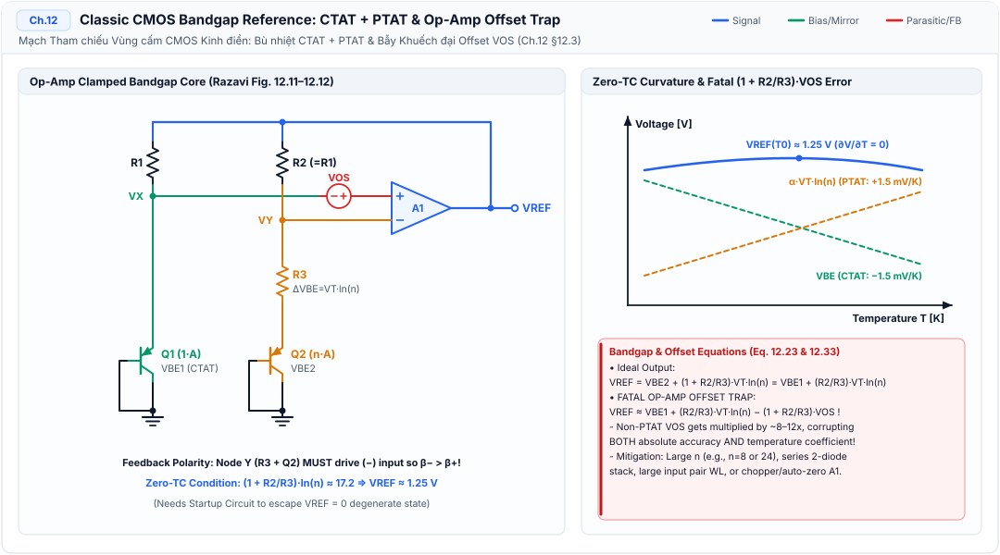

---
{
  "id": "tech-bandgap-curvature-compensation-and-speed",
  "kind": "technique",
  "domain": "references-and-biasing",
  "title_vi": "Độ cong Phi tuyến T·ln(T) của VBE, Kỹ thuật Bù cong Bandgap, Trở kháng Động Zout(s) và Lọc Nhiễu / PSRR",
  "title_en": "Nonlinear VBE Curvature Compensation, Dynamic Impedance Peaking Zout(s), Output Noise, and High-PSRR Bandgap Filtering",
  "summary": "Giải phẫu nguồn gốc vật lý số hạng phi tuyến -(4 + m - η)·VT·ln(T/T0) tạo độ cong vòm ~15–25 ppm/°C của mạch Bandgap bậc nhất, lý do sai lệch ngẫu nhiên VOS làm trôi đỉnh nhiệt độ T0 trên CMOS và các kiến trúc bù cong bậc cao (dòng phi tuyến VBE/RNL, bù từng đoạn PWL); kết hợp phân tích đỉnh cảm kháng Zout(s) khi chịu xung chuyển mạch, truyền thẳng nhiễu 1/f Op-Amp và kỹ thuật nguồn cấp cục bộ tự điều áp đạt PSRR > 90 dB.",
  "diagram": "../../diagrams/bandgap-reference-core.svg",
  "razavi_refs": [
    {
      "chapter": 12,
      "section": "12.3.1-12.3.3",
      "pages": "513-523",
      "equations": ["12.8", "12.9", "12.13", "12.20", "12.37", "12.42", "12.45", "12.46", "12.47", "12.48", "12.49", "12.50"]
    },
    {
      "chapter": 12,
      "section": "12.6, 12.8",
      "pages": "525-529, 533-536",
      "equations": ["12.55", "12.56", "12.58", "12.59", "12.60", "12.61", "12.62", "12.65", "12.76"]
    }
  ],
  "glossary_codes": [
    "T011",
    "T067",
    "T527",
    "T1067",
    "T1155",
    "T1515",
    "T2031",
    "T2034",
    "T2039",
    "T2067",
    "T2068",
    "T2070",
    "T2071",
    "T2072",
    "T2084",
    "T2087",
    "T2092",
    "T2093",
    "T2102",
    "T2118",
    "T2126",
    "T2134"
  ],
  "process_agnostic": true,
  "roles": {
    "bjt_nonlinear_vbe_engine": "Tiếp giáp gốc–phát BJT pnp đế mang đồng thời thành phần giảm tuyến tính theo nhiệt độ và số hạng cong lõm -(4 + m - η)·VT·ln(T/T0) xuất phát từ độ linh động hạt tải và mật độ trạng thái.",
    "curvature_correction_branch": "Nhánh bơm dòng bù phi tuyến (như dòng CTAT phụ I_NL = VBE / R_NL hoặc mảng dòng phân đoạn nhiệt PWL) kết hợp mạch hiệu chỉnh số (trimming) khử vòm cong bậc hai xuống mức < 5 ppm/°C.",
    "dynamic_output_impedance_loop": "Vòng hồi tiếp Op-Amp + gương dòng PMOS nén trở kháng ra ở DC nhưng sinh zero tại cực trội ω0 làm |Zout(jω)| leo dốc cảm kháng lên tới Rout/sqrt(2) ở tần số cao.",
    "local_regulated_supply_and_rc_filter": "Bộ tạo nguồn cấp cục bộ VDDL (Brooks–Westwick §12.8) và mắt lọc thông thấp thụ động R_filt·C_filt kèm bộ đệm cách ly hoàn toàn lõi tham chiếu khỏi nhiễu nguồn cấp và xung giật tải C-DAC/VCO."
  },
  "symptoms_addressed": [
    "first-order-bandgap-bow-error-exceeding-3mv-across-automotive-temp-range",
    "sample-to-sample-zero-tc-peak-scatter-ruining-untrimmed-curvature-correction",
    "slow-bandgap-recovery-tail-under-periodic-adc-or-switched-capacitor-kickback",
    "bandgap-1f-and-thermal-noise-degrading-high-resolution-adc-snr-or-vco-phase-noise",
    "psrr-collapse-above-10khz-letting-switching-regulator-ripple-into-vref"
  ],
  "limitations": [
    "curvature-compensation-is-futile-unless-opamp-offset-is-trimmed-or-chopped-first",
    "passive-low-pass-noise-filter-cannot-remove-ultra-low-frequency-0p1hz-to-10hz-1f-noise",
    "medium-sized-bypass-capacitor-on-internal-gate-node-causes-ringing-or-sluggish-recovery",
    "local-supply-preregulator-consumes-additional-voltage-headroom-from-global-vdd"
  ],
  "checklists": [
    "common-mos",
    "bandgap-and-bias",
    "feedback-and-stb",
    "layout-and-matching"
  ]
}
---

## 1. Bản chất Nguyên lý, Sơ đồ Mạch & Vai trò Từng Nhánh Cấu trúc

Trong mạch tham chiếu vùng cấm bậc nhất chuẩn (`topo-bandgap-reference-core`), ta cộng điện áp $V_{BE}$ có hệ số nhiệt âm ($\approx -1.5\text{ mV/K}$) với điện áp PTAT $\alpha_2 V_T \ln n$ có hệ số nhiệt dương hoàn toàn tuyến tính theo $T$ để triệt tiêu đạo hàm bậc nhất $\left.\frac{\partial V_{REF}}{\partial T}\right|_{T=T_0} = 0$ tại một nhiệt độ danh định duy nhất $T_0$ (thường chọn $T_0 = 300\text{ K}$). Tuy nhiên, bản thân $V_{BE}(T)$ **không phải là một đường thẳng theo nhiệt độ**! Sự phụ thuộc lũy thừa vào nhiệt độ của dòng bão hòa ngược $I_S(T) = b\,T^{4+m}\exp\!\left(-\frac{E_g}{k T}\right)$ tạo ra một số hạng phi tuyến dạng **$T\ln T$**, làm đặc tuyến $V_{REF}(T)$ uốn cong thành hình vòm úp ngược (**`Curvature`**, Razavi §12.3.3 Hình 12.16, trang 522): đạt cực đại tại $T_0$, nhưng rơi xuống ở cả đầu lạnh $-40\,^\circ\text{C}$ lẫn đầu nóng $+125\,^\circ\text{C}$!

Đồng thời, khi đưa mạch Bandgap rời phòng thí nghiệm DC tĩnh vào một hệ thống SoC thực tế (nuôi bộ chuyển đổi SAR/Pipeline ADC tốc độ cao hoặc bộ tổng hợp tần số RF PLL), ba bài toán động học lập tức quyết định sự sống còn của toàn chip (§12.6 & §12.8, trang 525–536): **tốc độ hồi phục trước xung giật quá độ (`Speed/Transient Recovery`)**, **mật độ phổ nhiễu ngõ ra (`Output Noise`)**, và **độ khử nhiễu nguồn cấp ở tần số cao (`High-Frequency PSRR`)**.



Kiến trúc một hệ thống tham chiếu chính xác cao hoàn chỉnh xử lý 4 chiều vật lý này thông qua **4 lớp cơ chế**:
1. **Giải phẫu Độ cong Nhiệt Nội tại & Điều kiện Tiên quyết Khử Offset (§12.3.3, Hình 12.16–12.17)**: Định lượng chính xác biên độ cong $\Delta V_{\text{bow}} \approx 2.5 \dots 4\text{ mV}$ trên dải $-40 \dots +125\,^\circ\text{C}$ và chứng minh cảnh báo kinh điển của Razavi: trên CMOS, sai lệch ngưỡng ngẫu nhiên tạo $V_{OS}$ làm đỉnh $T_0$ nhảy loạn xạ từ mẫu chip này sang mẫu chip khác (Hình 12.17) — nên **bắt buộc phải khử/chỉnh $V_{OS}$ trước khi thực hiện bù cong**!
2. **Các Mạng Bù Độ Cong Bậc Cao (`Curvature Correction`, `T2071`)**: Tạo một thành phần dòng/áp phi tuyến có đạo hàm bậc hai ngược dấu ($+\frac{\partial^2 V_{\text{corr}}}{\partial T^2} > 0$) như kỹ thuật cộng dòng tỉ lệ $V_{BE}/R_{NL}$ (Malcovati), kỹ thuật nhân dòng PTAT bậc hai, hoặc bù dòng từng đoạn nhiệt độ (`Piecewise-Linear — PWL`) để ép hệ số nhiệt hộp (`Box TC`) từ $20\text{ ppm/}^\circ\text{C}$ xuống dưới $3 \dots 5\text{ ppm/}^\circ\text{C}$.
3. **Động học Trở kháng Ra $Z_{out}(s)$ & Chiến lược Tụ Lọc Quá độ $C_B$ (§12.6, Hình 12.23–12.27)**: Mô hình hóa hiệu ứng tự cảm tương đương của vòng hồi tiếp Bandgap và giải quyết nghịch lý chọn tụ nối tắt $C_B$ (`T1155` / `T2092`) khi có xuyên nhiễu xung nhịp từ tải.
4. **Kiến trúc Nén Nhiễu $1/f$ + Nhiệt & Điều áp Nguồn Cục bộ (`Local Supply Regulation`, §12.6 Hình 12.28–12.30 & §12.8 Hình 12.36–12.41)**: Ghép bộ tiền ổn áp nguồn cục bộ $V_{DDL}$ tự nuôi từ chính lõi tham chiếu, bộ lọc RC thụ động tần số cực thấp và bộ đệm khử lệch để đạt PSRR $> 90\text{ dB}$ và nhiễu tích phân mức microvolt.

---

## 2. Hệ Phương trình Cốt lõi & Tư duy "Nhìn Mạch Đọc Nhanh" (Analysis by Inspection)

### 2.1. Đạo xuất Chính xác Số hạng Độ cong $T\ln(T/T_0)$ và Giá trị Tiệm cận $0\text{ K}$ (§12.3.1–12.3.3, PT 12.8–12.13, 12.45–12.50)
Từ phương trình vật lý của transistor lưỡng cực $I_C = I_S \exp(V_{BE}/V_T)$ với $I_S(T) = b\,T^{4+m}\exp\!\left(-\frac{E_g}{k T}\right)$ (trong đó $m \approx -3/2$ là số mũ nhiệt của độ linh động `T2068`, nên $4 + m \approx 2.5$, PT 12.8–12.9, 12.50), giả sử dòng cực góp nuôi BJT biến thiên theo luật lũy thừa tổng quát $I_C(T) = I_C(T_0)\left(\frac{T}{T_0}\right)^\eta$ (với $\eta = 1$ nếu nuôi bằng dòng PTAT chuẩn trong Hình 12.9/12.20, hoặc $\eta = 0$ nếu nuôi bằng dòng hằng định như Ví dụ 12.6). Viết $V_{BE}(T) = V_T \ln(I_C / I_S)$ tại nhiệt độ bất kỳ $T$ và đối chiếu với $T_0$, ta thu được biểu thức tường minh chính xác tuyệt đối của $V_{BE}(T)$:

$$V_{BE}(T) = \frac{E_g}{q} - \left[\frac{E_g}{q} - V_{BE}(T_0)\right]\frac{T}{T_0} - (4 + m - \eta)\,\frac{k T}{q}\,\ln\!\left(\frac{T}{T_0}\right)$$

- **Kiểm tra giới hạn vật lý Ví dụ 12.6 (PT 12.48–12.50)**: Khi $T \to 0\text{ K}$, cả hai số hạng sau đều tiến về $0$ (vì $\lim_{T\to 0} T\ln T = 0$), nên $V_{BE}(0\text{ K}) \to \frac{E_g}{q} \approx 1.16 \dots 1.205\text{ V}$ — chính là điện áp vùng cấm của Silic (`T2067`)! Và tại điểm đạo hàm bậc nhất bằng không ($\left.\frac{\partial V_{REF}}{\partial T}\right|_{T_0} = 0$ với $V_{REF} = V_{BE} + K_{\text{PTAT}} V_T$), điện áp chuẩn cần thiết là (PT 12.48 cho $\eta = 0$, hoặc tổng quát với $\eta$):
  $$V_{REF}(T_0) = \frac{E_g}{q} + (4 + m - \eta)\,V_T(T_0)$$
  Thay $E_g/q \approx 1.17\text{ V}$, $4 + m = 2.5$, $\eta = 1$ (dòng cực góp PTAT!), $V_T(300\text{ K}) = 25.85\text{ mV}$, ta có $V_{REF}(300\text{ K}) \approx 1.17 + 1.5 \times 0.02585 \approx 1.209 \dots 1.25\text{ V}$ (và nhận thấy ngay: **nuôi BJT bằng dòng PTAT $\eta = 1$ tự động giảm hệ số độ cong từ $(4+m)=2.5$ xuống còn $(3+m)=1.5$ so với nuôi bằng dòng hằng định $\eta = 0$**!).
- **Định lượng sai số vòm cong bậc hai (`Bow Error`)**: Khi phần tuyến tính theo $T$ đã được bù khít tại $T_0$ bằng nhánh PTAT $K_{\text{PTAT}} V_T = \left[\frac{E_g}{q} - V_{BE}(T_0) + (4+m-\eta)V_T(T_0)\right]\frac{T}{T_0}$, phần dư phụ thuộc nhiệt độ còn sót lại trên $V_{REF}(T)$ là:
  $$\Delta V_{REF,\text{curv}}(T) = V_{REF}(T) - V_{REF}(T_0) = -(4 + m - \eta)\,V_T(T_0)\left[\frac{T}{T_0}\ln\!\left(\frac{T}{T_0}\right) - \left(\frac{T}{T_0} - 1\right)\right] \approx -\frac{4 + m - \eta}{2}\,\frac{V_T(T_0)}{T_0^2}\,(T - T_0)^2$$
  Tính số chính xác với $4 + m - \eta = 1.5$, $T_0 = 300\text{ K}$ ($27\,^\circ\text{C}$) tại biên nóng $T = 398\text{ K}$ ($+125\,^\circ\text{C}$, $T/T_0 = 1.3267$): $\Delta V_{REF,\text{curv}} \approx -1.5 \times 25.85\text{ mV} \times [1.3267\ln(1.3267) - 0.3267] \approx -1.87\text{ mV}$, và tại biên lạnh $-40\,^\circ\text{C}$ ($T = 233\text{ K}$, $T/T_0 = 0.7767$) sụt khoảng $-1.05\text{ mV}$ (hoặc nếu chỉnh đỉnh $T_0 \approx 311\text{ K}$ nằm giữa dải để cân bằng hai biên thì mỗi đầu sụt $\approx -1.43\text{ mV}$; riêng khi nuôi bằng dòng không đổi $\eta = 0 \implies 4+m = 2.5$ thì độ sụt ở $+125\,^\circ\text{C}$ vọt lên $-3.12\text{ mV}$!). Quy ra hệ số nhiệt hộp trên dải rộng $\Delta T = 165\text{ K}$:
  $$\text{TC}_{\text{box,1st-order}} = \frac{V_{REF,\max} - V_{REF,\min}}{V_{REF}(T_0)\cdot \Delta T} \approx \frac{1.87\text{ mV}}{1.21\text{ V} \times 165\,^\circ\text{C}} \approx 9.4 \dots 20\text{ ppm/}^\circ\text{C}$$
  Đây là **bức tường vật lý cứng** của mọi mạch Bandgap bậc nhất dù tinh chỉnh điện trở chính xác đến đâu!

### 2.2. Nguyên lý Bù Độ Cong (`Curvature Compensation`) trên CMOS sau khi Hiệu chỉnh Offset
Từ phương trình $\Delta V_{REF,\text{curv}}(T)$ ở trên, có ba kiến trúc chuẩn công nghiệp để triệt số hạng $T\ln(T/T_0)$:
1. **Hiệu số hai dòng cực góp có số mũ nhiệt khác nhau ($\Delta \eta = 1$, Malcovati / Sub-1V Curvature Correction)**:
   Đặt hai BJT $Q_A$ và $Q_B$: $Q_A$ được phân cực bởi dòng **PTAT** ($\eta_A = 1 \implies \text{hệ số cong } 3+m$), còn $Q_B$ được phân cực bởi dòng **độc lập nhiệt độ Zero-TC** ($\eta_B = 0 \implies \text{hệ số cong } 4+m$, lấy từ tổng dòng PTAT + CTAT trên điện trở!). Hiệu điện áp $V_{BE,B}(T) - V_{BE,A}(T)$ tạo ra chính xác số hạng cô lập $+\frac{k T}{q}\ln\!\left(\frac{T}{T_0}\right)$, đem nhân tỉ số điện trở cộng bù vào $V_{REF}$ sẽ khử sạch hoàn toàn $T\ln(T/T_0)$ xuống còn $< 3\text{ ppm/}^\circ\text{C}$!
2. **Bù Từng đoạn Nhiệt độ (`Piecewise-Linear — PWL Curvature Correction`)**:
   Dùng hai bộ so sánh dòng nhiệt đơn giản chỉ bật dẫn ở vùng nóng ($T > 65\,^\circ\text{C}$, nơi $I_{\text{PTAT}} > \alpha_H I_{\text{CTAT}}$) và vùng lạnh ($T < -5\,^\circ\text{C}$, nơi $I_{\text{CTAT}} > \alpha_L I_{\text{PTAT}}$) để bơm thêm hai dòng bù nhỏ nâng hai cánh của parabol lên, gập đường cong bậc hai thành chữ `W` nông có biên độ dao động giảm $4\times \dots 6\times$.

### 2.3. Đỉnh Trở kháng Động $Z_{out}(s)$, Truyền Nhiễu $1/f$ và Điều áp Cục bộ (§12.6 & §12.8, PT 12.55–12.65)
1. **Hiện tượng "Tự cảm hóa" trở kháng đường phân cực Bandgap (Ví dụ 12.7, PT 12.58–12.62)**:
   Xét nút cổng gương dòng PMOS $P$ (hoặc ngõ ra hồi tiếp) trong Hình 12.26 với Op-Amp một cực $A(s) = \frac{A_0}{1 + s/\omega_0}$ và trở kháng ra vòng hở $R_{out}$:
   $$Z_{out}(s) = \frac{R_{out}}{1 + g_{mP} R_1 A(s)} = \frac{R_{out}}{1 + g_{mP} R_1 A_0}\,\frac{1 + s/\omega_0}{1 + \dfrac{s}{(1 + g_{mP} R_1 A_0)\omega_0}}$$
   Ở DC, $Z_{out}(0)$ rất thấp; nhưng ngay trên cực trội $\omega_0$ của Op-Amp, tử số $(1 + s/\omega_0)$ khiến $|Z_{out}(j\omega)|$ tăng vọt $+20\text{ dB/dec}$ và đạt tới **$R_{out}/\sqrt{2}$** tại tần số cắt vòng $(1 + g_{mP} R_1 A_0)\omega_0$ (PT 12.62)! Do đó đối với các sườn xung nhịp nhanh giật qua tụ ký sinh $C_{GD}$ của các mảng nguồn dòng ADC/DAC (Hình 12.23), vòng hồi tiếp của Bandgap gần như **hở mạch** ở tần số cao!
2. **Phương trình Nhiễu Tổng hợp Ngõ ra & Nhân Nhiễu Gương dòng (§12.6, Hình 12.28–12.30, PT 12.65)**:
   Trên mạch Bandgap chuẩn Kuijk Hình 12.9 (xét khi $1/g_{m,Q} \ll R_1, R_2, R_3$), mật độ phổ điện áp nhiễu tổng tại ngõ ra $V_{REF}$ xấp xỉ:
   $$\overline{V_{n,\text{REF}}^2}(f) \approx \left(1 + \frac{R_2}{R_3}\right)^2 \left[\overline{V_{n,\text{op}}^2}(f) + 4 k T \left(\frac{1}{2 g_{m,Q1}} + \frac{1}{2 g_{m,Q2}}\right)\right] + 4 k T R_3 \left(\frac{R_2}{R_3}\right)^2 + 4 k T R_2$$
   Với $(1 + R_2/R_3) \approx 8 \dots 10$, **nhiễu nhấp nháy $1/f$ và nhiễu nhiệt của Op-Amp bị khuếch đại bình phương lên $64 \dots 100$ lần về mặt công suất**! Nguy hiểm hơn, nếu dùng nhánh dòng từ lõi Bandgap nhân gương dòng hệ số $N$ nuôi tải tầng khuếch đại (Hình 12.28), dòng nhiễu bị nhân lên $N$ lần ($N^2$ về công suất!).
3. **Nguồn cấp Cục bộ Tự điều áp (`Local Regulated Supply`, §12.8 Hình 12.39–12.41)**:
   Thay vì để lõi Bandgap phơi trực tiếp dưới nguồn toàn cục $V_{DD}$ ồn ào (PSRR sụp đổ ở tần số cao khi $A(s)$ giảm), thiết kế Brooks & Westwick trích chính điện áp chuẩn nội bộ lái một vòng ổn áp phụ tạo **nguồn cấp cục bộ sạch $V_{DDL}$** cấp ngược lại cho toàn bộ lõi BJT và Op-Amp chính — cộng hưởng PSRR của hai tầng nối tiếp đạt **$94\text{ dB}$ ở tần số thấp** và giữ $> 60\text{ dB}$ tới hàng trăm kilohertz!

---

## 3. Bất biến Cấu trúc & Các Bẫy Lỗi Kinh điển (Structural Invariants & Traps)

- **[INV-BGRC-01] Bất biến Trình tự Bắt buộc: "Khử / Hiệu chỉnh Offset Trước — Bù Độ Cong Sau" (Hình 12.17)**:
  Nếu Op-Amp còn điện áp lệch ngẫu nhiên $V_{OS} = \pm 3\text{ mV}$, thành phần $-(1 + R_2/R_3) V_{OS}(T)$ làm dịch chuyển đỉnh nhiệt độ hệ số nhiệt bằng không $T_0$ đi hàng chục độ C giữa các con chip trên cùng một wafer (`T2072`, Hình 12.17)! Nếu lắp thêm mạch bù cong cố định vào một lõi chưa khử $V_{OS}$, mạch bù cong sẽ bơm dòng sai pha với đỉnh thực tế, thậm chí làm **tăng độ trôi nhiệt ở biên góc Monte Carlo**! Bắt buộc phải dùng điều biến băm (`tech-chopper-stabilization-vs-autozeroing`) hoặc hiệu chỉnh số nhiệt độ phòng (`room-temp digital trim`, `T2118`) để chốt chặt $V_{REF}(T_0)$ về đúng điện áp ma thuật $V_{G0} + (4+m-\eta)V_T(T_0)$ trước khi kích hoạt nhánh bù cong!
- **[INV-BGRC-02] Bất biến Phân cực Lưỡng vùng cho Tụ Nối Tắt Đường Tham chiếu ($C_B \to 0$ HOẶC $C_B \to \text{Rất lớn}$)**:
  Theo Hình 12.24 của Razavi, khi nút phân cực $P$ chịu xuyên nhiễu xung quá độ qua điện dung ký sinh $C_c$:
  - Hoặc giữ nút $P$ **thật nhẹ ($C_B = 0$)** và thiết kế Op-Amp 1 tầng băng thông rộng để vòng hồi tiếp dập tắt nhiễu quay về xác lập chỉ trong vài nanogiây (kịp trước thời điểm lấy mẫu cuối chu kỳ của ADC!);
  - Hoặc đặt **$C_B$ cực lớn** ($C_B \ge 500 \dots 1000\,C_c$, hàng trăm $\text{pF}$ kèm kiểm tra ổn định cực trội tại nút $P$) để biên độ bước nhảy tức thời $\Delta V_P = \Delta V_{\text{clk}} \frac{C_c}{C_B + C_c} < 0.2\text{ mV}$ ngay từ đầu!
- **[TRAP-BGRC-01] Bẫy Tụ $C_B$ "Lỡ cỡ" Gây Phá Hỏng Tốc độ Xác lập Hoặc Kéo Sập Dự trữ Pha (Hình 12.24)**:
  Chọn $C_B \approx 5 \dots 20\text{ pF}$ là vùng chết tệ hại nhất: tụ không đủ to để ghìm bước nhảy điện tích tức thời $\Delta Q / C_B$, nhưng lại đủ nặng để bóp nghẹt băng thông vòng hồi tiếp của Op-Amp đi hàng chục lần, khiến điện áp chuẩn bị sụt hàng milivôn rồi nằm lì hàng microgiây không hồi phục kịp giữa các chu kỳ chuyển đổi liên tiếp (và gây dao động tự kích nếu $A_1$ là Op-Amp 2 tầng bù Miller nội!).
- **[TRAP-BGRC-02] Bẫy Lọc Thông thấp RC Ở Ngõ Ra Bandgap Không Khử Được Nhiễu $1/f$ Cận DC**:
  Gắn mắt lọc thụ động $R_{\text{filt}} = 500\text{ k}\Omega$, $C_{\text{filt}} = 200\text{ pF}$ ở ngõ ra $V_{REF}$ tạo tần số cắt $f_{-3\text{dB}} = \frac{1}{2\pi R_{\text{filt}} C_{\text{filt}}} \approx 1.6\text{ kHz}$ rất hiệu quả để dập sạch nhiễu nhiệt băng rộng phía trên $10\text{ kHz}$, **nhưng hoàn toàn vô tác dụng trước nhiễu nhấp nháy $1/f$ từ $0.1\text{ Hz}$ đến $1\text{ kHz}$**! Để triệt nhiễu $1/f$ cho ADC $\ge 16\text{ bit}$ hoặc bộ tổng hợp tần số nhiễu pha cực thấp, bắt buộc phải tăng diện tích $W L$ cặp đầu vào PMOS của Op-Amp hoặc băm điều biến (`Chopper`) ngay trong lõi Bandgap rồi mới đặt mắt lọc $R_{\text{filt}} C_{\text{filt}}$ ở phía sau để lọc sạch đồng thời cả gợn sóng băm lẫn nhiễu nhiệt!

---

## 4. Lộ trình Nâng cấp Cấu trúc & Bát giác Đánh đổi (Upgrade Paths & Design Octagon)

Trong `concept-analog-design-octagon`, việc hoàn thiện độ cong, nhiễu và PSRR của mạch Bandgap là bài toán tối ưu hóa đồng thời 4 trục **Độ chính xác Nhiệt (`TC`)**, **Nhiễu thấp (`Noise`)**, **Khử nguồn cấp (`PSRR`)** và **Diện tích / Dự trữ áp (`Area / Headroom`)**:
- **Khởi điểm từ**: `law-ctat-ptat-temperature-cancellation` và `topo-bandgap-reference-core` (hoặc `topo-low-voltage-sub1v-bandgap` khi $V_{DD} \le 1.0\text{ V}$).
- **Lộ trình nâng cấp theo cấp độ yêu cầu hệ thống**:
  1. **Chuẩn đa dụng ($\pm 1.5\%$ độ chính xác, $\text{TC} \approx 25\text{ ppm/}^\circ\text{C}$)**: Bandgap bậc nhất + Op-Amp cặp đầu vào diện tích lớn + hiệu chỉnh điện trở 4-bit tại $27\,^\circ\text{C}$.
  2. **Chuẩn công nghiệp / Ô tô chính xác cao ($\pm 0.2\%$, $\text{TC} < 5\text{ ppm/}^\circ\text{C}$, nhiễu $< 10\,\mu\text{V}_{\text{rms}}$)**: Lõi Bandgap tích hợp **Chopper Stabilization** (`tech-chopper-stabilization-vs-autozeroing` triệt hoàn toàn $V_{OS}$ và nhiễu $1/f$) + **Nhánh bù độ cong bậc hai** + mắt lọc RC thông thấp chặn gợn băm.
  3. **Chuẩn cấp tải động tốc độ cao (nuôi C-DAC của `topo-sar-adc-charge-redistribution-architecture` hoặc VCO/PLL)**: Đặt bộ ổn áp tuyến tính sụt áp thấp `topo-cmos-ldo-regulator` tạo nguồn cấp cục bộ sạch cho lõi Bandgap VÀ dùng bộ đệm tham chiếu băng thông rộng (hoặc tụ khử nhiễu lớn trên chip) tách hoàn toàn dòng xung chuyển mạch khỏi lõi BJT!

| Cấu hình Tham chiếu Vùng cấm | Hệ số Nhiệt Điển hình (`-40..125 °C`) | Nhiễu Tích phân (`0.1 Hz .. 100 kHz`) | PSRR tại `100 kHz` | Chi phí Diện tích & Hiệu chỉnh |
| :--- | :--- | :--- | :--- | :--- |
| **Bandgap Bậc nhất Chưa Trim** | $30 \dots 80\text{ ppm/}^\circ\text{C}$ (do $V_{OS}$) | $80 \dots 250\,\mu\text{V}_{\text{rms}}$ | $25 \dots 40\text{ dB}$ | Thấp nhất; không tốn OTP/fuse |
| **Bandgap Bậc nhất + Trim 1 Điểm ($27\,^\circ\text{C}$)** | $15 \dots 25\text{ ppm/}^\circ\text{C}$ (giới hạn $T\ln T$) | $50 \dots 150\,\mu\text{V}_{\text{rms}}$ | $30 \dots 45\text{ dB}$ | Trung bình; cần 4–6 bit trim mạng $R$ |
| **Chopped + Curvature-Compensated + Local LDO** | **$2 \dots 6\text{ ppm/}^\circ\text{C}$** | **$< 5 \dots 15\,\mu\text{V}_{\text{rms}}$** (sau lọc RC) | **$> 70 \dots 85\text{ dB}$** | Cao (cần xung băm, lọc RC & tiền ổn áp) |

---

## 5. Thích ứng Đa Tiến trình (90nm / 65nm / 45nm) & Cách Kiểm chứng trong Cadence / Spectre

### 5.1. Thiết kế Mạng Hiệu chỉnh Số (`Binary-Weighted Trim DAC`) và Lọc RC trên 90nm / 65nm / 45nm
1. **Cách đặt công tắc Trim không làm hỏng hệ số nhiệt (`Zero-Ron-Sensitivity Trimming`)**:
   Khi hiệu chỉnh điện trở nhân PTAT $R_2$ để đưa $V_{REF}(27\,^\circ\text{C})$ về đúng đỉnh zero-TC, tuyệt đối **không mắc công tắc MOSFET nối tiếp trực tiếp trên nhánh mang dòng chính** (vì $R_{on}$ của MOSFET có hệ số nhiệt lớn gấp $5\times$ điện trở poly, sẽ phá hỏng độ bù nhiệt!). Thay vào đó, chia đoạn cuối của $R_2$ thành chuỗi các mắt điện trở nhỏ $\Delta R$ và dùng công tắc MOSFET nối tắt song song, hoặc tốt hơn nữa là tap vào thang chia điện trở nối vào ngõ vào Op-Amp trở kháng vô cùng (dòng DC qua công tắc bằng $0\text{ A}$!).
2. **Tận dụng Linh kiện I/O `1.8V / 2.5V` cho Nguồn Cục bộ & Lọc RC Diện tích Nhỏ**:
   Trên chip hỗn hợp `65nm` / `45nm`, luôn có đường nguồn I/O $1.8\text{ V}$ hoặc $2.5\text{ V}$ bên cạnh nguồn lõi $1.0\text{ V}$. Dùng MOSFET I/O dày oxit làm bộ tiền ổn áp tạo nguồn cục bộ $V_{DDL} \approx 1.45\text{ V}$ nuôi lõi Bandgap chuẩn $1.21\text{ V}$ vừa cho PSRR $> 80\text{ dB}$, vừa triệt sạch dòng rò cực cổng trên tụ lọc thông thấp MOS lớn $C_{\text{filt}}$ ở ngõ ra!

### 5.2. Phác đồ Kiểm chứng Độ Cong, Nhiễu, PSRR & Hồi phục Xung Tải trong Spectre
```spice
// Phac do 4 phep do chuyen sau cho Bandgap chinh xac cao (Razavi §12.3.3, §12.6, §12.8):
// 1. Do Box-TC tren Monte Carlo 200 mau (co mo phong buoc Trim tai 27C):
//    TC_ppm = (ymax(V(vref)) - ymin(V(vref))) / (value(V(vref) 27) * 165) * 1e6
dc_curv dc param=temp start=-40 stop=125 step=2

// 2. Quet tro khang ngo ra Zout(f) tu 1 Hz -> 1 GHz bang nguon dong thu AC 1A tai ngo ra VREF:
//    Kiem tra dinh cam khang |Zout| va dam bao khong co peaking rung chuong nguy hiem voi C_bypass!
ac_zout ac start=1 stop=1G dec=40

// 3. Kiem tra PSRR bang phan tich XF (Transfer Function tu ngo ra VREF quay ve VDD va VSS):
xf_psrr xf (vref 0) start=1 stop=100M dec=30

// 4. Tich phan nhieu ngõ ra (0.1 Hz -> 10 MHz) va xung tai qua do (Load/Kickback Step):
noise_vref noise (vref 0) iprobe=V_dummy start=0.1 stop=10M dec=30
tran_kick tran stop=50u errpreset=conservative
```

---

## 6. Mốc Đối chiếu Sách Razavi & Thuật ngữ Chuẩn CLB

- **Sách gốc Razavi (2nd Ed.)**: Chương 12 (*Bandgap References*):
  - **§12.3.1–12.3.3** (trang 513–523, Hình `12.15`–`12.17`, PT `12.8`–`12.13`, `12.45`–`12.50`, Ví dụ `12.5`–`12.6`): Đạo xuất phương trình nhiệt của $V_{BE}$, giới hạn $V_{REF} \to E_g/q$ khi $T \to 0\text{ K}$, nguồn gốc độ cong đặc tính nhiệt và sự phân tán nhiệt độ zero-TC giữa các mẫu chip CMOS do $V_{OS}$.
  - **§12.6** (*Speed and Noise Issues*, trang 525–529, Hình `12.23`–`12.30`, PT `12.55`–`12.65`, Ví dụ `12.7`): Xuyên nhiễu quá độ trên đường phân phối tham chiếu, nghịch lý chọn tụ nối tắt $C_B$, đỉnh tần số cao của $|Z_{out}(j\omega)| = R_{out}/\sqrt{2}$ và cơ chế truyền thẳng nhiễu $V_{n,\text{op}}$ lên ngõ ra.
  - **§12.8** (*Case Study*, trang 533–536, Hình `12.36`–`12.41`, PT `12.76`): Nghiên cứu thiết kế nguồn tham chiếu chính xác cao Brooks & Westwick dùng chồng $2 V_{BE}$, cascode tự phân cực và nguồn cấp cục bộ $V_{DDL}$ đạt PSRR $94\text{ dB}$.
- **Đối chiếu Thuật ngữ Chuẩn CLB (`terms-vi-en.json`)**:
  - `T2067` / `T2068`: `bandgap voltage` / `temperature exponent of mobility` — **điện áp vùng cấm tương đương** / **số mũ phụ thuộc nhiệt độ của độ linh động**.
  - `T2071` / `T2072` / `T2118`: `Curvature Correction` / `zero-TC temperature` / `trimming` — **hiệu chỉnh độ cong đặc tính nhiệt** / **nhiệt độ tại đó hệ số nhiệt bằng không** / **hiệu chỉnh tinh sau chế tạo**.
  - `T2084` / `T2092` / `T2093`: `Speed and Noise Issues` / `Very Large CB` / `small-signal output impedance` — **những vấn đề về tốc độ và nhiễu** / **tụ $C_B$ rất lớn** / **trở kháng ngõ ra tín hiệu nhỏ**.
  - `T2102` / `T2126` / `T2134`: `low-frequency 1/f noise` / `local supply` / `output thermal noise` — **nhiễu $1/f$ tần số thấp** / **nguồn cấp cục bộ** / **nhiễu nhiệt ngõ ra**.
