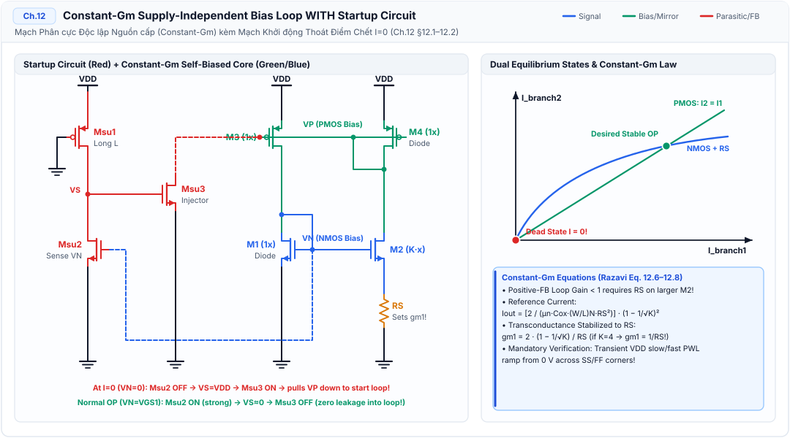

---
{
  "id": "tech-ptat-current-and-constant-gm",
  "kind": "technique",
  "domain": "references-and-biasing",
  "title_vi": "Tạo dòng phân cực PTAT và phân cực giữ hỗ dẫn không đổi (PTAT Current & Constant-Gm Biasing)",
  "title_en": "PTAT Current Generation and Constant-Gm Biasing",
  "summary": "Kỹ thuật định hình quy luật nhiệt và tiến trình cho dòng phân cực vi mạch: dùng dòng PTAT I = VT·ln(n)/R1 để bù suy giảm độ linh động trong bộ khuếch đại, hoặc dùng vòng Constant-Gm gm = (2/RS)(1 - 1/sqrt(K)) kết hợp điện trở tụ chuyển mạch và hiệu chỉnh số để ghim chặt băng thông, độ lợi và nhiễu trên mọi góc PVT.",
  "diagram": "../../diagrams/supply-independent-bias-startup.svg",
  "razavi_refs": [
    {
      "chapter": 12,
      "section": "12.4-12.5",
      "pages": "523-525",
      "equations": ["12.51", "12.52", "12.53", "12.54"]
    }
  ],
  "glossary_codes": [
    "T012",
    "T069",
    "T087",
    "T091",
    "T2012",
    "T2013",
    "T2074",
    "T2075",
    "T2076",
    "T2078",
    "T2079",
    "T2080",
    "T2081",
    "T2083",
    "T2085",
    "T2118",
    "T2131"
  ],
  "process_agnostic": true,
  "roles": {
    "ptat_bipolar_core": "Lõi BJT Q1 (A) và Q2 (n·A) kèm điện trở R1 dưới sự kẹp của Op-Amp (Hình 12.18) hoặc gương tự phân cực (Hình 12.19) tạo dòng tỉ lệ thuận với nhiệt độ tuyệt đối IPTAT = VT·ln(n)/R1",
    "constant_gm_loop": "Vòng tự phân cực MOSFET tỉ số 1:K với điện trở suy biến RS ép hỗ dẫn gm1 = (2/RS)·(1 - 1/sqrt(K)), tách gm khỏi độ linh động μ và điện dung cổng Cox",
    "switched_cap_resistor": "Mạng tụ chuyển mạch (CS·fCK)^(-1) kèm tụ lọc song song CB thay thế điện trở tấm RS khi có xung nhịp chính xác nhằm nâng tính tái lập (reproducibility) của gm",
    "replica_bias_bus": "Các nhánh gương dòng sao chép dòng chuẩn (thông qua phân phối dòng thay vì phân phối điện áp cổng đường dài) tới các khối OTA, bộ lọc Gm-C, VCO và ADC"
  },
  "symptoms_addressed": [
    "ota-gm-and-gbw-droop-at-high-temperature",
    "thermal-noise-and-phase-margin-shift-over-pvt",
    "gm-c-filter-cutoff-frequency-process-spread"
  ],
  "limitations": [
    "sheet-resistor-process-spread-plus-minus-20-percent",
    "resistor-temperature-coefficient-distorts-ideal-ptat-or-constant-gm",
    "switched-capacitor-resistor-injects-clock-ripple-without-cb"
  ],
  "checklists": [
    "common-mos",
    "current-mirror",
    "bandgap-and-bias",
    "layout-and-matching"
  ]
}
---

## 1. Bản chất Nguyên lý, Sơ đồ Mạch & Vai trò Từng Nhánh Cấu trúc

Một điện áp tham chiếu phẳng theo nhiệt độ ($V_{REF} \approx 1,25\text{ V}$) là chuẩn lý tưởng cho bộ chuyển đổi ADC/DAC hoặc bộ ổn áp LDO, nhưng **không phải** là nguồn phân cực tối ưu nếu đem chia cho điện trở cố định để tạo dòng không đổi ($I_D = \text{const}$) nuôi các tầng khuếch đại MOSFET! Lý do nằm ở vật lý linh kiện Chương 2 và Chương 17 (`concept-process-corners-and-temperature` / `law-short-channel-effects`): khi nhiệt độ tuyệt đối $T$ tăng, độ linh động hạt tải suy giảm mạnh theo $\mu(T) = \mu_0 (T/T_0)^m$ (với $m \approx -1,5$). Nếu giữ dòng $I_D$ không đổi, hỗ dẫn $g_m = \sqrt{2 \mu C_{ox} (W/L) I_D}$ sẽ sụt giảm theo $T^{-0,75}$ (tụt khoảng $25\%\text{–}30\%$ từ $-40\,^\circ\text{C}$ lên $+125\,^\circ\text{C}$), kéo sập đồng loạt băng thông $\text{GBW} = g_m / C_L$, độ lợi vòng hở và làm tăng nhiễu nhiệt $4 k T \gamma / g_m$!

Vì thế, Razavi dành riêng Mục `12.4` và `12.5` cho hai chiến lược định hình dòng phân cực chủ lực trong thiết kế vi mạch tương tự:

1. **Tạo dòng tỉ lệ với nhiệt độ tuyệt đối — PTAT Current Generation (§12.4, Hình 12.18 & Hình 12.19):**
   - **Cấu trúc dùng Op-Amp (Hình 12.18):** Bộ khuếch đại thuật toán kẹp trực tiếp $V_X = V_Y$ trên hai nhánh PNP đế $Q_1$ ($A$) và $R_1 + Q_2$ ($n A$), đồng thời lái cực cổng gương dòng PMOS $M_3, M_4, M_5$ để xuất dòng $I_{PTAT} = \frac{V_T \ln n}{R_1}$. Cấu trúc này hoạt động tốt ở nguồn thấp và có khả năng khử nhiễu nguồn cấp (PSRR) rất cao.
   - **Cấu trúc không dùng Op-Amp (Hình 12.19):** Ghép trực tiếp vòng tự phân cực $M_1$–$M_4$ (Hình 12.2) chồng lên lõi lưỡng cực $Q_1$ và $R_1 + Q_2$. Cặp gương NMOS $M_1$–$M_2$ ($1:1$) và PMOS $M_3$–$M_4$ ($1:1$) tự ép $I_{D1} = I_{D2}$ và $V_X = V_Y$, tạo ra cùng dòng $I_{PTAT} = \frac{V_T \ln n}{R_1}$ với độ phức tạp gọn hơn, nhưng tốn khoảng dự trữ điện áp lớn hơn ($V_{BE} + V_{GS,N} + |V_{DS,P}|$) và PSRR kém hơn nếu không bọc cascode (`topo-bandgap-reference-core` Hình 12.36–12.37).
   - Khi bơm dòng $I_D \propto T$ vào một cặp vi sai MOSFET: ở vùng bình phương, $g_m \propto \sqrt{\mu(T) I_D(T)} \propto \sqrt{T^{-1,5} \cdot T^1} = T^{-0,25}$ (bù được hai phần ba độ sụt hỗ dẫn!); còn ở vùng **nghịch đảo yếu** ($g_m = \frac{I_D}{\zeta V_T}$), vì cả tử số $I_D$ lẫn mẫu số $V_T$ đều tỉ lệ thuận với $T$, **$g_m$ trở nên bất biến tuyệt đối theo nhiệt độ**!
2. **Phân cực giữ hỗ dẫn không đổi — Constant-$G_m$ Biasing (§12.5, Hình 12.3 & Hình 12.21):**
   - Thay vì dùng BJT, vòng tự phân cực MOSFET tỉ số $1:K$ nối tiếp điện trở $R_S$ (`tech-supply-independent-bias-and-startup`) tự điều chỉnh dòng $I_{out}$ ngược chiều với $\mu_n C_{ox}$ sao cho tích $\mu_n C_{ox} I_{out} \propto 1/R_S^2$, từ đó ghim cứng hỗ dẫn $g_m$ tỉ lệ nghịch trực tiếp với $R_S$!
   - Khi hệ thống có sẵn tần số xung nhịp tinh thể thạch anh chính xác $f_{CK}$ (ví dụ trong thu phát RF, PLL hoặc bộ lọc Gm-C), Hình 12.21 thay thế $R_S$ bằng **điện trở tụ điện chuyển mạch (switched-capacitor resistor)** có điện trở trung bình tương đương $R_{eq} = \frac{1}{C_S f_{CK}}$ kèm tụ lọc gợn $C_B$, giúp $g_m \propto C_S f_{CK}$ đạt tính tái lập cực cao!

---

## 2. Hệ Phương trình Cốt lõi & Tư duy "Nhìn Mạch Đọc Nhanh" (Analysis by Inspection)

### 2.1. Phương trình Constant-$G_m$ và Định luật Đồng bộ Hỗ dẫn Toàn Chip (Phương trình 12.52–12.54)
Từ nghiệm dòng của vòng tự phân cực Hình 12.3 (`tech-supply-independent-bias-and-startup`):

$$I_{out} = \frac{2}{\mu_n C_{ox} (W/L)_N} \cdot \frac{1}{R_S^2} \left(1 - \frac{1}{\sqrt{K}}\right)^2$$

Thế trực tiếp $I_{D1} = I_{out}$ vào công thức hỗ dẫn của $M_1$:

$$g_{m1} = \sqrt{2 \mu_n C_{ox} \left(\frac{W}{L}\right)_N I_{D1}} = \frac{2}{R_S} \left(1 - \frac{1}{\sqrt{K}}\right)$$

Và bất kỳ transistor NMOS $M_k$ nào trên toàn vi mạch được sao chép dòng từ nhánh chuẩn với tỉ số dòng $I_{Dk} / I_{D1} = \alpha_I$ và tỉ số kích thước $(W/L)_k / (W/L)_N = \alpha_W$ đều có hỗ dẫn **chỉ phụ thuộc vào tỉ số hình học và $R_S$**:

$$g_{mk} = \sqrt{\alpha_W \alpha_I} \cdot g_{m1} = \sqrt{\alpha_W \alpha_I} \cdot \frac{2}{R_S} \left(1 - \frac{1}{\sqrt{K}}\right)$$

- **Hệ quả vàng cho bù tần số Op-Amp 2 tầng (`tech-miller-rhp-zero-nulling-and-cascode-comp`):**
  Điện trở triệt tiêu RHP zero $R_z$ mắc nối tiếp tụ bù Miller $C_c$ yêu cầu $R_z = \frac{1}{g_{m2}}$ (hoặc $R_z = \frac{C_L + C_c}{g_{m2} C_c}$). Nếu $M_2$ được phân cực từ mạch Constant-$G_m$ dùng điện trở $R_S$ **cùng loại vật liệu tấm** với $R_z$, thì khi quy trình hoặc nhiệt độ làm $R_S$ tăng $+20\%$, hỗ dẫn $g_{m2} \propto 1/R_S$ giảm đúng tương ứng để tích không thứ nguyên **$g_{m2} R_z \propto R_z / R_S$ giữ nguyên bất biến trên mọi góc PVT**!

### 2.2. Biến thể Constant-$G_m$ bằng Điện trở Tụ chuyển mạch (Hình 12.21–12.22)
Khi thay $R_S$ bằng tụ $C_S$ chuyển mạch bởi hai pha không chồng lấn $\Phi_1, \Phi_2$ ở tần số $f_{CK}$:

$$R_{S,\text{avg}} = \frac{1}{C_S f_{CK}} \implies g_{m1} = 2 C_S f_{CK} \left(1 - \frac{1}{\sqrt{K}}\right)$$

Nếu dùng transistor này trong một bộ lọc thời gian liên tục $G_m\text{-}C$ dùng tụ tích phân $C_{int}$ cùng loại vật liệu (MIM/MOM) với $C_S$, tần số cắt của bộ lọc trở thành:

$$f_{-3\text{dB}} = \frac{g_m}{2\pi C_{int}} = \frac{f_{CK}}{\pi} \left(\frac{C_S}{C_{int}}\right) \left(1 - \frac{1}{\sqrt{K}}\right)$$

Toàn bộ dung sai tuyệt đối của cả MOSFET lẫn tụ điện tự động triệt tiêu sạch sẽ — tần số cắt khóa cứng vào tần số thạch anh $f_{CK}$ và tỉ số tụ hình học $C_S / C_{int}$!

### 2.3. Ảnh hưởng thực tế của Hệ số nhiệt Điện trở ($\text{TC}_R$) lên dòng PTAT
Trong mạch PTAT Hình 12.18/12.19, dòng thực tế là $I_{PTAT}(T) = \frac{V_T \ln n}{R_1(T)}$. Nếu $R_1(T) = R_1(T_0)[1 + \alpha_{R1}(T - T_0)]$:
$$\frac{1}{I_{PTAT}} \frac{\partial I_{PTAT}}{\partial T} = \frac{1}{T} - \alpha_{R1}$$
- Ở $T_0 = 300\text{ K}$, độ dốc chuẩn hóa lý tưởng của PTAT là $1/300\text{ K} \approx +3333\text{ ppm/K}$. Nếu dùng điện trở poly không silicide có $\alpha_{R1} \approx -1000\text{ ppm/K}$, dòng tăng nhanh hơn PTAT ($+4333\text{ ppm/K}$); nếu dùng điện trở khuếch tán `n+/p+` có $\alpha_{R1} \approx +1500\text{ ppm/K}$, độ dốc giảm còn $+1833\text{ ppm/K}$. Nếu cần một dòng có hệ số nhiệt bằng không (**zero-TC current**, `T2107`), ta ghép nối tiếp hai điện trở khác dấu hệ số nhiệt $R_1 = R_{1a} + R_{1b}$ sao cho:
  $$\frac{R_{1a}\alpha_{R1a} + R_{1b}\alpha_{R1b}}{R_{1a} + R_{1b}} = \frac{1}{T_0} \approx +3333\text{ ppm/K}$$
  Hoặc cộng dòng PTAT với dòng CTAT $V_{BE}/R_2$ như cấu trúc Banba Hình 12.32(b) (`topo-low-voltage-sub1v-bandgap`)!

### 2.4. Ví dụ Định cỡ Nhanh Constant-$G_m$ (Nhìn Mạch Tính Nhẩm)
Giả sử cần tạo $g_{m1} = 1\text{ mS}$ cho lõi phân cực chuẩn để nuôi một OTA có $\text{GBW} = 100\text{ MHz}$ trên tải $C_L = 1,6\text{ pF}$:
1. Chọn tỉ số bội số đơn vị kinh điển **$K = 4$** ($1 - 1/\sqrt{K} = 0,5$).
2. Từ phương trình (12.54): $g_{m1} = \frac{2}{R_S}(0,5) = \frac{1}{R_S} \implies$ đọc ngay **$R_S = 1\text{ k}\Omega$**!
3. Chọn điểm làm việc nghịch đảo vừa cho $M_1$ với $V_{OV1} \approx 160\text{ mV}$ ($g_{m1}/I_{D1} = 2/V_{OV1} = 12,5\text{ V}^{-1}$) $\implies$ dòng nhánh chuẩn cần thiết là $I_{out} = \frac{1}{2} g_{m1} V_{OV1} = 80\,\mu\text{A}$ (kiểm tra lại sụt áp trên $R_S$: $I_{out} R_S = 80\text{ mV} = V_{OV1}/2$, khớp tuyệt đối!).
4. Nếu dùng biến thể tụ chuyển mạch Hình 12.21 với xung nhịp thạch anh $f_{CK} = 20\text{ MHz}$ để thay thế $R_S = 1\text{ k}\Omega$:
   $$C_S = \frac{1}{R_S f_{CK}} = \frac{1}{10^3 \times 20 \times 10^6} = 50\text{ fF}, \qquad C_B \ge 25 C_S \approx 1,5\text{ pF}$$
   Chỉ tốn diện tích tụ cực nhỏ trên chip nhưng loại bỏ hoàn toàn sự biến thiên $\pm 25\%$ của điện trở tấm!

### 2.5. Bộ Chuyển đổi Điện áp sang Dòng điện Chính xác (Hình 12.22)
Kết hợp một điện áp tham chiếu vùng cấm $V_{REF}$ (`topo-bandgap-reference-core`) với Op-Amp kẹp nút nguồn MOSFET $M_1$ vào mạng tụ chuyển mạch $(C_S f_{CK})^{-1}$ kèm tụ lọc $C_B$ (Hình 12.22, trang 525), ta tạo được nguồn dòng chuẩn tuyệt đối:
$$I_{REF} = V_{REF} \cdot C_S \cdot f_{CK}$$
Biểu thức này ghép nối hoàn hảo tính bất biến nhiệt độ của Bandgap với độ chính xác tuyệt đối của tần số xung nhịp $f_{CK}$ và điện dung kim loại `MIM/MOM`!

---

## 3. Bất biến Cấu trúc & Các Bẫy Lỗi Kinh điển (Structural Invariants & Traps)

- **[INV-CGM-01] Bất biến phân phối dòng (Current Routing) thay vì phân phối áp cổng đường dài:**
  Không bao giờ kéo dây điện áp cổng $V_{bias}$ từ khối Constant-$G_m$ / PTAT đi xuyên hàng trăm micromet qua chip để nối trực tiếp vào cực cổng các khối khuếch đại! Sụt áp đất $\Delta V_{GND}$ do dòng tuần hoàn trên đường nguồn/đất cộng với sai lệch ngưỡng cục bộ giữa hai vùng xa nhau sẽ biến $\Delta V_{GS}$ thành sai lệch dòng khổng lồ và tiêm thẳng nhiễu nền đế vào cực cổng. Quy tắc bắt buộc: **xuất dòng phân cực $I_{bias}$ từ nguồn dòng cascode trở kháng cao**, dẫn dòng tới từng khối cục bộ rồi mới chuyển lại thành điện áp cổng ngay sát khối đó kèm tụ lọc tại chỗ!
- **[TRAP-CGM-01] Bẫy dung sai tuyệt đối $\pm 20\%\text{–}30\%$ của điện trở tấm trên wafer:**
  Tuy gọi là "Constant-$G_m$", phương trình (12.54) chỉ độc lập với tham số MOSFET chứ **phụ thuộc nghịch đảo trực tiếp vào $R_S$**! Giữa góc điện trở cực tiểu (`r_min / ff_res`, $-25\%$) và cực đại (`r_max / ss_res`, $+25\%$), cả $g_m$ giảm $1,67\times$ còn dòng tĩnh $I_{out} \propto 1/R_S^2$ biến thiên tới **$(1,25 / 0,75)^2 \approx 2,78\times$**! Trong các khối nhạy công suất/băng thông, bắt buộc dùng điện trở chính xác ngoài chip (`R_ext`), điện trở tụ chuyển mạch (Hình 12.21), hoặc mạng điện trở hiệu chỉnh số 3–4 bit (`R_trim`).
- **[TRAP-CGM-02] Bẫy sai lệch công thức bậc hai khi sang vùng vận tốc bão hòa / nghịch đảo yếu ở nanomet:**
  Công thức $g_{m1} = \frac{2}{R_S}(1 - 1/\sqrt{K})$ được suy ra từ luật bình phương kênh dài! Ở $65\text{nm}/45\text{nm}$, nếu định cỡ $M_1, M_2$ ở mật độ dòng quá lớn rơi vào vùng bão hòa vận tốc ($I_D \propto V_{OV}$), hoặc mật độ dòng quá nhỏ rơi hẳn vào vùng dưới ngưỡng ($V_{GS1} - V_{GS2} = \zeta V_T \ln K \Rightarrow I_{out} = \frac{\zeta V_T \ln K}{R_S}$), mạch thực chất biến thành bộ tạo dòng PTAT chia $R_S$ (tức $g_m = \frac{I_{out}}{\zeta V_T} = \frac{\ln K}{R_S}$ — kỳ diệu thay, trong vùng dưới ngưỡng sâu, $g_m = \frac{\ln K}{R_S}$ **vẫn ghim $g_m \propto 1/R_S$** nhưng hệ số hằng số chuyển từ $2(1 - 1/\sqrt{K})$ sang $\ln K / \zeta$!). Người thiết kế phải nắm rõ vùng hoạt động thực tế của cặp $M_1$–$M_2$ thay vì nhắm mắt áp hệ số $2(1-1/\sqrt{K})$.
- **[TRAP-CGM-03] Bẫy đồng bộ hóa PMOS từ mạch Constant-$G_m$ NMOS:**
  Mạch Constant-$G_m$ dùng cặp $1:K$ là NMOS chỉ ghim trực tiếp $g_{m,N}$ của các transistor NMOS (khi góc tiến trình bị lệch chéo `SF` hoặc `FS`, $\mu_p C_{ox}$ biến thiên độc lập với $\mu_n C_{ox}$). Tuy nhiên, nếu dùng dòng $I_{out}$ đó nuôi một cặp vi sai đầu vào PMOS hoạt động ở vùng nghịch đảo vừa/cao ($g_m/I_D$ chủ đạo bởi $I_D/V_T$), sự lệch chéo giữa NMOS và PMOS giảm đi đáng kể so với vùng nghịch đảo mạnh.

---

## 4. Lộ trình Nâng cấp Cấu trúc & Bát giác Đánh đổi (Upgrade Paths & Design Octagon)

- **Kế thừa từ:** `tech-supply-independent-bias-and-startup` và `law-ctat-ptat-temperature-cancellation`.
- **Liên kết sang toàn đồ thị mạch:**
  1. **Nuôi các họ Op-Amp hiệu năng cao:** Cung cấp dòng đuôi và dòng gập ổn định GBW cho `topo-folded-cascode-ota`, `topo-telescopic-cascode-opamp`, và đồng bộ điện trở khử RHP zero $R_z \propto 1/g_{m2}$ trong `topo-two-stage-opamp` + `tech-miller-rhp-zero-nulling-and-cascode-comp`.
  2. **Giảm lỗi sao chép dòng do $\Delta V_{DS}$ giữa khối trung tâm và khối vệ tinh:** Thay gương đơn $M_3$–$M_5$ bằng gương cascode dải rộng $\rightarrow$ `topo-lvccml-wide-swing-mirror`.
  3. **Hạ áp nguồn xuống dưới $1,0\text{ V}$ cho lõi PTAT + CTAT kết hợp:** Mở rộng mạch PTAT Hình 12.18 bằng cách mắc song song cặp điện trở $R_2 = R_3$ qua hai BJT $\rightarrow$ `topo-low-voltage-sub1v-bandgap`.

---

## 5. Thích ứng Đa Tiến trình (90nm / 65nm / 45nm) & Cách Kiểm chứng trong Cadence / Spectre

### 5.1. Định cỡ thực chiến ở 90nm / 65nm / 45nm
- Chọn $K = 4$ (ma trận tâm chung $2 : 8$ ngón cùng kích thước đơn vị), chiều dài kênh $L \approx 0,5\text{–}1,0\,\mu\text{m}$, và đặt điểm làm việc của $M_1$ ở vùng nghịch đảo vừa ($g_{m1}/I_D \approx 12\text{–}15\text{ V}^{-1}$, tương ứng $V_{DS,\min} \approx 120\text{–}150\text{ mV}$) để cân bằng giữa độ đúng của luật Constant-$G_m$, khoảng dự trữ nguồn cấp $V_{DD} = 1,0\text{–}1,2\text{ V}$, và khả năng kháng sai lệch ngưỡng $\Delta V_{TH}$ (`law-pelgrom-mismatch-and-sizing-duality`: lưu ý nếu $V_{OV}$ quá nhỏ tới vài chục mV, $\Delta V_{TH1,2}$ giữa $M_1$ và $M_2$ chia cho $R_S$ sẽ gây sai lệch dòng ngẫu nhiên lớn!).
- Với biến thể tụ chuyển mạch Hình 12.21, chọn tụ lọc $C_B \ge 20 \, C_S$ và dùng công tắc kích thước tối thiểu kèm công tắc giả (`tech-charge-injection-and-bottom-plate-sampling`) để gợn điện áp cổng ở tần số $f_{CK}$ nhỏ hơn $0,5\text{ mV}_{\text{pp}}$.

### 5.2. Kiểm chứng trong Cadence Spectre
1. **Ma trận góc kết hợp MOS + Resistor (`corners`):** Không chỉ quét góc MOSFET (`tt, ss, ff, sf, fs`), bắt buộc tổ hợp với góc điện trở (`res_typ, res_min, res_max`) và nhiệt độ `-40 / 27 / 125 °C` (tổng $5 \times 3 \times 3 = 45$ góc).
2. **Đo độ bất biến thực tế của `gm` và tích `gm * Rz`:** Xuất biểu thức ADE Calculator `OP("/M_ota_in" "gm")` và `OP("/M_stage2" "gm") * OP("/Rz" "res")`: xác nhận tích $g_{m2} R_z$ chỉ lệch dưới $\pm 8\%\text{–}12\%$ trên toàn bộ 45 góc PVT!
3. **Với mạch SC Constant-$G_m$ (Hình 12.21):** Dùng `pss` + `pnoise` (SpectreRF) thay vì `dc`/`noise` thông thường vì mạch có công tắc đóng ngắt định kỳ tại $f_{CK}$, kiểm tra spur xung nhịp rò sang nhánh phân cực của VCO/OTA.

---

## 6. Mốc Đối chiếu Sách Razavi & Thuật ngữ Chuẩn CLB

- **Sách gốc Razavi (2nd Ed.):** Chương 12, Mục `12.4` (trang 523–524) và Mục `12.5` (trang 524–525); Hình `12.18`–`12.22`; Phương trình `(12.51)`–`(12.54)`; Bài tập `12.14`–`12.18`.
- **Đối chiếu Thuật ngữ Chuẩn CLB (`THUẬT NGỮ CHUẨN.md`):**
  - `T2012`: `constant-Gm biasing` — **phân cực giữ hỗ dẫn không đổi** (lưu ý sách viết hoa chữ `Gm` ở tiêu đề mục nhưng phương trình `12.53`–`12.54` tính hỗ dẫn $g_m$ của từng MOSFET).
  - `T2074` / `T2075` / `T2076`: `PTAT Current Generation` / `PTAT current` / `bipolar core` — **tạo dòng PTAT** / **dòng tỉ lệ với nhiệt độ tuyệt đối** / **lõi mạch lưỡng cực**.
  - `T2080` / `T2081` / `T2085`: `switched-capacitor equivalent` / `average resistance` / `switched-capacitor resistor` — **mạch tương đương tụ điện chuyển mạch** / **điện trở trung bình tương đương** / **điện trở tụ điện chuyển mạch**.
  - `T2083` / `T2131`: `reproducibility` / `resistor temperature coefficient` — **tính tái lập** / **hệ số nhiệt của điện trở**.
