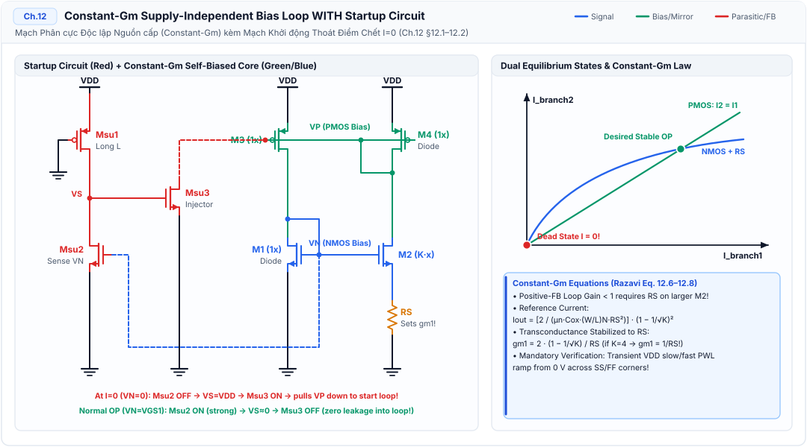

---
{
  "id": "tech-supply-independent-bias-and-startup",
  "kind": "technique",
  "domain": "references-and-biasing",
  "title_vi": "Phân cực độc lập nguồn cấp và mạch khởi động thoát điểm suy biến (Supply-Independent Biasing & Start-Up)",
  "title_en": "Supply-Independent Biasing and Start-Up Circuits",
  "summary": "Nguyên lý vòng tự phân cực hồi tiếp dương có độ lợi vòng nhỏ hơn 1 nhờ điện trở ghim cực nguồn RS để tạo dòng tham chiếu độc lập nguồn cấp VDD, đi kèm điều kiện bắt buộc phải có mạch khởi động tự ngắt nhằm thoát khỏi điểm phân cực suy biến dòng bằng không (I = 0).",
  "diagram": "../../diagrams/supply-independent-bias-startup.svg",
  "razavi_refs": [
    {
      "chapter": 12,
      "section": "12.1-12.2",
      "pages": "509-512",
      "equations": ["12.1", "12.2", "12.3", "12.4", "12.5", "12.6", "12.7"]
    }
  ],
  "glossary_codes": [
    "T012",
    "T026",
    "T051",
    "T085",
    "T086",
    "T2003",
    "T2008",
    "T2009",
    "T2015",
    "T2017",
    "T2022",
    "T2023",
    "T2025",
    "T2026",
    "T2027",
    "T2028"
  ],
  "process_agnostic": true,
  "roles": {
    "nmos_ratioed_mirror": "Cặp gương dòng NMOS M1-M2 có tỉ số kích thước 1:K phối hợp với điện trở cực nguồn RS tạo phương trình phi tuyến ghim mức dòng duy nhất khác không",
    "pmos_return_mirror": "Cặp gương dòng PMOS M3-M4 sao chép dòng ngõ ra Iout trả ngược lại thành dòng tham chiếu IREF để khép vòng tự thiết lập nhờ hồi tiếp (bootstrapped loop)",
    "pinning_resistor_rs": "Điện trở suy biến nguồn RS làm giảm hỗ dẫn tương đương Gm2 của nhánh M2 xuống nhỏ hơn gm1, ép độ lợi vòng hồi tiếp dương nhỏ hơn 1 tại điểm làm việc",
    "startup_injector": "Nhánh khởi động bơm dòng mồi kéo nút cổng thoát vùng ngắt khi cấp nguồn VDD, sau đó tự động ngắt hoàn toàn (Istartup = 0) khi vòng chính đã khóa dòng"
  },
  "symptoms_addressed": [
    "bias-current-sensitive-to-vdd",
    "resistor-biased-mirror-supply-drift",
    "zero-current-degenerate-lockup",
    "false-startup-on-fast-vdd-ramp"
  ],
  "limitations": [
    "current-still-varies-with-process-and-temperature",
    "finite-ro-leaves-residual-vdd-sensitivity",
    "body-effect-mismatch-when-rs-in-nmos-source",
    "high-frequency-psrr-degradation-via-parasitic-caps"
  ],
  "checklists": [
    "common-mos",
    "current-mirror",
    "bandgap-and-bias"
  ]
}
---

## 1. Bản chất Nguyên lý, Sơ đồ Mạch & Vai trò Từng Nhánh Cấu trúc

Trong toàn bộ các chương khuếch đại trước đó, ta luôn mặc định có sẵn một nguồn dòng tham chiếu (reference current, $I_{REF}$) "chuẩn vàng" cấp cho các gương dòng (current mirrors). Nếu thử thay nguồn dòng lý tưởng bằng một điện trở $R_1$ nối từ điện áp nguồn cấp (supply voltage, $V_{DD}$) xuống transistor mắc diode $M_1$ như Hình 12.1(b) của Razavi, dòng điện ngõ ra $I_{out}$ sẽ trôi trực tiếp theo mọi biến thiên $\Delta V_{DD}$:

$$\Delta I_{out} = \frac{\Delta V_{DD}}{R_1 + 1/g_{m1}} \cdot \frac{(W/L)_2}{(W/L)_1}$$

Để cắt đứt sự phụ thuộc tuyến tính vào $V_{DD}$, kỹ thuật **phân cực độc lập nguồn cấp (supply-independent biasing)** dựa trên một tiên đề cấu trúc sâu sắc: *mạch phải tự phân cực chính nó (self-biasing)* — nghĩa là $I_{REF}$ được tạo ra như một bản sao (replica) của chính $I_{out}$, hay nói theo thuật ngữ của Razavi là $I_{REF}$ "được tự thiết lập nhờ hồi tiếp" (bootstrapped) từ $I_{out}$.

Cấu trúc hoàn chỉnh trong Hình 12.3 và Hình 12.5(a) gồm 4 thành phần chức năng phối hợp chặt chẽ:

1. **Vòng gương dòng khép kín hai tầng ($M_1$–$M_2$ và $M_3$–$M_4$):**
   - Nhánh trái chứa $M_1$ mắc diode nhận dòng từ $M_3$; nhánh phải chứa $M_4$ mắc diode nhận dòng từ $M_2$. Vì mỗi linh kiện mắc diode đều được nuôi bởi một nguồn dòng cực máng trở kháng cao thay vì nối qua điện trở lên $V_{DD}$, điện thế cổng–nguồn của chúng gần như tách rời khỏi $V_{DD}$ khi điều biến chiều dài kênh (channel-length modulation) đủ nhỏ.
   - Tuy nhiên, nếu chỉ ghép hai gương dòng thuần túy (Hình 12.2) mà không có phần tử phi tuyến ghim biên độ, vòng kín chỉ cho duy nhất một phương trình tỉ lệ $I_{out} = K \cdot I_{REF}$; nếu $K=1$, mạch phiếm định và có thể duy trì bất kỳ mức dòng điện (current level) nào!
2. **Điện trở ràng buộc $R_S$ (Pinning / Degeneration Resistor):**
   - Trong Hình 12.3(a), cặp PMOS $M_3$–$M_4$ được chọn đồng nhất $(W/L)_3 = (W/L)_4$ để ép $I_{REF} = I_{out}$, trong khi transistor NMOS $M_2$ được nhân kích thước gấp $K$ lần $M_1$ ($K > 1$) và mắc nối tiếp điện trở $R_S$ tại cực nguồn.
   - Ở mức dòng rất nhỏ, sụt áp $I_{out} R_S \approx 0$ nên $M_2$ muốn dẫn dòng gấp $K$ lần $M_1$ (độ lợi vòng lớn hơn 1, đẩy dòng tăng vọt). Khi dòng tăng lên, sụt áp $I_{out} R_S$ bóp nghẹt $V_{GS2}$, làm độ dốc tăng dòng của nhánh phải thoải dần và cắt đường thẳng $I_{REF} = I_{out}$ tại một giao điểm cân bằng bền duy nhất khác không.
   - Biến thể Hình 12.3(b) dời $R_S$ lên cực nguồn của PMOS $M_3$ (lúc này $M_3$ lớn gấp $K$ lần $M_4$, còn $M_1$–$M_2$ bằng nhau) và **đấu chung cực nguồn và cực thân (source and bulk)** cho từng PMOS trong giếng n (n-well) riêng để triệt tiêu hoàn toàn sai số hiệu ứng thân (body effect).
3. **Điểm phân cực suy biến (Degenerate Bias Point) và Mạch khởi động (Start-Up Circuit):**
   - Vì cả hai nhánh đều tự nuôi lẫn nhau, trạng thái tất cả transistor cùng tắt ($I_{D1} = I_{D2} = I_{D3} = I_{D4} = 0$) cũng thỏa mãn hoàn toàn định luật Kirchhoff và là một điểm cân bằng ổn định thứ hai!
   - Mạch khởi động (ví dụ $M_5$ trong Hình 12.5(a) hoặc nhánh cảm nhận dòng + công tắc kéo cổng) có nhiệm vụ duy nhất: phát hiện trạng thái $I=0$ khi mới bật $V_{DD}$, bơm dòng mồi đánh thức vòng chính, rồi **tự động ngắt hẳn** để không làm lệch dòng chuẩn hay tạo đường rò nhiễu từ $V_{DD}$.

---

## 2. Hệ Phương trình Cốt lõi & Tư duy "Nhìn Mạch Đọc Nhanh" (Analysis by Inspection)

### 2.1. Nghiệm dòng một chiều độc lập nguồn cấp (Phương trình 12.2–12.4)
Xét mạch chuẩn Hình 12.3(a) với $(W/L)_3 = (W/L)_4 \Rightarrow I_{D1} = I_{D2} = I_{out}$ và $(W/L)_2 = K (W/L)_1$ ($K > 1$). Áp dụng KVL quanh vòng cổng–nguồn đáy:

$$V_{GS1} = V_{GS2} + I_{D2} R_S$$

Theo mô hình quy luật bình phương (square-law) vùng bão hòa:

$$\sqrt{\frac{2 I_{out}}{\mu_n C_{ox} (W/L)_N}} + V_{TH1} = \sqrt{\frac{2 I_{out}}{\mu_n C_{ox} K (W/L)_N}} + V_{TH2} + I_{out} R_S$$

Nếu bỏ qua hiệu ứng thân ($V_{TH1} = V_{TH2}$, điều đạt được chính xác ở cấu hình PMOS giếng riêng Hình 12.3(b)) và xét nghiệm $I_{out} \neq 0$ để chia hai vế cho $\sqrt{I_{out}}$:

$$\sqrt{\frac{2 I_{out}}{\mu_n C_{ox} (W/L)_N}} \left(1 - \frac{1}{\sqrt{K}}\right) = I_{out} R_S \implies I_{out} = \frac{2}{\mu_n C_{ox} (W/L)_N} \cdot \frac{1}{R_S^2} \left(1 - \frac{1}{\sqrt{K}}\right)^2$$

- **Đọc nhanh điện áp vượt ngưỡng:** Từ $\Delta V_{OV} = V_{OV1} (1 - 1/\sqrt{K}) = I_{out} R_S$, nếu chọn lựa chọn kinh điển **$K = 4$**, ta có ngay $1 - 1/\sqrt{4} = 1/2$, suy ra:
  $$V_{OV1} = 2 I_{out} R_S, \qquad V_{OV2} = I_{out} R_S, \qquad g_{m1} = \frac{2 I_{out}}{V_{OV1}} = \frac{1}{R_S}$$
  Chỉ bằng một phép nhìn 3 giây, kỹ sư thấy ngay $R_S$ vừa đặt điện áp vượt ngưỡng, vừa ấn định trực tiếp hỗ dẫn $g_{m1} = \frac{2}{R_S}\left(1 - \frac{1}{\sqrt{K}}\right)$!

### 2.2. Điều kiện ổn định vòng hồi tiếp dương ($T_{loop} < 1$)
Vòng ghép chéo $M_1 \to M_2 \to M_4 \to M_3 \to M_1$ là **vòng hồi tiếp dương (positive-feedback loop)** vì tăng dòng $I_{D1}$ làm tăng $V_{GS1} \Rightarrow$ tăng dòng $I_{D2} \Rightarrow$ tăng dòng sao chép qua $M_4, M_3$ đổ ngược về $M_1$. Để điểm làm việc ổn định tĩnh và không tự kích chốt lên nguồn cấp, **độ lợi vòng tín hiệu nhỏ quanh vòng kín bắt buộc phải nhỏ hơn 1**:

$$T_{loop} = \left(\frac{g_{m3}}{g_{m4}}\right) \cdot \left(\frac{G_{m2}}{g_{m1}}\right) < 1$$

Với $g_{m3} = g_{m4}$, điều kiện rút gọn thành $G_{m2} < g_{m1}$. Bỏ qua $r_O$ để nhìn bản chất:
- Tại điểm suy biến $I_{out} \to 0^+$ (khi mới mồi nhẹ dòng): $g_{m1}, g_{m2}$ còn rất nhỏ nên $g_{m2} R_S \ll 1 \Rightarrow G_{m2} \approx g_{m2} = \sqrt{K}\, g_{m1} > g_{m1}$ (vì $K > 1$). Độ lợi vòng $T_{loop} = \sqrt{K} > 1$: hồi tiếp dương khuếch đại vọt dòng đi lên, tự đẩy mạch rời khỏi vùng dòng nhỏ!
- Tại điểm cân bằng thiết kế (ví dụ $K=4$, bỏ qua hiệu ứng thân): $g_{m2} = \sqrt{K}\, g_{m1}/ \sqrt{K}$? Cẩn thận! Vì $I_{D1} = I_{D2}$ và $(W/L)_2 = K (W/L)_1$, ta luôn có $g_{m2} = \sqrt{K}\, g_{m1}$ và $I_{out} R_S = \frac{2}{g_{m1}}\left(1 - \frac{1}{\sqrt{K}}\right)$, suy ra $g_{m2} R_S = 2(\sqrt{K} - 1)$. Khi đó:

$$G_{m2} = \frac{g_{m2}}{1 + g_{m2} R_S} = \frac{\sqrt{K}\, g_{m1}}{2\sqrt{K} - 1} \implies T_{loop} = \frac{\sqrt{K}}{2\sqrt{K} - 1}$$

Với mọi $K > 1$, ta có $2\sqrt{K} - 1 > \sqrt{K} \iff \sqrt{K} > 1$, nên **$T_{loop} < 1$ luôn được thỏa mãn tự động** (cụ thể với $K=4$, $T_{loop} = \frac{2}{3} < 1$).

### 2.3. Độ nhạy nguồn cấp hữu hạn khi $r_O < \infty$ (Ví dụ 12.1, Phương trình 12.5–12.7)
Khi tính đến điều biến chiều dài kênh ($\lambda \neq 0$), đặt $R_1 = r_{O1} \parallel (1/g_{m1})$, $R_3 = r_{O3} \parallel (1/g_{m3})$ và hỗ dẫn tương đương của nhánh $M_2$–$R_S$:

$$G_{m2} = \frac{g_{m2} r_{O2}}{R_S + r_{O2} + (g_{m2} + g_{mb2}) R_S r_{O2}}$$

Biến thiên dòng ngõ ra theo $\Delta V_{DD}$ được Razavi chứng minh chính xác tại phương trình (12.6):

$$\frac{\Delta I_{out}}{\Delta V_{DD}} = \frac{1}{r_{O4}} \left[ \frac{1}{G_{m2} (r_{O4} \parallel R_1)} - g_{m4} R_3 \right]^{-1}$$

Biểu thức này phơi bày hai hệ quả thiết kế cực kỳ sắc bén:
1. Mẫu số chứa hiệu $\left[\frac{1}{G_{m2}(r_{O4} \parallel R_1)} - g_{m4} R_3\right] \approx \frac{1}{T_{loop}} - 1$: nếu chọn $K$ quá sát $1$ khiến $T_{loop} \to 1$, độ nhạy nguồn bị nhân bội lên vô cùng!
2. Hệ số đầu là $1/r_{O4}$: nếu nâng trở kháng nhìn vào nhánh gương bằng cấu trúc cascode (`topo-lvccml-wide-swing-mirror`), $r_{O4,eff}$ tăng gấp $g_m r_O$ lần, nén độ nhạy DC với $V_{DD}$ xuống hàng chục dB.

### 2.4. Điều kiện cửa sổ điện áp của mạch khởi động diode $M_5$
Trong Hình 12.5(a), transistor NMOS mắc diode $M_5$ nối giữa cổng NMOS ($M_1, M_2$) và cổng PMOS ($M_3, M_4$) chỉ hoạt động đúng trên mọi góc PVT nếu thỏa mãn đồng thời hai bất đẳng thức:
- **Bắt buộc dẫn khi kẹt ở $I=0$:** $V_{TH1} + V_{TH5} + |V_{TH3}| < V_{DD,\min}$
- **Bắt buộc tắt hẳn sau khi khởi động xong:** $V_{GS1} + V_{TH5} + |V_{GS3}| > V_{DD,\max}$

---

## 3. Bất biến Cấu trúc & Các Bẫy Lỗi Kinh điển (Structural Invariants & Traps)

- **[INV-SIB-01] Bất biến độ lợi vòng hồi tiếp dương tại điểm làm việc ($0 < T_{loop} < 1$):**
  Nhánh chứa điện trở $R_S$ bắt buộc phải là nhánh có tỉ số $(W/L)$ nhân hệ số $K > 1$ (khi gương phía đối diện có tỉ lệ $1:1$). Nếu tráo nhầm $R_S$ sang nhánh $1\times$ hoặc đặt $K \le 1$, phương trình (12.3) vô nghiệm dương ($1 - 1/\sqrt{K} \le 0$) và mạch sập hoàn toàn về dòng bằng không!
- **[INV-SIB-02] Bất biến tồn tại và tự ngắt của mạch khởi động:**
  Mọi vòng tự phân cực khép kín đều sở hữu nghiệm suy biến ổn định $I=0$. Mạch khởi động phải chứng minh được hai điều: (a) dòng rò hoặc dòng bơm khởi động đủ kéo vòng chính vượt qua điểm yên ngựa (saddle/unstable point) ở góc `SS`, nhiệt độ thấp nhất (`-40 °C`), $V_{DD,\min}$; và (b) dòng tĩnh qua nhánh khởi động ở trạng thái xác lập phải bằng $0$ (dưới mức nA ở góc `FF`, `125 °C`, $V_{DD,\max}$).
- **[TRAP-SIB-01] Bẫy "Khởi động giả" (False Start-Up) trong mô phỏng quá độ nguồn dốc đứng:**
  Razavi cảnh báo trực tiếp tại trang 512: nếu kỹ sư chỉ mô phỏng quá độ (transient simulation) với sườn lên $V_{DD}$ quá nhanh (ví dụ $0 \to V_{DD}$ trong $1\text{ ns}$), các điện dung ký sinh $C_{GD3}, C_{GS4}, C_{DB}$ sẽ truyền xung dòng điện dung $C \, dV_{DD}/dt$ vào cực cổng $M_1$, vô tình kích mạch chạy dù mạch **quên gắn mạch khởi động** hoặc mạch khởi động bị hỏng! Ngoài đời thực, khi nguồn LDO/pin lên chậm hàng chục mili-giây, $C \, dV_{DD}/dt \approx 0$ và chip chết cứng ở $I = 0$.
- **[TRAP-SIB-02] Bẫy cửa sổ hẹp của diode $M_5$ ở công nghệ nanomet nguồn thấp:**
  Cấu trúc $M_5$ đơn giản của Hình 12.5(a) đòi hỏi $V_{DD} > V_{TH1} + V_{TH5} + |V_{TH3}|$ nhưng đồng thời $V_{DD} < V_{GS1} + V_{TH5} + |V_{GS3}|$. Ở $90\text{nm}/65\text{nm}/45\text{nm}$ với $V_{DD} = 1,0\text{–}1,2\text{ V}$, tổng ba điện áp ngưỡng ở góc `SS, -40 °C` dễ dàng vượt quá $1,1\text{ V}$ (không khởi động được), trong khi ở góc `FF, 125 °C` với $V_{DD,\max} = 1,32\text{ V}$ thì $M_5$ lại không tắt hết, bơm dòng thẳng từ $V_{DD}$ làm hỏng tính độc lập nguồn! Giải pháp chuẩn cho nguồn thấp là dùng **mạch khởi động cảm nhận dòng + công tắc kéo cổng** (ví dụ nguồn dòng rò kênh dài $M_{leak}$ nuôi inverter chỉ lật khi $I_{out}=0$ để mở transistor PMOS/NMOS kéo cổng, và khóa chặt cổng công tắc về nguồn/đất khi $I_{out}$ đã lên).
- **[TRAP-SIB-03] Bẫy hiệu ứng thân bất đối xứng ở Hình 12.3(a):**
  Trong Hình 12.3(a), cực nguồn $M_1$ nối đất ($V_{SB1} = 0$) còn cực nguồn $M_2$ treo ở $I_{out} R_S > 0$ ($V_{SB2} > 0$). Do hiệu ứng thân, $V_{TH2} > V_{TH1}$, làm vế phải phương trình (12.2) tăng thêm $\Delta V_{TH}$, kéo dòng thực tế thấp hơn công thức (12.4) từ $15\%\text{–}30\%$ và phụ thuộc mạnh vào hệ số $\gamma$. Chuyển sang cấu hình Hình 12.3(b) đặt $R_S$ ở cực nguồn PMOS $M_3$ với giếng n riêng nối cực nguồn ($V_{SB3} = V_{SB4} = 0$) loại bỏ triệt để sai số này (xem chú giải hiệu đính `NG12-01`).

---

## 4. Lộ trình Nâng cấp Cấu trúc & Bát giác Đánh đổi (Upgrade Paths & Design Octagon)

Trên **Bát giác Thiết kế Tương tự (`concept-analog-design-octagon`)**, mạch tự phân cực đánh đổi diện tích (chiều dài kênh $L$ lớn, điện trở $R_S$, mạch khởi động) và khoảng dự trữ điện áp (headroom) để đổi lấy độ ổn định phân cực trước biến thiên $V_{DD}$:

- **Nâng cấp từ:** `topo-basic-current-mirror` phân cực bằng điện trở treo nguồn (loại bỏ độ nhạy trực tiếp $\Delta I_{out} \propto \Delta V_{DD}/R_1$).
- **Nâng cấp tiếp theo các trục giới hạn:**
  1. **Cần triệt tiêu điều biến chiều dài kênh ($\Delta I_{out}/\Delta V_{DD}$ cực nhỏ, PSRR cao):** Chồng tầng cascode điện áp thấp hoặc cascode tự phân cực (self-biased cascode, Hình 12.37) lên cả gương NMOS và PMOS $\rightarrow$ kết hợp với `topo-lvccml-wide-swing-mirror` (tăng trở kháng nhánh từ $r_O$ lên $\sim g_m r_O^2$, nâng PSRR tần số thấp thêm $30\text{–}40\text{ dB}$, đổi lại tốn thêm $V_{DS,\min}$ khoảng dự trữ điện áp).
  2. **Cần định nghĩa chính xác quy luật theo nhiệt độ (PTAT hoặc Constant-$G_m$):** Giữ nguyên khung tự phân cực để khai thác hỗ dẫn cố định $\rightarrow$ `tech-ptat-current-and-constant-gm`, hoặc thay cặp MOS chênh lệch $V_{GS}$ bằng lõi lưỡng cực $\Delta V_{BE}$ để loại bỏ sự phụ thuộc vào $\mu_n C_{ox}$ và $V_{TH}$ $\rightarrow$ `topo-bandgap-reference-core` và `topo-low-voltage-sub1v-bandgap`.
  3. **Cần chống nhiễu nguồn cấp tần số cao:** Nuôi toàn bộ vòng tự phân cực dưới một nguồn cấp nội bộ được điều áp cục bộ $\rightarrow$ `topo-cmos-ldo-regulator` (hoặc cấu trúc điều áp cục bộ Hình 12.39 trong §12.8).

---

## 5. Thích ứng Đa Tiến trình (90nm / 65nm / 45nm) & Cách Kiểm chứng trong Cadence / Spectre

### 5.1. Chiến lược định cỡ bất biến tiến trình (90nm / 65nm / 45nm)
- **Không dùng $L_{\min}$ cho bất kỳ transistor nào trong lõi phân cực:** Ở $90\text{nm}/65\text{nm}/45\text{nm}$, $L_{\min}$ bị DIBL mạnh làm $r_O$ sụp đổ và nhiễu nhấp nháy $1/f$ (`law-mos-thermal-and-flicker-noise`) rất lớn. Luôn chọn $L \ge 4 L_{\min} \dots 10 L_{\min}$ (ví dụ $0,5\text{–}1,0\,\mu\text{m}$) để đảm bảo $g_m r_O \ge 25\text{–}40$, giảm sai lệch Pelgrom (`law-pelgrom-mismatch-and-sizing-duality`) và nén nhiễu $1/f$.
- **Định cỡ theo $g_m/I_D$ thay vì công thức bậc hai thuần túy (`tech-nanometer-vdsmin-gmid-sizing`):** Ở tiến trình nanomet hoặc khi dòng phân cực nhỏ ($1\text{–}10\,\mu\text{A}$), cặp transistor mắc nối tiếp $R_S$ thường rơi vào vùng **nghịch đảo vừa hoặc yếu (moderate/weak inversion)**. Trong vùng nghịch đảo yếu, $V_{GS1} - V_{GS2} = \zeta V_T \ln K$, khi đó $I_{out} = \frac{\zeta V_T \ln K}{R_S}$ tự động chuyển sang dạng gần PTAT thay vì phụ thuộc $\mu_n C_{ox}$! Vì vậy, luôn dùng tỉ số bội số nguyên đơn vị $K = 4$ (ví dụ $M_1$ gồm $m=2$ đơn vị, $M_2$ gồm $m=8$ đơn vị bố trí tâm chung `tech-common-centroid-sti-wpe-layout`).

### 5.2. Phác đồ kiểm chứng bắt buộc trong Cadence Virtuoso / Spectre
1. **Phép thử số 1 — Quét DC hai chiều kiểm tra điểm suy biến (`dc` sweep):**
   - Quét `VDD` từ `0 V` lên `VDD_max` (không có hiệu ứng tụ $C \, dV/dt$!). Quan sát $I_{out}(V_{DD})$ phải bật lên dứt khoát trước $V_{DD,\min}$ trên cả 5 góc (`TT, SS, FF, SF, FS`) và 3 mức nhiệt (`-40 °C, 27 °C, 125 °C`).
2. **Phép thử số 2 — Mô phỏng quá độ nguồn PWL siêu chậm & sập nguồn (`tran`):**
   - Dùng nguồn `vpwl`: tăng chậm `0 -> VDD_min` trong `10 ms` (kiểm chứng không bị khởi động giả), giữ ổn định, sau đó cho sập nhanh về `0.2 V` rồi bật lại (brown-out test) để chắc chắn mạch khởi động tái kích hoạt thành công.
   - Đo dòng tĩnh qua nhánh khởi động sau khi ổn định: `IDC("/M_startup/D")` phải $< 1\text{ nA}$ ở mọi góc PVT.
3. **Phép thử số 3 — Kiểm tra độ lợi vòng và ổn định nội (`stb`) & độ nhạy nguồn (`xf` / `ac`):**
   - Chèn `iprobe` nối tiếp cực cổng nhánh gương PMOS hoặc nhánh dòng trả về để chạy `stb`: xác nhận độ lợi vòng hồi tiếp dương có biên độ $< 0\text{ dB}$ (tức $< 1$) hoặc kiểm tra hàm truyền AC từ nguồn nhiễu `vdd_ac = 1` tới $I_{out}$ trên dải $1\text{ Hz} \to 1\text{ GHz}$.

---

## 6. Mốc Đối chiếu Sách Razavi & Thuật ngữ Chuẩn CLB

- **Sách gốc Razavi (2nd Ed.):** Chương 12, Mục `12.1` (trang 509) và Mục `12.2` (trang 509–512); Hình `12.1`–`12.5`; Phương trình `(12.1)`–`(12.7)`; Ví dụ `12.1`; Bài tập `12.1`, `12.2`.
- **Ghi chú hiệu đính CLB (`NG12-01`):** Trang sách 511 (PDF trang 3), đoạn ngay sau phương trình `(12.4)` nói về Hình `12.3(b)` trong bản in tiếng Anh bị khuyết danh từ chủ ngữ (*"Shown in Fig. 12.3(b) is to place..."*); bản chất kỹ thuật xác nhận chính xác là đặt điện trở $R_S$ tại cực nguồn của $M_3$ và đấu chung cực nguồn với cực thân từng PMOS để triệt tiêu hiệu ứng thân.
- **Đối chiếu Thuật ngữ Chuẩn CLB (`THUẬT NGỮ CHUẨN.md`):**
  - `T2008`: `supply-independent biasing` — **phân cực độc lập nguồn cấp** (giảm mạnh phụ thuộc $V_{DD}$, không hàm ý bất biến trước P và T).
  - `T2015`: `bootstrapped` (ngữ cảnh §12.2) — **được tự thiết lập nhờ hồi tiếp** (không dịch nhầm thành tụ bootstrap của công tắc lấy mẫu Chương 13).
  - `T2022` / `T2023`: `degenerate bias points` / `zero current` — **các điểm phân cực suy biến** / **dòng điện bằng không**.
  - `T2025` / `T2026` / `T2027`: `start-up problem` / `start-up circuit` / `false start-up` — **vấn đề khởi động** / **mạch khởi động** / **khởi động giả**.
