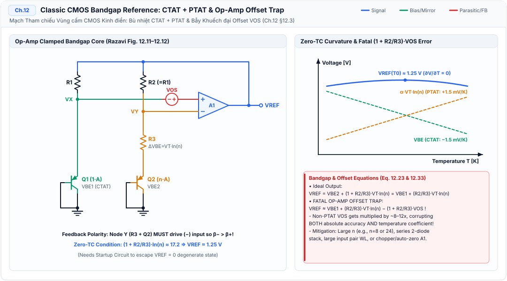

---
{
  "id": "topo-bandgap-reference-core",
  "kind": "topology",
  "domain": "references-and-biasing",
  "title_vi": "Lõi mạch tham chiếu điện áp vùng cấm chuẩn và bẫy khuếch đại điện áp lệch Op-Amp",
  "title_en": "Classic CMOS Bandgap Reference Core and Op-Amp Offset Amplification Trap",
  "summary": "Cấu trúc mạch tham chiếu điện áp vùng cấm kẹp hai nút bằng bộ khuếch đại thuật toán hoặc gương dòng cascode để tạo VREF = VBE2 + (1 + R2/R3)·VT·ln(n) ≈ 1.25 V, kèm phân tích bẫy chí mạng khi điện áp lệch VOS và nhiễu 1/f của Op-Amp bị khuếch đại trực tiếp lên ngõ ra.",
  "diagram": "../../diagrams/bandgap-reference-core.svg",
  "razavi_refs": [
    {
      "chapter": 12,
      "section": "12.3.3, 12.4, 12.6, 12.8",
      "pages": "515-524, 525-529, 533-536",
      "equations": ["12.22", "12.23", "12.24", "12.28", "12.32", "12.33", "12.35", "12.40", "12.42", "12.43", "12.44", "12.51", "12.60", "12.65", "12.76"]
    }
  ],
  "glossary_codes": [
    "T011",
    "T052",
    "T060",
    "T067",
    "T2046",
    "T2057",
    "T2058",
    "T2059",
    "T2061",
    "T2063",
    "T2064",
    "T2065",
    "T2066",
    "T2070",
    "T2084",
    "T2093",
    "T2102",
    "T2116",
    "T2118",
    "T2120",
    "T2122",
    "T2123",
    "T2124",
    "T2126"
  ],
  "process_agnostic": true,
  "roles": {
    "bjt_ratioed_pair": "Cặp BJT pnp đế Q1 (diện tích A) và Q2 (diện tích n·A) tạo độ chênh điện áp gốc-phát ΔVBE = VT·ln(n) khi được ép mang dòng cực góp bằng nhau",
    "ptat_resistor_network": "Điện trở R3 biến ΔVBE thành dòng PTAT I = VT·ln(n)/R3; cặp điện trở đối xứng R1 = R2 (hoặc nhánh gương dòng PMOS R2 ở Hình 12.20) nhân độ sụt áp PTAT trước khi cộng vào VBE",
    "clamping_opamp": "Bộ khuếch đại thuật toán A1 cảm nhận vi sai (VX, VY) và điều khiển đỉnh cầu nhánh (hoặc cực cổng gương PMOS) để cưỡng bức VX ≈ VY với độ lợi vòng lớn",
    "startup_and_bypass": "Mạch khởi động kéo VX, VY rời điểm chết 0 V khi bật nguồn; tụ lọc CB kết hợp op-amp một tầng hoặc nguồn cấp cục bộ bảo vệ ngõ ra khỏi xuyên nhiễu quá độ"
  },
  "symptoms_addressed": [
    "need-pvt-stable-1p25v-voltage-reference",
    "adc-dac-full-scale-reference-drift",
    "resistive-loading-on-bandgap-opamp"
  ],
  "limitations": [
    "opamp-offset-vos-amplified-by-1-plus-r2-over-r3",
    "dual-feedback-loop-polarity-instability-if-beta-p-exceeds-beta-n",
    "opamp-1f-noise-transfers-to-vref-unattenuated",
    "high-frequency-zout-peaking-and-psrr-drop"
  ],
  "checklists": [
    "common-mos",
    "differential-pair",
    "bandgap-and-bias",
    "layout-and-matching"
  ]
}
---

## 1. Bản chất Nguyên lý, Sơ đồ Mạch & Vai trò Từng Nhánh Cấu trúc

Từ quy luật vật lý `law-ctat-ptat-temperature-cancellation`, muốn thu được $V_{REF} = V_{BE} + 17,2 V_T \approx 1,25\text{ V}$ bằng một tỉ số diện tích BJT hợp lý ($n = 8 \dots 31$), mạch thực tế phải giải quyết đồng thời **ba bài toán cấu trúc** (Razavi §12.3.3, trang 515–516):
1. Có cơ chế hồi tiếp cưỡng bức hai nút $X$ và $Y$ có điện thế bằng nhau ($V_X = V_Y$) và hai nhánh mang dòng bằng nhau;
2. Khuếch đại độ sụt áp $\Delta V_{BE} = V_T \ln n$ trên một điện trở nhỏ lên gấp $\alpha_2$ lần bằng **tỉ số hai điện trở cùng loại** (để hệ số nhiệt của bản thân điện trở tự triệt tiêu hoàn toàn!);
3. Lấy ngõ ra tại nút tổng $1,25\text{ V}$ thay vì lấy tại nút bị kẹp $V_X \approx V_{BE1} \approx 0,75\text{ V}$.

Sách Razavi trình bày hai biến thể kiến trúc chủ lực và một nghiên cứu trường hợp thiết kế thực tế (Case Study §12.8):
- **Kiến trúc 1 — Cầu điện trở kẹp bằng Op-Amp Kuijk (Hình 12.9 & Hình 12.11 dùng PNP đế):**
  Ngõ ra $V_{out}$ của bộ khuếch đại thuật toán $A_1$ lái trực tiếp đỉnh của hai nhánh điện trở bằng nhau $R_1 = R_2$. Nhánh trái nối thẳng xuống cực phát $Q_1$ (diện tích $A$); nhánh phải nối qua $R_3$ xuống cực phát $Q_2$ (diện tích $n A$). Khi $A_1$ ép $V_X = V_Y$, hai điện trở $R_1 = R_2$ có cùng sụt áp $V_{out} - V_X = V_{out} - V_Y$ nên tự động ép hai dòng nhánh bằng nhau $I_1 = I_2 = \Delta V_{BE}/R_3$, và điện áp ngay tại ngõ ra $A_1$ chính là $V_{out} = V_{BE2} + (1 + R_2/R_3) V_T \ln n$.
- **Kiến trúc 2 — Gương dòng PMOS tách tải điện trở cho Op-Amp (Hình 12.18 $\to$ Hình 12.20):**
  Ở Hình 12.11, ngõ ra của $A_1$ phải trực tiếp cấp dòng DC cho cả hai nhánh điện trở (gây **hiệu ứng tải điện trở — resistive loading** làm sụt độ lợi nếu $A_1$ là OTA trở kháng ra cao). Trong Hình 12.20, ngõ ra $A_1$ chỉ lái cực cổng của dãy nguồn dòng PMOS $M_3, M_4, M_5$: $M_3$–$M_4$ ép dòng bằng nhau qua $Q_1$ và $R_1 + Q_2$ để tạo dòng PTAT $I_{PTAT} = V_T \ln n / R_1$, còn $M_5$ sao chép dòng PTAT đó đổ qua nhánh thứ ba gồm $R_2$ nối tiếp PNP $Q_3$ xuống đất, tạo ra $V_{REF} = |V_{BE3}| + (R_2/R_1) V_T \ln n$ hoàn toàn tách biệt khỏi vòng hồi tiếp!
- **Kiến trúc 3 — Lõi chính xác cao chồng $2 V_{BE}$ kèm Cascode tự phân cực & Nguồn cấp cục bộ (§12.8, Hình 12.36–12.41, Brooks & Westwick):**
  Ghép hai tầng tiếp giáp $pn$ (một tầng theo cực phát + một diode PNP đế như Hình 12.14b–12.15) để nhân đôi $\Delta V_{BE}$ thành $2 V_T \ln n$, dùng **cascode tự phân cực (self-biased cascode, Hình 12.37b)** triệt điều biến chiều dài kênh, xuất **tham chiếu thả nổi (floating reference, Hình 12.38)** và tự tạo **nguồn cấp cục bộ (local supply $V_{DDL}$, Hình 12.39–12.41)** đạt PSRR $94\text{ dB}$ ở tần số thấp!

---

## 2. Hệ Phương trình Cốt lõi & Tư duy "Nhìn Mạch Đọc Nhanh" (Analysis by Inspection)

### 2.1. Phương trình điện áp ngõ ra chuẩn & Nghịch lý biểu kiến Ví dụ 12.4 (Phương trình 12.22–12.28)
Trong Hình 12.9/12.11 với $R_1 = R_2$ và $V_X = V_Y = |V_{BE1}|$:
$$I_2 = \frac{|V_{BE1}| - |V_{BE2}|}{R_3} = \frac{V_T \ln n}{R_3} \implies V_{out} = |V_{BE2}| + \left(1 + \frac{R_2}{R_3}\right) V_T \ln n$$
Để đạt hệ số nhiệt bằng không tại $300\text{ K}$, ta chọn $\left(1 + \frac{R_2}{R_3}\right) \ln n \approx 17,2$ (ví dụ $n = 8 \Rightarrow \ln 8 = 2,079 \Rightarrow R_2 / R_3 \approx 7,27$; hoặc theo ví dụ sách $n = 31 \Rightarrow \ln 31 = 3,434 \Rightarrow R_2/R_3 \approx 4$).
- **Lưu ý nhìn nhanh từ Ví dụ 12.4:** Nếu tính $V_{out}$ đi theo nhánh trái, ta viết $V_{out} = |V_{BE1}| + \frac{R_1}{R_3} V_T \ln n$. Tại sao hệ số nhân trước $V_T \ln n$ chỉ còn $R_1/R_3$ thay vì $1 + R_2/R_3$? Không hề mâu thuẫn! Bởi vì $|V_{BE1}| = |V_{BE2}| + V_T \ln n$ lớn hơn $|V_{BE2}|$, nên theo (12.26) đạo hàm của $|V_{BE1}|$ ít âm hơn đạo hàm của $|V_{BE2}|$ đúng một lượng $+(k/q)\ln n$!

### 2.2. Cực tính hồi tiếp kép: Điều kiện để Op-Amp không tự khóa cứng (Phương trình 12.43–12.44)
Trong Hình 12.9/12.11, ngõ ra $V_{out}$ hồi tiếp đồng thời về **cả hai ngõ vào** của $A_1$: nhánh phải về ngõ vào đảo (hồi tiếp âm $\beta_N$), nhánh trái về ngõ vào không đảo (hồi tiếp dương $\beta_P$!). Thay $Q_1, Q_2$ bằng điện trở tín hiệu nhỏ $1/g_{m1}, 1/g_{m2}$:

$$\beta_N = \frac{1/g_{m2} + R_3}{1/g_{m2} + R_3 + R_2}, \qquad \beta_P = \frac{1/g_{m1}}{1/g_{m1} + R_1}$$

Với $R_1 = R_2$, vì hàm $f(x) = \frac{x}{x + R_2}$ đồng biến chặt theo $x > 0$ và $1/g_{m2} + R_3 > 1/g_{m1}$ (khi $I_1 = I_2 \Rightarrow g_{m1} = g_{m2}$), ở trạng thái cân bằng ta có $\beta_N > \beta_P$, nên hồi tiếp tổng $(\beta_N - \beta_P)$ là **hồi tiếp âm**. Razavi khuyến nghị thiết kế **$\beta_N \ge 2 \beta_P$** (tức $R_3$ đủ lớn so với $1/g_m$, tương đương $\ln n \ge 1$) để dự trữ ổn định tốt ngay cả khi ngõ ra mang tải tụ lớn.

### 2.3. Sai số chí mạng do Điện áp lệch $V_{OS}$ của Op-Amp (Phương trình 12.32–12.42)
Khi Op-Amp có **điện áp lệch ngõ vào (input offset voltage, $V_{OS}$)** như Hình 12.12 ($V_X - V_{OS} = V_Y$):
- Xấp xỉ bậc nhất (coi $I_{C1} \approx I_{C2}$): $R_3 I_{C2} = |V_{BE1}| - |V_{BE2}| - V_{OS} = V_T \ln n - V_{OS}$, suy ra phương trình (12.33):
  $$V_{out} \approx |V_{BE2}| + \left(1 + \frac{R_2}{R_3}\right) (V_T \ln n - V_{OS})$$
- Giải tích tín hiệu nhỏ chính xác kể cả sự lệch dòng $I_{C1} \neq I_{C2}$ (Ví dụ 12.5, Phương trình 12.35 & 12.40):
  $$\frac{\Delta V_{out}}{V_{OS}} = -\left[1 + \frac{1}{g_m R_2} + \frac{(1/g_m + R_2)^2}{R_2 R_3}\right] \approx -\left(1 + \frac{1}{g_m R_2}\right)\left(1 + \frac{R_2}{R_3}\right)$$
- **Hệ quả chấn động:** Với $n = 8$, $(1 + R_2/R_3) \approx 8,3$. Chỉ cần Op-Amp CMOS lệch ngẫu nhiên $V_{OS} = \pm 5\text{ mV}$, ngõ ra $V_{REF}$ đã văng mất **$\pm 41,5\text{ mV}$ ($\pm 3,3\%$)**! Nghiêm trọng hơn nữa, bản thân $V_{OS}$ của cặp vi sai CMOS biến thiên theo nhiệt độ, nên $(1 + R_2/R_3)\frac{\partial V_{OS}}{\partial T}$ phá nát trực tiếp điểm hệ số nhiệt bằng không mà không thể bù bằng một mã chỉnh điện trở đơn giản nếu $V_{OS}$ vừa có phần hằng định vừa có độ dốc khác PTAT!
- **Ba đòn bẩy nén hiệu ứng $V_{OS}$ (Phương trình 12.41–12.42):**
  1. Định cỡ cặp đầu vào Op-Amp cực lớn, $V_{OV}$ nhỏ theo `law-pelgrom-mismatch-and-sizing-duality` hoặc khử offset động `tech-dynamic-offset-cancellation-az-cds`;
  2. Tăng cả tỉ số dòng nhánh $m = R_2/R_1$ lẫn tỉ số diện tích $n$ để tăng $V_T \ln(mn)$, nhờ đó giảm hệ số khuếch đại $(1 + R_2/R_3)$;
  3. Chồng hai tiếp giáp $pn$ mỗi nhánh (Hình 12.13, 12.15, 12.36):
     $$V_{out} = 2 V_{BE} + \left(1 + \frac{R_2}{R_3}\right) [2 V_T \ln(mn) - V_{OS}]$$
     Tăng gấp đôi tín hiệu $\Delta V_{BE}$ giúp giảm một nửa tỉ số ảnh hưởng tương đối của $V_{OS}$ (đổi lại cần $V_{out} \approx 2,5\text{ V}$ hoặc chuyển sang cấu hình dòng điện Hình 12.38).

### 2.4. Trở kháng ngõ ra theo tần số $Z_{out}(s)$ & Truyền thẳng nhiễu $1/f$ của Op-Amp (§12.6, Phương trình 12.58–12.65)
Với cấu trúc gương PMOS (Hình 12.23, 12.26) dùng op-amp một cực $A(s) = \frac{A_0}{1 + s/\omega_0}$ có trở kháng ra vòng hở $R_{out}$ (xét tại nút cổng PMOS hoặc ngõ ra hồi tiếp):
$$Z_{out}(s) = \frac{R_{out}}{1 + g_{mP} R_1 A(s)} = \frac{R_{out}}{1 + g_{mP} R_1 A_0} \cdot \frac{1 + s/\omega_0}{1 + \frac{s}{(1 + g_{mP} R_1 A_0)\omega_0}}$$
- Ở tần số thấp ($\omega < \omega_0$), hồi tiếp nén $Z_{out}$ xuống rất thấp; nhưng từ $\omega_0$ trở lên, $|Z_{out}(j\omega)|$ leo dốc $+20\text{ dB/dec}$ như một **cuộn cảm tương đương**, chạm mức $R_{out}/\sqrt{2}$ tại băng thông vòng $(1 + g_{mP} R_1 A_0)\omega_0$!
- Về nhiễu (Hình 12.30, Phương trình 12.65): trong cấu hình Hình 12.30 (hoặc Hình 12.9), nhiễu quy về ngõ vào $V_{n,op}$ của Op-Amp xuất hiện trực tiếp tại ngõ ra (thậm chí bị nhân lên theo $(1 + R_2/R_3)$ trong Hình 12.9/12.20!):
  $$|V_{n,out}| \approx V_{n,op} \quad \text{(Hình 12.30)} \qquad \text{hoặc} \qquad V_{n,out} \approx \left(1 + \frac{R_2}{R_3}\right) V_{n,op} \quad \text{(Hình 12.9)}$$
  Tụ lọc $C_B$ ở ngõ ra (dù lớn hàng trăm pF trên chip) **không thể lọc được nhiễu nhấp nháy $1/f$ ở vùng $1\text{ Hz} \dots 10\text{ kHz}$**!

---

## 3. Bất biến Cấu trúc & Các Bẫy Lỗi Kinh điển (Structural Invariants & Traps)

- **[INV-BGR-01] Bất biến cực tính đúng của hai ngõ vào Op-Amp ($\beta_N > \beta_P$):**
  Đây là lỗi sơ đồ nối dây phổ biến số 1 khi vẽ schematic Bandgap!
  - Trong **Hình 12.11** (Op-Amp lái trực tiếp đỉnh cầu $R_1, R_2$; pha từ $V_{out}$ xuống $V_X, V_Y$ là **không đảo**): nhánh chứa $R_3 + Q_2$ (hệ số truyền lớn hơn $\beta_N$) bắt buộc nối vào **ngõ vào đảo (`-`)**, nhánh $Q_1$ nối vào **ngõ vào không đảo (`+`)**.
  - Ngược lại, trong **Hình 12.20** (Op-Amp lái cực cổng gương dòng PMOS $M_3, M_4$; tầng PMOS nguồn chung đã **đảo pha $180^\circ$** từ cổng xuống nút $X, Y$!): cực tính hai ngõ vào Op-Amp **bắt buộc phải đảo ngược lại** — nhánh chứa $R_1 + Q_2$ nối vào **ngõ vào không đảo (`+`)**, nhánh $Q_1$ nối vào **ngõ vào đảo (`-`)**! Đấu ngược cặp dây này sẽ biến hồi tiếp âm thành hồi tiếp dương khóa chặt ngõ ra lên nguồn hoặc đất!
- **[INV-BGR-02] Bất biến cùng loại vật liệu cho toàn bộ các điện trở lập tỉ số ($R_1, R_2, R_3$):**
  Hệ số nhiệt bậc nhất và bậc hai của điện trở tấm ($\text{TC}_{R1}, \text{TC}_{R2}$) chỉ triệt tiêu trong tỉ số $R_2/R_3$ hoặc $R_2/R_1$ khi cả hai được ghép từ **cùng một loại điện trở đơn vị (unit resistor)** có cùng chiều rộng $W_R$, không bao giờ trộn lẫn điện trở `rppoly` với `rnwell` hay điện trở khuếch tán!
- **[TRAP-BGR-01] Bẫy gắn tụ bypass $C_B$ cỡ trung bình vào nút cổng PMOS gây dao động hoặc kéo dài thời gian hồi phục quá độ (Hình 12.23–12.24):**
  Khi mạch tải chuyển mạch giật xung qua $C_{GD}$ vào đường gương phân cực (nút $P$ trong Hình 12.23), nhiều kỹ sư vội gắn tụ lọc $C_B$ vào nút $P$. Razavi chỉ ra hai hiểm họa: (1) Nếu Op-Amp $A_1$ là bộ khuếch đại 2 tầng bù Miller nội, $C_B$ lớn tạo cực thứ hai cực thấp ở ngõ ra $A_1$ làm vòng Bandgap **tự dao động**! (2) Nếu chọn $C_B$ "lỡ cỡ" (không đủ lớn gấp hàng trăm lần tụ ghép nhiễu, nhưng đủ lớn để bóp băng thông vòng), nút $P$ vừa bị sụt áp vừa mất thời gian cực dài mới bò lại mức chuẩn (Hình 12.24), làm tê liệt tốc độ xác lập của toàn hệ thống ADC/PLL phía sau!
- **[TRAP-BGR-02] Bẫy sập điểm làm việc Op-Amp khi $V_X = V_Y \approx V_{BE} \approx 0,75\text{ V}$ vượt ngoài ICMR:**
  Tại $-40\,^\circ\text{C}$, $V_{BE}$ tăng lên tới $\sim 0,85\text{–}0,90\text{ V}$; tại $+125\,^\circ\text{C}$, $V_{BE}$ tụt xuống $\sim 0,55\text{ V}$. Nếu dùng Op-Amp đầu vào NMOS với $V_{DD} = 1,2\text{–}1,5\text{ V}$, ở $+125\,^\circ\text{C}$ điện áp $V_X = 0,55\text{ V} < V_{GS,in} + V_{DS,\min,tail}$ làm nguồn dòng đuôi NMOS rơi vào vùng triode! Ngược lại nếu dùng đầu vào PMOS ở $V_{DD} = 1,2\text{ V}$, tại $-40\,^\circ\text{C}$ điện áp $V_X = 0,88\text{ V}$ lại bóp nghẹt khoảng dự trữ nguồn dòng đuôi PMOS ($V_{DD} - V_X = 0,32\text{ V} < |V_{GS,P}| + |V_{DS,\min}|$)! Phải kiểm tra biên ICMR ở cả hai đầu nhiệt độ cực trị!

---

## 4. Lộ trình Nâng cấp Cấu trúc & Bát giác Đánh đổi (Upgrade Paths & Design Octagon)

- **Nền tảng từ:** `law-ctat-ptat-temperature-cancellation` + `tech-supply-independent-bias-and-startup` + `topo-five-transistor-ota` / `topo-folded-cascode-ota`.
- **Lộ trình nâng cấp theo triệu chứng thiết kế:**
  1. **Khi $V_{DD} \le 1,2\text{ V}$ (công nghệ $65\text{nm}/45\text{nm}$ không đủ khoảng hở cho $1,25\text{ V} + |V_{DS,\min}|$):** Chuyển sang cấu trúc cộng dòng phân số Banba / Neuteboom $\rightarrow$ `topo-low-voltage-sub1v-bandgap`.
  2. **Khi $V_{OS}$ và nhiễu $1/f$ của Op-Amp vượt ngân sách sai số (ví dụ ADC $\ge 12\text{–}14\text{ bit}$):** Dùng cấu trúc chồng $2 V_{BE}$ (khi $V_{DD}$ cao) hoặc tích hợp điều biến băm / khử offset tự động $\rightarrow$ `tech-dynamic-offset-cancellation-az-cds` kết hợp mảng điện trở hiệu chỉnh số (digital resistor trimming).
  3. **Khi PSRR ở $10\text{ kHz} \dots 10\text{ MHz}$ sụp đổ hoặc tải tiêu thụ dòng biến thiên lớn:** Không bao giờ bắt lõi Bandgap trực tiếp cấp dòng tải! Đệm ngõ ra $V_{REF}$ bằng bộ ổn áp tuyến tính sụt áp thấp $\rightarrow$ `topo-cmos-ldo-regulator` (hoặc cấp nguồn cục bộ tự điều áp $V_{DDL}$ cho chính lõi Bandgap như Hình 12.39–12.41).

---

## 5. Thích ứng Đa Tiến trình (90nm / 65nm / 45nm) & Cách Kiểm chứng trong Cadence / Spectre

### 5.1. Quy tắc thiết kế Op-Amp và Gương dòng trong lõi Bandgap 90nm / 65nm / 45nm
- **Chọn kiến trúc Op-Amp 1 tầng (`topo-folded-cascode-ota` đầu vào PMOS dùng thiết bị LVT nếu cần ở $V_{DD}$ thấp, hoặc 2 tầng có bù chuẩn xác):** Cặp đầu vào PMOS có ưu điểm nhiễu nhấp nháy $1/f$ thấp hơn NMOS và dễ đọc mức đồng pha $V_X \approx 0,6\text{–}0,85\text{ V}$ khi $V_{DD} \ge 1,5\text{–}1,8\text{ V}$ (hoặc dùng thiết bị I/O dày oxit `1.8V / 2.5V` có sẵn trong mọi PDK $90\text{nm}/65\text{nm}/45\text{nm}$ cho khối Bandgap analog!).
- **Định cỡ chống Offset & Nhiễu (`law-pelgrom-mismatch-and-sizing-duality`):** Cặp đầu vào Op-Amp phải dùng diện tích $W \cdot L$ rất lớn (ví dụ $W/L = 80\,\mu\text{m} / 2\,\mu\text{m}$ hoạt động ở nghịch đảo yếu $g_m/I_D \approx 20\text{–}24\text{ V}^{-1}$) để nén $\sigma(V_{OS}) < 1\text{ mV}$. Ngược lại, dãy gương dòng PMOS $M_3, M_4, M_5$ trong Hình 12.20 bắt buộc chọn $L$ dài ($L \ge 2\text{–}4\,\mu\text{m}$) và $V_{OV}$ lớn ($g_m/I_D \le 6\text{–}8\text{ V}^{-1}$) kèm cascode `topo-lvccml-wide-swing-mirror` để sai lệch dòng $\Delta I_D/I_D < 0,2\%$.

### 5.2. Phác đồ kiểm chứng toàn diện trong Cadence Spectre
1. **Kiểm chứng Cực tính & Độ ổn định Hồi tiếp Kép (`stb`):**
   - Đặt `iprobe` nối tiếp ngay tại **ngõ ra của Op-Amp $A_1$** (trước điểm rẽ nhánh về cả đường âm $\beta_N$ lẫn đường dương $\beta_P$! Như vậy `stb` tự động đo chính xác hàm truyền vòng tổng $T(s) = A(s)(\beta_N - \beta_P)$ mà không cắt đứt phân cực DC). Yêu cầu: `DC Loop Gain >= 50-60 dB`, `Phase Margin >= 60 deg` ở cả không tải tụ và có tải tụ $C_B$.
2. **Kiểm chứng Monte Carlo Mismatch + Process (`montecarlo` 200 runs, DC temp sweep `-40..125 °C`):**
   - Tách riêng phân bố $3\sigma$ của $V_{REF}(27\,^\circ\text{C})$ chưa chỉnh (untrimmed, thường $\pm 2\% \dots \pm 4\%$ chủ yếu do $V_{OS}$) và phân bố sau hiệu chỉnh 1 điểm ở $27\,^\circ\text{C}$ (single-point room-temp trim).
3. **Kiểm chứng PSRR (`xf` hoặc `ac` trên `VDD`), Nhiễu tích phân (`noise` từ `0.1 Hz` đến `10 MHz`) & Đáp ứng quá độ (`tran`):**
   - Kiểm tra cả thời gian xác lập khi bật nguồn (turn-on settling time) lẫn xung nhiễu tải dòng $\Delta I_{load}$ tại ngõ ra như Hình 12.25.

---

## 6. Mốc Đối chiếu Sách Razavi & Thuật ngữ Chuẩn CLB

- **Sách gốc Razavi (2nd Ed.):** Chương 12, Mục `12.3.3` (trang 515–522), Mục `12.6` (trang 525–529), Mục `12.8` (trang 533–536); Hình `12.9`, `12.11`–`12.15`, `12.20`, `12.23`–`12.30`, `12.36`–`12.41`; Phương trình `(12.22)`–`(12.28)`, `(12.32)`–`(12.44)`, `(12.51)`, `(12.55)`–`(12.65)`, `(12.76)`; Ví dụ `12.4`, `12.5`, `12.7`.
- **Ghi chú hiệu đính học thuật CLB (`NG12-02` & `NG12-03`):**
  - **`NG12-02` (Trang sách 519 / PDF 11, Phương trình 12.36–12.40):** Trong Ví dụ `12.5`, với $I_{S2} = n I_{S1}$, phép biến đổi đại số chính xác từ `(12.36)` $\ln(I_{C1}/I_{S1}) - \ln(I_{C2}/I_{S2}) - V_{OS}/V_T$ phải cho dấu cộng $+V_T \ln(I_{C1}/I_{C2})$, nhưng bản in sách gốc viết dấu trừ $-V_T \ln(I_{C1}/I_{C2})$ ở `(12.37)`–`(12.40)` để khớp dấu với biểu thức `(12.35)` khi quy ước cực tính $V_{OS}$ ở Hình `12.12`. Kết luận vật lý cuối cùng về độ lớn hệ số khuếch đại $|\Delta V_{out}/V_{OS}| \approx (1 + \frac{1}{g_m R_2})(1 + \frac{R_2}{R_3})$ hoàn toàn chính xác.
  - **`NG12-03` (Trang sách 536 / PDF 28, Tài liệu tham khảo [4] & [7]):** Sách gốc in nhầm chính tả tên tác giả thành *"K. E. Kujik"* và *"A. L. Westwisk"*; tên chuẩn xác trên bài báo IEEE JSSC 1973 và ISSCC 1994 là **Karel E. Kuijk** và **Alan L. Westwick** (đồng thời Hình `12.36` trong bản PDF 2nd Ed. đang dùng đã ghi đúng diện tích `A / nA`).
- **Đối chiếu Thuật ngữ Chuẩn CLB (`THUẬT NGỮ CHUẨN.md`):**
  - `T2058`: `input offset voltage` — **điện áp lệch ngõ vào ($V_{OS}$)**.
  - `T2064` / `T2065` / `T2066`: `Feedback Polarity` / `negative-feedback factor` / `positive-feedback factor` — **cực tính hồi tiếp** / **hệ số hồi tiếp âm ($\beta_N$)** / **hệ số hồi tiếp dương ($\beta_P$)**.
  - `T2118`: `trimming` — **hiệu chỉnh tinh sau chế tạo**.
  - `T2123` / `T2124` / `T2126`: `self-biased cascode` / `floating reference` / `local supply` — **cascode tự phân cực** / **tham chiếu thả nổi** / **nguồn cấp cục bộ**.
