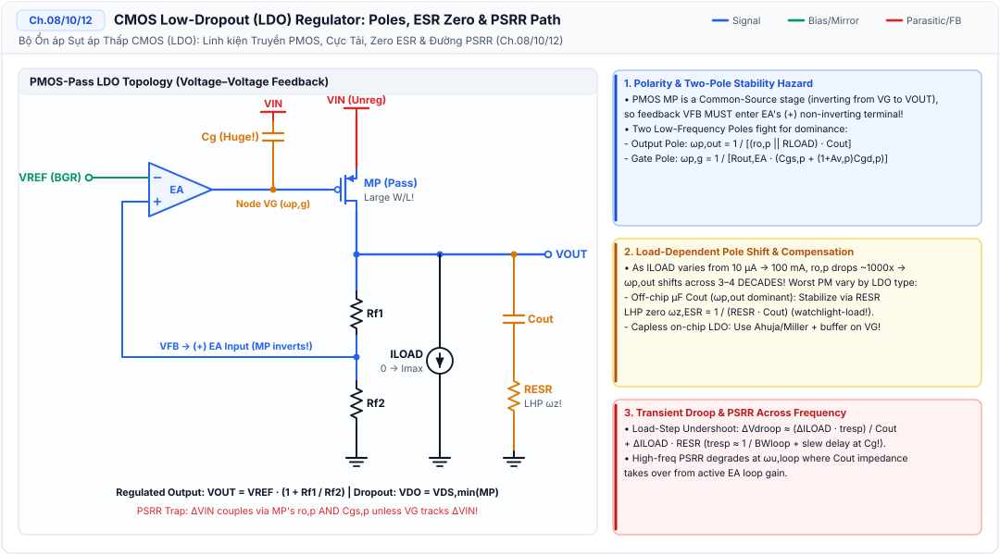

---
{
  "id": "topo-cmos-ldo-regulator",
  "kind": "topology",
  "domain": "references-and-biasing",
  "title_vi": "Bộ ổn áp tuyến tính sụt áp thấp CMOS (CMOS Low-Dropout Linear Regulator — LDO)",
  "title_en": "CMOS Low-Dropout (LDO) Linear Voltage Regulator",
  "summary": "Tổng hợp chặt chẽ từ lý thuyết hồi tiếp Điện áp-Điện áp (Ch.8), bù tần số đa cực tải biến thiên (Ch.10) và điều áp nguồn tham chiếu (Ch.12 §12.8): kiến trúc LDO dùng phần tử truyền PMOS sụt áp thấp, giải quyết bài toán cực ngõ ra dịch chuyển 3-4 thập kỷ theo dòng tải, ổn định bằng zero ESR hoặc bù Miller/Ahuja nội, tối ưu đáp ứng bước nhảy tải và PSRR đa miền tần số.",
  "diagram": "../../diagrams/cmos-ldo-regulator.svg",
  "razavi_refs": [
    {
      "chapter": 8,
      "section": "8.1.1, 8.2.1, 8.3, 8.5, 8.7",
      "pages": "278-291, 298-299, 303-312, 331-332",
      "equations": [
        "8.14",
        "8.18"
      ]
    },
    {
      "chapter": 10,
      "section": "10.3-10.7",
      "pages": "416-439",
      "equations": [
        "10.27",
        "10.35",
        "10.42"
      ]
    },
    {
      "chapter": 12,
      "section": "12.6, 12.8",
      "pages": "525-528, 534-535",
      "equations": [
        "12.60",
        "12.65"
      ]
    }
  ],
  "glossary_codes": [
    "T042",
    "T051",
    "T060",
    "T063",
    "T067",
    "T071",
    "T077",
    "T2070",
    "T2093",
    "T2126",
    "T2127"
  ],
  "process_agnostic": true,
  "roles": {
    "error_amplifier": "Bộ khuếch đại sai lệch (Error Amplifier — EA) so sánh điện áp hồi tiếp VFB với điện áp chuẩn VREF từ Bandgap và cung cấp độ lợi vòng DC lớn để nén sai số điều chỉnh",
    "pass_transistor": "Phần tử truyền công suất kích thước lớn (PMOS nguồn chung cho dropout thấp VDO = |VDS,min|, hoặc NMOS theo nguồn khi có nguồn phụ cao hơn) cấp dòng tải IL từ VIN xuống VOUT",
    "feedback_divider": "Cầu phân áp điện trở RFB1 - RFB2 cảm nhận điện áp VOUT (shunt voltage sensing) và trả điện áp tỉ lệ β = RFB2/(RFB1 + RFB2) về ngõ vào EA",
    "output_cap_and_compensation": "Tụ lọc ngõ ra Cout (ngoài chip µF có RESR hoặc trên chip trăm pF capless) cung cấp điện tích tức thời cho xung tải nhanh ΔIL và phối hợp với mạng bù tần số giữ dự trữ pha trên toàn dải IL"
  },
  "symptoms_addressed": [
    "bandgap-core-cannot-drive-heavy-or-dynamic-load-current",
    "global-supply-switching-ripple-corrupting-vco-adc-analog-blocks",
    "high-frequency-psrr-collapse-of-unregulated-circuits"
  ],
  "limitations": [
    "output-load-pole-shifts-3-to-4-decades-from-no-load-to-max-load",
    "large-pass-device-cgs-cgd-creates-heavy-internal-gate-pole-and-rhp-zero",
    "power-efficiency-bounded-by-vout-over-vin",
    "bandgap-noise-amplified-by-1-over-beta-to-ldo-output"
  ],
  "checklists": [
    "common-mos",
    "feedback-and-stb",
    "two-stage-miller",
    "ldo-regulator",
    "layout-and-matching"
  ]
}
---

## 1. Bản chất Nguyên lý, Sơ đồ Mạch & Vai trò Từng Nhánh Cấu trúc

Trong Mục `12.6` và `12.8` (Hình 12.39–12.41), Razavi chỉ rõ rằng một lõi tham chiếu vùng cấm (`topo-bandgap-reference-core` hoặc `topo-low-voltage-sub1v-bandgap`) tự thân nó không thể cấp dòng tải biến thiên lớn và cũng mất khả năng khử nhiễu nguồn ở tần số cao, do đó bắt buộc phải đi kèm khối **điều áp nguồn cấp (supply regulation)** để tạo ra nguồn cấp sạch $V_{OUT}$ (hoặc $V_{DDL}$). Đặt dưới lăng kính lý thuyết thống nhất của Chương 8 và Chương 10, **Bộ ổn áp tuyến tính sụt áp thấp CMOS (CMOS Low-Dropout Regulator — LDO)** chính là hiện thân kinh điển và khắc nghiệt nhất của một **bộ khuếch đại hai (hoặc ba) tầng ghép hồi tiếp âm Điện áp–Điện áp (Voltage–Voltage / Shunt–Series Feedback, `concept-feedback-four-topologies`)** phải lái một tải vừa có điện dung khổng lồ vừa có điện trở tải biến thiên hàng nghìn lần!

Phẫu thuật vai trò cấu trúc và sự đánh đổi giữa hai họ phần tử truyền (pass transistor):

1. **Lựa chọn Phần tử truyền Công suất ($M_{pass}$ — PMOS CS vs. NMOS SF):**
   - **PMOS nguồn chung (Common-Source PMOS Pass — chuẩn công nghiệp cho LDO sụt áp thấp):** Cực nguồn nối $V_{IN}$, cực máng nối $V_{OUT}$. Để duy trì vùng bão hòa, điện áp chênh lệch tối thiểu vào–ra (**Dropout Voltage, $V_{DO}$**) chỉ cần bằng **$V_{DO} = V_{IN,\min} - V_{OUT} = |V_{DS,\min,pass}| \approx 50\text{–}150\text{ mV}$** mà không cần bất kỳ điện áp điều khiển cổng nào vượt quá $V_{IN}$! Cái giá phải trả: vì $M_{pass}$ là tầng nguồn chung đảo pha có trở kháng ra cao $r_{O,pass}$, nút $V_{OUT}$ trở thành một **nút trở kháng cao thứ hai** (y hệt tầng thứ hai của `topo-two-stage-opamp`!), tạo ra bài toán ổn định hai cực di động cực kỳ hóc búa. (Lưu ý cực tính: vì $M_{pass}$ đảo pha $180^\circ$ từ cổng xuống $V_{OUT}$, điện áp hồi tiếp $V_{FB}$ bắt buộc phải nối vào **ngõ vào không đảo (`+`)** của bộ khuếch đại sai lệch $EA$, còn $V_{REF}$ nối vào **ngõ vào đảo (`-`)**!).
   - **NMOS theo nguồn (Source-Follower NMOS Pass — giống Hình 12.39 khi $V_{IN}$ dư dả hoặc có bơm điện tích):** Cực máng nối $V_{IN}$, cực nguồn nối $V_{OUT}$. Trở kháng nhìn ngược vào cực nguồn rất thấp ($1/(g_{m,pass} + g_{mb,pass})$) nên cực ngõ ra nằm ở tần số cao và khả năng cách ly nhiễu từ cực máng $V_{IN}$ tuyệt vời! Tuy nhiên, nó đòi hỏi $V_G = V_{OUT} + V_{GS,pass}$, nên nếu không có bơm điện tích nâng áp cổng, sụt áp tối thiểu mất tới $V_{DO} \ge V_{TH,N} + V_{OV,pass} + V_{DS,\min,EA} \approx 0,6\text{–}0,9\text{ V}$ (không phải Low-Dropout thực thụ!).
2. **Bộ khuếch đại sai lệch ($EA$) & Tầng đệm lái cổng (Buffer Stage):**
   - Vì $M_{pass}$ phải dẫn dòng tải $I_{L,\max}$ từ hàng chục mA tới hàng trăm mA ở điện áp sụt thấp $|V_{DS}| \le 100\text{ mV}$, chiều rộng $W_{pass}$ lớn tới hàng nghìn hoặc hàng chục nghìn micromet, kéo theo điện dung cổng $C_{G,pass} = C_{GS,pass} + (1 + g_{m,pass} R_{out}) C_{GD,pass}$ lên tới hàng chục pF! Một tầng đệm trở kháng thấp (source follower hoặc super-source-follower) thường được chèn giữa $EA$ và cổng $M_{pass}$ để đẩy cực nút cổng lên cao hơn băng thông vòng $\text{UGBW}$.
3. **Mạng phân áp hồi tiếp ($R_{FB1}, R_{FB2}$) & Dòng rò tải tối thiểu (Bleeder Current):**
   - Xác lập $V_{OUT} = V_{REF}\left(1 + \frac{R_{FB1}}{R_{FB2}}\right) = \frac{V_{REF}}{\beta}$, đồng thời dòng tĩnh chảy qua $I_{div} = \frac{V_{OUT}}{R_{FB1} + R_{FB2}}$ đóng vai trò dòng tải tối thiểu ($I_{L,\min} = I_{div}$) ngăn không cho $M_{pass}$ tắt hẳn và giữ cực ngõ ra không trôi xuống $0\text{ Hz}$ khi tải ngoài mở mạch ($I_{load} = 0$).

---

## 2. Hệ Phương trình Cốt lõi & Tư duy "Nhìn Mạch Đọc Nhanh" (Analysis by Inspection)

### 2.1. Độ lợi vòng, Độ ổn định đường nguồn (Line Regulation) & Độ ổn định tải (Load Regulation)
Với hệ số hồi tiếp $\beta = \frac{R_{FB2}}{R_{FB1} + R_{FB2}}$, độ lợi DC của bộ khuếch đại sai lệch $A_{EA}$, hỗ dẫn phần tử truyền $g_{m,pass}$, và điện trở tương đương tại ngõ ra $R_{out,\text{open}} = r_{O,pass} \parallel (R_{FB1} + R_{FB2}) \parallel R_L$:

$$T_0 = \beta \cdot A_{EA} \cdot (g_{m,pass} R_{out,\text{open}}), \qquad R_{out,\text{closed}}(\text{DC}) = \frac{R_{out,\text{open}}}{1 + T_0}$$

- **Load Regulation (Độ điều chỉnh tải tĩnh):**
  $$\frac{\Delta V_{OUT}}{\Delta I_{load}} = -R_{out,\text{closed}}(\text{DC}) \approx -\frac{1}{\beta A_{EA} g_{m,pass}} \quad (\text{khi } T_0 \gg 1)$$
- **Line Regulation (Độ điều chỉnh nguồn tĩnh):**
  $$\frac{\Delta V_{OUT}}{\Delta V_{IN}} \approx \frac{1}{\beta A_{EA} (g_{m,pass} r_{O,pass})} + \frac{1}{\beta \cdot \text{PSRR}_{EA}} + \frac{1}{\beta} \frac{\Delta V_{REF}}{\Delta V_{IN}}$$
  Nhìn ngay bằng mắt: nếu $V_{REF}$ của khối Bandgap phía trước có độ nhạy nguồn kém, LDO sẽ **nhân sai số đó lên $1/\beta$ lần** mà vòng hồi tiếp của LDO hoàn toàn mù không phân biệt được (vì LDO trung thành bám theo $V_{REF}$)!

### 2.2. Bài toán Cực Ngõ ra Di động 3–4 Thập kỷ theo Dòng tải $I_L$!
Trong LDO dùng PMOS nguồn chung, hai cực chủ chốt quyết định ổn định vòng (`law-multipole-phase-margin`) là cực tại nút cổng phần tử truyền ($\omega_{p,G}$) và cực tại ngõ ra ($\omega_{p,OUT}$):

$$\omega_{p,G} \approx \frac{1}{R_{out,EA} \left[C_{GS,pass} + (1 + g_{m,pass} R_{out,\text{open}}) C_{GD,pass}\right]}, \qquad \omega_{p,OUT} = \frac{1}{R_{out,\text{open}} C_{out}}$$

Khi dòng tải biến thiên từ không tải ($I_L \approx I_{div} \sim 10\,\mu\text{A}$) lên đầy tải ($I_L = 100\text{ mA}$ — gấp $10^4$ lần!):
- $r_{O,pass} \propto 1/I_L$ giảm $10^4$ lần $\implies$ **cực ngõ ra $\omega_{p,OUT}$ dịch chuyển tới $3\text{–}4$ thập kỷ tần số!**
- Hỗ dẫn $g_{m,pass}$ tăng theo $\sqrt{I_L}$ (vùng nghịch đảo mạnh, $\sim 100\times$) hoặc theo $I_L$ (vùng dưới ngưỡng), trong khi tích $g_{m,pass} r_{O,pass}$ giảm dần ở dòng lớn khiến $T_0$ thay đổi và băng thông vòng $\text{UGBW}$ xê dịch mạnh!

Tồn tại **hai trường phái bù tần số kinh điển** tùy thuộc bản chất tụ $C_{out}$:
1. **LDO có tụ ngoài chip lớn (External-Cap LDO, $C_{out} \sim 1\text{–}4,7\,\mu\text{F}$ đặt $\omega_{p,OUT}$ làm cực chủ đạo $\omega_{p1}$):**
   - Đẩy cực nội $\omega_{p,G}$ lên rất cao bằng tầng đệm lái cổng ($R_{buf}$ nhỏ). Khi $I_L$ tăng, $\omega_{p,OUT} \propto I_L$ tăng nhanh hơn $g_{m,pass} \propto \sqrt{I_L}$, nên $\text{UGBW} = \frac{\beta A_{EA} g_{m,pass}}{C_{out}} \propto \sqrt{I_L}$ mở rộng lên gần $\omega_{p,G}$, làm **dự trữ pha thấp nhất rơi vào trường hợp dòng tải lớn ($I_{L,\max}$) hoặc khi $V_{IN}$ sát dropout** (lúc $M_{pass}$ chớm triode làm $r_{O,pass}$ tụt nhưng $C_{GD}$ phình to).
   - Điện trở nối tiếp tương đương $R_{ESR}$ của tụ ngoài sinh ra một **LHP Zero tự nhiên**:
     $$\omega_{z,\text{ESR}} = \frac{1}{R_{ESR} C_{out}}$$
     Nếu đặt $\omega_{z,\text{ESR}}$ ngay gần/trước $\text{UGBW}$, nó cứu tới $+45^\circ \dots +70^\circ$ dự trữ pha khử cực $\omega_{p,G}$! Nhưng nếu người dùng thay tụ tantalum bằng tụ gốm MLCC có $R_{ESR} \to 0$, zero này chạy ra vô cực làm LDO tự dao động; ngược lại nếu $R_{ESR}$ quá lớn, $\omega_{z,\text{ESR}}$ tụt xuống quá sớm đẩy $\text{UGBW}$ vọt qua các cực ký sinh bậc cao của $EA$ cũng gây dao động (**Cửa sổ ổn định Tunnel of Death của $R_{ESR}$**!).
2. **LDO tích hợp hoàn toàn trên chip không tụ ngoài (Capless / On-Chip LDO, $C_{out} \sim 50\text{–}500\text{ pF}$ đặt cực nội $\omega_{p1}$ làm cực chủ đạo):**
   - Dùng **bù Miller qua tầng đệm hoặc nhánh cascode (Ahuja / Cascode Miller Compensation, `tech-miller-rhp-zero-nulling-and-cascode-comp`)** nối từ $V_{OUT}$ trả dòng điện dung qua cực nguồn cascode của tầng 1 $EA$: vừa tách cực (pole splitting), vừa chặn đứng đường truyền thẳng qua $C_c$ (không sinh RHP zero!), đồng thời nâng cực không chủ đạo $\omega_{p2} \approx \frac{g_{m,pass} C_c}{C_G C_{out}}$.
   - **Trường hợp xấu nhất về ổn định của Capless LDO lại nằm ở KHÔNG TẢI ($I_L \to I_{\min}$)!** Vì lúc $I_L$ cực nhỏ, $g_{m,pass}$ sụt thê thảm làm cực ngõ ra $\omega_{p2} \propto g_{m,pass} / C_{out}$ tụt thẳng vào trong băng thông vòng $\text{UGBW}$ gây rung hoặc dao động!

### 2.3. Sụt áp quá độ khi nhồi tải (Load-Step Undershoot) & Phổ PSRR 3 miền tần số
- Khi dòng tải nhảy bậc tức thời $\Delta I_{load}$ trong thời gian sườn lên nhanh hơn thời gian đáp ứng vòng kín $t_{resp} \approx \frac{1}{2\pi \cdot \text{UGBW}} + t_{slew,G}$ (thời gian dòng của tầng lái cổng nạp/xả tụ $C_{G,pass}$):
  $$\Delta V_{\text{undershoot}} \approx \frac{\Delta I_{load} \cdot t_{resp}}{C_{out}} + \Delta I_{load} \cdot R_{ESR}, \qquad t_{resp} \approx \frac{0,35}{\text{UGBW}} + \frac{C_{G,pass} \Delta V_{SG,pass}}{I_{\text{drive,max}}}$$
- **Ba vùng tần số đặc trưng của $\text{PSRR}(f) = 20\log_{10}|\Delta V_{IN} / \Delta V_{OUT}|$:**
  1. *Miền tần số thấp ($f < f_{p1,EA}$):* Cao nhất ($50\text{–}80\text{ dB}$), bị giới hạn bởi độ lợi vòng $T_0$ và độ ghép nhiễu nguồn của chính $EA$ + $V_{REF}$.
  2. *Miền tần số trung bình ($f_{p1,EA} < f < \text{UGBW}$):* Giảm dần theo $-20\text{ dB/dec}$ cùng tốc độ lăn xuống của độ lợi vòng $|T(j 2\pi f)|$, chạm đáy xấu nhất ngay quanh $\text{UGBW}$ (nơi vòng hồi tiếp hết độ lợi còn $C_{out}$ chưa kịp nối tắt xuống đất!).
  3. *Miền tần số cao ($f > \text{UGBW}$):* Vòng hồi tiếp đã ngắt; tụ lọc $C_{out}$ tạo bộ phân áp thụ động với $r_{O,pass}$ và $C_{DS,pass}$ giúp PSRR tốt trở lại cho tới khi chạm tần số cộng hưởng tự nhiên của $R_{ESR}$ và cuộn cảm ký sinh $L_{ESL}$ / dây hàn chân vỏ (`tech-common-centroid-sti-wpe-layout`).

---

## 3. Bất biến Cấu trúc & Các Bẫy Lỗi Kinh điển (Structural Invariants & Traps)

- **[INV-LDO-01] Bất biến nối cực cổng $M_{pass}$ phải bám theo $V_{IN}$ ở tần số cao ($V_{SG,pass}$ hằng định trước gợn $V_{IN}$):**
  Đây là quy tắc sống còn để không phá hỏng PSRR của PMOS LDO! Bởi vì cực nguồn của $M_{pass}$ gắn trực tiếp vào $V_{IN}$, dòng cực máng phụ thuộc vào $V_{SG} = V_{IN} - V_G$. Nếu gợn nhiễu $\Delta v_{in}$ xuất hiện trên $V_{IN}$ mà nút cổng $V_G$ bị ghim xuống đất (ví dụ lỡ gắn tụ bù hoặc tụ lọc từ $V_G$ xuống `GND`!), thì $\Delta v_{sg} = \Delta v_{in} - 0 = \Delta v_{in}$ sẽ biến toàn bộ $M_{pass}$ khổng lồ thành một bộ khuếch đại nguồn chung bơm dòng nhiễu $g_{m,pass} \Delta v_{in}$ thẳng xuống $V_{OUT}$! Ngược lại, tầng cuối lái cổng $M_{pass}$ phải tham chiếu theo đường $V_{IN}$ (ví dụ tải gương dòng PMOS treo lên $V_{IN}$ hoặc tầng đệm PMOS) để $\Delta v_G \approx \Delta v_{in} \implies \Delta v_{sg} \approx 0$!
- **[INV-LDO-02] Bất biến dòng rò tải tối thiểu (Minimum Bleeder Current $I_{bleed}$):**
  Bắt buộc duy trì $I_{div} = \frac{V_{OUT}}{R_{FB1} + R_{FB2}}$ (hoặc nguồn dòng tải giả thích ứng) đủ lớn sao cho ngay cả khi tải ngoài bằng $0\text{ A}$ ở góc `FF, 125 °C` (nơi dòng rò tắt dưới ngưỡng $I_{off}$ của $M_{pass}$ cực rộng có thể lên tới hàng chục $\mu\text{A}$!), $I_{div} > I_{off,\max}(125\,^\circ\text{C})$ để $V_{OUT}$ không tự trôi vọt lên $V_{IN}$, đồng thời đảm bảo $g_{m,pass}(I_{\min})$ giữ $\text{PM} \ge 45^\circ$!
- **[TRAP-LDO-01] Bẫy RHP Zero truyền thẳng qua $C_{GD,pass}$ khổng lồ:**
  Vì $W_{pass}$ rộng hàng milimet, $C_{GD,pass}$ rất lớn. Nếu nối tụ bù Miller trực tiếp từ $V_{OUT}$ về ngõ ra trở kháng cao của $EA$ mà không có $R_z$ hoặc không chặn bằng cascode/buffer, tổng tụ $(C_c + C_{GD,pass})$ tạo ra RHP zero $\omega_z = +\frac{g_{m,pass}}{C_c + C_{GD,pass}}$. Ở dòng tải nhỏ ($g_{m,pass}$ nhỏ!), RHP zero này lao thẳng xuống tần số thấp cướp mất $90^\circ$ pha!
- **[TRAP-LDO-02] Bẫy sụp đổ độ lợi vòng và bão hòa $EA$ khi đi vào vùng cận Dropout:**
  Khi $V_{IN}$ giảm xuống gần $V_{OUT} + V_{DO}$, $M_{pass}$ trượt sang vùng cận triode: $r_{O,pass}$ và $g_{m,pass}$ sụt mạnh ép $EA$ phải kéo $V_G$ xuống rất thấp. Nếu ngõ ra của $EA$ chạm biên dưới $V_{DS,\min,EA}$, vòng hồi tiếp đứt gãy làm PSRR rớt thẳng về $0\text{ dB}$!
- **[TRAP-LDO-03] Bẫy điện trở đường kim loại (IR Drop) làm sai hỏng Load Regulation thực tế:**
  Dù mạch mô phỏng schematic có $R_{out,\text{closed}} = 2\text{ m}\Omega$, chỉ cần đường kim loại nối cực nguồn/máng $M_{pass}$ có điện trở ký sinh $200\text{ m}\Omega$ và điểm lấy hồi tiếp $R_{FB1}$ đặt sai chỗ trước điện trở dây dẫn, tải $100\text{ mA}$ vẫn bị sụt mất $20\text{ mV}$! Phải nối điểm cảm nhận $R_{FB1}$ theo kiểu **Kelvin Sense** ngay tại chân tải thực tế (`tech-common-centroid-sti-wpe-layout`).

---

## 4. Lộ trình Nâng cấp Cấu trúc & Bát giác Đánh đổi (Upgrade Paths & Design Octagon)

- **Tổng hợp trực tiếp từ:**
  - `concept-feedback-four-topologies` & `tech-bode-blackman-middlebrook-stb` (hồi tiếp Điện áp–Điện áp và phép thử `stb` giữ tải hai cửa);
  - `topo-two-stage-opamp`, `tech-miller-pole-splitting` & `tech-miller-rhp-zero-nulling-and-cascode-comp` (cơ chế tách cực và bù Ahuja không RHP zero);
  - `topo-bandgap-reference-core` & `topo-low-voltage-sub1v-bandgap` (nguồn chuẩn $V_{REF}$ ngõ vào).
- **Nâng cấp cấu trúc LDO theo yêu cầu hệ thống:**
  1. **Cần đáp ứng bước nhảy tải cực nhanh cho lõi số / RF chuyển mạch trong Capless LDO:** Nâng cấp tầng đệm cổng thành **tầng đệm Class-AB / Super Source Follower hoặc mạch tăng cường dòng quá độ ghép tụ (Flipped Voltage Follower / Capacitive Slew-Rate Enhancer)** (`tech-slew-rate-and-class-ab-opamps`) để giữ dòng tĩnh chỉ vài $\mu\text{A}$ nhưng bơm hàng mA sạc/xả $C_{G,pass}$ tức thời khi $V_{OUT}$ sụt!
  2. **Cần PSRR $> 60\text{ dB}$ ở tần số rất cao ($10\text{ MHz} \dots 100\text{ MHz}$) nuôi LC-VCO / PLL (`topo-vco-tuning-and-phase-noise`, `topo-charge-pump-type2-pll`):** Chuyển sang **NMOS Pass Transistor** được cấp áp cổng bởi một bộ bơm điện tích công suất siêu nhỏ hoặc nguồn phụ cao hơn (`VDD_IO = 1.8V` điều khiển cổng NMOS cấp `VOUT = 1.0V` từ `VIN = 1.2V` — kiến trúc *Dual-Supply NMOS LDO* cực kỳ phổ biến trong SoC $65\text{nm}/45\text{nm}$!).
  3. **Cần nén nhiễu nền $1/f$ từ Bandgap sang $V_{OUT}$:** Đặt một bộ lọc thông thấp $R_{filt} C_{filt}$ (dùng công tắc khởi động nối tắt $R_{filt}$ lúc mới bật nguồn để khởi động nhanh!) ngay giữa ngõ ra Bandgap $V_{REF}$ và ngõ vào $EA$ của LDO.

---

## 5. Thích ứng Đa Tiến trình (90nm / 65nm / 45nm) & Cách Kiểm chứng trong Cadence / Spectre

### 5.1. Định cỡ và Bố cục Vật lý $M_{pass}$ ở 90nm / 65nm / 45nm
- **Định cỡ phần tử truyền $M_{pass}$ theo $V_{DS,\min}$ tại $I_{L,\max}$ ở góc xấu nhất (`SS, 125 °C`):**
  Dùng đồ thị đặc tuyến chuẩn hóa Chương 11 (`tech-nanometer-vdsmin-gmid-sizing`) tại góc `SS, 125 °C` với $|V_{DS}| = V_{DO,\text{spec}}$ (ví dụ $150\text{ mV}$) và $|V_{GS}| \le V_{IN,\min} - V_{DS,\min,EA}$ để trích ra mật độ dòng khả dụng $(I_D/W)_{\min}$, từ đó tính tổng độ rộng $W_{pass} = I_{L,\max} / (I_D/W)_{\min}$. Chọn $L_{pass}$ lớn hơn $L_{\min}$ khoảng $1,5\times \dots 2,5\times$ (ví dụ $L = 100\text{–}150\text{ nm}$ ở tiến trình $65\text{nm}$) để tránh DIBL làm hỏng $r_{O,pass}$ mà không làm $W_{pass}$ và $C_{G,pass}$ phình quá gấp bội.
- **Layout công suất chống di cư điện tử (Electromigration — EM) và Latch-up (`law-cmos-wells-and-latchup-guard-rings`, `tech-common-centroid-sti-wpe-layout`):** Chia $M_{pass}$ thành ma trận hàng trăm ngón (multi-finger array), chạy các thanh kim loại dày tầng trên cùng (`Top Metal / Ultra-Thick Metal`) dạng răng lược đan xen cho Source và Drain, bao bọc toàn bộ khối $M_{pass}$ bằng **vòng bảo vệ kép (double guard ring)** dày tiếp xúc giếng n nối $V_{IN}$ và tiếp xúc đế nối `GND` (vì khi quá độ sụt tải ngắt đột ngột, cảm kháng đường dây có thể đẩy cực máng $M_{pass}$ dội vượt mức làm phân cực thuận tiếp giáp ký sinh gây Latch-up!).

### 5.2. Ma trận 5 Phép thử Bắt buộc trong Cadence Spectre
1. **Quét Ổn định Vòng (`stb`) trên Lưới Dòng Tải Logarit:** Đặt `iprobe` trong nhánh phân áp hồi tiếp (giữa đỉnh cầu $V_{OUT}$ và ngõ vào $EA$, giữ nguyên tải dòng của $R_{FB1} + R_{FB2}$ lên $V_{OUT}$ theo đúng nguyên lý hai cửa `tech-bode-blackman-middlebrook-stb`!). Quét tham số `Iload = {0, 10u, 100u, 1m, 10m, Imax}` $\times$ `RESR = {RESR_min, RESR_max}` $\times$ 5 góc PVT: bắt buộc **$\text{PM} \ge 45^\circ$ ở mọi điểm** (và kiểm tra cả đồ thị Nyquist `tech-nyquist-stability-criterion` nếu dùng bù đa vòng phức tạp).
2. **Đáp ứng Bước nhảy Tải (`tran` Load Step):** Dòng tải dạng xung thang `Imin -> Imax -> Imin` với thời gian cạnh lên/xuống thực tế (`100 ns` hoặc `1 us`), đo $\Delta V_{\text{undershoot}}$, $\Delta V_{\text{overshoot}}$, thời gian hồi phục và kiểm tra không có dao động tắt dần kéo dài (ringing).
3. **Đáp ứng Bước nhảy Nguồn (`tran` Line Step) & Khởi động Mềm (Inrush Current Check):** Bật $V_{IN}$ lên kiểm tra dòng xung nạp $C_{out}$ qua $M_{pass}$ không vượt giới hạn an toàn kim loại (cần mạch giới hạn dòng ngắn mạch / soft-start khi $C_{out}$ lớn).
4. **Phổ PSRR (`xf` hoặc `ac` với `vin_ac = 1` từ `10 Hz` tới `1 GHz`):** Đo ở cả tải nhẹ và đầy tải, có kể cả cuộn cảm dây hàn chân vỏ $L_{bond} \approx 1\text{–}2\text{ nH}$ nếu nguồn cấp hoặc tụ lọc nằm ngoài chip!
5. **Nhiễu tích phân ngõ ra (`noise` từ `10 Hz` tới `100 kHz` / `10 MHz`):** Tách bảng đóng góp nhiễu (`Noise Summary`) để kiểm chứng xem phần lớn nhiễu đến từ $V_{REF}$, cặp đầu vào $EA$, hay điện trở phân áp $R_{FB1}$.

---

## 6. Mốc Đối chiếu Sách Razavi & Thuật ngữ Chuẩn CLB

- **Tổng hợp nguyên lý từ sách gốc Razavi (2nd Ed.):**
  - Chương 8: Mục `8.3.1` (Hồi tiếp Điện áp–Điện áp, trang 284–288), Mục `8.5` (Hiệu ứng tải mạng hồi tiếp cầu điện trở, trang 303–312), Mục `8.7` (Mở vòng chính xác Middlebrook, trang 326–336).
  - Chương 10: Mục `10.3`–`10.7` (Dự trữ pha hệ đa cực, tách cực Miller, khử RHP zero và bù qua nhánh cascode Ahuja, trang 416–439).
  - Chương 12: Mục `12.6` (Trở kháng ra theo tần số, quá độ tải và truyền nhiễu tham chiếu, trang 525–529) và Mục `12.8` (Điều áp nguồn cấp cục bộ $V_{DDL}$ nâng PSRR trong Hình `12.39`–`12.41`, trang 534–535).
- **Đối chiếu Thuật ngữ Chuẩn CLB (`THUẬT NGỮ CHUẨN.md`):**
  - `T042` / `T051` / `T063`: `feedback` / `loop gain` / `phase margin` — **Hồi tiếp** / **Độ lợi vòng** / **Dự trữ pha**.
  - `T067`: `power supply rejection` — **khả năng khử ảnh hưởng (nhiễu) của nguồn cấp**.
  - `T2070` / `T2126` / `T2127`: `supply regulation` / `local supply` / `global supply voltage` — **điều áp nguồn cấp** / **nguồn cấp cục bộ** / **điện áp nguồn cấp toàn cục**.
