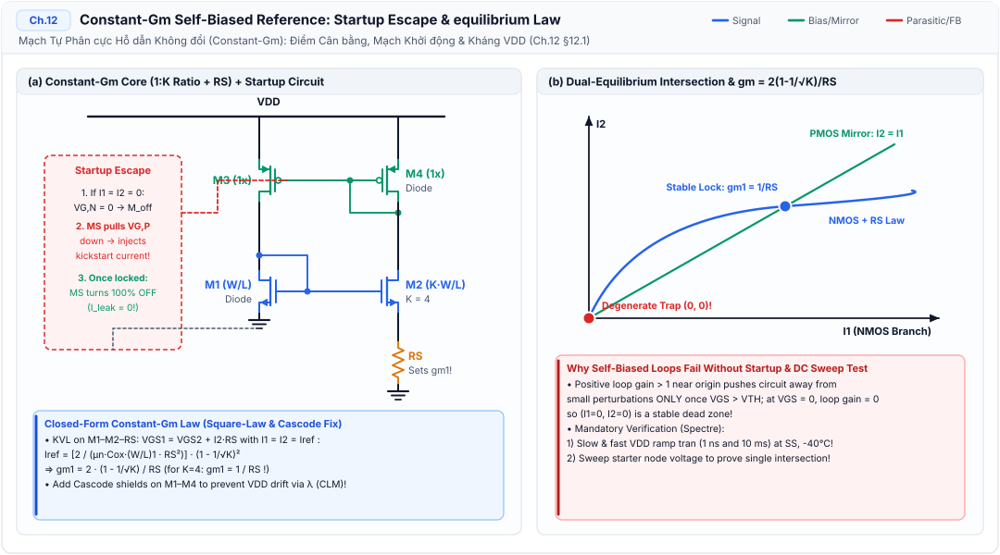

---
{
  "id": "topo-constant-gm-bias-and-supply-sensitivity",
  "kind": "topology",
  "domain": "references-and-biasing",
  "title_vi": "Mạch Tự phân cực Giữ Hỗ dẫn Không đổi (Constant-Gm), Độ nhạy Nguồn cấp do Điều biến Kênh và Cascode Tự phân cực",
  "title_en": "Constant-Gm Self-Biased Reference, Channel-Length Modulation Supply Sensitivity, and Cascode Self-Biasing Fix",
  "summary": "Giải phẫu mạch tự phân cực vòng kín ghim hỗ dẫn gm = (2/RS)·(1 - 1/sqrt(K)) độc lập với thông số MOSFET để ổn định GBW, nhiễu và điện trở khử RHP zero Rz; chứng minh công thức độ nhạy dòng đối với nguồn cấp ∂Iout/∂VDD do rO hữu hạn ở kênh ngắn và kỹ thuật nâng cấp bằng Cascode tự phân cực (Self-Biased Cascode), Op-Amp kẹp nút hoặc điện trở tụ chuyển mạch (CS·fCK)^-1.",
  "diagram": "../../diagrams/constant-gm-self-bias.svg",
  "razavi_refs": [
    {
      "chapter": 12,
      "section": "12.2",
      "pages": "509-513",
      "equations": ["12.1", "12.2", "12.3", "12.4", "12.5", "12.6", "12.7"]
    },
    {
      "chapter": 12,
      "section": "12.4-12.5",
      "pages": "523-525",
      "equations": ["12.51", "12.52", "12.53", "12.54"]
    },
    {
      "chapter": 12,
      "section": "12.8",
      "pages": "533-535",
      "equations": ["12.76"]
    }
  ],
  "glossary_codes": [
    "T012",
    "T026",
    "T069",
    "T529",
    "T712",
    "T713",
    "T813",
    "T2008",
    "T2009",
    "T2012",
    "T2015",
    "T2022",
    "T2023",
    "T2026",
    "T2027",
    "T2080",
    "T2085",
    "T2122",
    "T2123"
  ],
  "process_agnostic": true,
  "roles": {
    "ratioed_nmos_degenerated_pair": "Cặp NMOS M1 (bội số 1) và M2 (bội số K > 1, thường K = 4) mắc nối tiếp điện trở RS ở cực nguồn M2 tạo phương trình cân bằng VGS1 = VGS2 + Iout·RS ghim chặt hiệu điện áp vượt ngưỡng.",
    "pmos_bootstrap_current_mirror": "Cặp gương dòng PMOS M3 = M4 phản hồi dòng nhánh phải quay lại nuôi chính nhánh trái (tự thiết lập nhờ hồi tiếp — bootstrapped), giải phóng dòng phân cực khỏi sự phụ thuộc bậc nhất vào VDD.",
    "cascode_shield_or_clamping_ota": "Tầng cascode điện áp thấp hoặc cascode tự phân cực (Hình 12.37b) ghim VDS1 = VDS2 và VDS3 = VDS4, nén độ nhạy nguồn cấp ∂Iout/∂VDD đi g_m·r_O lần trong công nghệ nanomet.",
    "startup_injector_and_sc_resistor": "Mạch khởi động kéo vòng rời điểm chết suy biến I = 0 khi bật nguồn mà không rò dòng tĩnh sau khi khóa; tùy chọn thay RS bằng tụ chuyển mạch (CS·fCK)^-1 để đạt độ chính xác tần số thạch anh."
  },
  "symptoms_addressed": [
    "resistor-biased-mirror-current-varying-linearly-with-vdd",
    "ota-gbw-and-thermal-noise-drifting-widely-across-temperature-and-mobility",
    "miller-nulling-resistor-rz-losing-tracking-with-1-over-gm2-across-pvt",
    "severe-supply-sensitivity-of-4-transistor-beta-multiplier-in-short-channel-cmos"
  ],
  "limitations": [
    "degenerate-zero-current-state-requires-mandatory-startup-circuit",
    "sheet-resistance-process-tolerance-plus-minus-20-percent-shifts-absolute-gm",
    "body-effect-on-source-degenerated-m2-alters-effective-k-ratio-if-bulk-grounded",
    "positive-feedback-loop-instability-if-rs-bypassed-or-misplaced-on-1x-branch"
  ],
  "checklists": [
    "common-mos",
    "current-mirror",
    "bandgap-and-bias",
    "layout-and-matching"
  ]
}
---

## 1. Bản chất Nguyên lý, Sơ đồ Mạch & Vai trò Từng Nhánh Cấu trúc

Trong hầu hết các bộ khuếch đại tương tự và bộ lọc tích hợp, đại lượng quyết định trực tiếp băng thông độ lợi đơn vị ($\text{GBW} = g_{m1}/C_C$), mật độ phổ nhiễu nhiệt ($4kT\gamma / g_m$), trở kháng đầu vào tầng cổng chung ($1/g_m$) và vị trí điểm không bù tần số Miller ($\omega_z = [C_C(R_z - 1/g_{m2})]^{-1}$) không phải là bản thân dòng điện một chiều $I_D$, mà chính là **hỗ dẫn $g_m$** của MOSFET (Razavi §12.2 & §12.5, trang 509–513, 524–525)! Nếu chỉ dùng một điện trở treo lên nguồn cấp $V_{DD}$ để nuôi gương dòng (Hình 12.1), dòng phân cực trôi thẳng theo $\Delta V_{DD}$; ngay cả khi dùng một nguồn dòng cố định lý tưởng, khi nhiệt độ tăng từ $-40\,^\circ\text{C}$ lên $+125\,^\circ\text{C}$ làm độ linh động hạt tải $\mu(T) \propto T^{-3/2}$ sụt mất một nửa, hỗ dẫn $g_m = \sqrt{2\mu C_{ox}(W/L)I_D}$ vẫn bị suy giảm nghiêm trọng.

Mạch **tự phân cực giữ hỗ dẫn không đổi (`Constant-Gm Biasing`, `T2012` — còn gọi trong công nghiệp là *Beta-Multiplier Reference*)** giải quyết bài toán này bằng cách cho dòng điện tự thiết lập thông qua một vòng hồi tiếp khép kín kết hợp một phần tử phá vỡ tính tuyến tính tỉ lệ là điện trở cực nguồn $R_S$:



Cấu trúc gồm **4 khối chức năng gắn kết chặt chẽ**:
1. **Nhánh so sánh bất đối xứng kích thước có suy biến cực nguồn ($M_1, M_2, R_S$ — Hình 12.3a)**: Transistor $M_1$ mắc diode có tỉ số kích thước $(W/L)_N$, trong khi transistor $M_2$ được nhân bội bằng $K$ đơn vị giống hệt song song ($(W/L)_2 = K(W/L)_N$, thông dụng nhất là $K = 4$) và mắc nối tiếp điện trở $R_S$ từ cực nguồn xuống đất (cực nguồn và cực thân của $M_2$ ưu tiên nối chung trong giếng p riêng `T2018` để khử hiệu ứng thân!).
2. **Gương dòng PMOS tự nuôi hồi tiếp (`Bootstrapped Mirror`, `T2015`, $M_3$–$M_4$)**: Thay vì nhận dòng từ bên ngoài, gương dòng PMOS $M_3 = M_4$ lấy chính dòng cực máng $I_{out}$ của nhánh phải ($M_2$) sao chép tỷ lệ $1:1$ đổ ngược sang nhánh trái ($M_1$). Giao điểm giữa đường đặc tuyến tuyến tính của gương PMOS ($I_{D1} = I_{D2}$) và đường đặc tuyến bão hòa cong của cặp suy biến $M_1$–$M_2$–$R_S$ khóa chặt một nghiệm dòng dương duy nhất $I_{out} > 0$.
3. **Lá chắn Cascode chống nhạy nguồn cấp (`Cascode / Self-Biased Cascode`, `T2123`, Hình 12.37b)**: Ở công nghệ nanomet có $r_O$ nhỏ, chênh lệch lớn giữa $V_{DS4} = V_{DD} - V_{GS1}$ (thay đổi trực tiếp theo $V_{DD}$!) và $V_{DS3} = |V_{GS3}|$ khiến dòng $I_{out}$ vẫn trượt mạnh theo $V_{DD}$. Việc xếp tầng cascode điện áp thấp (`T2122`) hoặc **cascode tự phân cực dùng điện trở chèn gương** khóa chặt $V_{DS}$ hai nhánh bằng nhau và đẩy trở kháng nhìn vào nhánh gương lên bậc $g_m r_O^2$.
4. **Mạch Khởi động thoát điểm chết $I = 0$ (`Start-Up Circuit`, `T2026`, Hình 12.5) & Tùy chọn Tụ chuyển mạch (`T2085`, Hình 12.21)**: Bơm dòng mồi phá vỡ trạng thái tắt hoàn toàn lúc mới cấp nguồn và tự ngắt sạch sẽ khi vòng đã khóa; hoặc thay $R_S$ bằng $(C_S f_{CK})^{-1}$ khi cần độ tái lập cao theo thạch anh.

---

## 2. Hệ Phương trình Cốt lõi & Tư duy "Nhìn Mạch Đọc Nhanh" (Analysis by Inspection)

### 2.1. Phương trình Tự phân cực $I_{out}$ và Luật Ghim Hỗ dẫn $g_m \propto 1/R_S$ (§12.2 & §12.5, PT 12.3–12.4, 12.52–12.54)
Giả sử $M_3 = M_4$ ép hai nhánh mang dòng bằng nhau $I_{D1} = I_{D2} = I_{out}$, bỏ qua điều biến chiều dài kênh ($\lambda = 0$) và hiệu ứng thân ($\gamma = 0$ khi nối nguồn–thân cho $M_2$). Phương trình vòng KVL quanh cực cổng–nguồn của $M_1$ và $M_2$ là $V_{GS1} = V_{GS2} + I_{out} R_S$, hay viết theo luật bình phương (PT 12.3):

$$\sqrt{\frac{2 I_{out}}{\mu_n C_{ox}(W/L)_N}} + V_{TH1} = \sqrt{\frac{2 I_{out}}{\mu_n C_{ox} K (W/L)_N}} + V_{TH2} + I_{out} R_S$$

Với $V_{TH1} = V_{TH2}$ và chia cả hai vế của nghiệm khác không ($I_{out} \neq 0$) cho $\sqrt{I_{out}}$, ta thu được dòng tham chiếu và hỗ dẫn của $M_1$ (PT 12.4 & PT 12.52–12.54):

$$I_{out} = \frac{2}{\mu_n C_{ox}(W/L)_N}\,\frac{1}{R_S^2}\left(1 - \frac{1}{\sqrt{K}}\right)^2 \implies g_{m1} = \sqrt{2\mu_n C_{ox}\left(\frac{W}{L}\right)_N I_{out}} = \frac{2}{R_S}\left(1 - \frac{1}{\sqrt{K}}\right)$$

- **Nhìn nhanh trường hợp vàng $K = 4$**: Khi chọn $M_2$ gồm $K = 4$ transistor đơn vị ghép song song ($1 - 1/\sqrt{4} = 1/2$), biểu thức rút gọn thành hằng đẳng thức tuyệt đẹp:
  $$g_{m1} = \frac{1}{R_S}, \qquad V_{OV1} = \frac{2 I_{out}}{g_{m1}} = 2 I_{out} R_S, \qquad V_{OV2} = \frac{V_{OV1}}{\sqrt{4}} = I_{out} R_S = \Delta V_{RS}$$
  Nghĩa là sụt áp một chiều rơi trên điện trở $R_S$ bằng đúng một nửa điện áp vượt ngưỡng $V_{OV1}$ (thường $80 \dots 150\text{ mV}$)!
- **Hệ quả hệ thống cho mọi transistor được phân cực từ mạch này**: Bất kỳ transistor $M_k$ nào trong Op-Amp trên cùng con chip nhận dòng sao chép $I_{Dk} = m \cdot I_{out}$ và có kích thước $(W/L)_k = p \cdot (W/L)_N$ đều có hỗ dẫn:
  $$g_{mk} = \sqrt{m \cdot p}\;g_{m1} = \frac{2\sqrt{m \cdot p}}{R_S}\left(1 - \frac{1}{\sqrt{K}}\right)$$
  Đặc biệt, nếu điện trở triệt RHP zero $R_z$ trong Op-Amp hai tầng bù Miller được chế tạo từ **cùng loại vật liệu điện trở tấm $R_\square$** với $R_S$ ($R_z = \alpha_R R_S$), thì tích số $g_{m2} R_z = 2\alpha_R \sqrt{m \cdot p}\,(1 - 1/\sqrt{K})$ trở thành **hằng số hình học thuần túy, miễn nhiễm hoàn toàn trước cả biến thiên quy trình $\pm 20\%$ của $R_\square$, biến thiên độ linh động $\mu(T)$ lẫn biến thiên nguồn cấp**!

### 2.2. Giải tích Chính xác Độ nhạy Nguồn cấp $\frac{\partial I_{out}}{\partial V_{DD}}$ do $r_O$ Hữu hạn (Ví dụ 12.1, PT 12.5–12.7)
Tại sao khi đưa mạch 4 transistor Hình 12.3a vào công nghệ `90nm`/`65nm`/`45nm`, dòng $I_{out}$ lại tăng tới $15\% \dots 30\%$ mỗi khi $V_{DD}$ nhích lên $0.2\text{ V}$? Hãy tính đạo hàm tín hiệu nhỏ $\partial I_{out} / \partial V_{DD}$ theo Ví dụ 12.1 của Razavi (Hình 12.4):
- Khi $V_{DD}$ tăng thêm $\Delta V_{DD}$, cực nguồn của $M_3, M_4$ đi lên theo $\Delta V_{DD}$. Trong khi $M_3$ mắc diode giữ $|V_{DS3}| = |V_{GS3}|$ gần cố định, thì cực máng của $M_4$ bị ghim dưới thấp tại $V_{GS1}$ nên toàn bộ $\Delta V_{DD}$ giáng thẳng vào $V_{SD4}$, bơm một dòng nhiễu $\Delta V_{DD} / r_{O4}$ xuống $M_1$!
- Gọi $G_{m2} = \frac{I_{out}}{V_X} = \frac{g_{m2} r_{O2}}{R_S + r_{O2} + (g_{m2} + g_{mb2}) R_S r_{O2}} \approx \frac{g_{m2}}{1 + (g_{m2} + g_{mb2}) R_S}$ là hỗ dẫn suy biến của nhánh $M_2$–$R_S$ (PT 12.7), và $R_1 \approx 1/g_{m1}$ là trở kháng nhánh diode $M_1$, phương trình độ nhạy nguồn cấp chính xác là (PT 12.6):

$$\frac{\partial I_{out}}{\partial V_{DD}} = \frac{1}{r_{O4}}\left[\frac{1}{G_{m2}(r_{O4} \parallel R_1)} - \frac{g_{m4}}{g_{m3}}\right]^{-1} \approx \frac{1}{r_{O4}}\,\frac{1}{\dfrac{g_{m1}}{G_{m2}} - 1}$$

Với $K = 4$ và bỏ qua hiệu ứng thân ($g_{m2} = 2 g_{m1}$, $g_{m1} R_S = 1 \implies G_{m2} = \frac{2 g_{m1}}{1 + 2} = \frac{2}{3} g_{m1}$), hệ số khuếch đại vòng dương làm mẫu số chỉ còn $\frac{g_{m1}}{(2/3)g_{m1}} - 1 = 0.5$, tức là:

$$\frac{\partial I_{out}}{\partial V_{DD}} \approx \frac{2}{r_{O4}} \quad (\text{nhạy gấp đôi một nguồn dòng đơn } r_{O4}\text{!})$$

Phương trình này chỉ thẳng gốc bệnh: muốn $\partial I_{out}/\partial V_{DD} \to 0$, ta bắt buộc phải **nâng trở kháng ra nhánh gương PMOS từ $r_{O4}$ lên $g_m r_O^2$** VÀ **ép $V_{DS}$ hai nhánh đối xứng tuyệt đối**!

### 2.3. Hai Kiến trúc Triệt Độ nhạy Nguồn cấp & Thay thế $R_S$ bằng Tụ Chuyển mạch (§12.5 & §12.8)
1. **Cascode Tự phân cực (`Self-Biased Cascode`, Hình 12.37b, PT 12.76)**:
   Thay vì tốn thêm nhánh phân cực phụ để tạo điện áp cổng cho tầng cascode điện áp thấp, Razavi giới thiệu cấu trúc tự phân cực cực kỳ tinh gọn trong nghiên cứu trường hợp §12.8: chèn một điện trở nhỏ $R_{c}$ nối tiếp với transistor mắc diode sao cho cực cổng của cặp cascode lấy điện áp phía trên $R_c$ ($V_{G,\text{cas}} = V_{GS} + I_{out} R_c$). Chọn $I_{out} R_c \approx V_{DS,\min} \approx 120 \dots 150\text{ mV}$, transistor dưới được ghim đúng điểm gối bão hòa với khoảng dự trữ tối thiểu chỉ $2 V_{DS,\min}$, trong khi $r_{O,\text{eff}}$ tăng lên $(1 + g_{m,\text{cas}} r_{O,\text{cas}}) r_O$, nén độ nhạy nguồn cấp đi $30 \dots 80$ lần!
2. **Mạch Constant-$G_m$ dùng Tụ chuyển mạch (`Switched-Capacitor Resistor`, Hình 12.21)**:
   Thay điện trở $R_S$ (vốn chịu dung sai chế tạo $\pm 20\%$ và hệ số nhiệt TCR) bằng một tụ điện $C_S$ đóng ngắt ở tần số xung nhịp thạch anh chính xác $f_{CK}$ tạo điện trở trung bình $R_{eq} = \frac{1}{C_S f_{CK}}$ (kèm tụ lọc lớn $C_B$ nối đất san phẳng xung chuyển mạch):
   $$g_{m1} = 2 C_S f_{CK}\left(1 - \frac{1}{\sqrt{K}}\right)$$
   Vì dung sai tuyệt đối của tụ kim loại MIM/MOM ($\pm 5\% \dots 10\%$) chặt hơn nhiều so với điện trở poly và hệ số nhiệt của tụ gần bằng không ($\sim 20 \dots 30\text{ ppm/}^\circ\text{C}$), hỗ dẫn $g_m$ đạt độ ổn định nhiệt và độ tái lập vượt trội!

---

## 3. Bất biến Cấu trúc & Các Bẫy Lỗi Kinh điển (Structural Invariants & Traps)

- **[INV-CGM-01] Bất biến Độ lợi Vòng Hồi tiếp Dương Nhỏ hơn Đơn vị ($T_{\text{pos}} < 1 \iff R_S$ đặt đúng ở nhánh $K > 1$)**:
  Mạch Constant-$G_m$ là một vòng **hồi tiếp dương** (tăng $I_{D1} \to$ tăng $I_{D3} = I_{D4}$ qua gương PMOS $\to$ kéo tăng $I_{D2}$!). Mạch chỉ có điểm cân bằng ổn định vì tại nghiệm làm việc, điện trở suy biến $R_S$ nén độ lợi vòng nhỏ hơn $1$:
  $$T_{\text{loop}} = \left(\frac{g_{m4}}{g_{m3}}\right)\frac{G_{m2}}{g_{m1}} = \frac{\sqrt{K}}{1 + \sqrt{K}\,(g_{m1} R_S)} = \frac{\sqrt{K}}{1 + \sqrt{K}\cdot 2(1 - 1/\sqrt{K})} = \frac{\sqrt{K}}{2\sqrt{K} - 1} < 1 \quad (\forall K > 1)$$
  Nếu vẽ nhầm đặt $R_S$ sang nhánh $1\times$ ($M_1$) thay vì nhánh $K\times$ ($M_2$), hoặc chọn $K \le 1$, phương trình cân bằng vô nghiệm dương và dòng sập thẳng về $0\text{ A}$!
- **[INV-CGM-02] Bất biến Kiểm chứng Thoát Điểm Suy biến $I_{out} = 0$ bằng Quét DC Chậm (`No False Capacitive Start-Up`, `T2027`)**:
  Khi mới bật nguồn, $V_{GS1} = 0\text{ V}$ và $|V_{GS3}| = 0\text{ V}$ là một điểm cân bằng ổn định thứ hai ($I_{out} = 0$). Nếu chỉ kiểm tra mạch khởi động bằng phép mô phỏng quá độ `tran` với sườn nguồn dốc đứng (ví dụ `trise = 1 ns`), dòng nạp điện dung ký sinh $C_{GD}\,dV_{DD}/dt$ bơm mồi giả giúp mạch bật lên trên máy tính nhưng sẽ **chết cứng ngoài thực tế** khi nguồn LDO bên ngoài lên chậm hàng chục miligiây! Bắt buộc kiểm chứng bằng phép quét `.dc VDD 0 VDD_max`!
- **[TRAP-CGM-01] Bẫy Gắn Tụ Lọc Nhiễu Song song Trực tiếp với $R_S$ Gây Dao động Tự kích Tần số Cao**:
  Nhiều kỹ sư sợ nhiễu nhiệt của $R_S$ nên gắn một tụ điện lớn $C_{\text{bypass}}$ song song với $R_S$ để lọc nhiễu! Thảm họa: ở tần số cao $\omega \gg 1/(R_S C_{\text{bypass}})$, tụ điện nối tắt hoàn toàn $R_S$, làm hỗ dẫn nhánh phải vọt từ $G_{m2}$ lên $g_{m2} = \sqrt{K}\,g_{m1} > g_{m1}$, đẩy **độ lợi vòng hồi tiếp dương vọt lên $T_{\text{loop}}(j\omega) = \sqrt{K} = 2 > 1$** và biến mạch phân cực thành một bộ dao động tự kích! Tuyệt đối không bao giờ nối tắt AC qua $R_S$!
- **[TRAP-CGM-02] Bẫy Hiệu ứng Thân (`Body Effect`) trên $M_2$ và Sụp Luật Bình phương ở Nanomet**:
  Nếu chế tạo trên quy trình giếng n đơn (không có `Deep N-well`), cực thân của NMOS $M_2$ nối đất trong khi cực nguồn của $M_2$ nổi ở $I_{out} R_S > 0$, làm $V_{TH2} > V_{TH1}$! Khi đó $I_{out} R_S = V_{GS1} - V_{GS2}$ bị thu hẹp mất một lượng $\Delta V_{TH2,\text{body}} \approx \gamma(\sqrt{2\phi_F + I_{out}R_S} - \sqrt{2\phi_F})$, làm giảm $I_{out}$ và đưa sự phụ thuộc ngưỡng quay trở lại! Giải pháp chuẩn: hoặc đặt cặp lõi vào PMOS nằm trong hai `N-well` riêng biệt nối nguồn–thân ($V_{SB}=0$), hoặc dùng NMOS trong `Deep N-well`! Ngoài ra ở `45nm`/`65nm`, nếu định cỡ $M_1, M_2$ ở $V_{OV}$ quá lớn rơi vào bão hòa vận tốc, công thức căn bậc hai hết hiệu lực — phải giữ $M_1, M_2$ ở chiều dài kênh dài ($L \ge 0.5 \dots 1.0\,\mu\text{m}$) và vùng nghịch đảo vừa/mạnh vừa phải ($g_m/I_D \approx 10 \dots 15\text{ V}^{-1}$).

---

## 4. Lộ trình Nâng cấp Cấu trúc & Bát giác Đánh đổi (Upgrade Paths & Design Octagon)

Trong `concept-analog-design-octagon`, mạch Constant-$G_m$ đánh đổi một lượng nhỏ công suất nhánh tham chiếu, diện tích điện trở $R_S$ và khoảng dự trữ điện áp cascode để khóa chặt độ ổn định của băng thông, dự trữ pha và nhiễu cho toàn bộ hệ thống Op-Amp/PLL trên chip:
- **Nền tảng từ**: `topo-basic-current-mirror` $\rightarrow$ `tech-supply-independent-bias-and-startup` $\rightarrow$ nâng cấp trực tiếp thành `topo-constant-gm-bias-and-supply-sensitivity`.
- **Các lộ trình nâng cấp thực chiến**:
  1. **Khi độ nhạy nguồn cấp $\partial I_{out}/\partial V_{DD}$ quá lớn ở tiến trình kênh ngắn**: Nâng cấp cặp gương PMOS và cặp NMOS lên **Cascode điện áp thấp / Cascode tự phân cực** (`topo-lvccml-wide-swing-mirror`, Hình 12.37b) hoặc dùng một OTA phụ kẹp cứng $V_{DS1} = V_{DS2}$ để đạt PSRR $> 60 \dots 80\text{ dB}$.
  2. **Khi cần triệt tiêu hoàn toàn hệ số nhiệt của điện trở $R_S$**: Kết hợp dòng PTAT từ lõi lưỡng cực (`tech-ptat-current-and-constant-gm`) với dòng CTAT trên điện trở cùng loại, hoặc thay $R_S$ bằng mạng tụ chuyển mạch $(C_S f_{CK})^{-1}$ khi có xung nhịp chuẩn.
  3. **Cấp phân cực cho khối tiêu thụ**: Bắt buộc nuôi tầng hai của `topo-two-stage-opamp` để điện trở khử RHP zero `tech-miller-rhp-zero-nulling-and-cascode-comp` tự động bám $1/g_{m2}$ trên toàn miền PVT!

| Cấu trúc Mạch Tạo Dòng Phân cực | Đại lượng Được Ghim | Độ nhạy Nguồn $\frac{\Delta I / I}{\Delta V_{DD}}$ | Khoảng Dự trữ $V_{DD,\min}$ | Ứng dụng Điển hình |
| :--- | :--- | :--- | :--- | :--- |
| **Điện trở treo nguồn + Gương đơn** | Không ghim ($I \propto V_{DD} - V_{GS}$) | Rất xấu ($\sim 100\% / \text{V}$) | $V_{GS} + V_{DS,\min}$ | Chỉ dùng cho mạch số/thử nghiệm thô |
| **Constant-$G_m$ 4 Transistor cơ bản** | $g_m = \frac{2}{R_S}(1 - 1/\sqrt{K})$ | Trung bình–kém ($\sim \frac{2}{I_{out} r_{O4}}$) | $V_{GS,N} + |V_{DS,\min,P}|$ | Nguồn đã qua LDO sạch, kênh dài |
| **Constant-$G_m$ Cascode Tự phân cực** | $g_m = \frac{2}{R_S}(1 - 1/\sqrt{K})$ | **Xuất sắc** (giảm $g_m r_O$ lần, $< 0.5\%/\text{V}$) | $V_{GS} + 2 V_{DS,\min} \approx 0.85\text{ V}$ | **Chuẩn công nghiệp** cho Op-Amp, ADC, VCO |
| **Constant-$G_m$ Tụ chuyển mạch** | $g_m = 2 C_S f_{CK}(1 - 1/\sqrt{K})$ | Xuất sắc (khi kèm cascode) | $V_{GS} + 2 V_{DS,\min}$ | Bộ lọc thời gian liên tục $G_m\text{-}C$ chính xác cao |

---

## 5. Thích ứng Đa Tiến trình (90nm / 65nm / 45nm) & Cách Kiểm chứng trong Cadence / Spectre

### 5.1. Quy tắc Định cỡ và Layout Bền vững trên 90nm / 65nm / 45nm
1. **Đưa điện trở $R_S$ lên nhánh PMOS nối nguồn–thân nếu thiếu Deep N-Well**: Trên quy trình giếng n đơn tiêu chuẩn, thay vì đặt $R_S$ ở cực nguồn NMOS $M_2$ (bị hiệu ứng thân!), hãy đảo cấu trúc: đặt $R_S$ ở cực nguồn của PMOS $M_4$ (kích thước $K = 4$, nằm trong `N-well` riêng nối cực thân thẳng vào cực nguồn của chính $M_4$!) và dùng gương cascode NMOS ở dưới. Như vậy $V_{SB} = 0$ tuyệt đối trên cả hai linh kiện lập tỉ số mà không tốn mặt nạ `Deep N-well`!
2. **Chọn $L$ dài để bảo toàn quan hệ căn bậc hai và triệt DIBL**: Ngay cả trong chip `45nm`, lõi Constant-$G_m$ chỉ mang dòng DC nên luôn chọn $L \ge 0.5 \dots 1.0\,\mu\text{m}$ cho cả NMOS lẫn PMOS, bố trí ma trận tâm chung `1 : 4` (ví dụ `B B A B B` với 2 thanh dummy hai biên theo `tech-common-centroid-sti-wpe-layout`), và dùng điện trở poly không silicide (`rppolywo`) cùng loại với $R_z$ trong Op-Amp.
3. **Mạch Khởi động Không Rò Dòng cho Nguồn Thấp $\le 1.0\text{ V}$**: Không dùng chuỗi 3 diode nối tiếp Hình 12.5a khi $V_{DD} = 1.0\text{ V}$ (vì $3 V_{TH} > V_{DD}$ không bật nổi ở $-40\,^\circ\text{C}$, hoặc không tắt hẳn ở $+125\,^\circ\text{C}$!). Thay bằng bộ đảo cảm nhận dòng (inverter-sensed startup): một nhánh dòng rò siêu nhỏ $100\text{ nA}$ (MOSFET kênh rất dài $L = 5\,\mu\text{m}$) kéo cổng một công tắc khởi động mở mồi khi $V_{GS1} \approx 0$, và bị kéo sập hoàn toàn về $0\text{ V}$ ngay khi nhánh chính đã dẫn dòng ($I_{\text{leak,startup}} = 0$ tĩnh!).

### 5.2. Phác đồ Kiểm chứng Bắt buộc trong Cadence Spectre
```spice
// Kiem chung 4 tieu chi song con cua mach Constant-Gm trong Spectre:
// 1. Quet DC VDD tu 0 -> 1.2V o ca 5 goc PVT (dac biet SS/-40C va FF/125C) kiem tra:
//    (a) Khong bi ket o Iout = 0 tren DC sweep, (b) Do nhay d(Iout)/d(VDD) trong vung [0.9V, 1.1V] < 1%/V
dc_sup dc param=vdd_val start=0 stop=1.2 step=5m

// 2. Quet nhiet do -40C .. 125C xac nhan tich gm_target * Rz_replica bien thien < +-3%:
dc_temp dc param=temp start=-40 stop=125 step=5

// 3. Dat iprobe trong vong tu phan cuc chay STB xac nhan:
//    (a) Do loi vong duong o DC < 0 dB, (b) Khong co dinh peaking > 0 dB o tan so cao!
stb_loop stb probe=I_loop_probe start=10 stop=10G dec=40

// 4. Qua do bat nguon cham (10 ms ramp) va sap nguon tam thoi (brown-out glitch):
//    Dam bao I(M_startup:d) < 500pA sau khi khoa!
tran_boot tran stop=25m errpreset=conservative
```

---

## 6. Mốc Đối chiếu Sách Razavi & Thuật ngữ Chuẩn CLB

- **Sách gốc Razavi (2nd Ed.)**: Chương 12 (*Bandgap References*):
  - **§12.2** (*Supply-Independent Biasing*, trang 509–513, Hình `12.1`–`12.5`, PT `12.1`–`12.7`, Ví dụ `12.1`, Bài tập `12.1`–`12.4`): Từ phân cực điện trở sang gương tự thiết lập nhờ hồi tiếp, công thức độ nhạy nguồn cấp $\partial I_{out}/\partial V_{DD}$ do $r_{O4}$ hữu hạn, điểm phân cực suy biến $I = 0$ và nguyên lý mạch khởi động.
  - **§12.4–12.5** (*PTAT Current Generation & Constant-$G_m$ Biasing*, trang 523–525, Hình `12.18`–`12.21`, PT `12.51`–`12.54`): Đạo xuất hỗ dẫn $g_{m1} = \frac{2}{R_S}(1 - 1/\sqrt{K})$ độc lập tham số MOSFET và cấu trúc thay thế $R_S$ bằng điện trở tụ chuyển mạch $(C_S f_{CK})^{-1}$.
  - **§12.8** (*Case Study*, trang 533–535, Hình `12.37b`, PT `12.76`): Cấu trúc **cascode tự phân cực (`self-biased cascode`)** nén độ nhạy nguồn cấp trong nguồn tham chiếu chính xác cao.
- **Đối chiếu Thuật ngữ Chuẩn CLB (`terms-vi-en.json`)**:
  - `T2008` / `T2012`: `supply-independent biasing` / `constant-Gm biasing` — **phân cực độc lập nguồn cấp** / **phân cực giữ hỗ dẫn không đổi**.
  - `T2015` / `T813`: `bootstrapped` (ngữ cảnh §12.2) / `self-biasing` — **được tự thiết lập nhờ hồi tiếp** / **tự phân cực**.
  - `T2022` / `T2023` / `T2027`: `degenerate bias points` / `zero current` / `false start-up` — **các điểm phân cực suy biến** / **dòng điện bằng không** / **khởi động giả**.
  - `T2085` / `T2123`: `switched-capacitor resistor` / `self-biased cascode` — **điện trở tụ điện chuyển mạch** / **cascode tự phân cực**.
