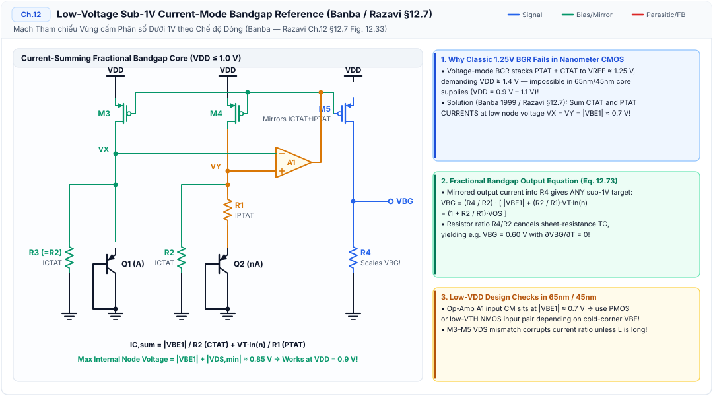

---
{
  "id": "topo-low-voltage-sub1v-bandgap",
  "kind": "topology",
  "domain": "references-and-biasing",
  "title_vi": "Mạch tham chiếu vùng cấm điện áp thấp dưới 1 V (Banba Fractional Sub-1V Bandgap Reference)",
  "title_en": "Low-Voltage Sub-1V Fractional Bandgap Reference",
  "summary": "Kiến trúc cộng dòng điện có hệ số nhiệt đối dấu (cấu trúc Banba và phân áp dòng Neuteboom) phá vỡ trần vật lý 1.25 V của tham chiếu vùng cấm truyền thống, cho phép tạo điện áp tham chiếu bất kỳ dưới 1 V (như 0.5 V - 0.8 V) và vận hành ở nguồn cấp VDD thấp tới 0.75 V trong các tiến trình CMOS 90nm / 65nm / 45nm.",
  "diagram": "../../diagrams/low-voltage-sub1v-bandgap.svg",
  "razavi_refs": [
    {
      "chapter": 12,
      "section": "12.7",
      "pages": "529-533",
      "equations": ["12.66", "12.67", "12.68", "12.69", "12.70", "12.71", "12.72", "12.73", "12.74", "12.75"]
    }
  ],
  "glossary_codes": [
    "T011",
    "T086",
    "T2058",
    "T2073",
    "T2101",
    "T2103",
    "T2104",
    "T2105",
    "T2106",
    "T2107",
    "T2108",
    "T2109",
    "T2110",
    "T2111",
    "T2112",
    "T2113",
    "T2114",
    "T2115"
  ],
  "process_agnostic": true,
  "roles": {
    "ptat_bjt_loop": "Cặp BJT pnp đế Q1 (A), Q2 (n·A) và điện trở R1 thiết lập thành phần dòng hệ số nhiệt dương IPTAT = VT·ln(n)/R1",
    "shunt_ctat_resistors": "Cặp điện trở đối xứng R2 = R3 mắc song song từ hai nút kẹp X, Y xuống đất sinh ra thành phần dòng hệ số nhiệt âm ICTAT = |VBE1|/R2 mà không làm lệch tỉ số dòng cực góp IC1 = IC2",
    "current_summing_pmos_mirror": "Gương dòng PMOS M3-M4-M5 cộng trực tiếp hai dòng IPTAT + ICTAT thành dòng có hệ số nhiệt bằng không (zero-TC current) và sao chép sang nhánh ngõ ra",
    "scaling_load_resistor_r4": "Điện trở tải ngõ ra R4 chuyển đổi dòng zero-TC thành điện áp tham chiếu phân số tùy ý VBG = (R4/R2)·(|VBE1| + (R2/R1)·VT·ln(n)) < 1 V",
    "low_vdd_ota_and_startup": "Bộ khuếch đại 5T-OTA đầu vào PMOS vận hành ngay dưới ngưỡng |VBE1| kèm transistor NMOS khởi động nối giữa nút cổng PMOS và nút X"
  },
  "symptoms_addressed": [
    "classic-1p25v-bandgap-exceeds-sub1v-supply",
    "pmos-mirror-crushed-in-triode-at-1v-vdd",
    "need-arbitrary-sub1v-reference-0p5v-to-0p8v",
    "need-zero-tc-bias-current-for-nanometer-blocks"
  ],
  "limitations": [
    "opamp-offset-and-noise-scaled-by-r4-over-r1-parallel-r2",
    "large-r4-generates-thermal-noise-and-high-output-impedance",
    "tight-ota-input-common-mode-window-around-vbe-at-sub1v-vdd",
    "resistor-mismatch-between-r2-and-r3-skews-bjt-currents"
  ],
  "checklists": [
    "common-mos",
    "current-mirror",
    "bandgap-and-bias",
    "layout-and-matching"
  ]
}
---

## 1. Bản chất Nguyên lý, Sơ đồ Mạch & Vai trò Từng Nhánh Cấu trúc

Trong cấu trúc tham chiếu vùng cấm kinh điển (`topo-bandgap-reference-core`), phép bù trừ nhiệt độ được thực hiện trong **miền điện áp**: ta buộc phải cộng chồng khoảng $17,2 V_T \approx 0,45\text{ V}$ nối tiếp lên một điện áp gốc–phát $|V_{BE}| \approx 0,75\text{–}0,80\text{ V}$, tạo ra điện áp ngõ ra cứng nhắc $V_{REF} \approx 1,25\text{ V}$. Khi công nghệ CMOS thu nhỏ xuống $90\text{nm}$ ($V_{DD} = 1,0\text{–}1,2\text{ V}$), $65\text{nm}$ ($V_{DD} = 1,0\text{ V}$) và $45\text{nm}$ ($V_{DD} = 0,9\text{–}1,0\text{ V}$), cấu trúc truyền thống sụp đổ hoàn toàn vì nguồn cấp $V_{DD}$ thậm chí còn thấp hơn $1,25\text{ V}$!

Trong Mục `12.7` (trang 529–533), Razavi dẫn dắt bước ngoặt tư duy của **H. Banba et al. (IEEE JSSC 1999)**: *Thay vì cộng hai điện áp có hệ số nhiệt đối dấu, ta cộng hai **dòng điện** có hệ số nhiệt đối dấu ($I_{PTAT}$ và $I_{CTAT}$) tại một nút dòng, tạo ra một **dòng điện có hệ số nhiệt bằng không (zero-TC current)**, rồi cho dòng đó chảy qua một điện trở $R_4$ có giá trị tùy chọn xuống đất để thu được **điện áp có hệ số nhiệt bằng không nhỏ tùy ý** ($V_{BG} < 1\text{ V}$)!*

Quá trình tiến hóa 3 bước trong Hình 12.32 làm sáng tỏ trọn vẹn vai trò của từng linh kiện:
1. **Thử nghiệm ngây thơ bị lỗi (Hình 12.32a):** Xuất phát từ mạch tạo dòng PTAT Hình 12.18, nếu chỉ mắc thêm một điện trở $R_2$ song song với $Q_2$, thì $R_1$ phải gánh thêm dòng $|V_{BE2}|/R_2$, làm hai dòng cực góp $I_{C1} \neq I_{C2}$ bị lệch nhau theo nhiệt độ và phá hủy bản chất PTAT của hiệu $\Delta V_{BE}$!
2. **Sửa lỗi đối xứng hoàn hảo của Banba (Hình 12.32b–c):** Thay vì mắc $R_2$ dưới $R_1$, ta nối $R_2$ trực tiếp từ nút kẹp $Y$ xuống đất, và **đặt thêm một điện trở đối xứng $R_3 = R_2$ từ nút kẹp $X$ xuống đất** (song song với $Q_1$).
   - Khi Op-Amp $A_1$ ép $V_X = V_Y = |V_{BE1}|$ và gương PMOS $M_3$–$M_4$ ($1:1$) ép $I_{D3} = I_{D4}$, hai dòng rẽ qua $R_3$ và $R_2$ hoàn toàn bằng nhau ($\frac{|V_{BE1}|}{R_3} = \frac{|V_{BE1}|}{R_2}$), nhờ đó hai dòng đi vào hai nhánh BJT vẫn bằng nhau tuyệt đối $I_{C1} = I_{C2} = \frac{V_T \ln n}{R_1}$!
   - Đồng thời, tổng dòng chảy trên mỗi nhánh PMOS chính là tổng của dòng PTAT (nhánh BJT) cộng với dòng CTAT (nhánh điện trở $R_2$): $|I_{D4}| = \frac{V_T \ln n}{R_1} + \frac{|V_{BE1}|}{R_2}$.
3. **Nhánh xuất áp phân số ($M_5$ và $R_4$):** Transistor PMOS $M_5$ sao chép dòng zero-TC $|I_{D4}|$ đổ xuống điện trở $R_4$, tạo ra bất kỳ mức điện áp tham chiếu nào (ví dụ $0,50\text{ V}$, $0,60\text{ V}$ hoặc $0,80\text{ V}$), trong khi khoảng dự trữ nguồn cấp tối thiểu toàn mạch chỉ cần **$V_{DD,\min} = |V_{BE1}| + |V_{DS3,\min}| \approx 0,70\text{ V} + 0,05\text{ V} = 0,75\text{ V}$**!
4. **Biến thể phân áp dòng Neuteboom (Hình 12.35):** Giữ nhánh thứ ba $|V_{BE3}| + R_2$ như Hình 12.20 nhưng mắc thêm điện trở $R_3$ từ $V_{out}$ xuống đất để trích bớt một phần dòng PTAT $|I_{D5}|$, hạ áp chuẩn $1,25\text{ V}$ xuống theo tỉ số $\frac{R_3}{R_2 + R_3}$.

---

## 2. Hệ Phương trình Cốt lõi & Tư duy "Nhìn Mạch Đọc Nhanh" (Analysis by Inspection)

### 2.1. Hệ phương trình cân bằng nút và điện áp ngõ ra Banba (Phương trình 12.66–12.69)
Tại hai nút $X$ và $Y$ của Hình 12.32(c) với $V_X \approx V_Y \approx |V_{BE1}|$ và $I_{D3} = I_{D4}$:

$$I_{C1} + \frac{|V_{BE1}|}{R_3} = I_{C2} + \frac{|V_{BE1}|}{R_2}$$

Chọn **$R_2 = R_3$**, ta khôi phục ngay $I_{C1} = I_{C2}$. Phương trình vòng nhánh phải cho $|V_{BE1}| = |V_{BE2}| + I_{C2} R_1 \implies I_{C2} = \frac{V_T \ln n}{R_1}$. Do đó dòng cực máng của $M_4$ là:

$$|I_{D4}| = \frac{V_T \ln n}{R_1} + \frac{|V_{BE1}|}{R_2} = \frac{1}{R_2}\left(|V_{BE1}| + \frac{R_2}{R_1} V_T \ln n\right)$$

Nếu $M_5$ có kích thước gấp $k$ lần $M_4$ (sách xét $k=1$ để gọn ký hiệu; tổng quát $|I_{D5}| = k |I_{D4}|$), điện áp tham chiếu ngõ ra trên $R_4$ là:

$$V_{BG} = k \frac{R_4}{R_2}\left(|V_{BE1}| + \frac{R_2}{R_1} V_T \ln n\right)$$

- **Quy tắc thiết kế 2 bước tách rời hoàn toàn (Orthogonal Two-Step Sizing):**
  - **Bước 1 (Chỉnh Zero-TC):** Chọn tỉ số $\frac{R_2}{R_1} \ln n \approx 17,2$ (chính xác theo đạo hàm $|V_{BE1}|$ ở dòng PTAT của PDK) để biểu thức trong ngoặc đơn bằng hằng số vùng cấm $V_{BG0} \approx 1,20\text{–}1,25\text{ V}$ có $\partial V / \partial T = 0$. Lưu ý $R_2 = R_3$ triệt tiêu cả hệ số nhiệt của điện trở trong $V_{BG}$ bởi vì $R_4 / R_2$ là tỉ số hai điện trở cùng loại! (Riêng dòng điện $|I_{D4}| = V_{BG0}/R_2$ sẽ có hệ số nhiệt ngược dấu với $\text{TC}_{R2}$ trừ khi ghép hai loại điện trở bù nhau, nhưng khi nhân lại với $R_4$ cùng loại thì $\text{TC}_{R4}$ và $\text{TC}_{R2}$ khử nhau sạch sẽ trong $V_{BG}$!).
  - **Bước 2 (Đặt mức điện áp đích $V_{BG} < 1\text{ V}$):** Chọn tỉ số $\frac{k R_4}{R_2} = \frac{V_{BG,\text{target}}}{1,25\text{ V}}$. Ví dụ muốn $V_{BG} = 0,60\text{ V}$ với $k=1$, chỉ cần đặt $R_4 / R_2 \approx 0,48$!

### 2.2. Khuếch đại Điện áp lệch $V_{OS}$ và Nhiễu Op-Amp trong cấu trúc Banba (Ví dụ 12.8, Phương trình 12.70–12.73)
Khi Op-Amp $A_1$ tồn tại điện áp lệch ngõ vào $V_{OS}$ sao cho $V_X \approx |V_{BE1}|$ và $V_Y \approx |V_{BE1}| - V_{OS}$ (Hình 12.33):
- Dòng qua $R_1$ bị lệch thành $I_{C2} \approx \frac{V_T \ln n - V_{OS}}{R_1}$;
- Đồng thời, chính điện trở $R_2$ nối từ nút $Y$ xuống đất cũng gánh thêm sai số dòng $-\frac{V_{OS}}{R_2}$!
Cộng hai thành phần lại trên nhánh $M_4$ và nhân sang $R_4$ (với $k=1$):

$$V_{BG} = \frac{R_4}{R_2}\left(|V_{BE1}| + \frac{R_2}{R_1} V_T \ln n\right) - \frac{R_4}{R_1 \parallel R_2} V_{OS} = \frac{R_4}{R_2}\left[|V_{BE1}| + \frac{R_2}{R_1} V_T \ln n - \left(1 + \frac{R_2}{R_1}\right) V_{OS}\right]$$

- **So sánh cực kỳ quan trọng với Bandgap $1,25\text{ V}$ chuẩn:**
  Tuy biên độ tuyệt đối của sai số ngõ ra được thu nhỏ theo cùng tỉ lệ $\frac{R_4}{R_2}$, nhưng **sai số tương đối $\frac{\Delta V_{BG}}{V_{BG}}$ do $V_{OS}$ gây ra là $\frac{(1 + R_2/R_1) V_{OS}}{1,25\text{ V}}$** — thực chất còn nhỉnh hơn một chút so với Bandgap chuẩn vì $V_{OS}$ tác động lên cả $R_1$ lẫn $R_2$! Như Razavi kết luận ở phương trình (12.73), cách duy nhất để giảm hệ số $(1 + R_2/R_1)$ trong ngoặc vuông (ngoài việc giảm chính $V_{OS}$) là **tăng tối đa tỉ số diện tích $n$** của cặp BJT (ví dụ dùng $n = 24$ thay vì $n = 8$ để giảm $R_2/R_1$ từ $8,3$ xuống $5,4$).
- Tương tự, điện áp nhiễu quy về ngõ vào của Op-Amp $V_{n,op}$ cũng bị nhân lên thành $\frac{R_4}{R_1 \parallel R_2} V_{n,op}$ tại ngõ ra, cộng thêm nhiễu nhiệt trực tiếp $4 k T R_4$ của điện trở tải $R_4$ (thường hàng chục $\text{k}\Omega$ khi thiết kế công suất thấp)!

### 2.3. Phương trình biến thể Neuteboom (Hình 12.35, Phương trình 12.74–12.75)
Trong Hình 12.35 với $|I_{D5}| = \frac{V_T \ln n}{R_1}$ chia cho hai nhánh song song ($R_3$ xuống đất và $R_2 + Q_3$ xuống đất):

$$\frac{V_{out}}{R_3} + \frac{V_{out} - |V_{BE3}|}{R_2} = \frac{V_T \ln n}{R_1} \implies V_{out} = \frac{R_3}{R_2 + R_3}\left(|V_{BE3}| + \frac{R_2}{R_1} V_T \ln n\right)$$

### 2.4. Phân tích Nhiễu Ngõ ra và Ví dụ Định cỡ Thực tế ở $V_{DD} = 0,85\text{ V}$ (Bài tập 12.24)
Tổng mật độ phổ công suất nhiễu tại ngõ ra $V_{BG}$ của mạch Banba Hình 12.32(c) (trước tụ lọc ngõ ra) bao gồm ba nguồn đóng góp độc lập:
1. **Nhiễu quy về ngõ vào của OTA ($V_{n,op}^2$ gồm cả nhiễu nhiệt và $1/f$):** Được nhân lên giống hệt hệ số khuếch đại điện áp lệch $V_{OS}$ trong phương trình (12.72):
   $$S_{V,\text{op}}(f) = \left(\frac{R_4}{R_1 \parallel R_2}\right)^2 \overline{V_{n,op}^2(f)}$$
2. **Nhiễu dòng của cặp gương PMOS $M_4$–$M_5$:** Dòng nhiễu của $M_4$ (được hồi tiếp truyền qua cổng chung) và $M_5$ đổ trực tiếp vào $R_4$:
   $$S_{V,\text{mirror}}(f) \approx 2 R_4^2 \left(4 k T \gamma g_{m4} + \frac{K_P}{C_{ox} W_4 L_4 f} g_{m4}^2\right)$$
3. **Nhiễu nhiệt của chính các điện trở $R_1, R_2, R_3, R_4$:**
   $$S_{V,R} \approx 4 k T R_4 + 4 k T R_1 \left(\frac{R_4}{R_1}\right)^2 = 4 k T R_4 \left(1 + \frac{R_4}{R_1}\right)$$
- **Ví dụ định cỡ số thực tế cho SoC $65\text{nm}$ ($V_{DD} = 0,85\text{ V}$, mục tiêu $V_{BG} = 0,600\text{ V}$, tổng dòng $< 30\,\mu\text{A}$):**
  - Chọn ma trận BJT đơn vị $n = 24$ (lưới $5 \times 5$ lấy tâm là $Q_1$, 24 ô xung quanh là $Q_2$) $\implies \ln 24 = 3,178$, tại $300\text{ K}$ cho $\Delta V_{BE} \approx 82,2\text{ mV}$.
  - Với $|V_{BE1}(300\text{ K})| \approx 740\text{ mV}$ và $|\partial V_{BE1}/\partial T| \approx 1,42\text{ mV/K}$, điều kiện zero-TC cho $\frac{R_2}{R_1} \approx \frac{1,42}{0,0862 \times 3,178} \approx 5,18$.
  - Chọn dòng nhánh BJT $I_{C1} = I_{C2} = 4,1\,\mu\text{A} \implies R_1 = \frac{82,2\text{ mV}}{4,1\,\mu\text{A}} = 20\text{ k}\Omega$, suy ra $R_2 = R_3 = 5,18 \times 20\text{ k}\Omega = 103,6\text{ k}\Omega$ (dòng qua $R_2$ là $740\text{ mV} / 103,6\text{ k}\Omega \approx 7,14\,\mu\text{A}$).
  - Tổng dòng zero-TC mỗi nhánh gương PMOS là $|I_{D3}| = |I_{D4}| = |I_{D5}| \approx 4,1 + 7,14 = 11,24\,\mu\text{A}$ (cả 3 nhánh cộng OTA chỉ tiêu thụ $\approx 38\,\mu\text{A}$, hoặc giảm nửa dòng bằng cách nhân đôi các điện trở!).
  - Đặt mức ngõ ra $V_{BG} = 0,600\text{ V}$: chọn $R_4 = \frac{0,600\text{ V}}{11,24\,\mu\text{A}} \approx 53,4\text{ k}\Omega$ (tức $R_4 / R_2 \approx 0,515$). Hệ số nhân offset chỉ còn $\frac{R_4}{R_1 \parallel R_2} = 0,515 \times (1 + 5,18) \approx 3,18\times$!

---

## 3. Bất biến Cấu trúc & Các Bẫy Lỗi Kinh điển (Structural Invariants & Traps)

- **[INV-LVBG-01] Bất biến đối xứng tuyệt đối $R_2 = R_3$ trong lưới điện trở đơn vị:**
  Nếu $R_2$ và $R_3$ lệch nhau $\Delta R$, phương trình (12.66) làm $I_{C1} - I_{C2} = |V_{BE1}|\left(\frac{1}{R_2} - \frac{1}{R_3}\right) \neq 0$, tiêm một thành phần CTAT ký sinh lọt vào vòng tạo $\Delta V_{BE}$. Bắt buộc dựng $R_2$ và $R_3$ từ các thanh điện trở đơn vị đan xen tâm chung (`tech-common-centroid-sti-wpe-layout`) ngay sát nhau.
- **[INV-LVBG-02] Bất biến ngân sách khoảng dự trữ ngõ vào OTA dưới mức $|V_{BE1}|$ (Hình 12.34a):**
  Ở $V_{DD} = 0,85\text{–}1,0\text{ V}$, hai ngõ vào của OTA ($M_a, M_b$) nối vào $X, Y$ có mức đồng pha bằng $|V_{BE1}|$.
  - Nếu dùng **5T-OTA đầu vào PMOS** như Hình 12.34(a), nguồn dòng đuôi $I_{SS}$ nằm phía $V_{DD}$, nên điều kiện bắt buộc để $I_{SS}$ không bị bóp nghẹt vào vùng triode là:
    $$|V_{BE1}| + |V_{GS,a}| + |V_{DS,\min,ISS}| \le V_{DD,\min}$$
    Ví dụ tại $-40\,^\circ\text{C}$, $|V_{BE1}| \approx 0,85\text{ V}$! Nếu $V_{DD,\min} = 0,90\text{ V}$, một cặp PMOS ngưỡng chuẩn ($|V_{TH,P}| \approx 0,35\text{ V}$) nối trực tiếp vào $X, Y$ **chắc chắn làm tắt nguồn dòng đuôi $I_{SS}$**! Bắt buộc phải: (a) dùng transistor PMOS ngưỡng thấp (`LVT`) chạy trong vùng dưới ngưỡng sâu với diện tích cực rộng để $|V_{GS,a}|$ cực nhỏ, hoặc (b) dịch mức đồng pha xuống thấp hơn bằng bộ chia điện trở $R_2$ thành hai đoạn ($R_{2a} + R_{2b}$) rồi đưa nút chia thấp hơn ($\sim 0,4\text{ V}$) vào cổng PMOS của OTA!
- **[TRAP-LVBG-01] Bẫy mạch khởi động ở $V_{DD} < 1\text{ V}$ (Hình 12.34b):**
  Khi mạch kẹt ở điểm chết $V_X = V_Y = 0\text{ V}$, trong 5T-OTA đầu vào PMOS của Hình 12.34(a), $M_a, M_b$ lại dẫn mạnh hoặc tải gương NMOS khóa nút $P$ (cổng $M_3, M_4$) sát $V_{DD}$, giữ chặt $M_3, M_4$ ở trạng thái tắt! Razavi chỉ ra mẹo tinh tế trong Hình 12.34(b): ở trạng thái chết ($V_X = 0, V_P \approx V_{DD}$), hiệu điện thế $V_P - V_X \approx V_{DD} > 0$ phân cực thuận một transistor NMOS mắc diode $M_e$ nối từ $P$ sang $X$, kéo $P$ xuống và bơm dòng vào $X$ để đánh thức mạch; khi mạch đã khóa ở $V_{DD} < 1\text{ V}$, $V_X \approx 0,75\text{ V}$ còn $V_P = V_{DD} - |V_{GS3}| \approx 0,5\text{–}0,6\text{ V}$ khiến **$V_P - V_X < 0$** — $M_e$ bị phân cực ngược nên tự ngắt hoàn toàn không tốn một pA dòng rò! (Nhưng cẩn thận: nếu đem nguyên sơ đồ $M_e$ này lên $V_{DD} = 1,5\text{ V}$, lúc khóa $V_P \approx 1,1\text{ V}$ khiến $V_P - V_X = +0,35\text{ V} > 0$, ở góc `FF, 125 °C` $M_e$ sẽ rò dòng làm hỏng $V_{BG}$!).
- **[TRAP-LVBG-02] Bẫy trở kháng ra cao của $R_4$ khi nối tải tiếp theo:**
  Khác với Bandgap Kuijk Hình 12.9 có ngõ ra được đệm bởi trở kháng thấp của Op-Amp, ngõ ra $V_{BG}$ của mạch Banba là một nguồn dòng $M_5$ đổ vào điện trở $R_4$ (trở kháng ra bằng $R_4 \parallel r_{O5} \approx R_4 \sim 50\text{ k}\Omega$)! Bất kỳ dòng rò ngõ vào hay dòng chuyển mạch tụ nào hút từ nút $V_{BG}$ đều gây sụt áp tức thời $I_{load} R_4$. Chỉ được nối $V_{BG}$ vào cực cổng cách điện của MOSFET (ví dụ ngõ vào của `topo-cmos-ldo-regulator`) kèm tụ lọc lớn song song với $R_4$.

---

## 4. Lộ trình Nâng cấp Cấu trúc & Bát giác Đánh đổi (Upgrade Paths & Design Octagon)

- **Nâng cấp trực tiếp từ:** `topo-bandgap-reference-core` và `tech-ptat-current-and-constant-gm` khi trục **Supply Voltage ($V_{DD}$)** trên `concept-analog-design-octagon` bị ép xuống $\le 1,0\text{ V}$.
- **Cái giá đánh đổi trên Bát giác Thiết kế:**
  - Tăng diện tích điện trở (cần 4 nhánh điện trở $R_1, R_2, R_3, R_4$ tổng hàng trăm $\text{k}\Omega$ cho mạch dòng nhỏ);
  - Tăng nhiễu nhiệt ngõ ra ($4 k T R_4$ + nhiễu gương PMOS $M_3$–$M_5$) và trở kháng ra cao ($R_4$).
- **Nâng cấp tiếp theo:**
  1. **Khi cần cấp dòng tải thực tế (vài mA đến hàng trăm mA) hoặc nâng điện áp từ $V_{BG} = 0,6\text{ V}$ lên $V_{OUT} = 0,9\text{–}1,0\text{ V}$ sạch nhiễu:** Đưa $V_{BG}$ làm chuẩn ngõ vào cho bộ ổn áp tuyến tính sụt áp thấp $\rightarrow$ `topo-cmos-ldo-regulator`.
  2. **Khi $V_{DD} \approx 0,9\text{–}1,2\text{ V}$ làm $r_O$ của $M_3, M_4, M_5$ thấp gây sai số theo $V_{DD}$ ($V_{DS5} = V_{DD} - V_{BG} \neq V_{DS4} = V_{DD} - |V_{BE1}|$):** Chọn mức $V_{BG} \approx |V_{BE1}(27\,^\circ\text{C})| \approx 0,72\text{ V}$ để cân bằng $V_{DS5} \approx V_{DS4}$ tại nhiệt độ phòng, hoặc dùng khuếch đại điều hòa cực máng / cascode áp siêu thấp (`topo-lvccml-wide-swing-mirror`).
  3. **Khi cần khử sai số $\frac{R_4}{R_1 \parallel R_2} V_{OS}$ và nhiễu $1/f$:** Thêm khóa điều biến băm (chopper stabilization) hoặc tự động khử lệch $\rightarrow$ `tech-dynamic-offset-cancellation-az-cds`.

---

## 5. Thích ứng Đa Tiến trình (90nm / 65nm / 45nm) & Cách Kiểm chứng trong Cadence / Spectre

### 5.1. Bí quyết định cỡ dưới 1 V cho 90nm / 65nm / 45nm
- **Kỹ thuật chia cầu điện trở $R_2, R_3$ để giải phóng ICMR cho OTA ở $-40\,^\circ\text{C}$:**
  Tách $R_2 = R_{2a} + R_{2b}$ và $R_3 = R_{3a} + R_{3b}$ theo cùng tỉ lệ $\eta = \frac{R_{2b}}{R_{2a} + R_{2b}} \approx 0,55$ (ví dụ nối bằng số thanh đơn vị nguyên $5 : 6$). Đưa hai nút chia giữa ($V_{X'} = \eta V_X \approx 0,45\text{ V}$, $V_{Y'} = \eta V_Y$) vào hai cực cổng cặp vi sai PMOS của `topo-folded-cascode-ota` hoặc `topo-five-transistor-ota`! Nhờ đó, ngay cả ở $-40\,^\circ\text{C}$ khi $|V_{BE1}| = 0,88\text{ V}$, cổng PMOS vẫn chỉ ở $0,48\text{ V}$, chừa hẳn $> 0,40\text{ V}$ cho $|V_{GS,P}| + |V_{DS,\min,ISS}|$ ở $V_{DD} = 0,9\text{ V}$ mà không cần phụ thuộc vào linh kiện LVT đắt đỏ! (Lưu ý đánh đổi: chia nhỏ điện áp cảm nhận theo $\eta$ làm tăng ảnh hưởng của $V_{OS}$ của OTA lên $1/\eta$ lần, nên phải định cỡ cặp đầu vào OTA đủ rộng để bù lại).
- **Tránh hiệu ứng rò cổng (gate tunneling leakage) ở 65nm/45nm:** Tụ lọc ngõ ra gắn song song với $R_4$ phải dùng tụ kim loại `MIM` hoặc `MOM` (`law-cmos-wells-and-latchup-guard-rings`), **tuyệt đối không dùng tụ MOS oxit mỏng lõi** vì dòng rò xuyên hầm cực cổng $I_{G,\text{leak}}$ hàng chục nA ở $125\,^\circ\text{C}$ chảy qua $R_4 = 100\text{ k}\Omega$ sẽ làm sụt $V_{BG}$ mất hàng mV theo hàm mũ của nhiệt độ!

### 5.2. Kiểm chứng trong Cadence Spectre
1. **Quét mặt phẳng 2 chiều $(V_{DD}, T)$:** Chạy `dc` quét $T \in [-40, 125]\,^\circ\text{C}$ tại các mức $V_{DD} = \{0,75\text{ V}, 0,85\text{ V}, 1,0\text{ V}, 1,1\text{ V}\}$ trên đủ 5 góc tiến trình để xác định chính xác $V_{DD,\min}$ thực tế (điểm mà độ nhạy đường nguồn $\Delta V_{BG}/\Delta V_{DD}$ bắt đầu vượt quá $2\text{ mV/V}$).
2. **Kiểm tra khởi động & không rò dòng nhánh khởi động trên toàn dải $V_{DD}$:** Xác minh ở cả $V_{DD,\min}$ (`SS, -40 °C`) mạch bật lên $100\%$, và ở $V_{DD,\max}$ (`FF, 125 °C`) nhánh khởi động ($M_e$ hoặc mạch cảm nhận dòng) có dòng rò $< 0,5\text{ nA}$.
3. **Đo mật độ phổ nhiễu ngõ ra (`noise`) và ổn định vòng (`stb`):** Đặt `iprobe` tại ngõ ra OTA lái cực cổng chung $M_3$–$M_5$; kiểm tra dự trữ pha $\text{PM} \ge 60^\circ$ và tích phân nhiễu RMS trên băng thông quan tâm.

---

## 6. Mốc Đối chiếu Sách Razavi & Thuật ngữ Chuẩn CLB

- **Sách gốc Razavi (2nd Ed.):** Chương 12, Mục `12.7` (trang 529–533); Hình `12.31`–`12.35`; Phương trình `(12.66)`–`(12.75)`; Ví dụ `12.8`; Bài tập `12.23`–`12.25`; Tài liệu tham khảo `[8]` (H. Banba et al., 1999) và `[9]` (H. Neuteboom et al., 1997).
- **Đối chiếu Thuật ngữ Chuẩn CLB (`THUẬT NGỮ CHUẨN.md`):**
  - `T2101` / `T2106`: `Low-Voltage Bandgap References` / `low-voltage implementation` — **mạch tham chiếu bandgap điện áp thấp** / **triển khai mạch ở điện áp nguồn thấp**.
  - `T2107` / `T2108` / `T2109`: `zero-TC current` / `generation of arbitrarily small voltage` / `zero-TC voltage` — **dòng điện có hệ số nhiệt bằng không** / **tạo điện áp nhỏ tùy ý** / **điện áp có hệ số nhiệt bằng không**.
  - `T2110` / `T2114` / `T2115`: `minimum VDD` / `standard bandgap voltage` / `scaled down` — **điện áp nguồn cấp $V_{DD}$ tối thiểu** / **điện áp tham chiếu bandgap tiêu chuẩn** / **được hạ theo tỉ lệ**.
