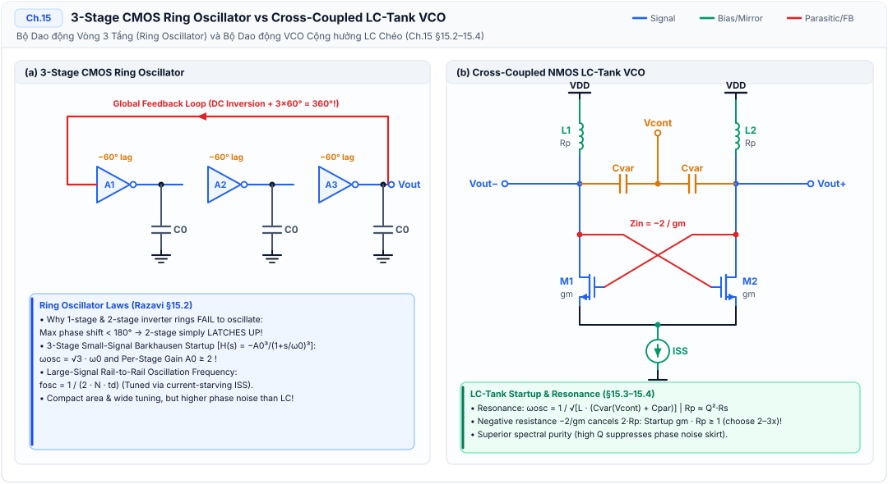

---
{
  "id": "law-oscillator-phase-noise-leeson-and-isf",
  "kind": "law",
  "domain": "sampled-and-clocked",
  "title_vi": "Định luật Nhiễu Pha Bộ Dao động: Công thức Leeson, Hàm Nhạy Xung ISF & Bộ lọc Đuôi 2w0 (Leeson Law & Hajimiri-Lee ISF)",
  "title_en": "Oscillator Phase Noise Laws: Leeson's Equation, Time-Variant ISF, Flicker Upconversion & Tail Noise Filtering",
  "summary": "Hệ định luật vật lý nền tảng chi phối độ tinh khiết phổ của mọi bộ dao động CMOS: mô hình tích phân pha dư và dải biên điều tần hẹp (Razavi §15.5 PT 15.76-15.85), phương trình bán thực nghiệm Leeson phân định vùng dốc -20 dB/dec (1/f^2 nhiễu nhiệt) và -30 dB/dec (1/f^3 nhiễu 1/f trộn lên), lý thuyết biến thiên theo thời gian tuần hoàn LTV với Hàm Nhạy Xung (ISF Gamma) giải thích tại sao đối xứng dạng sóng xóa sổ c0 triệt nhiễu 1/f^3, cơ chế AM-PM varactor, mạch lọc cộng hưởng đuôi Hegazi 2*w0 và thước đo chuẩn hóa FoM.",
  "diagram": "../../diagrams/ring-and-lc-oscillators.svg",
  "razavi_refs": [
    {
      "chapter": 15,
      "section": "15.4-15.5",
      "pages": "630-633, 644-649",
      "equations": ["15.55", "15.62", "15.73", "15.74", "15.76", "15.78", "15.82", "15.84", "15.85", "15.87"]
    }
  ],
  "glossary_codes": [
    "T047",
    "T057",
    "T066",
    "T070",
    "T090",
    "T095",
    "T392",
    "T527",
    "T528",
    "T951",
    "T1009",
    "T1025",
    "T1606",
    "T1802",
    "T2161",
    "T2162",
    "T2163",
    "T2166",
    "T2167",
    "T2168",
    "T2169"
  ],
  "process_agnostic": true,
  "roles": {
    "excess_phase_integrator": "Cơ chế bộ nhớ vô hạn của trạng thái pha phi(t) biến một xung điện tích nhiễu tức thời thành bước dịch thời điểm qua không tồn tại vĩnh viễn (hàm bậc thang đơn vị 1/s).",
    "tank_quality_factor_and_swing": "Khung cộng hưởng LC lưu trữ năng lượng điện từ tối đa E_tank = 0.5*C*V_pk^2 và nén độ rộng dải nhiễu nhiệt tỷ lệ nghịch với Q^2 * P_sig.",
    "impulse_sensitivity_function_isf": "Hàm tuần hoàn không thứ nguyên Gamma(w0*t) đo độ nhạy chuyển đổi điện tích thành pha tại từng thời điểm trong một chu kỳ dao động (bằng 0 tại đỉnh áp, cực đại tại điểm cắt không).",
    "second_harmonic_tail_filter": "Mạng cộng hưởng LC lọc nhiễu tại nút nguồn chung 2*w0 ngăn chặn nhiễu nhiệt của nguồn dòng đuôi ở tần số 2*w0 trộn xuống sóng mang và giữ trở kháng đuôi cao không sập Q khi transistor vào triode."
  },
  "symptoms_addressed": [
    "reciprocal-mixing-of-adjacent-channel-blockers-in-wireless-receivers",
    "severe-1-over-f-cubed-close-in-phase-noise-from-tail-and-pair-flicker-upconversion",
    "phase-noise-degradation-when-increasing-tail-current-into-voltage-limited-triode-region",
    "discrepancy-between-naive-lti-noise-formulas-and-actual-spectrerf-pnoise-simulations"
  ],
  "limitations": [
    "lowering-thermal-phase-noise-by-3db-requires-doubling-dc-power-in-current-limited-mode",
    "on-chip-tail-noise-filter-inductor-at-2w0-consumes-extra-die-area",
    "ring-oscillators-suffer-fundamental-q-equals-unity-penalty-due-to-full-cycle-energy-reset"
  ],
  "checklists": [
    "common-mos",
    "oscillator-and-pll",
    "spectre-pss-pnoise"
  ]
}
---

## 1. Bản chất Nguyên lý, Sơ đồ Mạch & Vai trò Từng Nhánh Cấu trúc

Một bộ dao động lý tưởng tạo ra tín hiệu hình sin thuần túy $V_{out}(t) = V_0 \cos(\omega_0 t)$, biểu diễn trên miền tần số bằng một vạch xung Dirac sắc lẹm duy nhất tại $\omega_0$. Trong thế giới vật lý thực tại nhiệt độ $T > 0\text{ K}$, nhiễu nhiệt trắng (`thermal noise` — `T1009`) của điện trở khung cộng hưởng và kênh dẫn MOSFET cùng **nhiễu nhấp nháy** (`Flicker noise` $1/f$ — `T392`) liên tục khuấy động cả biên độ lẫn thời điểm cắt không của sóng dao động, làm chân vạch phổ loe rộng thành "váy phổ" (**phase noise skirt**, Razavi §15.4–15.5) gọi là **nhiễu pha** (`phase noise` — `T2169`).

Tại sao nhiễu pha của bộ tạo dao động nội (LO) lại sống còn đối với toàn bộ hệ thống viễn thông và số tốc độ cao?
1. **Trong máy thu vô tuyến RF — Thảm họa Trộn tần Ngược (`Reciprocal Mixing`)**: Khi máy thu cần thu một tín hiệu mong muốn rất yếu (ví dụ $-95\text{ dBm}$ tại $\omega_{\text{sig}}$) nằm ngay cạnh một kênh gây nhiễu cực mạnh (`blocker / interferer`, ví dụ $-25\text{ dBm}$ cách đó $\Delta\omega = 2\pi \times 1\text{ MHz}$), bộ trộn tần nhân cả hai với LO. Đuôi nhiễu pha của LO tại độ lệch $\Delta\omega$ sẽ trộn với vạch nhiễu mạnh để đổ tràn trực tiếp lên đúng tần số trung tần $\omega_{IF}$ của tín hiệu yếu, nhấn chìm hoàn toàn tỷ số tín hiệu trên nhiễu (SNR)!
2. **Trong truyền thông điều chế số bậc cao (64-QAM / 256-QAM / OFDM) & SerDes tốc độ hàng chục Gb/s**: Tích phân toàn bộ phổ nhiễu pha quyết định sai số góc chòm sao (`EVM — Error Vector Magnitude`) và **jitter** (`T047`) thời gian lấy mẫu, đặt trần cứng cho tốc độ truyền bit.



Để làm chủ hoàn toàn bài toán nhiễu pha mà không mò mẫm mù quáng trên trình mô phỏng, kỹ sư thiết kế vi mạch bắt buộc phải nắm vững chuỗi **4 tầng bản chất vật lý từ LTI đến LTV (Linear Time-Variant)** dưới đây:
1. **Sự phân tách tự nhiên giữa Nhiễu Biên độ (AM) và Nhiễu Pha (PM)**: Mọi bộ dao động thực tế đều có cơ chế phi tuyến tự ổn định biên độ (cặp ghép chéo chuyển mạch bão hòa dòng đuôi). Do đó một nhiễu loạn làm thay đổi **biên độ** $\Delta A(t)$ sẽ bị lực hồi phục phi tuyến dập tắt nhanh chóng về biên độ cân bằng $V_0$; trái lại, bộ dao động tự do hoàn toàn "vô định hướng" về gốc thời gian $t_0$ — không có bất kỳ lực hồi phục nào kéo pha quay lại! Một xung nhiễu điện tích $\Delta q$ làm lệch thời điểm qua không sẽ **được ghi nhớ vĩnh viễn từ đó đến vô cùng** như một bộ tích phân lý tưởng $1/s$ (§15.5 PT 15.77–15.78)!
2. **Định luật Leeson (1966) — Bức tranh LTI về $Q$, Công suất và 3 Vùng độ dốc phổ**: Giải thích định lượng vì sao mật độ phổ nhiễu pha đơn biên $\mathcal{L}(\Delta\omega)$ (tính bằng $\text{dBc/Hz}$ tại tần số lệch $\Delta\omega$ so với sóng mang $\omega_0$) chia thành ba miền rõ rệt: miền gần sóng mang dốc **$-30\text{ dB/dec}$ ($1/\Delta\omega^3$)**, miền trung gian dốc **$-20\text{ dB/dec}$ ($1/\Delta\omega^2$)**, và sàn nhiễu nhiệt phẳng ở rất xa sóng mang ($0\text{ dB/dec}$).
3. **Lý thuyết Biến thiên Tuần hoàn Theo Thời gian (LTV) và Hàm Nhạy Xung ISF của Hajimiri–Lee (1998)**: Giải đáp trọn vẹn câu hỏi mà mô hình LTI bất lực — *"Cùng một xung nhiễu dòng điện, tại sao bơm vào lúc sóng đạt đỉnh lại vô hại, còn bơm vào đúng lúc sóng cắt qua điểm $0$ lại hủy hoại pha tối đa, và tại sao nhiễu $1/f$ ở vài kHz lại chui lên được vùng $5\text{ GHz} \pm 10\text{ kHz}$?"*
4. **Kỹ thuật Triệt Nhiễu Nguồn Đuôi ở Hài bậc Hai ($2\omega_0$ Tail Noise Filtering — Hegazi, Abidi & Rael 2001)**: Khám phá nguồn thủ phạm lớn nhất trong VCO cặp chéo có nguồn đuôi — nhiễu nhiệt của transistor nguồn dòng đuôi ở quanh tần số **$2\omega_0$** bị cặp công tắc ghép chéo trộn tần xuống $\omega_0$ — và cách khóa sạch nó bằng mạch lọc LC đuôi!

---

## 2. Hệ Phương trình Cốt lõi & Tư duy "Nhìn Mạch Đọc Nhanh" (Analysis by Inspection)

### 2.1. Mô hình Tích phân Pha Dư & Công thức Dải biên Điều tần Hẹp (Razavi §15.5, PT 15.76–15.85)
Từ quan hệ đạo hàm tần số góc $\omega(t) = \frac{d\phi(t)}{dt}$, tín hiệu ngõ ra của VCO có pha dư $\phi_{ex}(t) = K_{VCO}\int_{-\infty}^t V_{cont}(\tau)\,d\tau$, tương ứng hàm truyền miền tần số $\frac{\Phi_{ex}(s)}{V_{cont}(s)} = \frac{K_{VCO}}{s}$ (PT 15.78). Khi đường điều khiển mang một thành phần hình sin nhỏ $V_{cont}(t) = V_m \cos(\omega_m t)$ thỏa $\frac{K_{VCO} V_m}{\omega_m} \ll 1\text{ rad}$ (Ví dụ 15.17, PT 15.82–15.83):

$$V_{out}(t) \approx V_0 \cos(\omega_0 t) - \frac{K_{VCO} V_m V_0}{2\omega_m}\left[\cos(\omega_0 - \omega_m)t - \cos(\omega_0 + \omega_m)t\right]$$

Bình phương tỉ số biên độ dải biên trên sóng mang cho ta công thức chuyển đổi trực tiếp từ mật độ phổ nhiễu điện áp đơn biên $S_{v,\text{cont}}(\Delta f)$ $[\text{V}^2/\text{Hz}]$ trên chân $V_{cont}$ (hoặc chân nguồn qua $K_{VDD}$) sang mật độ phổ nhiễu pha đơn biên $\mathcal{L}(\Delta f)$ $[\text{dBc/Hz}]$ tại độ lệch $\Delta f = \frac{\omega_m}{2\pi}$:

$$\mathcal{L}_{\text{cont}}(\Delta f) = 10\log_{10}\!\left(\frac{P_{\text{sideband,1Hz}}}{P_{\text{carrier}}}\right) = 10\log_{10}\!\left[\left(\frac{K_{VCO}}{2\omega_m}\right)^2 \cdot 2 S_{v,\text{cont}}(\Delta f)\right] = 10\log_{10}\!\left[\frac{1}{2}\left(\frac{K_{VCO,\text{Hz}}}{\Delta f}\right)^2 S_{v,\text{1-sided}}(\Delta f)\right]$$

*Chú ý hệ số $1/2$ sống còn trong nhiễu nhiệt khung cộng hưởng*: Nếu bơm một dòng nhiễu trắng tĩnh vào khung cộng hưởng có trở kháng quanh $\omega_0$ là $|Z_{\text{tank}}(\omega_0 + \Delta\omega)| \approx \frac{R_P}{\sqrt{1 + (2 Q \Delta\omega / \omega_0)^2}} \approx \frac{R_P \omega_0}{2 Q \Delta\omega}$ (khi $\Delta\omega \gg \frac{\omega_0}{2Q}$), định lý phân bố đều năng lượng chỉ ra **một nửa công suất nhiễu đi vào biến thiên biên độ (AM — bị cặp chéo dập tắt)** và **chỉ một nửa công suất nhiễu đi vào biến thiên pha (PM)**!

### 2.2. Phương trình Leeson Đầy đủ & Thước đo Phẩm chất Chuẩn hóa ($\text{FoM}$)
Tổng hợp suy hao khung LC (hệ số phẩm chất $Q$), công suất tín hiệu sóng cơ bản tiêu tán trên điện trở tương đương của khung $P_{\text{sig}} = \frac{V_{\text{diff,pk}}^2}{2 R_{P,\text{diff}}}$, hệ số nhiễu dư của mạch tích cực $F$ (`excess noise factor`, $F = 1 + \gamma_{\text{pair}} + \gamma_{\text{tail}}\dots$, thường $F \approx 2 \sim 5$) và tần số góc gãy chuyển đổi nhiễu nhấp nháy $\omega_{1/f^3}$, **Phương trình Leeson** viết dưới dạng chuẩn công nghiệp là:

$$\mathcal{L}(\Delta\omega) = 10\log_{10}\left\{ \frac{2 F k T}{P_{\text{sig}}} \left[ 1 + \left(\frac{\omega_0}{2 Q \Delta\omega}\right)^2 \right] \left( 1 + \frac{\omega_{1/f^3}}{|\Delta\omega|} \right) \right\} \;\; [\text{dBc/Hz}]$$

Nhìn ngay phương trình này trong vùng làm việc chủ đạo $\frac{\omega_0}{2Q}$ lớn (tức $\omega_{1/f^3} < \Delta\omega \ll \frac{\omega_0}{2Q}$, vùng $-20\text{ dB/dec}$):

$$\mathcal{L}_{1/f^2}(\Delta\omega) \approx 10\log_{10}\left[ \frac{F k T}{2 P_{\text{sig}}} \left(\frac{\omega_0}{Q \Delta\omega}\right)^2 \right] = 10\log_{10}\left[ \frac{k T F R_{P,\text{diff}}}{V_{\text{diff,pk}}^2} \left(\frac{\omega_0}{Q \Delta\omega}\right)^2 \right]$$

*Ba quy luật thiết kế rút ra tức khắc từ Leeson*:
1. **Nhân đôi $Q$ của cuộn cảm** (khi giữ nguyên $P_{\text{sig}}$ hoặc giữ nguyên dòng $I_{\text{bias}}$ nên $R_P \propto Q$ và $V_{\text{pk}} \propto I_{\text{bias}} R_P \propto Q$!) làm giảm nhiễu pha tới **$6\text{ dB}$ đến $9\text{ dB}$** (tỉ lệ $1/Q^3$ cho cùng $L$ và $I_{\text{bias}}$ trong vùng giới hạn dòng vì $P_{\text{sig}} = \frac{2}{\pi^2} I_{\text{bias}}^2 Q \omega_0 L$!). Đây là lý do mọi thiết kế LC-VCO đều sống chết tối ưu $Q$ của cuộn cảm và dàn tụ trước tiên!
2. **Định luật chuẩn hóa công suất và tần số — Hệ số Phẩm chất VCO ($\text{FoM}$ và $\text{FoM}_T$)**: Vì $\mathcal{L}(\Delta f)$ tự nhiên tăng theo $(f_0 / \Delta f)^2$ và giảm theo $1 / P_{DC}$, cộng đồng ISSCC/JSSC định nghĩa chỉ số phẩm chất chuẩn hóa độc lập tần số & công suất (lấy trị dương, càng lớn càng tốt!):

$$\text{FoM} = -\mathcal{L}(\Delta f) + 20\log_{10}\left(\frac{f_0}{\Delta f}\right) - 10\log_{10}\left(\frac{P_{DC}}{1\text{ mW}}\right) \;\; [\text{dBc/Hz}]$$

   (Một Ring-VCO CMOS tốt đạt $\text{FoM} \approx 158 \sim 166\text{ dBc/Hz}$, trong khi LC-VCO CMOS chuẩn đạt $\text{FoM} \approx 184 \sim 192\text{ dBc/Hz}$ — chênh nhau hơn $20\text{ dB}$, tức tiết kiệm **100 lần công suất** cho cùng một mức jitter!).

### 2.3. Lý thuyết LTV & Hàm Nhạy Xung ISF ($\Gamma(\omega_0 \tau)$) của Hajimiri–Lee
Xét một xung dòng Dirac chứa điện tích $\Delta q$ bơm vào một nút có điện dung tương đương $C_{\text{node}}$ tại thời điểm $\tau$, gây bước nhảy áp tức thời $\Delta V = \Delta q / C_{\text{node}} \ll V_{\max}$ (với $q_{\max} = C_{\text{node}} V_{\max}$ là điện tích dao động cực đại trên nút). Độ dịch pha dư xác lập $\Delta\phi$ sinh ra phụ thuộc tuần hoàn vào pha xảy ra va chạm $\omega_0 \tau$:

$$h_{\phi}(t, \tau) = \frac{\Gamma(\omega_0 \tau)}{q_{\max}} u(t - \tau) \qquad \text{với khai triển Fourier:} \quad \Gamma(x) = \frac{c_0}{2} + \sum_{n=1}^{\infty} c_n \cos(n x + \theta_n)$$

- **Ý nghĩa hình học trực giác của $\Gamma(\omega_0 \tau)$**: Đối với sóng hình sin lý tưởng $V(t) = V_{\max}\cos(\omega_0 t)$, $\Gamma(\omega_0 t) = -\sin(\omega_0 t)$!
  - Tại **đỉnh hoặc đáy sóng** ($\omega_0 \tau = 0, \pi$): $\Gamma = 0$ — xung điện tích chỉ làm cao thêm đỉnh áp ($\Delta A$), không dịch chuyển thời điểm qua không $\implies$ **miễn nhiễm nhiễu pha tuyệt đối**! (Đây chính là bí mật của mạch Colpitts và Class-C VCO: chỉ mở transistor bơm dòng ở sát đỉnh/đáy sóng!).
  - Tại **điểm cắt không** ($\omega_0 \tau = \pi/2, 3\pi/2$): $|\Gamma| = 1$ cực đại — toàn bộ xung điện tích dịch ngang sườn dốc thành sai số thời gian và pha tối đa!
- **Hai công thức Hajimiri–Lee giải mã trọn vẹn vùng $1/f^2$ và vùng $1/f^3$**:
  Cho một nguồn dòng nhiễu có mật độ trắng một phía $\overline{i_n^2}/\Delta f$ và nhiễu nhấp nháy $\overline{i_{n,1/f}^2}(\Delta f) = \overline{i_n^2} \cdot \frac{\omega_{1/f}}{\Delta\omega}$:

$$\mathcal{L}_{1/f^2}(\Delta\omega) = 10\log_{10}\left( \frac{\Gamma_{\text{rms}}^2}{q_{\max}^2} \cdot \frac{\overline{i_n^2}/\Delta f}{2\,\Delta\omega^2} \right), \qquad \mathcal{L}_{1/f^3}(\Delta\omega) = 10\log_{10}\left( \frac{c_0^2}{q_{\max}^2} \cdot \frac{\overline{i_n^2}/\Delta f}{8\,\Delta\omega^2} \cdot \frac{\omega_{1/f}}{\Delta\omega} \right)$$

  trong đó $\Gamma_{\text{rms}}^2 = \frac{1}{2\pi}\int_0^{2\pi} \Gamma^2(x)\,dx = \frac{c_0^2}{4} + \frac{1}{2}\sum_{n=1}^{\infty} c_n^2$, và góc gãy nhiễu pha $\omega_{1/f^3}$ liên hệ với góc $1/f$ của bản thân transistor $\omega_{1/f}$ qua tỉ số **bất đối xứng chu kỳ**:

$$\omega_{1/f^3} = \omega_{1/f} \cdot \left(\frac{c_0}{2\,\Gamma_{\text{rms}}}\right)^2$$

  **Khai sáng chấn động**: Góc nhiễu pha $\omega_{1/f^3}$ KHÔNG BẰNG tần số góc nhiễu $1/f$ của MOSFET ($\omega_{1/f}$ có thể lên tới $10\text{ MHz}$ ở `45nm`, trong khi $\omega_{1/f^3}$ hoàn toàn có thể ép xuống $< 20\text{ kHz}$)! Nếu nửa chu kỳ sườn lên và nửa chu kỳ sườn xuống tại mỗi nút **đối xứng gương hoàn hảo**, diện tích dương và diện tích âm của $\Gamma(x)$ triệt tiêu nhau làm **hệ số trung bình một chiều $c_0 = \frac{1}{\pi}\int_0^{2\pi} \Gamma(x)\,dx = 0 \implies \omega_{1/f^3} \to 0$** (xóa sổ hoàn toàn sự trộn lên bậc nhất của nhiễu $1/f$!).

### 2.4. Cơ chế Nhiễu Đuôi $2\omega_0$ & Mạch Lọc Nhiễu Đuôi Hegazi (`Tail Noise Filter`) + Ví dụ Số
Trong VCO cặp ghép chéo có nguồn dòng đuôi $M_{\text{tail}}$: nút đuôi chung dao động ở tần số gấp đôi sóng mang là **$2\omega_0$** (vì mỗi nửa chu kỳ một trong hai transistor bật dẫn kéo nút đuôi). Cặp ghép chéo hoạt động như một bộ trộn đơn cân bằng đối với dòng từ đuôi đi lên:
- Nhiễu $1/f$ quanh DC của $M_{\text{tail}}$ chỉ điều chế biên độ đối xứng hai bên (tự triệt pha nếu mạch cân bằng và không bị chuyển đổi AM-to-PM trên varactor!).
- Ngược lại, **nhiễu nhiệt trắng của $M_{\text{tail}}$ nằm ở tần số $2\omega_0 \pm \Delta\omega$** khi nhân với hàm chuyển mạch tần số $\omega_0$ của cặp chéo sẽ trộn tần thẳng xuống $(2\omega_0 \pm \Delta\omega) - \omega_0 = \mathbf{\omega_0 \pm \Delta\omega}$, đóng góp tới $40\% \sim 60\%$ tổng công suất nhiễu pha của VCO! Hơn nữa, khi đỉnh sóng khung LC xuống thấp làm transistor đang dẫn chớm vào vùng triode, tụ lớn ở nút đuôi thông thường sẽ nối tắt cực máng khung LC xuống đất qua kênh triode, đánh sập $Q$ khung LC!
- **Giải pháp Mạch lọc Đuôi Hegazi ($L_{\text{tail}} + C_{\text{tail}}$)**: Chèn một cuộn cảm nhỏ $L_{\text{tail}}$ nối tiếp giữa cực máng của $M_{\text{tail}}$ và điểm chung cực nguồn cặp chéo, đặt một tụ nối tắt lớn $C_{\text{bypass}}$ ngay tại cực máng $M_{\text{tail}}$ để **ngắn mạch toàn bộ dòng nhiễu nhiệt $2\omega_0$ của $M_{\text{tail}}$ xuống đất**, đồng thời chọn $C_{\text{tail}}$ tại nút nguồn chung cộng hưởng song song với $L_{\text{tail}}$ đúng tại **$2\omega_0 = \frac{1}{\sqrt{L_{\text{tail}} C_{\text{tail}}}}$** để dựng lên trở kháng cực cao ở $2\omega_0$, ngăn không cho transistor cặp chéo khi vào vùng triode làm tải sụt $Q$ khung LC!

**Ví dụ Định lượng Tính Nhanh Nhiễu Pha & Jitter Chu kỳ**:
Xét LC-VCO $f_0 = 4.0\text{ GHz}$, tiêu thụ $I_{\text{bias}} = 2.0\text{ mA}$ từ $V_{DD} = 1.2\text{ V}$ ($P_{DC} = 2.4\text{ mW}$), khung LC có $Q = 12$, $R_{P,\text{diff}} = 400\,\Omega$, đạt biên độ đỉnh vi sai $V_{\text{diff,pk}} = 1.0\text{ V}$ ($P_{\text{sig}} = \frac{1.0^2}{2 \times 400} = 1.25\text{ mW}$) và hệ số nhiễu dư tổng hợp $F = 2.8$ ở $T = 300\text{ K}$ ($k T = 4.14 \times 10^{-21}\text{ J}$):
1. **Nhiễu pha vùng nhiệt tại $\Delta f = 1\text{ MHz}$**:
   $$\mathcal{L}(1\text{ MHz}) = 10\log_{10}\left[ \frac{2.8 \times 4.14 \times 10^{-21}}{2 \times 1.25 \times 10^{-3}} \left(\frac{4000\text{ MHz}}{12 \times 1\text{ MHz}}\right)^2 \right] = 10\log_{10}\left(4.637 \times 10^{-18} \times 1.111 \times 10^5\right) \approx \mathbf{-122.9\text{ dBc/Hz}}$$
2. **Chỉ số phẩm chất $\text{FoM}$**:
   $$\text{FoM} = 122.9 + 20\log_{10}\left(\frac{4000}{1}\right) - 10\log_{10}(2.4) = 122.9 + 72.04 - 3.80 = \mathbf{191.1\text{ dBc/Hz}}$$
3. **Jitter một chu kỳ (`Period Jitter`) so với Jitter chu kỳ-tới-chu kỳ kế tiếp (`Cycle-to-Cycle Jitter`) của VCO tự do**: Trong miền nhiễu tần số trắng $1/f^2$, độ lệch chuẩn của một chu kỳ đơn lẻ quanh $T_0 = 250\text{ ps}$ (`Period Jitter`, tích phân với trọng số Kundert $4\sin^2(\pi f T_0)$) liên hệ trực tiếp với $\mathcal{L}(\Delta f)$ qua $\sigma_{\text{per}} = \sqrt{\text{Var}(T_k - T_0)} = \frac{\Delta f}{f_0^{3/2}}\sqrt{10^{\mathcal{L}(\Delta f)/10}} = \frac{10^6}{(4\times 10^9)^{1.5}}\sqrt{5.15 \times 10^{-13}} \approx \mathbf{2.84\text{ fs}_{\text{rms}}}$, trong khi hiệu hai chu kỳ liền kề (`Cycle-to-Cycle Jitter`, $\sigma_{\text{cc}} = \sqrt{\text{Var}(T_{k+1} - T_k)}$) do bước đi ngẫu nhiên không tương quan giữa hai chu kỳ kế tiếp có giá trị $\sigma_{\text{cc}} = \sqrt{2}\,\sigma_{\text{per}} \approx \mathbf{4.01\text{ fs}_{\text{rms}}}$!

---

## 3. Bất biến Cấu trúc & Các Bẫy Lỗi Kinh điển (Structural Invariants & Traps)

- **[INV-PN-01] Bất biến Cân bằng Pha Nền $8\text{ dB} \sim 10\text{ dB}$ Kém hơn của Ring-VCO so với LC-VCO**: Trong bộ dao động vòng $N$ tầng (`topo-ring-oscillator`), mỗi chu kỳ toàn bộ điện tích tụ nút $C_L V_{\text{swing}}$ đều bị xả sạch xuống đất và nạp lại từ nguồn ($Q_{\text{eff}} \approx 1$), khiến công thức nhiễu pha tối thiểu giới hạn bởi nhiệt động lực học của Ring-VCO đơn cực là $\mathcal{L}_{\text{ring,min}}(\Delta f) \approx \frac{8}{3\eta} \frac{k T}{P_{DC}} \left(\frac{f_0}{\Delta f}\right)^2$ (thiếu hẳn thừa số $1/Q^2$ ở tử số, tức chịu phạt ít nhất $20\log_{10} Q \approx 20 \sim 25\text{ dB}$ so với LC-VCO cùng công suất!).
- **[INV-PN-02] Bất biến "Không tăng số tầng $N$ của VCO Vòng Đơn cực để giảm Nhiễu Pha ở Cùng Công suất & Cùng $f_0$"**: Đối với VCO vòng đảo đơn cực tiêu thụ tổng công suất $P_{DC}$ cố định ở tần số $f_0$ cố định, nhiễu pha nhiệt gần như không phụ thuộc số tầng $N$; tệ hơn, trong **VCO vòng vi sai** tải điện trở/nguồn dòng, nhiễu pha nhiệt **XẤU ĐI tỉ lệ thuận với số tầng $N$** ($\mathcal{L}_{\text{diff-ring}} \propto N \cdot \frac{kT}{I_{SS} V_{\text{swing}}} \left(\frac{f_0}{\Delta f}\right)^2$)! Do đó VCO vòng vi sai tạp âm thấp luôn ưu tiên số tầng ít nhất có thể ($N = 3$ hoặc $N = 4$ cho cầu phương).
- **[TRAP-PN-01] Bẫy Gắn Tụ Nối Tắt Lớn Trực tiếp Vào Điểm Chung Cực Nguồn Cặp Chéo Mà Thiếu $L_{\text{tail}}$**: Nhiều kỹ sư thấy nút đuôi có nhiễu nên gắn ngay một tụ lớn $C_{\text{tail}}$ từ điểm nối hai cực nguồn cặp chéo xuống đất để lọc nhiễu của $M_{\text{tail}}$. **Kết quả phản tác dụng nếu biên độ lớn**: tụ lớn giữ thế AC nút nguồn cứng xuống đất; ngay khi cực máng đi xuống đỉnh âm đẩy transistor cặp chéo vào vùng triode, transistor triode nối tắt trực tiếp khung cộng hưởng LC xuống tụ đất $C_{\text{tail}}$, hút cạn năng lượng khung LC và làm nhiễu pha vọt tăng $4 \sim 8\text{ dB}$! Nếu không có diện tích đặt cuộn cảm $L_{\text{tail}}$, chỉ chọn $C_{\text{tail}}$ vừa phải cộng hưởng với cảm kháng ký sinh hoặc chèn một điện trở nhỏ / dùng điều khiển biên độ tránh vùng triode.
- **[TRAP-PN-02] Bẫy Bỏ Quên Chuyển đổi AM-to-PM qua Varactor Làm Tái Sinh Vùng $1/f^3$**: Dù đã thiết kế dạng sóng đối xứng hoàn hảo để $c_0 \approx 0$, khi quét $V_{cont}$ vào đúng điểm giữa dải của varactor (nơi $\partial C_{\text{var}}/\partial V$ dốc nhất), vùng $1/f^3$ bỗng nhiên dâng vọt lên $10 \sim 15\text{ dB}$ trong mô phỏng `pnoise`! Thủ phạm là nhiễu $1/f$ của nguồn dòng đuôi $M_{\text{tail}}$ điều chế biên độ dao động $A(t) \implies$ làm biến thiên điện dung hiệu dụng của varactor $\implies$ đổi thẳng thành nhiễu tần số! Giải pháp triệt để: (1) Dùng dàn tụ chuyển mạch số giảm nhỏ kích thước varactor ($K_{VCO}$ nhỏ), (2) Định cỡ $M_{\text{tail}}$ có diện tích cổng $W \cdot L$ thật lớn (ưu tiên gương dòng PMOS nhiễu $1/f$ thấp kèm mắt lọc thông thấp $R_f C_f$ lớn ngay trước cực cổng $M_{\text{tail}}$!).

---

## 4. Lộ trình Nâng cấp Cấu trúc & Bát giác Đánh đổi (Upgrade Paths & Design Octagon)

Trên **Bát giác Thiết kế** (`concept-analog-design-octagon`), định luật nhiễu pha đóng vai trò kim chỉ nam điều phối các quyết định cấu trúc từ mức transistor đến mức hệ thống:

- **Nền tảng lý thuyết từ**: Kế thừa mô hình nguồn nhiễu vật lý $4kT\gamma g_m$ và $K/(W L C_{ox} f)$ từ `law-mos-thermal-and-flicker-noise`, cấu trúc lõi dao động từ `topo-ring-oscillator`, `topo-lc-cross-coupled-and-colpitts` và `topo-colpitts-hartley-and-one-port-lc-oscillators`.
- **Lộ trình giảm nhiễu pha theo từng miền tần số bù $\Delta f$**:
  1. *Nếu trượt chỉ tiêu ở vùng cận sóng mang ($\Delta f = 1\text{ kHz} \sim 100\text{ kHz}$, dốc $-30\text{ dB/dec}$)*: Kiểm tra `Noise Summary` trong Spectre `pnoise` — thường do $1/f$ của $M_{\text{tail}}$ chuyển đổi AM-PM qua varactor hoặc bất đối xứng sườn làm $c_0 \neq 0$. Khắc phục bằng cách giảm $K_{VCO}$ qua dàn tụ chuyển mạch (`topo-quadrature-vco-and-varactor-tuning`), lọc RC cực cổng gương dòng $M_{\text{tail}}$, tăng $W \cdot L$ của $M_{\text{tail}}$, cân bằng tỉ số N/P trong cặp chéo CMOS, và mở rộng băng thông vòng khóa pha PLL (`tech-cp-pll-third-order-loop-filter-synthesis`) để hàm thông cao $1 - H(s)$ gọt bỏ!
  2. *Nếu trượt chỉ tiêu ở vùng trung/xa sóng mang ($\Delta f = 500\text{ kHz} \sim 20\text{ MHz}$, dốc $-20\text{ dB/dec}$ — nằm ngoài băng thông PLL nên PLL không cứu được!)*: Bắt buộc nâng $Q_{\text{tank}}$ (dùng cuộn cảm kim loại đỉnh siêu dày ít vòng đường kính tối ưu + công tắc dàn tụ vi sai $Q_{\text{on}}$ cao), tăng biên độ dao động sát ngưỡng trước vùng triode, bổ sung bộ lọc đuôi Hegazi $2\omega_0$, hoặc ghép song song 2–4 lõi LC (Multicore Coupled VCO giảm $3\text{ dB}$ nhiễu pha mỗi lần nhân đôi số lõi và công suất khi chạm trần điện áp đánh thủng $V_{DD}$!).

| Kỹ thuật Giảm Nhiễu Pha VCO | Miền Tác động Chính | Mức Cải thiện Điển hình | Chi phí Đánh đổi trong Bát giác |
| :--- | :--- | :--- | :--- |
| **Dàn tụ số Coarse Bank hạ nhỏ $K_{VCO}$** | Vùng $1/f^3$ & Spur điều khiển | $8 \sim 20\text{ dB}$ vùng cận | Thêm logic hiệu chuẩn tần số AFC & diện tích mảng tụ. |
| **Lọc thông thấp $R_f C_f$ cực cổng gương dòng đuôi** | Vùng $1/f^3$ & $1/f^2$ từ nhánh gương | $5 \sim 12\text{ dB}$ (xóa hệ số nhân nhiễu gương $(M/1)^2$!) | Tăng nhẹ thời gian khởi động dòng phân cực VCO. |
| **Bộ lọc cộng hưởng đuôi $2\omega_0$ ($L_{\text{tail}}, C_{\text{tail}}$)** | Toàn dải $1/f^2$ (tiệm cận sàn khung thụ động) | $3 \sim 6\text{ dB}$ cải thiện $\text{FoM}$ | Tốn diện tích cho một cuộn cảm phụ nhỏ ở $2\omega_0$. |
| **Cấu trúc Class-C / Transformer-Feedback (Gierkink/Mazzanti)** | Vùng $1/f^2$ nhờ thu hẹp $\Gamma_{\text{rms}}$ | $3 \sim 5\text{ dB}$ cải thiện $\text{FoM}$ | Nhạy khởi động nếu không có vòng ổn định biên độ tự động (AAC). |

---

## 5. Thích ứng Đa Tiến trình (90nm / 65nm / 45nm) & Cách Kiểm chứng trong Cadence / Spectre

### 5.1. Thách thức của Tiến trình Nanomet Sâu (`90nm` / `65nm` / `45nm`) lên Nhiễu Pha
Khi lùi xuống `65nm` và `45nm`, hai đại lượng vật lý đều dịch chuyển theo chiều **bất lợi trực tiếp cho nhiễu pha**: (1) Điện áp nguồn $V_{DD}$ giảm từ $1.8\text{ V} \to 1.0\text{ V} / 0.9\text{ V}$ làm trần năng lượng lưu trữ tối đa trên khung $E_{\max} = \frac{1}{2} C V_{\text{pk}}^2 \propto V_{DD}^2$ giảm đi $3 \sim 4$ lần! Để giữ nguyên $P_{\text{sig}} = \frac{V_{\text{pk}}^2}{2 R_P}$ ở điện áp thấp, kỹ sư buộc phải **giảm độ tự cảm $L_P$ xuống nhỏ hơn** (ví dụ $250 \sim 600\text{ pH}$ bằng cuộn cảm 1 vòng hoặc số 8 dày bản rộng) để hạ $R_P = Q \omega_0 L_P$ và tăng dòng điện tương ứng; (2) Tần số góc nhiễu nhấp nháy $f_{1/f}$ của MOSFET kênh ngắn vọt lên hàng MHz kèm hệ số $\gamma$ tăng do hạt tải nóng, đòi hỏi kiểm soát cực kỳ gắt gao tính đối xứng $c_0 \approx 0$ và lọc triệt để nhánh phân cực gương dòng (`law-stage-and-mirror-noise-rules`)!

### 5.2. Quy trình Chẩn đoán Bảng Đóng góp Nhiễu (`PNoise Contribution Audit`) trong SpectreRF
1. **Không bao giờ dùng phân tích `.noise` tuyến tính tĩnh cho bộ dao động!** Phải dùng cặp lệnh `pss` + `pnoise` theo bảng kiểm `spectre-pss-pnoise`.
2. **Đọc Bảng Đóng góp Nhiễu tại Hai Tần số Lệch Đặc trưng**: Luôn xuất báo cáo `Noise Summary` (đơn vị `%` tổng công suất nhiễu pha tại tần số bù đó) ở đúng hai điểm:
   - **Điểm 1: $\Delta f = 10\text{ kHz}$ (Chẩn đoán vùng $1/f^3$)**: Kiểm tra xem mục `fn` (flicker noise) của `M_tail`, `M_bias_mirror` hay `M_pair` đứng đầu bảng. Nếu `M_bias_mirror` chiếm $> 5\%$, chèn ngay mắt lọc thông thấp $R_f = 50\text{ k}\Omega, C_f = 10\text{ pF}$ ($f_c = 318\text{ Hz}$) ngay sát cực cổng $M_{\text{tail}}$! Nếu `M_tail:fn` chiếm $> 30\%$, tăng $W$ và $L$ của $M_{\text{tail}}$ gấp $4\times$ và kiểm tra độ nhạy AM-PM bằng cách tạm thay varactor bằng tụ lý tưởng để tách biệt nguyên nhân!
   - **Điểm 2: $\Delta f = 1\text{ MHz}$ hoặc $10\text{ MHz}$ (Chẩn đoán vùng $1/f^2$)**: Trong một LC-VCO tối ưu tốt, điện trở tổn hao của chính khung thụ động (`R_inductor` + `R_capbank`) phải đóng góp $35\% \sim 55\%$ tổng nhiễu (nghĩa là mạch tích cực không làm bẩn quá $3\text{ dB}$ so với giới hạn vật lý của khung!). Nếu `M_tail:id` (nhiễu nhiệt nguồn đuôi) chiếm $> 25\%$ hoặc `M_pair` lún sâu vào triode chiếm $> 60\%$, giảm dòng đuôi về đúng điểm gối tối ưu (sweet-spot) hoặc thêm lọc đuôi $2\omega_0$!
```ocean
; OCEAN Script quet dong duoi Ibias tim diem cuc tieu Phase Noise & cuc dai FoM tai 1 MHz
; Luon chay voi: env PYTHONDONTWRITEBYTECODE=1 ocean -nograph < sweep_vco_fom.ocn
simulator('spectre)
design("lib_rf" "tb_lc_vco_pnoise" "schematic")
analysis('pss ?fund "4G" ?harms "15" ?autotstab "yes" ?method "traponly" ?errpreset "conservative" ?oscic "lin")
analysis('pnoise ?sweeptype "relative" ?relharmnum "1" ?start "1k" ?stop "40M" ?dec "10" ?maxsideband "15" ?noisetype "sources")

desVar("ibias" 1.5m)
paramAnalysis("ibias" ?values '(0.8m 1.2m 1.6m 2.0m 2.5m 3.0m 3.5m))
paramRun()

; Tinh FoM(ibias) de tim chinh xac bien gioi giua Current-Limited va Voltage-Limited:
f_osc = harmonic(xval(v("/voutp" ?result "pss_fd")) 1)
pn_1M = value(db10(leafValue(getData("out" ?result "pnoise") "")) 1e6)
; Chon ibias_opt ngay tai dinh duong cong FoM truoc khi cap ghep cheo cham vung triode!
```

---

## 6. Mốc Đối chiếu Sách Razavi & Thuật ngữ Chuẩn CLB

- **Sách gốc Razavi (2nd Ed.)**: Chương 15, Mục `15.4` (trang 630–633, Phương trình `15.55`–`15.62`) và Mục `15.5` (*Mathematical Model of VCOs*, trang 644–649, Hình `15.60`–`15.64`, Ví dụ `15.15`–`15.17`, Phương trình `15.73`–`15.87`), kết hợp mở rộng chuẩn mực từ các công trình nền tảng được dẫn chiếu trong tài liệu tham khảo cuối Chương 15 (Leeson 1966; Hajimiri & Lee *IEEE JSSC* 1998; Hegazi, Sjoland & Abidi *IEEE JSSC* 2001).
- **Đối chiếu Thuật ngữ Chuẩn CLB Vi Mạch (`terms-vi-en.json`)**:
  - `T2169` (`phase noise`): **nhiễu pha**; `T1025` (`noise spectrum`): **phổ nhiễu**; `T047` (`jitter`): **jitter**.
  - `T392` (`Flicker noise`): **nhiễu nhấp nháy ($1/f$)**; `T1009` (`thermal noise`): **nhiễu nhiệt**.
  - `T1802` (`integrator`): **mạch tích phân**; `T1606` (`oscillation amplitude`): **biên độ dao động**.
  - `T2167` (`VCO gain / tuning sensitivity, KVCO`): **độ lợi VCO (độ nhạy điều chỉnh tần số $K_{VCO}$)**; `T066` (`power dissipation`): **công suất tiêu tán**.
