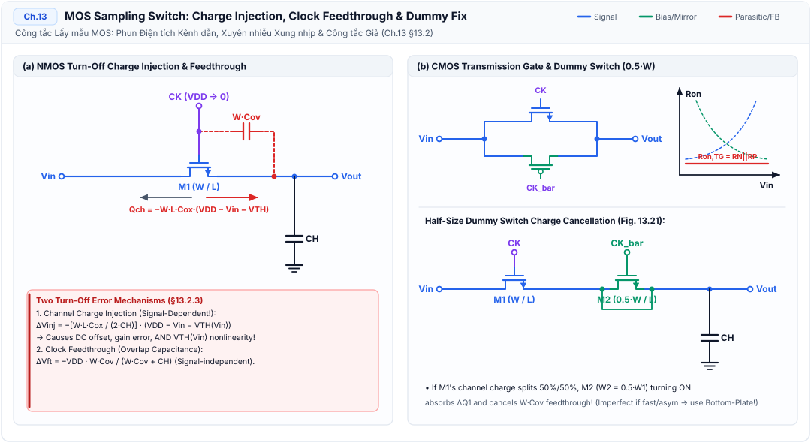

---
{
  "id": "tech-charge-injection-and-bottom-plate-sampling",
  "kind": "technique",
  "domain": "sampled-and-clocked",
  "title_vi": "Triệt tiêu hiện tượng phun điện tích, xuyên xung nhịp và lấy mẫu bản cực đáy",
  "title_en": "Charge Injection Cancellation, Clock Feedthrough, and Bottom-Plate Sampling",
  "summary": "Phân tích định lượng sai số điện áp bệ, sai số độ lợi và méo phi tuyến do phun điện tích kênh dẫn cùng xuyên xung nhịp, đồng thời thiết lập quy tắc vàng lấy mẫu bản cực đáy bằng xung ngắt sớm phi1_e.",
  "diagram": "../../diagrams/mos-switch-charge-injection.svg",
  "razavi_refs": [
    {
      "chapter": 13,
      "section": "13.2.3-13.2.4",
      "pages": "550-555",
      "equations": ["13.25", "13.26", "13.27", "13.28", "13.29", "13.30", "13.31", "13.32", "13.33", "13.34", "13.35", "13.36", "13.37", "13.38", "13.39"]
    },
    {
      "chapter": 13,
      "section": "13.3.1-13.3.2",
      "pages": "556-565",
      "equations": []
    }
  ],
  "glossary_codes": [
    "T014",
    "T015",
    "T022",
    "T024",
    "T052",
    "T057",
    "T074",
    "T084",
    "T087",
    "T088",
    "T090",
    "T245",
    "T319",
    "T431",
    "T620",
    "T786"
  ],
  "process_agnostic": true,
  "roles": {
    "early_reference_switch_s2": "Công tắc nối bản cực tham chiếu / đất ảo được điều khiển bởi xung nhịp ngắt sớm phi1_e để chốt thời điểm lấy mẫu và chỉ phun lượng điện tích hằng độc lập tín hiệu.",
    "input_driven_switch_s1": "Công tắc nối nguồn tín hiệu Vin ngắt muộn hơn trên xung phi1 khi bản cực đối diện đã thả nổi, khiến điện tích kênh dẫn của nó không thể làm đổi tổng điện tích lưu tại nút đất ảo.",
    "dummy_half_switch": "Transistor giả nối tắt nguồn-máng có W_dummy = 0.5*W điều khiển bởi xung đảo nhằm triệt tiêu xuyên xung nhịp và hấp thụ một phần điện tích phun.",
    "differential_equalizer_seq": "Công tắc cân bằng nối giữa hai nút đất ảo vi sai X và Y, ngắt ngay sau S2/S2' để xóa sai lệch điện tích phun giữa hai nhánh."
  },
  "symptoms_addressed": [
    "signal-dependent-charge-injection-distortion",
    "pedestal-offset-and-sampling-gain-error",
    "clock-feedthrough-step-offset",
    "body-effect-sampling-harmonic-distortion"
  ],
  "limitations": [
    "requires-non-overlapping-early-clock-phase",
    "dummy-switch-fails-under-asymmetric-impedance-split",
    "residual-differential-mismatch-without-equalization-switch"
  ],
  "checklists": [
    "common-mos",
    "switched-capacitor",
    "layout-and-matching"
  ]
}
---

## 1. Bản chất Nguyên lý, Sơ đồ Mạch & Vai trò Từng Nhánh Cấu trúc

Trong các mạch tụ chuyển mạch (switched-capacitor circuit), tăng tỷ số $W/L$ hoặc giảm tụ giữ mẫu $C_H$ giúp nâng cao tốc độ bám nhưng lại trực tiếp làm suy giảm độ chính xác tại thời khắc công tắc chuyển sang trạng thái ngắt (switch turns off). Hai cơ chế vật lý gây sai số tất định ngay tại sườn ngắt là **phun điện tích** kênh dẫn (charge injection — lưu ý thuật ngữ chuẩn CLB: tuyệt đối không dịch nhầm thành *bơm điện tích / charge pump* vốn là khối nguồn dòng của vòng khóa pha ở Chương 16!) và **xuyên xung nhịp** (clock feedthrough) qua điện dung chồng lấp cổng–nguồn/máng. Để bẻ gãy giới hạn tốc độ – độ chính xác này, kỹ thuật **triệt tiêu hiện tượng phun điện tích** (charge injection cancellation) phát triển qua bốn cấp độ cấu trúc:



1. **Ghép công tắc giả nửa kích thước (Dummy Switch Cancellation, Hình 13.25–13.26)**: Mắc nối tiếp sau công tắc chính $M_1$ ($W_1, L_1$, cổng nhận $CK$) một transistor giả $M_2$ nối tắt cực nguồn với cực máng ngay tại nút $V_{out}$, có $L_2 = L_1, W_2 = 0.5\,W_1$ và điều khiển bởi $\overline{CK}$. Khi $M_1$ ngắt và đẩy điện tích âm lên $C_H$, $M_2$ đồng thời bật lên để hút điện tích tạo kênh nghịch đảo của riêng nó, đồng thời đối xung qua hai tụ chồng lấp $2 W_2 C_{ov}$ để khử xuyên xung nhịp.
2. **Ghép công tắc MOS bổ sung (Complementary Switch Cancellation, Hình 13.27)**: Dùng cặp NMOS–PMOS song song để gói điện tử âm từ kênh NMOS bù trừ một phần với gói lỗ trống dương từ kênh PMOS khi cả hai cùng ngắt.
3. **Lấy mẫu vi sai đối xứng (Differential Sampling, Hình 13.28)**: Biến thành phần điện tích phun hằng thành nhiễu chế độ chung (common-mode) để tầng vi sai kế tiếp loại bỏ độ lệch một chiều và hài bậc chẵn.
4. **Quy tắc vàng Lấy mẫu Bản cực Đáy (Bottom-Plate Sampling, Hình 13.32–13.35 & 13.42–13.48)**: Giải pháp căn cơ nhất của kỹ thuật mạch tụ chuyển mạch hiện đại. Thay vì nối một đầu tụ $C_H$ cố định xuống đất cứng, tụ được đặt giữa công tắc ngõ vào $S_1$ (xung $\phi_1$) và công tắc nối đất ảo / điện áp tham chiếu cố định $S_2$ (xung ngắt sớm $\phi_{1e}$). Bằng cách ngắt $S_2$ sớm hơn $S_1$ một khoảng $\Delta t_e$, mạch cô lập hoàn toàn nút tích điện trước khi công tắc mang tín hiệu $S_1$ kịp chuyển trạng thái!

## 2. Hệ Phương trình Cốt lõi & Tư duy "Nhìn Mạch Đọc Nhanh" (Analysis by Inspection)

### 2.1. Ba thành phần sai số do phun điện tích kênh dẫn và hệ số phẩm chất $F = \mu_n / L^2$
Khi công tắc NMOS dẫn trong vùng triode sâu với $V_{out} \approx V_{in}$, tổng điện tích lớp nghịch đảo tích trữ dưới oxit cổng có độ lớn:
$$
Q_{ch} = W L C_{ox} (V_{DD} - V_{in} - V_{THN})
$$
Khi $CK$ sụt từ $V_{DD}$ về $0$, gói điện tích âm này thoát ra qua hai cực nguồn và máng. Gọi $\alpha \in [0, 1]$ là tỷ phần điện tích đổ sang phía tụ giữ mẫu $C_H$ ($\alpha = 0.5$ trong Phương trình 13.26, hoặc ước lượng trường hợp xấu nhất $\alpha = 1$ trong Phương trình 13.27–13.30). Xét đầy đủ sự phụ thuộc của điện áp ngưỡng vào tín hiệu qua hiệu ứng thân ($V_{BS} \approx -V_{in} \implies V_{THN} = V_{TH0} + \gamma\sqrt{2\phi_B + V_{in}} - \gamma\sqrt{2\phi_B}$), điện áp mẫu thu được trên $C_H$ là:
$$
V_{out} = V_{in}\underbrace{\left(1 + \alpha\frac{W L C_{ox}}{C_H}\right)}_{\text{Độ lợi khác đơn vị}}
+ \underbrace{\alpha \gamma \frac{W L C_{ox}}{C_H}\sqrt{2\phi_B + V_{in}}}_{\text{Méo phi tuyến (Nonlinearity)}}
- \underbrace{\alpha\frac{W L C_{ox}}{C_H}\left(V_{DD} - V_{TH0} + \gamma\sqrt{2\phi_B}\right)}_{\text{Độ lệch bệ một chiều (Pedestal Offset)}}
$$
Phương trình (13.30) chỉ rõ phun điện tích gây ra **ba hậu quả**: (1) độ lệch một chiều (offset), (2) sai số độ lợi tuyến tính $+\alpha W L C_{ox}/C_H$, và (3) tính phi tuyến (nonlinearity) căn bậc hai do hiệu ứng thân không thể hiệu chuẩn đơn giản! Hơn nữa, nếu ghép hằng số thời gian $\tau = R_{on} C_H = \frac{C_H}{\mu_n C_{ox}(W/L)(V_{DD} - V_{in} - V_{THN})}$ với độ lớn bước nhảy phun điện tích $\Delta V = \frac{W L C_{ox}(V_{DD} - V_{in} - V_{THN})}{C_H}$ (lấy $\alpha = 1$), hệ số phẩm chất tốc độ – độ chính xác $F = (\tau \Delta V)^{-1}$ rút gọn thành bất biến nổi tiếng (Phương trình 13.34):
$$
F = \frac{1}{\tau \Delta V} = \frac{\mu_n}{L^2}
$$
**Nhận xét sắc bén**: Cả bề rộng $W$, điện dung $C_H$ lẫn điện áp vượt ngưỡng đều tự triệt tiêu khỏi tích $\tau \Delta V$! Nếu không đổi cấu trúc mạch, co nhỏ $W$ hay tăng $C_H$ để giảm $\Delta V$ bao nhiêu lần thì hằng số thời gian $\tau$ sẽ chậm đi đúng bấy nhiêu lần.

### 2.2. Xuyên xung nhịp và giới hạn vật lý của công tắc giả, công tắc bổ sung, lấy mẫu vi sai
- **Xuyên xung nhịp (Clock Feedthrough, Phương trình 13.35)**: Sườn xuống $\Delta V_{CK} = -V_{CK}$ ghép điện dung qua $W C_{ov}$ tạo ra sai số phân áp $\Delta V_{cf} = -V_{CK}\frac{W C_{ov}}{W C_{ov} + C_H}$ (chủ yếu là độ lệch hằng nếu $C_{ov}$ không đổi).
- **Công tắc giả $M_2$ ($W_2 = 0.5\,W_1, L_2 = L_1$, Phương trình 13.36–13.37)**: Do cả nguồn và máng của $M_2$ cùng nối vào $V_{out}$, điện dung chồng lấp tổng của nó bằng $2 W_2 C_{ov} = W_1 C_{ov}$, triệt tiêu chính xác xuyên xung nhịp:
$$
\Delta V_{cf,\text{tot}} = -V_{CK}\frac{W_1 C_{ov}}{W_1 C_{ov} + C_H + 2 W_2 C_{ov}}
+ V_{CK}\frac{2 W_2 C_{ov}}{W_1 C_{ov} + C_H + 2 W_2 C_{ov}} = 0
$$
Tuy nhiên, đối với điện tích kênh dẫn, $W_2 = 0.5\,W_1$ chỉ triệt tiêu hoàn hảo khi $\alpha = 0.5$ tuyệt đối! Trong thực tế, tỷ phần phân chia $\alpha$ phụ thuộc mạnh vào tỷ số trở kháng hai đầu công tắc và độ dốc sườn xung nhịp $t_f$ (nghiên cứu của Wegmann và Sheu–Hu), nên giả thiết chia đôi 50/50 thường sai lệch lớn, chỉ giúp giảm sai số khoảng $3\text{--}5\times$.
- **Công tắc bổ sung & Lấy mẫu vi sai đơn thuần (Phương trình 13.38–13.39)**: Trong CMOS TG, điều kiện $W_1 L_1 C_{ox}(V_{CK} - V_{in} - V_{THN}) = W_2 L_2 C_{ox}(V_{in} - \lvert V_{THP} \rvert)$ chỉ thỏa mãn tại **duy nhất một điểm điện áp $V_{in}$** và $C_{ov,N} \neq C_{ov,P}$. Trong lấy mẫu vi sai trực tiếp (Hình 13.28), hiệu điện tích phun giữa hai nhánh là:
$$
\Delta q_1 - \Delta q_2 = W L C_{ox}\left[(V_{in2} - V_{in1}) + \gamma\left(\sqrt{2\phi_F + V_{in2}} - \sqrt{2\phi_F + V_{in1}}\right)\right]
$$
tuy triệt tiêu độ lệch một chiều và hài bậc chẵn nhưng **vẫn để lọt sai số độ lợi và méo hài bậc lẻ (HD3)**!

| Phương pháp triệt tiêu | Khử xuyên xung nhịp | Khử độ lệch tĩnh | Khử sai số độ lợi & méo phi tuyến $\gamma$ |
| :--- | :--- | :--- | :--- |
| Công tắc giả ($W_2 = 0.5\,W_1$) | Rất tốt (khớp $2W_2 C_{ov}$) | Một phần (lệ thuộc $\alpha = 0.5$) | Kém khi sườn xung chậm / trở kháng lệch |
| Cổng truyền dẫn CMOS bổ sung | Một phần ($C_{ov,N} \neq C_{ov,P}$) | Một phần | Chỉ khớp tại đúng một mức điện áp $V_{in}$ |
| Lấy mẫu vi sai trực tiếp (đơn pha) | Tốt (chuyển sang CM) | Rất tốt (triệt tiêu hoàn toàn) | Còn nguyên sai số độ lợi & méo lẻ HD3 |
| **Lấy mẫu bản cực đáy vi sai ($\phi_{1e} \to \phi_1$)** | **Hoàn toàn (chuyển sang CM)** | **Hoàn toàn (chỉ còn $\Delta V_{TH}$)** | **Triệt tiêu tận gốc cả hai ($\Delta q_2 \neq f(V_{in})$)** |

### 2.3. Chứng minh bảo toàn điện tích của Quy tắc Vàng Lấy mẫu Bản cực Đáy & Ví dụ 13.6
Xét tụ lấy mẫu $C_1$ có bản cực trái $P$ nối với $V_{in}$ qua $S_1$ (xung $\phi_1$) và bản cực phải nối với nút đất ảo $X$ ($V_X \approx V_{CM}$ cố định) qua $S_2$ (xung ngắt sớm $\phi_{1e}$, ngắt trước $\phi_1$ một khoảng $\Delta t_e > 0$):
1. **Khoảnh khắc $t = t_{1e}$ khi $S_2$ ngắt trên $\phi_{1e}$**: Vì nút $X$ đang ghim ở thế đất ảo cố định không phụ thuộc vào $V_{in}$, điện tích kênh dẫn của $S_2$ hoàn toàn độc lập với tín hiệu:
$$
\Delta q_2 = -\alpha_2 W_2 L_2 C_{ox}(V_{CK} - V_{CM} - V_{TH2}) = \text{const}
$$
Do đó $S_2$ **chỉ gây ra một độ lệch một chiều thuần túy**, tuyệt đối không sinh méo phi tuyến hay sai số độ lợi! Trong cấu trúc khuếch đại vi sai dùng tụ hồi tiếp $C_2$ (Hình 13.48–13.49, Ví dụ 13.6 của Razavi: $C_1 = 1\text{ pF}$, $C_2 = 0.5\text{ pF}$, $W L C_{ox} = 50\text{ fF}$, sai lệch ngưỡng giữa $S_2$ và $S_2'$ là $\Delta V_{TH} = 10\text{ mV}$), vì nút $X$ quay lại thế đất ảo ở pha khuếch đại nên toàn bộ gói lệch $\Delta q = W L C_{ox}\Delta V_{TH}$ dồn hết sang $C_2$ (không phụ thuộc $C_1$!), gây độ lệch ra rất nhỏ:
$$
\Delta V_{out,\text{off}} = \frac{W_2 L_2 C_{ox}\,\Delta V_{TH2}}{C_2} = \frac{50\text{ fF} \times 10\text{ mV}}{0.5\text{ pF}} = 1\text{ mV}
$$
và ngay cả $1\text{ mV}$ dư này cũng bị xóa sạch nếu thêm công tắc cân bằng $S_{eq}$ nối giữa hai nút đất ảo $X, Y$ ngắt sau $S_2, S_2'$ nhưng trước $S_1, S_1'$!
2. **Khoảnh khắc $t = t_1 > t_{1e}$ khi $S_1$ ngắt trên $\phi_1$**: Kể từ sau $t_{1e}$, nút $X$ trở thành **ốc đảo thả nổi không có đường dẫn một chiều** ($\sum Q_X = \text{const}$). Khi $S_1$ ngắt và phun gói điện tích phụ thuộc tín hiệu $\Delta q_1(V_{in})$ vào nút $P$, nút $P$ chỉ bị nhích thế tạm thời $\Delta V_P = \Delta q_1 / C_1$; sang pha khuếch đại $\phi_2$, công tắc tham chiếu $S_3$ đóng lại ép nút $P$ về điện thế cố định ($0\text{ V}$) và hồi tiếp của op-amp kéo $V_X \to 0$:
$$
C_X V_X - (V_{out} - V_X)C_H = 0, \quad V_X = -\frac{V_{out}}{A_{v1}}
\implies -\left(\frac{C_X + C_H}{A_{v1}} + C_H\right)V_{out,\text{err}} = 0
\implies V_{out,\text{err}} = 0
$$
Biểu thức chứng minh chặt chẽ ở trang 557 của Razavi cho thấy kết quả $V_{out,\text{err}} = 0$ đúng với **mọi giá trị hữu hạn của điện dung ngõ vào $C_X$ và độ lợi $A_{v1}$**! Hệ quả kép: **$\Delta q_1(V_{in})$ gây sai số bằng KHÔNG**, và **thời điểm lấy mẫu thực sự được ấn định chính xác bởi sườn ngắt của $\phi_{1e}$**!

### 2.4. Trình tự định thời bộ tạo xung hai pha không chồng lấp kèm ngắt sớm ($\phi_{1e}, \phi_1, \phi_{2e}, \phi_2$)
Trong một hệ thống mạch tụ chuyển mạch hoàn chỉnh (Hình 13.34 & 13.47), bộ tạo xung nhịp từ xung gốc $CK_{\text{master}}$ sử dụng chốt chéo cổng `NOR`/`NAND` kết hợp chuỗi cổng đảo tạo trễ để xuất ra bốn sườn điều khiển theo thứ tự nghiêm ngặt ở mỗi lần chuyển pha:
1. Cuối pha lấy mẫu: $\phi_{1e}$ hạ trước $\to$ chờ khoảng trễ an toàn $\Delta t_e \approx 2\tau_{\text{inv}}$ để công tắc đất ảo $S_2$ mở hoàn toàn (và công tắc cân bằng $S_{eq}$ mở ngay tiếp theo nếu có).
2. Tiếp đó $\phi_1$ mới hạ xuống $\to$ công tắc đầu vào $S_1$ ngắt mà không làm hỏng tổng điện tích tại $X$.
3. Sau khoảng chết không chồng lấp $t_{\text{nov}} \approx 4\text{--}6\,\tau_{\text{inv}}$ đảm bảo cả $\phi_1, \phi_{1e}$ đã về $0\text{ V}$ hoàn toàn, cặp xung pha hai ($\phi_{2e}, \phi_2$) mới đồng loạt bật lên để chuyển sang pha truyền điện tích / khuếch đại.
4. Cuối pha hai, trình tự lặp lại đối xứng: $\phi_{2e}$ hạ trước $\phi_2$ một khoảng $\Delta t_e$, sau đó chờ $t_{\text{nov}}$ mới bật lại $\phi_{1e}, \phi_1$.

## 3. Bất biến Cấu trúc & Các Bẫy Lỗi Kinh điển (Structural Invariants & Traps)

- **[INV-1] Thứ tự nhân quả bắt buộc của xung ngắt sớm ($t_{\text{off}}(\phi_{1e}) < t_{\text{off}}(\phi_1)$)**: Xung điều khiển công tắc phía đất ảo / tham chiếu cố định ($\phi_{1e}$) bắt buộc phải hạ xuống dưới ngưỡng dẫn hoàn toàn **trước khi** xung điều khiển công tắc phía tín hiệu ($\phi_1$) bắt đầu sườn xuống, trên mọi góc PVT và sau trích xuất ký sinh RC đường dây.
- **[INV-2] Quy ước đấu nối vật lý bản cực tụ nguyên khối (Hình 13.29 & 13.42)**: Dù tên gọi lịch sử là *bottom-plate sampling*, trên mặt bằng vật lý IC, **bản cực đáy vật lý** (bottom plate — có điện dung ký sinh xuống đế bán dẫn lớn nhất $C_{pB} \approx 5\%\text{--}10\%\,C$) bắt buộc phải nối về phía **nút dẫn động trở kháng thấp** ($S_1 / V_{in}$ hoặc $V_{out}$); còn **bản cực đỉnh vật lý** (top plate — ký sinh cực nhỏ) phải nối vào **nút đất ảo nhạy cảm $X$** để giảm suy hao hệ số hồi tiếp và chặn nhiễu đế bán dẫn!
- **[INV-3] Bất biến độc lập với công tắc đóng pha sau ($S_3$)**: Khi sang pha khuếch đại, công tắc $S_3$ bật lên cần rút điện tích để tạo lớp nghịch đảo kênh dẫn của nó, nhưng toàn bộ điện tích này được cấp bởi nguồn tham chiếu / ngõ ra op-amp chứ không thể lấy từ ốc đảo điện tích bảo toàn tại nút $X$ (Razavi tr. 557, 564).
- **[TRAP-1] Bẫy mô hình phân chia điện tích (`xpart`) trong trình mô phỏng SPICE**: Như Razavi cảnh báo ở trang 551, mô hình BSIM chia điện tích kênh theo cờ tham số lý tưởng hóa (`xpart = 0.5` chia đều 50/50, `xpart = 0` chia 40/60, `xpart = 1` chia 0/100). Nếu dùng công tắc giả $W_2 = 0.5\,W_1$ mà mô phỏng với `xpart = 0.5`, kết quả mô phỏng sẽ ảo tưởng đạt triệt tiêu hoàn hảo nhưng chip thật đo ra méo nặng!
- **[TRAP-2] Xung nhọn âm tại nút thả nổi $X$ làm phân cực thuận diode tiếp giáp**: Trong khoảng trễ giữa $\phi_{1e}$ và $\phi_1$ hoặc khi $S_1$ ngắt đẩy điện tích âm lớn, điện thế tức thời tại nút thả nổi $X$ có thể vọt xuống dưới $-0.6\text{ V}$ so với đế p của NMOS $S_2$, làm phân cực thuận tiếp giáp nguồn/máng–đế của $S_2$ và đánh mất bảo toàn điện tích! Cần giữ $S_2$ là NMOS kích thước nhỏ tối thiểu đủ cho hằng số thời gian xác lập.
- **[TRAP-3] Nhiễu pha (jitter) đặt sai vào đường xung $\phi_1$ thay vì $\phi_{1e}$**: Vì mẫu tín hiệu được chốt tại thời khắc $S_2$ mở, mọi nhiễu nguồn hoặc đệm cổng logic thừa trên đường $\phi_{1e}$ trực tiếp cộng jitter lấy mẫu $\sigma_{t,j}$, làm suy giảm SNR tần số cao theo $-20\log_{10}(2\pi f_{in} \sigma_{t,j})$. Đường tạo xung $\phi_{1e}$ phải ngắn, sạch và ít tầng đảo nhất!
- **[TRAP-4] Trở kháng đường tham chiếu $V_{CM}$ không đủ thấp ở tần số cao**: Nếu nút $V_{CM}$ mà công tắc $S_2$ bám vào bị rung theo tín hiệu đầu vào do thiếu tụ lọc tại chỗ hoặc trở kháng nguồn cấp $V_{CM}$ lớn, $V_X(t_{1e})$ không còn độc lập với $V_{in}$, làm sống lại méo phun điện tích phụ thuộc tín hiệu!

## 4. Lộ trình Nâng cấp Cấu trúc & Bát giác Đánh đổi (Upgrade Paths & Design Octagon)

Trên Bát giác Thiết kế Tương tự (`concept-analog-design-octagon`), kỹ thuật lấy mẫu bản cực đáy giải phóng mạch rời rạc khỏi định mệnh $F = \mu_n / L^2$, đánh đổi thêm một pha xung nhịp phụ ($\phi_{1e}$) để nâng vọt đồng thời **Độ tuyến tính** và **Tốc độ**:

| Bài toán giới hạn thực tế | Giải pháp cấu trúc phối hợp | Chi phí đánh đổi trên Design Octagon |
| :--- | :--- | :--- |
| Méo hài do $Q_{ch}(V_{in})$ của công tắc lấy mẫu thụ động | Áp dụng $\phi_{1e} \to \phi_1$ gắn vào đất ảo của `topo-switched-capacitor-amplifiers-integrators` | Thu hẹp cửa sổ bám một lượng $\Delta t_e + t_{\text{nov}}$; cần OTA tạo đất ảo |
| $R_{on}(V_{in})$ của công tắc đầu vào $S_1$ gây méo bám trước khi $\phi_{1e}$ mở | Giữ $S_2$ là NMOS nhỏ tối giản (`topo-mos-and-cmos-sampling-switches`), nâng cấp $S_1$ lên `topo-bootstrapped-sampling-switch` | Thêm diện tích tụ bay $C_{boot}$ cho riêng nhánh đầu vào $S_1$ |
| Độ lệch một chiều do sai lệch $\Delta V_{TH}$ của $S_2, S_2'$ và độ lệch OTA | Chèn công tắc cân bằng $S_{eq}$ kết hợp tự chỉnh không `tech-dynamic-offset-cancellation-az-cds` | Thêm một khe định thời cho $S_{eq}$ và gập phổ nhiễu trắng |
| Nhiễu hài bậc chẵn & xuyên nhiễu đường xung nhịp | Vi sai cân bằng `law-differential-nonlinearity-and-feedback` + mặt bằng `tech-common-centroid-sti-wpe-layout` | Tăng gấp đôi diện tích mảng tụ, nhưng đạt CMRR & PSRR vượt trội |

1. **Nâng cấp trực tiếp từ mạch lấy mẫu thụ động đơn giản**: Thay thế công tắc đơn / cổng truyền dẫn trong `topo-mos-and-cmos-sampling-switches` bằng trình tự hai pha ngắt sớm $\phi_{1e} \to \phi_1$ gắn vào lõi khuếch đại/tích phân của `topo-switched-capacitor-amplifiers-integrators`.
2. **Khi biên độ tín hiệu đầu vào lớn ở nguồn cấp thấp làm $R_{on}$ của công tắc $S_1$ gây méo bám trước cả khi $\phi_{1e}$ ngắt**: Giữ nguyên NMOS nhỏ tối giản cho công tắc đất ảo $S_2$ (vì $V_X = V_{CM}$ cố định!), đồng thời nâng cấp riêng công tắc phía tín hiệu $S_1$ lên cấu trúc nâng áp cổng tự cử `topo-bootstrapped-sampling-switch`.
3. **Khi cần triệt tiêu thêm cả độ lệch tĩnh của bộ khuếch đại thuật toán và nhiễu nhấp nháy $1/f$**: Kết hợp quy tắc ngắt sớm bản cực đáy với kỹ thuật tự chỉnh không / lấy mẫu kép tương quan trong `tech-dynamic-offset-cancellation-az-cds` và cấu trúc vi sai cân bằng theo `law-differential-nonlinearity-and-feedback`.
4. **Ràng buộc bố trí hình học (Layout)**: Cặp công tắc đất ảo $S_2, S_2'$, công tắc cân bằng $S_{eq}$ và đường đi xung $\phi_{1e}$ bắt buộc bố trí đối xứng trục nghiêm ngặt kèm dải giả bảo vệ theo `tech-common-centroid-sti-wpe-layout`.

## 5. Thích ứng Đa Tiến trình (90nm / 65nm / 45nm) & Cách Kiểm chứng trong Cadence / Spectre

Ở các tiến trình 90nm, 65nm và 45nm, chiều dài kênh nhỏ ($L = 60\text{--}100\text{ nm}$) giúp giảm mạnh $W L C_{ox}$, nhưng tụ lấy mẫu trong các bộ ADC tốc độ hàng trăm MS/s cũng thu nhỏ xuống mức $50\text{--}250\text{ fF}$ và tỷ trọng điện dung chồng lấp + điện dung rìa cổng $C_{ov,\text{eff}}$ tăng lên đáng kể. Khoảng cách thời gian ngắt sớm $\Delta t_e = t_{\text{off}}(\phi_1) - t_{\text{off}}(\phi_{1e})$ thường thiết kế trong vùng $40\text{--}120\text{ ps}$ (bằng khoảng $2\text{--}3$ độ trễ cổng đảo FO1 của tiến trình): đủ rộng để $S_2$ tắt hẳn trước khi $\phi_1$ bắt đầu sườn xuống ở mọi góc PVT, nhưng không chiếm dụng quá nhiều quỹ thời gian bám tín hiệu.

### Quy trình kiểm chứng chuẩn trong Cadence Virtuoso / Spectre
- **Bước 1 — Đo trực tiếp bước nhảy bệ điện áp (Pedestal Step Testbench, `tran`)**: Quét tham số mức tín hiệu một chiều `Vin_DC` trên toàn dải vào, chạy `tran` với `errpreset=conservative` và ghi lại hiệu điện áp lưu trên tụ $\Delta V_{err}(V_{in}) = V_{\text{hold}} - V_{in}$. Vẽ đạo hàm $\frac{d(\Delta V_{err})}{dV_{in}}$ để tách riêng độ lệch tĩnh, sai số độ lợi và độ cong phi tuyến khi đảo thứ tự $\phi_{1e}$ trước so với sau $\phi_1$.
- **Bước 2 — Phép thử độ bền với tham số phân chia điện tích mô hình (`xpart` Sensitivity Check)**:

```
// Kiểm tra độ bất biến với tham số chia điện tích kênh dẫn trong Spectre
tran_ci  tran  stop=64/fs  errpreset=conservative  maxstep=1/(200*fs)
// Chạy quét 2 cực trị sườn xuống xung phi1 (tf = 15p vs 150p) và ghi đè xpart=0 vs xpart=1
// Xác nhận SFDR cuối pha phi2 vẫn giữ nguyên > 80 dB nhờ phi1_e mở trước phi1!
```

- **Bước 3 — Kiểm chứng sau trích xuất ký sinh (`Post-Layout PEX` + `Monte Carlo` + `pss`/`pac`)**: Trích xuất lưới `R + C + CC` (Calibre PEX / Quantus) cho khối tạo xung không chồng lấp và đường dẫn tới cực cổng $S_1, S_2, S_{eq}$. Xác minh tại chính chân cực cổng transistor sau PEX rằng $V_{G,S2}$ đã rơi xuống dưới $V_{TH2} - 100\text{ mV}$ trước khi $V_{G,S1}$ giảm quá $5\%\,V_{DD}$, đồng thời chạy Monte Carlo (`mismatch + process`, 200 mẫu) đo độ lệch vi sai ngõ ra cuối pha khuếch đại để định cỡ công tắc cân bằng $S_{eq}$.

### Danh mục kiểm tra mặt bằng vật lý (Post-Layout Sign-off) cho nút đất ảo $X$
1. Tuyệt đối không đi dây xung nhịp $\phi_1, \phi_2$ song song hoặc cắt ngang trực tiếp phía trên dây nối nút thả nổi nhạy cảm $X, Y$ mà không có lớp kim loại nối đất che chắn tĩnh điện ở giữa; điện dung xuyên chéo $C_c$ chỉ $0.5\text{ fF}$ từ đường xung sang nút $X$ đã bơm sai số hàng milivôn!
2. Bố trí cặp công tắc ngắt sớm $S_2, S_2'$ sát ngay chân bản cực đỉnh của mảng tụ lấy mẫu và sát cổng cặp vi sai đầu vào OTA để giảm tối đa điện dung ký sinh $C_X$ và điện trở đường dây xung $\phi_{1e}$.
3. Dùng cùng hướng dòng chảy hạt tải và cùng môi trường dải giả (`dummy poly`) cho $S_2$ và $S_2'$ nhằm thu nhỏ $\Delta V_{TH2}$ xuống mức cực tiểu trước khi công tắc cân bằng $S_{eq}$ can thiệp.

## 6. Mốc Đối chiếu Sách Razavi & Thuật ngữ Chuẩn CLB

| Mục nội dung & Phương trình | Tham chiếu Razavi (2nd Ed.) | Mã & Thuật ngữ Chuẩn CLB |
| :--- | :--- | :--- |
| Phun điện tích kênh dẫn, sai số độ lợi, độ lệch và phi tuyến hiệu ứng thân | §13.2.3, Hình 13.20–13.22, PT (13.25)–(13.30), tr. 550–552 | `T014` Phun điện tích; `T057` Tính phi tuyến; `T245` Điện áp ngưỡng khi điện áp phân cực thân–nguồn bằng 0; `T620` độ lệch (offset) |
| Đánh đổi tốc độ – độ chính xác $F = \mu_n / L^2$ & xuyên xung nhịp | §13.2.3, Hình 13.23, PT (13.31)–(13.35), tr. 552–553 | `T074` Lấy mẫu; `T088` Chuyển mạch; `T090` Đánh đổi; `T431` Công tắc chuyển sang trạng thái ngắt |
| Công tắc giả nửa kích thước, công tắc bổ sung và lấy mẫu vi sai | §13.2.4, Hình 13.25–13.28, PT (13.36)–(13.39), tr. 553–555 | `T015` Triệt tiêu hiện tượng phun điện tích; `T022` Chế độ chung; `T024` MOS bổ sung; `T786` méo dạng |
| Quy tắc lấy mẫu bản cực đáy, bảo toàn điện tích nút $X$ & công tắc $S_{eq}$ | §13.3.1–13.3.2, Hình 13.32–13.35, 13.42, 13.44–13.49, Ví dụ 13.6, tr. 556–565 | `T052` Sai lệch linh kiện; `T084` Đế bán dẫn; `T087` Mạch tụ chuyển mạch; `T319` Điện dung đáy tiếp giáp |
