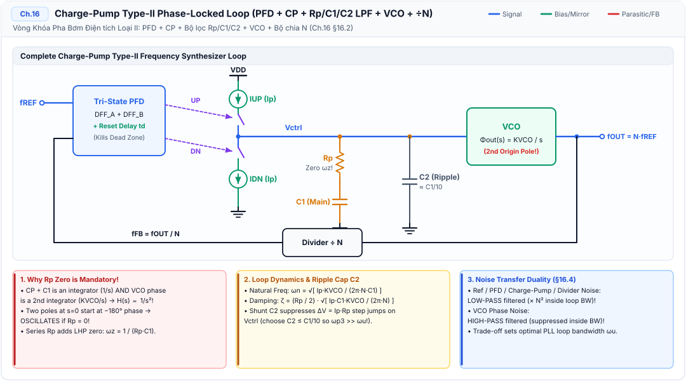

---
{
  "id": "tech-dll-delay-locked-loop-vs-pll",
  "kind": "technique",
  "domain": "sampled-and-clocked",
  "title_vi": "Vòng Khóa Trễ (DLL) so với Vòng Khóa Pha (PLL): Ổn định Vô điều kiện Bậc Nhất, Không Tích lũy Jitter & Bẫy Khóa Hài (DLL vs PLL)",
  "title_en": "Delay-Locked Loops (DLLs) vs. Phase-Locked Loops: First-Order Stability, Zero Jitter Accumulation, and Harmonic-Lock Prevention",
  "summary": "Đối chiếu toàn diện từ nguyên lý toán học đến thực thi mạch giữa Vòng khóa trễ (DLL) và Vòng khóa pha (PLL) theo Razavi §16.4 & §16.5.2: thay thế bộ tích phân VCO (K_VCO/s) bằng đường trễ điều khiển điện áp bậc không VCDL (-K_VCDL) giúp vòng bơm điện tích chỉ dùng 1 tụ đơn CP đạt ổn định vô điều kiện bậc nhất với 0 dB jitter peaking và không tích lũy jitter qua nhiều chu kỳ, ứng dụng tạo đồng hồ đa pha / khử lệch trễ (deskew), cùng quy tắc thiết kế máy trạng thái khởi động chống khóa nhầm bội chu kỳ (harmonic / stuck lock).",
  "diagram": "../../diagrams/charge-pump-type2-pll.svg",
  "razavi_refs": [
    {
      "chapter": 16,
      "section": "16.3.2",
      "pages": "681-683",
      "equations": ["16.48"]
    },
    {
      "chapter": 16,
      "section": "16.4, 16.5.2",
      "pages": "683-685, 687-688",
      "equations": []
    }
  ],
  "glossary_codes": [
    "T016",
    "T029",
    "T033",
    "T042",
    "T047",
    "T051",
    "T052",
    "T063",
    "T064",
    "T069",
    "T090",
    "T854",
    "T1004",
    "T1802",
    "T2079",
    "T2161",
    "T2170",
    "T2171",
    "T2174",
    "T2175"
  ],
  "process_agnostic": true,
  "roles": {
    "voltage_controlled_delay_line_vcdl": "Chuỗi M tầng trễ điều khiển bằng điện áp nhận trực tiếp xung nhịp chuẩn CK_in ở đầu vào và dịch trễ tuyến tính T_tot(Vcont) mà không nối vòng kín tái tuần hoàn cạnh xung.",
    "single_capacitor_integrating_filter": "Tụ tích phân duy nhất CP sau bơm điện tích cung cấp cực 1/s duy nhất tại gốc tọa độ, tạo hệ đóng vòng bậc nhất có dự trữ pha 90 độ tự nhiên mà không cần điện trở bù RP.",
    "anti_harmonic_start_reset_fsm": "Mạch khởi tạo và giám sát cửa sổ khóa đặt Vcont ở biên trễ nhỏ nhất (T_VCDL,min) lúc bật nguồn để cưỡng bức DLL chỉ khóa vào đúng 1 chu kỳ cơ bản T_in thay vì 2*T_in hay 3*T_in.",
    "duty_cycle_and_stage_matching": "Mạch hiệu chỉnh chu kỳ nhiệm vụ 50% (DCC) và bố cục đối xứng tuyệt đối giữa M tầng VCDL đảm bảo các vòi trích pha trung gian cách đều chính xác T_in / M."
  },
  "symptoms_addressed": [
    "ring-vco-multi-cycle-jitter-accumulation-in-ddr-and-serdes-clocking",
    "type2-pll-stability-compensation-area-and-jitter-peaking-amplification",
    "clock-tree-buffer-insertion-delay-skew-between-external-bus-and-internal-flops",
    "need-precisely-spaced-multiphase-clocks-for-time-interleaved-adcs-and-tdcs"
  ],
  "limitations": [
    "dll-cannot-filter-high-frequency-jitter-present-on-input-reference-clock",
    "dll-cannot-natively-multiply-frequency-without-external-edge-combiner",
    "catastrophic-harmonic-locking-to-k-times-tin-or-rail-saturation-stuck-lock",
    "inter-stage-device-mismatch-directly-corrupts-intermediate-multiphase-spacing"
  ],
  "checklists": [
    "common-mos",
    "oscillator-and-pll",
    "layout-and-matching"
  ]
}
---

## 1. Bản chất Nguyên lý, Sơ đồ Mạch & Vai trò Từng Nhánh Cấu trúc

Trong hàng loạt hệ thống số và tín hiệu hỗn hợp hiện đại — từ giao tiếp bộ nhớ băng thông cao (`DDR4/DDR5/HBM`), bộ chuyển đổi tương tự–số xen kẽ thời gian (`Time-Interleaved SAR/Pipeline ADC` cần $4 \sim 16$ pha lấy mẫu cách đều tới từng trăm femtogiây!), bộ đo khoảng thời gian số (`TDC`) cho tới mạng khử lệch thời gian cây đồng hồ (`Zero-Delay Buffer / Clock Deskewing`, Razavi §16.5.2) — bài toán đặt ra **không phải là đổi tần số**, mà là tạo ra các cạnh xung nhịp đồng bộ pha tuyệt đối với xung tham chiếu $CK_{\text{in}}$ sẵn có (Razavi §16.4, trang 683–685, Hình 16.52–16.54).

Nếu dùng một **vòng khóa pha** (`phase-locked loop, PLL` — `T064`) chứa bộ dao động vòng (`topo-ring-oscillator`) để làm việc này (Hình 16.52b), ta lập tức gánh chịu hai tai họa vật lý bắt nguồn từ việc nối vòng kín đầu ra quay lại đầu vào của VCO:
1. **Tích lũy Jitter đa chu kỳ (`Multi-Cycle Jitter Accumulation`)**: Trong VCO vòng, cạnh xung vừa bị nhiễu nhiệt và nhiễu nguồn cấp $V_{DD}$ làm lệch thời điểm tại chu kỳ thứ $k$ lại được quay vòng làm mốc xuất phát cho chu kỳ thứ $k+1, k+2, \dots$! Phương sai lỗi thời điểm tăng tuyến tính theo số chu kỳ ($\sigma_{\Delta t}^2(m) \propto m \cdot T_0$) cho tới tận khi vòng khóa pha kịp phản ứng sau $\sim \frac{1}{\omega_c}$ giây!
2. **Mất ổn định hai cực gốc tọa độ & Nhô đỉnh Jitter (`Jitter Peaking`)**: Bản chất tích phân tần số sang pha $\frac{K_{VCO}}{s}$ của VCO cộng với cực $\frac{1}{s C_P}$ của bơm điện tích buộc phải thêm điện trở $R_P$ tạo zero, vừa tốn diện tích tụ lọc lớn vừa sinh ra độ nhô đỉnh $|H(j\omega)| > 1$ khuếch đại nhiễu xung nhịp quanh $\omega_n$!



**Vòng khóa trễ** (`delay-locked loop, DLL` — `T029`, Hình 16.53b–16.54) hóa giải triệt để cả hai tai họa trên chỉ bằng một phẫu thuật cấu trúc duy nhất: **cắt bỏ đường hồi tiếp vòng kín của bộ dao động vòng, biến nó thành Đường trễ điều khiển bằng điện áp hở hai đầu (`Voltage-Controlled Delay Line — VCDL`) nhận trực tiếp $CK_{\text{in}}$ làm ngõ vào!**
- **Nguyên lý vận hành**: Tín hiệu xung nhịp $CK_{\text{in}}$ (chu kỳ $T_{\text{in}} = 2\pi / \omega_{\text{in}}$) đi nối tiếp qua $M$ tầng trễ giống hệt nhau (ví dụ $M = 4$ tầng vi sai cho $8$ pha cách nhau $45^\circ$), mỗi tầng có độ trễ $t_d(V_{cont})$. Ngõ ra cuối cùng $CK_M$ được đưa về bộ tách pha `PD / PFD` so sánh với chính $CK_{\text{in}}$, lái **bơm điện tích** (`charge pump` — `T016`) nạp vào **một tụ điện đơn duy nhất $C_P$** (không có $R_P$!). Ở trạng thái khóa xác lập, vòng điều khiển ép tổng độ trễ toàn tuyến bằng đúng **một chu kỳ tham chiếu**: $T_{\text{VCDL}}(V_{cont}) = M \cdot t_d(V_{cont}) = T_{\text{in}}$, nhờ đó mỗi vòi trích giữa xuất ra các pha cách đều hoàn hảo $\Delta T = \frac{T_{\text{in}}}{M}$ bất chấp biến thiên PVT!
- **Hai phép màu vật lý tức thì**: (1) Một cạnh xung bị nhiễu làm lệch trong VCDL chỉ truyền đi một lượt từ đầu dây đến cuối dây rồi **biến mất vĩnh viễn ra ngõ ra**, cạnh kế tiếp đi vào từ $CK_{\text{in}}$ hoàn toàn tươi mới — **triệt tiêu 100% sự tích lũy nhiễu qua nhiều chu kỳ**! (2) Khi $V_{cont}$ thay đổi một bậc $\Delta V_{cont}$, độ trễ $\Delta T_{\text{VCDL}}$ (và do đó pha ra $\Delta\phi_{\text{out}} = -\omega_{\text{in}} \Delta T_{\text{VCDL}}$) thay đổi **ngay lập tức không có phép tích phân theo thời gian** ($\frac{\Phi_{\text{out}}(s)}{V_{cont}(s)} = -K_{\text{VCDL}}$, bậc $0$!), biến toàn bộ vòng bơm điện tích thành **hệ bậc nhất ổn định tuyệt đối vô điều kiện với dự trữ pha $90^\circ$ và $0\text{ dB}$ jitter peaking**!

---

## 2. Hệ Phương trình Cốt lõi & Tư duy "Nhìn Mạch Đọc Nhanh" (Analysis by Inspection)

### 2.1. Dẫn xuất Hàm truyền Vòng Hở Bậc Nhất và Hàm truyền Pha Toàn Thông (`All-Pass Input Response`, Ví dụ 16.12)
Gọi tổng độ trễ của đường trễ $M$ tầng quanh điểm khóa $T_{\text{VCDL},0} = T_{\text{in}}$ là $T_{\text{VCDL}}(V_{cont}) = T_{\text{in}} + K_T \Delta V_{cont}$ (với $K_T = \frac{\partial T_{\text{VCDL}}}{\partial V_{cont}}$ tính bằng $\text{s/V}$; giả sử tăng $V_{cont}$ làm tăng tốc dòng phân cực khiến trễ giảm, tức $K_T < 0$, đặt độ nhạy pha dương $K_{\text{VCDL}} \equiv \omega_{\text{in}} |K_T| = \frac{2\pi}{T_{\text{in}}} |K_T|$ $[\text{rad/V}]$).

Khác hoàn toàn với VCO ($\Phi_{\text{out}}(s) = \frac{K_{\text{VCO}}}{s} V_{cont}(s)$), pha của tín hiệu tại cuối đường trễ $CK_M(t) = CK_{\text{in}}\!\left(t - T_{\text{VCDL}}(t)\right)$ gồm hai thành phần: pha gốc của đầu vào bị trễ đi đúng 1 chu kỳ $T_{\text{in}}$ là $e^{-s T_{\text{in}}} \Phi_{\text{in}}(s)$, cộng với lượng dịch pha tức thời từ điện áp điều khiển:

$$\Phi_{\text{out}}(s) = e^{-s T_{\text{in}}} \Phi_{\text{in}}(s) + K_{\text{VCDL}} V_{cont}(s)$$

Bộ tách pha PFD so sánh pha hiện tại $\Phi_{\text{in}}(s)$ với pha đi ra từ cuối dây trễ $\Phi_{\text{out}}(s)$, bơm dòng trung bình $I_{\text{CP}}(s) = \frac{I_P}{2\pi}\left[\Phi_{\text{in}}(s) - \Phi_{\text{out}}(s)\right]$ vào **duy nhất một tụ điện $C_P$** ($Z_{\text{LF}}(s) = \frac{1}{s C_P}$):
1. **Hàm truyền Vòng hở $L_{\text{DLL}}(s)$ (khi xét $\Phi_{\text{in}} = 0$)**:
   $$L_{\text{DLL}}(s) = \frac{I_P}{2\pi s C_P} \cdot K_{\text{VCDL}} = \frac{\omega_{\text{DLL}}}{s}, \qquad \text{với băng thông vòng bậc nhất:} \quad \omega_{\text{DLL}} \equiv \frac{I_P K_{\text{VCDL}}}{2\pi C_P}$$
   Chỉ có **duy nhất 1 cực tại gốc tọa độ**! Độ dốc biên độ là $-20\text{ dB/dec}$ đồng nhất trên mọi tần số, dự trữ pha lý tưởng bằng **$90^\circ$** (chỉ giảm nhẹ vài độ ở tần số cao do trễ lấy mẫu rời rạc khi giữ $\omega_{\text{DLL}} \le \omega_{\text{in}}/10$), **hoàn toàn không cần điện trở $R_P$ và không bao giờ có hiện tượng nhô đỉnh Jitter Peaking ($0.00\text{ dB}$ peaking)**!
2. **Hàm truyền từ Jitter Đầu vào $\Phi_{\text{in}}(s)$ ra Đầu ra $\Phi_{\text{out}}(s)$ (Giải tích chính xác cho Ví dụ 16.12 của Razavi!)**:
   Thay $V_{cont}(s) = \frac{I_P}{2\pi s C_P}\left[\Phi_{\text{in}}(s) - \Phi_{\text{out}}(s)\right]$ vào phương trình của $\Phi_{\text{out}}(s)$:

$$H_{\text{in}\to\text{out,DLL}}(s) = \frac{\Phi_{\text{out}}(s)}{\Phi_{\text{in}}(s)} = \frac{e^{-s T_{\text{in}}} + \dfrac{\omega_{\text{DLL}}}{s}}{1 + \dfrac{\omega_{\text{DLL}}}{s}} = \frac{s \, e^{-s T_{\text{in}}} + \omega_{\text{DLL}}}{s + \omega_{\text{DLL}}}$$

   Hãy kiểm chứng lời giải định tính tuyệt hay trong **Ví dụ 16.12 (trang 684–685)** bằng công thức chính xác vừa tìm được:
   - *Khi biến thiên pha đầu vào rất chậm ($s = j\omega_m \to 0$, $\omega_m \ll \omega_{\text{DLL}}$)*: $H_{\text{in}\to\text{out}}(j\omega_m) \to \frac{\omega_{\text{DLL}}}{\omega_{\text{DLL}}} = \mathbf{1}$ (vòng hồi tiếp chỉnh VCDL bám sát pha đầu vào!).
   - *Khi biến thiên pha đầu vào rất nhanh ($\omega_m \gg \omega_{\text{DLL}}$)*: Vòng điều khiển không kịp nhúc nhích ($V_{cont} \approx \text{hằng số}$), $H_{\text{in}\to\text{out}}(j\omega_m) \to e^{-j\omega_m T_{\text{in}}} \implies \left|H_{\text{in}\to\text{out}}(j\omega_m)\right| = \mathbf{1}$ (biến thiên pha đầu vào đi xuyên thẳng qua dây trễ ra ngõ ra không suy giảm!).
   - *Kết luận cốt tử*: Khác hẳn PLL (lọc thông thấp chặn sạch jitter tần số cao của đầu vào!), **DLL có đáp ứng biên độ dạng toàn thông (`All-Pass`, biên độ $\approx 1$ ở cả tần số thấp lẫn tần số cao, chỉ hơi nhấp nhô nhẹ quanh $\omega_{\text{DLL}}$ do giao thoa pha với $e^{-j\omega T_{\text{in}}}$)!** Do đó **TUYỆT ĐỐI KHÔNG BAO GIỜ DÙNG DLL ĐỂ LỌC SẠCH MỘT XUNG NHỊP ĐẦU VÀO ĐANG BẨN (`Jitter Attenuation / Cleanup`)** — DLL chỉ tỏa sáng khi nguồn xung nhịp đầu vào $CK_{\text{in}}$ đã sạch sẵn!
3. **Hàm truyền Nhiễu Nội tại của Bản thân Đường trễ VCDL và Nguồn cấp $V_{DD}$**:
   Gọi $\Phi_{n,\text{VCDL}}(s)$ là lỗi pha do nhiễu nhiệt của $M$ tầng trễ hoặc nhiễu nguồn cấp $V_{DD}$ gây ra trên VCDL:
   $$\frac{\Phi_{\text{out}}(s)}{\Phi_{n,\text{VCDL}}(s)} = \frac{1}{1 + L_{\text{DLL}}(s)} = \frac{s}{s + \omega_{\text{DLL}}}$$
   Nhiễu chậm ($\omega < \omega_{\text{DLL}}$) bị nén thông cao $-20\text{ dB/dec}$, còn nhiễu nhanh ($\omega > \omega_{\text{DLL}}$) chỉ chịu sai số **1 lần đi qua dây trễ duy nhất** chứ không bị nhân tích phân $1/\omega^2$ như VCO!

### 2.2. Toán học của Bẫy Khóa Nhầm Bội Chu kỳ (`Harmonic Locking`) & Bẫy Khóa Chết Biên (`Stuck Lock`)
Vì tín hiệu xung nhịp $CK_{\text{in}}$ tuần hoàn với chu kỳ $T_{\text{in}}$, bộ tách pha hoàn toàn "mù" trước số nguyên chu kỳ lệch giữa hai cạnh lên — nó báo sai số pha bằng $0$ với mọi tổng độ trễ $T_{\text{VCDL}} = k \cdot T_{\text{in}}$ ($k = 1, 2, 3, \dots$)! Xét một DLL tiêu chuẩn dùng PFD ba trạng thái có dải trễ vật lý khả dụng từ $T_{\min}$ (ứng với $V_{cont,\max}$) đến $T_{\max}$ (ứng với $V_{cont,\min}$):
- **Thảm họa 1 — Khóa Hài $k \ge 2$ (`Harmonic Lock`)**: Nếu $T_{\max} > 2 T_{\text{in}}$ và lúc mới bật nguồn điện áp $V_{cont}$ tình cờ khởi tạo ở vùng trễ lớn gần $1.8\,T_{\text{in}}$, PFD sẽ kéo DLL khóa cứng vào **$T_{\text{VCDL}} = 2\,T_{\text{in}}$**! Khi đó $4$ vòi lấy pha cách nhau $\frac{2 T_{\text{in}}}{4} = \frac{T_{\text{in}}}{2}$ ($180^\circ$ thay vì $90^\circ$!), phá hủy hoàn toàn mạch cầu phương hoặc ADC xen kẽ thời gian!
- **Thảm họa 2 — Kẹt Chết ở Biên Dưới $k = 0$ (`False Zero-Delay / Stuck-at-Min Lock`)**: Nếu lúc khởi động $T_{\text{VCDL}} < 0.5\,T_{\text{in}}$ và PFD hiểu nhầm cạnh trễ là cạnh *sớm* của chu kỳ tiếp theo, PFD sẽ liên tục phát xung `UP` cố kéo độ trễ tiến về **$0\text{ s}$** (vật lý không thể có trễ $0\text{ s}$!), ép $V_{cont}$ đập kịch trần $V_{DD}$ và chết cứng tại $T_{\min}$ mãi mãi!

**Bất đẳng thức Cửa sổ Khóa An toàn Tuyệt đối (`Unambiguous Lock Window`)**: Để một PFD tiêu chuẩn luôn khóa duy nhất vào đúng $k = 1$ ($T_{\text{VCDL}} = 1 \cdot T_{\text{in}}$) trên mọi góc PVT mà không bao giờ dính $k = 0$ hay $k = 2$, dải độ trễ của VCDL và điểm khởi tạo ban đầu $T_{\text{init}}$ phải thỏa mãn:

$$\frac{1}{2} T_{\text{in}} < T_{\min}(\text{FF}, -40^\circ\text{C}) < T_{\text{in}} < T_{\max}(\text{SS}, 125^\circ\text{C}) < \frac{3}{2} T_{\text{in}}$$

Trên thực tế khi tỉ số PVT của cổng trễ CMOS biến thiên hơn $2.5 : 1$ (hoặc DLL phải hỗ trợ dải tần số $f_{\text{in}}$ rộng!), không thể nhốt cả $T_{\min}$ và $T_{\max}$ vào khe hẹp $(0.5\,T_{\text{in}}, 1.5\,T_{\text{in}})$ chỉ bằng kích thước analog! Khi đó bắt buộc trang bị **Mạch Khởi động Reset Đặt trước + Bộ Phát hiện Khóa Hài Số (`Start-Controlled PFD & Harmonic Lock Detector`)**: lúc `Reset = 1`, mạch cưỡng bức nạp tụ $C_P$ để đặt VCDL ở **độ trễ nhỏ nhất $T_{\min} < T_{\text{in}}$**, đồng thời bỏ qua cạnh lên đầu tiên của $CK_{\text{in}}$ rồi mới ghép cạnh thứ hai với cạnh đầu tiên đi ra từ $CK_M$ — đảm bảo 100% đường trễ chỉ tăng đơn điệu từ $T_{\min}$ lên chạm ngưỡng đầu tiên chính là **$1.0 \cdot T_{\text{in}}$**!

### 2.3. Sai số Khoảng cách Pha Tĩnh từ Mismatch Giữa Các Tầng Trễ VCDL
Khác với VCO (nơi mọi tầng đều cùng quyết định một chu kỳ chung), trong DLL có $M$ tầng trễ danh định $t_d = T_{\text{in}}/M$ với độ lệch ngẫu nhiên độc lập $\Delta t_i$ có độ lệch chuẩn $\sigma_t$: vòng hồi tiếp âm chỉ ép **tổng độ trễ cuối cùng** $\sum_{i=1}^M (t_d + \Delta t_i) = T_{\text{in}}$ (sai số bằng $0$ tại vòi cuối $M$), nhưng tại vòi trích pha trung gian thứ $k$ ($1 \le k < M$), phương sai sai số thời gian tích lũy tuân theo cầu nối ngẫu nhiên (`Brownian Bridge`) đạt cực đại ngay tại **điểm chính giữa đường trễ ($k = M/2$)**:

$$\sigma_{\Delta T_{\text{skew}}}(k) = \sigma_t \sqrt{\frac{k(M - k)}{M}} \implies \sigma_{\Delta T_{\text{skew,max}}}\!\left(k = \frac{M}{2}\right) = \frac{\sqrt{M}}{2}\,\sigma_t$$

**Ví dụ Định lượng Thiết kế CP-DLL 4 Pha $1.0\text{ GHz}$ (`65nm` CMOS)**:
Cần tạo 8 pha vi sai cách nhau $125\text{ ps}$ từ xung chuẩn sạch $f_{\text{in}} = 1.0\text{ GHz}$ ($T_{\text{in}} = 1.0\text{ ns}$) bằng VCDL $M = 4$ tầng vi sai ($t_{d,\text{nom}} = 250\text{ ps}$/tầng), yêu cầu sai số pha cầu phương $3\sigma < 1.5^\circ$ ($\Delta t_{3\sigma} < \frac{1.5}{360} \times 1000\text{ ps} = 4.17\text{ ps}$) và băng thông vòng $f_{\text{DLL}} = 50\text{ MHz}$ ($\le f_{\text{in}}/20$):
1. **Định cỡ diện tích tầng trễ VCDL theo cầu nối ngẫu nhiên**: Tại vòi giữa $k = 2$ ($90^\circ$), $\sigma_{\Delta T}(2) = \frac{\sqrt{4}}{2}\sigma_t = \sigma_t$. Để $3\sigma_t < 4.17\text{ ps} \implies \sigma_t < 1.39\text{ ps}$ ($0.55\%$ của $250\text{ ps}$!), bắt buộc định cỡ cặp vi sai và tải của mỗi ô VCDL với diện tích $W \cdot L$ lớn và bố cục trọng tâm chung cả 4 ô trễ nằm chung một mảng kèm 2 ô trễ giả (`dummy delay cells`) ở đầu và cuối dây!
2. **Tính tụ lọc duy nhất $C_P$**: Giả sử độ nhạy đường trễ $|K_T| = 1.2\text{ ns/V} \implies K_{\text{VCDL}} = \frac{2\pi}{1\text{ ns}} \times 1.2\text{ ns/V} = 7.54\text{ rad/V}$. Chọn dòng bơm $I_P = 200\,\mu\text{A}$:
   $$C_P = \frac{I_P K_{\text{VCDL}}}{2\pi \omega_{\text{DLL}}} = \frac{200\times 10^{-6} \times 7.54}{2\pi \times (2\pi \times 50\times 10^6)} = \mathbf{0.764\text{ pF}} \quad (\text{nhỏ hơn tụ } C_1 \text{ của PLL hơn } \mathbf{100\text{ lần}}\text{!})$$
   (Thực tế chọn $I_P = 600\,\mu\text{A} \implies C_P = 2.3\text{ pF}$ để giảm ảnh hưởng phun điện tích công tắc mà diện tích tụ vẫn chỉ bằng một hạt bụi $30\,\mu\text{m} \times 30\,\mu\text{m}$!).

---

## 3. Bất biến Cấu trúc & Các Bẫy Lỗi Kinh điển (Structural Invariants & Traps)

- **[INV-DLL-01] Bất biến Cân bằng Tải Đầu Vào – Đầu Ra cho Mọi Ô Trễ (`Dummy Delay Load Matching`)**: Trong VCDL hở hai đầu ($CK_{\text{in}} \to \text{Stage } 1 \to \dots \to \text{Stage } M$), tầng số $1, 2, \dots, M-1$ đều lái đầu vào của tầng kế tiếp, nhưng tầng cuối cùng $M$ lại lái ngõ vào PFD! Nếu không gắn một **ô trễ giả (`Dummy Stage` $M+1$)** có kích thước y hệt vào sau tầng $M$ (và một ô đệm chuẩn hóa sườn `Input Shaper Stage 0` có cùng thời gian tăng/giảm sườn trước tầng $1$!), tầng $1$ và tầng $M$ sẽ có độ trễ khác hẳn các tầng giữa, tạo sai số pha hệ thống cố định hàng chục picogiây ngay tại góc danh định `TT`!
- **[INV-DLL-02] Bất biến Phụ thuộc Chu kỳ Nhiệm vụ Đầu vào (`50% Duty-Cycle Requirement`) khi Trích Pha Nửa Chu kỳ**: Nếu mạch phía sau sử dụng **cả cạnh lên lẫn cạnh xuống** của các vòi VCDL (ví dụ DDR truyền dữ liệu hai sườn hoặc bộ nhân tần số kết hợp cạnh `Edge-Combining DLL Frequency Multiplier`), bất kỳ độ lệch chu kỳ nhiệm vụ nào của $CK_{\text{in}}$ khác $50\%$ (ví dụ $45\% / 55\%$) sẽ đi nguyên vẹn xuyên qua VCDL mà không được vòng DLL sửa! Khi đó bắt buộc phải đặt một mạch **Hiệu chỉnh Chu kỳ Nhiệm vụ (`Duty-Cycle Corrector — DCC`)** ngay đầu vào VCDL và dùng các tầng trễ vi sai đối xứng hoàn toàn!
- **[TRAP-DLL-01] Bẫy Chết Khóa do Mất Cạnh Xung ở Tần số Cao trong VCDL (`Pulse Swallowing / Attenuation Inside VCDL`)**: Lúc bật nguồn nếu điện áp $V_{cont}$ chưa kịp khởi tạo làm dòng phân cực của các tầng VCDL quá yếu ($t_d$ quá chậm sao cho hằng số thời gian tải lớn hơn nửa chu kỳ $T_{\text{in}}/2$), biên độ sóng trong VCDL suy giảm dần qua từng tầng và **tắt ngấm biến mất trước khi tới được tầng cuối $CK_M$**! Khi $CK_M$ im lìm bằng $0$, nếu PFD đang ở cấu hình giảm tốc khi thiếu xung $CK_M$, nó càng kéo $V_{cont}$ yếu đi và khóa chết vĩnh viễn! Mạch khởi tạo bắt buộc phải kéo $V_{cont}$ về đầu **tốc độ nhanh nhất (biên độ khỏe nhất, $T_{\min}$)** trước khi thả cho vòng khóa chạy!
- **[TRAP-DLL-02] Bẫy Dùng Nhầm DLL Thay Cho PLL Khi Cần Nhân Tần Số Hoặc Khử Jitter Nguồn Bẩn**: DLL tự bản thân chỉ xuất ra $f_{\text{out}} = f_{\text{in}}$. Mặc dù có thể gắn một mạng cổng XOR/AND kết hợp $M$ pha cách đều của DLL để tạo xung tần số $M \cdot f_{\text{in}}$ (`DLL-Based Frequency Multiplier`), bất kỳ sai lệch vị trí pha $\Delta t_k$ nào giữa $M$ tầng VCDL sẽ biến thẳng thành **vạch phổ giả cố định cực lớn tại $\pm f_{\text{in}}$** trên sóng mang nhân tần!

---

## 4. Lộ trình Nâng cấp Cấu trúc & Bát giác Đánh đổi (Upgrade Paths & Design Octagon)

Trong `concept-analog-design-octagon`, quyết định chọn giữa **DLL**, **CP-PLL**, và **MDLL (`Multiplying DLL`)** dựa trên bảng phân xử kỹ thuật rõ ràng sau:

- **Nền tảng kết nối từ**: Song hành và bổ trợ trực tiếp cho `topo-charge-pump-type2-pll`, `concept-pll-nonidealities-spurs-jitter`, sử dụng các ô trễ điều khiển từ `topo-ring-oscillator` & `topo-vco-tuning-and-phase-noise`, và đòi hỏi khớp linh kiện khắt khe từ `law-pelgrom-mismatch-and-sizing-duality` & `tech-common-centroid-sti-wpe-layout`.
- **Hướng nâng cấp lai ghép hiện đại (`MDLL — Multiplying Delay-Locked Loop`)**: Nếu vừa muốn nhân tần số $f_{\text{out}} = N f_{\text{REF}}$ như PLL, vừa muốn xóa bỏ tích lũy jitter đa chu kỳ của Ring-VCO như DLL, nâng cấp lên cấu trúc **MDLL**: cho Ring-VCO chạy $N-1$ chu kỳ rồi mỗi chu kỳ thứ $N$ dùng bộ ghép kênh (`mux`) tiêm trực tiếp cạnh xung sạch tinh khôi từ thạch anh $f_{\text{REF}}$ vào thay thế cạnh tuần hoàn trong vòng, xóa sạch toàn bộ lỗi pha tích lũy sau mỗi $T_{\text{REF}}$!

| Tiêu chí Kỹ thuật | CP-DLL Chuẩn ($C_P$ đơn) | CP-PLL Loại II Bậc Ba ($R_P, C_1, C_2$) | MDLL (Multiplying DLL) |
| :--- | :--- | :--- | :--- |
| **Hàm truyền Khối Tạo Pha** | $-K_{\text{VCDL}}$ (Bậc $0$, không nhớ) | $K_{\text{VCO}} / s$ (Bậc $1$, tích phân nhớ vô hạn) | Tích phân ngắn hạn $N$ chu kỳ rồi xóa về $0$ |
| **Ổn định & Diện tích Bộ lọc** | **Bậc 1 ổn định vô điều kiện**, tụ $C_P \sim 1 \sim 3\text{ pF}$ | Bậc 3 ổn định có điều kiện, tụ $C_1 \sim 50 \sim 200\text{ pF}$ | Bậc 1 (tương tự DLL), diện tích siêu gọn |
| **Jitter Peaking Đóng vòng** | **$0\text{ dB}$ tuyệt đối** | Luôn $> 0\text{ dB}$ ($\sim 1 \sim 2\text{ dB}$ do LHP zero) | Gần $0\text{ dB}$ |
| **Lọc Jitter Tần số Cao Đầu vào** | **Không lọc được** (`All-Pass` $|H|=1$) | **Lọc thông thấp rất tốt** ($-40\text{ dB/dec}$) | Yêu cầu xung thạch anh tiêm vào phải cực sạch! |
| **Tích lũy Jitter Nhiệt / Nguồn $V_{DD}$** | **Không tích lũy** (chỉ 1 lượt truyền VCDL) | Tích lũy nhiều chu kỳ trong cửa sổ $1/\omega_c$ | Chỉ tích lũy tối đa trong đúng $N$ chu kỳ VCO |
| **Rủi ro Khóa Sai Hệ thống** | **Cao** (Khóa hài $2 T_{\text{in}}, 3 T_{\text{in}}$ hoặc kẹt biên) | Thấp (PFD 3 trạng thái tự bắt đúng tần số) | Cần căn chỉnh chính xác cửa sổ chọn xung (`sel` timing) |

---

## 5. Thích ứng Đa Tiến trình (90nm / 65nm / 45nm) & Cách Kiểm chứng trong Cadence / Spectre

### 5.1. Vượt Qua Biến thiên PVT Rộng ở `90nm` / `65nm` / `45nm` Bằng VCDL Bậc Nấc + Liên tục (`Dual-Range / Phase-Interpolator DLL`)
Ở `65nm` và `45nm`, trễ một cổng CMOS giữa góc `(FF, 1.1V, -40°C)` và `(SS, 0.9V, 125°C)` có thể lệch nhau tới **$2.8\times$**, vượt xa cửa sổ khóa không mơ hồ $(0.5\,T_{\text{in}}, 1.5\,T_{\text{in}})$! Hai kiến trúc công nghiệp giải quyết dứt điểm bài toán này:
1. **DLL Hai Vùng Thô–Tinh (`Coarse Switched-Cap/Current Bank + Fine VCDL` kèm Khởi tạo $T_{\min}$)**: Dùng mạch điều khiển khởi động giữ `Vcont` ở mức nhanh nhất lúc `rst_n = 0`, kết hợp bộ đếm pha khởi động tự chọn số tầng hoặc dải dòng thô để đặt $T_{\text{VCDL}}$ nằm chắc chắn ở khoảng $0.7\,T_{\text{in}}$ trước khi mở khóa tương tự kéo mịn lên đúng $1.0\,T_{\text{in}}$.
2. **DLL Vòng Quay Pha Vô tận (`Dual-DLL / Phase-Interpolator Unlimited-Range DLL`)**: Tạo 4 pha thô cố định rồi dùng bộ nội suy pha (`Phase Interpolator` điều khiển số) quay vòng trơn tru qua $360^\circ$ không có điểm dừng biên — loại bỏ hoàn toàn giới hạn dải khóa!

### 5.2. Kịch bản Kiểm chứng Khởi động Chống Khóa Hài ở Mọi Điều kiện Ban đầu trong Spectre
```spice
// Testbench Kiem chung Chong Khoa Hai (Anti-Harmonic Lock) & Do chinh xac Da Pha cua CP-DLL
simulator lang=spectre
parameters vcont_ic=0.15 f_clk=1.0G

// Kiem thu cung luc ca truong hop te nhat: ep dieu kien dau Vcont_ic o bien cham nhat HOAC nhanh nhat!
ic vcont=vcont_ic

// Xung nhip dau vao 1 GHz va xung Reset khoi tao may trang thai chong khoa hai
Vckin (ck_in 0)  vsource type=pulse val0=0 val1=1.0 period=(1/f_clk) rise=25p fall=25p width=(0.5/f_clk - 25p)
Vrstn (rst_n 0)  vsource type=pwl wave=[0 0  4n 0  4.1n 1.0]

// Chay Tran qua goc SS 125C va FF -40C, quet vcont_ic = {0.0, 0.5, 1.0} V
tran_dll tran stop=80n errpreset=conservative

// 3 Phép đo Nghiệm thu Bắt buộc (Sign-Off Assertions):
// 1. Kiem tra Tong Do Tre VCDL khoa dung 1.0 * T_in (= 1.0 ns), TUYET DOI KHONG KHOA VAO 2.0 ns hay 0 ns:
//    T_lock_delay = cross(v("/ck_out_4") 0.5 -1 'rising) - cross(v("/ck_in") 0.5 -2 'rising)  ==>  1.000 ns +- 3 ps!
// 2. Kiem tra Sai so Khoang cach Pha tinh giua 4 voi CK1, CK2, CK3, CK4 tren Monte Carlo 200 mau + PEX:
//    max_phase_skew_ps = max(|T_12 - 250p|, |T_23 - 250p|, |T_34 - 250p|) < 4.0 ps!
// 3. Bom xung buoc nhay pha nho 10 ps tren ck_in va xac nhan dap ung qua do khong co overshoot (0 dB Jitter Peaking)!
```

---

## 6. Mốc Đối chiếu Sách Razavi & Thuật ngữ Chuẩn CLB

- **Sách gốc Razavi (2nd Ed.)**: Chương 16, đối chiếu Mục `16.3.2` (*Jitter in PLLs*, trang 681–683, Phương trình `16.48`), trọng tâm Mục `16.4` (*Delay-Locked Loops*, trang 683–685, Hình `16.52`–`16.54`, Ví dụ `16.12`) và Mục `16.5.2` (*Skew Reduction*, trang 687–688, Hình `16.57`–`16.60`, Ví dụ `16.13`, Phương trình `16.55`–`16.56`).
- **Đối chiếu Thuật ngữ Chuẩn CLB Vi Mạch (`terms-vi-en.json`)**:
  - `T029` (`delay-locked loop, DLL`): **vòng khóa trễ**; `T064` (`phase-locked loop, PLL`): **vòng khóa pha**.
  - `T2161` (`ring oscillator`): **bộ dao động vòng**; `T1802` (`integrator`): **mạch tích phân**.
  - `T047` (`jitter`): **jitter**; `T052` (`mismatch`): **sai lệch linh kiện**; `T1004` (`phase shift`): **độ dịch pha**.
  - `T016` (`charge pump`): **bơm điện tích**; `T2175` (`loop filter`): **bộ lọc vòng**; `T063` (`phase margin`): **dự trữ pha**.
