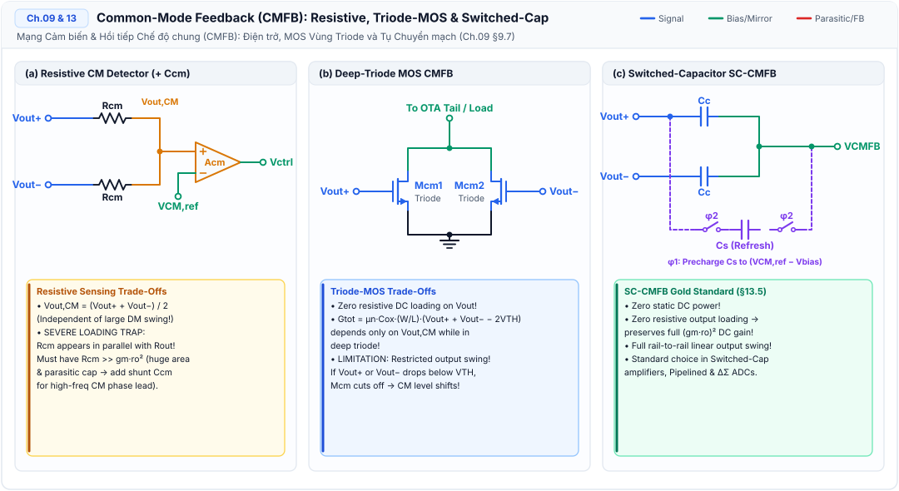

---
{
  "id": "tech-switched-capacitor-cmfb",
  "kind": "technique",
  "domain": "sampled-and-clocked",
  "title_vi": "Mạch hồi tiếp chế độ chung dùng tụ chuyển mạch (Switched-Capacitor CMFB)",
  "title_en": "Switched-Capacitor Common-Mode Feedback (SC-CMFB)",
  "summary": "Kỹ thuật cảm nhận điện áp trung bình ngõ ra vi sai bằng cặp tụ liên tục không gây tải điện trở và làm tươi điện tích phân cực định kỳ qua cặp tụ chuyển mạch hai pha, bảo toàn trọn vẹn độ lợi vòng hở lẫn dải dao động điện áp cực đại.",
  "diagram": "../../diagrams/cmfb-sensing-networks.svg",
  "razavi_refs": [
    {
      "chapter": 13,
      "section": "13.5",
      "pages": "571-572, 574-575",
      "equations": []
    },
    {
      "chapter": 9,
      "section": "9.7",
      "pages": "380-389",
      "equations": []
    }
  ],
  "glossary_codes": [
    "T012",
    "T014",
    "T022",
    "T042",
    "T052",
    "T060",
    "T063",
    "T065",
    "T076",
    "T087",
    "T088",
    "T095",
    "T800",
    "T1522",
    "T1526",
    "T1527",
    "T1534",
    "T1905",
    "T2079"
  ],
  "process_agnostic": true,
  "roles": {
    "continuous_averaging_capacitors_cc": "Cặp tụ tĩnh bằng nhau CC1 = CC2 nối từ hai ngõ ra vi sai Vout+, Vout- về nút điều khiển X để cảm nhận trung bình biến thiên chế độ chung liên tục mà không rút dòng một chiều.",
    "switched_refresh_capacitors_cs": "Cặp tụ làm tươi CS1 = CS2 chuyển mạch luân phiên trên hai pha không chồng lấp phi1, phi2 giữa cặp áp chuẩn (VCM,ref, Vb,ref) và cặp tụ CC1, CC2 để chốt chính xác mức một chiều và bù dòng rò.",
    "replica_bias_generator_vbref": "Nhánh transistor bản sao tạo điện áp cực cổng chuẩn Vb,ref khớp với điểm làm việc danh định của nguồn dòng đuôi hoặc nguồn dòng tải được điều khiển.",
    "split_current_source_return": "Cơ cấu tách nguồn dòng của OTA thành phần dòng tĩnh cố định song song với phần dòng điều chỉnh bởi CMFB nhằm tránh độ lợi chế độ chung quá lớn và tăng tốc độ hồi phục."
  },
  "symptoms_addressed": [
    "resistive-cmfb-differential-gain-degradation",
    "active-or-triode-cmfb-output-swing-clipping",
    "cmfb-amplifier-static-power-overhead",
    "high-impedance-differential-output-cm-drift"
  ],
  "limitations": [
    "requires-non-overlapping-two-phase-clocks",
    "clock-feedthrough-and-charge-injection-cm-ripple",
    "extra-shunt-capacitive-load-on-differential-outputs",
    "two-stage-cm-loop-instability-without-compensation"
  ],
  "checklists": [
    "common-mos",
    "switched-capacitor",
    "cmfb",
    "folded-cascode",
    "two-stage-miller",
    "layout-and-matching"
  ]
}
---

## 1. Bản chất Nguyên lý, Sơ đồ Mạch & Vai trò Từng Nhánh Cấu trúc

Mọi bộ khuếch đại thuật toán (operational amplifier, op amp) vi sai hoàn toàn có trở kháng ngõ ra cao đều bắt buộc cần mạng hồi tiếp chế độ chung (common-mode feedback — CMFB) để ghim trung bình hai ngõ ra $V_{out,\text{CM}} = \frac{1}{2}(V_{out+} + V_{out-})$ tại mức tham chiếu mong muốn $V_{CM,\text{ref}}$. Tuy nhiên, như Razavi phân tích ở Chương 9 (§9.7) và mở đầu §13.5, cả ba kỹ thuật cảm nhận chế độ chung liên tục theo thời gian đều bộc lộ nhược điểm nặng nề trong thiết kế độ lợi cao – biên độ lớn:
- **Cảm nhận bằng bộ chia điện trở ($R_{CM}$)**: Hai điện trở mắc song song với trở kháng ngõ ra cực lớn của OTA cascode làm sụt thê thảm độ lợi điện áp vi sai vòng hở (trừ khi chọn $R_{CM}$ hàng mêga-ôm chiếm diện tích khổng lồ và kéo theo tụ ký sinh lớn).
- **Cảm nhận bằng tầng bám nguồn hoặc cặp vi sai phụ**: Tiêu tốn thêm dòng tĩnh liên tục và đánh mất khoảng dự trữ thế $V_{GS}$, làm hẹp dải dao động điện áp (voltage swing) ngõ ra.
- **Cảm nhận bằng MOSFET vùng triode**: Chịu dải tuyến tính hẹp; khi tín hiệu vi sai dao động biên độ lớn, đặc tính bậc hai của MOSFET kéo lệch mức chế độ chung (nhiễu chuyển đổi DM sang CM).



Trong các hệ thống mạch tụ chuyển mạch (switched-capacitor circuit) nơi xung nhịp hai pha không chồng lấp $\phi_1, \phi_2$ đã có sẵn, **mạch hồi tiếp chế độ chung dùng tụ chuyển mạch (SC-CMFB)** khắc phục đồng thời cả ba rào cản trên: **không rút dòng một chiều, không làm suy giảm độ lợi vi sai vòng hở, không tiêu tốn công suất tĩnh cho bộ khuếch đại lỗi phụ, và cho phép $V_{out+}, V_{out-}$ dao động tuyến tính sát tận hai biên nguồn!** Cấu trúc hoàn chỉnh (tiến hóa từ Hình 13.60–13.62 của Razavi sang chuẩn công nghiệp 4 tụ động) gồm bốn thành phần phối hợp chặt chẽ:

1. **Cặp tụ cảm nhận trung bình liên tục ($C_{C1} = C_{C2} = C_C$, Hình 13.60)**: Nối thường trực từ $V_{out+}$ và $V_{out-}$ về nút cổng điều khiển $X$ ($V_{ctrl}$, ví dụ cực cổng transistor nguồn dòng đuôi $M_5$ hoặc tải PMOS của OTA). Mọi biến thiên chế độ chung $\Delta V_{out,\text{CM}}$ lập tức truyền qua bộ chia tụ về $V_{ctrl}$ để tạo vòng hồi tiếp âm tức thời ở mọi tần số mà không cần chờ xung nhịp!
2. **Mạng định thiên / làm tươi điện tích định kỳ trên hai pha ($\phi_1, \phi_2$, Hình 13.61–13.62 & mạng $C_{S1}, C_{S2}$)**: Vì nút $X$ chỉ ghép tụ nên mức điện tích một chiều trên $C_{C1}, C_{C2}$ chưa xác định và sẽ trôi dần do dòng rò. Trong sơ đồ đặt lại trực tiếp của Razavi (Hình 13.62), ở pha đặt lại, $C_1, C_2$ được ngắt khỏi ngõ ra để nạp hiệu thế chuẩn $V_{CM,\text{ref}} - V_{GS6}$. Trong cấu trúc SC-CMFB động không gián đoạn tiêu chuẩn, cặp tụ phụ $C_{S1} = C_{S2} = C_S$ nạp hiệu thế chuẩn $(V_{CM,\text{ref}} - V_{b,\text{ref}})$ trong pha $\phi_1$, sau đó đóng song song vào hai đầu $C_{C1}, C_{C2}$ trong pha $\phi_2$ để bơm bù điện tích và khóa chặt $V_{out,\text{CM}} \to V_{CM,\text{ref}}$ sau vài chu kỳ.
3. **Nhánh tạo áp phân cực bản sao ($V_{b,\text{ref}}$, transistor $M_6$ trong Hình 13.62)**: Tạo điện áp cực cổng danh định sao cho khi $V_{ctrl} = V_{b,\text{ref}}$, dòng của nguồn đuôi / tải OTA cân bằng chính xác với nhánh đối diện.
4. **Nguồn dòng hồi về chia tách (Split Current Source, Razavi tr. 572)**: Chỉ giao khoảng $20\%\text{--}35\%$ tổng dòng đuôi (hoặc dòng tải) cho transistor điều khiển bởi $V_{ctrl}$, còn $65\%\text{--}80\%$ do nguồn dòng cố định $V_b$ cung cấp nhằm giữ băng thông CMFB vừa vặn, giảm nhạy nhiễu và ngăn sập toàn bộ dòng phân cực OTA khi khởi động.

| Kiến trúc mạng CMFB | Tải điện trở lên độ lợi $A_0$ | Dải dao động $V_{out}$ cực đại | Công suất tĩnh phụ | Yêu cầu xung nhịp |
| :--- | :--- | :--- | :--- | :--- |
| Bộ chia điện trở $R_{CM}$ | Nặng ($R_{out} \parallel R_{CM}$) | Rộng (rail-to-rail) | Không (chỉ dòng qua $R_{CM}$) | Không cần (liên tục) |
| Tầng bám nguồn / cặp vi sai cảm nhận | Không tải một chiều | Bị xén mất $V_{GS} + V_{DS,\min}$ | Tốn dòng tĩnh riêng | Không cần (liên tục) |
| MOSFET vùng triode | Không tải ngõ ra | Hẹp do méo bậc hai $V_{\text{DM}}^2$ | Nhỏ | Không cần (liên tục) |
| **Tụ chuyển mạch (SC-CMFB)** | **Bằng không ($R_{\text{DC}} \to \infty$)** | **Trọn vẹn tối đa của OTA** | **Bằng không ($I_{\text{DC}} = 0$)** | **Cần hai pha $\phi_1, \phi_2$** |

## 2. Hệ Phương trình Cốt lõi & Tư duy "Nhìn Mạch Đọc Nhanh" (Analysis by Inspection)

### 2.1. Phương trình cảm nhận trung bình tức thời và tính miễn nhiễm với tín hiệu vi sai lớn
Gọi $C_{p,X}$ là tổng điện dung ký sinh từ nút điều khiển $X$ ($V_{ctrl}$) xuống đất / nguồn xoay chiều (bao gồm điện dung cổng–nguồn $C_{gs5}$, điện dung chồng lấp $C_{gd5}$ nhân hiệu ứng Miller chế độ chung và ký sinh bản cực tụ). Với $C_{C1} = C_{C2} = C_C$, bảo toàn điện tích biến thiên tại nút $X$ cho:
$$
C_C(\Delta V_{out+} - \Delta V_{ctrl}) + C_C(\Delta V_{out-} - \Delta V_{ctrl}) = C_{p,X}\,\Delta V_{ctrl}
$$
$$
\implies \Delta V_{ctrl} = \left(\frac{2 C_C}{2 C_C + C_{p,X}}\right)\frac{\Delta V_{out+} + \Delta V_{out-}}{2} = \beta_{\text{CM}}\,\Delta V_{out,\text{CM}},
\qquad \text{với } \beta_{\text{CM}} = \frac{2 C_C}{2 C_C + C_{p,X}}
$$
**Hai hệ quả cốt tử khi nhìn mạch đọc nhanh**:
- Đối với tín hiệu thuần vi sai ($\Delta V_{out+} = -\Delta V_{out-}$), tử số $\Delta V_{out+} + \Delta V_{out-} \equiv 0$ tuyệt đối ở **mọi biên độ dao động lớn** (do tụ kim loại tuyến tính cao hơn MOSFET vùng triode hàng vạn lần), nên $\Delta V_{ctrl} = 0$: mạch cảm nhận không gây nhiễu xuyên chéo từ vi sai sang chế độ chung!
- Đối với nhiễu chế độ chung nhanh, hệ số hồi tiếp $\beta_{\text{CM}}$ tiến sát $1$ nếu chọn $2 C_C \gg C_{p,X}$ (điển hình $\beta_{\text{CM}} \approx 0.5\text{--}0.8$).

### 2.2. Phương trình hội tụ rời rạc theo chu kỳ và điểm cân bằng một chiều $V_{out,\text{CM}}$
Xét mạng SC-CMFB 4 tụ hoạt động trên hai xung nhịp không chồng lấp $\phi_1, \phi_2$:
- Trong pha $\phi_1$: Hai tụ chuyển mạch $C_{S1} = C_{S2} = C_S$ nối giữa $V_{CM,\text{ref}}$ và $V_{b,\text{ref}}$, tích điện tích $Q_{S}[\phi_1] = 2 C_S (V_{CM,\text{ref}} - V_{b,\text{ref}})$.
- Sang pha $\phi_2$: $C_{S1}$ nối giữa $V_{out+}$ và $V_{ctrl}$, $C_{S2}$ nối giữa $V_{out-}$ và $V_{ctrl}$ (song song với $C_{C1}, C_{C2}$). Ở trạng thái xác lập tuần hoàn khi không còn dòng điện tích ròng chuyển dịch giữa $C_S$ và $C_C$ qua mỗi chu kỳ, hiệu điện thế một chiều trên $C_C$ bắt buộc bằng hiệu điện thế nạp trên $C_S$:
$$
V_{out,\text{CM,ss}} - V_{ctrl,\text{ss}} = V_{CM,\text{ref}} - V_{b,\text{ref}}
\implies V_{out,\text{CM,ss}} = V_{CM,\text{ref}} + \left(V_{ctrl,\text{ss}} - V_{b,\text{ref}}\right)
$$
Hoàn toàn tương đồng với Phương trình cân bằng của Hình 13.62 trong sách Razavi ($V_{out,\text{CM}} = V_{CM} - V_{GS6} + V_{GS5}$): nếu transistor bản sao tạo $V_{b,\text{ref}}$ khớp mật độ dòng với transistor điều khiển $M_5$ (và nhờ độ lợi vòng chế độ chung lớn $T_{\text{CM},0} = \beta_{\text{CM}} G_{m,\text{CM}} R_{out,\text{CM}} \gg 1$), sai lệch tĩnh thu nhỏ về cỡ vài milivôn! Với sai lệch điện tích ban đầu trên $C_C$ lúc mới cấp nguồn, mỗi chu kỳ làm tươi chia sẻ điện tích theo tỷ số $\frac{C_C}{C_C + C_S}$, cho hằng số thời gian làm tươi hiệu dụng:
$$
\Delta V_{C_C}[k] = \left(\frac{C_C}{C_C + C_S}\right)\Delta V_{C_C}[k - 1]
\implies \tau_{\text{refresh}} = \frac{T_{CK}}{\ln(1 + C_S/C_C)} \approx \frac{C_C}{C_S}\,T_{CK}
$$

### 2.3. Độ lợi vòng chế độ chung $T_{\text{CM}}(s)$, tải điện dung và Quy tắc chọn tỷ số $C_S / C_C$
Trong pha $\phi_2$, tổng điện dung của mạng SC-CMFB nhìn từ mỗi ngõ ra đơn lẻ ($V_{out+}$ hoặc $V_{out-}$) xuống đất xoay chiều bằng $(C_C + C_S)$ cho chế độ vi sai (vì nút $X$ là đất ảo đối xứng đối với tín hiệu vi sai!). Do đó, tải tổng mỗi bên ngõ ra vi sai tăng thêm $\Delta C_{L,\text{DM}} = C_C + C_S$. Với vòng chế độ chung một tầng hỗ dẫn $G_{m,\text{CM}}$ (tính trên nửa mạch tương đương chế độ chung):
$$
T_{\text{CM}}(0) = \beta_{\text{CM}}\,G_{m,\text{CM}}\,R_{out,\text{CM}},
\qquad
\omega_{u,\text{CM}} \approx \frac{\beta_{\text{CM}}\,G_{m,\text{CM}}}{C_{L,\text{CM}} + (1 - \beta_{\text{CM}})(C_C + C_S)}
$$
**Quy tắc định cỡ thực chiến ($C_C$ và $C_S$)**:
1. Chọn tổng $(C_C + C_S) \approx (0.10\text{--}0.25)\,C_{L,\text{DM}}$ để không làm giảm quá $10\%\text{--}20\%$ băng thông và tốc độ biến thiên cực đại của đường tín hiệu vi sai chính, đồng thời đảm bảo $2 C_C \ge (2\text{--}4)\,C_{p,X}$ để giữ $\beta_{\text{CM}} \ge 0.65$.
2. Chọn tỷ số **$C_S / C_C \approx \frac{1}{4}\text{--}\frac{1}{2}$** (ví dụ $C_C = 200\text{ fF}$, $C_S = 60\text{--}100\text{ fF}$): nếu $C_S$ quá nhỏ, mạch mất hàng chục chu kỳ mới xác lập được mức chế độ chung khi khởi động; ngược lại nếu $C_S$ quá lớn, gói phun điện tích từ công tắc làm tươi sẽ gây bước nhảy gợn sóng lớn $\Delta V_{ctrl,\text{ripple}} \approx \frac{\Delta q_{\text{sw}}}{2(C_C + C_S) + C_{p,X}}$ ở mỗi nhịp clock (Bài tập 13.37)!

**Ví dụ định cỡ thực tế & Đối chiếu Bài tập 13.37**:
Xét một OTA cascode gập (`topo-folded-cascode-ota`) trên tiến trình 65nm ($V_{DD} = 1.0\text{ V}, V_{CM,\text{ref}} = 0.5\text{ V}$) lái tải hiệu dụng đường vi sai $C_{L,\text{DM}} = 1.2\text{ pF}$ ở $f_{CK} = 100\text{ MHz}$ ($T_{CK} = 10\text{ ns}$), có cặp chân nguồn dòng NMOS dưới tổng dòng $1.0\text{ mA}$ được chia thành $70\%$ dòng cố định ($0.7\text{ mA}$) và $30\%$ dòng điều khiển bởi CMFB ($0.3\text{ mA}$, $G_{m,\text{CM}} \approx 3.6\text{ mS}$, điện dung cổng ký sinh nút $X$ là $C_{p,X} = 120\text{ fF}$):
1. Chọn $C_{C1} = C_{C2} = C_C = 180\text{ fF}$ và $C_{S1} = C_{S2} = C_S = 60\text{ fF}$ ($C_S/C_C = 1/3$). Khi đó tải phụ cộng thêm mỗi ngõ ra chỉ bằng $C_C + C_S = 240\text{ fF}$ ($= 20\%\,C_{L,\text{DM}}$).
2. Hệ số hồi tiếp chế độ chung đạt $\beta_{\text{CM}} = \frac{2 \times 180}{360 + 120} = 0.75$, hằng số thời gian làm tươi DC $\tau_{\text{refresh}} = \frac{10\text{ ns}}{\ln(1 + 1/3)} \approx 34.8\text{ ns}$ ($\approx 3.5$ chu kỳ clock là khóa chặt mức DC!).
3. Theo Bài tập 13.37 của Razavi: nếu các công tắc nhỏ trên $C_S$ phun gói điện tích ròng $\Delta q_{\text{sw}} = 1.5\text{ fC}$ vào nút điều khiển $X$, bước nhảy tức thời hở vòng tại $V_{ctrl}$ là $\Delta V_{ctrl}(0^+) = \frac{\Delta q_{\text{sw}}}{2(C_C + C_S) + C_{p,X}} = \frac{1.5\text{ fC}}{600\text{ fF}} = 2.5\text{ mV}$; sau đó vòng hồi tiếp âm chế độ chung kéo $\Delta V_{ctrl} \to 0$ bằng cách dịch nhẹ mức cân bằng chế độ chung ngõ ra một lượng $|\Delta V_{out,\text{CM}}| \approx \frac{\Delta q_{\text{sw}}}{2(C_C + C_S)} = \frac{1.5\text{ fC}}{480\text{ fF}} = 3.13\text{ mV}$ thuần đồng pha (bị triệt tiêu $> 40\text{ dB}$ khi quy sang chế độ vi sai nhờ đối xứng!).

## 3. Bất biến Cấu trúc & Các Bẫy Lỗi Kinh điển (Structural Invariants & Traps)

- **[INV-1] Cực tính âm bắt buộc của vòng hồi tiếp chế độ chung**: Trước khi chạy bất kỳ mô phỏng quá độ nào, phải truy vết dấu vòng: khi cả $V_{out+}$ và $V_{out-}$ cùng nhích tăng $+\Delta V$, điện thế $V_{ctrl}$ tăng $+\beta_{\text{CM}}\Delta V$; nếu $V_{ctrl}$ điều khiển nguồn dòng kéo xuống phía NMOS (như $M_5$ hoặc cặp chân cascode NMOS dưới của folded-cascode), dòng kéo xuống tăng làm kéo $V_{out\pm}$ giảm trở lại $\implies$ **hồi tiếp âm đúng dấu**! Ngược lại, nếu đảo nhầm chiều điều khiển, vòng CMFB thành hồi tiếp dương và khóa cứng ngõ ra vào nguồn/đất ngay lập tức (Bài tập 13.34, Hình 13.65).
- **[INV-2] Băng thông và dự trữ pha của vòng chế độ chung ($\omega_{u,\text{CM}} \sim (0.5\text{--}1.0)\,\omega_{u,\text{DM}}$, $\text{PM}_{\text{CM}} \ge 60^\circ$)**: Như Razavi nhấn mạnh ở trang 572, khi biên độ tín hiệu lớn làm hai nhánh vi sai bất đối xứng thoáng qua, tốc độ xác lập của vòng CMFB ảnh hưởng trực tiếp tới thời gian xác lập của tín hiệu vi sai! Vòng CMFB quá chậm sẽ để lại đuôi xác lập dài, còn vòng CMFB thiếu dự trữ pha sẽ tự dao động chế độ chung dù đường vi sai hoàn toàn ổn định.
- **[TRAP-1] Quên bù tần số cho vòng CMFB trong OTA hai tầng**: Trong OTA hai tầng dùng bù Miller vi sai, nếu đưa ngõ ra SC-CMFB quay về điều khiển nguồn dòng tầng 1, đường truyền chế độ chung đi xuyên qua hai nút trở kháng cao nối tiếp! Phải đảm bảo tụ bù Miller nối theo cấu hình có tác dụng tách cực cho cả chế độ chung, hoặc đặt hai vòng CMFB riêng cho từng tầng.
- **[TRAP-2] Sai lệch linh kiện giữa hai nhánh công tắc làm tươi chuyển đổi gợn sóng xung nhịp thành nhiễu vi sai**: Về lý thuyết, gợn sóng chuyển mạch tại $V_{ctrl}$ chỉ tạo nhiễu chế độ chung ở tần số $f_{CK}$. Tuy nhiên, nếu hai nhánh của OTA hoặc hai cặp tụ $(C_{C1}, C_{S1})$ và $(C_{C2}, C_{S2})$ có sai lệch linh kiện (mismatch), gợn sóng chế độ chung lập tức biến đổi thành gai nhiễu vi sai (clock-ripple spur) tại $V_{out+} - V_{out-}$. Dùng công tắc CMOS nhỏ tối thiểu cho mạng $C_S$ để giảm $\Delta q_{\text{sw}}$.
- **[TRAP-3] Đấu sai chiều bản cực đáy của $C_C$ và $C_S$**: Bản cực đáy (nhiều điện dung ký sinh xuống đế $C_{pB}$) của $C_{C1}, C_{C2}$ và $C_{S1}, C_{S2}$ **bắt buộc phải hướng về phía $V_{out\pm}$ và $V_{CM,\text{ref}}$**, còn bản cực đỉnh sạch ký sinh hướng về phía nút điều khiển nhạy cảm $V_{ctrl}$ ($X$)! Đấu ngược chiều sẽ làm $C_{p,X}$ tăng vọt, đánh tụt hệ số hồi tiếp $\beta_{\text{CM}}$ và tiêm nhiễu đế bán dẫn thẳng vào cổng nguồn dòng OTA.

## 4. Lộ trình Nâng cấp Cấu trúc & Bát giác Đánh đổi (Upgrade Paths & Design Octagon)

Trên Bát giác Thiết kế Tương tự (`concept-analog-design-octagon`), SC-CMFB tháo gỡ nút thắt kinh điển giữa **Độ lợi vòng hở – Dải dao động điện áp – Công suất tĩnh** với chi phí rất nhỏ là một phần điện dung tải động và yêu cầu xung nhịp hai pha:

| Kiến trúc lõi OTA vi sai phối hợp | Điểm trả tín hiệu điều khiển SC-CMFB chuẩn | Lưu ý ổn định & tốc độ trên Design Octagon |
| :--- | :--- | :--- |
| Cascode ống lồng (`topo-telescopic-cascode-opamp`) | Cực cổng nguồn dòng đuôi $M_{SS}$ (chia tách dòng $70/30$) | Mạch một tầng tự ổn định; cẩn thận giữ $M_{SS}$ không tụt khỏi vùng bão hòa khi khởi động |
| Cascode gập (`topo-folded-cascode-ota`) | Cực cổng cặp nguồn dòng chân cascode NMOS dưới (hoặc tải PMOS trên) | Một cực trội tại ngõ ra nên dự trữ pha $\text{PM}_{\text{CM}}$ rất cao ($> 70^\circ$) |
| Cascode điều hòa (`topo-gain-boosted-cascode`) | Cực cổng nguồn dòng chính (không chọc vào bên trong vòng phụ!) | Đảm bảo các bộ khuếch đại phụ của nhánh cascode ổn định cả với chế độ chung |
| Hai tầng bù Miller (`topo-two-stage-opamp`) | Điều khiển nguồn dòng tầng 1 + nối tụ bù Miller bao phủ cả CM, hoặc tách 2 vòng CMFB | Nguy cơ mất ổn định hai cực cao nhất; bắt buộc kiểm tra `pstb` chế độ chung |

1. **Nâng cấp từ CMFB liên tục**: Bất cứ khi nào OTA làm việc trong môi trường rời rạc thời gian (ADC, bộ lọc SC, mạch khuếch đại lập trình độ lợi) mà `tech-common-mode-feedback-cmfb` kiểu điện trở hay MOSFET vùng triode làm giảm độ lợi hoặc kẹp biên dao động, chuyển ngay sang `tech-switched-capacitor-cmfb`.
2. **Ghép nối chuẩn mực với các họ OTA vi sai hoàn toàn**: Triển khai trực tiếp làm khối khóa chế độ chung cho `topo-telescopic-cascode-opamp`, `topo-folded-cascode-ota`, `topo-gain-boosted-cascode` và tầng ra của `topo-two-stage-opamp` bên trong các mạch `topo-switched-capacitor-amplifiers-integrators`.
3. **Giảm gợn sóng chuyển mạch và bảo toàn đối xứng**: Áp dụng kỹ thuật giảm phun điện tích từ `tech-charge-injection-and-bottom-plate-sampling` cho bốn công tắc của $C_{S1}, C_{S2}$ và đan xen đối xứng trọng tâm chung cho bộ tứ tụ $(C_{C1}, C_{C2}, C_{S1}, C_{S2})$ theo `tech-common-centroid-sti-wpe-layout`.

## 5. Thích ứng Đa Tiến trình (90nm / 65nm / 45nm) & Cách Kiểm chứng trong Cadence / Spectre

Khi xuống 90nm, 65nm và đặc biệt 45nm với nguồn cấp $0.9\text{--}1.0\text{ V}$, SC-CMFB càng trở nên vô giá vì không tốn bất kỳ khoảng dự trữ thế $V_{GS}$ nào trên đường cảm nhận, giúp bảo toàn trọn vẹn dải dao động ngõ ra $V_{DD} - 4\,V_{DS,\min}$ (với cascode) hoặc $V_{DD} - 2\,V_{DS,\min}$ (với hai tầng). Điểm cảnh giác quan trọng nhất trên tiến trình 45nm/65nm là **dòng rò xuyên hầm cực cổng (gate-oxide tunneling leakage $I_G$)** của transistor điều khiển $M_5$ có diện tích lớn: nếu hệ thống chạy ở tần số xung nhịp quá thấp (ví dụ chế độ tiết kiệm năng lượng kHz), dòng rò cổng $I_G$ sẽ làm trôi điện áp nút $X$ giữa hai lần làm tươi $\Delta V_{\text{drift}} = \frac{I_G}{2 C_C} T_{CK}$! Cần kiểm tra ở góc `FF, 125°C` để chọn tần số làm tươi tối thiểu hoặc dùng transistor cổng dày hơn nếu chạy xung nhịp siêu chậm.

### Quy trình kiểm chứng chuẩn trong Cadence Virtuoso / Spectre
- **Bước 1 — Phân tích ổn định vòng chế độ chung tuần hoàn bằng SpectreRF (`pss` + `pstb`)**:

```
// Đo trực tiếp độ lợi vòng và dự trữ pha tuần hoàn của SC-CMFB bằng SpectreRF PSTB
pss_cmfb  pss   fund=fck  harms=0  errpreset=conservative  tstab=20/fck
pstb_cmfb pstb  start=10  stop=10G  dec=25  probe=IPROBE_VCTRL  annotate=status
```

Kiểm tra độ lợi một chiều `Loop Gain >= 35..50 dB`, dự trữ pha `PM_CM >= 60..65 deg` và dự trữ độ lợi `GM >= 10 dB` trên mọi góc PVT.
- **Bước 2 — Kiểm tra quá độ khởi động và phục hồi bước nhảy chế độ chung (`tran` Recovery Test)**: Áp điều kiện đầu lệch hẳn khỏi điểm cân bằng (ép `ic` cho $V_{out+} = V_{out-} = 0\text{ V}$ và trường hợp thứ hai $V_{out+} = V_{out-} = V_{DD}$) với ngõ vào vi sai bằng $0$. Chạy `tran` qua $15\text{--}20$ chu kỳ xung nhịp để chứng minh $V_{out,\text{CM}}$ hội tụ đơn điệu về $V_{CM,\text{ref}} \pm 5\text{ mV}$ trong vòng $3\text{--}6$ chu kỳ mà không dao động hay kẹt điểm chết.
- **Bước 3 — Kiểm toán gợn sóng xung nhịp chuyển thành nhiễu vi sai (`Monte Carlo` + `tran`)**: Chạy 200 mẫu Monte Carlo (`process + mismatch`) khi đầu vào vi sai tĩnh ở $0\text{ V}$, đo biên độ đỉnh-đỉnh của gợn sóng lọt sang ngõ ra vi sai $V_{out,\text{DM}}(t) = V_{out+}(t) - V_{out-}(t)$ quanh các sườn chuyển pha $\phi_1 \leftrightarrow \phi_2$, xác nhận sai số tại thời điểm lấy mẫu cuối pha nhỏ hơn $\frac{1}{4}\text{LSB}$.

### Mẹo thiết kế thực chiến giảm gợn sóng làm tươi & đồng bộ pha
- **Đồng bộ thời điểm chuyển mạch của $C_S$ với xung chính của tầng SC**: Luôn đóng cắt bốn công tắc của cặp tụ làm tươi $C_{S1}, C_{S2}$ trùng khớp với chính hai pha $\phi_1, \phi_2$ của đường tín hiệu chính (tuyệt đối không dùng xung nhịp khác tần số hay lệch pha tùy tiện!). Khi đó, mọi bước nhảy gợn sóng nhỏ tại $V_{ctrl}$ xảy ra ngay **đầu pha** chuyển mạch và được dập tắt hoàn toàn cùng quá trình xác lập của OTA trước khi đến sườn lấy mẫu cuối pha!
- **Tối ưu mặt bằng tứ tụ $(C_{C1}, C_{C2}, C_{S1}, C_{S2})$**: Dùng cùng một ô tụ đơn vị nhỏ (ví dụ $C_u = 30\text{ fF}$: ghép $3\,C_u$ cho mỗi $C_C$ và $1\,C_u$ cho mỗi $C_S$), sắp xếp đan xen đối xứng trục trung tâm của OTA và che chắn hoàn toàn dây dẫn nút điều khiển $V_{ctrl}$ bằng đường nguồn/đất tĩnh để ngăn xuyên nhiễu từ đường xung $\phi_1, \phi_2$.

## 6. Mốc Đối chiếu Sách Razavi & Thuật ngữ Chuẩn CLB

| Mục nội dung & Phương trình | Tham chiếu Razavi (2nd Ed.) | Mã & Thuật ngữ Chuẩn CLB |
| :--- | :--- | :--- |
| Hạn chế của CMFB điện trở, bám nguồn và linh kiện vùng triode | §9.7, tr. 380–389 & §13.5, tr. 571 | `T022` Chế độ chung; `T076` cảm nhận / thu nhận tín hiệu; `T095` Dải dao động điện áp; `T800` hồi tiếp chế độ chung; `T1526` hồi tiếp chế độ chung dùng linh kiện vùng triode |
| Nguyên lý cảm nhận bằng cặp tụ tĩnh $C_1, C_2$ không tải một chiều | §13.5, Hình 13.60, tr. 571 | `T042` Hồi tiếp; `T060` Bộ khuếch đại thuật toán; `T065` Công suất tiêu thụ; `T1522` kỹ thuật hồi tiếp chế độ chung; `T1527` mạng hồi tiếp chế độ chung |
| Thiết lập và làm tươi điện áp trên tụ cảm nhận & nhánh bản sao $M_6$ | §13.5, Hình 13.61–13.62, Bài tập 13.34–13.37, tr. 571–575 | `T012` Phân cực; `T014` Phun điện tích; `T052` Sai lệch linh kiện; `T087` Mạch tụ chuyển mạch; `T088` Chuyển mạch; `T2079` tần số xung nhịp |
| Nguồn dòng đuôi chia tách và ảnh hưởng tốc độ vòng CMFB lên xác lập | §13.5, tr. 572 & Bài tập 13.34 (Hình 13.65), tr. 574 | `T063` Dự trữ pha; `T1534` vòng hồi tiếp chế độ chung; `T1905` ổn định vòng hồi tiếp chế độ chung |
