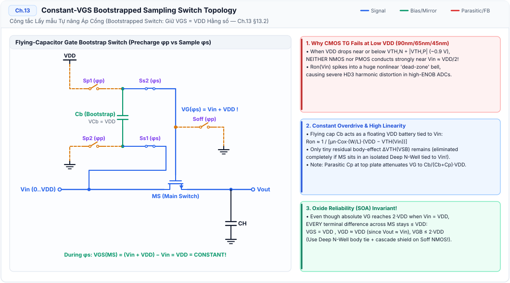

---
{
  "id": "topo-bootstrapped-sampling-switch",
  "kind": "topology",
  "domain": "sampled-and-clocked",
  "title_vi": "Công tắc lấy mẫu nâng áp cổng tự cử hằng số VGS (Bootstrapped Switch)",
  "title_en": "Constant-VGS Gate-Bootstrapped Sampling Switch",
  "summary": "Cấu trúc công tắc lấy mẫu dùng tụ bay tự cử nâng điện thế cực cổng dịch chuyển đồng bộ theo tín hiệu vào để duy trì VGS = VDD không đổi trên toàn dải biên độ, xóa bỏ vùng chết điện trở dẫn ở nguồn cấp thấp và bảo vệ nghiêm ngặt vùng làm việc an toàn của oxit cổng.",
  "diagram": "../../diagrams/bootstrapped-switch.svg",
  "razavi_refs": [
    {
      "chapter": 13,
      "section": "13.2.1-13.2.3",
      "pages": "543-553",
      "equations": ["13.22", "13.23", "13.24", "13.25", "13.30"]
    },
    {
      "chapter": 14,
      "section": "14.1.5",
      "pages": "586-588",
      "equations": []
    },
    {
      "chapter": 17,
      "section": "17.1-17.3",
      "pages": "691-715",
      "equations": []
    }
  ],
  "glossary_codes": [
    "T014",
    "T024",
    "T031",
    "T056",
    "T057",
    "T069",
    "T074",
    "T080",
    "T086",
    "T088",
    "T095",
    "T109",
    "T132",
    "T786",
    "T2015"
  ],
  "process_agnostic": true,
  "roles": {
    "main_nmos_switch_msw": "Transistor loại n duy nhất trên đường tín hiệu chính, được giữ VGS gần như cố định bằng VDD suốt pha bám để đạt điện trở dẫn thấp và phẳng.",
    "flying_capacitor_cboot": "Tụ bay tự cử tích sẵn điện áp VDD trong pha giữ và đóng vai trò nguồn pin nổi nối giữa cực nguồn (Vin) với cực cổng (VG = Vin + VDD) trong pha bám.",
    "precharge_network": "Cặp công tắc nạp trước nối hai bản cực của C_boot vào VDD và GND khi CK = 0, cách ly hoàn toàn tụ bay khỏi ngõ vào.",
    "floating_loop_switches": "Cặp công tắc đóng vòng tự cử trong pha CK = 1, kết nối bản đáy C_boot vào Vin và bản đỉnh C_boot vào cực cổng của M_sw.",
    "cascode_soa_shield_msh": "Transistor chắn cascode có cực cổng ghim cố định ở VDD đặt nối tiếp trên nhánh kéo cổng xuống đất, ngăn hiệu điện thế 2*VDD đánh thủng oxit công tắc xả cổng."
  },
  "symptoms_addressed": [
    "cmos-tg-midrail-ron-deadzone-at-low-vdd",
    "signal-dependent-ron-hd3-tracking-distortion",
    "signal-dependent-channel-charge-pedestal",
    "complementary-clock-skew-sampling-error"
  ],
  "limitations": [
    "gate-parasitic-charge-sharing-attenuation",
    "oxide-reliability-overstress-if-unshielded",
    "residual-body-effect-without-deep-nwell-switching",
    "area-and-clock-power-overhead-from-cboot"
  ],
  "checklists": [
    "common-mos",
    "switched-capacitor",
    "layout-and-matching"
  ]
}
---

## 1. Bản chất Nguyên lý, Sơ đồ Mạch & Vai trò Từng Nhánh Cấu trúc

Khi thu nhỏ kích thước linh kiện (device scaling) xuống các tiến trình nanomet (90nm, 65nm, 45nm), điện áp nguồn cấp (supply voltage) $V_{DD}$ giảm mạnh xuống $1.2\text{ V}$, $1.0\text{ V}$ thậm chí $0.8\text{--}0.9\text{ V}$ để bảo vệ lớp oxit cổng mỏng, trong khi điện áp ngưỡng $V_{THN}$ và $\lvert V_{THP} \rvert$ không thể giảm tương ứng nhằm khống chế dòng rò dưới ngưỡng. Hệ quả chí mạng đối với cổng truyền dẫn MOS bổ sung (complementary CMOS transmission gate) ở Chương 13 là khi tổng hai điện áp ngưỡng (đã tính cả hiệu ứng thân ở mức giữa nguồn $V_{in} \approx V_{DD}/2$) tiến sát hoặc vượt quá $V_{DD}$:
$$
V_{DD} \le V_{THN}\!\left(\frac{V_{DD}}{2}\right) + \left\lvert V_{THP}\!\left(\frac{V_{DD}}{2}\right) \right\rvert
$$
Lúc này cửa sổ dẫn của NMOS $[0, V_{DD} - V_{THN}]$ và PMOS $[\lvert V_{THP} \rvert, V_{DD}]$ tách rời nhau, tạo ra **vùng chết điện trở dẫn** (high-$R_{on}$ deadzone) ngay giữa dải dao động điện áp (voltage swing) làm mạch ngưng bám tín hiệu hoàn toàn! Ngay cả khi $V_{DD}$ nhỉnh hơn tổng ngưỡng đôi chút, sự phồng to hàng chục lần của $R_{on}(V_{in})$ ở giữa dải vẫn gây méo dạng (distortion) bậc ba trầm trọng cho các bộ chuyển đổi ADC tốc độ cao (>10–14 bit).



Mạch **công tắc lấy mẫu nâng áp cổng tự cử** (bootstrapped sampling switch — phát triển cổ điển của Abo & Gray và Dessouky & Kaiser trên nền tảng §13.2 của Razavi) giải quyết tận gốc bài toán bằng cách thay vì ghim cực cổng ở mức cố định $V_{DD}$, nó điều khiển cực cổng $V_G$ dịch chuyển đồng bộ theo sát $V_{in}$ với độ chênh cố định $V_{DD}$ ($V_G = V_{in} + V_{DD} \implies V_{GS} = V_{DD}$):

- **Công tắc lấy mẫu chính ($M_{sw}$, transistor loại n)**: Chỉ dùng duy nhất một NMOS trên đường tín hiệu từ $V_{in}$ sang $C_H$, loại bỏ triệt để bài toán lệch pha giữa hai xung nhịp bù của cổng truyền dẫn CMOS.
- **Tụ bay nâng áp ($C_{boot}$) & Nhánh nạp trước ($\overline{CK} = V_{DD}, CK = 0$)**: Trong pha giữ mẫu, hai công tắc nạp trước nối bản đáy của $C_{boot}$ xuống $\text{GND}$ và bản đỉnh lên $V_{DD}$ để nạp đầy điện tích $Q_{boot} = C_{boot} V_{DD}$, đồng thời tách hoàn toàn $C_{boot}$ khỏi đường tín hiệu $V_{in}$.
- **Nhánh đóng vòng tự cử ($CK = V_{DD}, \overline{CK} = 0$)**: Trong pha bám mẫu, tụ $C_{boot}$ được ngắt khỏi nguồn cấp và mắc nổi trực tiếp giữa cực nguồn (nút $V_{in}$) và cực cổng $G$ của $M_{sw}$ giống như một viên pin nổi thế hiệu $V_{DD}$, đẩy $V_G$ vọt lên $V_{in} + V_{DD}$ (có thể cao tới $2\,V_{DD}$ so với đất khi $V_{in} = V_{DD}$!).
- **Nhánh xả cổng và Transistor chắn bảo vệ oxit ($M_{sh}$ nối tiếp $M_{pd}$)**: Khi ngắt công tắc ($CK = 0$), nhánh kéo xuống $M_{pd}$ xả $V_G \to 0$. Vì trong pha bám $V_G$ đạt tới $2\,V_{DD}$, nếu nối trực tiếp cực máng $M_{pd}$ vào nút $G$, $M_{pd}$ sẽ chịu áp $V_{DS} = V_{GD} = 2\,V_{DD}$ gây đánh thủng oxit tức khắc! Đặt thêm transistor chắn cascode $M_{sh}$ (NMOS có cực cổng ghim cố định ở $V_{DD}$) chia đôi điện áp rơi, giữ an toàn tuyệt đối cho mọi tiếp giáp oxit.

### Giải phẫu vòng chuyển mạch 8–9 transistor kinh điển (Abo–Gray Bootstrap Cell)
Để hiện thực hóa cơ chế trên mà không vi phạm giới hạn oxit ở bất kỳ nút trung gian nào, mạng công tắc phụ quanh $C_{boot}$ được tổ chức thành một chu trình tự khóa thông minh:
- **Cặp nạp trước ($M_{n,\text{bot}}$ kéo bản đáy $V_{bot}$ xuống $\text{GND}$ khi $\overline{CK} = V_{DD}$, và $M_{p,\text{top}}$ nạp bản đỉnh $V_{top}$ lên $V_{DD}$)**: Đáng chú ý, cực cổng của $M_{p,\text{top}}$ được lái bởi chính điện thế nút cổng tự cử $V_G$! Nhờ vậy khi $CK = 0 \implies V_G = 0$, $M_{p,\text{top}}$ dẫn mạnh nạp $V_{top} \to V_{DD}$; ngược lại khi $CK = V_{DD} \implies V_G = V_{top} = V_{in} + V_{DD}$, ta có $V_{GS,p,\text{top}} = 0$ nên $M_{p,\text{top}}$ tự khóa chặt mà không bao giờ chịu áp quá $V_{DD}$!
- **Công tắc đỉnh ($M_P$) và nhánh kéo cổng tự cử của nó**: Cực cổng của $M_P$ được nối lên $V_{top}$ khi giữ mẫu (khóa $M_P$) và được kéo xuống $V_{bot} = V_{in}$ trong pha bám thông qua một NMOS chắn cascode cổng ghim $V_{DD}$, tạo đúng độ lệch mở $V_{SG,P} = V_{top} - V_{in} \approx V_{DD}$ không đổi.
- **Công tắc nối đáy theo tín hiệu ($M_{in}$)**: Nối giữa $V_{in}$ và bản đáy $V_{bot}$, có cực cổng được lái bởi chính nút cổng tự cử $V_G$! Nhờ đó chính $M_{in}$ cũng hưởng đặc tính nâng áp $V_{GS,in} = V_G - V_{in} \approx V_{DD}$, truyền trung thực $V_{in}$ sang bản đáy $C_{boot}$ trên toàn dải từ $0$ đến $V_{DD}$ mà không hề bị xén ngưỡng $V_{THN}$!

## 2. Hệ Phương trình Cốt lõi & Tư duy "Nhìn Mạch Đọc Nhanh" (Analysis by Inspection)

### 2.1. Bảo toàn điện tích trên nút cổng tự cử và hệ số suy giảm chia sẻ điện tích $\alpha_{boot}$
Gọi $C_{par}$ là tổng điện dung ký sinh quy về nút cổng $G$ của công tắc chính $M_{sw}$ (bao gồm điện dung cổng $C_{gg,sw} \approx W_{sw} L_{sw} C_{ox} + 2 W_{sw} C_{ov}$ của chính $M_{sw}$ cộng điện dung ký sinh của các công tắc phụ và đường dây kim loại nối tới nút $G$). Cuối pha giữ ($\overline{CK} = V_{DD}$), $C_{boot}$ mang điện tích $C_{boot} V_{DD}$ còn nút $G$ đang xả ở $0\text{ V}$ ($Q_{par} = 0$). Sang pha bám ($CK = V_{DD}$), bản đáy của $C_{boot}$ được kéo lên $V_{in}$ còn bản đỉnh nối vào nút $G$. Áp dụng định luật bảo toàn điện tích tại bản đỉnh thả nổi:
$$
C_{boot} V_{DD} = C_{boot}(V_G - V_{in}) + C_{par} V_G
\implies V_G = \frac{C_{boot}}{C_{boot} + C_{par}}(V_{in} + V_{DD}) = \alpha_{boot}(V_{in} + V_{DD})
$$
trong đó hệ số hiệu suất nâng áp tự cử được định nghĩa là:
$$
\alpha_{boot} = \frac{C_{boot}}{C_{boot} + C_{par}} < 1
$$
Từ đó suy ra điện áp cổng–nguồn hiệu dụng đặt lên công tắc chính $M_{sw}$ trong suốt pha bám:
$$
V_{GS,sw}(V_{in}) = V_G - V_{in} = \alpha_{boot} V_{DD} - (1 - \alpha_{boot}) V_{in}
$$
**Tư duy nhìn mạch đọc nhanh**: Khi chọn $C_{boot} \gg C_{par}$ (điển hình $C_{boot} \approx 10\text{--}20\,C_{par}$, đạt $\alpha_{boot} \approx 0.91\text{--}0.95$), độ sụt bậc nhất $(1 - \alpha_{boot})V_{in}$ rất nhỏ và $V_{GS,sw} \approx \alpha_{boot} V_{DD} \approx V_{DD}$ gần như độc lập hoàn toàn với biên độ $V_{in}$ trên toàn dải từ $0$ đến $V_{DD}$!

### 2.2. Điện trở dẫn phẳng $R_{on,boot}$, lợi ích lên $Q_{ch}$ và Ví dụ định cỡ số học
Thay $V_{GS,sw}$ vào phương trình điện trở vùng triode sâu (Phương trình 13.22 của Razavi), ta có:
$$
R_{on,boot}(V_{in}) = \frac{1}{\mu_n C_{ox}\left(\frac{W}{L}\right)_{sw}\left[\alpha_{boot} V_{DD} - (1 - \alpha_{boot})V_{in} - V_{THN}(V_{in})\right]}
$$
So với công tắc NMOS thường có mẫu số $(V_{DD} - V_{in} - V_{THN})$ sụp đổ về $0$ khi $V_{in} \to V_{DD} - V_{THN}$, mẫu số của $R_{on,boot}$ giữ nguyên biên độ vượt ngưỡng lớn $\approx V_{DD} - V_{THN}$ ngay cả khi $V_{in} = V_{DD}$! Hơn nữa, vì điện tích kênh dẫn tỷ lệ với điện áp vượt ngưỡng:
$$
Q_{ch,boot} = W_{sw} L_{sw} C_{ox}\left(V_{GS,sw} - V_{THN}\right)
\approx W_{sw} L_{sw} C_{ox}\left[\alpha_{boot} V_{DD} - (1 - \alpha_{boot})V_{in} - V_{THN}(V_{in})\right]
$$
nên việc giữ $V_{GS,sw} \approx \text{const}$ **đồng thời khử luôn thành phần phụ thuộc tín hiệu bậc nhất $-W L C_{ox} V_{in}$ trong gói điện tích phun** (Phương trình 13.25)! Nhờ vậy, sai số độ lợi do phun điện tích giảm đi xấp xỉ $\frac{1}{1 - \alpha_{boot}} \approx 10\text{--}20\times$, chỉ còn lại nhiễu loạn bậc cao rất nhỏ do hiệu ứng thân $V_{THN}(V_{in}) = V_{TH0} + \gamma(\sqrt{2\phi_B + V_{in}} - \sqrt{2\phi_B})$. Nếu công nghệ có giếng n sâu (deep n-well — `T132`) cho phép chuyển mạch thân p-well cách ly của $M_{sw}$ bám theo $V_{in}$ trong pha bám ($V_{SB} = 0$), ngay cả số hạng $\gamma$ cũng bị triệt tiêu hoàn toàn!

**Ví dụ định cỡ 65nm**: Với $V_{DD} = 1.0\text{ V}$, $V_{TH0} = 0.42\text{ V}$, công tắc chính $M_{sw}$ kích thước $W/L = 16\text{ }\mu\text{m}/60\text{ nm}$ có điện dung cổng + công tắc phụ $C_{par} \approx 35\text{ fF}$. Chọn tụ MOM $C_{boot} = 500\text{ fF}$ cho $\alpha_{boot} = \frac{500}{535} = 0.935$. Khi $V_{in}$ quét từ $0\text{ V}$ lên $1.0\text{ V}$, $V_{GS,sw}$ chỉ xê dịch nhẹ từ $0.935\text{ V}$ xuống $0.870\text{ V}$, giữ điện áp vượt ngưỡng luôn dồi dào $> 0.40\text{ V}$ trong khi cổng truyền dẫn CMOS tiêu chuẩn bị liệt hoàn toàn ở góc SS ($V_{THN} + \lvert V_{THP} \rvert \approx 0.98\text{ V}$)!

### 2.3. Kiểm toán điều kiện an toàn oxit cổng (SOA Reliability Proof: $\lvert V_{ij} \rvert \le V_{DD}$)
Dù điện thế nút $V_G$ vọt lên tới $2\,V_{DD}$ so với đất khi $V_{in} = V_{DD}$, hiệu điện thế nội bộ giữa từng cặp cực của công tắc chính $M_{sw}$ vẫn hoàn toàn nằm trong giới hạn oxit mỏng $\le V_{DD}$:

| Linh kiện & Nút kiểm tra | Pha giữ ($CK = 0,\; V_G = 0$) | Pha bám ($CK = V_{DD},\; V_G \approx V_{in} + V_{DD}$) | Trạng thái an toàn oxit (SOA) |
| :--- | :--- | :--- | :--- |
| Công tắc chính $M_{sw}$ ($\lvert V_{GS} \rvert, \lvert V_{GD} \rvert$) | $\le V_{DD}$ (khi $V_{in}, V_{out} \in [0, V_{DD}]$) | $\approx V_{DD}$ (vì $V_S = V_D \approx V_{in}$) | An toàn tuyệt đối $\le V_{DD}$ |
| Transistor chắn $M_{sh}$ ($V_{G,sh} = V_{DD}$) | $V_{D,sh} = 0 \implies \lvert V_{GD,sh} \rvert = V_{DD}$ | $V_{D,sh} \le 2V_{DD} \implies \lvert V_{DG,sh} \rvert \le V_{DD}$ | Chia áp bảo vệ hoàn hảo |
| Công tắc xả cổng $M_{pd}$ ($V_{G,pd} \in \{0, V_{DD}\}$) | Bật dẫn ($V_{DS,pd} = 0$) | Ngắt, $V_{D,pd} \le V_{DD} - V_{TH,sh} < V_{DD}$ | Được $M_{sh}$ che chắn khỏi $2V_{DD}$ |
| Công tắc đỉnh PMOS $M_P$ (giếng nối $V_{top}$) | Ngắt, $V_{top} = V_{DD},\; V_G = 0 \implies \lvert V_{DG} \rvert \le V_{DD}$ | Bật với $V_{G,P} = V_{in} \implies V_{SG,P} = V_{DD}$ | An toàn & không thuận diode giếng |

## 3. Bất biến Cấu trúc & Các Bẫy Lỗi Kinh điển (Structural Invariants & Traps)

- **[INV-1] Bất biến giới hạn điện áp giữa mọi cặp cực linh kiện ($\lvert V_{GS} \rvert, \lvert V_{GD} \rvert \le V_{DD}$)**: Mọi transistor phụ nối vào bản cực đỉnh của $C_{boot}$ hoặc nút cổng $V_G$ bắt buộc phải được che chắn sao cho không có bất kỳ lớp oxit mỏng nào chịu hiệu điện thế vượt quá $V_{DD}$ ở cả hai pha $CK = 0$ và $CK = 1$, ngay cả khi $V_{in}$ quét sát hai biên $0$ và $V_{DD}$.
- **[INV-2] Bất biến thế giếng n (N-Well Tie) của công tắc PMOS đỉnh tụ bay**: Công tắc PMOS $M_P$ nối bản đỉnh $V_{top}$ của $C_{boot}$ sang cực cổng $V_G$ hoạt động ở miền điện thế $[V_{DD}, 2\,V_{DD}]$. Giếng n riêng của $M_P$ **bắt buộc phải nối trực tiếp vào chính bản đỉnh $V_{top}$ của $C_{boot}$** (nút có thế cao nhất cục bộ), tuyệt đối không được nối vào đường nguồn $V_{DD}$!
- **[INV-3] Cách ly nguồn lái đầu vào trong pha nạp trước**: Bản đáy của $C_{boot}$ nối vào $V_{in}$ trong pha bám sẽ đặt thêm tải điện dung $(1 - \alpha_{boot})C_{par} + C_{pB,boot}$ lên bộ đệm lái đầu vào; phải đảm bảo công tắc nối $V_{in}$ vào bản đáy mở hoàn toàn trước khi công tắc kéo bản đáy xuống đất đóng lại để không gây chập xung dòng từ $V_{in}$ xuống đất!
- **[TRAP-1] Nối nhầm giếng n của PMOS đỉnh tụ bay vào $V_{DD}$ gây phóng điện & chốt ký sinh (Latch-up)**: Đây là lỗi kinh điển nhất khi vẽ sơ đồ mạch nâng áp cổng lần đầu! Ngay khi $V_{in} > 0.6\text{ V}$ trong pha bám, bản đỉnh $V_{top} \approx V_{in} + V_{DD}$ vượt quá $V_{DD} + 0.6\text{ V}$, làm phân cực thuận trực tiếp diode tiếp giáp p+/giếng n từ $V_{top}$ đổ thẳng dòng xuống $V_{DD}$, vừa xả cạn điện tích của $C_{boot}$ gây xén méo nặng, vừa bơm hạt tải thiểu số kích hoạt chốt ký sinh CMOS!
- **[TRAP-2] Đấu ngược bản cực ký sinh đáy của tụ $C_{boot}$ vào nút cổng $V_G$**: Tụ kim loại nguyên khối (MOM/MIM) có điện dung ký sinh bản đáy xuống đế $C_{pB}$ lớn hơn nhiều so với bản đỉnh. Nếu đấu bản đáy vào phía $V_G$, toàn bộ $C_{pB}$ cộng trực tiếp vào $C_{par}$, kéo tụt hệ số nâng áp $\alpha_{boot} = \frac{C_{boot}}{C_{boot} + C_{par}}$ và làm nghiêng lại đường cong $R_{on}(V_{in})$! Bản đáy của $C_{boot}$ **phải luôn đấu về phía nút dẫn động $V_{in}$ / $\text{GND}$**, còn bản đỉnh sạch ký sinh đấu về phía cực cổng $V_G$.
- **[TRAP-3] Quên điều khiển tự cử cho chính cực cổng của công tắc nối bản đỉnh $M_P$**: Để bật $M_P$ trong pha bám mà không vượt ngưỡng SOA khi $V_{top} = 2\,V_{DD}$, cực cổng của $M_P$ không được kéo tuột xuống $0\text{ V}$ (sẽ tạo $\lvert V_{GS,P} \rvert = 2\,V_{DD}$!), mà phải được kéo xuống nút bản đáy của $C_{boot}$ (đang ở $V_{in}$), nhờ đó $V_{SG,P} = V_{top} - V_{in} \approx V_{DD}$ luôn vừa đẹp và an toàn trên toàn dải!
- **[TRAP-4] Bỏ qua hiệu ứng thân còn sót lại khi lấy mẫu độ phân giải $\ge 12\text{--}14\text{ bit}$**: Ngay cả khi $C_{boot}/C_{par} \to \infty$ giữ $V_{GS,sw} = V_{DD}$ cố định tuyệt đối, nếu cực thân p-well của $M_{sw}$ nối đất cố định thì $V_{THN}(V_{in}) = V_{TH0} + \gamma(\sqrt{2\phi_B + V_{in}} - \sqrt{2\phi_B})$ vẫn điều chế $R_{on,boot}(V_{in})$ ở bậc căn thức! Trên quy trình có giếng n sâu (`DNW`, `T132`), giải pháp triệt để là cô lập p-well riêng cho $M_{sw}$, nối p-well vào $V_{in}$ qua một công tắc phụ trong pha bám ($V_{SB} = 0 \implies V_{THN} = V_{TH0}$ hằng định!) và kéo p-well về $\text{GND}$ trong pha giữ để tránh phân cực thuận tiếp giáp nguồn/máng–thân khi $M_{sw}$ ngắt.
- **[TRAP-5] Suy hao điện tích trên $C_{boot}$ khi xung nhịp dừng hoặc chạy quá chậm**: Nếu hệ thống tạm ngưng xung nhịp ở pha bám quá lâu (chế độ lấy mẫu không đều hoặc kiểm thử tần số thấp), dòng rò cổng và dòng rò tiếp giáp tại nút $V_G$ sẽ xả dần $C_{boot}$, làm $V_{GS,sw}$ tụt dần và tăng méo bám cuối chu kỳ.

## 4. Lộ trình Nâng cấp Cấu trúc & Bát giác Đánh đổi (Upgrade Paths & Design Octagon)

Trên Bát giác Thiết kế Tương tự (`concept-analog-design-octagon`), công tắc nâng áp cổng tự cử hy sinh **Diện tích mặt bằng** (tụ $C_{boot}$ cộng 7–9 transistor phụ), **Công suất động xung nhịp** và độ phức tạp kiểm tra độ tin cậy oxit để đổi lấy đột phá vượt bậc trên ba trục **Độ tuyến tính**, **Tốc độ** và khả năng vận hành ở **Điện áp nguồn cấp cực thấp**:

| Trục đánh giá trên Design Octagon | Cổng truyền dẫn CMOS (`topo-mos-and-cmos-sampling-switches`) | Công tắc nâng áp cổng tự cử (`topo-bootstrapped-sampling-switch`) |
| :--- | :--- | :--- |
| Điện áp nguồn cấp tối thiểu $V_{DD,\min}$ | Giới hạn bởi $V_{THN} + \lvert V_{THP} \rvert + 2V_{ov}$ ($\ge 1.1\text{--}1.2\text{ V}$) | Hoạt động trơn tru xuống tới $0.7\text{--}0.9\text{ V}$ |
| Độ phẳng $R_{on}(V_{in})$ & Méo động Nyquist | Biến thiên $2\times\text{--}10\times$ ở giữa dải (`SFDR ~ 55–68 dB`) | Biến thiên $< 5\%\text{--}10\%$ (`SFDR ~ 80–95+ dB`) |
| Phun điện tích phụ thuộc tín hiệu $Q_{ch}(V_{in})$ | Lớn và phi tuyến mạnh theo mức tín hiệu | Triệt tiêu bậc nhất vì $V_{GS} \approx \alpha_{boot} V_{DD} = \text{const}$ |
| Lệch xung nhịp bù ($\Delta t$ Clock Skew) | Nhạy cảm cao giữa $CK$ và $\overline{CK}$ | Bằng không (chỉ một công tắc NMOS duy nhất trên đường chính) |
| Diện tích mặt bằng & Độ phức tạp SOA | Rất gọn ($2$ transistor, không rủi ro vượt áp) | Lớn hơn ($C_{boot} + 8\text{--}9$ transistor, bắt buộc kiểm tra SOA) |

1. **Nâng cấp bắt buộc từ cổng truyền dẫn tiêu chuẩn**: Khi `topo-mos-and-cmos-sampling-switches` không còn đáp ứng được yêu cầu méo hài (`SFDR > 65–75 dB`) ở tần số đầu vào Nyquist cao hoặc bị kẹt vùng chết dẫn ở $V_{DD} \le 1.0\text{ V}$, thay công tắc lấy mẫu đầu vào bằng `topo-bootstrapped-sampling-switch`.
2. **Phối hợp phân vai tối ưu trong mạch khuếch đại/tích phân tụ chuyển mạch**: Trong một tầng MDAC hay bộ tích phân `topo-switched-capacitor-amplifiers-integrators` áp dụng `tech-charge-injection-and-bottom-plate-sampling`, **chỉ đặt công tắc nâng áp cổng tại lối vào biên độ rộng $S_1$**, còn công tắc đất ảo $S_2$ (luôn làm việc quanh mức cố định $V_{CM}$) chỉ cần một NMOS đơn tối giản để tránh cộng điện dung thừa vào nút nhạy cảm $X$!
3. **Khử hài bậc chẵn và nhiễu xuyên xung nhịp còn sót lại**: Triển khai hai khối `topo-bootstrapped-sampling-switch` hoàn toàn đối xứng trên hai nhánh vi sai theo `law-differential-nonlinearity-and-feedback`, bố trí mặt bằng gương đối xứng kèm che chắn đường xung theo `tech-common-centroid-sti-wpe-layout`.

## 5. Thích ứng Đa Tiến trình (90nm / 65nm / 45nm) & Cách Kiểm chứng trong Cadence / Spectre

Ở các nút công nghệ 90nm, 65nm và 45nm, công tắc nâng áp cổng là cấu trúc trụ cột ở tầng lấy mẫu đầu tiên (front-end track-and-hold) của mọi bộ SAR ADC, Pipelined ADC và bộ thu mẫu tốc độ cao. Trên 65nm/45nm với $V_{DD} = 0.9\text{--}1.0\text{ V}$, nên dùng transistor lõi oxit mỏng chuẩn (`SVT`) thay vì `LVT` cho $M_{sw}$ để cắt giảm tối đa dòng rò ngắt `Ioff` trong pha giữ ở `125°C` (vì nâng áp cổng đã cung cấp sẵn $V_{GS} \approx V_{DD}$ rất dồi dào!), dùng tụ kim loại đan răng lược (`MOM cap` từ tầng `M3`–`M6`) cỡ $C_{boot} \approx 200\text{--}800\text{ fF}$ sao cho $C_{boot}/C_{par} \ge 12$, và tận dụng tùy chọn giếng n sâu (`DNW`) cô lập thân $M_{sw}$ để xóa hiệu ứng thân $\gamma$.

### Quy trình kiểm chứng chuẩn trong Cadence Virtuoso / Spectre
- **Bước 1 — Kiểm tra tự động giới hạn an toàn oxit và dòng tiếp giáp (`tran` + Spectre `assert`)**:

```
// Khai báo kiểm tra tự động SOA oxit mỏng trên toàn bộ transistor trong ô tự cử
soa_vgs assert sub=boot_sw_cell mod=nch expr="abs(V(g,s))" max=1.1*VDD duration=50p level=error
soa_vgd assert sub=boot_sw_cell mod=nch expr="abs(V(g,d))" max=1.1*VDD duration=50p level=error
soa_well assert dev=I_BOOT.MP param=ib min=-1u max=1u level=error

// Chạy FFT mạch lạc ở biên Nyquist và kiểm toán nhiễu gập phổ cuối pha bám
tran_nyq  tran  stop=260/fs  errpreset=conservative  maxstep=1/(250*fs)
pss_boot  pss   fund=fs  harms=0  errpreset=conservative  tstab=8/fs
pnoise_b (vout_p vout_n) pnoise start=1 stop=fs/2 dec=25 maxsideband=40 \
    noisetype=timedomain  numberofpoints=1  noisetimepoints=[t_sample_edge]
```

- **Bước 2 — Đo độ phẳng $V_{GS}(t)$ và hệ số $\alpha_{boot}$ sau trích xuất ký sinh PEX**: Chạy `tran` với sóng tam giác chậm quét từ `0` đến `VDD` qua nhiều chu kỳ xung nhịp, vẽ hiệu `(V(VG) - V(Vin))` trong các cửa sổ `CK = VDD`: độ sụt từ `Vin = 0` đến `Vin = VDD` cho biết trực tiếp $(1 - \alpha_{boot})V_{DD}$ sau khi đã tính toàn bộ điện dung dây dẫn layout.
- **Bước 3 — Kiểm chứng méo hài Nyquist (`tran` Coherent FFT) và nhiễu lấy mẫu (`pss` + `pnoise`)**: Kích thích sóng sin vi sai biên độ toàn thang $V_{pp,\text{diff}} = 1.6\text{--}1.8\,V_{DD}$ tại tần số sát Nyquist $f_{in} = \frac{N_{\text{FFT}}/2 - 5}{N_{\text{FFT}}} f_s$ với `errpreset=conservative`, đo `HD2`, `HD3`, `SFDR` (đạt $80\text{--}95\text{ dB}$ sau PEX), tiếp đó chạy `pss` + `pnoise` (`sampled`) để xác nhận các công tắc phụ của mạch tự cử không bơm thêm nhiễu vượt quá sàn $\sqrt{kT/C_H}$.

## 6. Mốc Đối chiếu Sách Razavi & Thuật ngữ Chuẩn CLB

| Mục nội dung & Phương trình | Tham chiếu Razavi (2nd Ed.) | Mã & Thuật ngữ Chuẩn CLB |
| :--- | :--- | :--- |
| Giới hạn biên độ dẫn $V_{DD} - V_{TH}$ và sự phụ thuộc $R_{on}(V_{in})$ | §13.2.1–13.2.2, PT (13.22)–(13.24), tr. 543–550 | `T074` Lấy mẫu; `T086` điện áp nguồn cấp; `T088` Chuyển mạch; `T095` Dải dao động điện áp; `T109` MOSFET hoạt động như một công tắc |
| Điện tích kênh dẫn $Q_{ch}$ và phi tuyến hiệu ứng thân khi lấy mẫu | §13.2.3, PT (13.25)–(13.30), tr. 550–552 | `T014` Phun điện tích; `T056` transistor loại n; `T057` Tính phi tuyến; `T080` cực nguồn |
| Méo phi tuyến của công tắc lấy mẫu trong miền thời gian | §14.1.5, tr. 586–588 | `T024` MOS bổ sung; `T786` méo dạng; `T2015` được tự thiết lập nhờ hồi tiếp (bootstrapped) |
| Thu nhỏ linh kiện nanomet, co hẹp nguồn cấp và giếng n sâu | §17.1–17.3, tr. 691–715 & §2.1, tr. 9 | `T031` Thu nhỏ kích thước linh kiện; `T069` Biến thiên PVT; `T132` Giếng n sâu |
