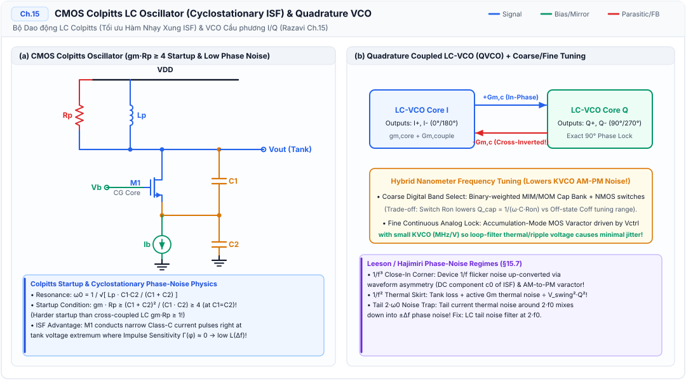

---
{
  "id": "topo-colpitts-hartley-and-one-port-lc-oscillators",
  "kind": "topology",
  "domain": "sampled-and-clocked",
  "title_vi": "Bộ dao động LC Colpitts, Hartley và Điện trở Âm Một cửa (Colpitts, Hartley & One-Port Negative-Gm LC Oscillators)",
  "title_en": "Colpitts, Hartley, and One-Port Negative-Gm LC Resonant Oscillators",
  "summary": "Giải phẫu chuyên sâu ba họ cấu trúc bộ dao động cộng hưởng LC thực thụ trong CMOS: lý do hồi tiếp trực tiếp cực máng–nguồn thất bại (Ex. 15.7), phương trình đặc trưng bậc ba của bộ dao động Colpitts đòi hỏi gm*Rp >= 4 nhưng lợi thế bơm dòng xung hẹp chu kỳ ở đỉnh điện áp giúp giảm nhiễu pha, cấu trúc đối ngẫu chia cảm Hartley (L1-L2) và phép tổng hợp điện trở âm một cửa (-2/gm cho NMOS thuần so với -2/(gmN+gmP) tái sử dụng dòng của cặp chéo CMOS bổ sung).",
  "diagram": "../../diagrams/colpitts-and-quadrature-vco.svg",
  "razavi_refs": [
    {
      "chapter": 15,
      "section": "15.3.1-15.3.4",
      "pages": "618-630",
      "equations": ["15.29", "15.33", "15.36", "15.37", "15.40", "15.43", "15.46", "15.47", "15.48", "15.51", "15.54"]
    }
  ],
  "glossary_codes": [
    "T012",
    "T019",
    "T021",
    "T023",
    "T024",
    "T042",
    "T066",
    "T070",
    "T082",
    "T091",
    "T095",
    "T678",
    "T951",
    "T1184",
    "T1601",
    "T1605",
    "T1606",
    "T2160",
    "T2162",
    "T2163",
    "T2164",
    "T2165",
    "T2169"
  ],
  "process_agnostic": true,
  "roles": {
    "parallel_equivalent_tank": "Khung cộng hưởng LP || CP || RP được quy đổi từ cuộn cảm xoắn ốc có điện trở dây quấn nối tiếp RS với RP = (1 + Q^2)*RS ~ Q^2*RS.",
    "colpitts_capacitive_tap": "Cặp tụ chia áp C1 - C2 nối từ cực máng về cực nguồn và từ cực nguồn xuống đất tạo biến áp dung kháng nâng trở kháng và đảo chiều dòng hồi tiếp dương.",
    "hartley_inductive_tap": "Cấu trúc đối ngẫu dùng cuộn cảm trích đầu ra giữa L1 - L2 (có hỗ cảm M) hồi tiếp không đảo về cực nguồn mà không chia nhỏ điện dung điều chỉnh.",
    "one_port_negative_gm_cell": "Mạng tích cực hai cực (cặp ghép chéo NMOS đơn hoặc cặp ghép chéo CMOS bổ sung NMOS+PMOS) sinh điện dẫn âm thực -Gm bù triệt để tổn hao 1/RP của khung LC."
  },
  "symptoms_addressed": [
    "single-transistor-tuned-stage-insufficient-phase-or-loop-gain-to-oscillate",
    "cross-coupled-fet-triode-loading-and-zero-crossing-noise-injection",
    "excessive-dc-bias-power-when-driving-low-q-on-chip-inductors",
    "voltage-headroom-vs-overstress-tradeoff-in-nanometer-lc-tanks"
  ],
  "limitations": [
    "colpitts-demands-minimum-gm-rp-of-4-struggling-at-low-inductor-q",
    "single-ended-colpitts-suffers-even-harmonic-supply-and-substrate-pushing",
    "hartley-tapped-inductor-occupies-large-area-and-requires-em-extraction",
    "complementary-cmos-negative-gm-halves-available-voltage-headroom"
  ],
  "checklists": [
    "common-mos",
    "oscillator-and-pll",
    "spectre-pss-pnoise"
  ]
}
---

## 1. Bản chất Nguyên lý, Sơ đồ Mạch & Vai trò Từng Nhánh Cấu trúc

Trong thiết kế mạch tần số vô tuyến (`radio-frequency, RF` — `T070`), để tạo dao động hình sin có **nhiễu pha** (`phase noise` — `T2169`) cực thấp, năng lượng phải được giam giữ trong **bộ dao động cộng hưởng LC** (`LC tank oscillator` — `T2162`) có hệ số phẩm chất $Q$ cao thay vì tiêu tán trên điện trở mỗi chu kỳ như `topo-ring-oscillator`. Trong khi thẻ `topo-lc-cross-coupled-and-colpitts` giới thiệu bức tranh tổng quát về tiêu chuẩn dao động LC, thẻ chuyên sâu này giải phẫu chi tiết cơ chế trường, hàm truyền bậc ba, chế độ dẫn dòng theo chu kỳ (`cyclostationary Class-C conduction`) và sự đánh đổi định lượng giữa bốn biến thể cấu trúc cốt lõi của Razavi §15.3.1–15.3.4: **Mạch Colpitts chia áp tụ**, **Mạch Hartley trích điểm giữa cuộn cảm**, **Mạch một cửa điện trở âm NMOS thuần**, và **Mạch một cửa CMOS bổ sung tái sử dụng dòng (Current-Reuse Complementary Negative-$G_m$)**.



Bốn cấu trúc này liên kết với nhau qua một bản chất vật lý thống nhất — cách thức "bù đắp năng lượng tiêu tán trên điện trở song song tương đương $R_P$ của khung cộng hưởng":

1. **Nghịch lý thất bại của tầng Cổng chung hồi tiếp thẳng & Sự ra đời của Bộ dao động Colpitts (`Colpitts oscillator` — `T2165`, §15.3.3, Hình 15.29–15.31)**:
   - Một tầng nguồn chung đơn lẻ tải khung $L_P \parallel C_P \parallel R_P$ có dịch pha đúng $180^\circ$ tại tần số cộng hưởng nên không thể nối thẳng máng về cổng. Nếu giữ cổng cố định ở $V_b$ (biến $M_1$ thành **tầng cổng chung** `T021` không đảo pha $0^\circ$) và nối thẳng cực máng quay về cực nguồn qua một tụ ghép cách ly DC $C_2$ thật lớn (Hình 15.29a), liệu mạch có dao động không? **Câu trả lời của Razavi là KHÔNG!** Bởi vì khi nối thẳng máng và nguồn ($V_S \approx V_D$), dòng cực máng $g_m(-V_S) = -g_m V_{out}$ chạy vòng quanh nội bộ $M_1$ và tụ $C_2$, tương đương một điện trở dương $1/g_m$ mắc song song làm sụt $Q$ của khung LC chứ không hề nhân dòng hay tạo điện trở âm (Phương trình 15.37, Ví dụ 15.7)!
   - Để tạo độ lợi vòng lớn hơn đơn vị, bắt buộc phải **hạ biên độ điện áp đưa về cực nguồn** đồng thời **tạo điểm tựa dòng điện xuống đất** bằng cách chèn thêm tụ $C_1$ từ cực nguồn của $M_1$ xuống đất xoay chiều (Hình 15.31a). Khi đó mạng $C_1 - C_2$ đóng vai trò một **máy biến áp dung kháng nâng áp (capacitive impedance transformer)**: nhìn từ cực máng vào khung, trở kháng vào cực nguồn $1/g_m$ được nâng lên theo tỉ số $(1 + C_1/C_2)^2$, trong khi pha bị trễ qua $C_1$ kết hợp với dòng $-g_m V_1$ tạo thành phần thực âm bù đắp $R_P$!
   - *Ưu điểm cyclostationary đắt giá của Colpitts*: Ở chế độ biên độ lớn xác lập, điện áp lớn trên tụ $C_1$ tự phân cực làm $M_1$ tắt trong phần lớn chu kỳ và chỉ bật dẫn một **xung dòng hẹp đúng vào thời điểm điện áp trên khung LC đi qua cực trị** (nơi hàm nhạy xung nhiễu pha ISF gần bằng $0$!). Nhờ đó transistor không bao giờ rơi vào vùng triode làm tải chết khung LC tại điểm cắt không!
2. **Bộ dao động Hartley đối ngẫu chia áp cảm kháng (`Hartley Oscillator` — đối ngẫu điện từ của họ ba điểm Hình 15.37–15.39 / Bài tập 15.11–15.12 & Razavi *RF Microelectronics* [5])**:
   - Thay vì chia áp trên nhánh tụ bằng hai tụ nối tiếp $C_1, C_2$, cấu trúc Hartley giữ nguyên một tụ cộng hưởng $C_P$ duy nhất và tách cuộn cảm thành hai phần $L_1$ (nối từ máng lên $V_{DD}$ / đất AC) và $L_2$ (nối từ $V_{DD}$ / đất AC về cực nguồn qua tụ chặn DC), có thể ghép hỗ cảm từ trường $M = k\sqrt{L_1 L_2}$. Toàn bộ tụ biến dung (`varactor`) nay nằm trọn vẹn song song với khung mà không bị suy giảm tỉ số điều chỉnh bởi tụ nối tiếp như Colpitts!
3. **Quan điểm Bộ dao động Điện trở Âm Một cửa (`negative-resistance oscillator` — `T2164`, §15.3.4, Hình 15.32–15.37)**:
   - Thay vì cắt vòng tìm độ lợi vòng $L(j\omega)$ dễ nhầm lẫn hiệu ứng tải hai chiều, mọi bộ dao động LC đều có thể tách làm hai mạng một cửa ghép song song: **Khung cộng hưởng có tổn hao** ($L_P \parallel C_P \parallel R_P$) và **Lõi tích cực một cửa** có dẫn nạp vào $Y_{\text{act}}(j\omega) = G_{\text{act}}(\omega) + j B_{\text{act}}(\omega)$. Nếu tại $\omega_0$ phần thực dẫn nạp tích cực là âm và đủ lớn sao cho $G_{\text{act}}(\omega_0) + \frac{1}{R_P} \le 0$, năng lượng bơm vào lớn hơn năng lượng tiêu tán nhiệt và dao động tự khởi phát (`oscillation buildup` — `T1605`) từ nhiễu nhiệt nội tại!
   - Ghép dương một mạch bám nguồn (`source follower` — `T082`) với một tầng cổng chung (Hình 15.33–15.35) rồi nhân bản vi sai chính là **cặp transistor ghép chéo** (`cross-coupled pair` — `T2163`): cấu trúc **NMOS thuần** ($G_{\text{act}} = -g_{mN}/2$) tối ưu cho nguồn áp cực thấp vì chỉ xếp chồng 2 tầng transistor, trong khi cấu trúc **CMOS bổ sung NMOS + PMOS** ($G_{\text{act}} = -(g_{mN} + g_{mP})/2$) cho cùng một dòng nguồn $I_{\text{bias}}$ chạy nối tiếp qua cả cặp PMOS lẫn cặp NMOS để nhân đôi hỗ dẫn âm!

---

## 2. Hệ Phương trình Cốt lõi & Tư duy "Nhìn Mạch Đọc Nhanh" (Analysis by Inspection)

### 2.1. Quy đổi Khung Cộng hưởng Tổn hao & Thất bại của Hồi tiếp Thẳng Cực Máng–Nguồn (§15.3.1 & §15.3.3)
Một cuộn cảm xoắn ốc kim loại trên đế silic có độ tự cảm $L_1$ và điện trở nối tiếp dây quấn $R_S$ (đặc trưng bởi hệ số phẩm chất $Q_L = \frac{\omega_0 L_1}{R_S}$). Đồng nhất dẫn nạp $Y(j\omega) = \frac{1}{R_S + j\omega L_1} = \frac{R_S}{R_S^2 + \omega^2 L_1^2} - j\frac{\omega L_1}{R_S^2 + \omega^2 L_1^2}$ quanh tần số cộng hưởng $\omega_0$, ta thu được mạng song song tương đương (Phương trình 15.29–15.36):

$$L_P = L_1\left(1 + \frac{1}{Q_L^2}\right) \approx L_1, \qquad R_P = R_S\left(1 + Q_L^2\right) \approx Q_L^2 R_S = Q_L \omega_0 L_1 = \frac{Q_L}{\omega_0 C_P}$$

Nếu cả tụ điện (đặc biệt là varactor hoặc dàn tụ chuyển mạch) cũng có hệ số phẩm chất hữu hạn $Q_C = \frac{1}{\omega_0 C_P R_{S,C}}$, hệ số phẩm chất tổng của khung $Q_{\text{tank}}$ và điện trở song song tổng $R_{P,\text{tot}}$ tuân theo định luật nghịch đảo:

$$\frac{1}{Q_{\text{tank}}} = \frac{1}{Q_L} + \frac{1}{Q_C}, \qquad R_{P,\text{tot}} = R_{P,L} \parallel R_{P,C} = Q_{\text{tank}} \omega_0 L_P$$

**Tại sao thiếu tụ $C_1$ nối đất ở cực nguồn thì mạch Hình 15.29a tắt lịm?** Khi bơm dòng thử $I_{in}$ vào cực nguồn của $M_1$ mà dưới cực nguồn chỉ là nguồn dòng phân cực lý tưởng $I_b$ (trở kháng AC bằng $\infty$), định luật Kirchhoff về dòng buộc toàn bộ $I_{in}$ phải đi thẳng qua kênh $M_1$ và tụ $C_2$ đổ vào khung LC (Phương trình 15.37):

$$\frac{V_{out}}{I_{in}}(s) = L_P s \parallel \frac{1}{C_P s} \parallel R_P \qquad \text{(không phụ thuộc } g_m \text{, không bao giờ tiến tới } \infty \text{!)}$$

Thậm chí trong **Ví dụ 15.7 (Hình 15.30)**, nếu thử kích nguồn áp $V_{in}$ vào cực cổng của $M_1$, do nguồn dòng $I_b$ giữ dòng tổng không đổi nên dòng tín hiệu nhỏ của $M_1$ và dòng qua $C_2$ tự triệt tiêu nhau hoàn toàn tại nút máng, cho $V_{out}/V_{in} = 0$ với mọi tần số!

### 2.2. Dẫn xuất Chính xác Đa thức Đặc trưng Bậc ba của Bộ dao động Colpitts (Phương trình 15.38–15.47)
Khi mắc thêm tụ $C_1$ từ cực nguồn (nút $V_1$) xuống đất (Hình 15.31, bỏ qua $r_O, g_{mb}$), viết KCL cho nút nguồn và nút máng với kích thích dòng $I_{in}$ đặt tại cực nguồn (Phương trình 15.38–15.40):

$$\frac{V_{out}}{I_{in}}(s) = \frac{R_P L_P s (g_m + C_2 s)}{R_P C_1 C_2 L_P s^3 + (C_1 + C_2) L_P s^2 + \left[g_m L_P + R_P(C_1 + C_2)\right] s + g_m R_P}$$

Để mạch dao động điều hòa tự duy trì tại $s = j\omega_R$, cả phần thực lẫn phần ảo của mẫu số bậc ba phải đồng thời triệt tiêu tại $\omega_R > 0$ (Phương trình 15.41–15.42):
- **Phần ảo bằng $0$**: $-R_P C_1 C_2 L_P \omega_R^3 + \left[g_m L_P + R_P(C_1 + C_2)\right]\omega_R = 0$. Với thiết kế thực tế có $Q_{\text{tank}}$ đủ lớn khiến $g_m L_P \ll R_P(C_1 + C_2)$ (tương đương $\frac{g_m \omega_R L_P}{R_P \omega_R (C_1+C_2)} \sim \frac{1}{Q^2} \ll 1$), tần số dao động được ấn định bởi $L_P$ ghép với tổ hợp nối tiếp của $C_1$ và $C_2$ (cộng thêm tụ ký sinh song song $C_P$ ở Phương trình 15.43, 15.47):

$$\omega_R = \frac{1}{\sqrt{L_P \left(C_P + \dfrac{C_1 C_2}{C_1 + C_2}\right)}}$$

- **Phần thực bằng $0$**: $-(C_1 + C_2) L_P \omega_R^2 + g_m R_P = 0$. Thế $\omega_R^2 = \frac{C_1 + C_2}{L_P C_1 C_2}$ (khi $C_P = 0$) vào phương trình phần thực, ta thu được điều kiện khởi động nổi tiếng của Colpitts (Phương trình 15.44–15.46):

$$g_m R_P = \frac{(C_1 + C_2)^2}{C_1 C_2} = \frac{C_1}{C_2}\left(1 + \frac{C_2}{C_1}\right)^2 = 2 + \frac{C_1}{C_2} + \frac{C_2}{C_1} \ge 4$$

Theo bất đẳng thức Cauchy–AM-GM, $\frac{C_1}{C_2} + \frac{C_2}{C_1} \ge 2$ với dấu bằng đạt tại $C_1 = C_2$. Lưu ý cực kỳ quan trọng từ Bài tập 15.10 & PT (15.46)–(15.47) (Razavi tr. 626): khi có thêm tụ $C_P > 0$ mắc song song trực tiếp với $L_P$ và $R_P$ (thay $\frac{1}{R_P} \to \frac{1}{R_P} + s C_P$ trong KCL làm xuất hiện thêm số hạng $g_m R_P C_P L_P s^2$ ở mẫu số), **với một giá trị $R_P$ cố định cho trước, điều kiện $g_m R_P \ge \frac{(C_1 + C_2)^2}{C_1 C_2} \ge 4$ hoàn toàn không đổi**; tuy nhiên đối với một cuộn cảm vật lý có điện trở nối tiếp dây quấn $R_S$ cố định, việc tăng $C_P$ làm hạ thấp $\omega_R^2$ theo (15.47) khiến $R_P \approx \frac{\omega_R^2 L_P^2}{R_S} = \frac{L_P}{R_S(C_P + C_{\text{ser}})}$ sụt giảm tỉ lệ nghịch với $(C_P + C_{\text{ser}})$! Tương đương khi nhìn từ một cửa nối tiếp với $C_P = 0$ (Hình 15.37, PT 15.53–15.54):

$$Z_X(j\omega) = \frac{V_X}{I_X} = -\frac{g_m}{C_1 C_2 \omega^2} + \frac{1}{j\omega C_1} + \frac{1}{j\omega C_2}$$

Phần thực âm nối tiếp $R_{\text{neg,ser}} = -\frac{g_m}{C_1 C_2 \omega^2}$ phải thắng điện trở nối tiếp $R_S$ của cuộn cảm: $\frac{g_m}{C_1 C_2 \omega_R^2} \ge R_S \iff g_m R_P \ge \frac{(C_1 + C_2)^2}{C_1 C_2}$ khi $C_P = 0$, còn khi có $C_P > 0$ mắc song song trên cuộn cảm thì tỉ số chia dung kháng tiếp tục làm giảm $R_P(\omega_R)$ và đòi hỏi $g_m$ lớn hơn!

### 2.3. Đối ngẫu Bộ dao động Hartley & Tái sử dụng Dòng trong Mạch Một cửa CMOS Bổ sung
- **Phương trình Bộ dao động Hartley (Chia áp cảm kháng $L_1, L_2$ không ghép hỗ cảm $M = 0$)**: Thay $C_1 \leftrightarrow L_1$, $C_2 \leftrightarrow L_2$ và $L_P \leftrightarrow C_P$ theo nguyên lý đối ngẫu điện từ, tần số cộng hưởng và điều kiện khởi động của Hartley là:

$$\omega_R = \frac{1}{\sqrt{(L_1 + L_2 + 2M) C_P}}, \qquad g_m R_P \ge \frac{(L_1 + L_2 + 2M)^2}{(L_1 + M)(L_2 + M)} \ge 4 \quad (\text{đạt } = 4 \text{ khi } L_1 = L_2)$$

- **So sánh Định lượng Cặp chéo Một cửa NMOS thuần so với CMOS Bổ sung (Hình 15.35–15.36)**:
  Xét cuộn cảm vi sai đối xứng có tổng cảm kháng $L_{\text{diff}}$ và điện trở suy hao song song vi sai giữa hai nút $X, Y$ là $R_{P,\text{diff}}$ (lưu ý $R_{P,\text{diff}} = 2 R_{P,\text{se}}$ nếu quy về hai nửa mạch đơn cực!), được cấp tổng dòng một chiều cố định $I_{\text{bias}}$:
  1. *Cặp chéo NMOS thuần (NMOS-only Cross-Coupled)*: Mỗi nhánh mang $I_D = I_{\text{bias}}/2$. Điện dẫn vi sai một cửa là $G_{\text{in,diff}} = -\frac{g_{mN}}{2}$. Điều kiện khởi động: $\frac{g_{mN}}{2} R_{P,\text{diff}} \ge \alpha_{\text{start}}$ (với hệ số dự trữ an toàn $\alpha_{\text{start}} = 2 \sim 3$). Ở chế độ bão hòa dòng đóng cắt sóng vuông $\pm I_{\text{bias}}/2$ (trung bình $\pm \frac{2}{\pi} I_{\text{bias}}$ dạng vi sai đối xứng nếu cuộn cảm có điểm giữa nối $V_{DD}$), biên độ đỉnh vi sai đạt $V_{\text{diff,pk}} \approx \frac{2}{\pi} I_{\text{bias}} R_{P,\text{diff}}$.
  2. *Cặp chéo CMOS bổ sung (Complementary NMOS + PMOS Cross-Coupled)*: Cả cặp PMOS phía trên lẫn cặp NMOS phía dưới cùng dẫn chung dòng đuôi $I_{\text{bias}}$ ($I_D = I_{\text{bias}}/2$ cho cả bốn transistor!). Hai điện dẫn âm mắc song song trực tiếp trên hai đầu khung LC:

$$G_{\text{in,diff,CMOS}} = -\frac{g_{mN} + g_{mP}}{2}, \qquad V_{\text{diff,pk,CMOS}} \approx \frac{4}{\pi} I_{\text{bias}} R_{P,\text{diff}} \quad \text{(cho tới khi chạm trần kẹp } V_{DD} - V_{DS,\text{tail}}\text{!)}$$

  Nhờ dòng điện đẩy–kéo hai chiều (push–pull H-bridge switching: khi $M_{N1}$ kéo nút $X$ xuống thì đồng thời $M_{P2}$ đẩy nút $Y$ lên thay vì chờ điểm giữa cuộn cảm cấp dòng!), với **cùng một dòng tiêu thụ $I_{\text{bias}}$ và cùng $R_{P,\text{diff}}$**, cấu trúc CMOS bổ sung tạo ra **gấp đôi hỗ dẫn âm khởi động** (khi $g_{mP} \approx g_{mN}$) VÀ **gấp đôi biên độ dao động vi sai trong vùng giới hạn dòng** so với cặp chéo NMOS thuần dùng một cuộn cảm vi sai có tap giữa!

### 2.4. Ví dụ Thiết kế Định lượng Đối chiếu 3 Cấu trúc tại $f_0 = 5\text{ GHz}$ (`65nm` CMOS)
Thiết kế lõi dao động $5.0\text{ GHz}$ dùng cuộn cảm vi sai tám cạnh đối xứng $L_{\text{diff}} = 1.0\text{ nH}$ có $Q_{\text{tank}} = 12$ tại $5\text{ GHz}$ (đã tính suy hao varactor) dưới nguồn cấp $V_{DD} = 1.2\text{ V}$, yêu cầu biên dự trữ khởi động $3\times$ ở góc `SS 125°C`:
1. **Thông số khung cộng hưởng**:
   - Cảm kháng vi sai: $\omega_0 L_{\text{diff}} = 2\pi \times 5\times 10^9 \times 1.0\times 10^{-9} = 31.42\,\Omega$.
   - Điện trở song song vi sai: $R_{P,\text{diff}} = Q_{\text{tank}} \omega_0 L_{\text{diff}} = 12 \times 31.42 \approx 377\,\Omega$ (mỗi nửa mạch đơn cực thấy $R_{P,\text{se}} = 188.5\,\Omega$).
   - Tổng điện dung vi sai giữa $X$ và $Y$: $C_{\text{diff}} = \frac{1}{\omega_0^2 L_{\text{diff}}} \approx 1.013\text{ pF}$.
2. **So sánh dòng phân cực $I_{\text{bias}}$ tối thiểu (giả sử chọn vùng $g_m / I_D = 12\,\text{V}^{-1}$ để cân bằng tốc độ $f_T$ và dư địa)**:
   - *Phương án A — CMOS bổ sung NMOS + PMOS*: Cần $\frac{g_{mN} + g_{mP}}{2} R_{P,\text{diff}} = 3 \implies g_{mN} = g_{mP} = \frac{3}{377\,\Omega} = 7.96\text{ mS}$. Dòng mỗi nhánh $I_D = \frac{7.96\text{ mS}}{12\,\text{V}^{-1}} = 0.663\text{ mA} \implies I_{\text{bias,tot}} = 2 I_D \approx \mathbf{1.33\text{ mA}}$ ($P_{DC} = 1.60\text{ mW}$). Biên độ vi sai lý thuyết $\frac{4}{\pi} \times 1.33\text{ mA} \times 377\,\Omega \approx 0.64\text{ V}_{\text{pk}}$ (nằm vừa khít trong dư địa $V_{DD} - V_{DS,\text{tail}} \approx 0.9\text{ V}$!).
   - *Phương án B — Cặp chéo NMOS thuần*: Cần $\frac{g_{mN}}{2} R_{P,\text{diff}} = 3 \implies g_{mN} = 15.92\text{ mS} \implies I_D = 1.33\text{ mA} \implies I_{\text{bias,tot}} \approx \mathbf{2.65\text{ mA}}$ ($P_{DC} = 3.18\text{ mW}$, tốn gấp đôi công suất cho cùng biên khởi động!).
   - *Phương án C — Colpitts Vi sai ghép đuôi ($C_1 = C_2$)*: Mỗi nửa mạch đơn cực đòi hỏi $g_m R_{P,\text{se}} = 3 \times 4 = 12 \implies g_m = \frac{12}{188.5\,\Omega} = 63.7\text{ mS} \implies I_D \approx 5.3\text{ mA}$ mỗi nhánh ($\mathbf{I_{\text{bias,tot}} \approx 10.6\text{ mA}}$!), nhưng đổi lại nếu nâng được công suất này ở tiến trình SiGe/RF cao áp, Colpitts cho sườn nhiễu pha cực sạch ở độ lệch xa nhờ tránh hoàn toàn vùng triode.

---

## 3. Bất biến Cấu trúc & Các Bẫy Lỗi Kinh điển (Structural Invariants & Traps)

- **[INV-COLP-01] Bất biến Điểm đặt Kích thích Mở vòng Bảo toàn Tần số Riêng (Chú thích 6 của Razavi tr. 625)**: Khi tìm đa thức đặc trưng dao động bằng cách bơm nguồn thử rồi cho hàm truyền tiến tới $\infty$, loại nguồn kích thích bắt buộc phải giữ nguyên cấu trúc mạch khi triệt tiêu về $0$! Cụ thể: nhánh nối tiếp phải chèn nguồn áp thử (khi $=0$ thành dây nối tắt), nút song song phải bơm nguồn dòng thử (khi $=0$ thành hở mạch). Đặt nhầm nguồn áp vào cổng nối đất hoặc đặt nguồn dòng cắt ngang nhánh nối tiếp sẽ làm thay đổi hoàn toàn cực của hệ!
- **[INV-COLP-02] Bất biến Suy giảm Khởi động Colpitts khi Tụ Song song $C_P$ Lớn trên Cuộn cảm Tổn hao $R_S$**: Mặc dù với $R_P$ cố định thì biểu thức (15.46) $g_m R_P \ge \frac{(C_1 + C_2)^2}{C_1 C_2}$ không đổi (Bài tập 15.10, tr. 626), trên một cuộn cảm vật lý có $L_P$ và điện trở nối tiếp $R_S$ cho trước, việc gắn tụ cố định hoặc varactor $C_P$ lớn ngang qua $L_P$ làm giảm $\omega_R^2$ theo PT (15.47) và kéo sụt $R_P(\omega_R) \approx \frac{\omega_R^2 L_P^2}{R_S} = \frac{L_P}{R_S(C_P + C_{\text{ser}})}$ (với $C_{\text{ser}} = \frac{C_1 C_2}{C_1 + C_2}$). Gọi $R_{P0} = \frac{L_P}{R_S C_{\text{ser}}}$ là điện trở song song khi $C_P = 0$, hỗ dẫn tối thiểu thực tế vọt lên thành $g_m R_{P0} \ge \frac{(C_1 + C_2)^2}{C_1 C_2}\left(1 + \frac{C_P}{C_{\text{ser}}}\right)$! Nếu nhồi varactor lớn trực tiếp ngang qua $L_P$ trong mạch Colpitts, mạch sẽ chết cứng không khởi động nổi ở đầu dải tần thấp ($C_P = C_{\text{var,max}}$)!
- **[INV-ONEP-03] Bất biến Ranh giới Hai Chế độ Biên độ (Current-Limited vs Voltage-Limited Regime)**: Khi tăng dần dòng đuôi $I_{\text{bias}}$, biên độ khung LC tăng tuyến tính theo $I_{\text{bias}} R_P$ (**chế độ giới hạn dòng** — nhiễu pha giảm $6\text{ dB}$ mỗi khi nhân đôi $I_{\text{bias}}$) cho tới khi đỉnh sóng làm cặp ghép chéo bị ép sâu vào vùng triode hoặc phân cực thuận tiếp giáp cổng/đế (**chế độ giới hạn điện áp**). Vượt qua điểm gãy (optimal corner) này, tăng thêm dòng chỉ đốt công suất vô ích, làm sụt hệ số phẩm chất hiệu dụng của khung LC và làm **XẤU ĐI** nhiễu pha!
- **[TRAP-COLP-01] Bẫy dùng Nguồn dòng Đuôi có Tụ Ký sinh Lớn ở Cực Nguồn Colpitts**: Trong mạch Colpitts đơn cực (Hình 15.31a), cực nguồn của $M_1$ là nút dao động tần số GHz biên độ lớn (mang tụ $C_1$). Điện dung cực máng $C_{DB,\text{tail}}$ và nhiễu nhiệt $4 k T \gamma g_{m,\text{tail}}$ của transistor nguồn dòng phân cực $I_b$ nối trực tiếp vào nút nguồn này! Nếu định cỡ nguồn dòng $I_b$ quá rộng, nhiễu nhiệt của $I_b$ sẽ bơm thẳng vào khung ở điểm nhạy pha nhất; giải pháp thực chiến là thay nguồn dòng transistor bằng cuộn chặn RF hoặc điện trở/mạng LC cộng hưởng song song ở $2\omega_0$ (Colpitts vi sai nối chung đuôi qua tụ!).
- **[TRAP-ONEP-02] Bẫy Mất Đối xứng Dạng sóng trong Cặp chéo CMOS Bổ sung do $g_{mN} \neq g_{mP}$**: Lợi thế khử chuyển đổi ngược nhiễu nhấp nháy $1/f \to 1/f^3$ của cặp chéo CMOS bổ sung chỉ đạt được khi thời gian sườn lên và sườn xuống tại mỗi nút đơn cực đối xứng nhau (tức $\mu_n (W/L)_N \approx \mu_p (W/L)_P \implies (W/L)_P \approx (2.5 \sim 3.5)(W/L)_N$). Nếu giữ nguyên kích thước bằng nhau khiến nhánh NMOS kéo mạnh hơn nhiều so với nhánh PMOS, điểm trung bình DC bị kéo lệch và giá trị trung bình của hàm nhạy xung ISF $c_0 \neq 0$, làm nhiễu $1/f$ của cặp PMOS/NMOS trộn thẳng lên sóng mang!
- **[TRAP-ONEP-03] Bẫy Dao động Ký sinh Tần số Rất Cao (Parasitic GHz Latch / Common-Mode Oscillation)**: Khi cuộn cảm vi sai lớn được nối qua hai dây dẫn dài tới cặp chéo có $f_T > 100\text{ GHz}$ ở `45nm`, điện cảm ký sinh của chính đoạn dây nối ngón transistor ($L_{\text{lead}} \approx 20 \sim 50\text{ pH}$) có thể cộng hưởng với $C_{GS}, C_{GD}$ tạo mốt dao động ký sinh ở $30 \sim 60\text{ GHz}$, hoặc tạo dao động chế độ chung qua nhánh điểm giữa cuộn cảm!

---

## 4. Lộ trình Nâng cấp Cấu trúc & Bát giác Đánh đổi (Upgrade Paths & Design Octagon)

Trong **Bát giác Thiết kế Tương tự** (`concept-analog-design-octagon`), lựa chọn cấu trúc lõi LC xoay quanh sự cân bằng bốn trục: **Công suất Khởi động ($I_{\text{bias}}$)**, **Dư địa Điện áp ($V_{DD}$)**, **Độ tin cậy Oxit Cổng**, và **Nhiễu Pha Cận/Xa Sóng mang**:

- **Nền tảng kết nối từ**: Kế thừa lý thuyết cuộn cảm xoắn ốc và tiêu chuẩn Barkhausen từ `topo-lc-cross-coupled-and-colpitts`, mô hình điện dung ký sinh MOSFET từ `concept-mos-capacitances-small-signal`, và tầng cổng chung / bám nguồn từ `topo-common-gate-stage` & `topo-source-follower`.
- **Nâng cấp khi cần điều chỉnh tần số rộng & tạo pha cầu phương I/Q**: Chuyển tiếp sang `topo-quadrature-vco-and-varactor-tuning` để ghép varactor tích lũy MOS + dàn tụ chuyển mạch số và ghép đôi hai lõi một cửa thành bộ dao động 4 pha $0^\circ/90^\circ/180^\circ/270^\circ$.
- **Nâng cấp khi cần tối ưu hóa đến giới hạn vật lý của Tạp âm Pha ($\text{FoM} > 188\text{ dBc/Hz}$)**: Áp dụng định luật Leeson, hàm nhạy xung ISF và bộ lọc nhiễu đuôi $2\omega_0$ trong thẻ chuyên sâu `law-oscillator-phase-noise-leeson-and-isf` (hoặc lai ghép ưu điểm của cả hai họ thành cấu trúc **Class-C Cross-Coupled Oscillator** của Mazzanti–Andreani: dùng cặp chéo khởi động nhẹ nhưng phân cực cổng thấp qua RC để ép góc dẫn hẹp như Colpitts!).

| Tiêu chí Đối chiếu Thiết kế | Cặp chéo NMOS Thuần (Tail-Biased) | Cặp chéo CMOS Bổ sung (NMOS + PMOS) | Colpitts Vi sai (Differential Colpitts) | Hartley / Class-C Lai ghép |
| :--- | :--- | :--- | :--- | :--- |
| **Điều kiện Khởi động Lý thuyết** | $g_{mN} R_{P,\text{diff}} \ge 2$ | $(g_{mN} + g_{mP}) R_{P,\text{diff}} \ge 2$ | $g_m R_{P,\text{se}} \ge 4$ (khó gấp $4\times$) | $g_m R_{P,\text{diff}} \ge 2 \sim 2.6$ |
| **Hiệu suất Biên độ / Dòng $I_{\text{bias}}$** | $\frac{2}{\pi} I_{\text{bias}} R_{P,\text{diff}}$ ($1\times$) | $\frac{4}{\pi} I_{\text{bias}} R_{P,\text{diff}}$ (**gấp $2\times$!**) | Trung bình (tốn dòng phân cực lớn) | Cao ($\sim \pi/2$ hiệu suất chuyển đổi dòng) |
| **Nguồn cấp Tối thiểu ($V_{DD,\min}$)** | **Thấp nhất** ($\sim 0.6 \sim 0.9\text{ V}$) | Cao hơn ($\ge 1.1 \sim 1.3\text{ V}$ do chồng 3 tầng) | Thấp–trung bình ($\sim 0.9 \sim 1.2\text{ V}$) | Thấp ($\sim 0.8 \sim 1.0\text{ V}$) |
| **Đỉnh Điện áp Cực Máng** | Vọt lên tới $V_{DD} + A \approx 2 V_{DD}$ (nguy hiểm SOA!) | Tự kẹp an toàn trong $[0, V_{DD}]$ | Vọt trên $V_{DD}$ | Kiểm soát dưới ngưỡng vào vùng triode |
| **Nhiễu Pha $1/f^3$ & ISF** | Nhạy nhiễu đuôi $2\omega_0$ và sập $Q$ vùng triode | Rất sạch $1/f^3$ khi khớp đối xứng sườn N/P | **Xuất sắc** ở vùng $1/f^2$ (bơm xung đúng đỉnh áp) | Đạt đỉnh $\text{FoM}$ hiện đại nhưng cần vòng giữ biên độ |

---

## 5. Thích ứng Đa Tiến trình (90nm / 65nm / 45nm) & Cách Kiểm chứng trong Cadence / Spectre

### 5.1. Ma trận Thích ứng Đa Tiến trình (`90nm` / `65nm` / `45nm`)
- **Chọn chiều dài kênh $L$ cho Cặp Ghép chéo**: Không dùng $L_{\min}$ tuyệt đối nếu không ở tần số sóng milimet ($> 30\text{ GHz}$)! Chọn $L \approx 1.5 \sim 2.5\,L_{\min}$ (ví dụ $L = 100\text{ nm}$ ở `65nm` hoặc $L = 80\text{ nm}$ ở `45nm`) giúp tăng gấp đôi điện trở ngõ ra $r_O$ (tránh làm suy giảm $R_P$ của khung LC!), giảm mạnh hệ số nhiễu nhiệt kênh ngắn $\gamma$ và giảm mật độ nhiễu nhấp nháy $1/f$ theo $1/(W L)$ mà điện dung cổng tăng thêm chỉ chiếm phần nhỏ trong tổng tụ khung LC.
- **Giải bài toán đánh thủng Oxit Cổng ở `65nm`/`45nm`**: Với $V_{DD} = 1.0\text{ V}$, nếu bắt buộc dùng cặp chéo NMOS thuần để lấy dư địa, phải chọn một trong hai biện pháp bảo vệ SOA: (1) Dùng transistor oxit dày hơn một bậc (ví dụ `1.2V / 1.8V analog RF FET`) nếu $f_0 \le 6\text{ GHz}$, hoặc (2) Hạ áp cấp điểm giữa cuộn cảm xuống $V_{DDL} \approx 0.65 \sim 0.75\text{ V}$ qua bộ ổn áp LDO tạp âm thấp để đỉnh sóng $2 V_{DDL} \le 1.3\text{ V}$ không làm lão hóa oxit cổng (TDDB / HCI).

| Tiến trình & $V_{DD}$ | Cấu trúc Khuyến nghị ($1 \sim 10\text{ GHz}$) | Chiều dài Kênh Cặp chéo | Định cỡ Nguồn Đuôi $I_{\text{bias}}$ | Lưu ý Ký sinh Hậu Bố cục (PEX) |
| :--- | :--- | :--- | :--- | :--- |
| **`90nm` ($1.2\text{ V}$)** | CMOS Bổ sung (NMOS + PMOS) có nguồn đuôi PMOS | $L_N = 120\text{ nm}$, $L_P = 120\text{ nm}$ | $L_{\text{tail}} \ge 0.5\,\mu\text{m}$, $V_{DS,\text{tail}} \approx 180\text{ mV}$ | Cân bằng $(W/L)_P \approx 2.8\,(W/L)_N$ để tâm sóng đúng $0.5\text{ V}$. |
| **`65nm` ($1.0 \sim 1.2\text{ V}$)** | CMOS Bổ sung không đuôi (hoặc điện trở đuôi lọc) / NMOS thuần | $L = 90 \sim 120\text{ nm}$ | $L_{\text{tail}} \ge 0.4\,\mu\text{m}$ kèm tụ lọc song song $C_{\text{tail}}$ | Đi dây chéo chữ X bằng hai tầng kim loại dày $M_5/M_6$ đối xứng hoàn toàn. |
| **`45nm` ($0.9\text{ V}$)** | Cặp chéo NMOS thuần hoặc PMOS thuần (cuộn cảm nối GND) | $L = 60 \sim 90\text{ nm}$ | Cặp chéo PMOS có nguồn đuôi nối $V_{DD}$ giảm nhiễu $1/f$ | Trích xuất EM 3D cho cả đoạn dây chuyển tầng (`via stack`) từ cuộn cảm xuống lõi! |

### 5.2. Phác đồ Kiểm chứng Chuẩn Xác trong Cadence Spectre / SpectreRF
1. **Đo Phổ Dẫn nạp Một cửa $Y_{\text{in}}(j\omega)$ bằng Phân tích `ac` / `sp`**: Tách riêng lõi tích cực, đặt nguồn áp vi sai AC $1\text{ V}$ tại điểm phân cực DC và quét tần số qua các góc `SS 125°C`, `TT 27°C`, `FF -40°C` để xác nhận $|\text{Re}\{Y_{\text{act}}(j\omega_0)\}| \ge 2.5 \, \text{Re}\{Y_{\text{tank}}(j\omega_0)\}$.
2. **Kiểm chứng Trạng thái Xác lập Tuần hoàn (`pss`) và Nhiễu Pha (`pnoise`) theo `spectre-pss-pnoise`**:
```spice
// SpectreRF Autonomous PSS + PNoise Deck cho Loi Dao dong LC (Colpitts / Negative-Gm)
simulator lang=spectre

// 1. Kich moi xung dong vi sai nho 50 uA trong 100 ps giup bo giai hoi tu nhanh khong anh huong xac lap
Istart (voutp voutn) isource type=pulse val0=0 val1=50u delay=50p rise=20p fall=20p width=60p

// 2. Phan tich PSS Autonomous: BAT BUOC dung traponly + conservative de tranh giam chan so Gear!
pss_osc pss fund=5G harms=15 autotstab=yes tstab=60n oscnode=voutp oscref=voutn \
    method=traponly errpreset=conservative maxstep=2p

// 3. Phan tich PNoise trich xuat nhieu pha dBc/Hz tu 1 kHz den 100 MHz va bang Noise Summary
pnoise_osc (voutp voutn) pnoise sweeptype=relative relharmnum=1 start=1k stop=100M \
    dec=10 maxsideband=15 noisetype=sources

// 4. Canh bao tu dong gioi han dien ap danh thung oxit cong SOA tren cap ghep cheo
chk_soa_vgd assert mod=nch expr="abs(v(g) - v(d))" max=1.32 level=error \
    info="VI PHAM SOA: Dinh dao dong LC vuot nguong an toan oxit cong VGD_max!"
```

---

## 6. Mốc Đối chiếu Sách Razavi & Thuật ngữ Chuẩn CLB

- **Sách gốc Razavi (2nd Ed.)**: Chương 15, Mục `15.3.1` (*Basic Concepts*, trang 618–621, Phương trình `15.27`–`15.36`), Mục `15.3.2` (*Cross-Coupled Oscillator*, trang 621–623, Hình `15.25`–`15.28`, Ví dụ `15.5`–`15.6`), Mục `15.3.3` (*Colpitts Oscillator*, trang 624–626, Hình `15.29`–`15.31`, Ví dụ `15.7`, Phương trình `15.37`–`15.47`), và Mục `15.3.4` (*One-Port Oscillators*, trang 626–630, Hình `15.32`–`15.39`, Ví dụ `15.8`, Phương trình `15.48`–`15.54`, Bài tập `15.10`–`15.15`).
- **Đối chiếu Thuật ngữ Chuẩn CLB Vi Mạch (`terms-vi-en.json`)**:
  - `T2162` (`LC tank oscillator`): **bộ dao động cộng hưởng LC**; `T2165` (`Colpitts oscillator`): **bộ dao động Colpitts**.
  - `T2164` (`negative-resistance oscillator`): **bộ dao động điện trở âm một cửa**; `T2163` (`cross-coupled pair`): **cặp transistor ghép chéo**.
  - `T2160` / `T1601` (`Barkhausen criteria`): **tiêu chuẩn dao động Barkhausen**; `T1605` (`oscillation buildup`): **quá trình hình thành dao động**; `T1606` (`oscillation amplitude`): **biên độ dao động**.
  - `T2169` (`phase noise`): **nhiễu pha**; `T678` (`steering the tail current`): **chuyển hướng dòng đuôi**; `T024` (`complementary MOS, CMOS`): **MOS bổ sung**.
