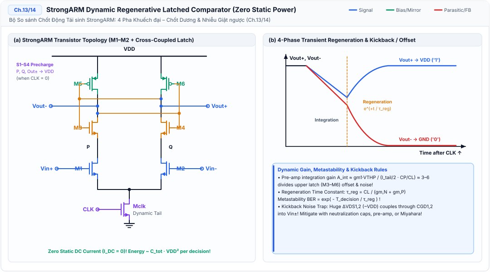

---
{
  "id": "topo-dynamic-strongarm-and-miyahara-comparator",
  "kind": "topology",
  "domain": "sampled-and-clocked",
  "title_vi": "Bộ So sánh Động Chốt Tái sinh: Kiến trúc StrongARM Bốn Pha và Bộ So sánh Hai Đuôi Miyahara (StrongARM & Double-Tail Dynamic Latched Comparators)",
  "title_en": "Dynamic Regenerative Latched Comparators: Four-Phase StrongARM Latch and Miyahara Double-Tail Architecture",
  "summary": "Giải phẫu vật lý và phương trình thời gian thực của hai kiến trúc bộ so sánh động tiêu thụ dòng tĩnh bằng không làm hạt nhân cho mọi bộ chuyển đổi ADC tốc độ cao: cơ chế 4 pha (đặt lại, tích phân tiền khuếch đại động, tái sinh NMOS, chốt ghép chéo CMOS) của StrongARM Latch so với cấu trúc hai tầng hai đuôi độc lập Miyahara / Double-Tail ở nguồn cấp thấp <= 0.9 V; phân tích hằng số thời gian tái sinh tau_reg = CL/Gm_eff, xác suất siêu ổn định BER, nhiễu giật ngược kickback và độ lệch/nhiễu nhiệt tích phân động.",
  "diagram": "../../diagrams/strongarm-dynamic-comparator.svg",
  "razavi_refs": [
    {
      "chapter": 13,
      "section": "13.2.3",
      "pages": "549-553",
      "equations": ["13.25", "13.30"]
    },
    {
      "chapter": 14,
      "section": "14.2.1-14.2.2",
      "pages": "593-602",
      "equations": ["14.75", "14.78", "14.88", "14.91", "14.95"]
    }
  ],
  "glossary_codes": [
    "T007",
    "T014",
    "T052",
    "T058",
    "T074",
    "T586",
    "T620",
    "T688",
    "T788",
    "T1009",
    "T1184",
    "T1950",
    "T2136",
    "T2153",
    "T2155"
  ],
  "process_agnostic": true,
  "roles": {
    "clocked_tail_and_input_pair": "Công tắc đuôi xung nhịp M_tail cấp dòng động chỉ khi có cạnh lên CLK, cho phép cặp vi sai đầu vào M1-M2 tích phân hiệu điện áp nhỏ Delta_Vin thành chênh lệch điện áp trên hai tụ nút nội CP, CQ.",
    "dynamic_integration_precharge_switches": "Các công tắc đặt lại PMOS kéo toàn bộ nút nội (P, Q) và nút ra (X, Y) lên VDD trong nửa chu kỳ CLK=0, xóa hoàn toàn lịch sử bit trước (zero hysteresis) và cắt đứt dòng tĩnh.",
    "cross_coupled_cmos_regenerative_latch": "Cặp biến tần CMOS ghép chéo hồi tiếp dương (M3-M4 NMOS và M5-M6 PMOS) tạo dẫn nạp vi sai âm -(gmN + gmP) khuếch đại theo hàm mũ e^(t/tau_reg) đẩy ngõ ra chạm hai biên rail-to-rail.",
    "miyahara_second_stage_double_tail": "Tầng chốt độc lập thứ hai trong kiến trúc Miyahara / Double-Tail tách rời dòng phân cực tiền khuếch đại (cần Vov nhỏ để giảm nhiễu/offset) khỏi dòng tái sinh chốt (cần Vov lớn để tăng tốc) và cách ly kickback."
  },
  "symptoms_addressed": [
    "excessive-static-power-in-continuous-time-preamp-comparators",
    "previous-code-memory-hysteresis-overdrive-recovery-error",
    "metastability-bit-error-rate-in-high-speed-adc-and-serdes-slicers",
    "insufficient-voltage-headroom-of-4-stacked-fets-under-sub-1v-supply"
  ],
  "limitations": [
    "large-voltage-swing-kickback-noise-through-cgd-cgs-onto-input-cdac",
    "input-common-mode-vcm-sensitivity-of-dynamic-offset-and-delay",
    "wideband-thermal-noise-integrated-over-short-aperture-window",
    "large-random-pelgrom-offset-without-trimming-or-calibration"
  ],
  "checklists": [
    "common-mos",
    "comparator-and-sar-adc",
    "differential-pair",
    "layout-and-matching"
  ]
}
---

## 1. Bản chất Nguyên lý, Sơ đồ Mạch & Vai trò Từng Nhánh Cấu trúc

Trong mọi **bộ chuyển đổi tương tự–số (`ADC` — `T007`, `T1950`)** từ SAR, Flash, Pipelined đến $\Delta\Sigma$ cũng như bộ cắt dữ liệu nối tiếp tốc độ cao (`SerDes slicer`), bộ so sánh (`comparator`) đóng vai trò cầu nối lượng tử hóa duy nhất biến một hiệu điện áp tương tự liên tục cực nhỏ $\Delta V_{in} = V_{in}^+ - V_{in}^-$ (cỡ vài chục microvolt đến vài milivolt, Razavi Hình 14.26) thành mức logic số chuẩn xác **`bit 1 / bit 0` (`T058`)** ngay tại sườn xung nhịp. Nếu dùng bộ khuếch đại vi sai mở vòng nối tầng liên tục theo thời gian, mạch vừa tiêu tán dòng tĩnh liên tục hàng miliampe, vừa quá chậm vì biên độ tăng tuyến tính theo $A_v \Delta V_{in}$, lại vừa mắc bệnh "nhớ mã cũ" (`overdrive recovery hysteresis`) khi vừa bị một tín hiệu lớn ép bão hòa ở chu kỳ trước!

Giải pháp đột phá thống trị toàn bộ công nghệ CMOS hiện đại là **Bộ so sánh Động Chốt Tái sinh (`Dynamic Regenerative Latched Comparator`)** kết hợp tích phân tiền khuếch đại động không tốn dòng tĩnh với **hồi tiếp dương (`positive feedback` — `T1184`)** khuếch đại hàm mũ $e^{+t/\tau_{\text{reg}}}$:



Hai kiến trúc trụ cột cần nắm vững đến từng pha chuyển tiếp vật lý là:

1. **Bộ chốt Động `StrongARM Latch` (Kobayashi 1993 / DEC StrongARM 1996 / Razavi phân tích chuẩn bốn pha):**
   Mạch xếp chồng bốn tầng transistor giữa $V_{DD}$ và $GND$: công tắc đuôi xung nhịp $M_{\text{tail}}$ ở dưới đáy, cặp vi sai đầu vào $M_1\text{–}M_2$ (nút máng nội $P, Q$), cặp NMOS ghép chéo $M_3\text{–}M_4$ đóng vai trò cascode kiêm chốt dưới, cặp PMOS ghép chéo $M_5\text{–}M_6$ ở đỉnh tạo ngõ ra $X, Y$, cùng **bốn công tắc đặt lại PMOS $S_1\text{–}S_4$** kéo cả bốn nút $P, Q, X, Y$ lên cứng $V_{DD}$ khi $CLK = 0$.
   - *Pha 0 — Đặt lại (`Reset / Precharge`, $CLK = 0$):* $M_{\text{tail}}$ ngắt hoàn toàn (**dòng tiêu thụ tĩnh bằng $0$ tuyệt đối!**); $S_1\text{–}S_4$ dẫn kéo $V_P = V_Q = V_X = V_Y = V_{DD}$, xóa sạch 100% ký ức của chu kỳ so sánh trước (bắt buộc nạp cả $P, Q$ lên $V_{DD}$, vì nếu bỏ sót $S_1, S_2$ để $P, Q$ còn dư áp khác nhau, sai lệch điện tích đó biến thẳng thành trễ nhớ `hysteresis`!).
   - *Pha 1 — Tích phân lấy mẫu động (`Sampling / Dynamic Amplification`, đầu sườn lên $CLK = 1$):* $S_1\text{–}S_4$ ngắt, $M_{\text{tail}}$ bật hút dòng $I_{\text{tail}}$. Lúc này $M_3\text{–}M_6$ vẫn tắt vì $V_P = V_Q = V_X = V_Y = V_{DD}$! Cặp vi sai $M_1, M_2$ hoạt động đúng trong vùng bão hòa, rút dòng chênh lệch $I_{D1,2} = \frac{I_{\text{tail}}}{2} \pm \frac{1}{2} g_{m1,2} \Delta V_{in}$ xả dần hai tụ nút nội $C_P, C_Q$ đi xuống từ $V_{DD}$ cho tới khi chạm mốc $V_{DD} - V_{TH,N}$.
   - *Pha 2 — Lan truyền và bật cặp NMOS chéo ($V_{P,Q} \le V_{DD} - V_{TH,N}$):* Khi $V_P, V_Q$ sụt quá một ngưỡng dưới cổng $V_X = V_Y = V_{DD}$, cặp $M_3, M_4$ bật dẫn như cặp cổng chung kiêm hồi tiếp dương bước đầu, bắt đầu rút dòng xả hai nút ngõ ra $X, Y$ đi xuống từ $V_{DD}$ đồng thời đẩy $M_1, M_2$ dần sang vùng triode đóng vai trò hai điện trở dẫn điều khiển bởi cổng.
   - *Pha 3 — Tái sinh Hồi tiếp Dương Toàn phần CMOS (`Full Latch Regeneration`, $V_{X,Y} \le V_{DD} - |V_{TH,P}|$):* Ngay khi một trong hai nút $X, Y$ sụt qua $V_{DD} - |V_{TH,P}|$, cặp PMOS ghép chéo $M_5\text{–}M_6$ bùng nổ tham gia cùng $M_3\text{–}M_4$ thành hai cổng đảo CMOS đấu vòng kín! Một nhánh bị khóa cứng lên $V_{DD}$, nhánh kia bị dập thẳng xuống $0\text{ V}$, và ngay khi chốt xong **dòng điện từ nguồn xuống đất tự động ngắt về $0$**!

2. **Bộ so sánh Động Hai tầng Hai đuôi (`Double-Tail` Schinkel 2007 & biến thể PMOS-latch `Miyahara Comparator` 2008):**
   Ở tiến trình `65nm` / `45nm` với $V_{DD} \le 0.9\text{–}1.0\text{ V}$, việc chồng đứng 4 transistor ($M_{\text{tail}} + M_1 + M_3 + M_5$) trong StrongARM khiến khoảng dự trữ điện áp bị bóp nghẹt nghiêm trọng (đặc biệt khi $V_{CM,\text{in}}$ thấp!), đồng thời một dòng $I_{\text{tail}}$ duy nhất không thể vừa tối ưu $g_m / I_D$ lớn cho cặp đầu vào vừa cấp dòng lớn cho chốt nhanh. Cấu trúc **Miyahara** tách mạch thành **hai tầng chỉ chồng tối đa 2–3 linh kiện**:
   - *Tầng 1 (Tiền khuếch đại động tích phân nhiễu thấp):* Gồm $M_{\text{tail1}}$ (NMOS bật theo $CLK$), cặp vi sai $M_1\text{–}M_2$ và hai khóa nạp trước PMOS kéo hai nút trung gian $F_P, F_N$ lên $V_{DD}$ khi $CLK = 0$. Khi $CLK = 1$, $F_P$ và $F_N$ xả thẳng từ $V_{DD}$ xuống $0\text{ V}$ với hai tốc độ chênh lệch nhau theo $\pm g_{m1} \Delta V_{in} / C_F$.
   - *Tầng 2 (Chốt tái sinh tốc độ cao tự kích không cần xung trễ ngoại vi):* Ở biến thể **Miyahara tinh gọn**, chính hai nút $F_P, F_N$ (lúc $CLK = 0$ đang ở mức cao $V_{DD}$ giữ hai nút ra $OUT_P, OUT_N$ xả sẵn về $0\text{ V}$ qua hai khóa NMOS dưới) trực tiếp lái một **cặp vi sai đầu vào PMOS gắn liền với chốt NMOS ghép chéo ở dưới**! Ngay khi $F_P, F_N$ xả tụt xuống dưới $V_{DD} - |V_{TH,P}|$, tầng 2 tự động kích hoạt nạp vọt hai ngõ ra lên và khóa cứng bằng chốt chéo mà **không cần mạch tạo xung nhịp trễ thứ hai**!

---

## 2. Hệ Phương trình Cốt lõi & Tư duy "Nhìn Mạch Đọc Nhanh" (Analysis by Inspection)

### 2.1. Độ lợi Tiền khuếch đại Tích phân Động $A_{\text{pre}}$ trong Pha 1 (Cơ chế Nén Offset & Nhiễu Chốt)
Trong Pha 1 của StrongARM, hai nút máng $P, Q$ sụt trung bình một lượng $\Delta V_{\text{CM},PQ} = V_{TH,N}$ trong khoảng thời gian mở cửa sổ tích phân:
$$T_{\text{int}} = \frac{C_P \, V_{TH,N}}{I_{\text{tail}} / 2} = \frac{2 C_P V_{TH,N}}{I_{\text{tail}}}$$
Trong suốt khoảng thời gian $T_{\text{int}}$ này, chênh lệch dòng $g_{m1,2} \Delta V_{in}$ tích phân lên $C_P, C_Q$ tạo hiệu điện áp vi sai khởi đầu trước khi cặp chốt $M_3\text{–}M_6$ kịp bật dẫn:
$$\Delta V_{PQ}(T_{\text{int}}) = \frac{g_{m1,2} \Delta V_{in}}{C_P} \cdot T_{\text{int}} = \left(\frac{g_{m1,2}}{I_{\text{tail}} / 2} \, V_{TH,N}\right) \Delta V_{in} = \left(\frac{g_m}{I_D}\right)_{1,2} V_{TH,N} \, \Delta V_{in} \approx \frac{2 V_{TH,N}}{V_{OV1,2}} \, \Delta V_{in}$$
**Phát hiện vàng khi nhìn nhanh công thức $A_{\text{pre}} = (g_m / I_D)_{1,2} V_{TH,N}$:**
Dù không hề có điện trở tải, quá trình xả tích phân dừng đúng tại ngưỡng bật $V_{TH,N}$ của tầng trên tự tạo ra một **độ lợi điện áp động $A_{\text{pre}} \approx 4\text{–}10\text{ V/V}$** (ví dụ $(g_m/I_D)_{1,2} = 18\text{ V}^{-1}$, $V_{TH,N} = 0.4\text{ V} \implies A_{\text{pre}} = 7.2$)! Nhờ độ lợi tiền khuếch đại tự thân này (và trong Miyahara là $\Delta V_{FN,FP} \approx (g_m/I_D)_{1,2} |V_{TH,P}| \Delta V_{in}$), toàn bộ **điện áp lệch ngẫu nhiên (`random offset voltage` — `T2155`) và nhiễu nhiệt của cặp chốt $M_3\text{–}M_6$ phía sau đều bị chia nhỏ đi $A_{\text{pre}}^2 \approx 20\text{–}60$ lần về phương sai** khi quy đổi về cổng đầu vào $M_1\text{–}M_2$ (tương đồng trực tiếp với quy tắc quy đổi độ lệch nhiều tầng Phương trình 14.82 của Razavi)!

### 2.2. Phương trình Vi phân Chốt Tái sinh, Hằng số Thời gian $\tau_{\text{reg}}$ & Xác suất Lỗi Siêu ổn định ($\text{BER}$)
Khi bước sang Pha 3, hai cổng đảo ghép chéo có tổng hỗ dẫn hiệu dụng $G_{m,\text{latch}} = g_{mN,3,4} + g_{mP,5,6}$ lái tổng điện dung nút ngõ ra $C_L$. Viết KCL vi sai cho $v_{\text{diff}}(t) = V_X(t) - V_Y(t)$ quanh điểm cân bằng không bền:
$$C_L \frac{dv_{\text{diff}}(t)}{dt} - G_{m,\text{latch}} \, v_{\text{diff}}(t) = 0 \implies v_{\text{diff}}(t) = \Delta V_0 \, \exp\!\left(+\frac{t - T_{\text{int}}}{\tau_{\text{reg}}}\right), \qquad \tau_{\text{reg}} = \frac{C_L}{G_{m,\text{latch}}} = \frac{C_L}{g_{mN} + g_{mP}}$$
Để ngõ ra vọt tới mức logic phân biệt rõ $\Delta V_{\text{logic}} \approx V_{DD}$, tổng thời gian ra quyết định từ sườn xung nhịp là:
$$T_{\text{clk}\to\text{out}}(\Delta V_{in}) = T_{\text{int}} + \tau_{\text{reg}} \ln\!\left(\frac{V_{DD}}{A_{\text{pre}} |\Delta V_{in}|}\right)$$
- **Định luật Tỷ lệ Lỗi Bit do Siêu ổn định (`Metastability Bit Error Rate — BER`):**
  Trong một chu kỳ SAR hay Flash ADC chỉ cấp cho bộ so sánh thời gian tối đa $T_{\text{dec,max}}$, nếu tín hiệu đầu vào rơi ngẫu nhiên vào dải siêu hẹp $|\Delta V_{in}| < \Delta V_{\text{meta}}$ sao cho $T_{\text{clk}\to\text{out}} > T_{\text{dec,max}}$, bộ so sánh chưa phân định xong mức logic và gây lỗi giải mã nghiêm trọng. Với tín hiệu phân bố đều trên một bước lượng tử $V_{\text{LSB}}$ (hoặc toàn thang $V_{\text{FS}}$), xác suất lỗi siêu ổn định là:
  $$P_{\text{meta}} = \frac{2\,\Delta V_{\text{meta}}}{V_{\text{LSB}}} = \frac{2 V_{DD}}{A_{\text{pre}} V_{\text{LSB}}} \exp\!\left(-\frac{T_{\text{dec,max}} - T_{\text{int}}}{\tau_{\text{reg}}}\right)$$
  **Ví dụ định lượng nhanh:** Với SAR ADC $10\text{-bit}$ tốc độ $100\text{ MS/s}$ ($10$ chu kỳ bit $\implies T_{\text{dec,max}} = 550\text{ ps}$, $T_{\text{int}} = 100\text{ ps}$), muốn đạt chuẩn công nghiệp không lỗi $\text{BER} \le 10^{-12}$ với $V_{DD} / (A_{\text{pre}} V_{\text{LSB}}) \approx 150$, ta cần $\frac{450\text{ ps}}{\tau_{\text{reg}}} \ge \ln(300 \times 10^{12}) = 33.3 \implies \tau_{\text{reg}} \le 13.5\text{ ps}$! Ở tiến trình `65nm`/`45nm` ($\tau_{\text{reg}} \approx 6\text{–}12\text{ ps}$), mục tiêu này hoàn toàn khả thi nhưng ở góc chậm `SS, VDD_min`, nếu $\tau_{\text{reg}}$ trượt lên $22\text{ ps}$, $\text{BER}$ sẽ vọt xấu đi **tới $6$ bậc độ lớn ($10^{-6}$)**!

### 2.3. Nhiễu Nhiệt Tích phân Động ($\sigma_{n,\text{in}}$), Độ lệch Pelgrom ($\sigma_{V_{OS}}$) & Nhiễu Giật ngược (`Kickback`)
1. **Phương sai Nhiễu Nhiệt Tích phân trên Cửa sổ $T_{\text{int}}$:**
   Dòng nhiễu trắng một phía $S_{i,n} = 8 k T \gamma g_{m1,2}$ của cặp vi sai $M_1\text{–}M_2$ được tích phân trên tụ $C_P, C_Q$ trong thời gian $T_{\text{int}}$ sinh phương sai điện áp vi sai trên $P, Q$ bằng $\frac{1}{2} S_{i,n} \frac{T_{\text{int}}}{C_P^2} = \frac{4 k T \gamma g_{m1,2} T_{\text{int}}}{C_P^2}$. Quy ngược về ngõ vào qua $A_{\text{pre}} = \frac{g_{m1,2} T_{\text{int}}}{C_P}$ và thế $T_{\text{int}} = \frac{2 C_P V_{TH,N}}{I_{\text{tail}}}$:
   $$\sigma_{n,\text{in,pre}}^2 = \frac{4 k T \gamma}{g_{m1,2} T_{\text{int}}} = \frac{4 k T \gamma}{\left(\dfrac{g_m}{I_D}\right)_{1,2} C_P \, V_{TH,N}} \quad \text{(cộng thêm đóng góp chốt } \approx \frac{\kappa_{\text{latch}} k T}{A_{\text{pre}}^2 C_L}\text{)}$$
   **Hệ quả cực kỳ sâu sắc:** Nhiễu quy về ngõ vào của bộ so sánh động **tỷ lệ nghịch với điện dung nút tích phân nội $C_P$ (hay $C_F$ trong Miyahara) và tỷ lệ nghịch với $(g_m / I_D)_{1,2}$**! Muốn giảm một nửa biên độ nhiễu RMS của bộ so sánh trong SAR ADC $12\text{–}14\text{ bit}$, người thiết kế thực tế thường gắn thêm cặp tụ kim loại nhỏ đối xứng ($C_P$ hoặc $C_F \approx 15\text{–}40\text{ fF}$) tại nút tích phân nội (đánh đổi tăng nhẹ $T_{\text{int}}$ và năng lượng mỗi lần chuyển mạch $E_{\text{comp}} \approx 2 C_P V_{DD}^2$)!
2. **Độ lệch Ngẫu nhiên Pelgrom & Bẫy Phụ thuộc Mức Đồng pha $V_{CM}$ (Razavi §14.2.1 Phương trình 14.78–14.79):**
   $$\sigma^2(V_{OS,\text{in}}) \approx \frac{A_{VTH}^2}{W_1 L_1} + \left(\frac{V_{OV1,2}}{2}\right)^2 \left[\left(\frac{\Delta(W/L)}{W/L}\right)_{1,2}^2 + \left(\frac{\Delta C_P}{C_P}\right)^2\right] + \frac{\sigma^2(V_{OS,\text{latch}})}{A_{\text{pre}}^2}$$
   Chú ý số hạng $\frac{V_{OV1,2}}{2} \frac{\Delta C_P}{C_P}$! Khi mức đồng pha đầu vào $V_{CM,\text{in}}$ thay đổi, cả dòng đuôi tức thời $I_{\text{tail}}(V_{CM})$ lẫn $V_{OV1,2}(V_{CM})$ đều biến thiên, khiến **$V_{OS,\text{in}}$ biến thiên theo $V_{CM,\text{in}}$**!
3. **Cơ chế Nhiễu Giật ngược (`Kickback Noise` — liên hệ §13.2.3 Phương trình 13.25–13.30):**
   Khi $CLK$ lên cao, cực nguồn chung của $M_1\text{–}M_2$ sập từ $\sim V_{CM} - V_{TH}$ xuống gần $0\text{ V}$ (rút dòng qua $C_{GS1,2}$), tiếp ngay sau đó hai cực máng $P, Q$ sập từ $V_{DD}$ xuống $0\text{ V}$ với độ dốc $dV/dt \sim 10^{10}\text{ V/s}$ bơm điện tích ngược qua $C_{GD1,2}$ ra hai chân cổng đầu vào! Nếu hai trở kháng nguồn nhìn từ $V_{in}^+$ và $V_{in}^-$ không bằng nhau ($Z_{S+} \neq Z_{S-}$) hoặc khi $M_1$ dẫn mạnh hơn $M_2$ làm $C_{GS1} \neq C_{GS2}$, xung điện tích giật ngược tạo sai số vi sai ngay trên giàn tụ C-DAC!

---

## 3. Bất biến Cấu trúc & Các Bẫy Lỗi Kinh điển (Structural Invariants & Traps)

- **`[INV-COMP-01]` Bất biến Bắt buộc Đặt lại Toàn bộ Các Nút Nội ($P, Q$ lẫn $X, Y$) trong Pha $CLK = 0$:**
  Trong StrongARM, nếu chỉ đặt hai khóa PMOS kéo hai nút ngõ ra $X, Y$ lên $V_{DD}$ mà **bỏ quên hai khóa $S_1, S_2$ kéo hai nút máng nội $P, Q$ lên $V_{DD}$**, thì sau một quyết định `1`, một nút ở $0\text{ V}$ còn nút kia kẹt lơ lửng ở khoảng $V_{DD} - V_{TH,N}$! Ở nhịp xung kế tiếp, sự chênh lệch điện áp khởi đầu hàng trăm milivolt giữa $P$ và $Q$ gây ra hiện tượng trễ nhớ mã cũ (`memory/hysteresis offset`) lên tới hàng chục milivolt!
- **`[INV-COMP-02]` Bất biến Đệm Chốt Giữ Mức `SR Latch` hoặc `RS-NAND` Phía Sau Bộ So sánh Động:**
  Ngõ ra $X, Y$ của StrongARM chỉ hợp lệ trong nửa chu kỳ $CLK = 1$ và bị kéo chập cả hai về $(1, 1)$ ngay khi $CLK = 0$ (hoặc $(0, 0)$ ở Miyahara). Do đó ngõ ra bộ so sánh động bắt buộc đi qua một cặp cổng chốt bất đồng bộ `NAND SR-Latch` (cho precharge lên $V_{DD}$) hoặc `NOR SR-Latch` (cho precharge xuống $GND$) có kích thước đối xứng chặt chẽ (để tải $C_L$ trên $X$ và $Y$ cân bằng tuyệt đối đến từng attofarad!).
- **`[TRAP-COMP-01]` Bẫy Sập Tốc độ StrongARM khi $V_{CM,\text{in}}$ Thấp ở Nguồn $\le 1.0\text{ V}$:**
  Khi mức đồng pha đầu vào giảm xuống gần $V_{TH,N} + 50\text{ mV}$ (ví dụ ở các bit cuối của SAR ADC dùng chuyển mạch đơn điệu `Monotonic Set-and-Down` hướng xuống đất!), $V_{GS1,2}$ quá nhỏ làm dòng xả Pha 1 giảm hàng chục lần, khiến $T_{\text{int}}$ vọt từ $80\text{ ps}$ lên hàng nanogiây và làm tê liệt hoàn toàn bộ so sánh! Giải pháp: chuyển sang cặp đầu vào PMOS nếu $V_{CM}$ tụt về đất, dùng chuyển mạch giữ $V_{CM}$ cố định, hoặc dùng cấu trúc hai tầng Miyahara.
- **`[TRAP-COMP-02]` Bẫy Đo `V_OS` và `Noise` của Bộ so sánh bằng Phân tích `.dc` / `.noise` Tĩnh:**
  Bộ so sánh động không hề có điểm làm việc DC tĩnh (tại $CLK = 0$ mạch tắt, tại $CLK = 1$ mạch chốt bão hòa về nguồn/đất!). Mọi phép quét `.dc` hay `.noise` thông thường đều cho kết quả vô nghĩa hoàn toàn. Phải đo offset động bằng tìm kiếm nhị phân quá độ (`transient binary search` / ramp chậm qua Monte Carlo) và đo nhiễu động bằng `SpectreRF PSS + PNoise (sampled/jitter)` hoặc khớp đường cong xác suất chuyển mức CDF Gaussian trong `Transient Noise`!
- **`[TRAP-COMP-03]` Bẫy Lệch Điện dung Dây Kim loại tại Nút Tích phân $P, Q$ ($1\text{ fF} \to \text{vài mV Offset}$):**
  Theo công thức $\Delta V_{OS,\Delta C} = \frac{V_{OV1,2}}{2} \frac{\Delta C_P}{C_P}$, nếu tổng tụ nút nội $C_P$ chỉ cỡ $8\text{ fF}$ và đi dây bất đối xứng làm lệch $\Delta C_P = 0.5\text{ fF}$ ($\sim 6.2\%$) với $V_{OV} = 160\text{ mV}$, riêng phần dây nối layout đã đẻ ra **điện áp lệch hệ thống $5\text{ mV}$**!

---

## 4. Lộ trình Nâng cấp Cấu trúc & Bát giác Đánh đổi (Upgrade Paths & Design Octagon)

Trong `concept-analog-design-octagon`, việc chọn kiến trúc bộ so sánh quyết định đồng thời **Năng lượng mỗi quyết định ($\text{fJ/conv-step}$)**, **Trần Tốc độ Lấy mẫu**, **Sàn Nhiễu Nhiệt** và **Ngưỡng Điện áp Nguồn Tối thiểu**:

| Tiêu chí Đối chiếu | Tiền khuếch đại Liên tục + Latch | StrongARM Dynamic Latch (1 tầng 4 xếp chồng) | Miyahara / Double-Tail Dynamic Comparator (2 tầng) |
| :--- | :--- | :--- | :--- |
| **Dòng điện tiêu thụ tĩnh ($I_{\text{static}}$)** | Cao (tốn dòng liên tục suốt chu kỳ) | **$0\text{ A}$** (chỉ tốn năng lượng động $C V_{DD}^2$) | **$0\text{ A}$** (chỉ tốn năng lượng động $C V_{DD}^2$) |
| **Nguồn cấp tối thiểu $V_{DD,\min}$** | $\sim 0.9\text{–}1.2\text{ V}$ | $\ge 1.0\text{–}1.2\text{ V}$ (4 FET xếp chồng đứng) | **$\mathbf{0.6\text{–}0.9\text{ V}}$** (chỉ 2–3 FET xếp chồng mỗi tầng!) |
| **Tách biệt tối ưu Nhiễu vs Tốc độ chốt** | Tốt | Kém (chung một nguồn dòng $M_{\text{tail}}$) | **Xuất sắc** ($I_{\text{tail1}}$ tối ưu $g_m/I_D$ cao; tầng 2 chốt cực đại) |
| **Nhiễu giật ngược (`Kickback Noise`)** | **Thấp nhất** (nhờ tầng đệm liên tục cách ly) | Trung bình–cao ($P, Q$ sập toàn dải $V_{DD}$) | **Thấp hơn đáng kể** (cách ly chốt tái sinh sang tầng 2) |
| **Độ nhạy trễ & offset theo $V_{CM,\text{in}}$** | Thấp (nhờ nguồn dòng đuôi hằng định) | Nhạy mạnh ($M_{\text{tail}}$ hoạt động vùng triode) | Trung bình–thấp (dễ giữ $M_{\text{tail1}}$ ổn định hơn) |

- **Lộ trình khử Độ lệch `V_OS` mà không phình to tụ đầu vào $C_{in}$:**
  Khi yêu cầu $V_{OS} < 0.5\text{ mV}$ (ví dụ trong Flash ADC hoặc SAR ADC xen kẽ thời gian `Time-Interleaved SAR` nơi lệch offset giữa các kênh sinh vạch phổ giả!), thay vì phóng to $W_1 L_1$ lên hàng trăm lần theo `law-pelgrom-mismatch-and-sizing-duality`, sử dụng một trong hai hướng nâng cấp chuẩn:
  1. **Hiệu chỉnh số nội tại (`Digital Offset Calibration`)**: Gắn mảng tụ biến dung nhỏ chuyển mạch số (`binary-weighted trim cap bank` bước nhảy $0.2\text{ fF}$) tại hai nút nội $P, Q$ (hoặc dùng cặp vi sai phụ `auxiliary calibration diff-pair` điều khiển bằng DAC dòng/áp hiệu chỉnh lúc khởi động!).
  2. **Đặt tầng tiền khuếch đại tự chỉnh không phía trước**: Dùng một tầng khuếch đại độ lợi vừa ($A_v \approx 5\text{–}8$) kèm khử lệch ngõ ra `OOS` theo `tech-dynamic-offset-cancellation-az-cds` đứng trước chốt động (vừa triệt $V_{OS}$ vừa chặn đứng $95\%$ nhiễu giật ngược `kickback` không cho chạm tới giàn tụ `topo-sar-adc-charge-redistribution-architecture`!).

---

## 5. Thích ứng Đa Tiến trình (90nm / 65nm / 45nm) & Cách Kiểm chứng trong Cadence / Spectre

### 5.1. Quy tắc Định cỡ Thực chiến trên `90nm` / `65nm` / `45nm`
1. **Phân vùng $g_m / I_D$ theo đúng vai trò từng cặp transistor:**
   - *Cặp vi sai đầu vào $M_1, M_2$:* Chọn chiều dài $L_1 = (1.5\text{–}2)\,L_{\min}$ (giảm DIBL và cải thiện khớp ngưỡng) và định cỡ bề rộng lớn để hoạt động ở vùng nghịch đảo vừa/yếu ($g_m / I_D \approx 16\text{–}22\text{ V}^{-1}$) trong Pha 1 $\implies$ tối đa hóa độ lợi tiền khuếch đại $A_{\text{pre}}$ đồng thời tối thiểu hóa cả $\sigma(V_{OS})$ lẫn nhiễu nhiệt tích phân!
   - *Cặp chốt tái sinh $M_3\text{–}M_6$ (và tầng 2 Miyahara):* Chọn chiều dài tối thiểu $L = L_{\min}$ để đạt tần số cắt nội tại $f_T$ cao nhất và hằng số thời gian tái sinh $\tau_{\text{reg}} = C_L / G_{m,\text{latch}}$ nhỏ nhất (cỡ $5\text{–}10\text{ ps}$ ở `65nm`/`45nm`), bởi đóng góp độ lệch của chúng đã được $A_{\text{pre}}$ che chắn!
   - *Các khóa đặt lại PMOS $S_1\text{–}S_4$:* Định cỡ vừa đủ nhỏ để hoàn tất nạp $P, Q, X, Y$ về $> 0.999\,V_{DD}$ trong nửa chu kỳ đặt lại (`t_reset >= 7 * R_on_rst * C_node`) mà không cộng thêm quá nhiều tụ ký sinh $C_{DB}$ làm chậm Pha 1 và Pha 3.
2. **Bố cục Mặt bằng Đối xứng Gương Gấp Đôi (`Mirror-Symmetric + Dummy Shielded Layout`):**
   - Khác với OTA tĩnh, bộ so sánh động cực nhạy với **sự chênh lệch điện dung phần mười femtofarad** giữa hai nút $P$–$Q$ và $X$–$Y$. Bắt buộc vẽ trục đối xứng gương tuyệt đối ở chính giữa ô bộ so sánh, dùng cặp biến tần tải giả (`dummy load`) nếu chỉ lấy một nhánh ra thanh ghi, và che chắn kim loại tách đường xung nhịp $CLK$ khỏi hai dây đầu vào $V_{in}^+, V_{in}^-$.

### 5.2. Phác đồ Kiểm chứng Bốn Bài Đo Bắt buộc trong Cadence Spectre
1. **Bài đo 1 — Trích xuất hằng số tái sinh $\tau_{\text{reg}}$ và kiểm chứng $\text{BER}$ (`tran` Logarithmic Overdrive Sweep):**
   - Quét $\Delta V_{in} \in \{10\text{ mV}, 1\text{ mV}, 100\,\mu\text{V}, 10\,\mu\text{V}, 1\,\mu\text{V}\}$ tại góc chậm nhất `SS, VDD_min`. Độ trễ $T_{\text{clk}\to\text{out}}$ tăng một lượng hằng định $\Delta T = \tau_{\text{reg}} \ln(10) = 2.3026\,\tau_{\text{reg}}$ cho mỗi thập kỷ giảm $\Delta V_{in}$ $\implies$ tính chính xác $\tau_{\text{reg}} = \frac{T(1\,\mu\text{V}) - T(100\,\mu\text{V})}{4.605}$.
2. **Bài đo 2 — Đo phân bố Độ lệch Động $\sigma(V_{OS,\text{dyn}})$ qua Monte Carlo (Ramp / Bisection):**
   - Tuyệt đối bao gồm cả bước chuyển mã nặng nhất ở nhịp ngay trước đó ($\Delta V_{in}[k-1] = +V_{\text{FS}}$ rồi nhịp $k$ quét qua $0\text{ V}$) để bắt trọn lỗi nhớ mã cũ (`hysteresis < 50 uV`) nếu khóa reset yếu!
3. **Bài đo 3 & 4 — Đo Nhiễu Nhiệt Quy về Ngõ vào của Bộ so sánh bằng `SpectreRF PSS + PNoise (Jitter/Sampled)` hoặc `Transient Noise CDF`:**
```spice
// Do nhieu nhiet tich phan quy ve ngo vao va do nhay suon cua StrongARM / Miyahara (f_clk = 100 MHz)
// Dat Delta_Vin nho (vi du 0.5 mV) de bo so sanh van o vung tuyen tinh tien khuech dai truoc khi chot
pss_cmp  pss  fund=100M  harms=0  errpreset=conservative  tstab=50n  method=traponly

// Su dung pnoise noisetype=sampled (phase/threshold crossing tai V_diff_out = 0 V):
// maxsideband=50 de tich phan tron ven nhieu nhiet bang cuc rong (~ 20 GHz) trong cua so T_int ~ 80 ps!
pnoise_cmp (out_p out_n) pnoise start=1k stop=50M dec=15 \
    maxsideband=50 noisetype=timedomain numberofpoints=1 timepoints=[t_pre_latch]

// Ngoai ra kiem tra truc tiep bang Transient Noise (1000 chu ky xung nhip voi Vin_diff = 0 V,
// hoac quet 7 diem Vin_diff quanh 0 V, dem xac suat P(D_out == 1) va khop ham 0.5*(1 + erf(Vin/(sqrt(2)*sigma_n))))
```

---

## 6. Mốc Đối chiếu Sách Razavi & Thuật ngữ Chuẩn CLB

| Mục Sách Razavi (2nd Ed.) & Tài liệu Chuẩn | Trang & Phương trình | Nội dung Đối chiếu Trọng tâm | Mã Thuật ngữ Chuẩn CLB |
| :--- | :--- | :--- | :--- |
| **§14.2.1 Comparator Precision & Offset Laws** | Tr. 593–598, Fig. `14.26–14.27`, Eq. `(14.75)–(14.82)` | Giới hạn phân giải ngưỡng so sánh $V_{in} - V_{REF}$ do $V_{OS,\text{in}}$; định luật Pelgrom và quy đổi sai lệch của tầng tải/tầng sau chia theo tỷ số hỗ dẫn | `T052` (Sai lệch linh kiện), `T620` (độ lệch), `T688` (sai lệch điện áp ngưỡng), `T788` (điện áp lệch quy về ngõ vào), `T2153` (định luật Pelgrom), `T2155` (điện áp lệch không ngẫu nhiên) |
| **§13.2.3 & §14.2.2 Switch Charge Kickback & Preamp AZ** | Tr. 549–553, 598–602, Eq. `(13.25)–(13.30)`, `(14.88)–(14.95)` | Xuyên xung nhịp qua $C_{GD}/C_{GS}$, phun điện tích kênh dẫn lên tụ giữ mẫu và chiến lược đặt tiền khuếch đại khử lệch phía trước chốt so sánh | `T014` (Phun điện tích), `T2136` (xuyên nhiễu xung nhịp), `T074` (Lấy mẫu), `T1009` (nhiễu nhiệt) |
| **Kiến trúc Chuẩn Công nghiệp ADC (StrongARM & Miyahara)** | Mở rộng thực chiến ADC từ nền tảng Ch.13/14 (Razavi *StrongARM Latch* JSSC 2015 & Miyahara A-SSCC 2008) | Giải tích 4 pha StrongARM ($A_{\text{pre}} \approx (g_m/I_D)V_{TH,N}$, $\tau_{\text{reg}} = C_L/G_m$, $\text{BER}$) và bộ so sánh hai tầng hai đuôi Miyahara nguồn cấp thấp | `T007` (Bộ chuyển đổi tương tự–số ADC), `T1950` (các cấu trúc bộ chuyển đổi tương tự–số), `T1184` (hồi tiếp dương), `T058` (bit 1 / bit 0), `T586` (cặp vi sai) |
