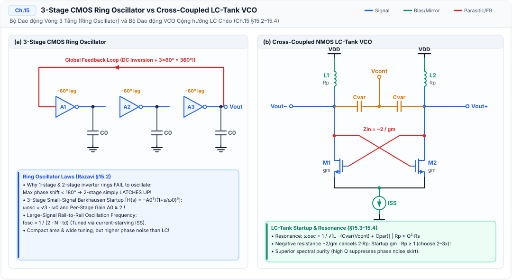

---
{
  "id": "topo-lc-cross-coupled-and-colpitts",
  "kind": "topology",
  "domain": "sampled-and-clocked",
  "title_vi": "Mạch dao động cộng hưởng LC cặp chéo và Colpitts (Cross-Coupled LC & Colpitts Oscillators)",
  "title_en": "Cross-Coupled LC and Colpitts Resonant CMOS Oscillators",
  "summary": "Cấu trúc dao động cộng hưởng dùng cuộn cảm xoắn ốc trên chip: phép biến đổi tổn hao nối tiếp–song song Rp ~ Q^2*Rs, nguyên lý hai tầng cộng hưởng gập chéo tạo điện trở âm một cửa -2/gm bù suy hao khung cộng hưởng (gm*Rp >= 1), giới hạn biên độ trên VDD và lý do mạch Colpitts đòi hỏi gm*Rp >= 4.",
  "diagram": "../../diagrams/ring-and-lc-oscillators.svg",
  "razavi_refs": [
    {
      "chapter": 15,
      "section": "15.3.1",
      "pages": "618-621",
      "equations": ["15.27", "15.28", "15.29", "15.33", "15.34", "15.35", "15.36"]
    },
    {
      "chapter": 15,
      "section": "15.3.2",
      "pages": "621-623",
      "equations": []
    },
    {
      "chapter": 15,
      "section": "15.3.3",
      "pages": "624-626",
      "equations": ["15.37", "15.40", "15.41", "15.42", "15.43", "15.44", "15.45", "15.46", "15.47"]
    },
    {
      "chapter": 15,
      "section": "15.3.4",
      "pages": "626-630",
      "equations": ["15.48", "15.51", "15.52", "15.54"]
    }
  ],
  "glossary_codes": [
    "T012",
    "T019",
    "T021",
    "T023",
    "T024",
    "T042",
    "T051",
    "T066",
    "T069",
    "T070",
    "T082",
    "T084",
    "T086",
    "T091",
    "T094",
    "T095",
    "T678",
    "T951",
    "T1184",
    "T1601"
  ],
  "process_agnostic": true,
  "roles": {
    "passive_lc_tank": "Khung cộng hưởng song song LP - CP lưu trữ năng lượng điện từ trường tại w1 = 1/sqrt(LP*CP) và lọc dải hẹp các thành phần hài.",
    "equivalent_parallel_loss_rp": "Điện trở song song tương đương Rp ~ Q^2*Rs đại diện cho năng lượng tiêu tán nhiệt mỗi chu kỳ trong cuộn cảm xoắn ốc và tụ điện.",
    "cross_coupled_negative_gm_pair": "Cặp transistor mắc chéo M1-M2 tạo trở kháng vi sai âm một cửa Rin = -2/gm bơm năng lượng bù đắp chính xác suy hao của khung LC.",
    "colpitts_capacitive_divider": "Bộ chia áp điện dung C1-C2 hồi tiếp từ cực máng về cực nguồn trong mạch Colpitts 1 transistor để đạt dịch pha 0 độ không đảo."
  },
  "symptoms_addressed": [
    "ring-oscillator-excessive-phase-noise-for-rf-wireless",
    "low-q-on-chip-spiral-inductor-energy-dissipation",
    "single-stage-tuned-amplifier-phase-failure-to-oscillate",
    "supply-dependent-bias-current-in-untail-biased-lc-core"
  ],
  "limitations": [
    "large-silicon-area-of-monolithic-spiral-inductor",
    "narrower-frequency-tuning-range-than-ring-oscillators",
    "colpitts-requires-fourfold-higher-gm-rp-than-cross-coupled",
    "nonzero-supply-frequency-pushing-via-drain-junction-capacitance"
  ],
  "checklists": [
    "common-mos",
    "oscillator-and-pll",
    "current-mirror",
    "layout-and-matching"
  ]
}
---

## 1. Bản chất Nguyên lý, Sơ đồ Mạch & Vai trò Từng Nhánh Cấu trúc

Trong các hệ thống thu phát tần số vô tuyến (RF) và truyền dẫn nối tiếp tốc độ cao, nhiễu pha nội tại của mạch dao động vòng quá lớn vì năng lượng bị tiêu tán hoàn toàn qua kênh dẫn mỗi chu kỳ. **Mạch dao động LC** (LC oscillator, §15.3) giải quyết tận gốc bài toán này bằng cách cho năng lượng trao đổi qua lại giữa từ trường của cuộn cảm nguyên khối (monolithic spiral inductor) $L_1$ và điện trường của tụ điện $C_1$ quanh tần số cộng hưởng $\omega_{\text{res}} = 1/\sqrt{L_1 C_1}$. Tuy nhiên, đường dây kim loại của cuộn cảm xoắn ốc trên đế silic luôn chịu điện trở nối tiếp ký sinh $R_S$ và suy hao dòng xoáy dưới đế bán dẫn, làm hệ số phẩm chất $Q = L_1 \omega / R_S$ hữu hạn (điển hình $Q \approx 4 \sim 15$ trên CMOS chuẩn) khiến dao động tự do tắt dần theo hàm mũ nếu không có mạch tích cực bù năng lượng.

Hành trình kiến tạo cấu trúc mạch dao động LC trong §15.3 đi qua ba bước tư duy vật lý nền tảng:
1. **Vì sao 1 tầng nguồn chung tải cộng hưởng LC nối vòng kín thất bại (Hình 15.23)**: Tại đúng tần số cộng hưởng $\omega_1 = 1/\sqrt{L_P C_P}$, cảm kháng và dung kháng triệt tiêu nhau nên khung LC thu gọn thành điện trở thuần $R_P$ (pha bằng $0^\circ$). Khi nối máng quay về cổng của $M_1$, tổng dịch pha quanh vòng tại $\omega_1$ chỉ là $180^\circ$ (do đảo pha cổng–máng của tầng CS), trong khi pha của khung LC chỉ quét từ $+90^\circ$ (vùng cảm kháng $\omega < \omega_1$) qua $0^\circ$ đến $-90^\circ$ (vùng dung kháng $\omega > \omega_1$, Hình 15.22b) — không bao giờ chạm thêm $180^\circ$ để đủ $360^\circ$. Đặc tính quý giá duy nhất cần ghi nhớ ở tầng này (Hình 15.24) là cuộn cảm có sụt áp DC gần bằng $0$, nên mức trung bình ngõ ra nằm sát $V_{DD}$ và **đỉnh sóng ngõ ra vọt lên cao hơn cả điện áp nguồn cấp $V_{DD}$**!
2. **Ghép nối tiếp 2 tầng cộng hưởng thành Mạch dao động LC cặp chéo (Cross-Coupled / Negative-$G_m$ Oscillator, §15.3.2 & §15.3.4)**: Mắc vòng 2 tầng CS tải LC đồng nhất $M_1, M_2$ (Hình 15.25). Khác hẳn vòng 2 tầng tải điện trở bị chốt cứng ở Chương 15 §15.2, ở tần số rất thấp ($\omega \to 0$) cuộn cảm nối tắt làm độ lợi vòng DC bằng $(g_m R_S)^2 \ll 1$, nên **mạch hoàn toàn miễn nhiễm với hiện tượng chốt cứng một chiều (latch-up)**! Đúng tại cộng hưởng $\omega_1$, mỗi khung LC có pha $0^\circ$ và hai tầng CS đảo pha hai lần tạo tổng dịch pha $360^\circ$ ($0^\circ$). Vẽ gập chéo lại và thêm nguồn dòng đuôi $I_{SS}$ (Hình 15.27c) ta thu được cặp vi sai hồi tiếp dương kinh điển: nhìn từ hai đầu khung cộng hưởng gộp, cặp chéo $M_1 - M_2$ chính là một phần tử một cửa có **điện trở vi sai âm** $R_{in} = -2/g_m$ đặt song song để triệt tiêu điện trở tổn hao của khung LC!
3. **Mạch dao động Colpitts một transistor (§15.3.3, Hình 15.31)**: Nếu chỉ muốn dùng duy nhất 1 transistor $M_1$ trong đường tín hiệu, không thể hồi tiếp máng về cổng (sai pha $180^\circ$) mà phải hồi tiếp máng về **cực nguồn** (nhìn như tầng cổng chung CG có dịch pha $0^\circ$). Để dòng hồi tiếp không bị chặn bởi nguồn dòng phân cực lý tưởng ở cực nguồn, bắt buộc phải dùng **bộ chia áp điện dung $C_1 - C_2$** nối từ máng về nguồn và từ nguồn xuống đất xoay chiều.

| Cấu trúc LC Oscillator | Điều kiện khởi động tối thiểu | Đặc trưng Dải dao động & Dư địa | Ưu / Nhược điểm cốt lõi |
| :--- | :--- | :--- | :--- |
| **Cặp chéo NMOS thuần + nguồn đuôi $I_{SS}$** | $g_{m1,2} R_P \ge 1$ (mỗi nhánh đơn cực) | Dao động quanh mức trung bình $V_{DD}$; đỉnh vượt trên $V_{DD}$. | Khởi động dễ nhất với cuộn cảm $Q$ thấp; đối xứng vi sai tự nhiên, khử hài bậc chẵn. |
| **Cặp chéo CMOS bổ sung (NMOS + PMOS)** | $\frac{1}{2}(g_{mN} + g_{mP}) R_{P,\text{diff}} \ge 1$ | Bị kẹp trong khoảng giữa $0$ và $V_{DD}$ (dừng trên nguồn đuôi). | Tái sử dụng cùng dòng phân cực $I_{SS}$ để nhân đôi hỗ dẫn âm cho cùng công suất, nhưng tốn dư địa điện áp hơn. |
| **Colpitts 1 transistor ($C_1, C_2$)** | $g_m R_P \ge \left(1 + \frac{C_1}{C_2}\right)\left(1 + \frac{C_2}{C_1}\right) \ge 4$ | Dao động quanh $V_{DD}$ (nếu tải $L_P$ treo lên $V_{DD}$). | Đặc tính nhiễu pha tốt nhờ bơm dòng xung hẹp ở đáy chu kỳ, nhưng đòi hỏi $g_m R_P$ cao gấp $4\times$ cặp chéo! |

## 2. Hệ Phương trình Cốt lõi & Tư duy "Nhìn Mạch Đọc Nhanh" (Analysis by Inspection)

### 2.1. Phép biến đổi Khung LC Nối tiếp sang Song song (Series-to-Parallel Transformation)
Xét nhánh cuộn cảm thực tế gồm $L_1$ nối tiếp điện trở dây quấn $R_S$ ghép song song tụ $C_1$ (Hình 15.19b–15.21). Đặt hệ số phẩm chất cuộn cảm $Q = \frac{L_1 \omega}{R_S}$. Trong dải tần hẹp quanh cộng hưởng, mạng nối tiếp $(L_1, R_S)$ tương đương hoàn toàn với mạng song song $(L_P \parallel R_P)$ khi đồng nhất phần thực và phần ảo của trở kháng (PT 15.29–15.36):

$$L_P = L_1\left(1 + \frac{R_S^2}{L_1^2 \omega^2}\right) = L_1\left(1 + \frac{1}{Q^2}\right) \approx L_1 \quad (\text{khi } Q > 3)$$

$$R_P = R_S(1 + Q^2) \approx \frac{L_1^2 \omega_0^2}{R_S} = Q^2 R_S = Q \cdot (\omega_0 L_1)$$

*Phản xạ nhìn mạch đọc nhanh*: Ở đúng tần số cộng hưởng $\omega_0 = 1/\sqrt{L_P C_P}$ (với $C_P = C_1$), cảm kháng $+j\omega_0 L_P$ và dung kháng $-j/(\omega_0 C_P)$ khử nhau hoàn toàn; toàn bộ khung cộng hưởng biến thành một điện trở thuần $R_P \approx Q^2 R_S$! Nếu cả tụ điện cũng có suy hao hữu hạn $Q_C$, điện trở song song tổng gộp đơn giản theo $R_{P,\text{tot}} = R_{P,L} \parallel R_{P,C}$.

### 2.2. Cách nhìn Hai cửa Hồi tiếp vs Một cửa Điện trở Âm của Cặp chéo LC
- **Theo quan điểm vòng hồi tiếp 2 tầng (Hình 15.25–15.27)**: Hai nhánh đơn cực mỗi nhánh có khung $(L_P \parallel C_P \parallel R_P)$. Độ lợi vòng tại $\omega_0$ là $(-g_{m1} R_P)(-g_{m2} R_P) = (g_m R_P)^2 \ge 1 \implies g_m R_P \ge 1$.
- **Theo quan điểm một cửa điện trở âm (Hình 15.33–15.36)**: Xét cặp transistor mắc chéo $M_1 - M_2$ ($g_{m1} = g_{m2} = g_m$, bỏ qua $\lambda, \gamma$). Khi đặt áp thử vi sai $V_X$ giữa hai cực máng (cũng là hai cực cổng chéo), $V_{gs1} = -V_{gs2} = -V_X/2$, dòng đi vào cửa thử là $I_X = -g_m V_X / 2$, suy ra điện trở vi sai nhìn vào cặp chéo (PT 15.51–15.52):

$$R_{in,\text{diff}} = \frac{V_X}{I_X} = -\left(\frac{1}{g_{m1}} + \frac{1}{g_{m2}}\right) = -\frac{2}{g_m}$$

Khi gộp hai khung đơn cực đối xứng (mỗi bên có $L_P, C_P, R_P$ nối lên $V_{DD}$) thành một khung vi sai duy nhất nằm giữa hai nút $X$ và $Y$ (Hình 15.36), khung vi sai có cảm kháng $2 L_P$, điện dung $C_P / 2$ và điện trở suy hao song song $R_{P,\text{diff}} = 2 R_P$. Điều kiện triệt tiêu năng lượng tổn hao để dao động tự mọc lên là $|R_{in,\text{diff}}| \le R_{P,\text{diff}}$:

$$\frac{2}{g_m} \le 2 R_P \implies g_m R_P \ge 1 \quad \text{(hoặc } g_m R_{P,\text{diff}} \ge 2 \text{ nếu cho } R_{P,\text{diff}} \text{ của cuộn cảm vi sai có tap giữa)}$$

Để chắc chắn khởi động qua mọi góc PVT và sai số mô hình cuộn cảm EM, thiết kế thực tế luôn chọn **$g_m R_P \ge 2 \sim 3$**. Khi biên độ tăng lớn đến mức dòng đuôi $I_{SS}$ chuyển hướng đóng cắt hoàn toàn giữa $M_1$ và $M_2$ như sóng vuông biên độ $0 \leftrightarrow I_{SS}$ (Ví dụ 15.6, Hình 15.28), khung LC có $Q$ cao lọc bỏ các hài bậc cao và chỉ giữ lại thành phần cơ bản $I_{\text{fund}} = \frac{2}{\pi} I_{SS}$ mỗi nhánh, tạo ra biên độ đỉnh vi sai ở chế độ giới hạn dòng (current-limited regime):

$$V_{\text{diff,pk}} \approx \frac{2}{\pi} I_{SS} R_{P,\text{diff}} = \frac{4}{\pi} I_{SS} R_P \quad \left(\text{tức mỗi nút đơn cực dao động } V_{DD} \pm \frac{2}{\pi} I_{SS} R_P\right)$$

### 2.3. Hệ phương trình Mạch dao động Colpitts (§15.3.3 & §15.3.4)
Áp dòng kích thích $I_{in}$ vào cực nguồn của $M_1$ trong mạch Colpitts (Hình 15.31, bỏ qua $r_o, g_{mb}$), hàm truyền đóng vòng bậc ba (PT 15.40) có mẫu số:

$$D(s) = R_P C_1 C_2 L_P s^3 + (C_1 + C_2) L_P s^2 + \left[g_m L_P + R_P(C_1 + C_2)\right] s + g_m R_P$$

Cho cả phần thực và phần ảo của $D(j\omega_R) = 0$ (với điều kiện thực tế $g_m L_P \ll R_P(C_1 + C_2)$) và cộng gộp cả tụ song song $C_P$ trên cuộn cảm (PT 15.43–15.47):

$$\omega_R = \frac{1}{\sqrt{L_P\left(C_P + \dfrac{C_1 C_2}{C_1 + C_2}\right)}}, \qquad g_m R_P \ge \frac{(C_1 + C_2)^2}{C_1 C_2} = \left(1 + \frac{C_1}{C_2}\right)\left(1 + \frac{C_2}{C_1}\right) \ge 4$$

Giá trị cực tiểu của vế phải đạt bằng $4$ khi chọn tỉ số tối ưu $C_1 = C_2$! Dưới góc nhìn một cửa ba cực nối tiếp (Hình 15.37, PT 15.54), tổ hợp $M_1 - C_1 - C_2$ trình diện trở kháng $Z_X(j\omega) = -\frac{g_m}{C_1 C_2 \omega^2} + \frac{1}{j\omega C_1} + \frac{1}{j\omega C_2}$: một điện trở âm nối tiếp bằng $-g_m / (C_1 C_2 \omega^2)$ bù trực tiếp điện trở mất mát của cuộn cảm!

### 2.4. Ví dụ Định lượng Thực chiến (Theo Bài tập Razavi 15.15)
Thiết kế lõi dao động LC cặp chéo NMOS hoạt động tại $f_0 = 1\text{ GHz}$ ($\omega_0 = 2\pi \times 10^9\text{ rad/s}$), sử dụng hai cuộn cảm nhánh đơn cực mỗi bên $L_P = 5\text{ nH}$ có hệ số phẩm chất $Q = 4$ tại $1\text{ GHz}$ và dòng đuôi $I_{SS} = 1\text{ mA}$:
1. **Tính điện trở dây nối tiếp $R_S$ và điện trở song song tương đương $R_P$**:
   - Cảm kháng tại $1\text{ GHz}$: $\omega_0 L_P = 2\pi \times 10^9 \times 5 \times 10^{-9} \approx 31.42\,\Omega$.
   - Điện trở nối tiếp cuộn cảm: $R_S = \frac{\omega_0 L_P}{Q} = \frac{31.42}{4} \approx 7.85\,\Omega$.
   - Điện trở song song mỗi nhánh đơn cực: $R_P \approx Q^2 R_S = 16 \times 7.85 \approx 125.7\,\Omega$ (tương đương $R_{P,\text{diff}} = 2 R_P \approx 251.3\,\Omega$).
2. **Tổng điện dung cộng hưởng mỗi nhánh & điều kiện khởi động $g_m$**:
   - $C_{\text{tot}} = \frac{1}{\omega_0^2 L_P} = \frac{1}{(2\pi \times 10^9)^2 \times 5 \times 10^{-9}} \approx 5.07\text{ pF}$. Nếu tụ ký sinh cố định bằng $500\text{ fF}$, phần dành cho tụ cộng hưởng/varactor tối đa là $4.57\text{ pF}$.
   - Ngưỡng khởi động lý thuyết: $g_{m1,2,\min} = \frac{1}{R_P} \approx 7.96\text{ mS}$; chọn biên dự trữ $2.5\times$ đòi hỏi $g_{m1,2} \approx 20\text{ mS}$ tại dòng tĩnh mỗi nhánh $I_D = I_{SS}/2 = 0.5\text{ mA}$ (đạt dễ dàng nếu dùng cặp chéo CMOS bổ sung hoặc nâng nhẹ $I_{SS}$).
3. **Ước lượng biên độ dao động xác lập**:
   - Với đóng cắt hoàn toàn dòng đuôi $I_{SS} = 1\text{ mA}$, biên độ đỉnh sóng cơ bản tại mỗi nút đơn cực là $V_{\text{se,pk}} \approx \frac{2}{\pi} I_{SS} R_P \approx 0.637 \times 1\text{ mA} \times 125.7\,\Omega \approx 80\text{ mV}$ (vi sai đỉnh–đỉnh $\approx 320\text{ mV}_{\text{pp}}$; thực tế khi dùng cuộn cảm vi sai $Q = 10$ sẽ nâng $R_P$ gấp $6.25\times$, đạt ngay biên độ vi sai $\approx 2.0\text{ V}_{\text{pp}}$!).

## 3. Bất biến Cấu trúc & Các Bẫy Lỗi Kinh điển (Structural Invariants & Traps)

- **[INV-LC-01] Bất biến triệt tiêu độ lợi DC chống chốt cứng**: Để cặp chéo $M_1 - M_2$ không biến thành chốt SRAM một chiều ở $\omega = 0$, tích độ lợi vòng một chiều qua điện trở dây quấn cuộn cảm bắt buộc phải thỏa $(g_m R_S)^2 < 1 \iff g_m R_S < 1$. Vì $R_P \approx Q^2 R_S$ với $Q \ge 4$, việc chọn $g_m R_P \approx 2 \sim 3$ tự động giữ $g_m R_S \approx (2 \sim 3)/Q^2 \ll 1$.
- **[INV-LC-02] Bất biến quy chiếu $R_P$ nhánh đơn cực so với $R_{P,\text{diff}}$ vi sai**: Sai lầm số học phổ biến nhất khi tính khởi động cặp chéo là nhầm hệ số $2$! Hãy khóa chặt bất biến: nếu tách thành 2 khung đơn cực mỗi bên $R_P$, điều kiện là $g_m R_P \ge 1$; nếu dùng 1 cuộn cảm vi sai đối xứng có điện trở song song giữa hai đầu là $R_{P,\text{diff}} = 2 R_P$, điều kiện cho cặp NMOS đơn thuần là $\frac{1}{2} g_m R_{P,\text{diff}} \ge 1 \iff g_m R_{P,\text{diff}} \ge 2$.
- **[INV-LC-03] Bất biến bất lợi hệ số 4 của Colpitts**: Do bộ chia áp điện dung $C_1 - C_2$ làm suy hao tín hiệu hồi tiếp về cực nguồn đồng thời tải nhẹ khung LC, mạch Colpitts luôn đòi hỏi $g_m R_P \ge 4$ (lớn gấp ít nhất $4$ lần cặp chéo). Với cuộn cảm trên chip có $Q$ thấp ($R_P$ nhỏ), Colpitts ngốn dòng phân cực lớn hơn rất nhiều để khởi động an toàn.
- **[TRAP-LC-01] Bẫy vượt áp đánh thủng oxit cổng (Gate-Oxide Overstress) do đỉnh sóng vượt trên $V_{DD}$**: Trong cấu trúc cặp chéo NMOS thuần treo cuộn cảm lên $V_{DD}$, mức DC cả cổng lẫn máng đều bằng $V_{DD}$. Nếu dòng đuôi $I_{SS}$ lớn đẩy mạch sang vùng biên độ lớn $V_X(t) = V_{DD} + A\cos\omega_0 t$ còn $V_Y(t) = V_{DD} - A\cos\omega_0 t$, điện áp tức thời cổng–máng $V_{GD1} = V_Y - V_X$ có thể chạm $2A > V_{DD,\text{max}}$, đồng thời đẩy $M_1, M_2$ lún sâu vào vùng triode làm tụt $Q$ tức thời của khung LC (chế độ giới hạn điện áp — voltage-limited regime)!
- **[TRAP-LC-02] Bẫy nhạy nguồn cấp dù mạch đối xứng hoàn hảo (Supply Pushing via $C_{DB}$)**: Dù dùng nguồn dòng đuôi $I_{SS}$ lý tưởng và bố cục vi sai đối xứng tuyệt đối (Hình 15.27c), điện thế DC tại hai cực máng vẫn bám theo $V_{DD}$, làm thay đổi điện dung tiếp giáp máng–đế $C_{DB}(V_{DD})$ và kéo trôi tần số dao động $\partial \omega_{out} / \partial V_{DD} \neq 0$ (Ví dụ 15.9).
- **[TRAP-LC-03] Bẫy nhiễu nhấp nháy $1/f$ và nhiễu nhiệt của nguồn dòng đuôi $I_{SS}$**: Nhiễu tần số thấp từ transistor nguồn dòng đuôi điều chế biên độ và điện dung phi tuyến của cặp chéo ở $2\omega_0$, bị trộn tần ngược lên thành nhiễu pha cận sóng mang $1/f^3$ cực mạnh nếu không có tụ lọc tại nút đuôi hoặc định cỡ $L$ lớn cho nguồn đuôi.

## 4. Lộ trình Nâng cấp Cấu trúc & Bát giác Đánh đổi (Upgrade Paths & Design Octagon)

Trên bản đồ `concept-analog-design-octagon`, `topo-lc-cross-coupled-and-colpitts` đánh đổi **diện tích silicon khổng lồ của cuộn cảm xoắn ốc** ($100 \sim 250\,\mu\text{m}$ mỗi chiều) và **dải điều chỉnh tần số hẹp** để giành lấy **tạp âm pha (phase noise) siêu thấp** và **khả năng hoạt động ở tần số sóng mang hàng chục GHz** với hiệu suất năng lượng vượt trội so với `topo-ring-oscillator`:

- **Khi cần biến mạch dao động LC cố định thành LC-VCO điều chỉnh tần số chuẩn xác**: Tích hợp varactor chế độ tích lũy MOS (accumulation-mode MOS varactor) kết hợp dàn tụ chuyển mạch nhị phân (switched-capacitor bank) để giữ $K_{VCO}$ nhỏ tại `topo-vco-tuning-and-phase-noise`.
- **Khi cần khóa pha sóng mang RF vào thạch anh chuẩn để tổng hợp tần số chính xác tới từng ppm**: Đưa LC-VCO vào vòng khóa pha bơm điện tích bậc cao tại `topo-charge-pump-type2-pll` (khắc phục giới hạn dải bắt của `topo-type1-simple-pll`) và chọn băng thông vòng tối ưu theo `concept-pll-nonidealities-spurs-jitter`.
- **Khi cần giảm nhiễu $1/f$ điều chế từ nguồn đuôi và chống đẩy tần số do nguồn cấp ($K_{VDD}$)**: Định cỡ nguồn dòng đuôi theo quy tắc nhiễu thấp `law-mos-thermal-and-flicker-noise` (hoặc dùng cặp chéo PMOS có nhiễu $1/f$ thấp hơn), phân cực bằng `topo-lvccml-wide-swing-mirror` có lọc RC, và tách nguồn riêng bằng `topo-cmos-ldo-regulator`.

| Trục Bát giác Thiết kế | Cặp chéo NMOS thuần | Cặp chéo CMOS bổ sung | Colpitts 1 Transistor |
| :--- | :--- | :--- | :--- |
| **Biên khởi động ($g_m R_P$)** | Thấp nhất ($g_m R_P \ge 1$) | Rất thấp ($\frac{1}{2}(g_{mN}+g_{mP})R_{P,\text{diff}} \ge 1$) | Khắt khe gấp $4\times$ ($g_m R_P \ge 4$) |
| **Dải dao động cực đại** | Vượt trên $V_{DD}$ ($\sim 2 V_{DD}$ vi sai) | Bị kẹp dưới $V_{DD} - V_{ISS,\min}$ | Lớn quanh $V_{DD}$ nhưng bất đối xứng đơn cực |
| **Tạp âm pha $1/f^3$ cận sóng mang** | Trung bình (dễ bị điều chế đuôi $2\omega_0$) | Tốt nhất nếu cân bằng sườn lên/xuống | Rất tốt nhờ góc dẫn dòng xung hẹp (Class-C tự nhiên) |
| **Rủi ro độ tin cậy oxit cổng** | Cao ở tiến trình $\le 65\text{nm}$ nếu $I_{SS} R_P$ lớn | An toàn tự nhiên trong giới hạn nguồn $V_{DD}$ | Cần kiểm soát đỉnh áp cực máng–cổng |

## 5. Thích ứng Đa Tiến trình (90nm / 65nm / 45nm) & Cách Kiểm chứng trong Cadence / Spectre

Khi tiến trình thu nhỏ xuống `90nm`, `65nm`, `45nm`, các lớp kim loại đỉnh siêu dày (ultra-thick top metal Cu/Al, dày $2 \sim 3.5\,\mu\text{m}$) trong PDK RF-CMOS giúp cuộn cảm xoắn ốc đối xứng đạt $Q \approx 10 \sim 18$ ở vài GHz, nhưng điện áp đánh thủng oxit mỏng chỉ còn $1.0 \sim 1.2\text{ V}$:
- **Lựa chọn kiến trúc NMOS thuần vs CMOS bổ sung theo $V_{DD}$**: Ở `90nm` ($V_{DD} = 1.2\text{ V}$), cấu trúc cặp chéo CMOS bổ sung (gồm cả cặp chéo NMOS lẫn cặp chéo PMOS kẹp giữa hai đầu khung LC) rất được ưa chuộng vì dòng $I_{SS}$ đi qua cả hai cặp tạo ra $R_{in,\text{diff}} = -2/(g_{mN} + g_{mP}) \approx -1/g_m$ (tiết kiệm một nửa dòng điện để đạt cùng biên khởi động!), biên độ tự giới hạn an toàn dưới $V_{DD}$ không sợ đánh thủng oxit và đối xứng sườn giảm chuyển đổi nhiễu $1/f$. Sang `65nm`/`45nm` khi $V_{DD} \le 0.9\text{ V}$, chồng 3 tầng (nguồn đuôi + NMOS + PMOS) bị thiếu dư địa điện áp nghiêm trọng, nên thiết kế thường quay về cặp chéo NMOS hoặc PMOS đơn với cuộn cảm có điểm giữa (center-tap) nối nguồn ổn áp.
- **Quy tắc vật lý & Layout bắt buộc**: Đặt tấm chắn đất xẻ rãnh (patterned ground shield — tuyệt đối không dùng tấm kim loại liền khối làm sinh dòng xoáy nghịch chiều triệt tiêu từ thông!) dưới cuộn cảm nếu PDK hỗ trợ, giữ vùng cấm kim loại/poly (keep-out zone) quanh cuộn cảm $\ge 30 \sim 50\,\mu\text{m}$, bố cục cặp chéo đa ngón cực ngắn dây nối theo `tech-common-centroid-sti-wpe-layout` để giảm $R_G$ và cách ly nhiễu đế theo `law-cmos-wells-and-latchup-guard-rings`.

**Quy trình kiểm chứng chuẩn trong Cadence Virtuoso / SpectreRF**:
1. **Đánh giá $Q(\omega)$ và $R_P(\omega)$ của khung thụ động bằng mô phỏng `sp` / `ac`**: Quét tham số $S$ hoặc trở kháng vi sai $Z_{11}(j\omega)$ của mô hình cuộn cảm PDK (kèm đường dây nối ra cặp chéo sau PEX) để đọc chính xác $\omega_0$, $Q = \text{Im}(Z)/\text{Re}(Z)$ trước khi cộng hưởng và $R_{P,\text{diff}} = \text{Re}\{Z_{\text{tank}}(j\omega_0)\}$ ở góc nhiệt độ nóng nhất $125^\circ\text{C}$ (nơi điện trở kim loại đồng/nhôm tăng $\sim 30 \sim 40\%$ làm sụt $R_P$!).
2. **Kiểm tra biên âm dẫn nạp khởi động một cửa (`ac` one-port negative conductance)**: Nối nguồn áp AC vi sai $1\text{ V}$ vào hai cực cặp chéo ở điểm phân cực tĩnh, kiểm tra phần thực dẫn nạp $\text{Re}\{Y_{\text{active}}(j\omega_0)\} = -g_{m,\text{eff}}/2$ sao cho $|\text{Re}\{Y_{\text{active}}\}| \ge (2.5 \sim 3) / R_{P,\text{diff}}$ trên toàn bộ các góc `SS/FF/FS/SF`.
3. **Mô phỏng `tran` kích mồi & SpectreRF `pss` + `pnoise`**: Chạy `tran` với xung dòng vi sai nhỏ kích vào khung LC để kiểm tra thời gian tăng trưởng bao hình (có $Q$ cao nên LC-VCO cần hàng chục đến hàng trăm chu kỳ để đạt xác lập `tstab`!). Sau đó chạy `pss` (Shooting hoặc **Harmonic Balance** — rất nhanh và chính xác cho mạch LC gần hình sin với `harms = 9..13`) kết hợp `pnoise` để vẽ phổ $\mathcal{L}(\Delta f)$ tại độ lệch $100\text{ kHz}, 1\text{ MHz}, 10\text{ MHz}$ và tính hệ số phẩm chất chuẩn hóa $\text{FoM} = |\mathcal{L}(\Delta f)| + 20\log_{10}(f_0/\Delta f) - 10\log_{10}(P_{DC}/1\text{ mW})$.

## 6. Mốc Đối chiếu Sách Razavi & Thuật ngữ Chuẩn CLB

- **Mốc sách Razavi (2nd Ed.)**: Chương 15 — `§15.3.1` (*Basic Concepts*, tr. 618–621, Hình 15.19–15.24, PT 15.27–15.36); `§15.3.2` (*Cross-Coupled Oscillator*, tr. 621–623, Hình 15.25–15.28, Ví dụ 15.5–15.6); `§15.3.3` (*Colpitts Oscillator*, tr. 624–626, Hình 15.29–15.31, Ví dụ 15.7, PT 15.37–15.47); `§15.3.4` (*One-Port Oscillators*, tr. 626–630, Hình 15.32–15.39, Ví dụ 15.8, PT 15.48–15.54).
- **Đối chiếu Thuật ngữ Chuẩn CLB Vi Mạch**:
  - `oscillators` (`T951`): mạch dao động; `radio-frequency, RF` (`T070`): tần số vô tuyến.
  - `transconductance` (`T091`): độ hỗ dẫn / hỗ dẫn; `positive feedback` (`T1184`): hồi tiếp dương.
  - `common-source stage, CS` (`T023`): tầng nguồn chung; `common-gate stage, CG` (`T021`): tầng cổng chung; `source follower` (`T082`): mạch bám nguồn.
  - `complementary MOS, CMOS` (`T024`): MOS bổ sung (CMOS); `steering the tail current` (`T678`): chuyển hướng dòng đuôi.
  - `voltage swing` (`T095`): dải dao động điện áp; `power dissipation` (`T066`): công suất tiêu tán.
