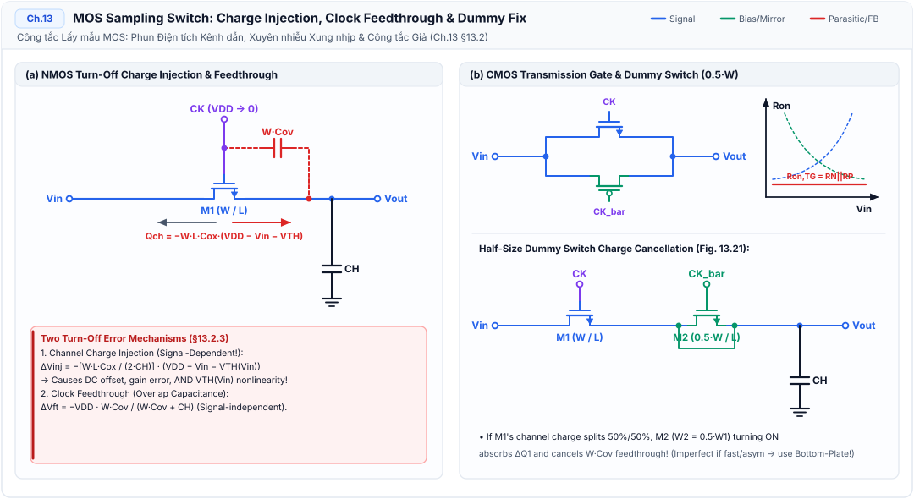

---
{
  "id": "topo-mos-and-cmos-sampling-switches",
  "kind": "topology",
  "domain": "sampled-and-clocked",
  "title_vi": "Công tắc lấy mẫu NMOS, PMOS và cổng truyền dẫn CMOS bổ sung",
  "title_en": "MOS and Complementary CMOS Transmission-Gate Sampling Switches",
  "summary": "Cấu trúc công tắc lấy mẫu và giữ mẫu dùng MOSFET vùng triode sâu hoặc cổng truyền dẫn CMOS bổ sung, quyết định biên độ dẫn, hằng số thời gian xác lập và bất biến nhiễu nhiệt tích phân kT/C.",
  "diagram": "../../diagrams/mos-switch-charge-injection.svg",
  "razavi_refs": [
    {
      "chapter": 13,
      "section": "13.1",
      "pages": "539-543",
      "equations": ["13.1", "13.2", "13.4", "13.5", "13.6"]
    },
    {
      "chapter": 13,
      "section": "13.2.1-13.2.2",
      "pages": "543-550",
      "equations": ["13.7", "13.8", "13.9", "13.11", "13.16", "13.18", "13.21", "13.22", "13.23", "13.24"]
    },
    {
      "chapter": 13,
      "section": "13.2.3",
      "pages": "553",
      "equations": []
    }
  ],
  "glossary_codes": [
    "T024",
    "T025",
    "T038",
    "T056",
    "T061",
    "T074",
    "T087",
    "T088",
    "T095",
    "T109",
    "T431",
    "T1009",
    "T1089",
    "T1169",
    "T2133"
  ],
  "process_agnostic": true,
  "roles": {
    "nmos_switch": "Transistor loại n dẫn tốt ở miền điện áp ngõ vào thấp và gần đất, nhưng suy giảm điện áp vượt ngưỡng và ngắt hẳn khi Vin tiến tới VDD - VTHN.",
    "pmos_switch": "Transistor loại p dẫn tốt ở miền điện áp ngõ vào cao gần VDD, nhưng tăng vọt điện trở dẫn khi Vin hạ xuống dưới |VTHP|.",
    "complementary_tg": "Ghép song song NMOS và PMOS điều khiển bởi các xung nhịp bù nhau để san phẳng điện trở dẫn tương đương trên toàn dải từ đất đến VDD.",
    "hold_capacitor_ch": "Tụ giữ mẫu lưu trữ điện áp tức thời tại sườn ngắt xung nhịp và ấn định sàn nhiễu nhiệt lấy mẫu kT/CH.",
    "clock_delay_equalizer": "Mạch đảo kết hợp cổng truyền dẫn luôn dẫn nhằm cân bằng độ trễ giữa hai xung nhịp bù CK và CK_bar."
  },
  "symptoms_addressed": [
    "resistive-feedback-loading-opamp-gain",
    "nmos-high-input-swing-clipping-at-vdd-minus-vth",
    "signal-dependent-ron-tracking-distortion"
  ],
  "limitations": [
    "kt-over-c-thermal-noise-floor",
    "midrail-ron-deadzone-at-ultra-low-vdd",
    "complementary-clock-skew-aperture-distortion",
    "channel-charge-injection-and-clock-feedthrough"
  ],
  "checklists": [
    "common-mos",
    "switched-capacitor",
    "layout-and-matching"
  ]
}
---

## 1. Bản chất Nguyên lý, Sơ đồ Mạch & Vai trò Từng Nhánh Cấu trúc

Trong mạch tương tự CMOS, việc thực hiện hồi tiếp (feedback) bằng mạng điện trở liên tục gặp một rào cản vật lý nghiêm trọng: bộ khuếch đại thuật toán (operational amplifier, op amp) CMOS đạt độ lợi điện áp (voltage gain) lớn nhờ trở kháng ngõ ra cao hàng trăm kilô-ôm, nên điện trở hồi tiếp $R_2$ tải trực tiếp ngõ ra, kéo tụt độ lợi vòng hở và làm méo hàm truyền theo cả tử số lẫn mẫu số (Phương trình 13.2–13.4 trong sách Razavi). Ngược lại, nếu thay điện trở bằng tụ điện kết hợp một điện trở phân cực lớn $R_F$ để xác lập điểm làm việc một chiều tại nút cổng đảo, mạch biến thành bộ lọc thông cao có hằng số thời gian $R_F C_2$, gây sụt đuôi điện tích khi khuếch đại tín hiệu bậc thang hoặc băng rộng. Hệ thống xử lý tín hiệu rời rạc theo thời gian (discrete-time signal) — tiêu biểu là mạch tụ chuyển mạch (switched-capacitor circuit) — giải quyết triệt để mâu thuẫn này bằng cách chia hoạt động thành hai pha định kỳ theo xung nhịp: pha lấy mẫu / bám tín hiệu (sampling / tracking mode) và pha giữ mẫu / khuếch đại (hold / amplification mode). Khi điện áp trên tụ đã xác lập, dòng điện qua tụ tiến về không, giúp bảo toàn trọn vẹn độ lợi vòng hở của bộ khuếch đại thuật toán.



Hạt nhân cơ bản nhất của mọi hệ lấy mẫu (sampling) là mạch bám và giữ mẫu (track-and-hold) gồm một MOSFET hoạt động như một công tắc (MOSFET as a switch) nối tiếp với tụ giữ mẫu $C_H$:

- **Công tắc đơn dùng transistor loại n (NMOS switch $M_1$)**: Cực cổng nhận xung nhịp $CK \in \{0, V_{DD}\}$. Khác hẳn transistor lưỡng cực luôn tồn tại độ lệch bão hòa $V_{CE,\text{sat}}$, MOSFET dẫn trong vùng triode sâu có đặc tuyến đi qua gốc tọa độ ($I_D = 0$ tại $V_{DS} = 0$), tạo nên **công tắc không độ lệch một chiều** (zero-offset switch). Hơn nữa, hai cực máng và nguồn tự động hoán đổi vai trò theo chiều dòng nạp/xả của $C_H$. Tuy nhiên, NMOS chỉ dẫn mạnh khi $V_{in}$ thấp; khi $V_{in}$ tiến lên gần $V_{DD} - V_{THN}$, điện áp vượt ngưỡng biến mất làm mạch bị xén đỉnh.
- **Công tắc đơn dùng transistor loại p (PMOS switch $M_2$)**: Cực cổng nhận xung đảo $\overline{CK}$. PMOS dẫn mạnh khi $V_{in}$ gần $V_{DD}$, nhưng mất khả năng dẫn khi $V_{in} \le \lvert V_{THP} \rvert$.
- **Cổng truyền dẫn MOS bổ sung (Complementary CMOS Transmission Gate — TG)**: Mắc song song $M_1$ (NMOS) và $M_2$ (PMOS) giữa $V_{in}$ và $C_H$, điều khiển bởi các xung nhịp bù nhau (complementary clocks) $CK$ và $\overline{CK}$. Khi $V_{in}$ ở mức thấp, NMOS gánh dòng chính; khi $V_{in}$ ở mức cao, PMOS gánh dòng chính; ở vùng giữa nguồn, cả hai cùng dẫn song song giúp dải dao động điện áp (voltage swing) đạt trọn vẹn từ $0$ đến $V_{DD}$ (rail-to-rail).
- **Nhánh cân bằng độ trễ xung nhịp bù ($I_1$ và $G_2$, Hình 13.19)**: Nếu lấy $\overline{CK}$ qua cổng đảo $I_1$ trực tiếp từ $CK$, nhánh $\overline{CK}$ bị trễ hơn một thời gian truyền cổng $\Delta t$. Ghép thêm một cổng truyền dẫn luôn dẫn $G_2$ trên đường $CK$ giúp cân bằng độ trễ đóng/ngắt giữa NMOS và PMOS, ngăn ngừa méo khẩu độ lấy mẫu ở tần số cao.
- **Tụ giữ mẫu ($C_H$)**: Lưu giữ mẫu điện áp tức thời tại thời điểm công tắc chuyển sang trạng thái ngắt (switch turns off), đồng thời đóng vai trò phần tử tích phân giới hạn băng thông nhiễu (noise bandwidth) của chính điện trở dẫn công tắc.

## 2. Hệ Phương trình Cốt lõi & Tư duy "Nhìn Mạch Đọc Nhanh" (Analysis by Inspection)

### 2.1. Quá độ tín hiệu lớn và giới hạn dải truyền qua của công tắc đơn
Khi $C_H$ ban đầu tích áp ở $V_{DD}$ và cần xả về $V_{in} = 0$ qua NMOS ($CK$ bật lên $V_{DD}$ tại $t = 0$, Ví dụ 13.2), $M_1$ khởi đầu trong vùng bão hòa với dòng hằng $I_{D1} = \frac{1}{2}\mu_n C_{ox}\frac{W}{L}(V_{DD} - V_{THN})^2$, xả tuyến tính điện áp ngõ ra theo $V_{out}(t) = V_{DD} - \frac{I_{D1}}{C_H}t$ cho tới mốc $t_1 = \frac{2 V_{THN} C_H}{\mu_n C_{ox}(W/L)(V_{DD} - V_{THN})^2}$, sau đó đi vào vùng triode và tiệm cận hàm mũ về $0$ (Phương trình 13.7–13.16). Ngược lại, nếu nạp $C_H$ từ $0$ lên $V_{in} = V_{DD}$, cực cổng và cực máng cùng ở $V_{DD}$ khiến $M_1$ bị khóa chặt trong vùng bão hòa suốt quá trình nạp:
$$
C_H \frac{dV_{out}}{dt} = \frac{1}{2}\mu_n C_{ox}\frac{W}{L}(V_{DD} - V_{out} - V_{THN})^2
\implies V_{out}(t) = V_{DD} - V_{THN} - \frac{1}{\frac{1}{2}\mu_n \frac{C_{ox}}{C_H}\frac{W}{L}t + \frac{1}{V_{DD} - V_{THN}}}
$$
Biểu thức (13.21) chứng minh $V_{out}$ chỉ hội tụ cực chậm theo quy luật nghịch đảo thời gian $1/t$ tới trần $V_{DD} - V_{THN}$ (bỏ qua dòng dưới ngưỡng quá nhỏ so với chu kỳ lấy mẫu). Do đó, để công tắc làm việc thuần túy trong vùng triode sâu ($V_{out} \approx V_{in}$), biên độ ngõ vào của NMOS phải nằm thấp hơn hẳn $V_{DD} - V_{THN}$.

### 2.2. Hồ sơ điện trở dẫn $R_{on}(V_{in})$ của NMOS, PMOS và CMOS TG
Ở chế độ bám tín hiệu ($V_{DS} = V_{out} - V_{in} \approx 0$), MOSFET vùng triode sâu tương đương một điện trở tuyến tính phụ thuộc mức tín hiệu $V_{in}$:
$$
R_{on,N}(V_{in}) = \frac{1}{\mu_n C_{ox}\left(\frac{W}{L}\right)_N \left[V_{DD} - V_{in} - V_{THN}(V_{in})\right]},
\qquad
R_{on,P}(V_{in}) = \frac{1}{\mu_p C_{ox}\left(\frac{W}{L}\right)_P \left[V_{in} - \lvert V_{THP}(V_{in}) \rvert\right]}
$$
Nếu chỉ dùng NMOS và giới hạn tỷ số biến thiên $R_{on,\max}/R_{on,\min} \le 4$ (Phương trình 13.23–13.24 khi bỏ qua hiệu ứng thân), dải tín hiệu tối đa chỉ đạt $V_{in,\max} = \frac{3}{4}(V_{DD} - V_{THN}) \approx 0.5\,V_{DD}$ — lãng phí gần một nửa nguồn cấp! Khi ghép song song thành cổng truyền dẫn CMOS ($R_{on,eq} = R_{on,N} \parallel R_{on,P}$), độ dẫn tổng $G_{on,eq} = R_{on,eq}^{-1}$ bằng:
$$
G_{on,eq}(V_{in}) = \mu_n C_{ox}\left(\frac{W}{L}\right)_N (V_{DD} - V_{THN})
- \left[\mu_n C_{ox}\left(\frac{W}{L}\right)_N - \mu_p C_{ox}\left(\frac{W}{L}\right)_P\right] V_{in}
- \mu_p C_{ox}\left(\frac{W}{L}\right)_P \lvert V_{THP} \rvert
$$
**Quy tắc nhìn mạch đọc nhanh**: Nếu thiết kế cân bằng hệ số dẫn $\beta_N = \mu_n C_{ox}(W/L)_N = \beta_P = \mu_p C_{ox}(W/L)_P = \beta$ (tức chọn $(W/L)_P \approx (\mu_n/\mu_p)(W/L)_N \approx (2.5\text{--}3.5)(W/L)_N$), số hạng bậc nhất theo $V_{in}$ triệt tiêu hoàn toàn, cho điện trở dẫn bậc nhất không phụ thuộc mức tín hiệu:
$$
R_{on,eq} \approx \frac{1}{\beta \left(V_{DD} - V_{THN} - \lvert V_{THP} \rvert\right)}
$$
Trong thực tế, do $V_{THN}$ và $\lvert V_{THP} \rvert$ cùng tăng ở giữa nguồn bởi hiệu ứng thân, đường cong $R_{on,eq}(V_{in})$ vẫn nhô lên một đỉnh lồi nhẹ quanh $V_{in} \approx V_{DD}/2$, nhưng biên độ dao động của $R_{on,eq}$ đã giảm hàng bậc độ lớn so với từng công tắc đơn lẻ.

| Cấu trúc công tắc | Dải tín hiệu hữu dụng | Đỉnh điện trở dẫn $R_{on,\max}$ | Méo pha động $\Delta\phi(V_{in})$ |
| :--- | :--- | :--- | :--- |
| Đơn NMOS ($M_1$) | $[0,\; V_{DD} - V_{THN} - V_{ov,\min}]$ | Tăng vọt vô cùng khi $V_{in} \to V_{DD} - V_{THN}$ | Rất lớn (chủ yếu hài bậc 2, HD2) |
| Đơn PMOS ($M_2$) | $[\lvert V_{THP} \rvert + V_{ov,\min},\; V_{DD}]$ | Tăng vọt vô cùng khi $V_{in} \to \lvert V_{THP} \rvert$ | Rất lớn (chủ yếu hài bậc 2, HD2) |
| Cổng truyền dẫn CMOS | $[0,\; V_{DD}]$ (nếu $V_{DD} > V_{THN} + \lvert V_{THP} \rvert$) | Đỉnh lồi nhẹ tại $V_{in} \approx V_{DD}/2$ do hiệu ứng thân | Thấp (chủ yếu hài bậc 3 đối xứng, HD3) |

### 2.3. Tốc độ xác lập $N$-bit, méo pha động và Ví dụ định cỡ nhanh
Với hằng số thời gian cực đại trên toàn dải tín hiệu $\tau_{\max} = R_{on,\max} C_H$, đáp ứng bước nhảy trong pha bám tuân theo $V_{out}(t) = V_{in0}(1 - e^{-t/\tau})$. Để sai số xác lập tương đối nhỏ hơn độ phân giải $N$-bit ($\lvert \Delta V \rvert / V_{FS} \le 2^{-N}$, hoặc chặt hơn là $\frac{1}{2}\text{LSB} = 2^{-(N+1)}$), cửa sổ thời gian bám tối thiểu $t_s$ phải thỏa mãn:
$$
e^{-t_s / \tau_{\max}} \le 2^{-N}
\implies t_s \ge N \ln(2)\, \tau_{\max} \approx 0.693\, N \, R_{on,\max} C_H
\quad \Big(\text{hoặc } (N+1)\ln(2)\, R_{on,\max} C_H \text{ cho } \tfrac{1}{2}\text{LSB}\Big)
$$
Với tín hiệu xoay chiều tần số cao $f_{in}$, bộ lọc thông thấp $R_{on}(V_{in}) C_H$ gây dịch pha tức thời $\Delta\phi(V_{in}) \approx -2\pi f_{in} R_{on}(V_{in}) C_H$, biến sự phụ thuộc điện áp của $R_{on}$ thành méo hài động ngay trong pha bám.

**Ví dụ định cỡ thực tế & Đối chiếu Ví dụ 13.3**:
- Trong Ví dụ 13.3 của Razavi ($\mu_n C_{ox} = 50\text{ }\mu\text{A/V}^2, W/L = 10/1, V_{TH} = 0.7\text{ V}, V_{DD} = 3\text{ V}$): khi tín hiệu dao động quanh $0.5\text{ V}$ biên độ nhỏ, $R_{on1}$ chỉ đổi nhẹ từ $870\text{ }\Omega$ lên $1.11\text{ k}\Omega$; nhưng ngay khi nâng đỉnh tín hiệu lên $1.5\text{ V}$, $R_{on1,\max}$ nhảy vọt lên $2.5\text{ k}\Omega$, làm dãn mạnh độ lệch pha bám ở $f_{in} = 10\text{ MHz}$.
- Khi thiết kế mạch lấy mẫu $12\text{ bit}$ ở $f_s = 50\text{ MS/s}$ ($T_{CK} = 20\text{ ns}$, cửa sổ pha bám $t_s = 8\text{ ns}$) với tụ giữ mẫu $C_H = 2\text{ pF}$: yêu cầu sai số xác lập $< \frac{1}{2}\text{LSB}$ ($N + 1 = 13$) đòi hỏi:
$$
13 \ln(2)\,\tau_{\max} = 9.01\,\tau_{\max} \le 8\text{ ns}
\implies \tau_{\max} \le 888\text{ ps}
\implies R_{on,\max} \le \frac{888\text{ ps}}{2\text{ pF}} = 444\text{ }\Omega
$$
trên toàn bộ các góc quy trình – điện áp – nhiệt độ (khắt khe nhất tại góc `SS, -40°C, VDD_min`).

### 2.4. Chứng minh chặt chẽ bất biến nhiễu nhiệt tích phân $kT/C_H$
Khi công tắc dẫn ở vùng triode sâu ($I_D \approx 0$), kênh dẫn chỉ phát nhiễu nhiệt cân bằng nhiệt động với mật độ phổ công suất một phía $S_{v,n}(f) = 4 k T R_{on}\text{ }[\text{V}^2/\text{Hz}]$. Mạng $R_{on}\text{--}C_H$ lọc nhiễu trắng này qua hàm truyền $\lvert H(jf) \rvert^2 = \frac{1}{1 + (2\pi f R_{on} C_H)^2}$. Phương sai điện áp nhiễu tích phân trên tụ $C_H$ trước thời điểm ngắt công tắc bằng:
$$
\overline{v_{n,out}^2} = \int_0^{\infty} \frac{4 k T R_{on}}{1 + (2\pi f R_{on} C_H)^2}\,df
= 4 k T R_{on} \cdot \underbrace{\left[\frac{1}{2\pi R_{on} C_H} \arctan(2\pi f R_{on} C_H)\right]_0^{\infty}}_{\text{ENBW} = \frac{\pi}{2} f_{-3\text{dB}} = \frac{1}{4 R_{on} C_H}}
= \frac{k T}{C_H}
$$
$$
\implies v_{n,\text{rms}} = \sqrt{\frac{k T}{C_H}}
$$
**Bản chất vật lý sâu sắc**: $R_{on}$ triệt tiêu hoàn toàn khỏi biểu thức nhiễu tổng! Nếu tăng kích thước $W/L$ để giảm $R_{on}$ đi $2\times$, sàn phổ nhiễu $4kTR_{on}$ hạ xuống $2\times$ nhưng băng thông nhiễu tương đương $\text{ENBW} = \frac{1}{4 R_{on} C_H}$ lại mở rộng đúng $2\times$, giữ nguyên diện tích dưới đường cong phổ bằng $kT/C_H$. Ngay khoảnh khắc $CK$ chuyển sang ngắt, toàn bộ năng lượng nhiễu trải rộng này bị đóng băng và chồng phổ (aliasing) trọn vẹn vào dải Nyquist $[0, f_s/2]$.

| Điện dung giữ mẫu $C_H$ | Nhiễu đơn cực $\sqrt{kT/C_H}$ ($300\text{ K}$) | Nhiễu vi sai $\sqrt{2kT/C_H}$ ($300\text{ K}$) | Trần SNR nhiệt ($V_{FS,\text{diff}} = 2\text{ V}_{pp}$) |
| :--- | :--- | :--- | :--- |
| $0.25\text{ pF}$ | $128.7\text{ }\mu\text{V}_{\text{rms}}$ | $182.0\text{ }\mu\text{V}_{\text{rms}}$ | $71.8\text{ dB}$ ($\approx 11.6\text{ bit}$) |
| $1.0\text{ pF}$ | $64.3\text{ }\mu\text{V}_{\text{rms}}$ | $91.0\text{ }\mu\text{V}_{\text{rms}}$ | $77.8\text{ dB}$ ($\approx 12.6\text{ bit}$) |
| $4.0\text{ pF}$ | $32.2\text{ }\mu\text{V}_{\text{rms}}$ | $45.5\text{ }\mu\text{V}_{\text{rms}}$ | $83.8\text{ dB}$ ($\approx 13.6\text{ bit}$) |
| $16.0\text{ pF}$ | $16.1\text{ }\mu\text{V}_{\text{rms}}$ | $22.8\text{ }\mu\text{V}_{\text{rms}}$ | $89.8\text{ dB}$ ($\approx 14.6\text{ bit}$) |

## 3. Bất biến Cấu trúc & Các Bẫy Lỗi Kinh điển (Structural Invariants & Traps)

- **[INV-1] Định luật bảo toàn diện tích phổ nhiễu lấy mẫu ($\overline{v_n^2} = kT/C_H$)**: Mọi nỗ lực nới rộng $W/L$ của công tắc chỉ cải thiện tốc độ xác lập ($\tau = R_{on}C_H$) chứ **tuyệt đối không** hạ được sàn nhiễu nhiệt lấy mẫu. Muốn tăng tỷ số tín hiệu trên nhiễu (SNR) thêm $6\text{ dB}$ ($+1\text{ bit}$ ENOB) khi đang bị giới hạn bởi nhiễu nhiệt, bắt buộc phải tăng điện dung $C_H$ gấp $4\times$ (kéo theo tăng $4\times$ dòng lái và công suất tiêu thụ).
- **[INV-2] Điều kiện chồng phủ cửa sổ dẫn của cổng truyền dẫn CMOS ($V_{DD} > V_{THN} + \lvert V_{THP} \rvert$)**: Để tồn tại ít nhất một nhánh dẫn mạnh tại mọi mức $V_{in} \in [0, V_{DD}]$, khoảng dẫn của NMOS $[0, V_{DD} - V_{THN}]$ và PMOS $[\lvert V_{THP} \rvert, V_{DD}]$ phải giao nhau dương: $V_{DD} - V_{THN}(V_{mid}) - \lvert V_{THP}(V_{mid}) \rvert > V_{ov,\min} > 0$.
- **[INV-3] Ràng buộc thế phân cực thân (Bulk Potential Invariant)**: Vì cực nguồn và cực máng của công tắc liên tục đổi chỗ theo sườn tín hiệu $V_{in}(t)$, cực thân (substrate) của NMOS trong quy trình chuẩn bắt buộc nối với thế âm nhất ($V_{SS}/\text{GND}$) và giếng n (n-well) của PMOS bắt buộc nối với thế dương nhất ($V_{DD}$).
- **[INV-4] Tỷ lệ điện dung tiếp giáp nguồn/máng phi tuyến trên tụ giữ mẫu ($C_{db,sb} \ll C_H$)**: Tổng điện dung tiếp giáp p–n phụ thuộc điện áp của nhánh NMOS + PMOS nối vào nút giữ mẫu phải nhỏ hơn nhiều so với $C_H$ để ngăn biến điệu pha phi tuyến trong pha bám.
- **[TRAP-1] Lệch sườn xung nhịp bù ($\Delta t$ Clock Skew) gây méo lấy mẫu tần số cao**: Trong cổng truyền dẫn CMOS (Hình 13.18), nếu NMOS ngắt sớm hơn PMOS một khoảng $\Delta t$, trong suốt cửa sổ $\Delta t$ đó mạch vẫn bám $V_{in}$ nhưng chỉ qua một mình $R_{on,P}(V_{in})$ biến thiên cực mạnh theo mức áp (thậm chí hở mạch khi $V_{in} < \lvert V_{THP} \rvert$), khiến thời điểm lấy mẫu hiệu dụng phụ thuộc vào biên độ tín hiệu và sinh ra hài bậc chẵn/lẻ nghiêm trọng.
- **[TRAP-2] Mở quá lớn chiều rộng $W$ để ép nhỏ $R_{on}$**: Khi tăng quá mức $W_N, W_P$ vượt xa nhu cầu xác lập $N\ln(2)\tau < T_{track}$, điện dung ký sinh tiếp giáp nguồn/máng phi tuyến và điện tích kênh dẫn $Q_{ch} \propto W L C_{ox}$ phình to, làm giảm độ tuyến tính và tăng vọt sai số phun điện tích khi ngắt.
- **[TRAP-3] Quên kiểm tra rò điện tích giữ mẫu ở góc quy trình nhanh – nhiệt độ cao (`FF, 125°C`)**: Ở tốc độ xung nhịp thấp, dòng rò dưới ngưỡng qua kênh công tắc đang ngắt và dòng rò tiếp giáp ngược xuống đế làm sụt áp $\Delta V_{droop} = \frac{I_{leak}}{C_H} T_{hold}$, phá hỏng mẫu lưu trữ.
- **[TRAP-4] Dùng phân tích `.noise` xoay chiều tĩnh thay vì `pnoise` tuần hoàn**: Phép đo `.noise` thông thường không tính đến sự gập phổ rời rạc từ $[0, \infty)$ về $[0, f_s/2]$, dẫn đến đánh giá thấp mật độ phổ nhiễu trong dải hàng chục đến hàng trăm lần khi $\frac{1}{2\pi R_{on} C_H} \gg f_s$!

## 4. Lộ trình Nâng cấp Cấu trúc & Bát giác Đánh đổi (Upgrade Paths & Design Octagon)

Trên Bát giác Thiết kế Tương tự (`concept-analog-design-octagon`), mạch công tắc lấy mẫu khóa chặt ba trục **Nhiễu – Tốc độ – Công suất** quanh hằng số $C_H$, đồng thời đặt trục **Độ tuyến tính** đối nghịch với **Dải dao động điện áp** và **Điện áp nguồn cấp**:

| Hiện tượng giới hạn / Triệu chứng | Hướng nâng cấp cấu trúc chuẩn | Trục đánh đổi trên Design Octagon |
| :--- | :--- | :--- |
| Xén đỉnh $V_{DD}-V_{THN}$ và hài bậc chẵn HD2 của công tắc đơn | Ghép cổng truyền dẫn CMOS trong `topo-mos-and-cmos-sampling-switches` + vi sai `law-differential-nonlinearity-and-feedback` | Thêm xung bù $\overline{CK}$ và gấp đôi đường dây xung nhịp |
| Sai số bệ điện áp, sai số độ lợi và méo hiệu ứng thân do $Q_{ch}(V_{in})$ | Lấy mẫu bản cực đáy xung ngắt sớm `tech-charge-injection-and-bottom-plate-sampling` trong `topo-switched-capacitor-amplifiers-integrators` | Thêm pha xung nhịp $\phi_{1e}$ và yêu cầu nút đất ảo OTA |
| Vùng chết $R_{on}$ giữa nguồn khi $V_{DD} \le 1.0\text{ V}$ hoặc méo Nyquist cao | Công tắc nâng áp cổng tự cử hằng số $V_{GS}$ `topo-bootstrapped-sampling-switch` | Tốn diện tích tụ bay $C_{boot}$ và mạch chắn bảo vệ oxit SOA |

Khi bố trí mặt bằng cho cặp công tắc lấy mẫu vi sai, bắt buộc đối xứng hóa chiều dài đường đi xung nhịp $CK/\overline{CK}$ và áp dụng kỹ thuật gập đa ngón giảm điện dung tiếp giáp máng/nguồn theo `tech-common-centroid-sti-wpe-layout`.

## 5. Thích ứng Đa Tiến trình (90nm / 65nm / 45nm) & Cách Kiểm chứng trong Cadence / Spectre

Khi dịch chuyển thiết kế qua các nút công nghệ 90nm ($V_{DD} = 1.2\text{ V}$), 65nm ($1.0\text{ V}$) và 45nm ($0.9\text{ V}$), tỷ số $\mu_n/\mu_p$ thay đổi và tổng ngưỡng $(V_{THN} + \lvert V_{THP} \rvert)$ ở góc `SS, -40°C` cộng hiệu ứng thân có thể chạm $0.85\text{--}0.95\text{ V}$, xóa sổ dự trữ dẫn của CMOS TG ở giữa dải! Trong trường hợp không dùng nâng áp cổng, người thiết kế chỉ nên dùng CMOS TG khi tín hiệu làm việc quanh mức cố định gần đất/nguồn (như công tắc đất ảo chọn `NMOS` đơn), hoặc chọn linh kiện ngưỡng thấp (`LVT`) nhưng phải kiểm soát nghiêm ngặt dòng rò ngắt (`Ioff`) ở góc `FF, 125°C`, luôn giữ $L = L_{\min}$ để cực tiểu hóa tích $\tau \Delta V \propto L^2/\mu$.

### Quy trình kiểm chứng chuẩn trong Cadence Virtuoso / Spectre
- **Bước 1 — Quét mặt cắt $R_{on}(V_{in})$ đa góc PVT (`dc` sweep)**: Đặt nguồn áp thử nhỏ $V_{test} = 1\text{ mV}$ qua công tắc đang bật ($CK = V_{DD}, \overline{CK} = 0$), quét `Vin` từ `0` đến `VDD` trên cả 5 góc `TT, SS, FF, SF, FS` ở `-40°C, 27°C, 125°C`. Vẽ `Ron = 1m / abs(I(Vtest))` và xác nhận đỉnh lồi giữa dải tại `SS, -40°C` thỏa mãn $R_{on,\max} < \frac{0.7\,T_{track}}{(N+1) \ln(2) C_H}$.
- **Bước 2 — Kiểm tra độ tuyến tính bám/giữ bằng FFT mạch lạc (`tran` Coherent FFT)**: Bơm sóng sin $f_{in} = \frac{M}{N_{\text{FFT}}} f_s$ (với $M$ nguyên tố cùng nhau với $N_{\text{FFT}}$, đặt $M \approx \frac{N_{\text{FFT}}}{2} - 3$ sát biên Nyquist), bật `errpreset=conservative`, trích xuất chuỗi mẫu cuối pha giữ bằng hàm `sample()` trong Calculator và chạy `dft()` đo `SFDR`, `THD`, `SNDR` khi chèn lệch xung $\Delta t = \pm 10\text{ ps}$.
- **Bước 3 — Kiểm chứng nhiễu lấy mẫu chồng phổ $kT/C_H$ bằng SpectreRF (`pss` + `pnoise`)**:

```
// Mẫu câu lệnh SpectreRF kiểm chứng sàn nhiễu lấy mẫu kT/CH tại sườn ngắt
pss_th  pss  fund=fs  harms=0  errpreset=conservative  tstab=4/fs
pnoise_th (vout 0)  pnoise  start=1  stop=fs/2  dec=25  maxsideband=40 \
    noisetype=timedomain  numberofpoints=1  noisetimepoints=[t_sample_hold]
```

Tích phân mật độ phổ công suất thu được từ `1 Hz` đến `fs/2` phải khớp sát lý thuyết $\sqrt{kT/C_H}$ trong phạm vi vài phần trăm.

## 6. Mốc Đối chiếu Sách Razavi & Thuật ngữ Chuẩn CLB

| Mục nội dung & Phương trình | Tham chiếu Razavi (2nd Ed.) | Mã & Thuật ngữ Chuẩn CLB |
| :--- | :--- | :--- |
| Động lực mạch rời rạc & giới hạn hồi tiếp điện trở / tụ liên tục | §13.1, Hình 13.1–13.8, PT (13.1)–(13.6), tr. 539–543 | `T025` Tín hiệu liên tục theo thời gian; `T038` Tín hiệu rời rạc theo thời gian; `T087` Mạch tụ chuyển mạch |
| MOSFET làm công tắc, quá độ nạp/xả và giới hạn $V_{DD} - V_{TH}$ | §13.2.1, Hình 13.9–13.14, Ví dụ 13.2–13.3, PT (13.7)–(13.22), tr. 543–547 | `T074` Lấy mẫu; `T088` Chuyển mạch; `T109` MOSFET hoạt động như một công tắc; `T431` Công tắc chuyển sang trạng thái ngắt |
| Tốc độ xác lập, giới hạn biên độ và cổng truyền dẫn CMOS bổ sung | §13.2.2, Hình 13.15–13.19, PT (13.23)–(13.24), tr. 547–550 | `T024` MOS bổ sung; `T056` transistor loại n; `T061` transistor loại p; `T095` Dải dao động điện áp; `T2133` các xung nhịp bù nhau |
| Nhiễu nhiệt lấy mẫu $kT/C_H$ độc lập với điện trở dẫn $R_{on}$ | §13.2.3, Hình 13.24, tr. 553 (đối chiếu Ví dụ 7.3, tr. 229) | `T1009` nhiễu nhiệt; `T1089` nhiễu kT/C; `T1169` băng thông nhiễu |
