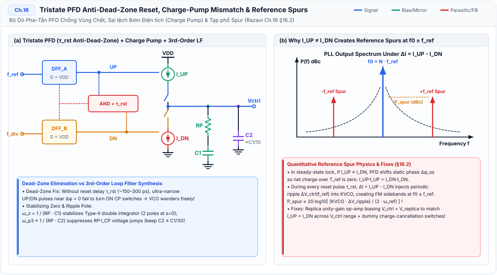

---
{
  "id": "topo-pfd-deadzone-and-charge-pump-nonidealities",
  "kind": "topology",
  "domain": "sampled-and-clocked",
  "title_vi": "Bộ Tách Pha–Tần số Ba Trạng thái (PFD), Chống Vùng Chết và Khử Bất lý tưởng Bơm Điện tích (PFD Dead-Zone & Charge-Pump Spurs)",
  "title_en": "Tri-State Phase-Frequency Detector Dead-Zone Elimination and Low-Spur Charge-Pump Architectures",
  "summary": "Giải phẫu mức cổng logic và mức transistor của khối PFD + Bơm điện tích (Razavi §16.2.2-16.2.3 & §16.3.1): cơ chế máy trạng thái hai D-FF có trễ đường xóa TP ~ 5*TD xóa bỏ vùng chết +-phi0, bù lệch trễ cổng đảo bằng cổng truyền dẫn CMOS, định lượng độ lệch pha tĩnh và vạch phổ giả tham chiếu (reference spurs) từ sai lệch dòng I_UP/I_DN và điều chế chiều dài kênh, cùng ba kiến trúc bơm điện tích tiên tiến (công tắc cực máng ghim thế bootstrap bằng Op-Amp, công tắc cực nguồn và điều hướng dòng vi sai Current-Steering).",
  "diagram": "../../diagrams/pfd-charge-pump-spur.svg",
  "razavi_refs": [
    {
      "chapter": 16,
      "section": "16.2.1-16.2.3, 16.3.1-16.3.2",
      "pages": "666-671, 677-683",
      "equations": ["16.47", "16.48"]
    }
  ],
  "glossary_codes": [
    "T014",
    "T016",
    "T024",
    "T033",
    "T047",
    "T052",
    "T058",
    "T064",
    "T095",
    "T518",
    "T724",
    "T752",
    "T1936",
    "T2015",
    "T2136",
    "T2138",
    "T2170",
    "T2171",
    "T2172",
    "T2174",
    "T2175",
    "T2177"
  ],
  "process_agnostic": true,
  "roles": {
    "tristate_dff_pfd_core": "Hai D-flip-flop kích cạnh lên với chân D nối mức cao logic 1 và cổng AND hồi tiếp xóa đồng thời, cung cấp tầm tách pha tuyến tính [-2*pi, +2*pi] và tự động phân biệt dấu sai số tần số.",
    "anti_deadzone_reset_delay": "Chuỗi cổng trễ có kiểm soát trên đường Reset giữ xung đồng thời UP & DN rộng tối thiểu TP >= t_rise + t_on_cp tại Delta_phi = 0 nhằm duy trì độ lợi tách pha khác 0 liên tục qua điểm khóa.",
    "delay_equalizing_pass_gate": "Cổng truyền dẫn CMOS luôn dẫn chèn trên đường điều khiển công tắc NMOS để cân bằng chính xác với trễ cổng đảo của đường điều khiển công tắc PMOS.",
    "replica_bootstrapped_charge_pump": "Mạch bơm điện tích kết hợp bộ đệm độ lợi đơn vị ghim thế nút trong (chống chia sẻ điện tích) và vòng Op-Amp bản sao ép I_UP(Vcont) == I_DN(Vcont) trên toàn dải tuân thủ điện áp."
  },
  "symptoms_addressed": [
    "pll-phase-wandering-and-massive-random-jitter-inside-pfd-dead-zone",
    "high-reference-spurs-at-carrier-plus-minus-fref-corrupting-rf-spectrum",
    "static-input-to-output-phase-skew-varying-across-vco-frequency-channels",
    "vcont-voltage-glitches-from-charge-sharing-and-up-down-arrival-skew"
  ],
  "limitations": [
    "wider-anti-deadzone-reset-pulse-directly-increases-current-mismatch-spur-energy",
    "maximum-operating-frequency-fmax-of-pfd-bounded-by-1-over-2-tp",
    "drain-switched-cp-with-cascode-reduces-usable-vcont-compliance-window-at-low-vdd"
  ],
  "checklists": [
    "common-mos",
    "oscillator-and-pll",
    "spectre-pss-pnoise",
    "current-mirror",
    "layout-and-matching"
  ]
}
---

## 1. Bản chất Nguyên lý, Sơ đồ Mạch & Vai trò Từng Nhánh Cấu trúc

Trong một **vòng khóa pha bơm điện tích loại II** (`type-II charge-pump PLL` — `T2174`), trái tim thực hiện phép so sánh định thời và chuyển đổi từ miền thời gian/pha sang miền điện tích tương tự chính là cặp bài trùng **bộ tách pha–tần số** (`phase/frequency detector, PFD` — `T2171`) và **bơm điện tích** (`charge pump` — `T016`). Nếu trên lý thuyết khối này chỉ đơn giản có hàm truyền tuyến tính $I_{\text{avg}} = \frac{I_P}{2\pi}\Delta\phi$, thì trong thực tế silicon nanomet (Razavi §16.2.2–16.2.3 & §16.3.1, trang 667–671, 677–681), chính những sai lệch tính bằng **vài picogiây thời gian** và **vài femtocoulomb điện tích** bên trong PFD/CP lại là thủ phạm số một gây bùng nổ **jitter** (`T047`) ngẫu nhiên hoặc đẻ ra các **vạch nhiễu giả tần số tham chiếu** (`reference spur` — `T2177`) tại $f_{\text{out}} \pm k f_{\text{REF}}$!



Để thiết kế mạch PFD + CP đạt chuẩn công nghiệp (Spur $< -70\text{ dBc}$, Jitter $< 200\text{ fs}$), kỹ sư phải làm chủ cấu trúc vi mô từ mức cổng số xuống mức mặt cắt transistor qua bốn tầng kiến trúc sau:

1. **Giải phẫu Cổng NOR/NAND của PFD Ba Trạng thái & Tần số Cực đại $f_{\text{PFD,max}}$ (§16.2.2, Hình 16.24–16.26, Ví dụ 16.8)**:
   - Mỗi D-flip-flop có chân $D = 1$ và chân `Reset` bất đồng bộ trong Hình 16.24b được tối giản thanh thoát chỉ bằng **hai cặp chốt SR ghép tầng gồm 4 cổng NOR** (hoặc cổng NAND cho PFD kích cạnh xuống / TSPC động cho tốc độ cao). Cổng `AND` nhận $Q_A, Q_B$ thực thi bằng một cổng NAND nối tiếp một cổng đảo (cộng thêm chuỗi chẵn cổng đảo tạo trễ xóa $\Delta t_{\text{rst}}$).
   - Trong Ví dụ 16.8 của Razavi, tính từ lúc cạnh lên thứ hai xuất hiện đến khi tín hiệu xóa quay về dập tắt cả $Q_A$ và $Q_B$, tín hiệu đi qua tổng cộng khoảng $5$ trễ cổng logic cơ bản: **độ rộng xung đồng thời ở trạng thái khóa là $T_P \approx 5 T_D$**. Hạn chế tốc độ trần của PFD: nếu chu kỳ tín hiệu đầu vào nhỏ hơn $2 T_P$, cạnh lên kế tiếp đã ập tới trong khi chân `Reset` vẫn đang mức cao làm PFD "nuốt xung" và đảo ngược dấu sai số tần số ($f_{\text{PFD,max}} < \frac{1}{2 T_P}$)!
2. **Cơ chế Vùng Chết (`dead zone` — `T2172`) và Vai trò Sống còn của Xung Đồng thời $T_P$ (§16.3.1, Hình 16.39–16.43)**:
   - Giả sử một bộ tách pha ngây thơ sinh ra độ rộng xung bằng $0$ tuyệt đối khi $\Delta\phi = 0$, và với $|\Delta\phi| = \phi_0$ rất nhỏ thì chỉ nhú lên một gai điện áp tam giác hẹp vài chục picogiây chưa kịp vượt điện áp ngưỡng hay nạp xong tụ cổng lớn của công tắc bơm điện tích (Hình 16.40). Khi đó với mọi $\Delta\phi \in [-\phi_0, +\phi_0]$, dòng ra của bơm điện tích bằng $0$ phẳng lì (Hình 16.41): **độ lợi vòng hở sụp về $0$ ($K_{PD} = 0$)**! Pha của VCO đi lang thang ngẫu nhiên qua lại giữa hai bờ vách $-\phi_0$ và $+\phi_0$ không có lực kéo lại, biến toàn bộ vùng chết thành jitter đỉnh–đỉnh bằng $\frac{2\phi_0}{2\pi} T_{\text{VCO}}$ (Hình 16.42)!
   - Nhờ giữ xung xóa đồng thời đủ rộng $T_P \ge t_{\text{rise,PFD}} + t_{\text{turn-on,CP}}$, ngay tại $\Delta\phi = 0$ cả hai nhánh `UP` và `DN` đều đã bật bão hòa hoàn toàn. Khi $\Delta\phi$ nhích nhẹ một lượng vô cùng bé $\delta\phi$, nhánh sớm mở rộng thêm đúng $\frac{\delta\phi}{2\pi}T_{\text{REF}}$ ở vùng dòng phẳng đỉnh $I_P$, đảm bảo độ lợi vi phân $\frac{d\overline{I}_{\text{net}}}{d\Delta\phi} = \frac{I_P}{2\pi}$ tuyến tính tuyệt đối xuyên qua gốc $0$ (Hình 16.43)!
3. **Bốn Kẻ Phá Hoại Trạng thái Khóa Biến Xung $T_P$ Thành Gợn Sóng Chu kỳ trên $V_{cont}$ (§16.3.1, Hình 16.44–16.47)**:
   - *(a) Lệch trễ đường điều khiển UP/DN (`Arrival Skew`, Hình 16.44)*: Công tắc nạp phía trên là PMOS $M_4$ cần xung âm $\overline{Q_A}$ (phải đi qua 1 cổng đảo), còn công tắc xả phía dưới là NMOS $M_3$ nhận thẳng xung dương $Q_B$. Sự lệch giờ bằng đúng $1\,T_{\text{inv}}$ khiến dòng ròng nhảy lên $-I_P$ trong $T_{\text{inv}}$ đầu tiên rồi vọt lên $+I_P$ trong $T_{\text{inv}}$ cuối cùng! Khắc phục chuẩn (Hình 16.44c): chèn một **cổng truyền dẫn CMOS** (`transmission gate` — `T2138`) luôn bật dẫn trên nhánh $Q_B$ có trễ truyền khớp với cổng đảo trên nhánh $Q_A$.
   - *(b) Sai lệch dòng $I_{UP} \neq I_{DN}$ và Điều chế chiều dài kênh theo $V_{cont}$ (Hình 16.45)*: Gương dòng PMOS và nguồn dòng NMOS có trở kháng ra hữu hạn $r_{OP}, r_{ON}$; khi $V_{cont}$ tiến gần $V_{DD}$ thì $|V_{DS,P}|$ nhỏ làm $I_{UP}$ tụt xuống trong khi $V_{DS,N}$ lớn làm $I_{DN}$ tăng vọt!
   - *(c) Bất đối xứng **phun điện tích** (`charge injection` — `T014`) và **xuyên nhiễu xung nhịp** (`clock feedthrough` — `T2136`)* khi $M_3$ và $M_4$ ngắt tại cuối xung $T_P$.
   - *(d) Chia sẻ điện tích nút trong (`Charge Sharing`, Hình 16.46–16.47)*: Khi hai công tắc đặt ở phía cực máng (sát $V_{cont}$) ngắt ra, nguồn dòng $M_1$ kéo nút ký sinh dưới $C_X \to 0\text{ V}$ và nguồn dòng $M_2$ kéo nút ký sinh trên $C_Y \to V_{DD}$. Đến chu kỳ kế tiếp khi công tắc đóng lại, $C_X$ và $C_Y$ hút/bơm gói điện tích chênh lệch thẳng vào bộ lọc vòng!
4. **Ba Họ Kiến trúc Bơm Điện tích Thực chiến**:
   - *Họ 1 — Công tắc ở Cực Máng kèm Bộ đệm Bootstrap Nút trong (Drain-Switched + Unity-Gain Buffer, Hình 16.47)*: Chuyển mạch cực nhanh vì cổng công tắc lái trực tiếp nút trở kháng thấp, còn khi công tắc chính $S_1, S_2$ ngắt thì cặp công tắc bù $S_3, S_4$ đóng lại nối nút $X, Y$ vào ngõ ra bộ đệm độ lợi đơn vị sao chép $V_{cont}$ ($V_X = V_Y = V_{cont} \implies \Delta Q_{\text{share}} = 0$!).
   - *Họ 2 — Công tắc ở Cực Nguồn / Cực Cổng (Source-Switched CP)*: Đặt công tắc nối nguồn $V_{DD}/GND$, còn cực máng của transistor nguồn dòng nối thẳng ra $V_{cont}$ (tránh phun điện tích công tắc trực tiếp vào $V_{cont}$, nhưng chậm hơn và vẫn chịu dòng dịch qua $C_{GD}$).
   - *Họ 3 — Bơm Điện tích Điều hướng Dòng Vi sai kèm Op-Amp Bản sao (`Current-Steering CP with Replica Feedback`)*: Chuẩn mực vàng cho bộ tổng hợp tần số RF hiện đại — hai nguồn dòng $I_{UP}, I_{DN}$ **không bao giờ tắt**, mà chỉ được hai cặp vi sai chuyển hướng mềm mại giữa nhánh chính ($V_{cont}$) và nhánh giả (`dummy branch` được giữ bằng đúng $V_{cont}$ nhờ bộ đệm độ lợi đơn vị!), cộng thêm một Op-Amp phụ giám sát nhánh bản sao để điều chỉnh cực cổng PMOS sao cho $I_{UP}(V_{cont}) \equiv I_{DN}(V_{cont})$ chính xác tới $< 0.2\%$ trên toàn dải!

---

## 2. Hệ Phương trình Cốt lõi & Tư duy "Nhìn Mạch Đọc Nhanh" (Analysis by Inspection)

### 2.1. Định lượng Sai số Pha Tĩnh ($\Delta\phi_{\text{ss}}$) từ Tổ hợp Sai lệch Dòng, Xuyên Xung nhịp và Dòng Rò
Ở trạng thái khóa xác lập của vòng Loại II, điện áp trung bình trên tụ tích phân $C_1$ không đổi qua mỗi chu kỳ $T_{\text{REF}} = 1/f_{\text{REF}}$, nghĩa là **tổng điện tích tịnh đi vào bộ lọc vòng trong trọn một chu kỳ phải bằng không tuyệt đối** ($\oint i_{\text{LF}}(t)\,dt = 0$). Xét đồng thời ba nguồn điện tích lệch mỗi chu kỳ: (1) sai lệch dòng $\Delta I_{\text{mis}}(V_{cont}) = I_{UP}(V_{cont}) - I_{DN}(V_{cont})$ chảy trong xung đồng thời $T_P$, (2) điện tích lệch do phun điện tích / chia sẻ điện tích $\Delta Q_{\text{sw}} = (C_Y(V_{DD} - V_{cont}) - C_X V_{cont}) + \Delta Q_{\text{inj}}$, và (3) dòng rò tĩnh trên nút điều khiển $I_{\text{leak}}$ (từ varactor cổng mỏng hoặc bảng mạch ngoại vi) chảy suốt chu kỳ $T_{\text{REF}}$. Vòng hồi tiếp buộc phải dịch pha ngõ vào PFD đi một góc tĩnh $\Delta\phi_{\text{ss}}$ (tương ứng độ lệch thời gian cạnh xung tĩnh $\Delta t_{\text{skew}} = \frac{\Delta\phi_{\text{ss}}}{2\pi} T_{\text{REF}}$) để bơm bù lại:

$$I_P \cdot \Delta t_{\text{skew}} + \Delta I_{\text{mis}}(V_{cont}) \cdot T_P + \Delta Q_{\text{sw}} - I_{\text{leak}} \cdot T_{\text{REF}} = 0$$

$$\implies \Delta\phi_{\text{ss}} = \frac{2\pi}{I_P}\left[ I_{\text{leak}} - \Delta I_{\text{mis}}(V_{cont})\frac{T_P}{T_{\text{REF}}} - \frac{\Delta Q_{\text{sw}}}{T_{\text{REF}}} \right] \;\; [\text{rad}]$$

Trong đó sai lệch dòng do trở kháng ngõ ra hữu hạn của hai nhánh nguồn dòng khi $V_{cont}$ dịch khỏi điểm cân bằng đối xứng $V_{DD}/2$ tuân theo:

$$\frac{\Delta I_{\text{mis}}(V_{cont})}{I_P} \approx \left(\frac{\Delta I}{I_P}\right)_{\text{random}} - \left(\frac{1}{I_P r_{\text{out,P}}} + \frac{1}{I_P r_{\text{out,N}}}\right)\left(V_{cont} - \frac{V_{DD}}{2}\right)$$

### 2.2. Công thức Chính xác Tính Biên độ Reference Spur ($\text{dBc}$) cho Bộ lọc Vòng Bậc ba ($R_P, C_1, C_2$)
Ở trạng thái khóa xác lập tuần hoàn chu kỳ $T_{\text{REF}} = 1/f_{\text{REF}}$, cần phân biệt rạch ròi giữa **điện tích một chiều tịnh bằng không** ($\oint_0^{T_{\text{REF}}} i_{\text{LF}}(t)\,dt = 0$) và **biên độ dòng hài bậc một Fourier khác không** $I_{m,1}$ tại $\omega_{\text{REF}} = 2\pi f_{\text{REF}}$! Mọi cặp xung lưỡng cực tuần hoàn hay xung hẹp bù rò rỉ đều tạo thành phần dòng hài bậc một $I_{m,1}$ (tương ứng gói điện tích hài bậc một tương đương $Q_{1,\text{eq}} \triangleq \frac{T_{\text{REF}}}{2}I_{m,1}$):

$$I_{m,1} = \frac{2}{T_{\text{REF}}}\left|\int_0^{T_{\text{REF}}} i_{\text{LF}}(t)e^{-j\omega_{\text{REF}} t}\,dt\right| = 2 f_{\text{REF}}\,Q_{1,\text{eq}}, \qquad Q_{1,\text{eq}} \triangleq \left|\int_0^{T_{\text{REF}}} i_{\text{LF}}(t)e^{-j\omega_{\text{REF}} t}\,dt\right|$$

Dòng hài này đi qua **trở kháng chính xác của bộ lọc vòng bậc hai** (cho PLL bậc ba gồm nhánh $R_P$ nối tiếp $C_1$ mắc song song với tụ dập gợn $C_2$, có điểm không $f_z = \frac{1}{2\pi R_P C_1}$ và cực bậc ba $f_{p3} = \frac{C_1 + C_2}{2\pi R_P C_1 C_2}$):

$$\left|Z_{\text{LF}}(j\omega)\right| = \frac{\sqrt{1 + (\omega R_P C_1)^2}}{\omega (C_1 + C_2)\sqrt{1 + \left(\omega R_P \frac{C_1 C_2}{C_1 + C_2}\right)^2}}$$

sinh ra biên độ gợn điện áp hài bậc một $V_{m,1}$ trên $V_{cont}$ và điều tần biên hẹp VCO tạo cặp **Reference Spur** tại $f_{\text{out}} \pm f_{\text{REF}}$:

$$V_{m,1} = I_{m,1} \cdot \left|Z_{\text{LF}}(j\omega_{\text{REF}})\right|, \qquad \text{Spur}(\pm f_{\text{REF}}) = 20\log_{10}\!\left(\frac{K_{\text{VCO,rad}}\,V_{m,1}}{2\,\omega_{\text{REF}}}\right) = 20\log_{10}\!\left(\frac{K_{\text{VCO,Hz}}\,V_{m,1}}{2\,f_{\text{REF}}}\right) = 20\log_{10}\!\left(Q_{1,\text{eq}}\cdot\left|Z_{\text{LF}}(j\omega_{\text{REF}})\right|\cdot K_{\text{VCO,Hz}}\right) \;\; [\text{dBc}]$$

*(Kiểm tra thứ nguyên bên trong $\log_{10}$: $[\text{C}]\cdot[\Omega]\cdot[\text{Hz/V}] = (\text{A}\cdot\text{s})\cdot(\text{V/A})\cdot(\text{s}^{-1}/\text{V}) = 1$ — hoàn toàn không thứ nguyên!)*

1. **Trường hợp 1 — Do dòng rò tĩnh $I_{\text{leak}}$ trên nút $V_{cont}$**: Dòng rò hằng số $-I_{\text{leak}}$ suốt chu kỳ $T_{\text{REF}}$ có tích phân Fourier bậc 1 bằng $0$, nhưng buộc PFD/CP bơm bù một xung đơn cực hẹp $+I_P$ độ rộng $\Delta t_{\text{leak}} = \frac{|I_{\text{leak}}| T_{\text{REF}}}{I_P} \ll T_{\text{REF}}$, mang $Q_{1,\text{eq,leak}} \approx |I_{\text{leak}}| T_{\text{REF}}$ và $I_{m,1,\text{leak}} \approx 2|I_{\text{leak}}|$:

$$\text{Spur}_{\text{leak}}(\pm f_{\text{REF}}) \approx 20\log_{10}\!\left(\frac{|I_{\text{leak}}|\cdot\left|Z_{\text{LF}}(j\omega_{\text{REF}})\right|\cdot K_{\text{VCO,Hz}}}{f_{\text{REF}}}\right) \xrightarrow{f_{\text{REF}} \gg f_{p3}} 20\log_{10}\!\left(\frac{|I_{\text{leak}}|\,K_{\text{VCO,Hz}}}{2\pi f_{\text{REF}}^2 C_2}\right)$$

   *(Lưu ý sống còn: khi $f_{\text{REF}} \lesssim f_{p3} = \frac{C_1 + C_2}{2\pi R_P C_1 C_2}$, xấp xỉ tiệm cận $\frac{1}{\omega_{\text{REF}} C_2}$ mất hiệu lực vì nhánh $R_P + C_1$ dẫn dòng song song — bắt buộc thay $|Z_{\text{LF}}(j\omega_{\text{REF}})|$ chính xác!)*

2. **Trường hợp 2 — Do sai lệch dòng $\Delta I_{\text{mis}}$ trong $T_P$ và lệch trễ công tắc $\Delta t_{\text{arr}}$ (Phân tích 2 cấp độ)**:
   - *(a) Xấp xỉ cận trên xung lỗi điện tích hẹp chưa khử lưỡng cực*: Nếu coi gói lỗi $|\Delta Q_{\text{err}}|$ (như bất đối xứng phun điện tích ngắt khóa hoặc ước lượng cận trên một xung hẹp) có $I_{m,1} \approx 2 f_{\text{REF}} |\Delta Q_{\text{err}}|$, thì thừa số $2 f_{\text{REF}}$ triệt tiêu hoàn toàn với $2 f_{\text{REF}}$ dưới mẫu của $\frac{K_{\text{VCO,Hz}} V_{m,1}}{2 f_{\text{REF}}}$, cho biểu thức không thứ nguyên:

$$\text{Spur}_{\text{imp}}(\pm f_{\text{REF}}) \approx 20\log_{10}\!\left(|\Delta Q_{\text{err}}| \cdot \left|Z_{\text{LF}}(j\omega_{\text{REF}})\right| \cdot K_{\text{VCO,Hz}}\right) \;\; [\text{dBc}]$$

   - *(b) Khử lưỡng cực trung bình không liền kề chính xác ở trạng thái khóa (`Zero-Mean Dipole Cancellation`)*: Khi chỉ có sai lệch dòng $\Delta I_{\text{mis}} = I_{UP} - I_{DN}$ trong cửa sổ $T_P$ (gói lỗi $|\Delta Q_{\text{mis}}| = |\Delta I_{\text{mis}}| T_P$), điều kiện khóa $\oint i_{\text{LF}}(t)\,dt = 0$ ép PFD tự dịch pha tạo xung bù ngược dấu $\mp I_P$ độ rộng $\Delta t_{\text{skew}} = \frac{|\Delta I_{\text{mis}}|}{I_P} T_P$ nằm ngay sát trước cửa sổ chồng lấp $T_P$. Trọng tâm hai xung ngược dấu $\mp\Delta Q_{\text{mis}}$ và $\pm\Delta Q_{\text{mis}}$ chỉ cách nhau $\Delta\tau_{\text{c}} = \frac{T_P + \Delta t_{\text{skew}}}{2}$ (góc lệch pha nửa khoảng $\frac{\omega_{\text{REF}}\Delta\tau_{\text{c}}}{2} = \frac{\pi f_{\text{REF}}(T_P + \Delta t_{\text{skew}})}{2} \ll 1$), nên tích phân Fourier tự triệt tiêu bậc nhất theo hệ số lưỡng cực $2\sin\!\left[\frac{\pi f_{\text{REF}}(T_P + \Delta t_{\text{skew}})}{2}\right] \approx \pi f_{\text{REF}}(T_P + \Delta t_{\text{skew}})$:

$$Q_{1,\text{eq,mis}} \approx |\Delta I_{\text{mis}}|\,T_P \cdot 2\sin\!\left(\frac{\pi f_{\text{REF}}(T_P + \Delta t_{\text{skew}})}{2}\right) \approx \pi f_{\text{REF}}(T_P + \Delta t_{\text{skew}})\,|\Delta I_{\text{mis}}|\,T_P$$

$$\implies \text{Spur}_{\text{mismatch}}(\pm f_{\text{REF}}) \approx 20\log_{10}\!\left[\pi f_{\text{REF}}(T_P + \Delta t_{\text{skew}})\cdot |\Delta I_{\text{mis}}|\,T_P \cdot \left|Z_{\text{LF}}(j\omega_{\text{REF}})\right| \cdot K_{\text{VCO,Hz}}\right] \;\; [\text{dBc}]$$

   - Hoàn toàn tương tự, với **lệch trễ đường điều khiển $\Delta t_{\text{arr}}$** (xung lưỡng cực $\mp I_P$ và $\pm I_P$ độ rộng $|\Delta t_{\text{arr}}|$, điện tích $|\Delta Q_{\text{arr}}| = I_P |\Delta t_{\text{arr}}|$ tách nhau bởi sườn đầu và sườn cuối của $T_P$, tức $\Delta\tau_{\text{arr}} = T_P$): $Q_{1,\text{eq,arr}} \approx I_P |\Delta t_{\text{arr}}| \cdot 2\sin(\pi f_{\text{REF}} T_P) \approx 2\pi f_{\text{REF}} T_P \cdot I_P |\Delta t_{\text{arr}}|$!

### 2.3. Mật độ Phổ Nhiễu Nhiệt và Nhiễu $1/f$ Nội dải của Bơm Điện tích (Chu kỳ Nhiệm vụ $\alpha_{\text{CP}} = T_P / T_{\text{REF}}$)
Ở trạng thái khóa ($\Delta\phi \approx 0$), cả nguồn dòng PMOS ($I_{UP}$) và nguồn dòng NMOS ($I_{DN}$) chỉ bật dẫn đưa nhiễu vào bộ lọc vòng trong đúng cửa sổ thời gian hẹp $T_P$ của mỗi chu kỳ $T_{\text{REF}}$! Hệ số chu kỳ nhiệm vụ bật nhiễu là $\alpha_{\text{CP}} = \frac{T_P}{T_{\text{REF}}} \ll 1$:
- Công suất nhiễu nhiệt trắng của hai nguồn dòng bị băm (gated) theo tỉ lệ thời gian dẫn $\alpha_{\text{CP}}$, còn nhiễu nhấp nháy $1/f$ tần số thấp bị nhân tỉ lệ bình phương chu kỳ nhiệm vụ $\alpha_{\text{CP}}^2$:

$$S_{i,\text{CP,1-sided}}(f) = 2 \cdot \left[ 4 k T \gamma g_{m,\text{CP}} \left(\frac{T_P}{T_{\text{REF}}}\right) + \frac{K_f g_{m,\text{CP}}^2}{W L C_{ox} f} \left(\frac{T_P}{T_{\text{REF}}}\right)^2 \right]$$

Quy đổi qua độ lợi tách pha $K_{\text{PD}} = \frac{I_P}{2\pi}$ và nhân hệ số chia tần $N$ trong dải thông thấp của PLL ($f \ll f_{\text{loop}}$), sàn nhiễu pha nội dải do bơm điện tích đóng góp là:

$$\mathcal{L}_{\text{in-band,CP}}(f) = 10\log_{10}\!\left[ \frac{1}{2} \left(\frac{2\pi N}{I_P}\right)^2 S_{i,\text{CP,1-sided}}(f) \right]$$

*Đọc nhanh thiết kế tối ưu*: Với $g_{m,\text{CP}} = \frac{2 I_P}{V_{\text{OV,CP}}}$, sàn nhiễu nhiệt nội dải tỉ lệ với $\frac{N^2}{I_P \cdot V_{\text{OV,CP}}} \cdot \left(\frac{T_P}{T_{\text{REF}}}\right)$! Do đó để hạ thấp sàn nhiễu nội dải CP-PLL: **(1) Tăng $V_{\text{OV,CP}}$ lớn hết mức dư địa cho phép** ($g_m/I_D$ thấp!), **(2) Tăng dòng bơm $I_P$**, và **(3) Giữ xung chống vùng chết $T_P$ ngắn vừa đủ**!

### 2.4. Ví dụ Định lượng Kiểm toán Ngân sách Spur & Nhiễu Bơm Điện tích tại $2.4\text{ GHz}$
Xét bộ tổng hợp tần số Wi-Fi/BLE $f_{\text{out}} = 2.4\text{ GHz}$, $f_{\text{REF}} = 40\text{ MHz}$ ($N = 60$, $T_{\text{REF}} = 25\text{ ns}$), $I_P = 400\,\mu\text{A}$, $R_P = 5\text{ k}\Omega$, $C_1 = 80\text{ pF}$, $C_2 = 8\text{ pF}$, $K_{\text{VCO,Hz}} = 50\text{ MHz/V}$, xung chống vùng chết $T_P = 200\text{ ps}$ ($\alpha_{\text{CP}} = 0.2 / 25 = 0.008$):
- **Đặc tính trở kháng bộ lọc vòng bậc ba**: Điểm không $f_z = \frac{1}{2\pi R_P C_1} = 397.9\text{ kHz}$; cực dập gợn bậc ba $f_{p3} = \frac{C_1 + C_2}{2\pi R_P C_1 C_2} = 4.377\text{ MHz}$. Tại $f_{\text{REF}} = 40\text{ MHz} \gg f_{p3}$, trở kháng chính xác là $\left|Z_{\text{LF}}(j 2\pi\cdot 40\text{ MHz})\right| = \mathbf{494.43\;\Omega}$ (sát tiệm cận $\frac{1}{\omega_{\text{REF}} C_2} = 497.36\;\Omega$).
1. **Kiểm tra Spur do dòng rò cổng varactor nếu dùng nhầm oxit mỏng ($I_{\text{leak}} = 20\text{ nA}$)**:
   - Tại $f_{\text{REF}} = 40\text{ MHz}$ ($\Delta t_{\text{leak}} = 1.25\text{ ps}$): $I_{m,1} \approx 2 I_{\text{leak}} = 40.0\text{ nA}$, $V_{m,1} = 40\text{ nA} \times 494.43\;\Omega = \mathbf{19.78\,\mu\text{V}}$, suy ra $\text{Spur}_{\text{leak}}(\pm 40\text{ MHz}) = 20\log_{10}\!\left(\frac{50\text{ MHz/V} \times 19.78\,\mu\text{V}}{2 \times 40\text{ MHz}}\right) = 20\log_{10}(1.236 \times 10^{-5}) \approx \mathbf{-98.16\text{ dBc}}$.
   - Nhưng nếu dùng kiến trúc Integer-N bước kênh hẹp $f_{\text{REF}} = 1\text{ MHz}$ ($< f_{p3} = 4.377\text{ MHz}$, nơi tiệm cận $1/(\omega_{\text{REF}} C_2) = 19.89\text{ k}\Omega$ **không còn hợp lệ**!): trở kháng lọc chính xác là $\left|Z_{\text{LF}}(j 2\pi\cdot 1\text{ MHz})\right| = \mathbf{4.769\text{ k}\Omega}$, cho $V_{m,1} = 40\text{ nA} \times 4.769\text{ k}\Omega = \mathbf{190.8\,\mu\text{V}}$ và $\text{Spur}_{\text{leak}}(\pm 1\text{ MHz}) = 20\log_{10}\!\left(\frac{50\text{ MHz/V} \times 190.77\,\mu\text{V}}{2 \times 1\text{ MHz}}\right) \approx \mathbf{-46.43\text{ dBc}}$ — vi phạm nặng chuẩn phổ RF và chứng minh vì sao Integer-N $f_{\text{REF}}$ thấp tuyệt đối cấm rò điện tích trên $V_{cont}$!
2. **Kiểm tra Spur do sai lệch dòng ($|\Delta I_{\text{mis}}| = 1\%\,I_P = 4\,\mu\text{A}$) và lệch trễ công tắc ($\Delta t_{\text{arr}} = 3\text{ ps}$)**:
   - *Sai lệch dòng $|\Delta I_{\text{mis}}| = 4\,\mu\text{A}$ trong $T_P = 200\text{ ps}$* ($|\Delta Q_{\text{mis}}| = 0.80\text{ fC}$, xung bù tĩnh $\Delta t_{\text{skew}} = \frac{4}{400}\times 200\text{ ps} = 2.0\text{ ps}$): nếu tính cận trên một gói xung chưa khử lưỡng cực thì $\text{Spur}_{\text{imp}} = 20\log_{10}(0.80\text{ fC} \times 494.43\;\Omega \times 50\text{ MHz/V}) = \mathbf{-94.08\text{ dBc}}$; nhờ khử lưỡng cực trung bình không liền kề hệ số $\pi f_{\text{REF}}(T_P + \Delta t_{\text{skew}}) = 0.02538$ ($-31.91\text{ dB}$), tích phân Fourier chính xác cho $Q_{1,\text{eq,mis}} = 0.02031\text{ fC}$, $I_{m,1} = 1.624\text{ nA}$, $V_{m,1} = 0.803\,\mu\text{V} \implies \text{Spur}_{\text{mismatch}} \approx \mathbf{-125.99\text{ dBc}}$.
   - *Lệch trễ đường điều khiển $\Delta t_{\text{arr}} = 3\text{ ps}$* (cặp xung lưỡng cực $\pm 400\,\mu\text{A}$ mang $|\Delta Q_{\text{arr}}| = 1.20\text{ fC}$ tách nhau đúng $T_P = 200\text{ ps}$): cho $Q_{1,\text{eq,arr}} = 0.06031\text{ fC}$, $I_{m,1} = 4.825\text{ nA}$, $V_{m,1} = 2.386\,\mu\text{V} \implies \text{Spur}_{\text{arr}} \approx \mathbf{-116.53\text{ dBc}}$; tổ hợp đồng thời xấu nhất ($\Delta t_{\text{arr}} = 3\text{ ps}$ cộng hưởng cùng chiều với $\Delta I_{\text{mis}} = +4\,\mu\text{A}$) cho $Q_{1,\text{eq,tot}} = 0.08122\text{ fC} \implies \mathbf{-113.95\text{ dBc}}$ (trong khi nếu phun điện tích/chia sẻ điện tích nút $X, Y$ để lọt gói lỗi bất đối xứng $1.20\text{ fC}$ không có xung đối cực kề sát thì cận trên spur tăng vọt lên $20\log_{10}(1.20\text{ fC} \times 494.43\;\Omega \times 50\text{ MHz/V}) = \mathbf{-90.55\text{ dBc}}$!).
3. **Sàn nhiễu nhiệt nội dải do bơm điện tích (chọn $V_{\text{OV,CP}} = 0.25\text{ V} \implies g_{m,\text{CP}} = \frac{2 I_P}{V_{\text{OV,CP}}} = 3.2\text{ mS}$, $\gamma = 1.2$, $T = 300\text{ K}$)**:
   - $S_{i,\text{CP,th}} = 2 \times 4 \times (4.14\times 10^{-21}\text{ J}) \times 1.2 \times 3.2\times 10^{-3}\text{ S} \times 0.008 = \mathbf{1.017 \times 10^{-24}\;\text{A}^2/\text{Hz}}$.
   - $\mathcal{L}_{\text{in-band,CP}} = 10\log_{10}\!\left[ 0.5 \times \left(\frac{2\pi \times 60}{4\times 10^{-4}\text{ A}}\right)^2 \times 1.017\times 10^{-24}\;\text{A}^2/\text{Hz} \right] = 10\log_{10}(4.519 \times 10^{-13}) = \mathbf{-123.45\text{ dBc/Hz}}$ tại $2.4\text{ GHz}$!

---

## 3. Bất biến Cấu trúc & Các Bẫy Lỗi Kinh điển (Structural Invariants & Traps)

- **[INV-PFD-01] Bất biến Định chuẩn $T_P$ Qua Mọi Góc PVT**: Độ rộng xung xóa đồng thời $T_P$ phải thỏa mãn bất đẳng thức kép:
  $$t_{\text{turn-on,CP}}(\text{SS}, V_{DD,\min}, -40^\circ\text{C}) < T_P(\text{FF}, V_{DD,\max}, -40^\circ\text{C}) \quad \text{VÀ} \quad T_P(\text{SS}, V_{DD,\min}, 125^\circ\text{C}) < \frac{T_{\text{REF,min}}}{4}$$
  Không được để đường xóa quá ngắn chỉ bằng 1 cổng NAND khiến ở góc `FF` xung $T_P$ co rút mất vùng bật công tắc CP (tái xuất hiện vùng chết!), nhưng cũng không kéo dài quá $300 \sim 500\text{ ps}$ làm tăng nhiễu nền CP ($\propto T_P$) và tăng spur!
- **[INV-PFD-02] Bất biến Tốc độ Hồi phục Bộ đệm Bootstrap Nút trong (`Unity-Gain Buffer Settling`)**: Trong cấu trúc ghim thế chống chia sẻ điện tích Hình 16.47 (hoặc nhánh giả của Current-Steering CP), bộ khuếch đại thuật toán độ lợi đơn vị nối vào $V_{cont}$ bắt buộc phải có **dòng ngõ vào bằng $0$ tuyệt đối** (cổng MOSFET oxit dày I/O không rò!) và **ổn định với tải dung kháng chuyển mạch** $C_X, C_Y$ để khôi phục $V_X, V_Y = V_{cont}$ trước khi nhịp so pha kế tiếp ập tới.
- **[TRAP-PFD-01] Bẫy Đấu Lẫn Lộn Khái niệm `Charge Pump` (`T016`) và `Charge Injection` (`T014`)**: Trong cả thiết kế lẫn tài liệu kỹ thuật tiếng Việt, `charge pump` là khối **bơm điện tích chủ động** tạo cực tích phân thứ hai cho PLL, còn `charge injection` là lỗi ký sinh **phun điện tích kênh dẫn** của MOSFET công tắc khi ngắt sườn xung nhịp! Đặc biệt, để hủy phun điện tích bất đối xứng giữa công tắc PMOS ($M_4$) và NMOS ($M_3$) tại nút ra $V_{cont}$, luôn chèn cặp công tắc giả một nửa chiều rộng (`dummy switches` $W_{\text{dum}} = 0.5 W_{\text{sw}}$ nối tắt S–D kích xung ngược pha!).
- **[TRAP-PFD-02] Bẫy Mất Tuyến tính Chuỗi $\Delta\Sigma$ Fractional-N khi $I_{UP} \neq I_{DN}$ (Noise Folding Trap!)**: Trong PLL nguyên (`Integer-N`), PLL khóa tại một điểm $\Delta\phi \approx 0$ cố định nên gãy khúc độ lợi giữa nhánh dương ($I_{UP}$) và nhánh âm ($I_{DN}$) chỉ tạo vạch spur tại $\pm f_{\text{REF}}$. Nhưng trong **PLL phân số $\Delta\Sigma$ (`Fractional-N`)**, sai số pha tức thời tại PFD quét qua lại liên tục quanh $0$ với biên độ lớn nhiều radian mỗi chu kỳ! Nếu $I_{UP} \neq I_{DN}$, đường truyền đạt $Q_{\text{out}}(\Delta\phi)$ bị **gãy khúc phi tuyến bậc hai ngay tại gốc tọa độ**, làm trộn gập toàn bộ nhiễu lượng tử hóa tần số cao khổng lồ của bộ điều chế $\Delta\Sigma$ thẳng xuống vùng nội dải DC, đánh sập hoàn toàn nhiễu pha nội dải! Trong Fractional-N, bắt buộc dùng vòng Op-Amp khớp dòng $I_{UP} = I_{DN}$ kèm dòng bù lệch tĩnh (`bleed current`) để đẩy điểm làm việc của PFD rời hẳn khỏi điểm gãy gốc $0$ sang miền chỉ dùng 1 nhánh đơn điệu!

---

## 4. Lộ trình Nâng cấp Cấu trúc & Bát giác Đánh đổi (Upgrade Paths & Design Octagon)

Trong `concept-analog-design-octagon`, kiến trúc PFD và Bơm điện tích tiến hóa theo yêu cầu độ sạch phổ và nguồn cấp:

- **Nền tảng kết nối từ**: Chi tiết hóa phần cứng khối đầu vào của `topo-charge-pump-type2-pll` và hệ quy luật mức hệ thống trong `concept-pll-nonidealities-spurs-jitter`, sử dụng trực tiếp kỹ thuật gương dòng dải rộng `topo-lvccml-wide-swing-mirror` và định luật đối ngẫu định cỡ `law-pelgrom-mismatch-and-sizing-duality` ($V_{\text{OV}}$ lớn, $L$ dài cho nguồn dòng CP!).
- **Cung cấp đầu vào thiết kế cho**: Bộ lọc vòng bậc ba/bậc bốn trong `tech-cp-pll-third-order-loop-filter-synthesis`, bộ tổng hợp tần số nguyên/phân số trong `topo-frequency-synthesizer-integer-fractional-n`, và vòng khóa trễ đa pha trong `tech-dll-delay-locked-loop-vs-pll`.

| Kiến trúc Bơm Điện tích (Charge Pump) | Dải Tuân thủ $V_{cont}$ (Compliance) | Chia sẻ Điện tích & Spur | Tốc độ Chuyển mạch & Dòng tĩnh | Ứng dụng Điển hình |
| :--- | :--- | :--- | :--- | :--- |
| **Drain-Switched Cơ bản (Hình 16.44c)** | Rộng ($V_{DS,\min} \dots V_{DD} - |V_{DS,\min}|$) | Kém (chia sẻ điện tích nặng + lệch dòng kênh ngắn) | Nhanh, tiêu thụ $0$ dòng tĩnh ngoài $T_P$ | Clocking số cơ bản dung sai spur lỏng ($-40\text{ dBc}$). |
| **Drain-Switched + Buffer Bootstrap (Hình 16.47)** | Rộng | Tốt (triệt tiêu chia sẻ điện tích nút $X, Y$) | Nhanh, tốn thêm dòng nhỏ cho unity-gain buffer | PLL đa dụng công suất thấp `180nm–65nm`. |
| **Cascode + Replica Op-Amp Current Matching** | Thu hẹp ($\sim 0.25\text{ V} \dots V_{DD}-0.25\text{ V}$) | **Rất tốt** ($|\Delta I/I_P| < 0.3\%$, Spur $< -70\text{ dBc}$) | Trung bình–nhanh, cần ổn định vòng Op-Amp phụ | Bộ tổng hợp tần số RF Integer-N chuẩn công nghiệp. |
| **Differential Current-Steering + Replica + Bleed** | Trung bình–rộng | **Đỉnh cao** (tuyến tính mượt, không tắt nguồn dòng) | **Siêu nhanh** ($< 50\text{ ps}$), tốn dòng tĩnh $I_P$ liên tục | Bộ tổng hợp $\Delta\Sigma$ Fractional-N băng rộng tạp âm siêu thấp. |

---

## 5. Thích ứng Đa Tiến trình (90nm / 65nm / 45nm) & Cách Kiểm chứng trong Cadence / Spectre

### 5.1. Quy tắc Thiết kế ở Điện áp Thấp (`90nm` / `65nm` / `45nm`)
- **Giải cứu Dải Tuân thủ $V_{cont}$ cho Replica-Biased CP ở $V_{DD} = 0.9 \sim 1.0\text{ V}$**: Ở $V_{DD} = 1.0\text{ V}$, không thể xếp chồng cascode 4 tầng (2 PMOS trên + 2 NMOS dưới) với $V_{\text{OV}} = 200\text{ mV}$ vì sẽ bóp chết cửa sổ $V_{cont}$! Thay vào đó, sử dụng **nguồn dòng đơn có chiều dài kênh rất lớn** ($L_N, L_P = 0.5 \sim 1.0\,\mu\text{m}$ để nâng $r_O$) kết hợp **Op-Amp phụ Rail-to-Rail đầu vào (`error amplifier`)**: nhánh bản sao (`replica branch` có dòng bằng $0.25\,I_P \sim 1.0\,I_P$) được ghim nút giữa bằng đúng $V_{cont}$, và Op-Amp tự động chỉnh cổng $M_{P,\text{up}}$ của cả nhánh bản sao lẫn nhánh chính để ép $I_{UP}(V_{cont}) = I_{DN}(V_{cont})$ trên toàn dải $V_{cont} \in [0.18\text{ V}, 0.82\text{ V}]$ mà chỉ tốn đúng 1 lần $V_{DS,\min}$ mỗi phía!
- ** Ổn định Vòng Op-Amp Phụ của CP**: Op-Amp bản sao nhìn thấy tụ cổng lớn của nguồn dòng PMOS chính (bị đóng ngắt mỗi nhịp $T_{\text{REF}}$!). Phải đặt tụ bù lớn ngay tại ngõ ra Op-Amp phụ (băng thông vòng phụ đặt thấp khoảng $1 \sim 5\text{ MHz}$) và kiểm chứng bằng phân tích `stb` rằng nó không tự dao động!

### 5.2. Kịch bản Kiểm chứng Vùng Chết, Độ Khớp Dòng Dải rộng & Phổ Nhiễu PFD/CP trong Spectre
```spice
// Testbench Kiem chung 2-trong-1 cho PFD + Charge Pump: (A) DC Compliance Sweep & (B) Fine-Step Dead-Zone Sweep
simulator lang=spectre
parameters delta_t=0p vcont_dc=0.5

// Nguon giu ap Vcont de do chinh xac goi dien tich bom ra Q_net = integral(I(Vhold)) moi chu ky Tref = 25 ns
Vhold (vcont 0) vsource dc=vcont_dc

// Hai nguon xung tham chieu A (REF) va B (FB) lech nhau delta_t (quet tu -50 ps den +50 ps voi buoc 1 ps!)
Vref (clk_ref 0) vsource type=pulse val0=0 val1=1.0 period=25n delay=5n rise=20p fall=20p width=12.48n
Vfb  (clk_fb  0) vsource type=pulse val0=0 val1=1.0 period=25n delay=(5n + delta_t) rise=20p fall=20p width=12.48n

// 1. Phan tich Tran do do tuyen tinh qua goc 0 (Anti-Dead-Zone Audit)
tran_dz tran stop=75n maxstep=0.5p errpreset=conservative

// 2. Phan tich Driven PSS + PNoise tai trang thai khoa (delta_t = static_skew) do san nhieu dong Si_cp(f)
pss_cp pss fund=40M harms=40 tstab=50n errpreset=conservative
pnoise_cp (vcont 0) pnoise sweeptype=absolute start=100 stop=20M dec=10 maxsideband=40

// Tieu chuan dat:
// (1) d(Q_net)/d(delta_t) khong sut giam > 5% tai delta_t = 0 tren moi goc PVT (0 Dead-Zone!)
// (2) |I_up(vcont_dc) - I_dn(vcont_dc)| / I_p < 0.5% voi moi vcont_dc thuoc [0.2*VDD, 0.8*VDD]!
```

---

## 6. Mốc Đối chiếu Sách Razavi & Thuật ngữ Chuẩn CLB

- **Sách gốc Razavi (2nd Ed.)**: Chương 16, Mục `16.2.1`–`16.2.3` (*Problem of Lock Acquisition, Phase/Frequency Detector, Charge Pump*, trang 666–671, Hình `16.21`–`16.29`, Ví dụ `16.7`–`16.9`) và trọng tâm Mục `16.3.1`–`16.3.2` (*PFD/CP Nonidealities & Jitter in PLLs*, trang 677–683, Hình `16.39`–`16.49`, Phương trình `16.47`–`16.48`, Bài tập `16.12`–`16.13`).
- **Đối chiếu Thuật ngữ Chuẩn CLB Vi Mạch (`terms-vi-en.json`)**:
  - `T2171` (`phase/frequency detector, PFD`): **bộ tách pha–tần số**; `T2172` (`dead zone`): **vùng chết (trong PFD/CP)**.
  - `T016` (`charge pump`): **bơm điện tích** — phân biệt rạch ròi với `T014` (`charge injection`): **phun điện tích** và `T2136` (`clock feedthrough`): **xuyên nhiễu xung nhịp**.
  - `T2177` (`reference spur`): **vạch nhiễu giả tần số tham chiếu**; `T2015` (`bootstrapped`): **được tự thiết lập nhờ hồi tiếp**.
  - `T2138` (`transmission gate, CMOS switch`): **cổng truyền dẫn CMOS**; `T752` (`replica`): **mạch bản sao**.
