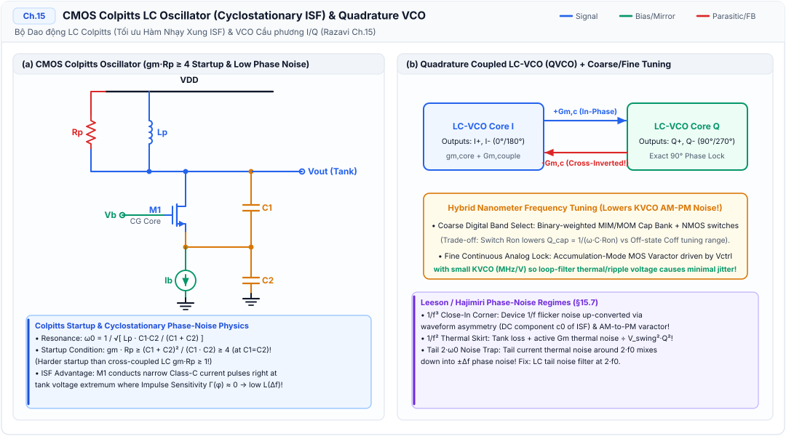

---
{
  "id": "topo-quadrature-vco-and-varactor-tuning",
  "kind": "topology",
  "domain": "sampled-and-clocked",
  "title_vi": "Điều chỉnh Tần số Varactor MOS / Dàn Tụ Chuyển mạch và Bộ Dao động Cầu phương I/Q (Varactor Bank Tuning & Quadrature LC-VCO)",
  "title_en": "Accumulation-Mode MOS Varactors, Coarse Switched-Capacitor Banks, and Quadrature I/Q LC-VCOs",
  "summary": "Kiến trúc điều chỉnh tần số thô–tinh chuẩn công nghiệp và tạo sóng mang cầu phương 90 độ cho máy thu phát vô tuyến: giải phẫu giới hạn diode p+/n-well (PT 15.72, Ví dụ 15.14), cơ chế đơn điệu của varactor MOS chế độ tích lũy trong giếng n, thiết kế dàn tụ chuyển mạch vi sai nhị phân nén KVCO giảm chuyển đổi nhiễu AM-PM, và nguyên lý khóa pha cầu phương hai lõi LC (Parallel/Series QVCO) kèm hiện tượng đa mốt tần số +-90 độ.",
  "diagram": "../../diagrams/colpitts-and-quadrature-vco.svg",
  "razavi_refs": [
    {
      "chapter": 15,
      "section": "15.4, 15.4.1-15.4.2",
      "pages": "630-644",
      "equations": ["15.55", "15.58", "15.60", "15.61", "15.65", "15.69", "15.71", "15.72"]
    }
  ],
  "glossary_codes": [
    "T024",
    "T057",
    "T064",
    "T069",
    "T070",
    "T090",
    "T095",
    "T130",
    "T392",
    "T414",
    "T570",
    "T766",
    "T951",
    "T1004",
    "T2036",
    "T2162",
    "T2163",
    "T2166",
    "T2167",
    "T2168",
    "T2169"
  ],
  "process_agnostic": true,
  "roles": {
    "accumulation_mos_varactor": "Transistor NMOS đặt bên trong giếng n (A-MOS varactor) tạo đặc tuyến C(VGS) đơn điệu trơn tru từ vùng nghèo sang vùng tích lũy để điều chỉnh tinh tần số mà không bị dẫn dòng diode thuận.",
    "differential_switched_cap_bank": "Mảng tụ MIM/MOM trọng số nhị phân đóng cắt qua công tắc NMOS vi sai tâm ảo để chia dải tần rộng thành 2^B phân dải chồng lấp, giúp giảm KVCO đi một bậc độ lớn.",
    "quadrature_coupled_lc_cores": "Hai lõi LC-VCO đối xứng (Core I và Core Q) ghép chéo bất đối xứng (một nhánh nối thẳng cùng dấu, một nhánh đảo chéo dấu) cưỡng bức lệch pha chính xác 90 độ.",
    "coupling_transconductors_mc": "Các cặp transistor ghép pha song song hoặc nối tiếp kiểm soát tỷ số cường độ ghép alpha_c = gm_c / gm_core, quyết định sự đánh đổi giữa sai số pha I/Q và độ suy giảm nhiễu pha."
  },
  "symptoms_addressed": [
    "nonmonotonic-mos-gate-capacitance-causing-pll-positive-feedback-unlock",
    "pn-varactor-forward-conduction-and-heavy-nwell-substrate-parasitic",
    "huge-kvco-at-low-supply-voltage-magnifying-control-ripple-and-am-pm-noise",
    "need-accurate-four-phase-iq-local-oscillator-for-image-reject-rf-transceivers"
  ],
  "limitations": [
    "switched-capacitor-switch-ron-times-coff-product-limits-q-at-mmwave",
    "parallel-qvco-operates-off-tank-resonance-degrading-effective-q-and-phase-noise",
    "bimodal-oscillation-ambiguity-between-lead-and-lag-quadrature-modes",
    "double-inductor-footprint-and-magnetic-pulling-between-i-and-q-tanks"
  ],
  "checklists": [
    "common-mos",
    "oscillator-and-pll",
    "spectre-pss-pnoise",
    "layout-and-matching"
  ]
}
---

## 1. Bản chất Nguyên lý, Sơ đồ Mạch & Vai trò Từng Nhánh Cấu trúc

Trong mọi máy thu phát vô tuyến hiện đại (Zero-IF / Low-IF Weaver / Hartley transceivers) và bộ khôi phục xung nhịp–dữ liệu tốc độ cao (Half-Rate / Quarter-Rate CDR), **bộ dao động điều khiển bằng điện áp** (`voltage-controlled oscillator, VCO` — `T2166`) phải giải quyết đồng thời hai thách thức vật lý hóc búa trên nền CMOS điện áp thấp: **(1) Làm sao mở rộng dải điều chỉnh tần số lên $20\% \sim 45\%$ để phủ kín biến thiên PVT và nhiều băng tần dưới nguồn $V_{DD} \le 1.2\text{ V}$ mà không để độ nhạy điều chỉnh $K_{VCO}$ (`T2167`) phình to biến mọi nhiễu nhỏ thành tạp âm pha?** và **(2) Làm sao sinh ra bốn pha cầu phương chuẩn xác $0^\circ, 90^\circ, 180^\circ, 270^\circ$ (`I+`, `Q+`, `I-`, `Q-`) ở tần số nhiều GHz với sai số pha $< 1^\circ$ mà không đốt công suất gấp bốn lần bằng việc chạy VCO ở $2 f_0$ rồi chia đôi tần số?**



Thẻ kiến trúc này đi sâu vào ba trụ cột kỹ thuật nối tiếp trực tiếp từ Razavi §15.4.2 đến thực hành RFIC công nghiệp:

1. **Tiến hóa Vật lý Linh kiện Biến dung: Từ Diode Tiếp giáp $p^+/n\text{-well}$ đến Varactor MOS Chế độ Tích lũy (`MOS varactor` — `T2168`, §15.4.2, Hình 15.53–15.59)**:
   - *Bốn tử huyệt của Diode Tiếp giáp $p^+/n\text{-well}$ thả nổi (Hình 15.53–15.56)*: Để gắn varactor vào hai nút khung cộng hưởng $X, Y$ đang có thế DC bằng $V_{DD}$, không thể dùng diode $n^+/p\text{-sub}$ bị nối cứng cực dương xuống đất mà buộc phải cấy vùng $p^+$ trong một **giếng n** (`N-well` — `T130`, Hình 15.54b). Cấu trúc này vấp phải 4 rào cản nặng nề: (i) Điện trở suất cao của giếng n tạo điện trở nối tiếp $R_S$ lớn làm sụt $Q$ của khung (buộc phải bao vòng $n^+$ bốn phía quanh các đảo $p^+$ nhỏ ghép song song như Hình 15.56); (ii) Toàn bộ đáy giếng n tạo điện dung ký sinh cố định khổng lồ $C_n$ xuống đế $p$ bóp nghẹt dải điều chỉnh (có thể lách bằng cặp chéo PMOS dao động quanh $0\text{ V}$ để nối cực $p^+$ vào khung và treo giếng n vào $V_{cont}$, Hình 15.58); (iii) Hệ số mũ vùng nghèo $m \approx 0.3 \sim 0.4$ cho tỉ số $C_{\max}/C_{\min}$ nhỏ ở áp thấp; và (iv) Nếu biên độ dao động đỉnh $A$ lớn khiến $V_{cont} > V_X(t)_{\min} + 0.3\text{ V} = V_{DD} - A + 0.3\text{ V}$, diode bị **phân cực thuận** kẹp cụt biên độ và phá nát nhiễu pha!
   - *Tại sao MOSFET thường có đặc tuyến $C\text{–}V$ không đơn điệu và Cách hóa giải bằng A-MOS Varactor (Hình 15.59)*: Một NMOS thường đặt trong đế $p$ khi quét $V_{GS}$ từ âm sang dương đi qua 3 miền: *Tích lũy* ($C \approx C_{ox}$) $\to$ *Nghèo* ($C$ tụt xuống đáy $C_{ox} \parallel C_{\text{dep}}$) $\to$ *Nghịch đảo mạnh* ($C$ tăng ngược trở lại $C_{ox}$!). Đường cong chữ U không đơn điệu này khiến một tần số ứng với hai mức $V_{cont}$ có dấu $K_{VCO}$ trái ngược nhau, làm vòng PLL khóa chết về biên! Giải pháp thiên tài (Hình 15.59b–c): đặt cực nguồn/máng $n^+$ của transistor cổng n-poly ngay bên trong **giếng n (`n-well`)** thay vì đế $p$! Khi $V_G > V_{S,D}$ (với $S, D$ nối chung thành cực điều khiển $V_{cont}$), điện tử đa số trong giếng n hút thẳng lên bề mặt dưới oxit cổng tạo **chế độ tích lũy** ($C_{\max} = W L C_{ox}$); khi $V_G < V_{S,D}$, điện tử bị đẩy lùi tạo **vùng nghèo** ($C_{\min}$), và vì hai đầu $S/D$ là $n^+$ chứ không phải $p^+$, lớp nghịch đảo lỗ trống rất khó hình thành ở tần số GHz — cho ra đường cong $C(V_{GS})$ **đơn điệu chặt**, tỉ số $C_{\max}/C_{\min} \approx 2.5 \sim 3.5$ ngay trong khoảng $\pm 0.5\text{ V}$ và **không bao giờ dẫn dòng thuận diode**!
2. **Kiến trúc Điều chỉnh Lai ghép Thô–Tinh (`Coarse Switched-Capacitor Bank + Fine Varactor`)**:
   - Tách tổng điện dung thay đổi của khung LC thành **Dàn tụ chuyển mạch nhị phân $B$-bit** (gồm các nhánh tụ tuyến tính `MOM`/`MIM` đóng ngắt bằng công tắc MOSFET ở trạng thái số BẬT/TẮT hoàn toàn) để chọn phân dải tần số và bù sai số quy trình/nhiệt độ, song song với một **A-MOS Varactor nhỏ** chỉ quét dải tần tinh chỉnh hẹp $\Delta f_{\text{fine}}$, cắt giảm $K_{VCO}$ từ hàng trăm $\text{MHz/V}$ xuống chỉ còn $20 \sim 60\text{ MHz/V}$!
3. **Bộ Dao động Cầu phương Ghép Hai Lõi LC (`Quadrature LC-VCO — QVCO`)**:
   - Đặt hai lõi một cửa LC-VCO giống hệt nhau (`Core I` tạo $V_{I+}, V_{I-}$ và `Core Q` tạo $V_{Q+}, V_{Q-}$). Nếu nối `Core I` truyền sang `Core Q` theo pha **thuận (không đảo)** ($0^\circ$) và nối `Core Q` hồi tiếp ngược về `Core I` theo pha **đảo chéo dây** ($180^\circ$), tổng dịch pha quanh vòng ghép hai lõi bắt buộc thỏa mãn $2\Delta\theta + 180^\circ = 360^\circ k \implies \Delta\theta = \pm 90^\circ$! Hai lõi tự động khóa cứng vào nhau ở trạng thái lệch pha vuông góc cầu phương mà không cần bộ chia tần số tiêu tốn công suất ở $2 f_0$ hay bộ lọc đa pha RC suy hao lớn (`polyphase filter`).

---

## 2. Hệ Phương trình Cốt lõi & Tư duy "Nhìn Mạch Đọc Nhanh" (Analysis by Inspection)

### 2.1. Giới hạn Dải Điều chỉnh từ Ký sinh Cố định & Luật Đánh đổi $Q_{\text{bank}} \cdot \text{TR}$ của Dàn Tụ Chuyển mạch
Từ công thức diode biến dung (Phương trình 15.72: $C_{\text{var}}(V_R) = \frac{C_0}{(1 + V_R/\phi_B)^m}$, Ví dụ 15.14 cho thấy ngay cả khi không có tụ ký sinh cố định và quét $V_R = 0 \to 2\text{ V}$ với $\phi_B = 0.7\text{ V}, m = 0.35$, dải điều chỉnh chỉ đạt $27\%$). Trong mạch thực tế (§15.4.2 tr. 643), mỗi nút khung LC luôn gánh ba thành phần điện dung không đổi tổng cộng là $C_{\text{fix}}$: (1) tụ tự thân của cuộn cảm xoắn ốc $C_{L,\text{par}}$, (2) tụ của cặp ghép chéo gồm $C_{GS} + C_{DB} + \mathbf{2 C_{GD}}$ *(hệ số Miller bằng đúng $2$ do $A_v = -1$ giữa hai nút ngược pha!)* cộng tụ tải bộ đệm ngõ ra $C_{\text{buf}}$, và (3) tụ tắt của dàn chuyển mạch.

Xét một nhánh đơn vị trong **Dàn tụ chuyển mạch vi sai tâm ảo** (hai tụ tuyến tính $C_u$ nối tiếp kẹp một công tắc NMOS trung tâm $M_{sw}$ chiều rộng $W_{sw}$ đặt ngay tại mặt phẳng đối xứng đất ảo vi sai!):
- **Vì sao công tắc vi sai trung tâm thắng tuyệt đối hai công tắc đơn nối đất?** Trong cấu hình đơn cực gồm hai công tắc nối đất hai bên, hai điện trở $R_{on}$ mắc **nối tiếp** nhau trên đường dòng vi sai ($R_{\text{diff}} = 2 R_{on}$). Khi chập thành **một công tắc duy nhất $M_{sw}$ nối giữa hai tấm trong của hai tụ $C_u$**: ở chế độ vi sai, tâm của $M_{sw}$ là đất ảo hoàn hảo, mỗi nửa mạch chỉ thấy điện trở **$R_{on}/2$**! Như vậy với cùng kích thước transistor (cùng tụ ký sinh tắt $C_{\text{off}}$), cấu trúc công tắc vi sai giảm **4 lần điện trở tổn hao** (tức tăng **4 lần $Q_{\text{cap,on}}$**)!
- **Bất biến tích số hằng số thời gian công tắc $\tau_{sw} = R_{on} C_{\text{off}}$**: Một công tắc MOSFET ở tiến trình cho trước có tích số công nghệ gần như không đổi theo chiều rộng $W_{sw}$ là $\tau_{sw} = R_{on} C_{\text{off}}$ (điển hình $\tau_{sw} \approx 120 \sim 250\text{ fs}$ ở `65nm`/`45nm`). Khi công tắc ĐÓNG (`ON`), hệ số phẩm chất nhánh tụ tại $\omega_0$ là $Q_{\text{on}} = \frac{1}{\omega_0 (C_u / 2) R_{on}}$; khi công tắc MỞ (`OFF`), điện dung còn sót lại do $C_{DS} + C_{GD}/2 + C_{GS}/2$ ghép nối tiếp $C_u/2$ xấp xỉ $C_{\text{min,branch}} \approx C_{\text{off}}$ (khi $C_u \gg C_{\text{off}}$). Tỉ số điện dung bật/tắt $r_C = \frac{C_{\text{on}}}{C_{\text{off}}} \approx \frac{C_u / 2}{C_{\text{off}}}$ bị khóa cứng với $Q_{\text{on}}$ bởi phương trình bất biến vàng:

$$Q_{\text{on}} \cdot (r_C - 1) \approx \frac{1}{\omega_0 R_{on} C_{\text{off}}} = \frac{1}{\omega_0 \tau_{sw}}$$

*Đọc nhanh thiết kế*: Ở $f_0 = 5\text{ GHz}$ với $\tau_{sw} = 200\text{ fs}$, vế phải bằng $\frac{1}{2\pi \times 5\text{ GHz} \times 200\text{ fs}} \approx 15.9$. Nếu bạn tham chọn tỉ số bật/tắt $r_C = 5$ để lấy dải điều chỉnh cực rộng, $Q_{\text{on}}$ của dàn tụ sụt thảm hại xuống $15.9 / 4 \approx 4.0$, bóp chết $Q$ của cuộn cảm! Để giữ $Q_{\text{on}} \ge 25$ (không làm hỏng $Q_L = 12$), bắt buộc giới hạn $r_C$ hoặc phân cực ngược nhẹ cực nguồn/máng công tắc ở trạng thái `OFF` lên $V_{DD}$ trong khi cổng về $0\text{ V}$!

### 2.2. Hệ Phương trình Khóa Pha Cầu phương & Dịch Tần số Lệch Cộng hưởng của QVCO
Xét **Parallel-Coupled QVCO (P-QVCO)** gồm hai lõi giống hệt nhau: mỗi lõi có cặp ghép chéo chính hỗ dẫn $g_m$ và một cặp transistor ghép pha phụ mắc song song có hỗ dẫn $g_{mc} = \alpha_c g_m$ (với hệ số cường độ ghép $0 < \alpha_c \le 1$). Gọi các phasor sóng cơ bản xác lập là $\tilde{V}_I = V_0 e^{j0}$ và $\tilde{V}_Q = V_0 e^{j\theta}$.
- Dòng tổng bơm vào khung cộng hưởng của `Core I` là tổng dòng từ cặp chéo bản thân và dòng từ cặp ghép nhận áp từ `Core Q` (nối đảo dấu): $\tilde{I}_I = G_m \tilde{V}_I - G_{mc} \tilde{V}_Q = G_m V_0 (1 - \alpha_c e^{j\theta})$.
- Dòng tổng bơm vào khung cộng hưởng của `Core Q` nhận áp không đảo từ `Core I`: $\tilde{I}_Q = G_m \tilde{V}_Q + G_{mc} \tilde{V}_I = G_m V_0 e^{j\theta} (1 + \alpha_c e^{-j\theta})$.
Để hai lõi cùng dao động ở cùng một tần số góc $\omega_{\text{QVCO}}$ và cùng biên độ trên hai khung LC giống hệt nhau có dẫn nạp $Y_{\text{tank}}(j\omega) = \frac{1}{R_P} + j\left(\omega C_P - \frac{1}{\omega L_P}\right)$, tỉ số $\tilde{I}_I / \tilde{V}_I$ và $\tilde{I}_Q / \tilde{V}_Q$ phải bằng nhau và bằng $Y_{\text{tank}}(j\omega_{\text{QVCO}})$:

$$1 - \alpha_c e^{j\theta} = 1 + \alpha_c e^{-j\theta} \iff e^{j\theta} + e^{-j\theta} = 2\cos\theta = 0 \implies \theta = \pm 90^\circ \;\; \left(\pm \frac{\pi}{2}\right)$$

Thay $\theta = \pm 90^\circ$ ($e^{\pm j90^\circ} = \pm j$) ngược lại phương trình cân bằng dẫn nạp:

$$Y_{\text{tank}}(j\omega_{\text{QVCO}}) = \frac{1}{R_P} + j\left(\omega_{\text{QVCO}} C_P - \frac{1}{\omega_{\text{QVCO}} L_P}\right) = G_m \mp j \alpha_c G_m$$

Từ phần thực suy ra $G_m = 1/R_P$ ở xác lập; thế vào phần ảo và dùng xấp xỉ dải hẹp quanh $\omega_0 = 1/\sqrt{L_P C_P}$ ($\omega C_P - \frac{1}{\omega L_P} \approx \frac{2 Q_{\text{tank}}}{R_P}\frac{\Delta\omega}{\omega_0}$), ta phát hiện ra hai hệ quả vật lý sâu sắc bậc nhất của QVCO:
1. **Dịch tần số rời khỏi đỉnh cộng hưởng & Đa mốt Lưỡng trị ($\pm 90^\circ$ Bimodality)**: Do dòng ghép từ lõi kia bơm vuông góc pha ($\pm 90^\circ$) vào dòng bản thân, tổng dòng đi vào mỗi khung LC bị lệch pha một góc $\phi_c = \tan^{-1}(\alpha_c)$! Để khép kín điều kiện pha Barkhausen $0^\circ$, khung LC buộc phải **trượt lệch khỏi tần số cộng hưởng tự nhiên $\omega_0$** một lượng:

$$\omega_{\text{QVCO}} \approx \omega_0 \left(1 \mp \frac{\alpha_c}{2 Q_{\text{tank}}}\right)$$

   Trong thực tế, bất đối xứng ký sinh ở tần số cao (trễ pha đường dây và $C_{GS}$ của cặp ghép $M_c$) sẽ làm một trong hai mốt ($+90^\circ$ hoặc $-90^\circ$) có tổn hao thấp hơn mốt kia và tự được chọn — nhưng nếu ký sinh gần cân bằng, mạch có thể nhảy mốt gây đảo ngược biên dải ảnh (sideband inversion)!
2. **Sự đánh đổi nghịch đảo giữa Sai số Pha Cầu phương ($\Delta\phi_{IQ}$) và Suy giảm Nhiễu Pha**: Khi hai khung LC lệch cộng hưởng nhau một lượng nhỏ $\frac{\Delta\omega_0}{\omega_0} = \frac{1}{2}\frac{\Delta C}{C}$ do mismatch Pelgrom, sai số lệch khỏi góc vuông $90^\circ$ tỉ lệ nghịch với $\alpha_c$, trong khi hệ số suy giảm phẩm chất khung (và độ dâng nhiễu pha $1/f^2, 1/f^3$) lại tăng mạnh theo $(1 + \alpha_c^2)$:

$$|\Delta\phi_{IQ}| \approx \frac{Q_{\text{tank}}}{\alpha_c} \cdot \left|\frac{\Delta\omega_0}{\omega_0}\right| = \frac{Q_{\text{tank}}}{2\alpha_c}\left|\frac{\Delta L}{L} + \frac{\Delta C}{C}\right| \;\; [\text{rad}], \qquad \text{Penalty}_{\text{PN,P-QVCO}} \propto (1 + \alpha_c^2)$$

Để giải thoát mâu thuẫn này, cấu trúc **Top-/Bottom-Series QVCO (S-QVCO)** xếp chồng transistor ghép nối tiếp dưới dạng cascode với cặp chéo chính thay vì mắc song song, giảm mạnh dòng nhiễu phun trực tiếp vào khung LC ở điểm cắt không và cải thiện nhiễu pha $5 \sim 8\text{ dB}$ cho cùng độ chính xác pha $< 1^\circ$ (đổi lại tốn thêm một tầng dư địa điện áp $V_{DS,\min}$).

### 2.3. Ví dụ Định lượng Thiết kế Phân bổ Dàn Tụ 4-bit + A-MOS Varactor cho QVCO $4.0\text{ GHz}$
Thiết kế bộ tạo dao động nội I/Q `65nm` ($V_{DD} = 1.2\text{ V}$) tâm $f_0 = 4.0\text{ GHz}$, phủ dải tần $3.6\text{ GHz} \to 4.4\text{ GHz}$ ($\text{TR} = 20\%$, $\Delta f_{\text{tot}} = 800\text{ MHz}$) với cuộn cảm vi sai mỗi lõi $L_{\text{diff}} = 1.2\text{ nH}$ ($Q_L = 14$) và yêu cầu $K_{VCO} \le 90\text{ MHz/V}$ để nén chuyển đổi AM-to-PM:
1. **Tính ngân sách điện dung vi sai toàn phần tại hai đầu biên tần số**:
   - Tại $f_{\max} = 4.4\text{ GHz}$: $C_{\text{tot,min}} = \frac{1}{(2\pi \times 4.4\text{ GHz})^2 \times 1.2\text{ nH}} = 1.090\text{ pF}$.
   - Tại $f_{\min} = 3.6\text{ GHz}$: $C_{\text{tot,max}} = \frac{1}{(2\pi \times 3.6\text{ GHz})^2 \times 1.2\text{ nH}} = 1.629\text{ pF}$.
   - Lượng điện dung cần thay đổi: $\Delta C_{\text{tot}} = 1.629 - 1.090 = 539\text{ fF}$.
2. **Định cỡ dàn tụ chuyển mạch vi sai 4-bit ($16$ trạng thái, $15$ bước nhảy)**:
   - Bước nhảy trung bình mỗi LSB ở giữa dải: $\Delta C_{\text{LSB}} = \frac{539\text{ fF}}{15} \approx 36\text{ fF}$ vi sai (tương ứng hai tụ MOM $C_u = 72\text{ fF}$ nối tiếp qua công tắc vi sai trung tâm, bước nhảy tần số trung bình $\Delta f_{\text{step}} \approx \frac{800\text{ MHz}}{15} \approx 53.3\text{ MHz}$).
   - Chọn công tắc trung tâm cho bit LSB có $\tau_{sw} = 180\text{ fs}$ và $Q_{\text{on}} = 30$ tại $4.4\text{ GHz}$: $R_{on,\text{LSB}} = \frac{1}{2\pi \times 4.4\text{ GHz} \times 36\text{ fF} \times 30} \approx 33.5\,\Omega \implies C_{\text{off,LSB}} = \frac{180\text{ fs}}{33.5\,\Omega} \approx 5.4\text{ fF}$. Tổng tụ tắt của cả dàn 15 đơn vị là $15 \times 5.4\text{ fF} \approx 81\text{ fF}$ (chừa dư $1.090\text{ pF} - 81\text{ fF} \approx 1.01\text{ pF}$ thoải mái cho cuộn cảm, cặp chéo, cặp ghép QVCO, bộ đệm và $C_{\text{var,min}}$!).
3. **Định cỡ A-MOS Varactor tinh chỉnh có hệ số chồng lấp $1.6\times$**:
   - Dải tần quét của varactor trên cửa sổ tuyến tính $\Delta V_{cont} = 1.0\text{ V}$ (từ $0.1\text{ V}$ đến $1.1\text{ V}$): $\Delta f_{\text{fine}} = 1.6 \times 53.3\text{ MHz} \approx 85\text{ MHz}$.
   - Suy ra $\Delta C_{\text{var}} \approx 2 C_{\text{tot}} \frac{\Delta f_{\text{fine}}}{f_0} \approx 2 \times 1.35\text{ pF} \times \frac{85}{4000} \approx 57.4\text{ fF}$, đạt độ nhạy trung bình $K_{VCO} \approx \mathbf{85\text{ MHz/V}}$, bảo đảm không bao giờ hở rãnh tần số ngay cả khi nhiệt độ trôi $100\,^\circ\text{C}$ sau lúc khóa băng thô!

---

## 3. Bất biến Cấu trúc & Các Bẫy Lỗi Kinh điển (Structural Invariants & Traps)

- **[INV-VAR-01] Bất biến Cấm Treo Nổi Nút Trong của Dàn Tụ Chuyển mạch (`DC Biasing of Switched-Cap Nodes`)**: Hai bản cực trong của cặp tụ $C_u$ nối vào cực nguồn/máng công tắc trung tâm $M_{sw}$ hoàn toàn cách ly DC với khung LC! Nếu quên gắn hai điện trở lớn ($R_{\text{bias}} \approx 20 \sim 50\text{ k}\Omega$) phân cực DC cho hai nút này: khi công tắc mở (`OFF`, cổng $= 0\text{ V}$), sóng lớn từ khung LC truyền qua $C_u$ sẽ chỉnh lưu qua diode nguồn/máng–đế đẩy thế DC lơ lửng âm xuống hoặc làm công tắc tự bật dẫn một phần nửa chu kỳ âm! Quy tắc vàng: khi `ON`, cổng $= V_{DD}$ và hai đầu S/D phải được điện trở kéo về $0\text{ V}$ (để $V_{GS,\text{on}} = V_{DD}$ tối đa); khi `OFF`, cổng $= 0\text{ V}$ và hai đầu S/D được một cổng đảo nhỏ kéo qua điện trở lớn lên $V_{DD}$ (để $V_{GS,\text{off}} = -V_{DD}$, khóa chặt công tắc trước biên độ sóng lớn mà không vi phạm SOA nếu dùng thiết bị phù hợp!).
- **[INV-QVCO-02] Bất biến Định cỡ Trọng số Nhị phân Nặng dần ở Đầu Tần số Cao ($\Delta f \propto \Delta C / C^{3/2}$)**: Vì đạo hàm $\left|\frac{df}{dC}\right| = \frac{1}{4\pi\sqrt{L} C^{3/2}}$ lớn hơn nhiều ở đầu tần số cao ($C$ nhỏ) so với đầu tần số thấp ($C$ lớn), cùng một tụ đơn vị $\Delta C_u$ sẽ tạo bước nhảy $\Delta f_{\text{step}}$ ở $f_{\max}$ lớn gấp $(f_{\max}/f_{\min})^3$ lần bước nhảy ở $f_{\min}$! Do đó điều kiện chồng lấp varactor $\Delta f_{\text{fine}}(f_{\max}) > \Delta f_{\text{step}}(f_{\max})$ bắt buộc phải kiểm tra tại **mã tần số cao nhất (góc `FF -40°C`)**!
- **[TRAP-VAR-01] Bẫy Chuyển đổi Biên độ sang Pha (AM-to-PM Conversion) trên Varactor**: Điện dung trung bình chu kỳ $C_{\text{avg}}(A, V_{cont})$ của varactor là hàm phi tuyến của cả biên độ dao động $A$ trên khung LC! Do đó mọi nhiễu biên độ tần số thấp (nhiễu $1/f$ và nhiễu nhiệt của nguồn dòng đuôi $I_{SS}$ hoặc nhiễu gợn trên bộ ổn áp LDO) làm rung nhẹ biên độ $\Delta A(t) \implies$ làm rung điện dung trung bình $\Delta C_{\text{avg}}(t) \implies$ điều tần trực tiếp VCO sinh tạp âm pha $1/f^3$ dữ dội ngay tại giữa dải nơi $K_{VCO}$ đạt cực đại!
- **[TRAP-QVCO-02] Bẫy Kéo Tần số Từ trường (Magnetic Coupling Pulling) giữa Hai Cuộn cảm I và Q**: Nếu đặt hai cuộn cảm xoắn ốc của `Core I` và `Core Q` sát nhau mà không đối xứng hoặc chung chiều quấn bất đối xứng trên layout, hệ số hỗ cảm ký sinh $k_m$ giữa hai cuộn cảm sẽ tiêm thẳng điện áp cảm ứng lệch pha vào nhau, gây sai số pha cầu phương cố định $3^\circ \sim 8^\circ$ không thể sửa bằng dòng ghép! Phải đặt hai cuộn cảm cách xa hoặc dùng cấu trúc cuộn cảm số 8 (figure-8) khử từ trường xa và bố cục đối xứng trục gương tuyệt đối.

---

## 4. Lộ trình Nâng cấp Cấu trúc & Bát giác Đánh đổi (Upgrade Paths & Design Octagon)

Trong `concept-analog-design-octagon`, kiến trúc điều chỉnh và tạo pha cầu phương liên kết chặt chẽ các khối RF và PLL:

- **Nền tảng kết nối từ**: Xây dựng trực tiếp trên các lõi một cửa của `topo-colpitts-hartley-and-one-port-lc-oscillators` và mô hình VCO cơ sở `topo-vco-tuning-and-phase-noise`, đồng thời kế thừa vật lý mặt cắt tụ điện/giếng từ `concept-integrated-resistors-and-capacitors-cmos` và `law-cmos-wells-and-latchup-guard-rings`.
- **Nâng cấp kiểm soát nhiễu pha & đóng vòng tổng hợp tần số**: Phân tích chi tiết cơ chế chuyển đổi AM-to-PM và tối ưu hàm nhạy xung ISF tại `law-oscillator-phase-noise-leeson-and-isf`, sau đó đưa tín hiệu vào bộ chia tiền định tỷ lệ kép trong `topo-frequency-synthesizer-integer-fractional-n` với bộ lọc vòng thiết kế theo `tech-cp-pll-third-order-loop-filter-synthesis`.
- **Các phương án thay thế khi chọn kiến trúc tạo pha $90^\circ$ (I/Q Generation Trade-off)**:

| Kiến trúc Tạo Sóng mang I/Q | Sai số Pha I/Q Điển hình | Công suất & Diện tích Silicon | Nhiễu Pha & Băng thông Tần số |
| :--- | :--- | :--- | :--- |
| **VCO tại $2 f_0$ + Bộ chia $\div 2$ Chốt CML** | Rất tốt ($0.5^\circ \sim 1.5^\circ$, nhạy lệch chu kỳ duty-cycle $2 f_0$) | Chỉ tốn **1 cuộn cảm** nhỏ ở $2 f_0$, nhưng bộ chia CML ở $2 f_0$ đốt nhiều dòng | Nhiễu pha tốt (chia 2 giảm $6\text{ dB}$), khả thi khi $2 f_0 \ll f_{\max}$ của tiến trình. |
| **VCO tại $f_0$ + Bộ lọc Đa pha RC (Polyphase Filter)** | Tốt trong dải hẹp ($1^\circ \sim 2^\circ$ nếu ghép 2–3 tầng RC) | 1 cuộn cảm + mạng R-C diện tích nhỏ | Suy hao biên độ lớn ($3 \sim 6\text{ dB}$/tầng) đòi hỏi bộ đệm công suất lớn kéo lại biên độ, nâng sàn nhiễu xa. |
| **Parallel-Coupled QVCO ($P\text{-QVCO}$ tại $f_0$)** | Tốt ($0.8^\circ \sim 2^\circ$ với $\alpha_c \approx 0.3 \sim 0.5$) | Tốn **2 cuộn cảm** ở $f_0$; chạy trực tiếp ở $f_0$ (hữu ích khi $2 f_0$ quá cao!) | Xấu hơn lõi đơn $3 \sim 6\text{ dB}$ do lệch cộng hưởng khung & nhiễu cặp ghép song song. |
| **Series-Coupled / Phase-Shifted QVCO ($S\text{-QVCO}$)** | Xuất sắc ($< 1^\circ$ khi chèn dịch pha cổng ghép) | 2 cuộn cảm; cần thêm khoảng dự trữ áp cho tầng cascode ghép | Gần chạm nhiễu pha lý tưởng của 2 lõi ghép (cải thiện $3\text{ dB}$ công suất tín hiệu kép!), không bị đa mốt. |

---

## 5. Thích ứng Đa Tiến trình (90nm / 65nm / 45nm) & Cách Kiểm chứng trong Cadence / Spectre

### 5.1. Quy tắc Thiết kế Thực tế ở `90nm` / `65nm` / `45nm`
1. **Chọn Oxit Cổng cho A-MOS Varactor và Công tắc Dàn Tụ**: Ở `65nm`/`45nm`, oxit cổng mỏng chuẩn (`1.0V core`) có dòng rò xuyên hầm cực cổng ($I_G$, xem `concept-bsim4-and-finfet-nanometer-models`) đáng kể trên diện tích lớn. Vì đường $V_{cont}$ nối trực tiếp ra bộ lọc vòng PLL trở kháng cực cao, **bắt buộc kiểm tra dòng rò cổng của A-MOS Varactor $< 1\text{ nA}$ ở $125\,^\circ\text{C}$** (hoặc nối bản cổng của varactor vào nút khung LC có đường DC xuống đất/nguồn qua cuộn cảm, còn chân giếng n `S/D/Bulk` nối vào $V_{cont}$ để dòng rò bằng $0$!). Ngược lại, công tắc trung tâm $M_{sw}$ của dàn tụ chuyển mạch nên dùng transistor lõi kênh ngắn `LVT / SVT` (như $L = 60\text{ nm}$ ở `65nm`, bọc trong `Deep N-Well`) để đạt tích $\tau_{sw} = R_{on} C_{\text{off}}$ nhỏ nhất!
2. **Thuật toán Tự động Khóa Băng Thô (Automatic Frequency Calibration — AFC)**: Trước khi đóng vòng tương tự của CP-PLL, mạch số giữ tạm $V_{cont} = V_{DD}/2$, dùng bộ đếm tần số so sánh $f_{DIV}$ với $f_{REF}$ theo thuật toán tìm kiếm nhị phân (SAR $B$ bước mất chỉ vài microgiây!) để chọn mã dàn tụ gần nhất rồi mới trả quyền tinh chỉnh liên tục cho bơm điện tích quanh đúng tâm $V_{DD}/2$.

### 5.2. Kịch bản Kiểm chứng Dàn Tụ, Đặc tuyến $K_{VCO}$ và Độ Lệch Cầu phương I/Q trong SpectreRF
```spice
// SpectreRF Parametric PSS Deck kiem chung Ho duong cong dieu chinh Dan tu + Sai so pha QVCO
simulator lang=spectre
parameters vcont_val=0.6 b3=0 b2=1 b1=0 b0=1

// Nguon dieu khien tinh chinh va cac bit nhị phan dan tu chuyen mach (0 V hoac VDD)
Vctrl (vcont 0) vsource dc=vcont_val
Vb0   (ctrl_b0 0) vsource dc=b0*1.2
Vb1   (ctrl_b1 0) vsource dc=b1*1.2
Vb2   (ctrl_b2 0) vsource dc=b2*1.2
Vb3   (ctrl_b3 0) vsource dc=b3*1.2

// Kich moi uu tien mot chieu pha (+90 deg) de kiem tra tinh on dinh đơn mot cua QVCO
Iinit_I (vip vin) isource type=pulse val0=0 val1=40u delay=20p rise=15p fall=15p width=40p

// Chay Harmonic Balance / Shooting PSS cho QVCO
pss_qvco pss fund=4.0G harms=13 autotstab=yes tstab=80n oscnode=vip oscref=vin \
    method=traponly errpreset=conservative

// Trong ADE Assembler / OCEAN sau khi chay PSS, do chinh xac sai so pha va bien do I/Q tai hai co ban:
// phase_err_deg = abs( phase(harmonic(v("/vip") - v("/vin") 1)) - phase(harmonic(v("/vqp") - v("/vqn") 1)) ) - 90.0
// amp_mismatch_dB = 20 * log10( abs(harmonic(v("/vip") - v("/vin") 1)) / abs(harmonic(v("/vqp") - v("/vqn") 1)) )
// YEU CAU SIGN-OFF (sau Monte Carlo 200 mau + PEX): |phase_err_deg| < 1.0 deg va |amp_mismatch_dB| < 0.2 dB!
```

---

## 6. Mốc Đối chiếu Sách Razavi & Thuật ngữ Chuẩn CLB

- **Sách gốc Razavi (2nd Ed.)**: Chương 15, Mục `15.4` (*Voltage-Controlled Oscillators*, trang 630–633, Phương trình `15.55`–`15.61`, Ví dụ `15.9`), Mục `15.4.1` (*Tuning in Ring Oscillators*, trang 633–641, Phương trình `15.62`–`15.71`, Ví dụ `15.10`–`15.13`), và trọng tâm Mục `15.4.2` (*Tuning in LC Oscillators*, trang 641–644, Hình `15.53`–`15.59`, Phương trình `15.72`, Ví dụ `15.14`, Bài tập `15.22`–`15.26`).
- **Đối chiếu Thuật ngữ Chuẩn CLB Vi Mạch (`terms-vi-en.json`)**:
  - `T2166` (`voltage-controlled oscillator, VCO`): **bộ dao động điều khiển bằng điện áp**; `T2167` (`VCO gain, KVCO`): **độ lợi VCO (độ nhạy điều chỉnh tần số $K_{VCO}$)**.
  - `T2168` (`MOS varactor / accumulation-mode varactor`): **tụ biến dung MOS (varactor chế độ tích lũy)**; `T414` (`Capacitance-voltage characteristic`): **đặc tuyến điện dung–điện áp (C–V)**.
  - `T2036` (`pn-junction diode`): **diode tiếp giáp p–n**; `T130` (`N-well`): **giếng n**.
  - `T570` (`differential phases`): **các pha vi sai**; `T766` (`in-phase`): **cùng pha**; `T1004` (`phase shift`): **độ dịch pha**.
