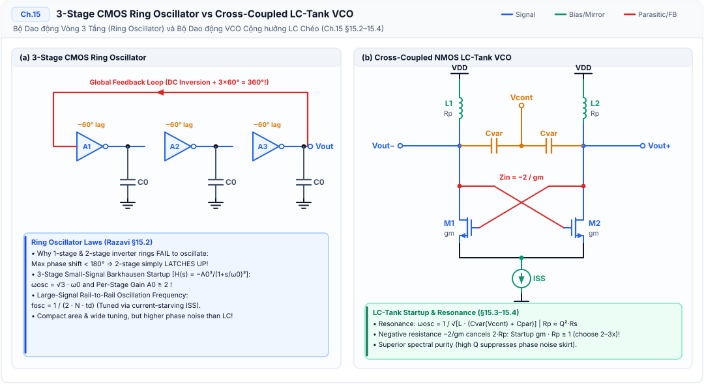

---
{
  "id": "topo-ring-oscillator",
  "kind": "topology",
  "domain": "sampled-and-clocked",
  "title_vi": "Mạch dao động vòng đơn cực và vi sai (CMOS Ring Oscillator)",
  "title_en": "Single-Ended and Differential CMOS Ring Oscillators",
  "summary": "Cấu trúc tạo dao động tuần hoàn dùng chuỗi tầng khuếch đại ghép vòng thỏa tiêu chuẩn Barkhausen: giải mã vì sao vòng 1 tầng thất bại về pha, vòng 2 tầng chốt cứng một chiều, vòng 3 tầng dao động tại sqrt(3)*w0 với độ lợi tối thiểu A0 >= 2, định luật trễ tín hiệu lớn f_osc = 1/(2*N*TD) và kỹ thuật đảo chéo vi sai cho số tầng chẵn.",
  "diagram": "../../diagrams/ring-and-lc-oscillators.svg",
  "razavi_refs": [
    {
      "chapter": 15,
      "section": "15.1",
      "pages": "607-609",
      "equations": ["15.1", "15.2", "15.3", "15.4", "15.5"]
    },
    {
      "chapter": 15,
      "section": "15.2",
      "pages": "609-618",
      "equations": ["15.6", "15.7", "15.8", "15.9", "15.10", "15.14", "15.15", "15.16", "15.17", "15.18", "15.24", "15.26"]
    }
  ],
  "glossary_codes": [
    "T019",
    "T023",
    "T024",
    "T042",
    "T051",
    "T066",
    "T069",
    "T086",
    "T094",
    "T095",
    "T196",
    "T528",
    "T678",
    "T854",
    "T951",
    "T1184",
    "T1419",
    "T1601",
    "T1642",
    "T2028"
  ],
  "process_agnostic": true,
  "roles": {
    "delay_gain_stages": "Chuỗi N tầng nguồn chung (CS), cổng đảo CMOS hoặc cặp vi sai nối tiếp tích lũy đủ dịch pha phụ thuộc tần số 180 độ tại tần số hữu hạn.",
    "dc_negative_feedback_inversion": "Số lẻ lần đảo pha một chiều (hoặc một cặp dây đan chéo trong vòng vi sai chẵn tầng) giữ hồi tiếp âm ở tần số gần 0 để chống chốt cứng (latch-up).",
    "amplitude_limiting_mechanism": "Sự bão hòa phi tuyến tín hiệu lớn (chuyển hướng hoàn toàn dòng đuôi ISS hoặc chạm biên VDD/GND) kéo các cực từ nửa mặt phẳng phải (RHP) về trục ảo jw.",
    "tail_current_and_load": "Nguồn dòng đuôi ISS và tải điện trở/PMOS định chuẩn dải dao động điện áp (voltage swing) và điểm làm việc trong cấu trúc vòng vi sai."
  },
  "symptoms_addressed": [
    "need-compact-inductorless-on-chip-clock-generator",
    "multiphase-quadrature-clock-generation",
    "oscillator-dc-latchup-in-even-stage-single-ended-loop",
    "insufficient-phase-shift-in-one-or-two-pole-feedback-loop"
  ],
  "limitations": [
    "inferior-phase-noise-and-jitter-compared-to-lc-tank",
    "high-frequency-sensitivity-to-vdd-and-pvt-in-inverter-rings",
    "startup-failure-if-per-stage-small-signal-gain-below-threshold",
    "metastable-dc-equilibrium-in-noiseless-transient-simulation"
  ],
  "checklists": [
    "common-mos",
    "oscillator-and-pll",
    "feedback-and-stb",
    "layout-and-matching"
  ]
}
---

## 1. Bản chất Nguyên lý, Sơ đồ Mạch & Vai trò Từng Nhánh Cấu trúc

Một mạch dao động (oscillator) tạo ra tín hiệu tuần hoàn bền vững mà không cần tín hiệu kích thích đầu vào — về bản chất động học, nó chính là một hệ thống hồi tiếp âm (negative-feedback system) được thiết kế cố ý mất ổn định tại một tần số xác định $\omega_0$. Xét hệ hồi tiếp âm đơn vị có hàm truyền vòng kín:

$$\frac{V_{out}}{V_{in}}(s) = \frac{H(s)}{1 + H(s)}$$

Nếu tại $s = j\omega_0$ độ lợi vòng (loop gain) đạt $H(j\omega_0) = -1$, mẫu số triệt tiêu và nhiễu điện tử nội tại quanh $\omega_0$ được khuếch đại tái sinh qua từng vòng lặp theo chuỗi hình học $V_X = V_0(1 + |H| + |H|^2 + |H|^3 + \dots)$. Khi $|H(j\omega_0)| > 1$, chuỗi phân kỳ làm biên độ tăng trưởng theo hàm mũ. Để dao động tự khởi phát trước biến thiên PVT, mạch phải thỏa **tiêu chuẩn Barkhausen** (Barkhausen's criteria — điều kiện cần nhưng chưa đủ):

$$|H(j\omega_0)| \ge 1, \qquad \angle H(j\omega_0) = 180^\circ \quad \text{(tương đương tổng dịch pha } 360^\circ \text{ quanh vòng)}$$

Trong thực tế thiết kế vi mạch CMOS, độ lợi vòng tín hiệu nhỏ lúc khởi động luôn được chọn dư gấp $2\times$ đến $3\times$ ngưỡng tối thiểu. Điểm mấu chốt trong phân tích của Razavi (§15.1, Hình 15.3) nằm ở việc tách bạch **pha một chiều (DC phase shift)** và **pha phụ thuộc tần số (frequency-dependent phase shift)**: mạch bắt buộc phải có hồi tiếp âm ở tần số thấp ($180^\circ$ đảo pha DC) để tự xác lập điểm phân cực tĩnh ổn định, rồi cộng thêm đúng $-180^\circ$ dịch pha trễ từ các cực (poles) ở tần số $\omega_{osc}$ để biến hồi tiếp âm thành hồi tiếp dương (positive feedback) đúng tại $\omega_{osc}$.

Quá trình tiến hóa hình thành **mạch dao động vòng** (ring oscillator, §15.2) được chứng minh chặt chẽ qua phép loại trừ số tầng khuếch đại ghép vòng $N$:
- **Vòng 1 tầng nguồn chung ($N = 1$, Ví dụ 15.1, Hình 15.4)**: Mạch vòng hở chỉ chứa duy nhất 1 cực tại nút ngõ ra nên dịch pha phụ thuộc tần số tối đa chỉ đạt $-90^\circ$ tại $\omega \to \infty$. Cộng với $180^\circ$ đảo pha cực cổng–máng ở DC, tổng dịch pha quanh vòng không bao giờ vượt quá $270^\circ < 360^\circ$. Vòng hoàn toàn ổn định và không thể tự dao động.
- **Vòng 2 tầng nguồn chung ($N = 2$, Hình 15.5)**: Hai tầng CS nối tiếp tạo ra hai lần đảo pha ở DC, tức tổng dịch pha $360^\circ$ ($0^\circ$) ngay tại $\omega = 0$. Mạch rơi vào hồi tiếp dương một chiều giống phần tử nhớ chốt (latch): nếu $V_E$ nhích tăng nhẹ, $V_F$ sụt xuống khóa $M_1$, đẩy $V_E \to V_{DD}$ và $V_F \to 0$ vĩnh viễn — mạch bị **chốt cứng một chiều (latch-up)** thay vì dao động! Ngay cả khi chèn thêm một tầng đảo lý tưởng hệ số $-1$ không trễ để khôi phục hồi tiếp âm DC (Hình 15.6–15.7), hai cực tại $E$ và $F$ chỉ chạm $-180^\circ$ ở $\omega \to \infty$ nơi $|H(j\omega)| \to 0$, nên không thể thỏa đồng thời hai điều kiện Barkhausen tại cùng một tần số hữu hạn.
- **Vòng $N \ge 3$ tầng (Hình 15.8, 15.13, 15.15)**: Với chuỗi lẻ tầng đảo đơn cực ($N = 3, 5, \dots$) hoặc chuỗi $N$ tầng vi sai (kể cả $N$ chẵn như $N = 4$ nhờ 1 cặp dây đan chéo ngõ ra), mạch vừa duy trì hồi tiếp âm ở DC vừa tích lũy đủ $-180^\circ$ pha phụ thuộc tần số tại tần số hữu hạn $\omega_{osc} < \infty$, nơi độ lợi vòng vẫn lớn hơn hoặc bằng $1$.

| Nhánh / Khối cấu trúc | Vai trò vật lý trong vòng dao động | Hệ quả thiết kế trực tiếp |
| :--- | :--- | :--- |
| **Tầng cổng đảo CMOS đơn cực** ($N$ lẻ) | Đóng cắt toàn phần từ $0$ đến $V_{DD}$, không cần điện trở và không tiêu thụ dòng tĩnh ngoài sườn chuyển mức. | Dải dao động rail-to-rail, diện tích cực nhỏ nhưng tần số rất nhạy với nhiễu nguồn cấp $V_{DD}$. |
| **Cặp vi sai tải $R_P$ / PMOS** ($M_1, M_2$) | Chuyển hướng dòng đuôi (steering tail current) $I_{SS}$ giữa hai nhánh tải để tạo độ lợi và trễ vi sai. | Khử nhiễu chế độ chung (CM noise), cho phép ghép số tầng chẵn ($N = 4$) để lấy xung vuông góc $90^\circ$ (I/Q). |
| **Nguồn dòng đuôi** ($I_{SS}$) | Khống chế dòng cực đại mỗi nửa chu kỳ và cách ly biên độ dao động khỏi biến thiên nhẹ của $V_{DD}$. | Đòi hỏi dư địa điện áp $V_{P,\min} \ge V_{ISS,\min}$; nút đuôi $V_P$ nhấp nhô ở tần số gấp đôi $2f_{osc}$. |
| **Mạng tải PMOS triode / bám nguồn** | Thay thế điện trở thụ động bằng PMOS vùng triode (Hình 15.18a) hoặc tải PMOS kèm tầng bám nguồn NMOS (Hình 15.18c). | Tải Hình 15.18c chỉ tốn dư địa $\lvert V_{DS3,4} \rvert$, trở kháng xấp xỉ $1/g_{m3}$ và có tính cảm kháng nhẹ mở rộng băng thông. |

## 2. Hệ Phương trình Cốt lõi & Tư duy "Nhìn Mạch Đọc Nhanh" (Analysis by Inspection)

### 2.1. Điều kiện khởi động tuyến tính & Quỹ đạo cực cho vòng 3 tầng và $N$ tầng
Bỏ qua điện dung chồng lấp cổng–máng $C_{GD}$, gọi hàm truyền mỗi tầng trong vòng 3 tầng đồng nhất (Hình 15.8) là $-A_0 / (1 + s/\omega_0)$ với $\omega_0 = 1/(R_D C_L)$. Hàm truyền vòng hở là:

$$H(s) = -\frac{A_0^3}{\left(1 + \dfrac{s}{\omega_0}\right)^3}$$

Để tổng dịch pha phụ thuộc tần số quanh vòng đạt đúng $-180^\circ$, mỗi tầng phải đóng góp $-180^\circ / 3 = -60^\circ$:

$$\tan^{-1}\left(\frac{\omega_{osc}}{\omega_0}\right) = 60^\circ \implies \omega_{osc} = \sqrt{3}\,\omega_0$$

Áp điều kiện biên độ $|H(j\omega_{osc})| \ge 1$ tại $\omega_{osc} = \sqrt{3}\omega_0$ cho ra ngưỡng độ lợi tần số thấp tối thiểu mỗi tầng:

$$\frac{A_0^3}{\left[\sqrt{1 + \left(\dfrac{\omega_{osc}}{\omega_0}\right)^2}\right]^3} = \frac{A_0^3}{\left(\sqrt{1 + 3}\right)^3} \ge 1 \implies A_{0,\min} = 2 \quad (\text{với } N = 3)$$

Tại trạng thái này, mỗi tầng tạo ra $180^\circ$ đảo pha DC cộng $60^\circ$ trễ pha tần số, nên dạng sóng tại 3 nút kế tiếp lệch pha nhau đúng $240^\circ$ (hay $120^\circ$, Hình 15.9). Phân tích đa thức mẫu số vòng kín $(1 + s/\omega_0)^3 + A_0^3 = 0$ (PT 15.13–15.15) chỉ rõ 3 cực vòng kín:

$$s_1 = -(A_0 + 1)\omega_0, \qquad s_{2,3} = \left[\frac{A_0(1 \pm j\sqrt{3})}{2} - 1\right]\omega_0$$

Cực thực $s_1 < 0$ tắt dần nhanh theo $\exp[-(A_0 + 1)\omega_0 t]$. Khi $A_0 > 2$, cặp cực phức liên hợp $s_{2,3}$ bước sang **nửa mặt phẳng phải** ($\text{Re}\{s_{2,3}\} = \frac{A_0 - 2}{2}\omega_0 > 0$, Hình 15.11), sinh ra sóng hình sin tăng trưởng mũ:

$$V_{out}(t) = a \exp\left(\frac{A_0 - 2}{2}\omega_0 t\right)\cos\left(\frac{A_0\sqrt{3}}{2}\omega_0 t\right)$$

Khi biên độ đủ lớn, hiện tượng phi tuyến và bão hòa dòng làm các tầng chỉ nằm trong vùng độ lợi cao một phần chu kỳ sao cho độ lợi vòng trung bình giảm về $1$, kéo cặp cực từ nửa mặt phẳng phải về nằm trên trục ảo $j\omega$.

Tổng quát hóa cho vòng $N$ tầng đồng nhất (Ví dụ 15.3, Hình 15.15b cho vòng vi sai $N = 4$):
- Dịch pha phụ thuộc tần số mỗi tầng: $\Delta\phi_{\text{stage}} = 180^\circ / N \implies \omega_{osc} = \omega_0 \tan(180^\circ / N)$.
- Độ lợi tối thiểu mỗi tầng: $A_{0,\min} = \sqrt{1 + \tan^2(180^\circ / N)} = \frac{1}{\cos(180^\circ / N)}$.
- Với **vòng vi sai 4 tầng ($N = 4$)**: $\Delta\phi_{\text{stage}} = 45^\circ \implies \omega_{osc} = \omega_0$ và $A_{0,\min} = \sqrt{2} \approx 1.414 < 2$, đồng thời cung cấp trực tiếp 8 pha cách đều $45^\circ$ (gồm cặp vuông góc I/Q $0^\circ, 90^\circ, 180^\circ, 270^\circ$).

### 2.2. Định luật trễ tín hiệu lớn & Dư địa điện áp vòng vi sai
Khi biên độ đạt xác lập tín hiệu lớn (như chuỗi $N$ cổng đảo CMOS trong Hình 15.13–15.14), mỗi cạnh xung cần thời gian trễ lan truyền $T_D$ qua một tầng. Đi hết $N$ tầng (một lượt vòng) tín hiệu mới đảo trạng thái; phải đi hết lượt thứ hai ($2N$ tầng) tín hiệu mới hoàn tất một chu kỳ:

$$T_{osc} = 2 N T_D \implies f_{osc} = \frac{1}{2 N T_D}$$

*Phản xạ nhìn mạch đọc nhanh*: Đừng nhầm tần số khởi động tín hiệu nhỏ $\frac{\sqrt{3}}{2} A_0 \omega_0$ với tần số xác lập $1/(6 T_D)$! Ở điểm khởi phát quanh $V_{trip}$, $\omega_0$ tính theo $r_o$ và $C$ tín hiệu nhỏ; khi đập biên lớn, dòng nạp/xả phi tuyến trung bình làm tần số trượt xuống mức thấp hơn là $1/(6 T_D)$.

Đối với vòng vi sai tải điện trở $R_P$ đóng cắt hoàn toàn dòng đuôi $I_{SS}$ (Ví dụ 15.2 & 15.4, Hình 15.17):
- Mỗi nút đơn cực dao động từ $V_{DD}$ xuống $V_{DD} - I_{SS} R_P$ (dải dao động vi sai đỉnh–đỉnh $2 I_{SS} R_P$).
- Điều kiện để cặp vi sai $M_{1,2}$ không rơi vào vùng triode khi dẫn toàn phần ($V_G = V_{DD}, V_D = V_{DD} - I_{SS} R_P$):

$$I_{SS} R_P \le V_{TH}$$

- Điện thế nút chung cực nguồn $V_P$ đạt cực tiểu đúng tại trạng thái cân bằng $\Delta V_{in} = 0$ ($I_{D1} = I_{D2} = I_{SS}/2$) và dao động ở tần số gấp đôi $2 f_{osc}$, ấn định điện áp nguồn cấp tối thiểu (PT 15.24–15.26):

$$V_{P,\min} = V_{DD} - \frac{I_{SS} R_P}{2} - V_{TH} - V_{OV,\text{eq}} \ge V_{ISS,\min} \implies V_{DD,\min} = V_{ISS,\min} + V_{TH} + V_{OV,\text{eq}} + \frac{I_{SS} R_P}{2}$$

### 2.3. Ví dụ Định lượng Thực chiến (Theo Bài tập Razavi 15.2 & Ví dụ 15.3–15.4)
Thiết kế vòng dao động 3 tầng nguồn chung tải $R_D$ đạt $f_{osc} = 1\text{ GHz}$ với tổng độ lợi vòng tần số thấp $|H(0)| = A_0^3 = 16$ (tức $A_0 = 2^{4/3} \approx 2.52 > 2$), biết mỗi transistor có $g_m = (200\,\Omega)^{-1} = 5\text{ mS}$:
1. **Điện trở tải tối thiểu để khởi động**: $g_m R_{D,\min} = 2 \implies R_{D,\min} = \frac{2}{5\text{ mS}} = 400\,\Omega$.
2. **Chọn $R_D$ và $C_L$ cho độ lợi vòng bằng $16$**:
   - $A_0 = g_m R_D = 2.52 \implies R_D = \frac{2.52}{5\text{ mS}} \approx 504\,\Omega$.
   - Khi mới khởi phát tín hiệu nhỏ quanh điểm cân bằng (theo PT 15.16), tần số góc là $\omega_{osc,\text{init}} = \frac{\sqrt{3}}{2} A_0 \omega_0 \approx 2.182\,\omega_0$; còn tại ngưỡng biên Barkhausen $A_0 = 2$ thì $\omega_{osc} = \sqrt{3}\,\omega_0 \implies \omega_0 = \frac{2\pi \times 1\text{ GHz}}{\sqrt{3}} \approx 3.628 \times 10^9\text{ rad/s}$, cho $C_L = \frac{1}{\omega_0 R_D} \approx 547\text{ fF}$.
3. **Nếu nâng lên vòng vi sai 4 tầng đồng nhất ($N = 4$)**: Chỉ cần $A_{0,\min} = \sqrt{2} \approx 1.414 \implies R_{P,\min} = 283\,\Omega$, dao động ngay tại $\omega_{osc} = \omega_0 = 1/(R_P C_L)$ và cấp trực tiếp 4 cặp pha vi sai lệch nhau từng nấc $45^\circ$ ($T_{osc}/8 = 125\text{ ps}$).

## 3. Bất biến Cấu trúc & Các Bẫy Lỗi Kinh điển (Structural Invariants & Traps)

- **[INV-RING-01] Bất biến cực tính hồi tiếp âm một chiều ($\prod A_{DC} < 0$)**: Tổng số lần đảo dấu tín hiệu tại $\omega = 0$ quanh vòng kín bắt buộc phải là **số lẻ**. Mạch đơn cực bắt buộc dùng $N$ lẻ ($3, 5, 7\dots$); mạch vi sai với $N$ chẵn ($N = 4$) bắt buộc phải có lẻ số lần đảo chéo cặp dây vi sai (thường 3 liên tầng nối thẳng + 1 liên tầng nối chéo).
- **[INV-RING-02] Bất biến dự trữ khởi động Barkhausen qua mọi góc PVT**: Độ lợi tín hiệu nhỏ mỗi tầng tại điểm cân bằng tĩnh $A_0 = g_m R_{\text{load}}$ phải vượt ngưỡng $1/\cos(180^\circ/N)$ ít nhất $2\times \sim 3\times$ tại góc xấu nhất (thường là SS hoặc FS ở nhiệt độ cao $125^\circ\text{C}$, nơi $\mu(T)$ giảm mạnh làm tụt $g_m$).
- **[INV-RING-03] Bất biến đồng đều tải điện dung giữa các pha**: Mọi nút trong vòng $N$ tầng phải nhìn thấy điện dung tổng (kể cả đường dây kim loại và cổng tầng đệm) bằng nhau tuyệt đối thì khoảng cách pha $180^\circ/N$ và chu kỳ nhiệm vụ $50\%$ mới được bảo toàn.
- **[TRAP-RING-01] Bẫy chốt cứng hoặc tịt dao động ở vòng 2 tầng ($N = 2$)**: Nối 2 cổng đảo đơn cực chắc chắn chốt cứng ở $V_{DD}$ / $0\text{ V}$. Nối 2 cặp vi sai có 1 lần đảo chéo tuy thoát chốt cứng DC nhưng chỉ có 2 cực chính nên dịch pha không bao giờ chạm $-180^\circ$ ở tần số hữu hạn — mạch sẽ tắt lịm trừ khi cố ý cấy thêm tải chốt hồi tiếp dương (cross-coupled latch load) tạo trễ phụ.
- **[TRAP-RING-02] Bẫy "đường thẳng chết" tại điểm cân bằng siêu ổn định trong mô phỏng quá độ (`tran`)**: Trong SPICE/Spectre khi tắt nhiễu quá độ, bộ giải DC đặt tất cả các nút đúng bằng $V_{trip}$ hoàn hảo đến 15 chữ số thập phân; không có nhiễu mồi, mạch đứng yên mãi mãi dù thiết kế hoàn toàn đúng!
- **[TRAP-RING-03] Bẫy tham biên độ lớn $I_{SS} R_P > V_{TH}$ làm hỏng độ khử nhiễu nguồn**: Khi vượt giới hạn $I_{SS} R_P \le V_{TH}$, transistor cặp vi sai lún sâu vào vùng triode ở đỉnh xung, làm suy sụp trở kháng ngõ ra, nhân đôi điện dung Miller $C_{GD}$ và mở đường cho nhiễu trên $V_{DD}$ truyền thẳng vào pha dao động.
- **[TRAP-RING-04] Bẫy trích xung nhịp một phía (Asymmetric Buffer Tap)**: Chỉ gắn bộ đệm lấy xung ra tại 1 tầng làm riêng nút đó chịu thêm $C_{in,\text{buf}}$, gây lệch pha tĩnh (phase skew) nặng cho hệ thống I/Q; bắt buộc gắn $(N-1)$ bộ đệm giả (dummy buffers) cùng kích thước lên tất cả các tầng còn lại.

## 4. Lộ trình Nâng cấp Cấu trúc & Bát giác Đánh đổi (Upgrade Paths & Design Octagon)

Đặt trên bàn cân `concept-analog-design-octagon`, `topo-ring-oscillator` đạt ưu thế tuyệt đối về **diện tích silicon nhỏ gọn**, **khả năng tích hợp thuần số/hỗn hợp không cần cuộn cảm**, **xuất đa pha tự nhiên** và **dải điều chỉnh rộng**, nhưng phải trả giá đắt ở trục **tạp âm pha (phase noise) và jitter** (do toàn bộ năng lượng điện dung $\frac{1}{2} C_L V_{\text{swing}}^2$ bị nạp/xả tiêu tán qua điện trở kênh dẫn sinh nhiễu nhiệt và nhiễu $1/f$ theo `law-mos-thermal-and-flicker-noise` mỗi chu kỳ, đồng thời đối ngẫu trực tiếp với bài toán ổn định đa cực tại `law-multipole-phase-margin`):

- **Nâng cấp thành bộ tạo dao động điều khiển bằng điện áp (Ring VCO)**: Tích hợp cơ chế điều chỉnh trễ $T_D$ bằng tải PMOS vùng triode kèm mạch phân cực bản sao (replica biasing), tải điện trở âm điều khiển dòng hoặc nội suy trễ nhanh–chậm tại `topo-vco-tuning-and-phase-noise`.
- **Nâng cấp khi chỉ tiêu tạp âm pha RF / SerDes vượt quá giới hạn vật lý của mạch vòng**: Chuyển sang cấu trúc cộng hưởng thụ động $Q$ cao dùng cặp chéo hoặc Colpitts tại `topo-lc-cross-coupled-and-colpitts`.
- **Nâng cấp để khóa tần số chính xác và nén nhiễu pha tần số thấp**: Đặt mạch dao động vòng làm lõi VCO bên trong vòng khóa pha tại `topo-type1-simple-pll` hoặc chuẩn công nghiệp `topo-charge-pump-type2-pll`, rồi mở rộng băng thông vòng hợp lý để lọc cao qua nhiễu VCO theo quy luật đối ngẫu tại `concept-pll-nonidealities-spurs-jitter`.
- **Nâng cấp độ sạch nguồn cấp & dòng phân cực**: Dùng gương dòng cascode dải rộng `topo-lvccml-wide-swing-mirror` cho nguồn đuôi $I_{SS}$ và cấp nguồn qua bộ ổn áp nội chip `topo-cmos-ldo-regulator` để chặn nhiễu nguồn $V_{DD}$ biến đổi thành FM/jitter.

| Trục Bát giác Thiết kế | Đánh giá trên Mạch dao động Vòng | Nguyên nhân Vật lý & Phương hướng Cải thiện |
| :--- | :--- | :--- |
| **Tốc độ / Tần số cực đại** | Rất cao ($f_{osc} = 1/(2 N T_D)$ bám sát $f_T$ công nghệ) | Giảm số tầng về $N = 3$ (đơn cực) hoặc $N = 4$ (vi sai I/Q) để cực đại hóa $f_{osc}$. |
| **Tạp âm pha & Jitter** | Yếu ($Q_{\text{eff}} \sim 1$, tiêu tán năng lượng mỗi chu kỳ) | Tăng công suất $I_{SS}$ và $C_L$ giảm nhiễu nhiệt $\propto kT/C_L$, đối xứng sườn lên/xuống triệt $1/f$. |
| **Công suất tiêu tán** | Tỉ lệ thuận tuyến tính với $N \cdot C_L V_{\text{swing}}^2 f_{osc}$ | Vòng cổng đảo CMOS không tốn dòng tĩnh DC; vòng vi sai tốn dòng tĩnh $N \cdot I_{SS}$ liên tục. |
| **Điện áp nguồn cấp ($V_{DD}$)** | Cổng đảo chạy tốt tới $0.6\text{ V}$; vòng vi sai bị chặn bởi $V_{DD,\min}$ | Thay tải diode bằng tải điện trở hoặc PMOS triode để cứu một ngưỡng $V_{TH}$ dư địa. |
| **Độ khử nhiễu nguồn (PSRR)** | Rất kém ở cổng đảo đơn cực; khá ở vòng vi sai có $I_{SS}$ cascode | Bắt buộc cấp nguồn qua bộ ổn áp riêng khi đặt chung đế với lõi xử lý số ồn ào. |
| **Diện tích Silicon** | Siêu nhỏ ($< 0.005\text{ mm}^2$, gấp $50\times \sim 100\times$ nhỏ hơn LC) | Không chứa cuộn cảm thụ động; tích hợp dễ dàng nhiều bộ tạo xung cục bộ trên SoC. |

## 5. Thích ứng Đa Tiến trình (90nm / 65nm / 45nm) & Cách Kiểm chứng trong Cadence / Spectre

Khi chuyển dịch qua các nút công nghệ `90nm` ($V_{DD} = 1.2\text{ V}$), `65nm` ($1.0\text{ V}$) và `45nm` ($0.9\text{ V}$):
- **Định cỡ thích ứng tiến trình**: Tần số chuyển tiếp $f_T$ tăng mạnh cho phép vòng 3–5 tầng đạt nhiều GHz với công suất mW thấp, nhưng độ lợi nội tại $g_m r_o$ giảm và $V_{DD}$ thu hẹp chèn ép công thức $V_{DD,\min} = V_{ISS,\min} + V_{TH} + V_{OV,\text{eq}} + I_{SS} R_P / 2$. Ở `65nm`/`45nm`, dùng transistor ngưỡng thấp (LVT/SVT) nếu cần dư địa cho vòng vi sai, chọn $g_m / I_D \approx 12 \sim 15\text{ V}^{-1}$ ($V_{DS,\min} \approx 110 \sim 140\text{ mV}$), giới hạn biên độ đơn cực $I_{SS} R_P \approx 250 \sim 300\text{ mV}$, và dùng chiều dài kênh $L = 2 \sim 3\,L_{\min}$ cho nguồn dòng đuôi nhằm ép nhỏ nhiễu $1/f$ chuyển đổi lên cận sóng mang.
- **Bố trí vật lý (Layout)**: Bố cục các tầng trễ thành cấu trúc đối xứng khép kín chiều dài dây nối bằng nhau theo `tech-common-centroid-sti-wpe-layout` (tránh tầng cuối cùng có dây hồi tiếp dài gấp $N$ lần các tầng giữa!), bao bọc toàn khối bằng vòng bảo vệ kép theo `law-cmos-wells-and-latchup-guard-rings`.

**Quy trình kiểm chứng chuẩn trong Cadence Virtuoso / SpectreRF**:
1. **Kiểm tra biên khởi động vòng hở (`stb`)**: Chèn `iprobe` (vòng đơn cực) hoặc `diffstbprobe` (vòng vi sai) tại giao diện một tầng khi mạch giữ ở điểm cân bằng tĩnh; quét `stb` trên đủ các góc `TT, FF, SS, FS, SF` và nhiệt độ $-40^\circ\text{C} \dots 125^\circ\text{C}$ để xác nhận $|T(j\omega_{180})| \ge 2.5$ ($\ge 8\text{ dB}$).
2. **Mô phỏng quá độ có kích mồi (`tran` kick-start)**: Khởi tạo lệch đối xứng bằng điều kiện đầu `.ic` trên một nút (ví dụ `ic V(out1)=0.65`) hoặc tiêm một xung dòng hẹp `ipulse` ($10\,\mu\text{A}$, độ rộng $20\text{ ps}$) với `errpreset=conservative`, `maxstep <= T_osc/50`. Kiểm tra thời gian khởi động, biên độ xác lập, hài $2 f_{osc}$ tại nút đuôi $V_P$ và xác nhận nguồn đuôi luôn giữ `region=2`.
3. **Mô phỏng xác lập tuần hoàn và tạp âm pha (`pss` + `pnoise` + hậu kiểm PEX)**: Chạy SpectreRF `pss` ở chế độ **Oscillator (Autonomous)** với `tstab` đủ cho biên độ bão hòa hoàn toàn, đặt `maxacfreq` hoặc số hài `harms >= 15` (bắt buộc cho dạng sóng vuông/hình thang của mạch vòng!). Tiếp nối bằng `pnoise` (`noisetype=pmjitter` / `timeaverage`) để trích xuất đường cong tạp âm pha $\mathcal{L}(\Delta f)$ (dBc/Hz), đóng góp nhiễu từng transistor (Noise Summary) và độ trôi tần số sau trích xuất ký sinh `R-C-CC` (Post-Layout PEX thường làm giảm $f_{osc}$ từ $15\% \sim 30\%$!).

## 6. Mốc Đối chiếu Sách Razavi & Thuật ngữ Chuẩn CLB

- **Mốc sách Razavi (2nd Ed.)**: Chương 15 — `§15.1` (*General Considerations*, tr. 607–609, Hình 15.1–15.3, PT 15.1–15.5); `§15.2` (*Ring Oscillators*, tr. 609–618, Hình 15.4–15.18, Ví dụ 15.1–15.4, PT 15.6–15.26, Bài tập 15.1–15.5).
- **Đối chiếu Thuật ngữ Chuẩn CLB Vi Mạch**:
  - `oscillators` (`T951`): mạch dao động; `Clock generator` (`T196`): bộ tạo xung nhịp.
  - `Barkhausen’s Criteria` (`T1601`): tiêu chuẩn Barkhausen; `loop gain` (`T051`): độ lợi vòng.
  - `positive feedback` (`T1184`): hồi tiếp dương; `pole in the right half plane` (`T1419`): cực tại nửa mặt phẳng phải.
  - `three-pole system` (`T1642`): hệ thống ba cực; `common-source stage, CS` (`T023`): tầng nguồn chung.
  - `steering the tail current` (`T678`): chuyển hướng dòng đuôi; `voltage swing` (`T095`): dải dao động điện áp.
  - `supply noise` (`T528`): nhiễu nguồn cấp; `transient simulation` (`T2028`): mô phỏng quá độ.
