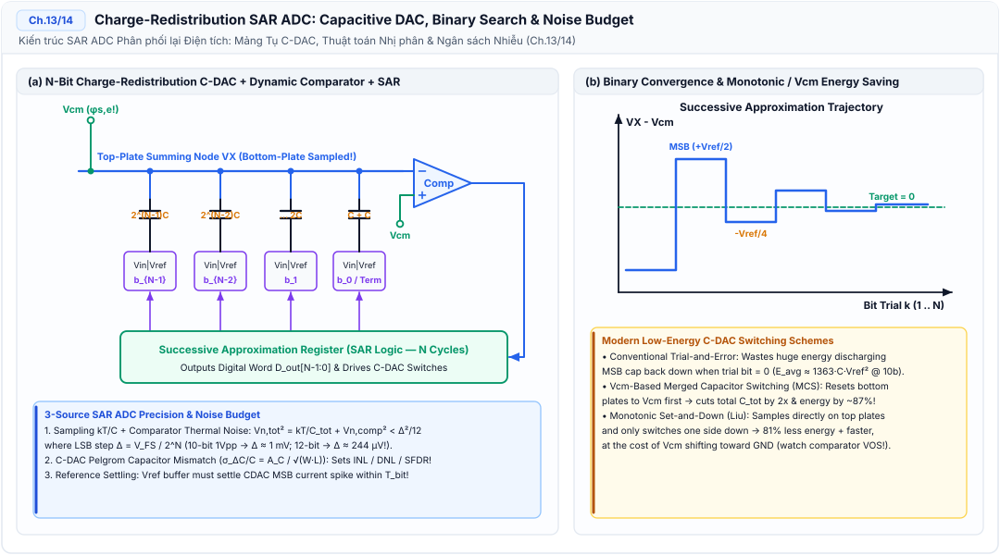

---
{
  "id": "topo-sar-adc-charge-redistribution-architecture",
  "kind": "topology",
  "domain": "sampled-and-clocked",
  "title_vi": "Kiến trúc Bộ Chuyển đổi Tương tự–Số Xấp xỉ Liên tiếp Phân bố lại Điện tích (Charge-Redistribution SAR ADC)",
  "title_en": "Charge-Redistribution Successive-Approximation Register (SAR) ADC Architecture, Split-Bridge C-DAC, and Low-Energy Switching",
  "summary": "Kiến trúc chủ lực tiết kiệm năng lượng nhất trong dải 8–14 bit từ kS/s đến hàng trăm MS/s: hợp nhất mạch lấy mẫu giữ mẫu (S/H) và giàn tụ nhị phân C-DAC qua nguyên lý bảo toàn điện tích tấm đỉnh, phân tích giàn tụ tách đôi có tụ cầu (Split-Bridge C-DAC) kèm bẫy suy hao ký sinh, đối chiếu định lượng ba thuật toán chuyển mạch (Conventional vs VCM-Based Merged vs Monotonic Set-and-Down tiết kiệm 81% năng lượng), ngân sách 4 thành phần nhiễu căn bậc hai và điều kiện khớp tụ DNL/INL.",
  "diagram": "../../diagrams/sar-adc-cdac-architecture.svg",
  "razavi_refs": [
    {
      "chapter": 13,
      "section": "13.1-13.2.4",
      "pages": "539-555",
      "equations": ["13.2", "13.6", "13.14", "13.25", "13.34"]
    },
    {
      "chapter": 14,
      "section": "14.1.4-14.1.5",
      "pages": "583-585",
      "equations": ["14.37", "14.42", "14.44", "14.49"]
    }
  ],
  "glossary_codes": [
    "T007",
    "T014",
    "T035",
    "T052",
    "T057",
    "T058",
    "T074",
    "T319",
    "T1009",
    "T1515",
    "T1950",
    "T2006",
    "T2007",
    "T2098",
    "T2135",
    "T2139",
    "T2142",
    "T2150",
    "T2153",
    "T2194",
    "T2195"
  ],
  "process_agnostic": true,
  "roles": {
    "bootstrapped_front_end_switches": "Cặp công tắc nâng áp cực cổng (bootstrapped switches) lấy mẫu tín hiệu đầu vào vi sai lên giàn tụ với điện trở dẫn hằng định độc lập Vin, bảo toàn độ tuyến tính Nyquist.",
    "binary_or_split_bridge_cdac": "Mảng tụ điện trọng số nhị phân (hoặc tách nhánh MSB/LSB qua tụ cầu CB) kiêm nhiệm đồng thời tụ giữ mẫu S/H và bộ DAC trừ điện tích từng bit mà không cần bất kỳ Op-Amp tiêu thụ dòng tĩnh nào.",
    "dynamic_regenerative_comparator": "Bộ so sánh động chốt tái sinh (StrongARM / Miyahara) quyết định dấu của điện áp dư vi sai trên hai tấm đỉnh giàn tụ sau mỗi bước dịch chuyển nhị phân.",
    "synchronous_or_async_sar_logic": "Máy trạng thái tìm kiếm nhị phân (SAR register) tuần tự thử bit từ MSB xuống LSB trong N nhịp (đồng bộ theo xung ngoài hoặc tự tạo nhịp nội bất đồng bộ tốc độ cao)."
  },
  "symptoms_addressed": [
    "high-opamp-static-power-and-low-gain-scaling-penalty-in-nanometer-adcs",
    "separate-sample-and-hold-amplifier-power-and-distortion-overhead",
    "exponential-2-to-n-capacitor-area-explosion-above-10-bits",
    "excessive-cdac-reference-switching-energy-in-battery-iot-sensors"
  ],
  "limitations": [
    "serial-n-cycle-bit-conversion-bottleneck-limiting-single-channel-sample-rate",
    "bridge-capacitor-top-plate-parasitic-causing-periodic-dnl-missing-codes",
    "monotonic-switching-common-mode-shift-modulating-comparator-dynamic-offset",
    "strict-per-bit-vref-settling-and-comparator-thermal-noise-budget"
  ],
  "checklists": [
    "common-mos",
    "comparator-and-sar-adc",
    "switched-capacitor",
    "layout-and-matching"
  ]
}
---

## 1. Bản chất Nguyên lý, Sơ đồ Mạch & Vai trò Từng Nhánh Cấu trúc

Khi công nghệ CMOS thu nhỏ xuống `90nm`, `65nm`, `45nm` và sâu hơn, các kiến trúc ADC dựa trên bộ khuếch đại thuật toán chính xác cao (như Pipelined hay $\Delta\Sigma$ truyền thống) chịu áp lực nặng nề do độ lợi nội tại $g_m r_o$ sụt giảm và dải dao động điện áp thu hẹp, trong khi tốc độ chuyển mạch của cổng logic số và công tắc MOS lại tăng vọt cùng năng lượng chuyển mạch giảm mạnh. **Bộ chuyển đổi Tương tự–Số Xấp xỉ Liên tiếp Phân bố lại Điện tích (`Charge-Redistribution SAR ADC` — McCreary & Gray 1975, phát triển trên nền tảng mạch lấy mẫu Chương 13 và tuyến tính tụ điện Chương 14 của Razavi)** đã vươn lên thành kiến trúc số hóa (`digitization` — `T035`) hiệu quả năng lượng số 1 thế giới (đạt kỷ lục vài $\text{fJ/conversion-step}$!) nhờ một triết lý tối giản triệt để: **không dùng bất kỳ một Op-Amp tuyến tính nào** — chỉ dùng **tụ điện kim loại, công tắc MOS, một bộ so sánh động duy nhất và thanh ghi tìm kiếm nhị phân số**!



Một hệ thống `Charge-Redistribution SAR ADC` vi sai chuẩn công nghiệp được hợp thành từ 4 khối chức năng gắn kết chặt chẽ:
1. **Công tắc Lấy mẫu Đầu vào Độ tuyến tính Cao (`Front-End Sampling Switches`, §13.2 & §14.1.5):**
   Sử dụng cặp công tắc nâng áp cực cổng (`bootstrapped switch` — `T2139`, `topo-bootstrapped-sampling-switch`) kết hợp lấy mẫu tấm đáy hoặc lấy mẫu tấm đỉnh vi sai để thu nhận tín hiệu $V_{in}^+, V_{in}^-$ với méo hài $\text{THD} < -80\text{ đến }-95\text{ dB}$ ngay tại tần số Nyquist $f_{in} \approx f_s / 2$.
2. **Mạng Tụ điện Trọng số Nhị phân (`Binary-Weighted` hoặc `Split-Bridge Capacitive DAC — C-DAC`, §13.1 & §14.1.4):**
   Thực hiện đồng thời hai nhiệm vụ: vừa là tụ lấy mẫu giữ mẫu (`Sample-and-Hold`) trong pha thu nhận, vừa là bộ chuyển đổi số–tương tự trừ điện tích trong pha lượng tử hóa $N$ bit. Mỗi nhánh gồm dãy tụ $C_{N-1} = 2^{N-1} C_u, \dots, C_1 = 2 C_u, C_0 = C_u$ cộng một tụ kết thúc $C_{\text{term}} = C_u$ để tổng điện dung bằng đúng $C_{\text{tot}} = 2^N C_u$.
3. **Bộ So sánh Động Chốt Tái sinh (`Dynamic Latched Comparator`):**
   Nhận trực tiếp hai tấm đỉnh chung (`top plates` $V_{XP}, V_{XN}$) của hai giàn tụ C-DAC dương và âm, thực hiện $N$ phép kiểm tra dấu liên tiếp $(V_{XP} - V_{XN} \gtrless 0)$ với dòng tiêu thụ tĩnh bằng không (`topo-dynamic-strongarm-and-miyahara-comparator`).
4. **Khối Logic Thanh ghi Xấp xỉ Liên tiếp (`SAR Control Logic — Synchronous or Asynchronous`):**
   Điều khiển thuật toán tìm kiếm nhị phân (`binary search`) tuần tự từ bit trọng số lớn nhất (`MSB` $b_{N-1}$) xuống bit nhỏ nhất (`LSB` $b_0$). Ở kiến trúc **Bất đồng bộ (`Asynchronous SAR`)**, chính tín hiệu báo chốt xong (`Valid / Ready`) của bộ so sánh kích hoạt ngay lập tức nhịp thử bit kế tiếp mà không cần xung đồng hồ ngoài tần số gấp $(N+2) f_s$, giúp tận dụng thời gian quyết định nhanh của các bit có điện áp dư lớn!

---

## 2. Hệ Phương trình Cốt lõi & Tư duy "Nhìn Mạch Đọc Nhanh" (Analysis by Inspection)

### 2.1. Phương trình Bảo toàn Điện tích Tấm Đỉnh: Lấy mẫu Tấm Đáy vs Lấy mẫu Tấm Đỉnh
Xét một nhánh C-DAC trọng số nhị phân tổng điện dung $C_{\text{tot}} = \sum_{i=0}^{N-1} 2^i C_u + C_u = 2^N C_u$, kèm điện dung ký sinh tổng từ tấm đỉnh chung xuống đất là $C_{pT}$ (gồm tụ ký sinh dây nối + tụ cổng đầu vào bộ so sánh $C_{in,\text{comp}}$):
1. **Lấy mẫu Tấm đáy Chuẩn (`Bottom-Plate Sampling` — miễn nhiễm phun điện tích đầu vào):**
   - *Pha lấy mẫu ($\phi_s = 1$):* Tấm đỉnh $X$ bị kẹp vào điện áp đồng pha chuẩn $V_{CM}$ qua công tắc ngắt sớm $S_{CM}$, trong khi tất cả các tấm đáy nối vào $V_{in}$. Tổng điện tích trên tấm đỉnh là $Q_X(\phi_s) = (V_{CM} - V_{in}) C_{\text{tot}} + V_{CM} C_{pT}$.
   - *Pha chuyển mạch bit $k$ ($\phi_s = 0$, $S_{CM}$ mở hoàn toàn):* Các tấm đáy được chuyển tới $V_{REF}$ (nếu bit $b_i = 1$) hoặc $0\text{ V}$ (nếu bit $b_i = 0$). Định luật bảo toàn điện tích tại đảo cô lập $X$ cho:
     $$(V_X - V_{REF})\sum_{i=0}^{N-1} b_i 2^i C_u + (V_X - 0)\left(C_{\text{tot}} - \sum_{i=0}^{N-1} b_i 2^i C_u\right) + V_X C_{pT} = (V_{CM} - V_{in}) C_{\text{tot}} + V_{CM} C_{pT}$$
     Rút gọn cho biểu thức điện thế tấm đỉnh và hiệu điện áp vi sai hai nhánh $(V_{XP} - V_{XN})$ (với mã bù $b_i^- = \overline{b_i^+}$):
     $$V_{XP} - V_{XN} = \left(\frac{C_{\text{tot}}}{C_{\text{tot}} + C_{pT}}\right)\left[ - (V_{in}^+ - V_{in}^-) + V_{REF} \sum_{i=0}^{N-1} (2 b_i - 1) \frac{2^i}{2^N} \right]$$
   **Nhận thức tuyệt diệu bằng mắt thường:** Thừa số suy giảm ký sinh tấm đỉnh $\alpha_T = \frac{C_{\text{tot}}}{C_{\text{tot}} + C_{pT}} < 1$ nhân **đồng thời vào cả tín hiệu đầu vào vi sai lẫn bậc thang tham chiếu $V_{REF}$**! Bởi vì bộ so sánh chỉ xét **dấu qua điểm $0\text{ V}$** ($V_{XP} - V_{XN} \gtrless 0$), thừa số tuyến tính $\alpha_T$ bị **giản ước sạch hoàn toàn khỏi ngưỡng quyết định**! *(Tuy nhiên, nếu $C_{in,\text{comp}}(V)$ phi tuyến theo điện áp mà mức đồng pha dịch chuyển, hoặc vì $\alpha_T < 1$ làm teo nhỏ biên độ tín hiệu so với nhiễu của bộ so sánh, ta vẫn phải giữ $C_{pT} \ll C_{\text{tot}}$!).*

2. **Lấy mẫu Tấm đỉnh (`Top-Plate Sampling` — giảm 50% số tụ và cho phép thử MSB ngay lập tức không tốn năng lượng!):**
   - Trong pha $\phi_s$, nạp trực tiếp $V_{in}^+, V_{in}^-$ lên hai tấm đỉnh $V_{XP}, V_{XN}$, trong khi các tấm đáy đã được đặt sẵn ở $V_{CM}$ (hoặc đặt sẵn toàn bộ lên $V_{REF}$ trong thuật toán `Monotonic`).
   - Ngay khi công tắc lấy mẫu mở ra, bộ so sánh có thể **quyết định ngay lập tức bit đầu tiên `MSB` ($V_{in}^+ - V_{in}^- \gtrless 0$) mà chưa cần chuyển mạch bất kỳ một tụ điện nào**, giảm tổng số tụ đơn vị mỗi nhánh xuống một nửa ($2^{N-1} C_u$ thay vì $2^N C_u$)! Đổi lại, công tắc lấy mẫu nằm ngay trên tấm đỉnh nên bắt buộc dùng `topo-bootstrapped-sampling-switch` để tránh phun điện tích phi tuyến và suy hao chia áp với $C_{pT}$!

### 2.2. Ba Thuật toán Chuyển mạch C-DAC & Đánh đổi Năng lượng – Độ lệch Động Bộ so sánh
Trong một bộ SAR ADC $10\text{-bit}$, năng lượng rút từ nguồn chuẩn $V_{REF}$ phụ thuộc kịch tính vào sơ đồ chuyển mạch tấm đáy:
1. **Chuyển mạch Truyền thống (`Conventional Trial-and-Backtrack`):** Đặt MSB = 1 còn lại = 0; nếu $V_{XP} < V_{XN}$ phải kéo tụ MSB trả ngược từ $V_{REF}$ về $0\text{ V}$ đồng thời kéo MSB-1 lên $V_{REF}$ (bước trả ngược này tiêu tốn năng lượng khổng lồ!). Năng lượng trung bình cho $N$-bit vi sai là $E_{\text{conv}} \approx \sum_{i=1}^{N} 2^{N+1-2i}(2^i - 1) C_u V_{REF}^2 \approx \mathbf{1363\,C_u V_{REF}^2}$ (cho $N = 10$).
2. **Chuyển mạch Đơn điệu (`Monotonic Set-and-Down`, Liu JSSC 2010):** Lấy mẫu tấm đỉnh, đặt sẵn toàn bộ tấm đáy lên $V_{REF}$. Sau phép so sánh đầu tiên, chỉ kéo **một tụ tương ứng ở phía có áp cao hơn** từ $V_{REF}$ sập xuống $0\text{ V}$ mà không bao giờ phải lùi bước (`no upward transition`)! Năng lượng trung bình sụt xuống chỉ còn $E_{\text{mono}} \approx \mathbf{255.5\,C_u V_{REF}^2}$ (**tiết kiệm $81.2\%$ năng lượng** và giảm $50\%$ tổng điện dung!), **NHƯNG** điện áp đồng pha tấm đỉnh tụt bậc thang từ $V_{CM}$ xuống sát $0\text{ V}$ theo chu kỳ bit: $V_{\text{CM,top}}[k] = V_{CM} - \frac{V_{REF}}{2}\left(1 - 2^{-k}\right)$!
3. **Chuyển mạch Hợp nhất Dựa trên $V_{CM}$ (`VCM-Based Merged Capacitor Switching — MCS`, Zhu 2010):** Lấy mẫu tấm đỉnh trong khi toàn bộ tấm đáy nối $V_{CM} = V_{REF}/2$. Sau quyết định bit $k$, một nhánh chuyển tụ từ $V_{CM} \to V_{REF}$ đồng thời nhánh đối diện chuyển đối xứng từ $V_{CM} \to 0\text{ V}$! Kết quả đạt đồng thời cả hai đỉnh cao: **năng lượng giảm $87.5\%$** ($E_{\text{MCS}} \approx \mathbf{170.2\,C_u V_{REF}^2}$ cho $10\text{-bit}$, bởi trong lần thử đầu tiên không tốn năng lượng từ $V_{REF}$!) **VÀ giữ mức đồng pha tấm đỉnh cố định tuyệt đối tại $V_{CM}$ suốt cả $N$ bit**!

### 2.3. Kiến trúc Giàn Tụ Tách Đôi Có Tụ Cầu (`Split-Capacitor Bridge C-DAC`) & Bẫy Ký sinh $C_{p,\text{LSB}}$
Khi độ phân giải $N \ge 11\text{–}14\text{ bit}$, mảng nhị phân thuần túy cần $2^{12} = 4096$ ô tụ đơn vị mỗi bên, làm diện tích và tải đầu vào nổ tung theo hàm mũ. Bằng cách tách $N = M + L$ bit thành mảng trên `MSB` ($M$ bit) và mảng dưới `LSB` ($L$ bit) nối với nhau qua **tụ cầu nối tiếp (`bridge/attenuation capacitor` $C_B$)** sao cho tổng điện dung nhìn về phía LSB nhìn qua $C_B$ đúng bằng $1\,C_u$:
$$\frac{C_B \cdot 2^L C_u}{C_B + 2^L C_u} = C_u \implies C_B = \left(\frac{2^L}{2^L - 1}\right) C_u \quad \text{(hoặc bỏ tụ kết thúc nhánh LSB thì } C_B = C_u \text{ nguyên vẹn!)}$$
- **Cái bẫy ký sinh chết người trên thực tế silicon:** Tại nút tấm đỉnh trung gian của mảng phụ LSB luôn tồn tại điện dung ký sinh nối đất $C_{p,\text{LSB}}$ (do dây kim loại đi gom $L$ tụ và ký sinh rìa của bản thân $C_B$). Điện dung $C_{p,\text{LSB}}$ này làm **suy giảm trọng số hiệu dụng của toàn bộ nhóm bit LSB** đi hệ số $\frac{2^L C_u}{2^L C_u + C_{p,\text{LSB}}}$ so với nhóm MSB! Hệ quả là cứ mỗi khi nhóm MSB tăng $1$ đơn vị (`011...1 -> 100...0`), tổng toàn thang của nhóm LSB bị hụt mất một khe hở $\Delta V_{\text{gap}} = V_{\text{LSB}} \cdot 2^L \frac{C_{p,\text{LSB}}}{2^L C_u + C_{p,\text{LSB}}}$, gây ra **lỗi DNL định kỳ và mất mã (`missing codes`)** nếu không trích xuất `PEX` chính xác để phóng nhẹ giá trị $C_B$ bù lại hoặc dùng dư thừa bit cơ số dưới 2 (`sub-radix-2 redundancy`)!

### 2.4. Ngân sách Bốn Nguồn Nhiễu RMS & Điều kiện Khớp Tụ Pelgrom cho $\text{DNL} / \text{INL}$
1. **Phương trình Tổng Nhiễu Quy về Ngõ vào Vi sai (Ấn định $\text{SNDR}_{\max}$ và $\text{ENOB}$):**
   Với dải toàn thang vi sai đỉnh–đỉnh $V_{\text{FS,pp,diff}} = 2 V_{REF}$ (công suất sóng sin cực đại $P_{\text{sig}} = \frac{V_{REF}^2}{2}$ và bước lượng tử $V_{\text{LSB}} = \frac{2 V_{REF}}{2^N}$):
   $$V_{n,\text{tot,rms}}^2 = \underbrace{\frac{V_{\text{LSB}}^2}{12}}_{\text{Nhiễu lượng tử}} + \underbrace{\frac{2 k T}{C_{\text{tot,single}}}}_{\text{Nhiễu lấy mẫu } kT/C} + \underbrace{\sigma_{n,\text{comp}}^2}_{\text{Nhiễu nhiệt Comparator}} + \underbrace{\sigma_{n,\text{ref,eff}}^2}_{\text{Nhiễu nguồn } V_{REF}}, \qquad \text{SNDR} = 10\log_{10}\!\left(\frac{V_{REF}^2 / 2}{V_{n,\text{tot,rms}}^2}\right)$$
   - **Ví dụ thiết kế chuẩn $12\text{-bit}$ ($V_{REF} = 1.0\text{ V} \implies V_{\text{LSB}} = 488\,\mu\text{V}$, $\sigma_{\text{quant}} = 141\,\mu\text{V}_{\text{rms}}$):** Để đạt $\text{ENOB} = 11.3\text{ bit}$ ($\text{SNDR} = 69.8\text{ dB} \implies V_{n,\text{tot,rms}} \le 228\,\mu\text{V}_{\text{rms}}$), tổng bình phương ba nguồn nhiễu vật lý chỉ được phép chiếm $228^2 - 141^2 = (179\,\mu\text{V}_{\text{rms}})^2$! Chia ngân sách: $\sigma_{kT/C} \le 90\,\mu\text{V}_{\text{rms}} \implies C_{\text{tot,single}} \ge \frac{2 \times 4.14\times 10^{-21}}{(90\times 10^{-6})^2} \approx \mathbf{1.02\text{ pF}}$, dành phần còn lại $\sigma_{n,\text{comp}} \le 130\,\mu\text{V}_{\text{rms}}$ và $\sigma_{n,\text{ref}} \le 80\,\mu\text{V}_{\text{rms}}$.
2. **Định cỡ Tụ Đơn vị $C_u$ theo Khớp Tụ Ngẫu nhiên ($\sigma(\Delta C_u / C_u) = k_C / \sqrt{C_u}$):**
   Bước chuyển mã chính giữa (`mid-scale transition`: `011...1` sang `100...0`) đánh tráo toàn bộ $2^{N-1} - 1$ tụ đơn vị với tụ MSB $2^{N-1} C_u$ (tổng cộng xấp xỉ $2^N$ tụ đơn vị đổi dấu!), tạo độ lệch chuẩn bước nhảy $\text{DNL}$ cực đại:
   $$\sigma(\text{DNL}_{\text{mid}}) \approx 2^{N/2}\,\sigma\!\left(\frac{\Delta C_u}{C_u}\right) \text{ [LSB]} \quad \text{(cho chuyển mạch thường; giảm còn } 2^{(N-1)/2}\sigma \text{ với MCS/Monotonic!)}$$
   Để đạt hiệu suất thu hoạch $> 99.7\%$ không mất mã ($3\,\sigma(\text{DNL}_{\text{mid}}) < 0.5\text{ LSB}$) ở $12\text{-bit}$ MCS ($2^{5.5} \approx 45.25$): cần $\sigma(\Delta C_u / C_u) < \frac{0.5}{3 \times 45.25} = 0.368\%$, thường chỉ cần $C_u \approx 1\text{–}3\text{ fF}$ trên tụ MOM hiện đại!

---

## 3. Bất biến Cấu trúc & Các Bẫy Lỗi Kinh điển (Structural Invariants & Traps)

- **`[INV-SAR-01]` Bất biến Xác lập Điện áp Tham chiếu $V_{REF}$ và Mạng RC Giàn Tụ Trong Từng Chu kỳ Bit:**
  Trong các bit đầu tiên không có dư thừa (`non-redundant binary SAR`), nếu tại cuối cửa sổ nạp của bit $k$ điện áp giàn tụ hoặc đường $V_{REF}$ còn sụt áp dư $\Delta V_{\text{err}}(k) > 0.5\text{ LSB}$ chưa kịp hồi phục, bộ so sánh sẽ chốt **sai vĩnh viễn bit trọng số lớn đó**, và toàn bộ các bit nhỏ phía sau dù chính xác tuyệt đối cũng không thể bù đắp nổi khoảng hụt đã vượt trần!
- **`[INV-SAR-02]` Bất biến Tuyến tính Tụ điện Tích hợp (`Linear MOM/MIM Cap Mandatory`, Razavi §14.1.4 Phương trình 14.37–14.42):**
  Mọi tụ trong giàn C-DAC bắt buộc là tụ kim loại tuyến tính (`MOM` / `MIM`) có hệ số điện áp bậc nhất và bậc hai cực nhỏ ($\alpha_1, \alpha_2 < 20\text{–}50\text{ ppm/V}$); nếu dùng tụ tiếp giáp hay tụ MOS, thành phần bậc hai của điện dung sẽ sinh hài bậc ba HD3 ngay trong quá trình phân bố lại điện tích!
- **`[TRAP-SAR-01]` Bẫy Sập Độ Tuyến tính INL do Chuyển mạch Đơn điệu (`Monotonic`) Làm Trôi Offset Bộ So sánh:**
  Nhiều người áp dụng mù quáng sơ đồ `Monotonic Set-and-Down` vì thấy dễ điều khiển công tắc, rồi ngỡ ngàng khi mô phỏng Monte Carlo cho thấy INL vọt lên $3\text{–}6\text{ LSB}$ dù tụ C-DAC lý tưởng 100%! Nguyên nhân gốc rễ: khi $V_{\text{CM,top}}$ tụt từ $0.5\text{ V}$ xuống $0.05\text{ V}$ qua các bit, độ lệch ngẫu nhiên của bộ so sánh StrongARM trôi từ $+1\text{ mV}$ sang $+4\text{ mV}$, làm méo lệch thang quyết định giữa các bit đầu và các bit cuối! Luôn ưu tiên **`VCM-Based MCS`** cho độ phân giải $\ge 10\text{ bit}$.
- **`[TRAP-SAR-02]` Bẫy Rung Chuông Dây Hàn trên Chân $V_{REF}$ tại Nhịp `MSB-1` (`Reference Bondwire Ringing`):**
  Bước thử tiêu tốn xung điện tích lớn nhất từ $V_{REF}$ không phải nhịp MSB (ở lấy mẫu tấm đỉnh là $0$!) mà là nhịp **`MSB-1`**. Nếu dẫn $V_{REF}$ từ ngoài chip qua dây hàn $L_{\text{bond}} \approx 3\text{ nH}$ mà tụ khử nhiễu nội tại $C_{\text{decap,ref}}$ nhỏ hơn $200\times C_{\text{tot}}$, xung dòng C-DAC sẽ kích thích dao động hình sin tần số cao trên $V_{REF}$ xuyên suốt các bit còn lại! Quy tắc: hoặc đặt $C_{\text{decap,ref}} \ge 2^{N} C_{\text{tot}} / 2$ ngay sát giàn tụ, hoặc dùng bộ đệm tham chiếu siêu nhanh hồi phục trong $< T_{\text{bit}}/2$.
- **`[TRAP-SAR-03]` Bẫy Tụ Đơn vị Dưới Giới hạn Lưới Đi dây (`Sub-fF Unit Cap Routing Mismatch`):**
  Ở $10\text{–}12\text{ bit}$, phép tính nhiễu $kT/C$ cho phép dùng $C_u$ nhỏ cỡ $0.5\text{–}1.0\text{ fF}$. Nếu thiết kế bất cẩn để nhánh kim loại nối đến từng ô tụ không đồng nhất tuyệt đối, điện dung rìa dây dẫn $0.05\text{ fF}$ đã làm lệch $5\%\text{–}10\%$ trọng số bit! Phải nhúng sẵn phần nhánh kim loại kết nối vào ngay bên trong ô đơn vị chuẩn (`custom unit MOM cell with integrated routing shields`).

---

## 4. Lộ trình Nâng cấp Cấu trúc & Bát giác Đánh đổi (Upgrade Paths & Design Octagon)

Trong `concept-analog-design-octagon`, kiến trúc SAR ADC chiếm giữ vị thế độc tôn ở tâm điểm giao thoa giữa **Năng lượng thấp kỷ lục**, **Diện tích nhỏ gọn** và **Khả năng mở rộng công nghệ số**, với ma trận lựa chọn cấu hình C-DAC rõ ràng:

| Phương án Cấu trúc C-DAC | Tổng Tụ Đơn vị (Mỗi bên, $N$-bit) | Năng lượng Chuyển mạch ($10\text{-bit}$) | Dịch chuyển $V_{\text{CM}}$ tại Comparator | Phù hợp Cấp độ Độ phân giải & Ứng dụng |
| :--- | :--- | :--- | :--- | :--- |
| **Nhị phân + Chuyển mạch Thường** | $2^N C_u$ ($1024\,C_u$) | $1363\,C_u V_{REF}^2$ ($100\%$) | Hằng định quanh $V_{CM}$ | Tham chiếu kinh điển sách giáo khoa |
| **Nhị phân + Đơn điệu (`Monotonic`)** | $2^{N-1} C_u$ ($512\,C_u$) | $255.5\,C_u V_{REF}^2$ ($-81.2\%$) | **Tụt mạnh $\Delta V_{CM} = -V_{REF}/2$!** | $8\text{–}10\text{ bit}$ tốc độ cao (cần canh kỹ $V_{OS}(V_{CM})$) |
| **Nhị phân + Hợp nhất `VCM-MCS`** | $2^{N-1} C_u$ ($512\,C_u$) | **$170.2\,C_u V_{REF}^2$ ($-87.5\%$)** | **Đứng yên tại $V_{CM}$!** | **Chuẩn vàng cho $10\text{–}12\text{ bit}$ hiệu suất cao** |
| **Cầu chia `Split-Bridge` + Dư thừa cơ số $<2$** | $\sim (2^{M} + 2^{L}) C_u$ ($\sim 128\,C_u$ cho $12\text{-bit}$) | Cực thấp (nhờ $C_{\text{tot}}$ nhỏ) | Đứng yên (với MCS) | **$12\text{–}14\text{ bit}$** (kèm hiệu chỉnh số trọng số cầu!) |

- **Các nhánh nâng cấp vượt ngưỡng giới hạn của SAR cơ bản:**
  1. **Khi cần vượt trần $12\text{–}14\text{ bit}$ (lên $15\text{–}18\text{ bit}$) mà vẫn giữ tiết kiệm điện:** Nâng cấp sang **Noise-Shaping SAR ADC** (dùng bộ tích phân thụ động/động lấy phần điện áp dư cuối chu kỳ trên tấm đỉnh sau bit LSB đưa vào vòng lọc nhiễu lượng tử và nhiễu bộ so sánh theo nguyên lý $\Delta\Sigma$, ghép với `topo-switched-capacitor-integrator-parasitic-insensitive`!).
  2. **Khi cần vượt trần tốc độ một kênh ($\ge 500\text{ MS/s} \dots 10\text{ GS/s}$):** Ghép song song $K$ kênh SAR hoạt động lệch pha nhau (`Time-Interleaved SAR ADC`), hoặc lai ghép với khuếch đại dư `topo-switched-capacitor-unity-and-multiplying-amps` tạo kiến trúc **Pipelined-SAR ADC** ($2$ tầng SAR nối tiếp qua một tầng khuếch đại dư lật tụ!).

---

## 5. Thích ứng Đa Tiến trình (90nm / 65nm / 45nm) & Cách Kiểm chứng trong Cadence / Spectre

### 5.1. Quy tắc Thực thi Vật lý trên `90nm` / `65nm` / `45nm`
1. **Phân cấp Định cỡ Công tắc Tham chiếu Theo Trọng số Nhị phân (`Thermometer / Binary Scaled Reference Switches`):**
   - Tụ MSB ($2^{N-1} C_u$) lớn gấp hàng trăm lần tụ LSB ($C_u$): định cỡ bề rộng các công tắc nạp $V_{REF} / V_{CM} / GND$ **tỷ lệ thuận với trọng số tụ của từng bit** ($W_{\text{sw},i} = 2^i W_{\text{sw,0}}$ với ngưỡng sàn tối thiểu cho các bit thấp) để mọi nhánh đều có **cùng một hằng số thời gian nạp xả $\tau_{\text{DAC}} = R_{on,i} C_i = \text{const}$** và cùng tỷ lệ xuyên xung nhịp!
2. **Bố cục Mặt bằng Mảng Tụ Tâm chung 2D & Che chắn Tấm Đỉnh (`Common-Centroid Shielded C-DAC Floorplan`):**
   - Xếp các tụ bit lớn (`MSB, MSB-1, MSB-2, MSB-3`) đối xứng tâm chung 2D xung quanh tâm mảng (`tech-common-centroid-sti-wpe-layout`), bao bọc toàn bộ chu vi giàn tụ bằng ít nhất $1\text{–}2$ hàng ô tụ giả nối đất (`dummy unit cells`) để khắc đồng nhất điện trường rìa.
   - Đường kim loại tấm đỉnh (`Top-Plate Net`) phải vẽ ngắn gọn tối đa ở tầng kim loại cao và được bao bọc hai bên lẫn bên dưới bởi lồng kim loại nối `VCM` / `GNDA` sạch để chặn hoàn toàn xuyên âm từ các dây điều khiển số thanh ghi SAR (`CHK-ESD-08`)!

### 5.2. Phác đồ Kiểm chứng Toàn diện bằng Coherent FFT trong Cadence Spectre
1. **Kiểm chứng Chuỗi Thời gian Bit ở Góc Chậm nhất & Sau `PEX`:**
   - Trích xuất ký sinh điện dung + ghép chéo `PEX (C + CC)` cho toàn bộ mảng C-DAC và chạy `tran` với xung nhịp thực tế ở `(SS, VDD_min, -40 °C)` và `(SS, VDD_min, 125 °C)`.
2. **Đo Toàn bộ Chỉ tiêu Động ($\text{SNDR}, \text{ENOB}, \text{SFDR}, \text{THD}$) bằng Lấy mẫu Kết hợp Nguyên tố Cùng nhau (`Coherent Prime-Bin FFT`):**
   - Chọn số điểm $N_{\text{FFT}} = 128$ hoặc $256$ (trong mô phỏng mức transistor đầy đủ có bật `Transient Noise` nếu kiểm tra cả nhiễu nhiệt, hoặc tắt nhiễu nhiệt với `errpreset=conservative`, `reltol=1e-5` để soi độ tuyến tính tĩnh/động tới $-90\text{ dB}$!). Đặt $f_{in} = \frac{M_{\text{prime}}}{N_{\text{FFT}}} f_s$ với $M_{\text{prime}}$ lẻ sát $N_{\text{FFT}}/2$ (ví dụ $M_{\text{prime}} = 61$ cho $N_{\text{FFT}} = 128$ kiểm tra sát biên Nyquist!).
```spice
// Testbench Coherent FFT cho 10-bit 50-MS/s Differential Charge-Redistribution SAR ADC
parameters fs=50M Nfft=128 Mbin=61 fin=(Mbin*fs/Nfft) vdd_val=1.0 vref_val=1.0
// Bo qua 4 chu ky khoi dong dau tien, thu dung 128 mau ket qua tai suon EOC:
tran_sar tran stop=((4 + Nfft)/fs) errpreset=conservative maxstep=(1/(200*fs)) \
    strobeperiod=(1/fs) strobedelay=((4/fs) + 19.5n)

// Kiem tra khong sut ap VREF qua 0.25 LSB tai cuoi moi nhip thu bit:
// V_LSB = 2 * 1.0 / 1024 = 1.953 mV -> 0.25 LSB = 0.488 mV
// Sau mo phong: xuat 128 gia tri D_out<9:0> -> tinh 128-pt FFT khong cua so:
// SNDR_dB = 10*log10( P_bin(61) / sum_{k!=0,61}(P_bin(k)) )
// ENOB    = (SNDR_dB - 1.76) / 6.02
```

---

## 6. Mốc Đối chiếu Sách Razavi & Thuật ngữ Chuẩn CLB

| Mục Sách Razavi (2nd Ed.) & Nền tảng Hỗn hợp | Trang & Phương trình | Nội dung Đối chiếu Trọng tâm | Mã Thuật ngữ Chuẩn CLB |
| :--- | :--- | :--- | :--- |
| **§13.1–13.2.4 Precision CMOS Sampling** | Tr. 539–555, Eq. `(13.2)`, `(13.6)`, `(13.14)`, `(13.25)`, `(13.34)` | Điện trở dẫn công tắc MOS/CMOS, giới hạn tốc độ–độ chính xác lấy mẫu, nhiễu nhiệt $kT/C$, phun điện tích và lấy mẫu tấm đáy | `T074` (Lấy mẫu), `T2135` (lấy mẫu tấm đáy), `T2139` (công tắc nâng áp cực cổng), `T2142` (nhiễu lấy mẫu nhiệt $kT/C$), `T014` (Phun điện tích) |
| **§14.1.4–14.1.5 Capacitor & Sampler Nonlinearity** | Tr. 583–585, Eq. `(14.37)–(14.49)`, Fig. `14.9–14.10` | Hệ số điện áp tụ điện gây méo hài trong phép chuyển giao điện tích và phi tuyến phụ thuộc biên độ của mạch lấy mẫu đầu vào ADC | `T057` (Tính phi tuyến), `T2150` (méo hài), `T319` (Điện dung đáy tiếp giáp), `T1009` (nhiễu nhiệt) |
| **Kiến trúc Charge-Redistribution SAR ADC** | Ứng dụng tổng hợp Ch.12/13/14/19 (Hình `12.29`, Mục `11.6`, `19.2.2`, `19.2.6`) | Tìm kiếm nhị phân phân bố lại điện tích trên C-DAC, cầu chia tụ $C_B$, chuyển mạch tiết kiệm năng lượng `VCM-MCS` vs `Monotonic`, và khớp mảng tụ tâm chung | `T007` (Bộ chuyển đổi tương tự–số ADC), `T2006` (bộ chuyển đổi A/D và D/A), `T2007` (dải toàn thang), `T1515` ($V_{REF}$), `T2098` (ADC độ chính xác cao), `T2153` (định luật Pelgrom), `T2194` (common-centroid) |
