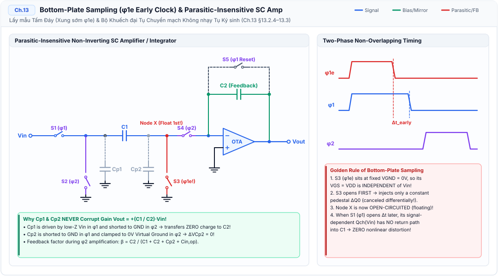

---
{
  "id": "topo-switched-capacitor-amplifiers-integrators",
  "kind": "topology",
  "domain": "sampled-and-clocked",
  "title_vi": "Bộ khuếch đại và mạch tích phân tụ chuyển mạch miễn nhiễm ký sinh",
  "title_en": "Parasitic-Insensitive Switched-Capacitor Amplifiers and Integrators",
  "summary": "Họ các mạch đệm lấy mẫu độ lợi đơn vị, khuếch đại không đảo tỷ số tụ C1/C2, mạch nhân đôi lật tụ độ chính xác cao và bộ tích phân rời rạc theo thời gian miễn nhiễm điện dung ký sinh bản cực.",
  "diagram": "../../diagrams/bottom-plate-sampling-sc.svg",
  "razavi_refs": [
    {
      "chapter": 13,
      "section": "13.3.1",
      "pages": "555-562",
      "equations": ["13.40", "13.41", "13.42", "13.43", "13.44", "13.47", "13.48", "13.49", "13.50"]
    },
    {
      "chapter": 13,
      "section": "13.3.2-13.3.3",
      "pages": "562-568",
      "equations": ["13.51", "13.52", "13.53", "13.56", "13.57", "13.58", "13.59"]
    },
    {
      "chapter": 13,
      "section": "13.4",
      "pages": "568-571",
      "equations": ["13.60", "13.61", "13.62", "13.63", "13.64"]
    }
  ],
  "glossary_codes": [
    "T014",
    "T038",
    "T042",
    "T051",
    "T060",
    "T074",
    "T079",
    "T087",
    "T094",
    "T1201",
    "T1619",
    "T1674",
    "T1802",
    "T1958",
    "T1975",
    "T2078",
    "T2079",
    "T2085"
  ],
  "process_agnostic": true,
  "roles": {
    "sampling_capacitor_c1": "Tụ lấy mẫu thu nhận điện tích tỷ lệ với Vin trong pha phi1 và chuyển giao sang tụ hồi tiếp thông qua nút đất ảo trong pha phi2.",
    "feedback_capacitor_c2": "Tụ hồi tiếp hoặc tụ tích phân bao quanh bộ khuếch đại thuật toán trong pha phi2 để ấn định độ lợi điện áp C1/C2 hoặc tích lũy mẫu theo chu kỳ.",
    "ota_core": "Bộ khuếch đại thuật toán hỗ dẫn (OTA) cung cấp độ lợi vòng hở lớn A0 để triệt tiêu điện áp dư tại nút đất ảo X và cấp dòng nạp xác lập cho mạng tụ.",
    "four_switch_parasitic_insensitive_bridge": "Cầu bốn công tắc điều khiển bởi hai pha không chồng lấp kèm ngắt sớm phi1_e, đảm bảo mọi điện dung ký sinh bản cực đều bị dẫn động bởi nguồn áp hoặc bị khóa ở thế đất ảo."
  },
  "symptoms_addressed": [
    "rc-product-large-pvt-variation",
    "monolithic-bottom-plate-parasitic-gain-error",
    "junction-capacitance-nonlinearity-in-sc-integrators",
    "low-feedback-factor-penalty-in-gain-of-two-stages"
  ],
  "limitations": [
    "finite-opamp-dc-gain-and-cin-gain-error",
    "slewing-plus-linear-settling-half-clock-budget",
    "feedforward-rhp-zero-through-feedback-capacitor",
    "two-phase-kt-over-c-thermal-noise-accumulation"
  ],
  "checklists": [
    "common-mos",
    "switched-capacitor",
    "folded-cascode",
    "two-stage-miller",
    "cmfb",
    "layout-and-matching"
  ]
}
---

## 1. Bản chất Nguyên lý, Sơ đồ Mạch & Vai trò Từng Nhánh Cấu trúc

Trong quy trình CMOS nguyên khối, hằng số thời gian tuyệt đối $R \cdot C$ biến thiên tới $\pm 20\%\text{--}30\%$ theo quy trình và nhiệt độ, trong khi **tỷ số giữa hai tụ điện đồng dạng** $C_1 / C_2$ ghép từ cùng một ô tụ đơn vị đạt độ chính xác hình học xuất sắc ($0.05\%\text{--}0.1\%$) và hệ số nhiệt gần bằng không. Tuy nhiên, mỗi tụ nguyên khối luôn mang điện dung ký sinh từ bản cực đáy xuống đế bán dẫn $C_{pB} \approx 5\%\text{--}10\%\,C$ và bản cực đỉnh $C_{pT} \approx 0.5\%\text{--}2\%\,C$ (Hình 13.29). Nếu cấu trúc mạch để $C_{pB}$ chia sẻ điện tích với tụ chính, toàn bộ ưu thế chính xác của mạch tụ chuyển mạch (switched-capacitor circuit) lập tức sụp đổ. Bốn cấu trúc kinh điển trong §13.3–13.4 của Razavi giải quyết trọn vẹn bài toán này bằng nguyên lý **vận chuyển điện tích qua nút đất ảo kết hợp lấy mẫu bản cực đáy**:



1. **Mạch lấy mẫu / đệm độ lợi đơn vị lật tụ (Unity-Gain Sampler/Buffer, §13.3.1, Hình 13.31)**: Trong pha $\phi_1$, $S_1$ và $S_2$ đóng (với $S_2$ đặt bộ khuếch đại thuật toán ở chế độ hồi tiếp độ lợi đơn vị tạo đất ảo $V_X \approx 0$), nạp $C_H$ tới $V_{in0}$. Cuối $\phi_1$, $S_2$ mở sớm trên $\phi_{1e}$ rồi $S_1$ mở trên $\phi_1$; sang pha $\phi_2$, $S_3$ lật bản trái của $C_H$ vòng ra ngõ ra $V_{out}$, giữ nguyên điện tích bảo toàn trên $C_H$ để tái tạo $V_{out} \approx V_{in0}$ với hệ số hồi tiếp lớn nhất $\beta \approx 1$.
2. **Bộ khuếch đại không đảo miễn nhiễm ký sinh (Noninverting SC Amplifier, §13.3.2, Hình 13.43)**: Trong pha $\phi_1$, $C_1$ nạp $Q_1 = C_1 V_{in0}$ so với đất ảo $X$ còn $C_2$ được xả (hoặc đặt lại). Sang pha $\phi_2$, $S_3$ kéo bản trái $P$ của $C_1$ về đất cố định ($0\text{ V}$); bước nhảy $\Delta V_P = -V_{in0}$ buộc toàn bộ điện tích $-C_1 V_{in0}$ tại nút thả nổi $X$ phải chuyển sang bản trái của tụ hồi tiếp $C_2$, tạo điện áp ra cùng dấu $V_{out} = +(C_1/C_2) V_{in0}$.
3. **Mạch nhân đôi độ chính xác cao lật tụ (Precision Multiply-by-Two / Flip-Around MDAC, §13.3.3, Hình 13.53)**: Thay vì dùng $C_1 = 2C, C_2 = C$ theo cấu trúc trên (khiến hệ số hồi tiếp tụt xuống $< 1/3$), mạch dùng hai tụ bằng nhau $C_1 = C_2 = C$ cùng lấy mẫu $V_{in0}$ song song trong pha $\phi_1$ (tổng điện tích $2 C V_{in0}$). Sang pha $\phi_2$, $C_1$ được lật vòng làm tụ hồi tiếp lên $V_{out}$, còn bản trái của $C_2$ nối xuống đất để dồn nốt gói điện tích $C V_{in0}$ sang $C_1$, cho $V_{out} = 2 V_{in0}$ nhưng nâng hệ số hồi tiếp lên gấp rưỡi ($\beta \approx 1/2$)!
4. **Mạch tích phân tụ chuyển mạch miễn nhiễm ký sinh (Parasitic-Insensitive SC Integrator, §13.4, Hình 13.59)**: Dựa trên nhận thức của Maxwell rằng tụ $C_S$ chuyển mạch ở tần số $f_{CK}$ vận chuyển dòng trung bình $I_{AB} = C_S f_{CK}(V_A - V_B)$ tương đương một điện trở tụ điện chuyển mạch $R_{eq} = (C_S f_{CK})^{-1}$ (Phương trình 13.61–13.62). Khắc phục nhược điểm của mạch tích phân 2 công tắc ngây thơ (Hình 13.57–13.58 vốn bị méo do phun điện tích của $S_1$ và điện tích phi tuyến trên tụ tiếp giáp $q_{cj} = \int_0^{V_{in0}} C_j(V)\,dV$), cầu 4 công tắc ($S_1, S_3$ đóng ở $\phi_1$ với $S_3$ ngắt sớm trên $\phi_{1e}$; $S_2, S_4$ đóng ở $\phi_2$) cách ly hoàn toàn mọi tụ ký sinh và tụ tiếp giáp khỏi đường truyền điện tích!

## 2. Hệ Phương trình Cốt lõi & Tư duy "Nhìn Mạch Đọc Nhanh" (Analysis by Inspection)

### 2.1. Chứng minh tính miễn nhiễm ký sinh trên cả hai bản cực (Top & Bottom Plate Parasitic Insensitivity)
Xét tụ chuyển mạch $C_1$ có tụ ký sinh bản trái $C_{p1}$ và tụ ký sinh bản phải $C_{p2}$ (cộng gộp cùng điện dung cổng op-amp $C_{in}$ và điện dung tiếp giáp công tắc $C_j$ tại nút $X$):
- **Tại nút dẫn động bên trái $P$**: Trong pha $\phi_1$, $C_{p1}$ được nạp trực tiếp bởi nguồn áp $V_{in}$; sang pha $\phi_2$, công tắc $S_2$ (hoặc $S_3$) xả thẳng $C_{p1}$ xuống đất cố định mà **không bao giờ nối vào nút đất ảo $X$**. Mọi dòng nạp/xả của $C_{p1}$ chỉ khép kín giữa nguồn áp và đất!
- **Tại nút đất ảo bên phải $X$**: Trong pha $\phi_1$, $V_X \approx 0$; sang pha $\phi_2$, hồi tiếp âm của bộ khuếch đại thuật toán có độ lợi vòng hở lớn $A_0 \gg 1$ ép $V_X = -V_{out}/A_0 \to 0$. Vì điện áp hai đầu $C_{p2}$ và tụ tiếp giáp phi tuyến $C_j$ hầu như không đổi giữa hai pha ($\Delta V_X \approx 0$), chúng không hấp thụ điện tích ($\Delta Q_{pX} = C_{pX}\Delta V_X \to 0$) và méo phi tuyến của $C_j(V)$ bị triệt tiêu hoàn toàn!

### 2.2. Sai số độ lợi tĩnh do độ lợi vòng hở hữu hạn $A_0$ và điện dung ngõ vào $C_{in}$
Khi độ lợi một chiều $A_0$ của bộ khuếch đại thuật toán là hữu hạn, nút $X$ trong pha khuếch đại tồn tại điện áp dư $V_X = -V_{out}/A_0$, làm tụ $C_1$ và $C_{in}$ giữ lại một phần điện tích thay vì chuyển hết sang $C_2$. Bảo toàn điện tích tại nút $X$ (Phương trình 13.51–13.53) cho hàm truyền chính xác của bộ khuếch đại không đảo:
$$
\frac{V_{out}}{V_{in0}} = \frac{C_1}{C_2 + \frac{C_1 + C_2 + C_{in}}{A_0}}
= \frac{C_1}{C_2}\cdot\frac{1}{1 + \frac{1}{\beta A_0}}
\approx \frac{C_1}{C_2}\left(1 - \frac{1}{\beta A_0}\right),
\qquad \text{với } \beta = \frac{C_2}{C_1 + C_2 + C_{in}}
$$

| Cấu trúc mạch SC | Độ lợi danh định | Hệ số hồi tiếp $\beta$ (pha $\phi_2$) | Sai số độ lợi tĩnh $\lvert \epsilon_G \rvert \approx \frac{1}{\beta A_0}$ |
| :--- | :--- | :--- | :--- |
| Đệm lật tụ (Hình 13.31) | $1$ | $\frac{C_H}{C_H + C_{in}}$ | $\frac{1 + C_{in}/C_H}{A_0}$ (nhỏ nhất! Ví dụ 13.4: $A_0 = 1250$ đạt $0.1\%$) |
| Không đảo chuẩn ($C_1 = C_2$) | $1$ | $\frac{C_2}{2C_2 + C_{in}}$ | $\frac{2 + C_{in}/C_2}{A_0}$ (lớn gấp đôi mạch lật tụ khi $C_{in} \to 0$) |
| Không đảo nhân đôi ($C_1 = 2C, C_2 = C$) | $2$ | $\frac{C}{3C + C_{in}}$ | $\frac{3 + C_{in}/C}{A_0}$ (chậm và tốn độ lợi $A_0$) |
| **Nhân đôi lật tụ (§13.3.3, $C_1 = C_2 = C$)** | **$2$** | **$\frac{C}{2C + C_{in}}$** | **$\frac{2 + C_{in}/C}{A_0}$ (nhanh hơn $1.5\times$ cho cùng $G_m$)** |

**Quy tắc tối ưu kích thước cặp vi sai đầu vào OTA (Razavi tr. 559)**: Nới quá rộng bề rộng $W_{1,2}$ của cặp transistor đầu vào OTA để mong tăng $A_0$ sẽ làm $C_{in}$ phình to tuyến tính, làm sụt $\beta$ và có thể khiến $\epsilon_G = \frac{C_1 + C_2 + C_{in}}{C_2 A_0}$ xấu đi thay vì tốt lên!

### 2.3. Tốc độ xác lập hai pha: Hằng số thời gian lấy mẫu $\tau_{sam}$, Slewing và Xác lập tuyến tính $\tau_{amp}$
1. **Pha lấy mẫu ($\phi_1$, Phương trình 13.42–13.44)**: Điện trở nhìn vào nút đất ảo của OTA mắc hồi tiếp đơn vị qua công tắc $S_2$ bằng $R_X = \frac{R_0 + R_{on2}}{1 + G_m R_0} \approx \frac{1}{G_m}$ (với $R_{on2} \ll R_0, G_m R_0 \gg 1$), cho hằng số thời gian nạp mẫu:
$$
\tau_{sam} = \left(R_{on1} + \frac{1}{G_m}\right) C_1
$$
2. **Pha khuếch đại ($\phi_2$, Phương trình 13.47–13.50 & 13.56–13.59, Hình 13.51–13.52)**:
   - *Giai đoạn quá tải dòng (Slewing)*: Ngay đầu pha $\phi_2$, bước nhảy lớn tại nút $X$ khóa lệch hoàn toàn cặp vi sai đầu vào của OTA, bơm toàn bộ dòng đuôi $I_{SS}$ nạp cho điện dung tải hiệu dụng $C_{L,\text{tot}}$ với tốc độ biến thiên điện áp cực đại $SR = \frac{I_{SS}}{C_{L,\text{tot}}}$ trong khoảng thời gian $t_{slew}$ cho đến khi $\lvert V_X \rvert \le \sqrt{2}\,V_{ov}$.
   - *Giai đoạn xác lập tuyến tính (Linear Settling)*: Đặt $C_{eq} = C_1 + C_{in}$, hàm truyền miền $s$ của OTA một tầng hỗ dẫn $G_m$ tải tụ $C_L$ là:
$$
\frac{V_{out}}{V_{in}}(s) \approx -\frac{C_1}{C_2}\cdot\frac{1 - s\,\frac{C_2}{G_m}}{1 + s\,\tau_{amp}},
\qquad
\tau_{amp} = \frac{C_L C_{eq} + C_L C_2 + C_{eq} C_2}{G_m C_2} = \frac{C_{L,\text{tot}}}{\beta G_m}
$$
trong đó tổng điện dung tải hiệu dụng nhìn từ ngõ ra OTA chính bằng $C_L$ ghép song song với nhánh nối tiếp của $C_2$ và $(C_1 + C_{in})$:
$$
C_{L,\text{tot}} = C_L + \frac{C_2(C_1 + C_{in})}{C_1 + C_2 + C_{in}} = C_L + (1 - \beta)C_2,
\qquad
\omega_{-3\text{dB,CL}} = \frac{1}{\tau_{amp}} = \frac{\beta G_m}{C_{L,\text{tot}}}
$$
Lưu ý hai hệ quả vật lý đẹp mắt: (a) $\tau_{amp}$ hoàn toàn **độc lập với $R_0$** của OTA (vì $R_0$ tăng làm cực vòng hở giảm nhưng lại nhân độ lợi vòng lên cùng tỷ lệ!), và (b) tụ hồi tiếp $C_2$ tạo ra một **zero nửa mặt phẳng phải** (RHP zero) tại $\omega_{z,\text{RHP}} = +\frac{G_m}{C_2}$ do truyền thẳng điện tích qua $C_2$ ở tần số cao. Tổng quỹ thời gian nửa chu kỳ bắt buộc thỏa mãn: $t_{slew} + (N+1)\ln(2)\,\tau_{amp} < \frac{T_{CK}}{2} - t_{\text{nov}}$.

**Ví dụ định cỡ tổng hợp (Đối chiếu Bài tập 13.26–13.32 của Razavi)**:
Thiết kế tầng khuếch đại SC vi sai độ lợi $G = C_1/C_2 = 4$ ($C_1 = 2\text{ pF}, C_2 = 0.5\text{ pF}$), tải ngoài $C_L = 1\text{ pF}$, điện dung cổng OTA $C_{in} = 0.2\text{ pF}$, độ chính xác $10\text{ bit}$ ở $f_{CK} = 50\text{ MHz}$ ($T_{CK}/2 = 10\text{ ns}$, trừ $t_{\text{nov}} = 1\text{ ns}$ còn $9\text{ ns}$; phân bổ $t_{slew} = 2.5\text{ ns}$ và $t_{\text{lin}} = 6.5\text{ ns}$):
1. Hệ số hồi tiếp pha khuếch đại: $\beta = \frac{0.5}{2 + 0.5 + 0.2} = 0.185$. Để sai số độ lợi tĩnh $< 0.05\%$ ($\frac{1}{2}\text{LSB}$ ở $10\text{ bit}$), độ lợi vòng hở tối thiểu của OTA là $A_{0,\min} = \frac{1}{0.185 \times 5\times 10^{-4}} \approx 10{,}800$ ($80.7\text{ dB}$).
2. Tải hiệu dụng ngõ ra: $C_{L,\text{tot}} = 1\text{ pF} + (1 - 0.185)\times 0.5\text{ pF} = 1.41\text{ pF}$. Để bước nhảy $\Delta V_{out} = 1.0\text{ V}$ hoàn tất slewing trong $2.5\text{ ns}$, dòng đuôi tối thiểu phải đạt $I_{SS} \ge C_{L,\text{tot}}\frac{\Delta V_{out}}{t_{slew}} = 0.56\text{ mA}$.
3. Để xác lập tuyến tính đạt $11\ln(2)\,\tau_{amp} = 7.62\,\tau_{amp} \le 6.5\text{ ns} \implies \tau_{amp} \le 0.85\text{ ns}$, hỗ dẫn tối thiểu của cặp đầu vào OTA bằng $G_{m,\min} = \frac{C_{L,\text{tot}}}{\beta\,\tau_{amp}} = \frac{1.41\text{ pF}}{0.185 \times 0.85\text{ ns}} \approx 9.0\text{ mS}$.

### 2.4. Phương trình sai phân và hàm truyền miền $z$ của mạch tích phân SC miễn nhiễm ký sinh
Trong cấu trúc cầu 4 công tắc chuẩn (Hình 13.59): tại cuối pha $\phi_1$ thuộc chu kỳ $(k-1)$, $C_1$ chốt gói điện tích $Q_1 = C_1 V_{in}[k-1]$ trong khi $C_2$ vẫn giữ nguyên $V_{out}[k-1]$. Sang pha $\phi_2$ kết thúc tại $k T_{CK}$, bản trái của $C_1$ nối đất còn bản phải nối vào đất ảo $X$ (đảo chiều xả so với lúc nạp), bơm trọn gói điện tích $+C_1 V_{in}[k-1]$ cộng dồn lên tụ tích phân $C_2$:
$$
V_{out}[k] = V_{out}[k - 1] + \frac{C_1}{C_2}\,V_{in}[k - 1]
\xrightarrow{\mathcal{Z}}
H(z) = \frac{V_{out}(z)}{V_{in}(z)} = \frac{C_1}{C_2}\,\frac{z^{-1}}{1 - z^{-1}}
$$
(Nếu giữ cùng chiều nối bản cực như mạch 2 công tắc Hình 13.57 hoặc đảo chéo nhánh vi sai, ta thu được bộ tích phân đảo $H_{inv}(z) = -\frac{C_1}{C_2}\frac{z^{-1}}{1 - z^{-1}}$ theo Phương trình 13.63). Với tần số tín hiệu thấp hơn nhiều tần số xung nhịp ($\omega T_{CK} \ll 1 \implies z = e^{j\omega T_{CK}} \approx 1 + j\omega T_{CK}$), hàm truyền hội tụ về $H(e^{j\omega T_{CK}}) \approx \frac{C_1 f_{CK}}{j\omega C_2}$, cho tần số góc độ lợi đơn vị $\omega_u = \frac{C_1}{C_2} f_{CK}\;[\text{rad/s}]$ (tức $f_u = \frac{\omega_u}{2\pi} = \frac{1}{2\pi}\frac{C_1}{C_2} f_{CK}\;[\text{Hz}]$) chỉ phụ thuộc vào **tỷ số hình học hai tụ điện và tần số thạch anh chính xác**!

## 3. Bất biến Cấu trúc & Các Bẫy Lỗi Kinh điển (Structural Invariants & Traps)

- **[INV-1] Xung nhịp hai pha bắt buộc không chồng lấp ($\phi_1 \cap \phi_2 = \varnothing$)**: Giữa $\phi_1$ và $\phi_2$ bắt buộc có khoảng chết không chồng lấp $t_{nov} > 0$ đủ lớn trên mọi góc PVT để tuyệt đối không xảy ra khoảnh khắc cả $S_1, S_2$ hoặc $S_3, S_4$ cùng dẫn làm phóng mất điện tích tích lũy trên $C_2$ xuống nguồn hoặc đất.
- **[INV-2] Bất biến tổng sai số xác lập tĩnh và động ($\epsilon_{\text{tot}} = \epsilon_{\text{gain}} + \epsilon_{\text{settling}} < 2^{-N}$)**: Để tầng khuếch đại SC đạt độ phân giải $N$-bit (ví dụ trong tầng MDAC của Pipelined ADC), độ lợi vòng một chiều phải thỏa mãn $\beta A_0 > 2^{N+1}$ **đồng thời** băng thông vòng kín phải đủ rộng để $e^{-t_{\text{lin}}/\tau_{amp}} < 2^{-(N+1)}$.
- **[TRAP-1] OTA bị hở vòng hồi tiếp trong khoảng chết không chồng lấp ($t_{nov}$)**: Trong sơ đồ khuếch đại SC đặt lại (reset) không có tụ giữ liên tục trên đường hồi tiếp, suốt khoảng chết $t_{nov}$ khi cả $S_2$ lẫn $S_3$ đều ngắt, ngõ ra OTA hở vòng và có thể trôi mạnh về sát nguồn/đất, làm tốn thêm thời gian slewing ở đầu pha kế tiếp! Luôn giữ một tụ hồi tiếp nhỏ hoặc công tắc kẹp chuyển tiếp hợp lý.
- **[TRAP-2] Bỏ quên nhiễu nhiệt $kT/C$ cộng dồn từ cả hai pha $\phi_1$ và $\phi_2$**: Không chỉ pha lấy mẫu $\phi_1$ đóng băng nhiễu $kT/C_1$ của công tắc, mà trong pha truyền điện tích $\phi_2$, cả nhiễu nhiệt của công tắc nối tiếp lẫn nhiễu nhiệt kênh dẫn quy về ngõ vào của chính OTA cũng được lọc qua băng thông vòng kín và đóng băng lên $C_2$, làm phương sai nhiễu ngõ ra thực tế lớn hơn $\left(\frac{C_1}{C_2}\right)^2 \frac{kT}{C_1}$ đáng kể (thường gấp $2\text{--}3\times$ tùy hệ số nhiễu OTA)!
- **[TRAP-3] Sụp đổ độ lợi $A_0(V_{out})$ ở biên độ ngõ ra lớn gây méo hài HD3**: Sai số độ lợi $1/(\beta A_0)$ chỉ là sai số tuyến tính nếu $A_0$ hằng định. Khi $V_{out}$ tiến sát biên trên/dưới làm transistor cascode của OTA chớm vào vùng triode, $A_0(V_{out})$ tụt gắt ở hai đầu dải, biến sai số độ lợi thành méo phi tuyến bậc lẻ nặng nề.

## 4. Lộ trình Nâng cấp Cấu trúc & Bát giác Đánh đổi (Upgrade Paths & Design Octagon)

Trên Bát giác Thiết kế Tương tự (`concept-analog-design-octagon`), việc chọn lõi OTA và mạng tụ cho mạch khuếch đại/tích phân SC là bài toán cân bằng đa chiều giữa **Độ lợi một chiều $A_0$**, **Tốc độ xác lập ($\beta G_m / C_{L,\text{tot}}$)**, **Dải dao động điện áp**, **Nhiễu $kT/C$** và **Công suất tiêu thụ**:

| Yêu cầu ứng dụng mạch SC | Lựa chọn lõi OTA & Kỹ thuật nâng cấp chuẩn | Đánh đổi chính trên Design Octagon |
| :--- | :--- | :--- |
| Tốc độ rất cao, công suất tối thiểu, biên độ vừa | `topo-telescopic-cascode-opamp` + `tech-switched-capacitor-cmfb` | Dải dao động ra hẹp hơn; không được nối tắt trực tiếp cổng–máng |
| Đa dụng, dải chế độ chung vào linh hoạt, ổn định cao | `topo-folded-cascode-ota` + `tech-switched-capacitor-cmfb` | Tốn dòng gấp $\sim 2\times$ và nhiễu nhiệt cao hơn ống lồng |
| Độ chính xác $12\text{--}16\text{ bit}$ trên tiến trình 65nm/45nm | `topo-gain-boosted-cascode` hoặc `tech-dynamic-offset-cancellation-az-cds` | Cẩn trọng cặp cực–zero (doublet) của bộ khuếch đại phụ làm chậm đuôi xác lập |
| Nguồn cấp thấp $\le 1.0\text{ V}$ cần dải dao động sát hai biên | `topo-two-stage-opamp` + đầu vào `topo-bootstrapped-sampling-switch` | Phải bù Miller giữ dự trữ pha cao ở cả hai pha $\phi_1$ ($\beta \approx 1$) và $\phi_2$ |

1. **Chọn kiến trúc lõi OTA theo yêu cầu độ phân giải và dải dao động**:
   - Tốc độ cực cao, công suất thấp và nhiễu thấp ở biên độ vừa phải: dùng `topo-telescopic-cascode-opamp` (lưu ý không nối tắt trực tiếp cổng–máng cho pha reset nếu vượt quá cửa sổ $V_{TH}$, mà dùng mảng tụ đặt lại mức chế độ chung riêng!).
   - Dải chế độ chung vào linh hoạt và dễ đóng hồi tiếp đơn vị trong pha đặt lại: dùng `topo-folded-cascode-ota`.
   - Độ phân giải cao ($12\text{--}16\text{ bit}$) trên tiến trình nanomet nơi $g_m r_o$ đơn lẻ thấp: nâng cấp lên cascode điều hòa `topo-gain-boosted-cascode` (giữ tốc độ một tầng với độ lợi hai tầng) hoặc `topo-two-stage-opamp` khi bắt buộc cần dải dao động ngõ ra sát hai biên nguồn.
2. **Thiết lập chế độ chung ngõ ra vi sai mà không làm sụt độ lợi**: Mọi bộ khuếch đại/tích phân SC vi sai hoàn toàn bắt buộc ghép đôi với mạng `tech-switched-capacitor-cmfb` thay vì CMFB điện trở.
3. **Nâng cấp hệ công tắc và khử sai số tần số thấp**: Phối hợp chặt với `topo-mos-and-cmos-sampling-switches`, `tech-charge-injection-and-bottom-plate-sampling`, công tắc đầu vào `topo-bootstrapped-sampling-switch`, kỹ thuật tự chỉnh không / lấy mẫu kép tương quan `tech-dynamic-offset-cancellation-az-cds` (đặc biệt hữu hiệu để nâng độ lợi hiệu dụng $\propto A_0^2$ và xóa nhiễu $1/f$), và bố trí mảng tụ đơn vị đối xứng trọng tâm chung theo `tech-common-centroid-sti-wpe-layout`.

## 5. Thích ứng Đa Tiến trình (90nm / 65nm / 45nm) & Cách Kiểm chứng trong Cadence / Spectre

Trên các tiến trình 90nm, 65nm và 45nm, độ lợi nội tại $g_m r_o$ của transistor chiều dài tối thiểu chỉ đạt $8\text{--}15$, nên các transistor trong lõi OTA của mạch SC phải chọn chiều dài kênh lớn hơn ($L \approx 2\text{--}4\,L_{\min}$) kết hợp cấu trúc tăng cường độ lợi hoặc hai tầng để đạt $A_0 \ge 65\text{--}85\text{ dB}$. Mảng tụ $C_1, C_2$ được ghép bằng bội số nguyên các ô tụ đơn vị kim loại đan ngón (`MOM unit cell`, ví dụ $C_u = 25\text{--}50\text{ fF}$) bao quanh bởi vòng tụ giả nối đất (`dummy capacitors`) để bảo toàn tỷ số $C_1/C_2$ trước hiệu ứng rìa điện trường. Với OTA một tầng (telescopic/folded-cascode), chính $C_{L,\text{tot}}$ là tụ bù tần số tự nhiên: tải lớn hơn làm mạch ổn định hơn (tăng dự trữ pha)!

### Quy trình kiểm chứng chuẩn trong Cadence Virtuoso / Spectre
- **Bước 1 — Phân tích dự trữ pha từng pha xung nhịp (`stb` hoặc `tran` với `actimes`)**: Đặt `iprobe` / `diffstbprobe` ngay trên vòng hồi tiếp điện dung và chạy phân tích ổn định tại hai thời điểm tĩnh cuối pha $\phi_1$ ($\beta \approx 1$, điều kiện dự trữ pha khắt khe nhất!) và cuối pha $\phi_2$ ($\beta = \frac{C_2}{C_1 + C_2 + C_{in}}$). Đảm bảo dự trữ pha `PM >= 68..72 deg` ở cả hai pha để đáp ứng bước nhảy không bị dao động rung (ringing) làm lỡ cửa sổ xác lập!
- **Bước 2 — Kiểm tra sai số xác lập động trong miền thời gian (`tran` Step Settling)**: Bơm bước nhảy vi sai biên độ cực đại vào đầu vào, đo đường cong sai số chuẩn hóa $\epsilon(t) = \left\lvert \frac{V_{out,\text{diff}}(t) - (C_1/C_2)V_{in,\text{diff}}}{(C_1/C_2)V_{in,\text{diff}}} \right\rvert$ suốt pha $\phi_2$ ở góc xấu nhất (`SS, -40°C` cho tốc độ xác lập và `FF, 125°C` cho sụt độ lợi $A_0$ + rò điện tích), xác nhận $\epsilon(T_{\phi2,\text{end}}) < 2^{-(N+1)}$.
- **Bước 3 — Đo hàm truyền miền $z$ và nhiễu tích phân bằng SpectreRF (`pss` + `pac` + `pnoise`)**:

```
// Đo trực tiếp hàm truyền rời rạc H(z) và nhiễu tích phân cuối pha phi2 trong SpectreRF
pss_sc  pss  fund=fck  harms=0  errpreset=conservative  tstab=16/fck
pac_sc  pac  start=1k  stop=fck/2  dec=30  maxsideband=25   annotate=status
pnoise_sc (vout_p vout_n) pnoise start=1 stop=fck/2 dec=25 maxsideband=35 \
    noisetype=timedomain  numberofpoints=1  noisetimepoints=[t_end_phi2]
```

## 6. Mốc Đối chiếu Sách Razavi & Thuật ngữ Chuẩn CLB

| Mục nội dung & Phương trình | Tham chiếu Razavi (2nd Ed.) | Mã & Thuật ngữ Chuẩn CLB |
| :--- | :--- | :--- |
| Tụ nguyên khối, ký sinh bản đáy & mạch lấy mẫu / đệm độ lợi đơn vị | §13.3–13.3.1, Hình 13.29–13.42, Ví dụ 13.4–13.5, PT (13.40)–(13.50), tr. 555–562 | `T060` Bộ khuếch đại thuật toán; `T074` Lấy mẫu; `T079` Tốc độ biến thiên điện áp cực đại; `T1619` hồi tiếp độ lợi đơn vị; `T1958` hồi tiếp điện dung |
| Bộ khuếch đại không đảo $C_1/C_2$, sai số độ lợi $1/(\beta A_0)$ và hằng số $\tau_{amp}$ | §13.3.2, Hình 13.43–13.52, PT (13.51)–(13.59), tr. 562–567 | `T014` Phun điện tích; `T042` Hồi tiếp; `T051` Độ lợi vòng; `T094` Độ lợi điện áp; `T1201` hệ số hồi tiếp; `T1975` các tụ trong mạng hồi tiếp; `T2078` độ chính xác |
| Mạch nhân đôi độ chính xác cao dùng hai tụ bằng nhau lật vòng | §13.3.3, Hình 13.53–13.54, tr. 567–568 | `T087` Mạch tụ chuyển mạch; `T1674` tụ chuyển mạch |
| Điện trở tụ chuyển mạch $1/(C_S f_{CK})$ & bộ tích phân SC miễn nhiễm ký sinh | §13.4, Hình 13.55–13.59, PT (13.60)–(13.64), tr. 568–571 | `T038` Tín hiệu rời rạc theo thời gian; `T1802` mạch tích phân; `T2079` tần số xung nhịp; `T2085` điện trở tụ điện chuyển mạch |
