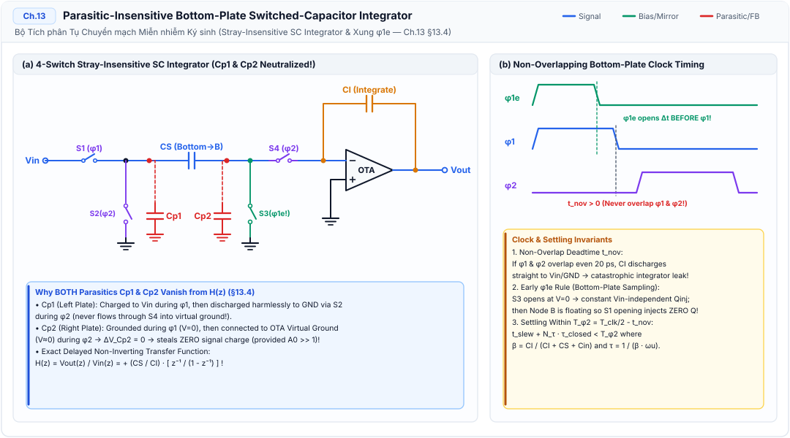

---
{
  "id": "topo-switched-capacitor-integrator-parasitic-insensitive",
  "kind": "topology",
  "domain": "sampled-and-clocked",
  "title_vi": "Bộ Tích phân Tụ Chuyển mạch Miễn nhiễm Ký sinh và Xung nhịp Hai Pha Không Chồng lấn (Parasitic-Insensitive Bottom-Plate SC Integrator)",
  "title_en": "Parasitic-Insensitive Bottom-Plate Switched-Capacitor Integrator and Non-Overlapping Two-Phase Clocking",
  "summary": "Từ điện trở tương đương Maxwell Req = 1/(CS*fCK) và hai khuyết tật chí mạng của bộ tích phân 2 công tắc nhạy ký sinh (phun điện tích phụ thuộc tín hiệu và méo điện tích tiếp giáp phi tuyến q_cj) đến kiến trúc cầu 4 công tắc miễn nhiễm ký sinh bản cực của Razavi §13.4: hàm truyền miền z đảo có trễ và không đảo không trễ, dịch chuyển cực/pha do độ lợi OTA hữu hạn A0 và băng thông hữu hạn GBW, cùng bộ tạo xung nhịp hai pha ngắt sớm phi1, phi1_e, phi2, phi2_e.",
  "diagram": "../../diagrams/sc-parasitic-insensitive-integrator.svg",
  "razavi_refs": [
    {
      "chapter": 13,
      "section": "13.4",
      "pages": "568-571",
      "equations": ["13.60", "13.61", "13.62", "13.63", "13.64"]
    }
  ],
  "glossary_codes": [
    "T014",
    "T015",
    "T038",
    "T060",
    "T069",
    "T074",
    "T1201",
    "T1413",
    "T1959",
    "T2079",
    "T2080",
    "T2081",
    "T2085",
    "T2135",
    "T2142",
    "T2146",
    "T2147",
    "T2148"
  ],
  "process_agnostic": true,
  "roles": {
    "switched_sampling_capacitor_c1": "Tụ chuyển mạch C1 mô phỏng điện trở rời rạc tương đương Req = 1/(C1*fCK), vận chuyển từng gói điện tích định lượng C1*Vin vào nút tích phân mỗi chu kỳ xung nhịp.",
    "integrating_feedback_capacitor_c2": "Tụ tích phân C2 mắc cố định từ ngõ vào đảo X sang ngõ ra Vout của OTA, cộng dồn không thất thoát các gói điện tích qua nhiều chu kỳ để thực hiện phép tích phân rời rạc 1/(1 - z^-1).",
    "four_switch_stray_insensitive_bridge": "Cầu bốn công tắc S1-S4 tách biệt hoàn toàn pha nạp và pha xả sao cho mọi tụ ký sinh bản đáy, bản đỉnh và tiếp giáp S/D đều bị khóa vào nguồn áp hoặc đất ảo.",
    "non_overlapping_early_clock_gen": "Mạch tạo xung nhịp hai pha không chồng lấp phi1, phi2 kèm hai nhánh ngắt sớm phi1_e, phi2_e ngăn phóng tắt điện tích giữa hai pha và khử phun điện tích phụ thuộc biên độ."
  },
  "symptoms_addressed": [
    "continuous-time-rc-time-constant-30-percent-pvt-drift",
    "bottom-plate-parasitic-shift-of-filter-cutoff-frequency",
    "source-drain-junction-capacitance-harmonic-distortion-in-integrators",
    "signal-dependent-switch-charge-injection-in-oversampled-sigma-delta-modulators"
  ],
  "limitations": [
    "integrator-leakage-and-dc-gain-saturation-from-finite-ota-gain-a0",
    "excess-phase-shift-and-gain-error-from-incomplete-gbw-settling",
    "double-kt-over-c1-sampled-thermal-noise-transferred-every-clock-cycle",
    "high-frequency-noise-and-blocker-aliasing-around-multiples-of-fck"
  ],
  "checklists": [
    "common-mos",
    "switched-capacitor",
    "spectre-pss-pnoise",
    "layout-and-matching"
  ]
}
---

## 1. Bản chất Nguyên lý, Sơ đồ Mạch & Vai trò Từng Nhánh Cấu trúc

Bộ tích phân là viên gạch nền tảng quan trọng bậc nhất của các bộ lọc bậc cao chính xác (`switched-capacitor biquad / ladder filters`) và bộ chuyển đổi tương tự–số lấy mẫu vượt mức điều chế $\Delta\Sigma$ (`oversampled Delta-Sigma ADC`). Trong miền thời gian liên tục (Hình 13.55, Phương trình 13.60), bộ tích phân RC chủ động cho $V_{out}(t) = -\frac{1}{R C_F}\int V_{in}(t)\,dt$, tức hằng số thời gian tích phân bị trói buộc trực tiếp vào tích số tuyệt đối $R \cdot C_F$. Trên một vi mạch CMOS công nghệ thực, $R_{\square}$ biến thiên $\pm 20\%$ và $C_{\text{unit}}$ biến thiên $\pm 10\%\text{–}15\%$ độc lập nhau qua các lô phiến bán dẫn và nhiệt độ (`PVT` — `T069`), làm tần số cắt bộ lọc trôi dạt tới $\pm 35\%$!



Chương 13 (§13.4, trang 568–571) dẫn dắt sự tiến hóa cấu trúc qua ba nấc thang vật lý rõ rệt để kiến tạo một **bộ tích phân tụ chuyển mạch (`switched-capacitor integrator` — `T2146`)** chính xác tuyệt đối:

1. **Nguyên lý Điện trở Tụ điện Chuyển mạch của Maxwell (`Switched-Capacitor Resistor`, `T2085`, Hình 13.56, Phương trình 13.61–13.62):**
   Một tụ điện $C_S$ được hai công tắc $S_1, S_2$ chuyển đổi luân phiên không chồng lấp giữa nút $A$ (điện thế $V_A$) và nút $B$ (điện thế $V_B$) ở tần số xung nhịp $f_{CK} = 1/T_{CK}$. Trong mỗi chu kỳ $T_{CK}$, một gói điện tích $\Delta Q = C_S(V_A - V_B)$ được múc từ nút $A$ đổ sang nút $B$, tạo nên dòng điện trung bình:
   $$I_{AB,\text{avg}} = \frac{C_S (V_A - V_B)}{T_{CK}} = C_S f_{CK} (V_A - V_B) \implies R_{\text{eq}} = \frac{1}{C_S f_{CK}}$$
   Khi thay điện trở $R$ của bộ tích phân bằng $R_{\text{eq}}$, hằng số thời gian tích phân biến thành $\tau_{\text{int}} = R_{\text{eq}} C_2 = \frac{C_2}{C_1 f_{CK}}$ — chỉ còn phụ thuộc vào **tỷ số hai tụ đồng dạng trên cùng một đế ($< 0.1\%$) và tần số dao động thạch anh ($< 50\text{ ppm}$)**!

2. **Bộ tích phân 2 Công tắc Nhạy Ký sinh và Hai Tử huyệt Vật lý (Hình 13.57–13.58, Phương trình 13.63–13.64):**
   Thay trực tiếp $R$ bằng mạng 2 công tắc nối tiếp tụ $C_1$ nối đất (Hình 13.57a) tuy cho phương trình bậc thang tích phân đảo $V_{out}[k] = V_{out}[k-1] - \frac{C_1}{C_2} V_{in}[k-1]$ (Phương trình 13.63), nhưng thất bại hoàn toàn trong các hệ thống độ chính xác cao ($\ge 10\text{–}16\text{ bit}$) vì **ba sai lầm cấu trúc tại nút đỉnh $P$ của $C_1$**:
   - *Tử huyệt 1 (Sai số tỷ số do tụ ký sinh bản cực):* Mọi tụ ký sinh từ nút $P$ xuống đế ($C_{p,P}$) đều nằm song song trực tiếp với $C_1$, làm hệ số tích phân thực tế biến thành $(C_1 + C_{p,P})/C_2$, phá vỡ độ chính xác tỷ số!
   - *Tử huyệt 2 (Phun điện tích kênh dẫn phụ thuộc tín hiệu):* Khi công tắc $S_1$ ngắt ở cuối pha lấy mẫu, điện tích kênh dẫn $\Delta q_1 = -\frac{1}{2} W_1 L_1 C_{ox}(V_{DD} - V_{in0} - V_{TH1}(V_{in0}))$ bơm thẳng vào $C_1$, sau đó bị đẩy toàn bộ sang tụ tích phân $C_2$ ở pha kế tiếp!
   - *Tử huyệt 3 (Méo phi tuyến do điện dung tiếp giáp nguồn/máng $C_j(V)$, Hình 13.58, Phương trình 13.64):* Cực máng của $S_1$ và cực nguồn của $S_2$ tạo nên tụ tiếp giáp p–n phi tuyến $C_j(V)$ nối từ nút $P$ xuống đất. Khi nạp tới $V_{in0}$, lượng điện tích tích trữ trên $C_j$ không phải hàm tuyến tính mà là tích phân phi tuyến:
     $$q_{cj}(V_{in0}) = \int_{0}^{V_{in0}} C_j(V)\,dV = \int_{0}^{V_{in0}} \frac{C_{j0}}{\left(1 + V / \phi_B\right)^m}\,dV$$
     Sang pha tích phân khi $S_2$ kéo nút $P$ về đất ảo $0\text{ V}$, **toàn bộ gói điện tích phi tuyến $q_{cj}(V_{in0})$ này được xả tràn sang tụ tích phân $C_2$**, gây méo hài bậc cao không thể cứu vãn cho bộ điều chế $\Delta\Sigma$!

3. **Kiến trúc Cầu 4 Công tắc Miễn nhiễm Ký sinh (`Stray-Insensitive Bottom-Plate SC Integrator`, Hình 13.59):**
   Bằng cách treo tụ $C_1$ nằm ngang giữa hai cặp công tắc đầu trái ($S_1, S_2$) và đầu phải ($S_3, S_4$), cấu trúc Hình 13.59 của Razavi xóa sạch cả ba tử huyệt trên trong một nhát cắt cấu trúc duy nhất:
   - **Biến thể Không đảo Có trễ (Hình 13.59 chuẩn của Razavi — `LDI Noninverting Delayed Integrator`):** Pha $\phi_1$ đóng $(S_1, S_3)$ nạp $C_1$ tới $V_{in}$ (bản phải nối đất qua $S_3$); chuyển tiếp mở $S_3$ sớm trên $\phi_{1e}$ rồi mở $S_1$ trên $\phi_1$; pha $\phi_2$ đóng $(S_2, S_4)$ nối bản trái xuống đất và bản phải vào đất ảo $X$, đẩy gói điện tích đảo chiều nạp làm $V_{out}$ tăng thêm $+\frac{C_1}{C_2} V_{in}$.
   - **Biến thể Đảo Không trễ / Nửa chu kỳ (`Inverting Delay-Free Integrator`):** Giữ $S_1, S_2$ như trên nhưng đảo pha điều khiển cặp công tắc bên phải: pha $\phi_1$ đóng $(S_2, S_3)$ xả sạch cả hai đầu $C_1$ xuống đất; pha $\phi_2$ đóng $(S_1, S_4)$ nạp $V_{in}$ trực tiếp vào bản trái đồng thời đẩy dòng điện tích $-C_1 V_{in}$ qua bản phải vào đất ảo $X$ lên $C_2$ ngay trong cùng pha $\phi_2$! (Trong mạch vi sai hoàn toàn, ta luôn ưu tiên biến thể **có trễ Hình 13.59** rồi đơn giản **tráo chéo cặp dây đầu vào vi sai** để thu được dấu đảo `inverting` mà không bắt OTA của hai tầng tích phân liên tiếp phải xác lập nối tiếp nhau trong cùng một pha!).

---

## 2. Hệ Phương trình Cốt lõi & Tư duy "Nhìn Mạch Đọc Nhanh" (Analysis by Inspection)

### 2.1. Chứng minh Vật lý Tuyệt đối Tính Miễn nhiễm Ký sinh tại Mọi Nút của Cầu 4 Công tắc
Gắn đầy đủ tụ ký sinh bản trái $C_{pL}$ (bao gồm $C_{pB}$ của $C_1$ + $C_j$ của $S_1, S_2$) tại nút trái $P$, và tụ ký sinh bản phải $C_{pR}$ (bao gồm $C_{pT}$ của $C_1$ + $C_j$ của $S_3, S_4$) tại nút phải $Q$:
- **Xét $C_{pL}$ tại nút trái $P$:** Ở $\phi_1$, $C_{pL}$ được nạp bởi nguồn áp $V_{in}$ qua $S_1$. Ở $\phi_2$, $S_2$ nối thẳng $P$ xuống đất cố định $0\text{ V}$: toàn bộ điện tích $q_{pL}(V_{in})$ xả thẳng xuống đất, **tuyệt đối không có con đường nào đi sang nút đất ảo $X$**!
- **Xét $C_{pR}$ tại nút phải $Q$:** Ở $\phi_1$, $S_3$ kẹp $Q$ tại đất $0\text{ V}$ ($V_Q = 0 \implies q_{pR}(\phi_1) = 0$). Sang $\phi_2$, $S_4$ nối $Q$ vào nút đất ảo $X$ của OTA ($V_Q = V_X \approx 0 \implies q_{pR}(\phi_2) \approx 0$). Vì điện áp hai đầu $C_{pR}$ giữ nguyên bằng $0\text{ V}$ ở cả đầu lẫn cuối quá trình truyền điện tích ($\Delta V_Q = 0$), **$C_{pR}$ và tụ tiếp giáp phi tuyến của $S_3, S_4$ không nhận và không nhả bất kỳ lượng điện tích nào**!
- **Xét phun điện tích của cả 4 công tắc ($S_1, S_2, S_3, S_4$):**
  1. $S_3$ mở đầu tiên trên xung sớm $\phi_{1e}$ tại điện thế cố định $0\text{ V}$ $\implies$ chỉ tiêm điện tích hằng số độc lập $V_{in}$ (bị triệt hoàn toàn bởi cấu trúc vi sai!).
  2. Khi $S_3$ đã mở, bản phải $Q$ lơ lửng nên việc $S_1$ mở ra hay $S_2$ đóng lại ở bản trái $P$ chỉ làm nhấp nhô điện thế tạm thời trước khi $P$ bị ghim cứng xuống $0\text{ V}$, không làm đổi tổng điện tích trên $Q$.
  3. Cuối $\phi_2$, công tắc $S_4$ (ngắt sớm trên $\phi_{2e}$ trước $S_2$) cũng nằm ngay tại nút đất ảo $V_X \approx 0$ $\implies$ điện tích phun vào $C_2$ cũng hoàn toàn độc lập với $V_{in}$!

### 2.2. Hàm Truyền Lý tưởng Miền $z$, Biến dạng Tần số Euler/Bilinear & Cặp Cực Biquad
Viết phương trình bảo toàn điện tích tại nút $X$ từ cuối chu kỳ $(k-1)T_{CK}$ sang cuối chu kỳ $k T_{CK}$ cho hai cấu hình cầu 4 công tắc:
1. **Tích phân Không đảo Có trễ (`LDI Delayed Integrator`, Hình 13.59):**
   $$C_2 V_{out}[k] = C_2 V_{out}[k - 1] + C_1 V_{in}\!\left[\left(k - \tfrac{1}{2}\right)\right] \quad \text{(lấy mẫu cuối }\phi_1\text{, xuất cuối }\phi_2\text{)}$$
   Tính theo lưới mẫu đồng bộ từng chu kỳ $T_{CK}$:
   $$H_{\text{delayed}}(z) = +\frac{C_1}{C_2}\,\frac{z^{-1}}{1 - z^{-1}} \implies H_{\text{delayed}}\!\left(e^{j\omega T_{CK}}\right) = \frac{C_1}{C_2}\,\frac{e^{-j\omega T_{CK}/2}}{j\,2\sin(\omega T_{CK}/2)}$$
2. **Tích phân Đảo Không trễ (`Delay-Free Inverting Integrator`):**
   $$V_{out}[k] = V_{out}[k - 1] - \frac{C_1}{C_2}\,V_{in}[k] \implies H_{\text{nodelay}}(z) = -\frac{C_1}{C_2}\,\frac{1}{1 - z^{-1}} = -\frac{C_1}{C_2}\,\frac{e^{+j\omega T_{CK}/2}}{j\,2\sin(\omega T_{CK}/2)}$$
**Nhìn nhanh pha lý tưởng:** So với bộ tích phân liên tục lý tưởng có pha đúng $-90^\circ$ (hoặc $+90^\circ$), mỗi bộ tích phân rời rạc riêng lẻ bị lệch pha thêm một lượng tuyến tính $\mp \omega T_{CK} / 2$. Tuy nhiên, khi ghép vòng **một bộ tích phân có trễ $z^{-1}/(1-z^{-1})$ với một bộ tích phân không trễ $-1/(1-z^{-1})$** (cấu trúc kinh điển `Lossless Discrete Integrator — LDI Loop` trong bộ lọc thang bậc cao và điều chế $\Delta\Sigma$ bậc $\ge 2$), hai lượng lệch pha $-\omega T_{CK}/2$ và $+\omega T_{CK}/2$ **tự triệt tiêu nhau chính xác bằng $0$**, bảo toàn hệ số phẩm chất $Q$ của khung cộng hưởng mà không bị tự kích dao động!

### 2.3. Ảnh hưởng Bất Lý tưởng của OTA: Độ lợi Hữu hạn $A_0$ ("Rò Tích phân") & Băng thông Hữu hạn $\text{GBW}$
Trong thiết kế thực tế, OTA có độ lợi DC hữu hạn $A_0$ ($V_X[k] = -V_{out}[k]/A_0$) và hằng số thời gian xác lập hữu hạn $\tau_{\text{int}}$ trong pha tích phân $\phi_2$.
1. **Sai số Cực và Pha do Độ lợi DC Hữu hạn $A_0$ (`Leaky Integrator`):**
   Viết đầy đủ bảo toàn điện tích tại nút $X$ trong pha $\phi_2$ tính cả điện dung cổng $C_{in}$ của OTA (với $S_3$ nối đất ở $\phi_1$, $S_4$ nối vào $X$ ở $\phi_2$):
   $$C_2\bigl(V_X[k] - V_{out}[k]\bigr) + C_{in} V_X[k] + C_1\bigl(V_X[k] - 0\bigr) = C_2\bigl(V_X[k-1] - V_{out}[k-1]\bigr) + C_{in} V_X[k-1] - C_1 V_{in}[k-1]$$
   Thay $V_X = -V_{out}/A_0$ và biến đổi sang miền $z$, hàm truyền thực tế trở thành:
   $$H_A(z) = \left(\frac{C_1}{C_2}\right) \frac{\dfrac{1}{1 + \frac{C_1 + C_2 + C_{in}}{C_2 A_0}}\,z^{-1}}{1 - \left(\dfrac{1 + \frac{C_2 + C_{in}}{C_2 A_0}}{1 + \frac{C_1 + C_2 + C_{in}}{C_2 A_0}}\right) z^{-1}} = \frac{g_0\,z^{-1}}{1 - p_0\,z^{-1}}$$
   - **Hệ quả sống còn cho $\Delta\Sigma$ ADC:** Cực của bộ tích phân không còn nằm trên đường tròn đơn vị tại $z = 1$ nữa mà **thụt lùi vào bên trong tại $p_0 \approx 1 - \frac{C_1}{C_2 A_0}$**! Độ lợi tích phân ở DC bị chặn trần đúng bằng $H_A(1) = A_0 \frac{C_1}{C_1} = A_0$ (độc lập với $C_1/C_2$!). Trong bộ điều chế $\Delta\Sigma$, sự "rò tích phân" (`integrator leakage`) $1 - p_0 = \frac{C_1}{C_2 A_0}$ đẩy các điểm không của hàm truyền nhiễu lượng tử (`NTF zeros`) rời khỏi $f = 0$, làm lấp đầy hố nén nhiễu trong dải gốc nếu $A_0 < \text{OSR} / \pi$!
2. **Sai số Xác lập Chưa Hoàn tất do Băng thông Hữu hạn (`Incomplete Settling` $\epsilon_s = e^{-T_{\phi2}/\tau_{\text{int}}}$):**
   Trong pha $\phi_2$, hằng số thời gian vòng kín của bộ tích phân tuân theo đúng Phương trình (13.50)/(13.59):
   $$\tau_{\text{int}} = \frac{C_1 + C_2 + C_{in}}{G_m C_2}\left[C_L + \frac{C_2(C_1 + C_{in})}{C_1 + C_2 + C_{in}}\right] = \frac{C_{L,\text{eff}}}{\beta_{\text{int}} G_m}, \qquad \beta_{\text{int}} = \frac{C_2}{C_1 + C_2 + C_{in}}$$
   Nếu cuối pha $\phi_2$ còn sót phần trăm chưa xác lập tuyến tính $\epsilon_s = e^{-T_{\phi2}/\tau_{\text{int}}} \ll 1$ (chưa rơi vào slewing!), do tụ $C_1$ bị tháo ra xả sạch ở pha $\phi_1$ kế tiếp nên lượng điện tích chưa kịp chuyển sang $C_2$ bị mất đi, làm suy giảm hệ số tích phân hữu hiệu thành $(C_1/C_2)(1 - \epsilon_s)$; miễn là OTA **không bị slewing**, sai số $\epsilon_s$ chỉ gây sai số tỷ lệ tuyến tính chứ không gây méo hài (nhưng nếu OTA rơi vào slewing làm tốc độ phụ thuộc biên độ, hài bậc ba HD3 sẽ bùng nổ ngay lập tức!).

### 2.4. Mật độ Phổ Nhiễu Lấy mẫu Kép $2kT/C_1$ của Nhánh Tụ Chuyển mạch
Khác với mạch lấy mẫu đơn chỉ chịu một lần $kT/C$, trong cầu 4 công tắc Hình 13.59 mỗi chu kỳ có **hai sự kiện đóng băng nhiễu nhiệt độc lập** trên tụ $C_1$:
1. Cuối pha $\phi_1$: nhiễu nhiệt của $R_{on1} + R_{on3}$ bị đóng băng trên $C_1$ với phương sai điện tích $\overline{q_{n,\phi1}^2} = k T C_1$.
2. Trong pha $\phi_2$: nhiễu nhiệt của $R_{on2} + R_{on4}$ cộng với nhiễu nhiệt của chính OTA bơm thêm vào quá trình truyền điện tích sang $C_2$ một phương sai $\overline{q_{n,\phi2}^2} = k T C_1 (1 + \chi_{\text{OTA}})$ (với $\chi_{\text{OTA}} \approx \frac{2\gamma}{3 \beta_{\text{int}} (R_{on2}+R_{on4}) G_m}$ khi $R_{on} G_m \ll 1$, hoặc xấp xỉ $\frac{4\gamma}{3}$ quy đổi).
Quy đổi tổng điện tích nhiễu mỗi chu kỳ về điện áp nhiễu tương đương ở ngõ vào nhánh $C_1$ (cho sơ đồ đơn cực; nhân $2$ về phương sai áp nhưng biên độ tín hiệu tăng $2\times$ nên $\text{SNR}$ vi sai tăng $+3\text{ dB}$):
$$\overline{V_{n,\text{in,eq}}^2} \approx \frac{2 k T}{C_1} + \overline{V_{n,\text{OTA},\phi2}^2}\left(\frac{C_2}{C_1}\right)^2 \quad \text{(trải đều trên dải Nyquist } [0, f_{CK}/2]\text{, giảm đi OSR lần trong dải tín hiệu } f_B = \frac{f_{CK}}{2\,\text{OSR}}\text{!)}$$

---

## 3. Bất biến Cấu trúc & Các Bẫy Lỗi Kinh điển (Structural Invariants & Traps)

- **`[INV-SCINT-01]` Bất biến Bốn Xung Nhịp Không Chồng lấn & Ngắt Sớm Kép ($\phi_{1e}, \phi_1, \phi_{2e}, \phi_2$):**
  Mạch tạo xung nhịp từ cổng chốt chéo NOR/NAND bắt buộc xuất 4 pha chuẩn xác:
  - Cuối $\phi_1$: $\phi_{1e}$ (điều khiển công tắc đất sạch $S_3$) ngắt trước $\phi_1$ (điều khiển công tắc tín hiệu $S_1$).
  - Khoảng chết 1: cả 4 công tắc đều mở ($\phi_1 = \phi_2 = 0$).
  - Cuối $\phi_2$: $\phi_{2e}$ (điều khiển công tắc đất ảo $S_4$) ngắt trước $\phi_2$ (điều khiển công tắc nối đất bản trái $S_2$).
  - Khoảng chết 2: cả 4 công tắc đều mở trước khi $\phi_1$ chu kỳ mới bật lên.
  Nếu $\phi_1$ và $\phi_2$ chồng lấn dù chỉ $30\text{ ps}$ ở góc nhanh `FF`, $S_3$ và $S_4$ cùng dẫn sẽ **nối tắt trực tiếp nút đất ảo $X$ xuống đất cố định**, làm xả trôi bộ nhớ tích phân trên $C_2$!
- **`[INV-SCINT-02]` Bất biến Khởi tạo và Làm tươi Mức Chế độ Chung Nút Đất ảo $X$:**
  Trong bộ tích phân SC lý tưởng (khác với mạch khuếch đại đặt lại §13.3.2!), tụ tích phân $C_2$ **không bao giờ có công tắc nối tắt song song** trong suốt quá trình vận hành (trừ một xung `POR_RESET` duy nhất lúc mới bật nguồn!). Do đó nút ngõ vào vi sai $X^+, X^-$ của OTA chỉ nhìn thấy các tụ điện và công tắc: nếu các công tắc $S_3, S_4$ tham chiếu tới mức áp $V_{CM,\text{in}}$ bị trôi hoặc rò bất đối xứng ở nhiệt độ cao, mức đồng pha đầu vào của OTA sẽ trôi ra ngoài `ICMR` trừ khi $S_3$ kẹp đúng vào $V_{CM,\text{in}}$ chuẩn xác mỗi chu kỳ!
- **`[TRAP-SCINT-01]` Bẫy Quên Chống Chồng Phổ Đầu vào (`Missing Continuous-Time Anti-Aliasing Pre-Filter`):**
  Vì nhánh tụ $C_1$ lấy mẫu trực tiếp tín hiệu vào ở tốc độ $f_{CK}$, mọi thành phần nhiễu cao tần hoặc tín hiệu gây nhiễu nằm quanh $k \cdot f_{CK} \pm f_{\text{sig}}$ ($k = 1, 2, 3\dots$) đều bị gập nguyên vẹn vào trong dải thông bộ lọc SC mà bộ tích phân không hề phân biệt được! Mọi hệ thống SC thực tế bắt buộc đặt một bộ lọc thông thấp RC liên tục bậc $1\text{–}2$ đơn giản phía trước để dập tần số quanh $f_{CK}$.
- **`[TRAP-SCINT-02]` Bẫy Slewing Tầng Tích phân Đầu tiên của $\Delta\Sigma$ Modulator Làm Mọc Đầy Hài & Tăng Sàn Nhiễu:**
  Ở tầng tích phân đầu tiên nhận bước nhảy phản hồi lớn $\pm V_{REF}$ từ DAC 1-bit cùng với tín hiệu vào, đầu pha $\phi_2$ tạo xung áp lớn tại nút $X$. Nếu dòng đuôi $I_{SS}$ của OTA không đủ đáp ứng tốc độ biến thiên cực đại $I_{SS} > C_{L,\text{eff}} \frac{\Delta V_{\text{max}}}{0.25\,T_{\phi2}}$, quá trình slewing phi tuyến không chỉ sinh hài bậc lẻ mà còn **trộn tần nhiễu lượng tử tần số cao của $\Delta\Sigma$ dội ngược xuống dải gốc (`quantization noise folding`)**, nâng sàn nhiễu lên hàng chục dB!
- **`[TRAP-SCINT-03]` Bẫy Đấu Ngược Bản Đáy của Tụ Tích phân $C_2$:**
  Với $C_2$, **bản đáy (`bottom plate`)** bắt buộc nối về phía **ngõ ra $V_{out}$** của OTA (cộng ký sinh $C_{pB2}$ vào tải $C_L$, đôi khi còn giúp cải thiện dự trữ pha cho OTA 1 tầng!), còn **bản đỉnh (`top plate`)** nối về nút đất ảo $X$. Đấu ngược sẽ cộng $C_{pB2}$ vào $C_{in}$, làm giảm $\beta_{\text{int}}$ và dẫn thẳng nhiễu đế bán dẫn vào nút tích phân!

---

## 4. Lộ trình Nâng cấp Cấu trúc & Bát giác Đánh đổi (Upgrade Paths & Design Octagon)

Trên `concept-analog-design-octagon`, cầu tích phân SC 4 công tắc đánh đổi **Băng thông OTA gấp $5\text{–}10\times$ tần số xung nhịp** và **Hệ sinh thái Xung nhịp Đa pha** để đạt **Độ chính xác Hằng số Thời gian Tuyệt đối ($< 0.1\%$)** không cần bất kỳ mạch hiệu chỉnh (`tuning loop`) nào:

| Tiêu chí So sánh | Tích phân Liên tục Active-RC (Hình 13.55) | Tích phân SC 2 Công tắc Nhạy Ký sinh (Hình 13.57) | Tích phân SC 4 Công tắc Miễn nhiễm Ký sinh (Hình 13.59) |
| :--- | :--- | :--- | :--- |
| **Độ chính xác hằng số $\tau$ qua PVT** | Kém ($\pm 25\%\text{–}35\%$ do tích $R \cdot C$) | Lệch hệ thống $5\%\text{–}15\%$ do $C_{pB} + C_j$ | **Tuyệt hảo ($< 0.1\%$ theo tỷ số $C_1/C_2$ & $f_{CK}$)** |
| **Méo hài do tiếp giáp S/D $C_j(V)$** | Không có công tắc trên đường tín hiệu | **Rất nặng** ($q_{cj} = \int C_j(V)dV$ đổ vào $C_2$) | **Triệt tiêu hoàn toàn** ($\Delta V = 0$ tại nút đất ảo) |
| **Độ tuyến tính tín hiệu lớn đầu vào** | Siêu tuyến tính (nhờ điện trở poly dài) | Kém (phun điện tích $\Delta q_1(V_{in})$) | Cao (phụ thuộc công tắc $S_1$ $\to$ dùng Bootstrap) |
| **Yêu cầu GBW của lõi OTA** | Vừa phải ($\text{GBW} \approx (2\text{–}4)\,\omega_u$) | Cao ($\text{GBW} \ge (5\text{–}8)\,f_{CK}/\beta$) | Cao ($\text{GBW} \ge (5\text{–}8)\,f_{CK}/\beta$) |
| **Khả năng lọc chống chồng phổ tự thân** | **Có sẵn** (bản chất thông thấp liên tục) | Không (bị gập phổ quanh $k \cdot f_{CK}$) | Không (cần lọc RC đơn giản đặt trước) |

- **Lộ trình nâng cấp cho Tầng 1 Bộ điều chế $\Delta\Sigma$ Độ phân giải Siêu cao ($16\text{–}20\text{ bit}$):**
  - Để triệt đồng thời điện áp lệch $V_{OS}$, nhiễu $1/f$ của OTA và nâng độ lợi DC hiệu dụng từ $A_0$ lên tỷ lệ với $A_0^2$ (khử hoàn toàn hiện tượng rò tích phân `integrator leakage` ở tiến trình nanomet!), nâng cấp sang **Bộ tích phân SC Lấy mẫu Kép Tương quan (`CDS / Correlated-Double-Sampling SC Integrator`)** bằng cách tích hợp tụ nhớ phụ lưu điện áp nút $X$ ở pha $\phi_1$ theo `tech-dynamic-offset-cancellation-az-cds` hoặc dùng điều biến băm `tech-chopper-stabilization-vs-autozeroing` bao quanh OTA!
  - Toàn bộ cấu trúc vi sai bắt buộc ghép với `tech-switched-capacitor-cmfb` và định cỡ công tắc theo `topo-mos-and-cmos-sampling-switches` / `topo-bootstrapped-sampling-switch`.

---

## 5. Thích ứng Đa Tiến trình (90nm / 65nm / 45nm) & Cách Kiểm chứng trong Cadence / Spectre

### 5.1. Quy tắc Thiết kế trên Tiến trình Nanomet (`90nm` / `65nm` / `45nm`)
1. **Định cỡ Tụ Tầng 1 so với Các Tầng Sau (`Thermal Noise Scaling Across Stages`):**
   - Trong chuỗi tích phân nối tầng (ví dụ $\Delta\Sigma$ bậc 3), chỉ có nhiễu của **bộ tích phân Tầng 1** cộng thẳng vào đầu vào, còn nhiễu của Tầng 2 và Tầng 3 bị chia nhỏ đi tương ứng bởi độ lợi tích phân khổng lồ của các tầng đứng trước trong dải tín hiệu! Do đó định cỡ $C_{1,\text{stage1}}$ đủ lớn theo trần $\frac{2kT}{C_1\,\text{OSR}}$ (ví dụ $C_1 = 1\text{–}4\text{ pF}$), sau đó **thu nhỏ tụ và dòng phân cực OTA đi $4\times\text{–}8\times$ ở Tầng 2, Tầng 3** để tiết kiệm diện tích và công suất!
2. **Thiết kế Bộ tạo Xung nhịp Hai pha Ngắt sớm Bền vững qua Góc PVT:**
   - Dùng cấu trúc chốt chéo hai cổng `NOR` (cho xung dương) chèn chuỗi số chẵn cổng đảo có tải tụ nhỏ tạo khoảng không chồng lấn $t_{\text{nov}} \approx 250\text{–}400\text{ ps}$, tách tín hiệu $\phi_{1e}, \phi_{2e}$ **trước** hai cổng đảo cuối cùng dẫn ra $\phi_1, \phi_2$ để độ trễ mở sớm $\Delta t_{\text{early}} \approx 2\,t_{\text{inv}}$ luôn dương bất biến trên mọi góc `FF/-40C` đến `SS/125C`.
   - Với công tắc dùng cổng truyền CMOS (`transmission gate`), xung đảo $\overline{\phi_1}, \overline{\phi_2}$ phải được căn chỉnh đối xứng trễ bằng một cổng truyền giả luôn dẫn (`always-on pass gate`) tương tự kỹ thuật cân bằng trễ Hình 16.44c để NMOS và PMOS ngắt đồng thời.

### 5.2. Phác đồ Kiểm chứng Chuyên sâu trong Cadence Spectre / SpectreRF
1. **Kiểm tra Bất biến Xung nhịp qua PVT & Sau Trích xuất Ký sinh (`tran` + `assert`):**
   - Xác nhận không bao giờ có khoảnh khắc $V(\phi_1) > V_{TH,N}$ đồng thời với $V(\phi_2) > V_{TH,N}$, và xác nhận sườn xuống của $\phi_{1e}$ chạm $0.1\,V_{DD}$ trước khi $\phi_1$ tụt qua $0.8\,V_{DD}$.
2. **Đo Chính xác Hàm Truyền Tích phân $H(e^{j\omega T_{CK}})$, Độ lợi DC Rò ($H(1)$) và Nhiễu Gập Phổ bằng `SpectreRF PSS + PAC + PNoise`:**
   - Lưu ý: vì bộ tích phân lý tưởng không có đường hồi tiếp DC tĩnh cho đầu vào thử (sẽ trôi bão hòa nếu có $0.1\,\mu\text{V}$ lệch trong `pss` hở vòng!), khi chạy `pss` cho riêng một khối tích phân đơn lẻ, hãy khép một điện trở lý tưởng cực lớn ($R_{\text{dc,servo}} = 10\text{ G}\Omega$ kèm tụ cách ly lớn hoặc đặt nó ngay trong vòng kín bộ lọc biquad/modulator) để giữ điểm làm việc DC tại $V_{CM}$ mà không ảnh hưởng dải tần đo `pac` từ $10\text{ Hz}$ trở lên!
```spice
// Kiem chung Bo tich phan SC mien nhiem ky sinh (f_ck = 12.8 MHz, C1 = 0.5 pF, C2 = 2.0 pF)
// Tang so luong sideband (maxsideband=40) de bat tron nhieu nhiet 2*k*T/C1 gap ve dai goc
pss_int  pss  fund=12.8M  harms=0  errpreset=conservative  tstab=2u  method=gear2only

// 1) Do bien do & pha H(z) tu 10 Hz den Nyquist 6.4 MHz bang PAC (sideband = 0):
//    Tai f -> 10 Hz: |H| tiem can A0_eff (kiem tra rò tích phân do A0 huu han!)
//    Tai f_u = (C1/C2)*f_ck / (2*pi) = 509.3 kHz: |H| cat 0 dB, pha ~ -90 deg - 180*(f_u/f_ck)
pac_int  pac  start=10  stop=6.4M  dec=25  maxsideband=25

// 2) Do mat do pho nhieu tai thoi diem ket thuc pha tich phan phi2:
pnoise_int (vout_p vout_n) pnoise start=10 stop=6.4M dec=20 \
    maxsideband=40 noisetype=timedomain numberofpoints=1 timepoints=[t_end_phi2]
// Tich phan nhieu trong bang thong tin hieu f_B = 20 kHz (OSR = 320):
// Vn_inband_rms = sqrt(integ(pow(getData("out" ?result "pnoise_sample_pm0"), 2), 10, 20e3))
```

---

## 6. Mốc Đối chiếu Sách Razavi & Thuật ngữ Chuẩn CLB

| Mục Sách Razavi (2nd Ed.) | Trang & Phương trình | Nội dung Đối chiếu Trọng tâm | Mã Thuật ngữ Chuẩn CLB |
| :--- | :--- | :--- | :--- |
| **§13.4 Continuous vs Discrete Resistor** | Tr. 568–569, Fig. `13.55–13.56`, Eq. `(13.60)–(13.62)` | Bộ tích phân liên tục $-1/(R C_F)\int V_{in}dt$ và nhận thức của Maxwell về điện trở tụ chuyển mạch $R_{\text{eq}} = (C_S f_{CK})^{-1}$ | `T2080` (mạch tương đương tụ điện chuyển mạch), `T2081` (điện trở trung bình tương đương), `T2085` (điện trở tụ điện chuyển mạch), `T2079` (tần số xung nhịp) |
| **§13.4 Parasitic-Sensitive Integrator** | Tr. 569–570, Fig. `13.57–13.58`, Eq. `(13.63)–(13.64)` | Phương trình sai phân $V_{out}(k T_{CK})$ và hai khuyết tật chí mạng: phun điện tích $S_1$ + điện tích tiếp giáp phi tuyến $q_{cj} = \int_0^{V_{in0}} C_j dV$ | `T038` (Tín hiệu rời rạc theo thời gian), `T1959` (hoạt động thời gian rời rạc), `T014` (Phun điện tích) |
| **§13.4 Parasitic-Insensitive Integrator** | Tr. 570–571, Fig. `13.59(a)–(c)` | Cầu 4 công tắc $S_1\text{–}S_4$ với $S_3$ ngắt sớm đầu tiên, bản trái dẫn động bởi nguồn áp, bản phải nối đất ảo giúp miễn nhiễm hoàn toàn tụ ký sinh và phun điện tích | `T2146` (bộ tích phân tụ chuyển mạch), `T2147` (xung nhịp hai pha không chồng lấp), `T2135` (lấy mẫu tấm đáy), `T015` (Triệt tiêu hiện tượng phun điện tích) |
