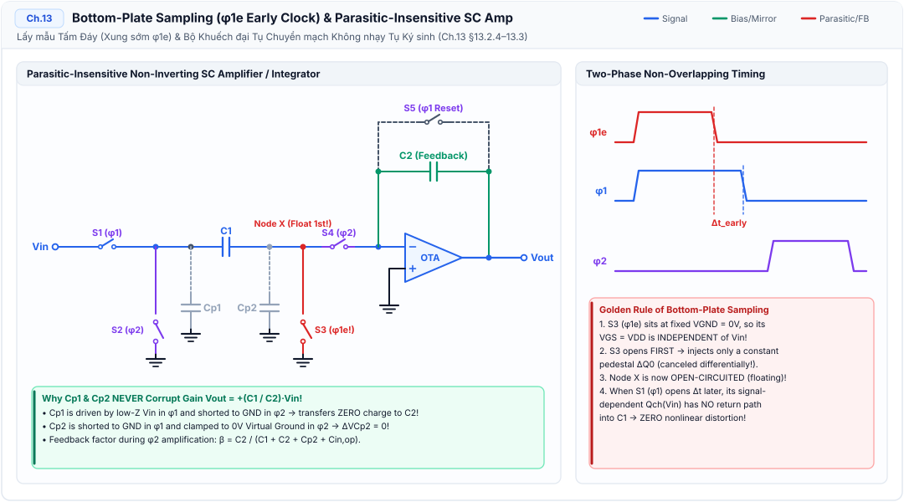

---
{
  "id": "topo-switched-capacitor-unity-and-multiplying-amps",
  "kind": "topology",
  "domain": "sampled-and-clocked",
  "title_vi": "Bộ Đệm Độ lợi Đơn vị Lật Tụ, Bộ Khuếch đại Nhân Tỷ số C1/C2 Đặt lại và Mạch Nhân đôi Chính xác (SC Unity-Gain, Multiplying & Flip-Around 2x Amplifiers)",
  "title_en": "Switched-Capacitor Unity-Gain Sampler/Buffer, Resettable C1/C2 Multiplying Amplifier, and Precision Multiply-by-Two Stage",
  "summary": "Giải phẫu định lượng ba kiến trúc khuếch đại tụ chuyển mạch cốt lõi trong Razavi §13.3: mạch đệm độ lợi đơn vị lật tụ (flip-around sampler), bộ khuếch đại nhân không đảo đặt lại theo tỷ số C1/C2 và mạch nhân đôi lật tụ chính xác C1=C2=C — suy diễn từ bảo toàn điện tích hệ số hồi tiếp beta = C2/(C1+C2+Cin), sai số độ lợi tĩnh 1/(beta*A0), hằng số thời gian xác lập vòng kín tau_amp, zero truyền thẳng nửa mặt phẳng phải và cơ chế tự động triệt lệch VOS của Op-Amp.",
  "diagram": "../../diagrams/bottom-plate-sampling-sc.svg",
  "razavi_refs": [
    {
      "chapter": 13,
      "section": "13.3.1-13.3.3",
      "pages": "555-568",
      "equations": ["13.38", "13.39", "13.40", "13.41", "13.43", "13.46", "13.49", "13.50", "13.51", "13.54", "13.56", "13.58", "13.59"]
    }
  ],
  "glossary_codes": [
    "T014",
    "T015",
    "T038",
    "T042",
    "T051",
    "T060",
    "T074",
    "T079",
    "T1201",
    "T1369",
    "T1413",
    "T1541",
    "T1958",
    "T1971",
    "T1973",
    "T1975",
    "T2135",
    "T2142",
    "T2143",
    "T2144",
    "T2145",
    "T2149"
  ],
  "process_agnostic": true,
  "roles": {
    "bottom_plate_sampling_network": "Cặp công tắc lấy mẫu S1 (phía tín hiệu Vin) và S2 (phía nút đất ảo X ngắt sớm trên xung phi1_e) đóng băng điện tích lấy mẫu mà không bị nhiễm phun điện tích phụ thuộc tín hiệu.",
    "flip_around_capacitor_ch": "Tụ lấy mẫu kiêm tụ hồi tiếp CH trong mạch đệm độ lợi đơn vị và mạch nhân đôi chính xác: thu nhận Vin trong pha phi1 rồi lật vòng sang ngõ ra OTA trong pha phi2 để tối đa hóa hệ số hồi tiếp beta.",
    "ratioed_multiplying_pair_c1_c2": "Mạng hai tụ đồng dạng C1 (tụ lấy mẫu đầu vào) và C2 (tụ hồi tiếp đặt lại) ép chuyển điện tích qua nút đất ảo để kiến tạo độ lợi điện áp rời rạc Av = C1/C2 miễn nhiễm biến thiên PVT.",
    "transconductance_ota_core": "Bộ khuếch đại hỗ dẫn thuật toán (OTA) duy trì nút đất ảo VX = -Vout/A0 và cung cấp dòng đuôi ISS cùng hỗ dẫn Gm để xác lập điện áp trên tải tụ hiệu dụng trong nửa chu kỳ xung nhịp."
  },
  "symptoms_addressed": [
    "resistive-feedback-loading-and-poor-sheet-resistance-matching",
    "signal-dependent-channel-charge-injection-distortion",
    "bottom-plate-substrate-parasitic-gain-attenuation",
    "severe-feedback-factor-degradation-in-mdac-gain-of-two-stages",
    "opamp-dc-offset-corrupting-sampled-residue-amplification"
  ],
  "limitations": [
    "static-gain-error-inversely-proportional-to-beta-times-a0",
    "input-transistor-gate-capacitance-cin-degrades-feedback-factor",
    "feedforward-rhp-zero-gm-over-c2-eroding-phase-margin",
    "open-loop-opamp-glitching-during-non-overlapping-dead-time",
    "two-phase-kt-over-c-and-ota-wideband-thermal-noise-accumulation"
  ],
  "checklists": [
    "common-mos",
    "switched-capacitor",
    "spectre-pss-pnoise",
    "folded-cascode"
  ]
}
---

## 1. Bản chất Nguyên lý, Sơ đồ Mạch & Vai trò Từng Nhánh Cấu trúc

Trong các hệ thống xử lý tín hiệu mẫu rời rạc như bộ chuyển đổi tương tự–số đường ống (`Pipelined ADC`), bộ khuếch đại khả trình (`PGA`) hay giao diện cảm biến chính xác, mạch hồi tiếp bằng điện trở thuần vấp phải hai rào cản vật lý trên chip CMOS (Razavi §13.1 & §13.3, trang 539–556): (1) mạng điện trở gây tải dòng trực tiếp làm sụp đổ độ lợi vòng hở của OTA một tầng trở kháng ra cao, và (2) điện trở diện tích vừa phải chỉ khớp nhau cỡ $0.2\%\text{–}0.5\%$ kèm tụ phân bố làm chậm đáp ứng. Ngược lại, **mạch hồi tiếp điện dung (`capacitive feedback` — `T1958`)** không tiêu thụ dòng tĩnh từ ngõ ra OTA và cho phép lập tỷ số hình học giữa các ô tụ kim loại đồng dạng với độ khớp $0.02\%\text{–}0.08\%$. Tuy nhiên, tụ điện nguyên khối luôn mang điện dung ký sinh bản đáy xuống đế bán dẫn $C_{pB} \approx 5\%\text{–}10\%\,C$ (Hình 13.29) và thiếu đường xác lập điểm làm việc DC tại nút cổng OTA nếu không có công tắc đặt lại định kỳ.

Chương 13 (§13.3.1–13.3.3) xây dựng ba kiến trúc **bộ khuếch đại tụ chuyển mạch không nhạy tụ ký sinh (`parasitic-insensitive switched-capacitor amplifier` — `T2145`)** giải quyết đồng thời bài toán phân cực DC, phun điện tích kênh dẫn và điện dung ký sinh bản cực:



1. **Bộ lấy mẫu / đệm độ lợi đơn vị lật tụ (`Unity-Gain Sampler/Buffer`, §13.3.1, Hình 13.31–13.35):**
   - *Cấu trúc:* Chỉ dùng một tụ giữ mẫu duy nhất $C_H$ (hoặc cặp $C_H$ đối xứng vi sai trong Hình 13.35) cùng ba công tắc $S_1, S_2, S_3$ quanh OTA.
   - *Hoạt động hai pha:* Trong **chế độ lấy mẫu (`sampling mode` — `T2143`, pha $\phi_1$)**, $S_1$ nối bản trái (bản đáy) của $C_H$ vào $V_{in}$, còn $S_2$ nối tắt ngõ ra với ngõ vào đảo $X$ của OTA tạo vòng đệm độ lợi đơn vị ($V_X \approx 0$), nạp điện áp $V_{in0}$ lên $C_H$. Khi chuyển sang **chế độ giữ mẫu / khuếch đại (`hold / amplification mode` — `T2144`, pha $\phi_2$)**, công tắc đất ảo $S_2$ **ngắt trước** trên sườn sớm $\phi_{1e}$, cố định tổng điện tích tại nút cô lập $X$; kế đến $S_1$ ngắt trên $\phi_1$; và cuối cùng $S_3$ đóng trên $\phi_2$ **lật bản trái của $C_H$ vòng sang ngõ ra $V_{out}$** (`flip-around`). Bảo toàn điện tích ép $V_{out}$ nhảy lên tái tạo đúng mẫu $V_{in0}$ với hệ số hồi tiếp đạt ngưỡng tối đa $\beta \approx 1$.
2. **Bộ khuếch đại nhân không đảo đặt lại theo tỷ số $C_1 / C_2$ (`Resettable Noninverting Multiplying SC Amplifier`, §13.3.2, Hình 13.43–13.46):**
   - *Cấu trúc:* Dùng tụ lấy mẫu đầu vào $C_1$, tụ hồi tiếp $C_2$ nối cố định giữa nút $X$ và $V_{out}$, công tắc đặt lại $S_2$ mắc song song $C_2$, và cặp công tắc đầu vào $S_1$ (nối $V_{in}$ ở $\phi_1$) – $S_3$ (kéo bản trái $P$ của $C_1$ xuống đất cố định ở $\phi_2$).
   - *Hoạt động hai pha:* Ở pha $\phi_1$, $S_1$ và $S_2$ dẫn: $C_2$ bị xả sạch về $0\text{ V}$ đồng thời đặt OTA vào trạng thái đất ảo $V_X \approx 0$, nạp điện tích $Q_{C1} = C_1 V_{in0}$ lên $C_1$. Cuối $\phi_1$, $S_2$ mở sớm trên $\phi_{1e}$ cô lập nút $X$, rồi $S_1$ mở. Sang pha $\phi_2$, $S_3$ đóng kéo nút $P$ từ $V_{in0}$ sập xuống $0\text{ V}$ ($\Delta V_P = -V_{in0}$); toàn bộ gói điện tích $-C_1 V_{in0}$ thoát khỏi bản phải $C_1$ buộc phải rút từ bản trái $C_2$, đẩy ngõ ra vọt lên cùng cực tính $V_{out} = +(C_1 / C_2) V_{in0}$!
3. **Mạch nhân đôi điện áp chính xác kiểu lật tụ (`Precision Multiply-by-Two Circuit / Flip-Around 2x MDAC`, §13.3.3, Hình 13.53–13.54):**
   - *Động lực cấu trúc:* Nếu thực hiện độ lợi bằng $2$ bằng cấu trúc §13.3.2 với $C_1 = 2C, C_2 = C$, hệ số hồi tiếp sụt xuống $\beta = \frac{C}{3C + C_{in}} < \frac{1}{3}$, vừa làm tăng sai số độ lợi tĩnh vừa kéo dài hằng số thời gian xác lập.
   - *Cấu trúc lật tụ:* Sử dụng hai tụ bằng nhau $C_1 = C_2 = C$. Trong pha $\phi_1$ (Hình 13.53b), cả $C_1$ và $C_2$ mắc song song giữa $V_{in}$ và đất ảo $X$ (qua công tắc đặt lại $S_3$), tích lũy tổng điện tích $2 C V_{in0}$. Khi chuyển sang pha $\phi_2$ (Hình 13.53c & 13.54), $S_3$ mở sớm trước tiên, sau đó **tụ $C_1$ được lật vòng qua ngõ ra OTA làm tụ hồi tiếp** trong khi bản trái của $C_2$ được nối xuống đất $0\text{ V}$ để dồn toàn bộ gói điện tích $C V_{in0}$ của $C_2$ sang cộng thêm vào $C_1$. Kết quả thu được điện áp ra chính xác $V_{out} = 2 V_{in0}$ nhưng giữ được hệ số hồi tiếp lớn gấp rưỡi: $\beta = \frac{C}{2C + C_{in}} \approx \frac{1}{2}$!

---

## 2. Hệ Phương trình Cốt lõi & Tư duy "Nhìn Mạch Đọc Nhanh" (Analysis by Inspection)

### 2.1. Định luật Bảo toàn Điện tích Nút Thả nổi $X$ & Cơ chế Khử Phun Điện tích Kênh dẫn (Phương trình 13.38–13.39)
Điểm tinh túy nhất của kỹ thuật **lấy mẫu tấm đáy (`bottom-plate sampling` — `T2135`, Hình 13.32–13.34 & Hình 13.44–13.45)** nằm ở trình tự thời gian ngắt công tắc:
- Khi công tắc đất ảo $S_2$ ngắt trên xung sớm $\phi_{1e}$, cực nguồn và cực máng của $S_2$ luôn nằm tại thế đất ảo cố định $V_X \approx 0$ (hoặc $V_{CM}$ không đổi), hoàn toàn không phụ thuộc biên độ tín hiệu đầu vào $V_{in0}$. Do đó lượng điện tích kênh dẫn bơm vào nút $X$ là một hằng số $\Delta q_2 = -\frac{1}{2} W_2 L_2 C_{ox}(V_{DD} - V_{CM} - V_{TH2})$. Khi ghép thành sơ đồ vi sai đối xứng (Hình 13.35, có thêm công tắc cân bằng giữa hai nhánh nếu cần), thành phần đồng pha này tự động triệt tiêu, chỉ còn lại sai lệch bậc hai do lệch ngưỡng $\Delta V_{TH}$ mà không còn sai lệch hiệu ứng thân phi tuyến phụ thuộc tín hiệu như khi đặt công tắc ở phía $V_{in}$ (đối chiếu Phương trình 13.38–13.39)!
- Ngay khoảnh khắc $S_2$ mở hoàn toàn, **nút $X$ trở thành một đảo điện môi cô lập hoàn toàn về mặt một chiều**: bất kể sau đó công tắc đầu vào $S_1$ mở ra bơm gói điện tích phi tuyến lớn $\Delta q_1(V_{in0})$ vào nút $P$, hay công tắc $S_3$ đóng lại hấp thụ điện tích tại nút $P$ (Hình 13.45), tổng điện tích ròng trên các bản cực nối vào nút $X$ **bắt buộc giữ nguyên bất biến**! Khi nút $P$ đã ổn định tại điện thế xác định cuối pha $\phi_2$ ($0\text{ V}$ ở mạch nhân, hoặc $V_{out}$ ở mạch lật tụ), mọi nhiễu loạn trung gian do $\Delta q_1$ tại nút $P$ đều bị nguồn áp thấp trở kháng nuốt trọn mà không để lại bất kỳ dấu vết sai số nào trên $V_{out}$ (Hình 13.33c chứng minh ngay cả khi xét điện dung ngõ vào $C_X$ hữu hạn của OTA, sai số do $\Delta q_1$ vẫn bằng $0$ tuyệt đối!).

### 2.2. Sai số Độ lợi Tĩnh do Độ lợi Vòng hở Hữu hạn $A_0$, Điện dung Cổng $C_{in}$ & Tự Khử Lệch $V_{OS}$ (Phương trình 13.40–13.41 & 13.51–13.53)
Gọi $A_0$ là độ lợi điện áp vòng hở một chiều và $C_{in}$ là tổng điện dung ngõ vào nhìn vào cực cổng OTA tại nút $X$ (gồm $C_{GS} + C_{GB}$ của cặp vi sai đầu vào cộng tụ ký sinh dây nối).
1. **Với Bộ đệm độ lợi đơn vị lật tụ (§13.3.1, Hình 13.36, Phương trình 13.40–13.41):**
   Giả sử ở cuối pha $\phi_1$ (khi $V_X \approx 0$ với $A_0$ rất lớn lúc lấy mẫu hoặc xét biến thiên từ trạng thái đặt lại), điện tích lưu trên bản phải $C_H$ là $-C_H V_0$. Sang pha $\phi_2$, $V_X = -V_{out} / A_0 \neq 0$ làm tụ cổng $C_{in}$ tích điện tích $C_{in} V_X$, rút bớt điện tích từ $C_H$. Bảo toàn điện tích tại nút $X$ cho:
   $$C_{in} V_X + C_H (V_X - V_{out}) = -C_H V_0, \qquad V_X = -\frac{V_{out}}{A_0}$$
   $$\implies \frac{V_{out}}{V_0} = \frac{1}{1 + \dfrac{1}{A_0}\left(1 + \dfrac{C_{in}}{C_H}\right)} = \frac{1}{1 + \dfrac{1}{\beta_{\text{buf}} A_0}} \approx 1 - \frac{1}{\beta_{\text{buf}} A_0}, \qquad \beta_{\text{buf}} = \frac{C_H}{C_H + C_{in}}$$
   *(Nếu tính chính xác cả điện áp dư nút $X$ ngay từ pha lấy mẫu $\phi_1$ nơi $V_X(\phi_1) = \frac{V_{OS}}{1+A_0} \approx 0$ khi có $V_{OS}$: ở pha $\phi_1$, $V_X = \frac{A_0}{1+A_0} V_{OS}$, bản trái nạp $V_0$, nên điện tích nút $X$ là $(V_X(\phi_1) - V_0)C_H + C_{in} V_X(\phi_1)$; sang pha $\phi_2$, $(V_{out} - V_X(\phi_2)) = V_0 - [V_X(\phi_1) - V_X(\phi_2)](1 + C_{in}/C_H)$, nhờ $V_X(\phi_1) \approx V_X(\phi_2) \approx V_{OS}$, **điện áp lệch tĩnh $V_{OS}$ của OTA tự động triệt tiêu bậc nhất** — chính là nguyên lý tự chỉnh không `Auto-Zeroing` được nhắc lại ở Chú thích 3 Chương 14 trang 602!).*

2. **Với Bộ khuếch đại nhân không đảo $C_1 / C_2$ (§13.3.2, Hình 13.49, Phương trình 13.51–13.53):**
   Khi nút $P$ chuyển từ $V_{in0}$ về $0\text{ V}$ trong pha $\phi_2$, phương trình bảo toàn điện tích tại nút $X$ (xét từ mức đất ảo lý tưởng) là:
   $$(0 - V_X) C_1 + (V_{out} - V_X) C_2 - V_X C_{in} = C_1 V_{in0} \quad \text{(viết theo độ biến thiên điện tích nút } X\text{: } \Delta Q_X = 0\text{)}$$
   Thế $V_X = -V_{out} / A_0$ vào biểu thức cân bằng điện tích chuẩn của Razavi $(V_X - 0)C_1 + (V_X - V_{out})C_2 + V_X C_{in} = -C_1 V_{in0}$, ta thu được:
   $$\frac{V_{out}}{V_{in0}} = \frac{C_1}{C_2 + \dfrac{C_1 + C_2 + C_{in}}{A_0}} = \left(\frac{C_1}{C_2}\right) \frac{1}{1 + \dfrac{1}{\beta A_0}} \approx \frac{C_1}{C_2}\left(1 - \frac{C_1 + C_2 + C_{in}}{C_2 A_0}\right)$$
   trong đó **hệ số hồi tiếp (`feedback factor` — `T1201`)** tổng quát trong pha khuếch đại là:
   $$\beta = \frac{C_2}{C_1 + C_2 + C_{in}}, \qquad |\epsilon_{\text{gain}}| \approx \frac{1}{\beta A_0} = \frac{1 + \dfrac{C_1}{C_2} + \dfrac{C_{in}}{C_2}}{A_0}$$
   **Nhận thức thiết kế quan trọng (Ví dụ 13.4 tr. 559):** Nếu tăng bề rộng $W$ của cặp vi sai đầu vào OTA với hy vọng nâng $A_0$, điện dung cổng $C_{in} \propto W L C_{ox}$ sẽ tăng lên làm giảm $\beta$! Do đó luôn có một điểm tối ưu diện tích cổng sao cho $C_{in} \approx (0.15 \dots 0.35)(C_1 + C_2)$ thay vì tăng $W$ vô hạn.

### 2.3. Động học Xác lập Hai Pha: Hằng số Thời gian $\tau_{\text{sam}}$, $\tau_{\text{amp}}$, Slewing & RHP Zero (Phương trình 13.43–13.50 & 13.54–13.59)
Mô hình hóa OTA một tầng bằng nguồn dòng hỗ dẫn $G_m V_X$ song song điện trở ra lớn $R_o$ ($G_m R_o = A_0 \gg 1$) lái tụ tải ngoài $C_L$:
1. **Trong pha lấy mẫu $\phi_1$ (Hình 13.37, Phương trình 13.42–13.44):**
   Khi $S_2$ (điện trở dẫn $R_{on2}$) đóng vòng hồi tiếp đơn vị quanh OTA, trở kháng nhìn vào nút đất ảo $X$ là $R_X = \frac{R_o + R_{on2}}{1 + G_m R_o} \approx \frac{1}{G_m}$ (khi $R_{on2} \ll R_o$). Do đó tụ lấy mẫu $C_1$ (hay $C_H$) nạp qua chuỗi nối tiếp gồm điện trở công tắc đầu vào $R_{on1}$ và điện trở đất ảo $1/G_m$:
   $$\tau_{\text{sam}} = \left(R_{on1} + \frac{1}{G_m}\right) C_{\text{sample}}$$
   *(Trong mạch nhân đôi lật tụ Hình 13.53b, cả hai tụ $C_1 = C_2 = C$ cùng nạp song song nên $C_{\text{sample}} = 2C$!).*

2. **Trong pha khuếch đại $\phi_2$ (Hình 13.38–13.41 & Hình 13.50–13.52, Phương trình 13.46–13.50 & 13.54–13.59):**
   Viết phương trình KCL miền $s$ cho mạng tổng quát gồm $C_{eq} = C_1 + C_{in}$ nối đất tại nút $X$, tụ hồi tiếp $C_2$ nối từ $X$ sang $V_{out}$, và tải tụ $C_L$ tại $V_{out}$ (bỏ qua $R_{on}$ công tắc nhỏ hơn nhiều so với $1/G_m$, coi $R_o \to \infty$ khi tính cực vòng kín):
   $$\frac{V_{out}(s)}{V_P(s)} = -\frac{C_1}{C_2} \cdot \frac{1 - s\,\dfrac{C_2}{G_m}}{1 + s\,\dfrac{C_L C_{eq} + C_L C_2 + C_{eq} C_2}{G_m C_2}}$$
   Biến đổi đại số mẫu số (Phương trình 13.58–13.59) phơi bày bức tranh vật lý "nhìn mạch đọc ngay" tuyệt đẹp (Hình 13.52):
   $$\tau_{\text{amp}} = \frac{C_L(C_1 + C_{in}) + C_L C_2 + (C_1 + C_{in})C_2}{G_m C_2} = \frac{1}{\beta G_m}\left[C_L + \frac{C_2(C_1 + C_{in})}{C_1 + C_2 + C_{in}}\right] = \frac{C_{L,\text{eff}}}{\beta G_m}$$
   trong đó:
   - **$C_{L,\text{eff}} = C_L + (1 - \beta)C_2$**: Tổng điện dung tải hiệu dụng mà ngõ ra OTA phải gánh đúng bằng $C_L$ song song với dãy nối tiếp của $C_2$ và $(C_1 + C_{in})$!
   - **$R_{\text{out,CL}} = \frac{1}{\beta G_m}$**: Điện trở ra vòng kín của OTA bị nhân lên theo nghịch đảo hệ số hồi tiếp $1/\beta = \frac{C_1 + C_2 + C_{in}}{C_2}$!
   - **Trường hợp đặc biệt $C_L = 0$:** Khi không có tải ngoài, $\tau_{\text{amp}}\big|_{C_L=0} = \frac{C_1 + C_{in}}{G_m}$ — **hoàn toàn độc lập với $C_2$**, vì tăng $C_2$ tuy làm nặng tải nối tiếp nhưng lại tăng $\beta$ bù lại đúng bấy nhiêu lần!
   - **Zero nửa mặt phẳng phải (`feedforward RHP zero` — `T1973`):** Tử số chứa zero dương $\omega_{z,\text{RHP}} = +\frac{G_m}{C_2}$ do tín hiệu truyền thẳng không đảo qua tụ $C_2$ ra ngõ ra cạnh tranh với dòng đảo pha $-G_m V_X$ của OTA, tạo bước nhảy ngược chiều ban đầu (`initial negative glitch`, Hình 13.39) và ăn mòn dự trữ pha nếu $C_2$ quá lớn!

3. **Ngân sách thời gian Slewing + Xác lập Tuyến tính trong nửa chu kỳ (Hình 13.40–13.41, Ví dụ 13.5–13.6):**
   Khi bước nhảy đầu pha $\phi_2$ làm điện áp đầu vào OTA vượt quá ngưỡng tuyến tính $|V_X(0^+)| = \frac{C_1}{C_1 + C_2 + C_{in}} |V_{in0}|$ (tính đến chia áp tức thời với $C_L$) lớn hơn $\Delta V_{\text{lin}} \approx \sqrt{2}\,V_{OV1}$ (hoặc $\frac{2}{g_m/I_D}$), dòng đuôi $I_{SS}$ bị bão hòa hoàn toàn:
   $$t_{\text{total}} = t_{\text{slew}} + t_{\text{lin}} = \frac{|\Delta V_{out}| - \Delta V_{\text{lin}}/\beta}{I_{SS} / C_{L,\text{eff}}} + \tau_{\text{amp}} \ln\!\left(\frac{\Delta V_{\text{lin}} / (\beta |\Delta V_{out}|)}{\epsilon_{\text{dyn}}}\right) \le \frac{T_{CK}}{2} - t_{\text{non-overlap}}$$

### 2.4. Ví dụ Thiết kế Định lượng So sánh Trực tiếp Hai Kiến trúc Nhân đôi ($\times 2$) cho 12-bit 40-MS/s MDAC
Cần thiết kế tầng nhân đôi điện áp ($\text{Gain} = 2.0$, biên độ ra vi sai đỉnh–đỉnh $\Delta V_{out,\text{max}} = 1.2\text{ V}$) cho ADC đường ống $12\text{-bit}$ tốc độ $f_s = 40\text{ MS/s}$ ($T_{CK} = 25\text{ ns}$, cửa sổ khuếch đại hữu ích $T_{\phi2} = 10.5\text{ ns}$). Tổng sai số tại cuối $\phi_2$ phải nhỏ hơn $\frac{1}{2}\text{LSB}_{11\text{-bit}} = \frac{1}{4096} \approx 0.024\%$ (chia đều: sai số tĩnh $\epsilon_{\text{gain}} \le 0.012\%$, sai số xác lập động $\epsilon_{\text{dyn}} \le 0.012\% \implies \ln(1/\epsilon_{\text{dyn}}) \approx 9.0$). Giả sử tải tầng sau $C_L = 0.6\text{ pF}$, điện dung cổng OTA $C_{in} = 0.25\text{ pF}$, và đơn vị tụ lấy mẫu ấn định từ nhiễu $kT/C$ yêu cầu tổng tụ lấy mẫu $C_{\text{sam,tot}} = 1.0\text{ pF}$:
- **Phương án A — Khuếch đại không đảo đặt lại (§13.3.2) với $C_1 = 1.0\text{ pF}, C_2 = 0.5\text{ pF}$:**
  - $\beta_A = \frac{0.5}{1.0 + 0.5 + 0.25} = 0.2857$; độ lợi vòng hở cần đạt $A_{0,A} \ge \frac{1}{0.2857 \times 1.2\times 10^{-4}} \approx 29{,}170$ (**$89.3\text{ dB}$**).
  - $C_{L,\text{eff},A} = 0.6 + (1 - 0.2857)\times 0.5 = 0.957\text{ pF}$. Dành $3.0\text{ ns}$ cho slewing ($I_{SS,A} \ge 0.957\text{ pF} \times \frac{1.0\text{ V}}{3\text{ ns}} = 0.32\text{ mA}$) và $7.5\text{ ns}$ cho $9\,\tau_{\text{amp}} \implies \tau_{\text{amp}} \le 0.833\text{ ns}$, đòi hỏi hỗ dẫn **$G_{m,A} = \frac{0.957\text{ pF}}{0.2857 \times 0.833\text{ ns}} = 4.02\text{ mS}$**.
- **Phương án B — Mạch nhân đôi lật tụ chính xác (§13.3.3) với $C_1 = C_2 = 0.5\text{ pF}$ (tổng tụ lấy mẫu vẫn bằng $1.0\text{ pF}$!):**
  - $\beta_B = \frac{0.5}{0.5 + 0.5 + 0.25} = 0.400$; độ lợi vòng hở cần đạt giảm xuống $A_{0,B} \ge \frac{1}{0.400 \times 1.2\times 10^{-4}} \approx 20{,}830$ (**$86.4\text{ dB}$**, nhẹ hơn $3\text{ dB}$).
  - $C_{L,\text{eff},B} = 0.6 + (1 - 0.400)\times 0.5 = 0.900\text{ pF}$. Với cùng $\tau_{\text{amp}} \le 0.833\text{ ns}$, hỗ dẫn cần thiết chỉ còn **$G_{m,B} = \frac{0.900\text{ pF}}{0.400 \times 0.833\text{ ns}} = 2.70\text{ mS}$** — **tiết kiệm $33\%$ dòng tiêu thụ và công suất của OTA** trong khi vẫn giữ nguyên sàn nhiễu $kT/C$!

---

## 3. Bất biến Cấu trúc & Các Bẫy Lỗi Kinh điển (Structural Invariants & Traps)

- **`[INV-SCAMP-01]` Bất biến Ba Mốc Thời gian Xung nhịp ($\phi_{1e} \prec \phi_1 \prec \phi_2$):**
  Công tắc kẹp nút đất ảo $S_2$ bắt buộc ngắt hoàn toàn trước khi công tắc đầu vào $S_1$ bắt đầu ngắt ($\Delta t_{\text{early}} \ge 100\text{–}250\text{ ps}$ qua mọi góc PVT), và cả hai phải ngắt hẳn trước khi nhóm công tắc khuếch đại $S_3$ bật lên. Vi phạm thứ tự $\phi_{1e} \prec \phi_1$ sẽ phun trực tiếp điện tích kênh dẫn phụ thuộc phi tuyến theo $V_{in}$ vào tụ lấy mẫu, phá hủy SFDR xuống dưới $50\text{–}60\text{ dB}$!
- **`[INV-SCAMP-02]` Bất biến Định hướng Bản Đáy Tụ (`Bottom-Plate Orientation`):**
  Trong cả ba cấu trúc, **bản đáy (`bottom plate`)** có ký sinh lớn $C_{pB}$ xuống đế bắt buộc hướng sang phía công tắc nối $V_{in}$, đất hoặc ngõ ra thấp trở kháng $V_{out}$ của OTA; **bản đỉnh (`top plate`)** có ký sinh cực nhỏ luôn nối cố định vào nút đất ảo $X$. Nếu đảo ngược tụ trong mạch nhân đôi lật tụ (Hình 13.53), khi lật $C_1$ sang $V_{out}$ không sao nhưng nếu bản đáy nằm ở nút $X$, $C_{pB}$ cộng thẳng vào $C_{in}$ làm sụt mạnh hệ số hồi tiếp $\beta$ và tiêm nhiễu đế thẳng vào cổng OTA!
- **`[TRAP-SCAMP-01]` Bẫy Trôi Bão hòa Ngõ ra OTA trong Khoảng Chết Không Chồng lấn (`Non-Overlap Open-Loop Glitch`):**
  Trong khoảng chết $t_{\text{nov}}$ giữa lúc mở $S_2$ và lúc đóng $S_3$ ở mạch lật tụ (Hình 13.31a & 13.53a), ngõ ra OTA bị **hở vòng hồi tiếp hoàn toàn**! Dòng lệch nhỏ hoặc xung xuyên điện dung đồng hồ $C_{GD}$ của $S_2$ đẩy ngõ ra OTA bay vọt về nguồn/đất nếu không có tụ tải giữ áp hoặc công tắc phụ giữ ngắn mạch nhẹ. Giải pháp công nghiệp: giữ thời gian không chồng lấn đủ ngắn vừa khít an toàn ($150\text{–}300\text{ ps}$) và cân bằng chặt xung đồng hồ vi sai.
- **`[TRAP-SCAMP-02]` Bẫy Cổng Truyền CMOS trên Đường Lật Tụ $S_3$ Gây Méo Sườn Xác lập Cuối:**
  Ở mạch lật tụ (Hình 13.31 & 13.53), công tắc $S_3$ nằm nối tiếp ngay trên nhánh hồi tiếp nối ra $V_{out}$ có biên độ dao động lớn gần bằng $V_{DD}$. Ở nguồn thấp $\le 1.0\text{ V}$ góc `SS, -40 °C`, nếu dùng cổng truyền CMOS thường cho $S_3$, điện trở $R_{on3}(V_{out})$ vọt lên hàng chục kilô-ôm ở giữa dải làm hằng số thời gian vòng hồi tiếp bị thắt cổ chai phi tuyến! Khi đó phải dùng công tắc bootstrap hoặc chọn mức $V_{CM,\text{out}}$ hợp lý kèm linh kiện ngưỡng thấp (`LVT`) cho $S_3$.
- **`[TRAP-SCAMP-03]` Bẫy Đánh giá Thiếu Nhiễu Tích phân Pha Khuếch đại $\phi_2$:**
  Sai lầm rất phổ biến là chỉ tính nhiễu lấy mẫu $\overline{V_{n,\phi1}^2} = \frac{kT}{C_1}$ (nhân $2$ cho vi sai). Thực tế trong pha $\phi_2$, nhiễu nhiệt của bản thân OTA ($S_{v,\text{OTA}} = \frac{8 k T \gamma}{G_{m,\text{in}}}(1 + \eta_{\text{load}})$ cho vi sai) được khuếch đại với độ lợi nhiễu $1/\beta$ trên băng thông nhiễu $\text{NBW} = \frac{1}{4\tau_{\text{amp}}} = \frac{\beta G_m}{4 C_{L,\text{eff}}}$, đóng băng thêm vào ngõ ra phương sai:
  $$\overline{V_{n,\text{out},\phi2}^2} = \frac{1}{\beta^2} \cdot S_{v,\text{OTA}} \cdot \frac{\beta G_m}{4 C_{L,\text{eff}}} = \frac{2 k T \gamma (1 + \eta_{\text{load}})}{\beta \, C_{L,\text{eff}}}$$
  Khi $\beta$ nhỏ (độ lợi lớn $C_1/C_2 \gg 1$), chính thành phần nhiễu OTA đóng băng ở pha $\phi_2$ này mới là kẻ thống trị tổng nhiễu ngõ ra!

---

## 4. Lộ trình Nâng cấp Cấu trúc & Bát giác Đánh đổi (Upgrade Paths & Design Octagon)

Trong `concept-analog-design-octagon`, ba mạch khuếch đại SC ở §13.3 định hình đường biên đánh đổi trực tiếp giữa **Hệ số hồi tiếp $\beta$ (quyết định Tốc độ & Độ chính xác)**, **Điện dung tải nhìn từ tầng trước** và **Số lượng công tắc chuyển mạch**:

| Đặc tính Kỹ thuật | Bộ đệm Lật tụ (§13.3.1) | Khuếch đại Không đảo $C_1/C_2$ (§13.3.2) | Nhân đôi Lật tụ $C_1=C_2=C$ (§13.3.3) |
| :--- | :--- | :--- | :--- |
| **Độ lợi danh định $A_{v,\text{nom}}$** | $+1$ | $+C_1 / C_2$ (tùy ý theo tỷ số tụ) | $+2$ (chuyên biệt cho MDAC $1.5\text{-bit/stage}$) |
| **Hệ số hồi tiếp $\beta$ ở pha $\phi_2$** | $\dfrac{C_H}{C_H + C_{in}} \approx 1$ (cao nhất) | $\dfrac{C_2}{C_1 + C_2 + C_{in}}$ ($< \frac{1}{3}$ khi $A_v = 2$) | $\dfrac{C}{2C + C_{in}} \approx \dfrac{1}{2}$ (tăng $1.5\times$ so với $C_1=2C_2$) |
| **Tụ nhìn từ ngõ vào ở pha $\phi_1$** | $C_H$ | $C_1$ | $2C$ (cả hai tụ lấy mẫu song song) |
| **Tự động khử $V_{OS}$ của Op-Amp** | **Có** (lưu $V_{OS}$ trong pha $\phi_1$ $\beta=1$) | **Có** (nhờ pha đặt lại $S_2$ đóng vòng $\beta=1$) | **Có** (nhờ pha đặt lại $S_3$ đóng vòng $\beta=1$) |
| **Ràng buộc trên ICMR / Swing OTA** | Cho phép dùng OTA một tầng hoặc hai tầng (nút $X$ đứng yên tại $V_{CM}$) | Nút $X$ đứng yên tại $V_{CM}$; $S_1, S_3$ chỉ chuyển mạch đầu vào và đất | Công tắc lật $S_4$ phải dẫn tốt tại toàn bộ biên độ ngõ ra $V_{out}$! |

- **Lộ trình nâng cấp sang xử lý lọc tần số và tích phân bậc cao:** Khi thay công tắc xả tụ hồi tiếp $S_2$ bằng việc giữ nguyên điện tích tích lũy trên $C_2$ từ chu kỳ này sang chu kỳ khác, bộ khuếch đại đặt lại §13.3.2 biến thành bộ tích phân rời rạc miễn nhiễm ký sinh $\rightarrow$ `topo-switched-capacitor-integrator-parasitic-insensitive` (hạt nhân của bộ điều chế $\Delta\Sigma$ ADC).
- **Lựa chọn lõi OTA & CMFB đi kèm:**
  - Ghép với `topo-telescopic-cascode-opamp` (chú ý dùng hai mức chế độ chung vào/ra tách biệt qua tụ lấy mẫu để không khóa cứng cổng–máng khi đóng $S_2$!) hoặc `topo-folded-cascode-ota` khi tốc độ cao là ưu tiên số 1; nâng lên `topo-gain-boosted-cascode` khi cần $\beta A_0 > 80\text{ dB}$ ở công nghệ nanomet (nhưng phải đặt băng thông bộ khuếch đại phụ nằm gọn trong cửa sổ an toàn để tránh đuôi xác lập chậm do cặp cực–zero `doublet`!).
  - Mọi sơ đồ vi sai bắt buộc dùng hồi tiếp chế độ chung tụ chuyển mạch $\rightarrow$ `tech-switched-capacitor-cmfb`, kết hợp công tắc đầu vào tuyến tính cao $\rightarrow$ `topo-bootstrapped-sampling-switch` khi lấy mẫu tín hiệu liên tục tần số cao.

---

## 5. Thích ứng Đa Tiến trình (90nm / 65nm / 45nm) & Cách Kiểm chứng trong Cadence / Spectre

### 5.1. Chiến lược Định cỡ Đa Tiến trình (`90nm` / `65nm` / `45nm`)
1. **Đối phó sụt giảm độ lợi nội tại $g_m r_o$ và cửa sổ nguồn thấp $0.9\text{–}1.2\text{ V}$:**
   - Ở `65nm`/`45nm`, một OTA cascode gập đơn giản chỉ đạt $A_0 \approx 45\text{–}55\text{ dB}$, làm sai số độ lợi $1/(\beta A_0)$ vọt lên $0.5\%\text{–}1.5\%$ (chỉ đủ cho $7\text{–}8\text{ bit}$!). Để đạt chuẩn $11\text{–}13\text{ bit}$, dùng `topo-gain-boosted-cascode` với chiều dài kênh $L = (2.5\text{–}4) L_{\min}$, hoặc dùng **OTA hai tầng bù cascode Ahuja** (`tech-miller-rhp-zero-nulling-and-cascode-comp`) vừa đạt $A_0 > 75\text{ dB}$ vừa mở rộng dải dao động vi sai lên $1.2\text{–}1.4\text{ V}_{\text{pp,diff}}$ dưới nguồn $1.0\text{ V}$.
   - Định cỡ cặp đầu vào OTA ở vùng nghịch đảo vừa ($g_m / I_D \approx 14\text{–}17\text{ V}^{-1}$) để cân bằng giữa tốc độ $f_T$ (giữ $C_{in}$ nhỏ bảo vệ $\beta$!) và hiệu suất dòng $G_m / I_D$.
2. **Mặt bằng mảng tụ đơn vị `MOM` & Xung nhịp ngắt sớm:**
   - Xây dựng $C_1$ và $C_2$ từ cùng một ô tụ kim loại đan ngón đơn vị (`MOM unit cell`, ví dụ $C_u = 25\text{ fF}$ dùng các lớp kim loại giữa $M_3\text{–}M_6$ để giảm $C_{pB}$ xuống $< 2\%$), bố trí tâm chung 2D (`common-centroid`) có vòng tụ giả nối đất bao quanh để sai lệch tỷ số tĩnh $\Delta(C_1/C_2) < 0.05\%$.
   - Kiểm tra dòng rò cổng/dưới ngưỡng công tắc đất ảo $S_2$ ở góc `FF, 125 °C`: tuyệt đối không dùng transistor siêu ngưỡng thấp (`ULVT`) cho $S_2$, vì dòng rò hàng chục nanoampe trong nửa chu kỳ sẽ làm trôi điện thế nút đất ảo $X$!

### 5.2. Phác đồ Kiểm chứng Toàn diện trong Cadence Spectre / SpectreRF
1. **Kiểm chứng Dự trữ Pha ở CẢ HAI PHA $\phi_1$ và $\phi_2$ (`stb` tại `actimes`):**
   - Trong pha đặt lại $\phi_1$, OTA bị đóng vòng hồi tiếp $\beta_{\phi1} \approx 1$ (độ lợi vòng lớn nhất, dự trữ pha thấp nhất!). Chạy `tran` kèm `actimes=[t_end_phi1, t_end_phi2]` với phân tích `stb` (dùng `diffstbprobe`) để đảm bảo $\text{PM}(\phi_1) \ge 60^\circ$ (không tự dao động lúc lấy mẫu) và $\text{PM}(\phi_2) \ge 70^\circ$ (xác lập đơn điệu không vọt lố lặp đi lặp lại trong cửa sổ hẹp!).
2. **Kiểm chứng Xác lập Bước nhảy Lớn (`tran` Settling Accuracy) & Phổ Méo Hài (`DFT`):**
   - Bơm bước nhảy vi sai toàn thang vào đầu vào, đo đường bao sai số tương đối $|V_{out}(t) - A_{v,\text{ideal}} V_{in0}| / V_{\text{FS}}$ tại điểm kết thúc $\phi_2$ qua đủ 5 góc PVT (`SS/-40C`, `FF/125C`, `FS`, `SF`, `TT`).
3. **Mẫu Netlist SpectreRF (`PSS` + `PAC` + `Sampled PNoise`) Đo Độ lợi Rời rạc và Tổng Nhiễu Hai Pha:**
```spice
// Kiem chung bo khuech dai nhan doi lat tu SC (f_ck = 40 MHz, T_ck = 25 ns)
// phi1: [0..11.5ns] (phi1_e ngat tai 11.2ns), phi2: [12.0ns..24.5ns]
pss_amp  pss  fund=40M  harms=0  errpreset=conservative  tstab=250n  method=gear2only

// 1) Do do loi mien tan so roi rac va sai so do loi tinh bang PAC (dai bien k = 0):
pac_amp  pac  start=10k  stop=20M  lin=50  maxsideband=20  annotate=status

// 2) Do tong nhieu nhiet tich phan (bao gom ca nhieu lay mau kT/C pha phi1 + nhieu OTA pha phi2
//    gap pho ve dai Nyquist [1 Hz .. 20 MHz]) ngay truoc suon ngat pha phi2 (t = 24.3 ns):
pnoise_amp (vout_p vout_n) pnoise start=1 stop=20M dec=20 \
    maxsideband=35 noisetype=timedomain numberofpoints=1 timepoints=[24.3n]

// Kiem tra tu dong bang bieu thuc:
// Gain_dB_DC = db20(abs(value(pac_sideband(0) 10k)))  -> ky vong 6.0206 dB +- 0.002 dB
// Vn_out_rms = sqrt(integ(pow(getData("out" ?result "pnoise_sample_pm0"), 2), 1, 20e6))
```

---

## 6. Mốc Đối chiếu Sách Razavi & Thuật ngữ Chuẩn CLB

| Mục Sách Razavi (2nd Ed.) | Trang & Phương trình | Nội dung Đối chiếu Trọng tâm | Mã Thuật ngữ Chuẩn CLB |
| :--- | :--- | :--- | :--- |
| **§13.3 & §13.3.1 Unity-Gain Sampler/Buffer** | Tr. 555–562, Fig. `13.29–13.42`, Eq. `(13.38)–(13.50)`, Ex. `13.4–13.5` | Mô hình tụ nguyên khối + ký sinh $C_p$; trình tự ngắt sớm $S_2$ trước $S_1$ bảo toàn điện tích nút $X$; sai số độ lợi $(1 + C_{in}/C_H)/A_0$; thời gian slewing + xác lập $\tau_{\text{amp}}$ | `T2135` (lấy mẫu tấm đáy), `T2143` (chế độ lấy mẫu), `T2144` (chế độ giữ mẫu), `T1369` (sai số độ lợi), `T1541` (slewing), `T1413` (thời gian xác lập) |
| **§13.3.2 Noninverting Multiplying SC Amp** | Tr. 562–567, Fig. `13.43–13.52`, Eq. `(13.51)–(13.59)`, Ex. `13.6` | Khuếch đại đặt lại tỷ số $C_1/C_2$; miễn nhiễm phun điện tích $S_1/S_3$; hệ số hồi tiếp $\beta = \frac{C_2}{C_1+C_2+C_{in}}$; mạch tương đương hằng số $\tau_{\text{amp}}$ và zero truyền thẳng $+G_m/C_2$ | `T2145` (bộ khuếch đại tụ chuyển mạch không nhạy tụ ký sinh), `T1201` (hệ số hồi tiếp), `T1971` (hằng số thời gian vòng kín), `T1973` (zero do đường truyền thẳng), `T1975` (các tụ trong mạng hồi tiếp) |
| **§13.3.3 Precision Multiply-by-Two Circuit** | Tr. 567–568, Fig. `13.53–13.54` | Lấy mẫu song song trên hai tụ bằng nhau $C_1 = C_2 = C$ rồi lật $C_1$ làm tụ hồi tiếp để nâng hệ số hồi tiếp từ $1/3$ lên $1/2$, tăng tốc độ và độ chính xác cho tầng $\times 2$ | `T2149` (mạch nhân đôi điện áp chính xác), `T1958` (hồi tiếp điện dung), `T2142` (nhiễu lấy mẫu nhiệt $kT/C$) |
