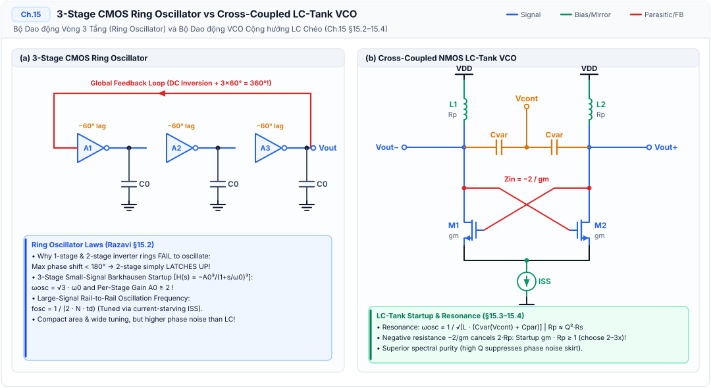

---
{
  "id": "topo-vco-tuning-and-phase-noise",
  "kind": "topology",
  "domain": "sampled-and-clocked",
  "title_vi": "Mạch dao động điều khiển bằng điện áp (VCO), Cơ chế Điều chỉnh Tần số & Mô hình Tích phân Pha",
  "title_en": "Voltage-Controlled Oscillators (VCOs): Ring/LC Tuning & Phase-Integrator Model",
  "summary": "Cơ chế điều chỉnh tần số w_out = w0 + KVCO*Vcont trong VCO vòng (tải triode phân cực bản sao, điện trở âm, nội suy trễ, hạn dòng) và VCO cộng hưởng LC (diode tiếp giáp p-n, varactor MOS chế độ tích lũy kết hợp dàn tụ chuyển mạch thô để ép nhỏ KVCO), cùng mô hình toán học tích phân pha dư Phi_ex(s)/Vcont(s) = KVCO/s và cơ chế biến đổi nhiễu/gợn sóng thành dải biên FM và tạp âm pha.",
  "diagram": "../../diagrams/ring-and-lc-oscillators.svg",
  "razavi_refs": [
    {
      "chapter": 15,
      "section": "15.4",
      "pages": "630-633",
      "equations": ["15.55", "15.58", "15.60", "15.61"]
    },
    {
      "chapter": 15,
      "section": "15.4.1",
      "pages": "633-641",
      "equations": ["15.62", "15.63", "15.65", "15.67", "15.68", "15.69", "15.70", "15.71"]
    },
    {
      "chapter": 15,
      "section": "15.4.2",
      "pages": "641-644",
      "equations": ["15.72"]
    },
    {
      "chapter": 15,
      "section": "15.5",
      "pages": "644-649",
      "equations": ["15.73", "15.74", "15.76", "15.77", "15.78", "15.82", "15.83", "15.84", "15.85", "15.87"]
    }
  ],
  "glossary_codes": [
    "T012",
    "T047",
    "T057",
    "T064",
    "T069",
    "T086",
    "T088",
    "T090",
    "T095",
    "T130",
    "T392",
    "T414",
    "T527",
    "T528",
    "T678",
    "T951",
    "T1009",
    "T1025",
    "T1802",
    "T2036"
  ],
  "process_agnostic": true,
  "roles": {
    "ring_delay_tuning_core": "Mạng điều chỉnh trễ TD của từng tầng trong VCO vòng (tải triode kèm replica op-amp, cặp chéo hỗ dẫn âm hoặc nội suy đường nhanh-chậm).",
    "mos_accumulation_varactor": "Transistor NMOS đặt trong giếng n (n-well) cung cấp đặc tuyến C(Vcont) đơn điệu để tinh chỉnh liên tục tần số LC-VCO với KVCO nhỏ.",
    "switched_capacitor_coarse_bank": "Dàn tụ MIM/MOM đóng cắt số nhị phân chia dải tần rộng thành nhiều phân dải chồng lấp, giải phóng xung đột giữa dải điều chỉnh và độ nhạy nhiễu KVCO.",
    "phase_integrator_transfer": "Bản chất vật lý tích phân tần số tức thời thành pha dư phi_ex(t) = KVCO * int Vcont(t) dt tạo cực lý tưởng 1/s tại gốc tọa độ."
  },
  "symptoms_addressed": [
    "oscillator-center-frequency-drift-across-pvt",
    "excessive-kvco-converting-vcont-noise-into-phase-noise-and-spurs",
    "amplitude-variation-across-ring-vco-tuning-range",
    "nonmonotonic-gate-capacitance-in-standard-inversion-mosfet"
  ],
  "limitations": [
    "fundamental-tradeoff-between-continuous-tuning-range-and-kvco-sensitivity",
    "pn-varactor-forward-bias-risk-under-large-tank-swing",
    "fixed-parasitic-capacitances-limiting-lc-vco-tuning-ratio",
    "switched-cap-bank-switch-on-resistance-degrading-tank-q"
  ],
  "checklists": [
    "common-mos",
    "oscillator-and-pll",
    "current-mirror",
    "layout-and-matching"
  ]
}
---

## 1. Bản chất Nguyên lý, Sơ đồ Mạch & Vai trò Từng Nhánh Cấu trúc

Một mạch dao động tự do luôn bị trôi tần số trung tâm đáng kể theo biến thiên PVT (tới $\pm 30\% \sim 50\%$ với mạch vòng và $\pm 10\% \sim 20\%$ với mạch LC). Để khóa tần số vào nguồn tham chiếu chuẩn bên trong vòng khóa pha (PLL), tần số ngõ ra phải điều khiển được bằng điện áp $V_{cont}$ thông qua **mạch dao động điều khiển bằng điện áp** (Voltage-Controlled Oscillator — VCO, §15.4):

$$\omega_{out} = \omega_0 + K_{VCO} V_{cont}$$

trong đó $\omega_0$ là tần số chặn ứng với $V_{cont} = 0$, và $K_{VCO} = \partial \omega_{out} / \partial V_{cont}$ là **độ lợi (hay độ nhạy) của VCO** tính bằng $\text{rad/(s}\cdot\text{V)}$ (lưu ý đổi đơn vị $K_{VCO} = 2\pi K_{VCO,\text{Hz/V}}$ khi đưa vào hàm truyền PLL!). Nếu điện áp điều khiển chỉ được phép quét trong cửa sổ $[V_1, V_2]$ (bị chặn trên bởi $V_{DD}$) mà ứng dụng đòi hỏi dải điều chỉnh tần số (tuning range) tối thiểu $\omega_2 - \omega_1$, độ nhạy $K_{VCO}$ bị ép phải thỏa bất đẳng thức xung đột cốt tử (PT 15.61):

$$K_{VCO} \ge \frac{\omega_2 - \omega_1}{V_2 - V_1}$$

Khi điện áp nguồn cấp $V_{DD}$ thu nhỏ theo công nghệ nanomet, mẫu số $V_2 - V_1$ co hẹp làm $K_{VCO}$ buộc phải tăng vọt; mọi nhiễu nhiệt hay gợn sóng nhỏ $\Delta V_{cont}$ trên đường điều khiển lập tức bị nhân với $K_{VCO}$ thành biến thiên tần số và tạp âm pha nghiêm trọng!

Razavi phân tích hai họ cơ chế điều chỉnh tần số hoàn toàn khác biệt về bản chất vật lý:
1. **Điều chỉnh tần số trong VCO vòng (§15.4.1 — thay đổi trễ $T_D$ trong $f_{osc} = \frac{1}{2 N T_D}$)**:
   - *Tải PMOS vùng triode kèm phân cực bản sao (Replica-Biased Triode Load, Hình 15.42–15.43)*: Chỉnh cổng PMOS tải $M_{3,4}$ trực tiếp bằng $V_{cont}$ làm thay đổi $R_{on3,4}$, nhưng khiến biên độ ngõ ra $2 I_{SS} R_{on3,4}$ co giãn mạnh theo tần số. Giải pháp kinh điển là dùng bộ khuếch đại thuật toán $A_1$ khóa thế nút bản sao $V_P \approx V_{REF}$ sao cho $I_{SS} R_{on3,4} \approx V_{DD} - V_{REF} = \text{hằng số}$, rồi quét dòng đuôi $I_{SS}$ để đạt cả **biên độ cố định** lẫn đặc tuyến $f_{osc} \propto I_{SS}$ tuyến tính!
   - *Biến thiên trễ bằng tải điện trở âm cặp chéo & nội suy trễ (Negative-$G_m$ Load & Delay Interpolation, Hình 15.44–15.51)*: Ghép cặp chéo $M_{3,4}$ song song tải $R_P$ tạo điện trở tương đương $R_P / (1 - g_{m3,4} R_P)$ tăng lên khi bơm thêm dòng vào cặp chéo (kèm nguồn giữ sống $I_H$ để cặp chính không bao giờ tắt hẳn), hoặc dùng cặp vi sai chuyển hướng dòng tổng không đổi $I_{SS}$ nội suy mượt giữa **đường nhanh (fast path)** và **đường chậm (slow path)**. Khi cần dải điều chỉnh cực rộng nhiều bậc độ lớn (hàng chục kHz tới hàng trăm MHz), mạch hạn dòng (current-starved) có cặp PMOS kéo biên $M_{5,6}$ (Hình 15.52) giữ biên độ gần $V_{DD}$ ngay cả khi $I_{SS}$ thay đổi $10^4$ lần.
2. **Điều chỉnh tần số trong LC-VCO (§15.4.2 — thay đổi điện dung $C_{\text{var}}(V_{cont})$ trong $f_{osc} = \frac{1}{2\pi\sqrt{L_P C_{\text{tot}}}}$)**:
   - *Diode tiếp giáp $p\text{–}n$ phân cực ngược (Hình 15.53–15.56)*: Thực hiện bằng tâm $p^+$ bao quanh bởi vòng $n^+$ đặt bên trong giếng $n$ (n-well) thả nổi. Nhược điểm lớn là nếu biên độ dao động $A$ trên khung LC quá lớn sẽ phân cực thuận tiếp giáp $p\text{–}n$ (ép $V_{cont} < V_{DD} - A + 300\text{ mV}$), điện trở giếng $n$ làm tụt $Q$, và tụ ký sinh từ giếng $n$ xuống đế $C_n$ thu hẹp dải điều chỉnh (khắc phục một phần bằng cặp chéo PMOS dao động quanh mức đất, Hình 15.58).
   - *Varactor MOS chế độ tích lũy (Accumulation-Mode MOS Varactor, Hình 15.59b–c) + Dàn tụ chuyển mạch thô*: Một NMOS thông thường đặt trên đế $p$ có đặc tuyến điện dung cổng $C_{GS}(V_{GS})$ **không đơn điệu** (lõm xuống ở vùng nghèo rồi tăng lại ở vùng nghịch đảo mạnh, Hình 15.59a — gây đa trị nguy hiểm cho PLL!). Bằng cách đặt cực $n^+$ nguồn/máng bên trong **giếng $n$ (n-well)** thay vì đế $p$, linh kiện chuyển mượt và **đơn điệu** từ vùng nghèo ($C_{\min}$) sang vùng tích lũy ($C_{\max}$), chịu được cả áp dương lẫn âm mà không bao giờ dẫn dòng thuận diode! Để phá vỡ xung đột Phương trình (15.61), kiến trúc hiện đại chia nhỏ dải tần bằng **dàn tụ chuyển mạch số (coarse switched-capacitor bank)** để bù PVT và chọn băng tần, chỉ để lại varactor MOS tinh chỉnh liên tục một dải hẹp với **$K_{VCO}$ cực nhỏ**.

## 2. Hệ Phương trình Cốt lõi & Tư duy "Nhìn Mạch Đọc Nhanh" (Analysis by Inspection)

### 2.1. Phương trình Điều chỉnh Tần số cho VCO Vòng & LC-VCO
- **VCO vòng tải PMOS vùng triode có ổn định biên độ bản sao (Ví dụ 15.10–15.11, PT 15.63–15.69)**:
  Khi vòng hồi tiếp phụ giữ $R_{on3,4} I_{SS} = V_{DD} - V_{REF}$, hằng số thời gian tải $\tau_1 = R_{on3,4} C_L$ tỉ lệ nghịch với $I_{SS}$:

$$f_{osc} \propto \frac{1}{R_{on3,4} C_L} = \frac{I_{SS}}{(V_{DD} - V_{REF}) C_L}$$

- **VCO vòng tải điện trở âm có dòng giữ sống $I_H$ (Ví dụ 15.12, Hình 15.45, PT 15.70–15.71)**:
  Độ lợi một chiều mỗi tầng bằng $\frac{g_{m1,2} R_P}{1 - g_{m3,4} R_P}$. Ngay cả khi toàn bộ dòng điều khiển $I_T$ bị lái sang cặp chéo $M_{3,4}$ để chạy ở tần số thấp nhất, nguồn dòng nền $I_H$ phải giữ độ lợi $\ge 2$ (cho vòng 3 tầng) và không để $g_{m3,4} R_P \ge 1$ gây chốt cứng:

$$\frac{g_{m1,2}(I_H)\, R_P}{1 - g_{m3,4}(I_T)\, R_P} \ge 2, \qquad g_{m3,4}(I_T)\, R_P < 1$$

- **Giới hạn dải điều chỉnh của LC-VCO trước điện dung ký sinh cố định (§15.4.2, PT 15.72)**:
  Gọi $C_{\text{fix}}$ là tổng điện dung cố định tại mỗi nút khung LC — bao gồm điện dung ký sinh cuộn cảm xoắn ốc, điện dung $C_{DB}$, $C_{GS}$ và **điện dung Miller $2 C_{GD}$** (hệ số nhân Miller luôn đúng bằng $2$ vì hai cực cổng–máng của cặp chéo dao động ngược pha biên độ bằng nhau!). Khi varactor biến thiên từ $C_{\text{var},\min}$ đến $C_{\text{var},\max}$:

$$f_{\max} = \frac{1}{2\pi\sqrt{L_P (C_{\text{fix}} + C_{\text{var},\min})}}, \qquad f_{\min} = \frac{1}{2\pi\sqrt{L_P (C_{\text{fix}} + C_{\text{var},\max})}} \implies \frac{f_{\max}}{f_{\min}} = \sqrt{\frac{C_{\text{fix}} + C_{\text{var},\max}}{C_{\text{fix}} + C_{\text{var},\min}}}$$

### 2.2. Mô hình Toán học Tích phân Pha của VCO & Phổ Dải biên FM (§15.5)
Vì tần số góc tức thời là đạo hàm theo thời gian của pha tổng $\omega(t) = \frac{d\phi_{\text{tot}}(t)}{dt}$ (PT 15.73), pha tổng buộc phải tính bằng **tích phân thời gian** của $\omega_{out}(t) = \omega_0 + K_{VCO} V_{cont}(t)$ (PT 15.74–15.78):

$$V_{out}(t) = V_m \cos\left[\omega_0 t + K_{VCO} \int_{-\infty}^{t} V_{cont}(\tau)\,d\tau + \phi_0\right] = V_m \cos\left[\omega_0 t + \phi_{ex}(t)\right]$$

Số hạng biến thiên $\phi_{ex}(t) = K_{VCO} \int V_{cont}(t)\,dt$ được gọi là **pha dư (excess phase)**. Trong miền Laplace, đối với tín hiệu pha dư dùng trong mọi vòng khóa pha PLL, VCO chính xác là **một bộ tích phân lý tưởng không suy hao**:

$$\frac{\Phi_{ex}(s)}{V_{cont}(s)} = \frac{K_{VCO}}{s}$$

Nếu đường điều khiển $V_{cont}$ chịu một gợn sóng hình sin nhỏ $V_{cont}(t) = V_m \cos(\omega_m t)$ thỏa điều kiện điều tần dải hẹp $\frac{K_{VCO} V_m}{\omega_m} \ll 1\text{ rad}$ (Ví dụ 15.17, PT 15.79–15.83):

$$V_{out}(t) \approx V_0 \cos(\omega_0 t) - \frac{K_{VCO} V_m V_0}{2\omega_m}\left[\cos(\omega_0 - \omega_m)t - \cos(\omega_0 + \omega_m)t\right]$$

Mọi gợn sóng tuần hoàn tần số $\omega_m$ trên $V_{cont}$ (hoặc trên nguồn cấp qua hệ số đẩy nguồn $K_{VDD}$) sẽ đẻ ra hai vạch phổ ký sinh đối xứng (**sidebands / spurs**) tại $\omega_0 \pm \omega_m$ có tỉ số biên độ so với sóng mang:

$$\frac{A_{\text{sideband}}}{A_{\text{carrier}}} = \frac{K_{VCO} V_m}{2\omega_m} \implies \text{Spur Level (dBc)} = 20\log_{10}\left(\frac{K_{VCO} V_m}{2\omega_m}\right)$$

Đối với sóng dao động giàu hài (như sóng vuông của VCO vòng, PT 15.87), hài bậc $k$ tại $k\omega_0$ tích lũy pha dư gấp $k$ lần là $k K_{VCO} \int V_{cont}\,dt$ (tức tạp âm pha tăng thêm $20\log_{10} k$ dB ở hài bậc $k$). Tương tự, mật độ phổ nhiễu điện tử nội tại của linh kiện quanh DC ($1/f$) và quanh $\omega_0$ (nhiễu nhiệt trắng) khi đi qua cơ chế tích phân pha $1/s$ tạo ra sườn phổ **tạp âm pha (phase noise skirt)** $\mathcal{L}(\Delta\omega)$ dốc xuống theo quy luật $1/(\Delta\omega)^3$ ($-30\text{ dB/dec}$, vùng chuyển đổi nhiễu $1/f$) và $1/(\Delta\omega)^2$ ($-20\text{ dB/dec}$, vùng nhiễu nhiệt Leeson), tỉ lệ nghịch với $Q^2$ và công suất dao động trên khung LC.

### 2.3. Ví dụ Định lượng Thực chiến: Chia Dải Tụ Chuyển mạch để Nén Spur Đường Điều khiển
Giả sử cần thiết kế LC-VCO tâm $f_0 = 2.4\text{ GHz}$ phủ tổng dải tần $\Delta f_{\text{tot}} = 480\text{ MHz}$ ($\pm 10\%$ bù PVT + băng tần) trên tiến trình `65nm` có cửa sổ $V_{cont}$ tuyến tính rộng $\Delta V_{cont} = 0.6\text{ V}$, trong khi đường $V_{cont}$ chịu gợn sóng tuần hoàn $V_m = 100\,\mu\text{V}$ tại $f_m = 10\text{ MHz}$:
- **Phương án 1 — Dùng duy nhất 1 varactor liên tục (không có dàn tụ thô)**:
  - Theo PT (15.61), $K_{VCO,\min} = \frac{480\text{ MHz}}{0.6\text{ V}} = 800\text{ MHz/V}$ (thực tế ở giữa dải cong đạt $K_{VCO,\max} \approx 1600\text{ MHz/V}$!).
  - Mức vạch phổ biên ký sinh tại $f_0 \pm 10\text{ MHz}$ theo PT (15.83): $\frac{K_{VCO} V_m}{2 f_m} = \frac{1600\text{ MHz/V} \times 10^{-4}\text{ V}}{2 \times 10\text{ MHz}} = 8 \times 10^{-3} \implies \text{Spur} = -41.9\text{ dBc}$ (quá cao, vi phạm chuẩn thu phát vô tuyến!).
- **Phương án 2 — Kết hợp dàn tụ chuyển mạch 4-bit ($16$ băng chồng lấp $50\%$) + varactor MOS tinh chỉnh**:
  - Mỗi băng con chỉ cần quét $\Delta f_{\text{fine}} = \frac{1.5 \times 480\text{ MHz}}{16} = 45\text{ MHz} \implies K_{VCO} \approx \frac{45\text{ MHz}}{0.6\text{ V}} = 75\text{ MHz/V}$ (giảm hơn $20\times$!).
  - Với cùng gợn sóng $V_m = 100\,\mu\text{V}$, mức vạch phổ biên tụt ngay xuống $20\log_{10}\left(\frac{75 \times 10^{-4}}{20}\right) = -68.5\text{ dBc}$ (cải thiện hơn **$26.6\text{ dB}$** độ sạch phổ mà không tốn thêm công suất DC!).

## 3. Bất biến Cấu trúc & Các Bẫy Lỗi Kinh điển (Structural Invariants & Traps)

- **[INV-VCO-01] Bất biến tích phân pha (không bao giờ nhân trực tiếp $t$)**: Tần số thay đổi tức thời theo $V_{cont}(t)$ (quan hệ không nhớ), nhưng pha $\phi_{ex}(t)$ là lịch sử tích lũy diện tích dưới đường cong tần số $\int K_{VCO} V_{cont}\,dt$. Nhờ cực $1/s$ tại gốc tọa độ này, chỉ cần thay đổi $V_{cont}$ trong một khoảng thời gian ngắn rồi trả về chỗ cũ là đã dịch chuyển vĩnh viễn được pha ngõ ra!
- **[INV-VCO-02] Bất biến đơn điệu dấu của $K_{VCO}(V_{cont})$**: Độ dốc $K_{VCO} = \partial \omega_{out} / \partial V_{cont}$ bắt buộc giữ **cùng một dấu** (luôn dương hoặc luôn âm) và không có điểm uốn bằng $0$ trên toàn dải hoạt động; nếu $K_{VCO}$ đảo dấu (như dùng nhầm MOSFET vùng nghịch đảo làm varactor), vòng khóa pha PLL sẽ đổi cực tính thành hồi tiếp dương và mất khóa ngay lập tức!
- **[INV-VCO-03] Bất biến chồng lấp phân dải của dàn tụ chuyển mạch (Sub-band Overlap)**: Khi dùng dàn tụ nhị phân $N$-bit kết hợp varactor tinh chỉnh nhỏ, bước nhảy tần số giữa hai mã nhị phân kế tiếp $\Delta f_{\text{step}}$ bắt buộc phải nhỏ hơn dải quét liên tục của varactor tinh chỉnh ít nhất $30\% \sim 50\%$ ($\Delta f_{\text{fine}} \ge 1.5\,\Delta f_{\text{step}}$) để không xuất hiện "lỗ thủng tần số" (frequency dead-band) khi nhiệt độ trôi sau lúc hiệu chuẩn số!
- **[TRAP-VCO-01] Bẫy đại số kinh điển viết sai $V_{out}(t) = V_m \cos[(\omega_0 + K_{VCO} V_{cont})t]$ (PT 15.84–15.85)**: Đạo hàm biểu thức sai này cho ra $\omega(t) = \omega_0 + K_{VCO} V_{cont} + K_{VCO} t \frac{dV_{cont}}{dt}$ — xuất hiện số hạng giả tạo nhân với $t$ tăng vô hạn theo thời gian! Luôn phải viết tích phân $\int V_{cont}\,dt$.
- **[TRAP-VCO-02] Bẫy băng thông op-amp bản sao $A_1$ gây mất ổn định PLL (§15.4.1, Hình 15.43b)**: Trong VCO vòng dùng op-amp $A_1$ ổn định biên độ mà đường điều khiển đi qua vòng $A_1$, nếu băng thông của $A_1$ không lớn hơn nhiều lần băng thông vòng PLL, cực phụ của $A_1$ sẽ chèn thêm trễ pha trực tiếp vào hàm truyền $K_{VCO}/s$, làm PLL dao động tự kích!
- **[TRAP-VCO-03] Bẫy phi tuyến $K_{VCO}$ cực đại ở giữa dải (Hình 15.41)**: Đường cong đặc tuyến $\omega_{out}(V_{cont})$ của cả varactor MOS lẫn mạch vòng thường phẳng ở hai đầu $0\text{ V} / V_{DD}$ nhưng rất dốc ở giữa dải, khiến $K_{VCO,\max}$ thực tế cao gấp $2 \sim 3$ lần độ dốc trung bình $(\omega_2 - \omega_1)/(V_2 - V_1)$, làm biến thiên hệ số tắt dần $\zeta$ và dự trữ pha của PLL theo điểm khóa!
- **[TRAP-VCO-04] Bẫy đánh đổi $R_{on}$ và $C_{off}$ của công tắc trong dàn tụ chuyển mạch LC-VCO**: Mở rộng $W$ của công tắc NMOS nối tiếp tụ chuyển mạch giúp giảm $R_{on}$ (bảo toàn $Q$ khi đóng tụ = bit 1), nhưng lại làm tăng điện dung ký sinh $C_{DB}/C_{GD}$ khi ngắt tụ (= bit 0), gặm cụt tần số cực đại $f_{\max}$!

## 4. Lộ trình Nâng cấp Cấu trúc & Bát giác Đánh đổi (Upgrade Paths & Design Octagon)

Trong `concept-analog-design-octagon`, thiết kế VCO xoay quanh mâu thuẫn trung tâm giữa **dải điều chỉnh tần số**, **độ tinh khiết phổ (tạp âm pha / độ nhạy nhiễu $K_{VCO}, K_{VDD}$)**, **diện tích** và **công suất tiêu thụ**:

- **Lựa chọn lõi cơ sở**: Dùng `topo-ring-oscillator` khi ưu tiên diện tích nhỏ, đa pha và dải điều chỉnh rộng nhiều quãng tám (clock số, CDR băng rộng); dùng `topo-lc-cross-coupled-and-colpitts` khi ưu tiên tạp âm pha thấp cho thu phát vô tuyến RF và SerDes tốc độ cao.
- **Nhúng vào kiến trúc khóa pha hoàn chỉnh**: Mô hình tích phân $\Phi_{ex}(s)/V_{cont}(s) = K_{VCO}/s$ của nút này đóng vai trò mắt xích cung cấp cực gốc tọa độ cho `topo-type1-simple-pll` và kết hợp với cực của bơm điện tích tạo thành hệ hai cực gốc tọa độ trong `topo-charge-pump-type2-pll`.
- **Triệt tạp âm pha và vạch phổ ký sinh mức hệ thống**: Giảm nhiễu nội tại transistor theo `law-mos-thermal-and-flicker-noise`, ổn định vòng phản hồi phụ bản sao theo `law-multipole-phase-margin`, lọc sạch nguồn cấp VCO qua `topo-cmos-ldo-regulator` để triệt $K_{VDD}$, phân cực dòng sạch qua `topo-lvccml-wide-swing-mirror`, và chọn băng thông PLL cắt chéo tối ưu theo `concept-pll-nonidealities-spurs-jitter`.

| Họ cấu trúc VCO | Dải điều chỉnh điển hình | Tạp âm pha tại $\Delta f = 1\text{ MHz}$ | Diện tích & Độ nhạy nguồn $K_{VDD}$ |
| :--- | :--- | :--- | :--- |
| **Ring VCO hạn dòng / tải triode** | Rất rộng ($50\% \sim >100\%$, nhiều thập kỷ) | Cao ($-90 \sim -105\text{ dBc/Hz}$) | Siêu gọn; nhạy mạnh với $V_{DD}$ nếu thiếu replica/LDO. |
| **Ring VCO nội suy / điện trở âm** | Trung bình rộng ($2:1 \sim 3:1$) | Trung bình ($-100 \sim -110\text{ dBc/Hz}$) | Gọn, biên độ ổn định, hỗ trợ điều khiển vi sai kháng nhiễu. |
| **LC-VCO chỉ dùng Varactor liên tục** | Hẹp ($10\% \sim 25\%$ ở $V_{DD}$ thấp) | Thấp nhưng dễ nhiễm nhiễu qua $K_{VCO}$ lớn | Tốn diện tích cuộn cảm; nhạy biến đổi AM-to-PM trên varactor. |
| **LC-VCO Hybrid (Switched-Cap + MOS Var)** | Rộng cho RF ($25\% \sim 50\%$) với $K_{VCO}$ nhỏ | Siêu thấp ($-120 \sim -135\text{ dBc/Hz}$) | Chuẩn vàng công nghiệp cho bộ tổng hợp tần số không dây & SerDes. |

## 5. Thích ứng Đa Tiến trình (90nm / 65nm / 45nm) & Cách Kiểm chứng trong Cadence / Spectre

Ở các tiến trình `90nm`, `65nm`, `45nm`, điện áp nguồn $V_{DD}$ giảm xuống $\le 1.0\text{ V}$ khiến khoảng điện áp điều khiển khả dụng cho $V_{cont}$ chỉ còn vỏn vẹn $0.15\text{ V} \sim 0.85\text{ V}$ ($\Delta V_{cont} \approx 0.7\text{ V}$):
- **Chiến lược giải cứu $K_{VCO}$ ở điện áp thấp**: Tuyệt đối không dùng một varactor duy nhất để gánh toàn bộ dải tần $\pm 20\%$ ở $1.0\text{ V}$ (sẽ đẩy $K_{VCO}$ vọt lên hàng GHz/V!). Thay vào đó, thiết kế dàn tụ MIM/MOM chuyển mạch vi sai đối xứng $3 \sim 5$ bit (dùng công tắc vi sai tâm ảo để giảm một nửa $R_{on}$ mà không tốn diện tích gấp bốn!) chia nhỏ thành $8 \sim 32$ băng chồng lấp, giữ $K_{VCO}$ của varactor tích lũy MOS ở mức thấp an toàn ($30 \sim 80\text{ MHz/V}$).
- **Quy tắc Layout cho Varactor & Dàn tụ**: Bố cục varactor MOS đa ngón chân cổng ngắn liên kết hai đầu để giảm điện trở cổng, sắp xếp dàn tụ nhị phân theo cấu trúc trọng tâm chung đối xứng `tech-common-centroid-sti-wpe-layout`, và che chắn đường $V_{cont}$ bằng dây đất hai bên trên nền cách ly `law-cmos-wells-and-latchup-guard-rings` để chặn xuyên nhiễu xung nhịp tham chiếu tạo spur!

**Quy trình kiểm chứng chuẩn trong Cadence Virtuoso / SpectreRF**:
1. **Quét họ đường cong điều chỉnh tần số $f_{osc}(V_{cont}, \text{Code})$ bằng `pss` Parametric Sweep**: Quét $V_{cont}$ từ $0$ đến $V_{DD}$ với bước $50\text{ mV}$ qua các mã nhị phân dàn tụ trên các góc cực đoan (`FF -40C` cho $f_{\max}$ và `SS 125C` cho $f_{\min}$). Dùng hàm đạo hàm `deriv(harmonic(xval(...) 1))` trong ADE Calculator để vẽ $K_{VCO}(V_{cont})$, kiểm tra: (a) $K_{VCO}$ không đổi dấu, (b) tỉ số $K_{VCO,\max} / K_{VCO,\min} \le 2.5$ trong vùng khóa hoạt động, và (c) các phân dải chồng lấp liên tục không đứt quãng giữa mọi góc PVT.
2. **Đo độ nhạy gợn sóng đường điều khiển & đẩy nguồn (`pac` / `pxf`)**: Ngay sau `pss`, chạy `pac` hoặc `pxf` đặt nguồn nhiễu nhỏ trên $V_{cont}$ và trên $V_{DD}$ ở tần số lệch $f_m$ (ví dụ $f_{REF}$), đối chiếu biên độ dải biên chuyển đổi tần số tại $f_0 \pm f_m$ khớp với công thức lý thuyết $K_{VCO} V_m / (2\omega_m)$ và xác định $K_{VDD}$ để đặt chỉ tiêu PSRR cho bộ ổn áp LDO.
3. **Kiểm tra tạp âm pha toàn dải (`pnoise`)**: Đo $\mathcal{L}(\Delta f)$ tại cả điểm giữa dải (nơi $K_{VCO}$ lớn nhất, nhạy nhất với nhiễu AM-to-PM trên varactor!) và hai biên dải điều chỉnh, tách riêng đóng góp nhiễu nhiệt kênh dẫn, nhiễu $1/f$ cặp chéo/nguồn đuôi và nhiễu nhiệt điện trở công tắc dàn tụ.

## 6. Mốc Đối chiếu Sách Razavi & Thuật ngữ Chuẩn CLB

- **Mốc sách Razavi (2nd Ed.)**: Chương 15 — `§15.4` (*Voltage-Controlled Oscillators*, tr. 630–633, Hình 15.40–15.41, Ví dụ 15.9, PT 15.55–15.61); `§15.4.1` (*Tuning in Ring Oscillators*, tr. 633–641, Hình 15.42–15.52, Ví dụ 15.10–15.13, PT 15.62–15.71); `§15.4.2` (*Tuning in LC Oscillators*, tr. 641–644, Hình 15.53–15.59, Ví dụ 15.14, PT 15.72); `§15.5` (*Mathematical Model of VCOs*, tr. 644–649, Hình 15.60–15.64, Ví dụ 15.15–15.17, PT 15.73–15.87).
- **Đối chiếu Thuật ngữ Chuẩn CLB Vi Mạch**:
  - `phase-locked loop, PLL` (`T064`): vòng khóa pha; `integrator` (`T1802`): mạch tích phân.
  - `Capacitance-voltage characteristic` (`T414`): đặc tuyến điện dung–điện áp (C–V); `pn-junction diode` (`T2036`): diode tiếp giáp p–n; `N-well` (`T130`): giếng n.
  - `nonlinearity` (`T057`): tính phi tuyến; `trade-off` (`T090`): đánh đổi.
  - `Flicker noise` (`T392`): nhiễu nhấp nháy (nhiễu $1/f$); `thermal noise` (`T1009`): nhiễu nhiệt; `noise spectrum` (`T1025`): phổ nhiễu; `jitter` (`T047`): jitter.
