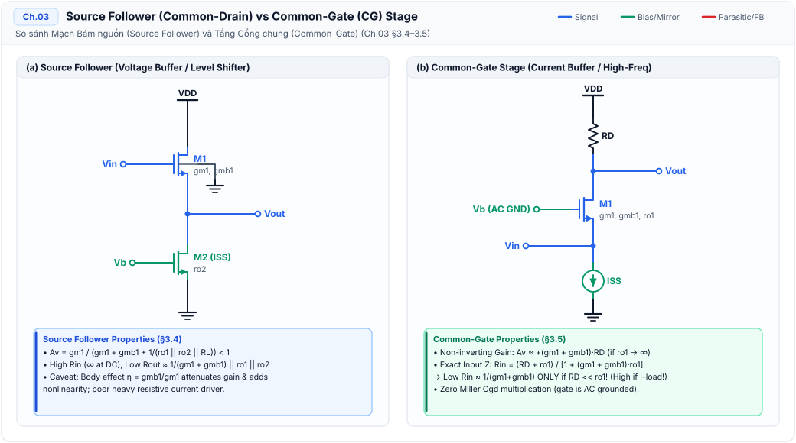

---
{
  "id": "concept-choice-of-transistor-configurations",
  "kind": "concept",
  "domain": "stages-and-mirrors",
  "title_vi": "Lựa chọn Cấu hình Transistor, Ma trận Tổ hợp Khuếch đại & Nghệ thuật Giản lược Mô hình Tín hiệu Nhỏ (Choice of Transistor Configurations & Device Models)",
  "title_en": "Systematic Comparison of CS, CG, SF, and Cascode Configurations, Multi-Transistor Synthesis, and Choice of Device Models",
  "summary": "Tổng hợp ma trận đặc tính hai cửa (Zin, Zout, Gm, Av, độ cách ly ngược, băng thông, nhiễu và dự trữ áp) của 4 cấu hình hạt nhân CS, CG, SF, Cascode (Telescopic & Folded), quy luật đại số ghép nối tầng dựa trên bổ đề Av = -Gm*Rout, bài toán tổ hợp cấu trúc hai MOSFET của Razavi (Bài tập 3.36) và triết lý chọn mức độ chi tiết mô hình linh kiện (§3.7 'Don't be a SPICE monkey').",
  "diagram": "../../diagrams/source-follower-and-cg.svg",
  "razavi_refs": [
    {
      "chapter": 3,
      "section": "3.3.6, 3.4, 3.5, 3.6, 3.7",
      "pages": "66-93, 99",
      "equations": ["3.74", "3.88", "3.100", "3.106", "3.116", "3.123", "3.135", "3.143", "3.149", "3.150"]
    }
  ],
  "glossary_codes": ["T021", "T023", "T082", "T499", "T500", "T501", "T517", "T518"],
  "process_agnostic": true,
  "roles": {
    "transconductor_voltage_sensor_cs": "Tầng nguồn chung (CS) có cổng cách điện Zin -> inf biến đổi áp thành dòng gm*Vin mà không rút dòng tĩnh từ nguồn tín hiệu",
    "current_buffer_shield_cg": "Tầng cổng chung (CG) nhận dòng tại trở kháng thấp ~1/(gm+gmb) và truyền nguyên vẹn sang nút trở kháng cao ~gm*ro*Rs, triệt tiêu hiệu ứng Miller",
    "voltage_buffer_level_shifter_sf": "Mạch bám nguồn (SF) nhận áp tại Zin -> inf và xuất áp tại trở kháng thấp ~1/(gm+gmb) để cách ly tải trở nhỏ khỏi nút độ lợi cao",
    "iterative_model_selector": "Quy trình 3 mức chọn mô hình linh kiện (§3.7) giúp đọc mạch phức tạp trong 30 giây bằng gm trước khi gài thêm ro và gmb đúng nút nhạy cảm"
  },
  "symptoms_addressed": [
    "paralysis-writing-giant-kcl-matrices-with-ro-and-gmb-everywhere",
    "connecting-cs-stage-directly-to-low-resistance-50ohm-load-killing-gain",
    "confusing-when-cg-input-resistance-depends-on-drain-load",
    "selecting-wrong-input-configuration-for-current-mode-sensor-or-rf-line"
  ],
  "limitations": [
    "no-single-transistor-configuration-simultaneously-provides-high-zin-low-zout-and-high-voltage-gain",
    "cg-input-impedance-loses-low-value-property-when-loaded-by-current-source-instead-of-resistor",
    "sf-suffers-body-effect-attenuation-and-dc-vgs-headroom-shift"
  ],
  "checklists": ["common-mos", "single-stage"]
}
---

## 1. Bản chất Nguyên lý, Sơ đồ Mạch & Vai trò Từng Nhánh Cấu trúc

Một transistor MOSFET chỉ có ba cực mang tín hiệu chính (**Gate — G**, **Source — S**, **Drain — D**, cùng cực thân **Bulk — B** đóng vai trò cổng phụ bậc hai). Vì cực máng D không có khả năng điều khiển dòng kênh mạnh ở vùng bão hòa ($\frac{\partial I_D}{\partial V_D} = \frac{1}{r_O} \ll g_m$), **cực máng không bao giờ được dùng làm cực ngõ vào**! Từ định luật loại trừ cơ bản đó, toàn bộ vũ trụ mạch tích hợp tương tự chỉ có đúng **ba cách đưa tín hiệu vào và lấy tín hiệu ra trên một MOSFET đơn lẻ**, cộng thêm **hai phép ghép đôi không phân nhánh/gập dòng** tạo nên 5 viên gạch nguyên tử của Chương 3 (Razavi §3.3–§3.7, tr. 47–93):



1. **Tầng Nguồn Chung (`T023`, Common-Source — CS: Vào G $\to$ Ra D, S nối đất AC):** Bộ chuyển đổi Điện áp $\to$ Dòng điện (Transconductor) tự nhiên nhất, có **trở kháng đầu vào (`T517`)** vô cùng ở DC, độ lợi điện áp âm lớn, nhưng bị hiệu ứng nhân tụ Miller qua $C_{GD}$ bóp nghẹt băng thông khi lái tải trở kháng cao.
2. **Mạch Bám Nguồn (`T082`, Source Follower — SF / Common-Drain: Vào G $\to$ Ra S, D nối nguồn AC):** Bộ đệm Điện áp $\to$ Điện áp ($0 < A_v < 1$) có trở kháng vào cao và **trở kháng đầu ra (`T518`)** thấp $\sim \frac{1}{g_m + g_{mb}}$, dùng để lái tải điện trở nhỏ hoặc dịch mức điện áp một chiều đi một lượng $V_{GS}$, nhưng không bao giờ khuếch đại được biên độ điện áp!
3. **Tầng Cổng Chung (`T021`, Common-Gate — CG: Vào S $\to$ Ra D, G nối áp tĩnh AC ground):** Bộ đệm Dòng điện $\to$ Dòng điện ($A_i \approx 1$) kiêm khuếch đại điện áp đồng pha ($A_v > 0$), có trở kháng vào thấp cho phép phối hợp trở kháng đường truyền $50\,\Omega$ và không bị nhân tụ Miller cổng–máng.
4. **Tầng Cascode Xếp chồng (`T501`, Telescopic Cascode = CS nối tiếp CG cùng loại) & Cascode Gập (`T500`, Folded Cascode = CS ghép CG đối cực, §3.6–§3.6.1):** Phép hợp thể hoàn hảo giữa ưu điểm $Z_{\text{in}} \to \infty$, $G_m = g_{m1}$ của CS với ưu điểm che chắn áp máng, triệt Miller và nhân trở kháng ra lên $g_{m2} r_{O2} r_{O1}$ của CG!

---

## 2. Hệ Phương trình Cốt lõi & Tư duy "Nhìn Mạch Đọc Nhanh" (Analysis by Inspection)

### 2.1. Bổ đề Vạn Năng $A_v = -G_m R_{\text{out}}$ & Ma trận Đặc tính Chuẩn Của 5 Cấu hình Hạt nhân
Cuối §3.3.6 (Hình 3.32, Phương trình 3.74, tr. 66–67; xem thêm ghi chú `NG03-03`), Razavi chứng minh **Bổ đề Tuyến tính Norton–Thevenin** áp dụng được cho **mọi mạch hai cửa tuyến tính bất kỳ** (dù bên trong có hàng chục transistor!):
$$A_v = -G_m R_{\text{out}}, \qquad G_m \triangleq \left.\frac{I_{\text{out,short}}}{V_{\text{in}}}\right|_{V_{\text{out}}=0}, \qquad R_{\text{out}} \triangleq \left.\frac{V_{\text{test}}}{I_{\text{test}}}\right|_{V_{\text{in}}=0}$$
(Chú ý quy ước chiều dòng $I_{\text{out}}$ chảy *từ ngõ ra xuống đất* khi nối tắt ngõ ra nên có dấu trừ; nếu định nghĩa $I_{\text{sc}}$ chảy từ trong mạch *ra ngoài tải* thì $A_v = +G_{m,\text{out}} R_{\text{out}}$). Nhờ bổ đề này, bài toán phức tạp có cả $\lambda > 0, \gamma > 0$ (như Bài tập 3.34 cho SF và Bài tập 3.35 cho CG, tr. 99) tách đôi thành hai phép nhìn mạch nhẩm miệng độc lập!

| Cấu hình Hạt nhân | $Z_{\text{in}}$ (tần số thấp, gồm $r_O < \infty$!) | $R_{\text{out}}$ (nhìn từ ngõ ra, nguồn tín hiệu có $R_S$) | Hỗ dẫn hiệu dụng $G_m$ (ngõ ra nối đất AC) | Độ lợi điện áp hở tải $A_{v0}$ (hoặc với tải $R_D$) | Đánh giá Băng thông & Nhiễu |
|---|---|---|---|---|---|
| **1. Common-Source (CS)** | $\infty$ *(tụ vào bị nhân Miller $(1+|A_v|)C_{GD}$)* | $R_D \parallel r_{O1}$ | $+g_{m1}$ | $-g_{m1}(R_D \parallel r_{O1})$ | Nhiễu quy cổng nhỏ nhất; BW hẹp nếu $R_S$ và $R_D$ cùng lớn. |
| **2. CS Suy biến Nguồn ($R_{\text{deg}}$)** | $\infty$ | $R_D \parallel \big[r_{O1} + (1 + (g_{m1}+g_{mb1})r_{O1})R_{\text{deg}}\big]$ | $\dfrac{g_{m1}}{1 + (g_{m1}+g_{mb1})R_{\text{deg}}+\dfrac{R_{\text{deg}}}{r_{O1}}}$ | $\approx \dfrac{-g_{m1} R_D}{1 + (g_{m1}+g_{mb1})R_{\text{deg}}}$ *(khi $R_D \ll R_{\text{out,up}}$)* | Mở rộng dải tuyến tính $(1+g_m R_{\text{deg}})$; tăng nhiễu do $4kT R_{\text{deg}}$. |
| **3. Source Follower (SF)** | $\infty$ *(tụ $C_{GS}$ được bootstrap giảm còn $(1-A_v)C_{GS}$!)* | $\dfrac{1}{g_{m1} + g_{mb1}} \parallel r_{O1} \parallel R_L$ | $-g_{m1}$ *(dòng chảy ra cực nguồn)* | $\dfrac{g_{m1}}{g_{m1} + g_{mb1} + \dfrac{1}{r_{O1}\parallel R_L}} < 1$ | BW rộng nhưng dễ sinh $Z_{\text{out}}$ cảm kháng nếu $R_S > 1/g_{m1}$. |
| **4. Common-Gate (CG — PT 3.116, 3.123)** | **$\dfrac{R_D + r_{O1}}{1 + (g_{m1}+g_{mb1})r_{O1}}$** *(chỉ $\approx \frac{1}{g_{m1}+g_{mb1}}$ khi $R_D \ll g_m r_O$!)* | $R_D \parallel \big[r_{O1} + (1 + (g_{m1}+g_{mb1})r_{O1})R_S\big]$ | $-\dfrac{g_{m1} + g_{mb1} + 1/r_{O1}}{1 + (g_{m1}+g_{mb1})R_S + R_S/r_{O1}}$ | $\dfrac{\big[(g_{m1}+g_{mb1})r_{O1} + 1\big] R_D}{r_{O1} + \big[(g_{m1}+g_{mb1})r_{O1} + 1\big] R_S + R_D}$ | Không chịu Miller cổng–máng; chịu nhiễu nặng từ nguồn dòng phân cực dưới nguồn! |
| **5. Cascode (Telescopic / Folded)** | $\infty$ *(tụ Miller bị kẹp chỉ còn $\approx 2 C_{GD1}$!)* | $\approx (g_{m2}+g_{mb2}) r_{O2} r_{O1}$ *(Folded: thay $r_{O1}$ bằng $r_{O1}\parallel r_{O,\text{fold}}$)* | $+g_{m1}$ | $-g_{m1} R_{\text{out}} \sim -(g_m r_O)^2$ | Vừa đạt độ lợi bậc hai, vừa giữ BW rộng và nhiễu thấp của CS! |

### 2.2. Hai Hệ quả "Phản Trực giác" Cực Quan trọng Trong Bảng Trên!
1. **Sự thật về $Z_{\text{in}}$ của Tầng Cổng Chung khi Dùng Tải Nguồn dòng Lý tưởng ($R_D \to \infty$, Phương trình 3.116, tr. 80):**
   Rất nhiều sinh viên học thuộc lòng *"Trở kháng vào của tầng CG luôn thấp bằng $\frac{1}{g_m + g_{mb}}$"*. Nhìn vào công thức chính xác $R_{\text{in,CG}} = \frac{R_D + r_{O1}}{1 + (g_{m1}+g_{mb1})r_{O1}}$:
   - Nếu tải cực máng là điện trở vừa phải $R_D \ll r_{O1}$, thì đúng là $R_{\text{in,CG}} \approx \frac{1}{g_{m1}+g_{mb1}}$.
   - Nhưng nếu thay $R_D$ bằng một **nguồn dòng tải PMOS có $R_D = r_{O,\text{load}} \sim g_m r_O^2$ (cascode load)**, tử số vọt lên lớn khiến **$R_{\text{in,CG}}$ tăng vọt thành hàng chục $\text{k}\Omega$ (thậm chí $\to \infty$ nếu $R_D = \infty$ vì theo KCL một nhánh bị bịt kín ở trên thì không dòng nào vào được từ dưới!)**! Đó là tính **thiếu cách ly ngược (poor reverse isolation)** của MOSFET kênh ngắn do $r_O$ hữu hạn!
2. **Độ lợi khi Phối hợp Trở kháng Đường truyền $R_{\text{in,CG}} = R_S = 50\,\Omega$ (Bài tập 3.33, Phương trình 3.149–3.150, tr. 99):**
   Ngay cả khi bao gồm đầy đủ $\lambda > 0$ và $\gamma > 0$, nếu thiết kế tầng CG sao cho trở kháng nhìn vào cực nguồn khớp hoàn toàn với trở kháng nguồn tín hiệu $R_{\text{in,CG}} = R_S$ (để chống phản xạ sóng RF), hai hiệu ứng tăng/giảm do $r_O$ và $g_{mb}$ triệt tiêu nhau đẹp đẽ để cho kết quả chính xác tuyệt đối (Phương trình 3.150):
   $$\frac{V_{\text{out}}}{V_{\text{in}}} = \frac{R_D}{2 R_S}$$

### 2.3. Quy luật Ghép Nối Tầng (Cascade Synthesis) & Bài toán Tổ hợp 2-MOSFET (Bài tập 3.36, Hình 3.87)
Vì không một transistor đơn lẻ nào đồng thời thỏa mãn $\{Z_{\text{in}}\text{ cao}, A_v\text{ lớn}, Z_{\text{out}}\text{ thấp}, \text{BW rộng}\}$, việc thiết kế bộ khuếch đại đa tầng tuân theo đại số ghép nối:
- **Ghép $\text{CS} \to \text{CG}$ = Cascode (`topo-cascode-stage`):** CS nhận điện áp tại $Z_{\text{in}} = \infty$ đổi ra dòng $g_{m1} V_{\text{in}}$; CG nhận ngay dòng đó tại trở kháng thấp $\frac{1}{g_{m2}+g_{mb2}}$ (triệt Miller cho CS!) và đẩy lên nút tải trở kháng cao $\to$ tối ưu cho **OTA / LNA độ lợi cao băng rộng**.
- **Ghép $\text{CS} \to \text{SF}$ (Buffer):** CS tạo độ lợi điện áp cao trên nút nội không bị tải trở nặng, rồi SF cách ly nút đó để lái tải điện trở nhỏ $R_L$ bên ngoài mà không làm sụp độ lợi tầng 1!
- **Ghép $\text{CG} \to \text{CS}$:** CG phối hợp trở kháng $50\,\Omega$ hoặc nhận dòng photodiode đầu vào, đổi thành điện áp trên tải trở trung gian để lái cổng tầng CS thứ hai (thậm chí trong *Noise-Canceling LNA*, kết hợp hai đường CG và CS làm nhiễu kênh của CG ngược pha tự triệt tiêu tại ngõ ra trong khi tín hiệu cộng đồng pha!).
- **Tư duy Tổ hợp Cấu trúc từ 2 MOSFET (Bài tập 3.36, Hình 3.87, tr. 99):** Chỉ với hai transistor nối nhau (cùng cực NMOS–NMOS hoặc đối cực NMOS–PMOS), việc chọn cực nào nhận $V_{\text{in}}$, cực nào buộc đất/nguồn cấp, cực nào lấy $V_{\text{out}}$ sinh ra trọn vẹn họ cấu trúc nền tảng: CS tải nguồn dòng, CS tải diode, CS đẩy–kéo CMOS, SF tải nguồn dòng, SF tải diode, Telescopic Cascode, Folded Cascode, Super Source Follower và Regulated Cascode 2-FET!

### 2.4. Triết lý "3 Vòng Lặp Chọn Mô hình Linh kiện" của Razavi (§3.7 *Choice of Device Models*, tr. 92–93)
Trước một sơ đồ lạ gồm 8–15 MOSFET (như Hình 3.76–3.77 & Hình 3.84 trong bài tập Chương 3), nếu ngay từ đầu bạn vẽ sơ đồ tương đương có đầy đủ cả $g_m, g_{mb}, r_O$ cho mọi transistor rồi lập hệ 10 phương trình KCL, bạn sẽ sa lầy trong rừng đại số vô nghĩa! Razavi đúc kết quy tắc vàng **"Don't be a SPICE monkey"** qua 3 bước lặp tinh gọn:
1. **Vòng 1 (Khung xương $g_m$ thuần túy — 30 giây đầu tiên):** Bỏ qua $\lambda = 0$ ($r_O = \infty$) và $\gamma = 0$ ($g_{mb} = 0$) cho tất cả các transistor *ngoại trừ* những transistor nào có cực máng nối vào một nút chỉ toàn nguồn dòng lý tưởng! Cụ thể: **chỉ gắn $r_O$ vào mô hình của transistor khi cực máng của nó đối diện trực tiếp với một trở kháng cao (ví dụ chạm cực máng của một nguồn dòng khác)**. Nếu cực máng nối vào một điện trở $R_D$, một cực nguồn $\sim 1/g_m$, hoặc một linh kiện mắc diode $\sim 1/g_m$, vứt bỏ ngay $r_O$ của nó ở Vòng 1!
2. **Vòng 2 (Bổ sung Hiệu ứng Thân $g_{mb}$ chọn lọc):** Kiểm tra danh sách transistor nào có **cực nguồn KHÔNG nằm ở đất xoay chiều** (như SF, CG, transistor cascode) và thân không nối nguồn $\to$ chỉ thêm $g_{mb}$ (thường chỉ cần thay $g_m \to g_m + g_{mb}$ cho các nhánh bị nối đất cổng như CG/Cascode!) tại những vị trí đó.
3. **Vòng 3 (Chính xác hóa $r_O$ cục bộ cho cascode/suy biến & Kiểm chứng SPICE):** Dùng sẵn kết quả đóng gói của hai khối chuẩn (như $R_{\text{out}}$ của khối suy biến nguồn `topo-cs-source-degeneration`) lắp ghép bằng bổ đề $-G_m R_{\text{out}}$, sau đó mới đưa lên simulator kiểm chứng hiệu ứng kênh ngắn nanomet!

---

## 3. Bất biến Cấu trúc & Các Bẫy Lỗi Kinh điển (Structural Invariants & Traps)

- **[INV-CONF-01] Định luật Bảo toàn Đảo pha Của Một Transistor Đơn:**
  - Đi từ **Gate $\to$ Drain (CS)**: **Đảo pha ($180^\circ$, $A_v < 0$)**.
  - Đi từ **Gate $\to$ Source (SF)** hoặc từ **Source $\to$ Drain (CG)**: **Đồng pha ($0^\circ$, $A_v > 0$)**.
  Quy tắc dấu bất biến này cho phép nhẩm dấu hồi tiếp âm hay hồi tiếp dương của bất kỳ vòng lặp 5–10 transistor nào chỉ trong **3 giây** bằng cách đếm số bước nhảy `Gate -> Drain` dọc theo chu trình khép kín (số lẻ bước `G -> D` là **hồi tiếp âm**; số chẵn bước `G -> D` là **hồi tiếp dương / mạch chốt latch**!).
- **[INV-CONF-02] Bất biến Phân cực Dòng Của CG so với CS/SF (`tech-stage-biasing-rules`, §5.4):** Cực cổng của CS và SF cách điện một chiều nên nguồn tín hiệu chỉ cần cấp thế DC mà không tốn dòng; ngược lại, ngõ vào của CG là **cực nguồn mang toàn bộ dòng phân cực $I_D$**, nên bắt buộc phải có đường thoát dòng DC (cuộn cảm Choke, điện trở hoặc nguồn dòng phân cực $I_{\text{bias}}$ nối tiếp tụ ghép AC)!

- **[TRAP-CONF-01] Bẫy Vứt Nhầm $r_O$ Làm Xuất hiện Phép Chia Cho $0$ (Ví dụ Hình 3.77, tr. 92):** Nếu ở tầng CS tải nguồn dòng hoặc tầng Cascode tải nguồn dòng bạn bỏ qua $\lambda = 0$ cho tất cả transistor, trở kháng ra sẽ bằng $\infty$ không xác định! Ngược lại, nếu ở tầng cascode $M_2$ chồng trên $M_1$ tải điện trở $R_D = 2\,\text{k}\Omega$ ($R_D \ll r_{O2}$) bạn mất công giữ $r_{O1}, r_{O2}$, bạn tốn 1 trang giấy chỉ để thấy độ lợi vẫn xấp xỉ $-g_{m1} R_D$ sai khác chưa tới $2\%$!
- **[TRAP-CONF-02] Bẫy Dùng Source Follower Để Lái Tải Có Biên Độ Gần Chạm Nguồn:** Một NMOS Source Follower có cổng tối đa tới $V_{DD}$ chỉ đẩy được cực nguồn lên cao nhất $V_{\text{out,max}} = V_{DD} - V_{THN}(V_{\text{out}}) - V_{OV1}$ — mất đứt $0{,}5\text{–}0{,}7\,\text{V}$ phía trên (cộng thêm hiệu ứng thân làm $V_{THN}$ phình to!). Под nguồn $1{,}0\,\text{V}$, một bộ đệm SF làm rơi mất quá nửa dải điện áp toàn thang; khi cần đệm biên độ rộng ở nguồn thấp, bắt buộc phải chuyển sang tầng ra **Common-Source Class-A/AB có hồi tiếp âm toàn cục** (`topo-two-stage-opamp`, `tech-slew-rate-and-class-ab-opamps`)!

---

## 4. Lộ trình Nâng cấp Cấu trúc & Bát giác Đánh đổi (Upgrade Paths & Design Octagon)

Bản đồ định hướng chọn cấu trúc từ các hạt nhân đơn tầng sang hệ thống đầy đủ trên `concept-analog-design-octagon`:
- **Từ Đơn cực sang Vi sai (Khử nhiễu nguồn/đế & hài bậc chẵn $\text{HD}_2$):**
  - Hai tầng CS ghép chung cực nguồn trên nguồn dòng đuôi $\rightarrow$ `topo-basic-differential-pair`.
  - Hai tầng Telescopic Cascode vi sai hóa $\rightarrow$ `topo-telescopic-cascode-opamp`; hai tầng Folded Cascode vi sai hóa $\rightarrow$ `topo-folded-cascode-ota`.
- **Từ Khảo sát Tần số thấp sang Động học Cực–Zero & Nhiễu:**
  - Phân tích chính xác các cực và zero tần số cao của CS, SF, CG, Cascode tại `law-miller-theorem-and-rhp-zero`, `concept-source-follower-inductive-zout` và `law-cascode-and-cg-high-frequency-poles`.
  - Đối chiếu nhiễu nhiệt và $1/f$ quy đổi về ngõ vào của cả 4 cấu hình tại `law-noise-in-single-stage-amplifiers`.
- **Khi cần chuyển đổi dòng cảm biến (Photodiode / DAC dòng) sang điện áp băng rộng:** So sánh trực tiếp tầng CG vòng hở với bộ khuếch đại hỗ trở hồi tiếp âm (TIA) tại `topo-transimpedance-amplifier-tia-feedback` (nơi TIA thắng áp đảo về nhiễu và sự độc lập trở kháng vào với tải máng!).

---

## 5. Thích ứng Đa Tiến trình (90nm / 65nm / 45nm) & Cách Kiểm chứng trong Cadence / Spectre

### 5.1. Sự Thay đổi Trọng số Lựa chọn Ở 90nm / 65nm / 45nm
1. **Hiệu ứng $r_O$ giảm thấp làm CG mất hẳn tính cô lập một chiều:** Ở tiến trình $0{,}5\,\mu\text{m}$ ($g_m r_O \approx 80$), tầng CG cách ly khá tốt tải cực máng khỏi cực nguồn. Nhưng ở $65\,\text{nm}/45\,\text{nm}$ với $L = L_{\min}$ ($g_m r_O \approx 6\text{–}8$), công thức $R_{\text{in,CG}} = \frac{R_D + r_O}{1 + (g_m+g_{mb})r_O}$ cho thấy nếu $R_D = 3 r_O$, trở kháng vào bị đẩy vọt từ $\frac{1}{g_m}$ lên tới $\frac{4}{9 g_m} \times (g_m r_O) \approx \frac{4}{g_m}$ (**tăng gấp $4$ lần**!), phá hỏng hoàn toàn phối hợp trở kháng $S_{11}$ nếu thiết kế chủ quan dùng công thức kênh dài $1/g_m$!
2. **Tận dụng Giếng Ba Lớp (Deep N-Well / Triple-Well) Cho NMOS SF & CG:** Mọi PDK RF/Mixed-Signal 90nm/65nm/45nm đều cung cấp transistor NMOS đặt trong giếng $p$-well cô lập bởi **Deep N-Well**. Với NMOS Source Follower, việc đặt linh kiện trong Deep N-Well để nối thân–nguồn ($B\text{–}S$) giúp **xóa sổ hoàn toàn $g_{mb1} = 0$**, đưa độ lợi SF vọt từ $0{,}78$ lên $0{,}94$, khử méo hài phi tuyến do $V_{TH}(V_{\text{out}})$ và tăng thêm $\sim 150\,\text{mV}$ trần điện áp ngõ ra (đổi lại xuất hiện tụ ký sinh lớn từ $p$-well sang Deep N-Well nối vào nút ngõ ra nên phải kiểm tra băng thông!).

### 5.2. Quy trình Đo Đầy đủ Bộ 4 Tham số Hai Cửa ($Z_{\text{in}}, Z_{\text{out}}, G_m, A_v$) Trong Spectre
Khi khảo sát một khối mạch con mới lắp ghép trước khi tích hợp lên hệ thống lớn, dùng phân tích mạng hai cửa `sp` (hoặc hai nguồn `ac` kết hợp `xf`) trong Cadence Virtuoso / Spectre để đối chiếu tức thì với công thức nhẩm tay Vòng 1–Vòng 3:

```ocean
; Script OCEAN đo kiểm đồng thời Zin(f), Zout(f), Gm(f) và Av(f) đối chiếu bổ đề Av = -Gm * Rout:
; Giả sử đặt nguồn áp AC Vin = 1V (nối tiếp iprobe IN) tại ngõ vào; trường hợp 2 đặt Itest = 1A tại ngõ ra:
analysis('ac ?start 1e3 ?stop 20e9 ?dec 25)
run()

zin_dc  = value(mag(VF("/in_node") / IF("/IPROBE_IN/PLUS")) 1e3)
av_dc   = value(real(VF("/out_node") / VF("/in_node")) 1e3)
; So sánh nhanh sai số của xấp xỉ Vòng 1 (chỉ gm, rO nút cao) với kết quả BSIM4 đầy đủ:
gm1     = pv("/M1" "gm" ?result "dcOpInfo")
ro1     = 1.0 / pv("/M1" "gds" ?result "dcOpInfo")
printf("BSIM4 Exact: Zin = %.1f Ohm | Av = %.3f V/V || Hand Pass-1 Check: gm1 = %.3f mS, ro1 = %.1f kOhm\n"
       zin_dc av_dc gm1*1e3 ro1/1e3)
```

- **Quy tắc Kiểm tra Chéo Chống "SPICE Monkey" Trước Mọi Chạy Tối Ưu Hóa:**
  1. Đếm dấu pha qua mọi nhánh từ $V_{\text{in}}$ tới $V_{\text{out}}$ (đối chiếu dấu của `real(VF("/out_node"))` tại `1 kHz`).
  2. Tính nhẩm $G_m$ và $R_{\text{out}}$ từ bảng `dcOpInfo` (`gm`, `gmb`, `gds`); nếu $|G_m R_{\text{out}}|$ lệch quá $15\%$ so với `mag(Av)` của Spectre `ac`, chứng tỏ trong mạch đang có **một đường truyền song song ẩn hoặc một sự suy biến trở kháng $r_O$ chưa nhận diện** (như nút gập Folded-Cascode hoặc phản chiếu tải CG) — bắt buộc tìm ra nguyên nhân vật lý trước khi bấm quét thông số!

---

## 6. Mốc Đối chiếu Sách Razavi & Thuật ngữ Chuẩn CLB

### 6.1. Đối chiếu Sách Gốc Razavi (2nd Edition)
- **Chương 3:**
  - §3.3.6 *CS Stage with Source Degeneration — Lemma $A_v = -G_m R_{\text{out}}$* (tr. 66–67, Hình 3.32, Phương trình 3.74).
  - §3.4 *Source Follower* (tr. 68–75, Phương trình 3.82–3.100, Hình 3.33–3.49 — tính chất đệm áp, nhược điểm dịch mức và phi tuyến hiệu ứng thân).
  - §3.5 *Common-Gate Stage* (tr. 75–82, Phương trình 3.101–3.123, Hình 3.50–3.57 — chứng minh $R_{\text{in}}$, $R_{\text{out}}$ phụ thuộc hai chiều khi $\lambda > 0$, Ví dụ 3.19–3.20).
  - §3.6 & §3.6.1 *Cascode Stage & Folded Cascode* (tr. 82–92, Phương trình 3.124–3.146, Hình 3.58–3.75).
  - §3.7 *Choice of Device Models* (tr. 92–93, Hình 3.76–3.77 — nguyên tắc chọn mô hình lặp từng bước và châm ngôn *"Don't let the computer think for you / Don't be a SPICE monkey"*).
  - **Bài tập 3.33–3.36** (tr. 99, Phương trình 3.149–3.150, Hình 3.86–3.87 — phối hợp trở kháng CG, áp dụng bổ đề $-G_m R_{\text{out}}$ và tổng hợp mọi cấu trúc khuếch đại từ cặp 2 MOSFET).
- **Chú giải Hiệu đính Học thuật CLB (`NG03`):**
  - **`NG03-03` (tr. 86):** Đoạn trước Ví dụ 3.22 trong sách gốc dẫn nhầm bổ đề $A_v = -G_m R_{\text{out}}$ về §3.3.3; vị trí thực tế của bổ đề nằm ở cuối §3.3.6 (tr. 66–67, Hình 3.32).
  - **`NG03-04` (tr. 86):** Ngay sau khi áp dụng $A_v = -G_m R_{\text{out}}$ cho tầng cascode, sách gốc viết độ lớn dương $(g_{m2}+g_{mb2})r_{O2} g_{m1} r_{O1}$ bỏ dấu trừ đảo pha; luôn lưu ý tầng cascode đảo pha ($A_v < 0$) giống tầng CS!

### 6.2. Bảng Thuật ngữ Chuẩn CLB Vi Mạch Sử dụng trong Thẻ
| Mã CLB | Thuật ngữ Tiếng Anh | Thuật ngữ Tiếng Việt Chuẩn | Ghi chú Ngữ cảnh |
|---|---|---|---|
| `T023` | common-source stage, CS | tầng nguồn chung | Vào G, ra D: nền tảng khuếch đại chuyển đổi áp–dòng |
| `T082` | source follower | Mạch bám nguồn | Vào G, ra S: bộ đệm điện áp trở kháng ra thấp |
| `T021` | common-gate stage, CG | tầng cổng chung | Vào S, ra D: bộ đệm dòng và phối hợp trở kháng |
| `T499` | cascode stage | Tầng cascode | Tổ hợp nối tiếp CS–CG nâng $R_{\text{out}}$ lên bậc $g_m r_O^2$ |
| `T501` | telescopic cascode | Cascode telescopic | Cascode xếp chồng hai transistor cùng cực tính (NMOS–NMOS) |
| `T500` | folded cascode | Cascode gập | Cascode bẻ dòng từ CS sang CG đối cực tính (NMOS–PMOS) |
| `T517` | input impedance | Trở kháng đầu vào | Tiêu chí đầu tiên khớp nguồn tín hiệu áp (cần cao) hay dòng/RF (cần xác định) |
| `T518` | output impedance | Trở kháng đầu ra | Quyết định khả năng giữ độ lợi trên tải trở hay nhân độ lợi trên tải dòng |
