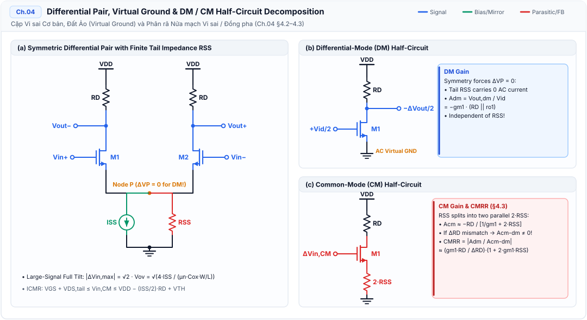

---
{
  "id": "concept-cm-response-and-cmrr",
  "kind": "concept",
  "domain": "stages-and-mirrors",
  "title_vi": "Đáp ứng Chế độ Chung, Chuyển đổi CM-sang-DM & Tỷ số Khử Chế độ Chung (Common-Mode Response & CMRR)",
  "title_en": "Common-Mode Response, CM-to-DM Conversion, and Common-Mode Rejection Ratio (CMRR)",
  "summary": "Định lượng cơ chế trở kháng nguồn dòng đuôi hữu hạn RSS phối hợp với sai lệch linh kiện (Delta_RD, Delta_gm, tụ ký sinh nút đuôi CP) biến nhiễu chế độ chung thành lỗi vi sai tại ngõ ra, xác lập công thức chính xác CMRR = |ADM / ACM-DM|.",
  "diagram": "../../diagrams/diff-pair-half-circuit.svg",
  "razavi_refs": [
    {
      "chapter": 4,
      "section": "4.3",
      "pages": "118-123",
      "equations": ["4.36", "4.37", "4.40", "4.43", "4.44", "4.45", "4.46", "4.47", "4.52", "4.53", "4.54", "4.55", "4.56", "4.57", "4.58"]
    }
  ],
  "glossary_codes": ["T022", "T052", "T576", "T593", "T641", "T642", "T643", "T644", "T645", "T647", "T648", "T649", "T650", "T654", "T657", "T659", "T661", "T662", "T663"],
  "process_agnostic": true,
  "roles": {
    "tail_impedance": "RSS || (1 / s*CP) (trở kháng nút đuôi quyết định mức suy giảm dòng biến thiên chế độ chung)",
    "symmetry_breakers": "Delta_RD, Delta_gm, Delta_VTH, Delta_gmb (các bất đối xứng rẽ dòng CM thành tín hiệu lỗi vi sai)",
    "cm_composite_stage": "M1 + M2 mắc song song tương đương (hỗ dẫn 2*gm suy giảm nguồn bởi RSS tải bởi RD/2)"
  },
  "symptoms_addressed": [
    "common-mode-noise-corrupting-differential-signal",
    "output-cm-level-drift-across-cascaded-stages",
    "high-frequency-cmrr-degradation-due-to-tail-capacitance",
    "single-ended-sensing-poor-common-mode-rejection"
  ],
  "limitations": [
    "requires-high-tail-output-impedance-trading-headroom-or-length",
    "tail-parasitic-capacitance-inevitably-shunts-rss-at-high-frequency",
    "body-effect-mismatch-bypasses-infinite-tail-resistance-if-wells-differ"
  ],
  "checklists": ["common-mos", "differential-pair"]
}
---

## 1. Bản chất Nguyên lý, Sơ đồ Mạch & Vai trò Từng Nhánh Cấu trúc

Trong lý tưởng hóa sơ khởi của cặp vi sai, nguồn dòng đuôi $I_{SS}$ có trở kháng vô hạn và hai nửa mạch đối xứng tuyệt đối, khiến mọi **nhiễu loạn chế độ chung** (*common-mode perturbations*) tại ngõ vào bị chặn đứng hoàn toàn. Trên thực tế chế tạo silicon, hai hiện tượng không lý tưởng luôn đồng thời xuất hiện (Razavi Mục 4.3, trang 118–123):
1. Nguồn dòng đuôi thực tế luôn có **trở kháng đầu ra hữu hạn** (*finite output impedance*) $R_{SS}$ ở tần số thấp và bị nối tắt bởi **điện dung nút đuôi** (*tail capacitance*) $C_P$ ở tần số cao.
2. Hai nhánh trái–phải luôn chịu **các sai lệch không đồng nhất** (*mismatches*) ngẫu nhiên hoặc hệ thống về điện trở tải ($\Delta R_D$), kích thước hình học $\Delta(W/L)$, điện áp ngưỡng ($\Delta V_{TH}$) và hiệu ứng thân ($\Delta g_{mb}$).

Sự kết hợp của hai yếu tố này sinh ra hai hệ quả vật lý hoàn toàn khác nhau về mức độ nguy hiểm:
- **Hệ quả bậc một (khi mạch đối xứng hoàn hảo nhưng $R_{SS} < \infty$):** Biến thiên $\Delta V_{in,CM}$ làm trôi đồng thời điện áp $V_X$ và $V_Y$ cùng chiều với **độ lợi chế độ chung** (*common-mode gain*) $A_{v,CM}$. Nếu lấy ngõ ra vi sai $V_X - V_Y$, thành phần này vẫn tự triệt tiêu bằng $0$, nhưng độ dịch mức DC của $V_X, V_Y$ làm thu hẹp dự trữ bão hòa (Ví dụ 4.9) và lan truyền qua **các cặp vi sai mắc tầng** (*cascaded differential pairs*). Nếu chỉ đọc ngõ ra đơn đầu tại $X$ hoặc $Y$, $A_{v,CM}$ cộng thẳng vào tín hiệu!
- **Hệ quả chí mạng (khi đồng thời $R_{SS} < \infty$ và mạch có sai lệch bất đối xứng):** Biến thiên dòng đuôi do $\Delta V_{in,CM}$ gây ra được chia không đều hoặc rơi trên hai tải không bằng nhau, sinh ra điện áp chênh lệch khác không giữa $X$ và $Y$. Hiện tượng này gọi là **chuyển đổi chế độ chung sang vi sai** (*common-mode to differential conversion*, ký hiệu hệ số chuyển đổi $A_{\text{CM-DM}}$). Một khi nhiễu chế độ chung (nhiễu đế, nhiễu nguồn, xuyên âm đồng hồ) đã biến thành thành phần vi sai ngay trong tầng đầu, không một tầng vi sai nào phía sau còn có thể phân biệt hay lọc bỏ nó khỏi tín hiệu thật!

Phân rã vai trò cấu trúc trong đáp ứng chế độ chung (Hình 4.29, 4.31, 4.33, 4.34):
- **Linh kiện gộp tương đương ($M_1 + M_2$ — *composite device*):** Khi kích chung $V_{in,CM}$ trên sơ đồ đối xứng, $V_X = V_Y$ cho phép chập hai nút đầu ra lại; $M_1, M_2$ ghép song song tất cả các cực, tạo thành một transistor duy nhất có chiều rộng gấp đôi $2(W/L)$, dòng phân cực $I_{SS}$, độ hỗ dẫn $2g_m$, mắc nguồn chung với tải $R_D/2$ và điện trở suy giảm nguồn $R_{SS}$.
- **Mắt xích chặn dòng chung ($R_{SS} \parallel \frac{1}{sC_P}$):** Đóng vai trò hồi tiếp âm cục bộ cực mạnh cho tín hiệu chế độ chung (hệ số suy giảm $1 + 2g_m R_{SS}$) trong khi hoàn toàn "tàng hình" đối với tín hiệu vi sai nhờ đất ảo tại nút $P$.
- **Tác nhân phá vỡ đối xứng ($\Delta R_D, \Delta g_m, \Delta g_{mb}$):** Đóng vai trò "cầu bắc chéo" biến dòng chế độ chung lọt qua nút $P$ thành hiệu điện áp vi sai $V_X - V_Y$.

---

## 2. Hệ Phương trình Cốt lõi & Tư duy "Nhìn Mạch Đọc Nhanh" (Analysis by Inspection)

### 2.1. Độ lợi Chế độ Chung Đối xứng $A_{v,\text{CM}}$ (Phương trình 4.36–4.42)

Xét mạch đối xứng hoàn hảo ($R_{D1} = R_{D2} = R_D$, $g_{m1} = g_{m2} = g_m$) với $\lambda = \gamma = 0$ nhưng nguồn dòng đuôi có trở kháng $R_{SS}$ (Hình 4.29). Từ mạch gộp tương đương gồm một transistor hỗ dẫn $2g_m$, điện trở cực nguồn $R_{SS}$ và điện trở cực máng $R_D/2$, đọc nhanh theo công thức tầng CS có suy giảm nguồn:

$$A_{v,\text{CM}} = \frac{\Delta V_{X,Y}}{\Delta V_{in,\text{CM}}} = -\frac{R_D / 2}{\dfrac{1}{2g_m} + R_{SS}} = -\frac{R_D}{2R_{SS} + \dfrac{1}{g_m}} \approx -\frac{R_D}{2R_{SS}} \quad (\text{khi } 2g_m R_{SS} \gg 1)$$

Nếu kể thêm hiệu ứng thân ($\gamma \neq 0$, hai thân nối đất), mẫu số $\frac{1}{2g_m}$ thay bằng $\frac{1}{2(g_m + g_{mb})}$, và xấp xỉ $-R_D/(2R_{SS})$ vẫn giữ nguyên. Trong trường hợp đối xứng này, đầu ra vi sai vẫn bằng không ($\Delta V_X - \Delta V_Y = 0$). Tuy nhiên, như minh họa số tại Ví dụ 4.9 (trang 118–119, dùng điện trở đuôi $R_{SS} = 500\,\Omega, R_D = 3{,}16\text{ k}\Omega, 1/g_m = 632\,\Omega$), khi $V_{in,\text{CM}}$ tăng nhẹ $+50\text{ mV}$, cả $V_X, V_Y$ sụt giảm tới $96{,}8\text{ mV}$, làm biên độ dự trữ cách vùng triode ($V_X - (V_{in,\text{CM}} - V_{TH})$) bị bào mòn tổng cộng $50 + 96{,}8 = 146{,}8\text{ mV}$!

### 2.2. Chuyển đổi CM-sang-DM do Sai lệch Điện trở Tải $\Delta R_D$ (Phương trình 4.43–4.45)

Giả sử $M_1, M_2$ khớp nhau hoàn toàn ($g_{m1} = g_{m2} = g_m, \lambda = \gamma = 0$), nhưng hai điện trở tải lệch nhau một lượng nhỏ $\Delta R_D$. Theo quy ước Hình 4.31 của Razavi ($R_{D1} = R_D$, $R_{D2} = R_D + \Delta R_D$):
1. Nhìn từ cổng xuống nút đuôi $P$, cặp $M_1 + M_2$ hoạt động như một tầng bám nguồn có hỗ dẫn $2g_m$ lái tải $R_{SS}$, kéo nút $P$ tăng một lượng (Phương trình 4.43):

$$\Delta V_P = \frac{R_{SS}}{R_{SS} + \dfrac{1}{2g_m}}\,\Delta V_{in,\text{CM}}$$

2. Biến thiên dòng máng trên mỗi nhánh bằng nhau: $\Delta I_{D1} = \Delta I_{D2} = g_m(\Delta V_{in,\text{CM}} - \Delta V_P) = \frac{g_m}{1 + 2g_m R_{SS}}\Delta V_{in,\text{CM}}$.
3. Tuy dòng bằng nhau, sụt áp trên hai tải lại khác nhau (Phương trình 4.44–4.45):

$$\Delta V_X = -\frac{g_m R_D}{1 + 2g_m R_{SS}}\Delta V_{in,\text{CM}}, \qquad \Delta V_Y = -\frac{g_m(R_D + \Delta R_D)}{1 + 2g_m R_{SS}}\Delta V_{in,\text{CM}}$$

Từ đó hệ số chuyển đổi chế độ chung sang chế độ vi sai $A_{\text{CM-DM}} \triangleq \frac{\Delta(V_X - V_Y)}{\Delta V_{in,\text{CM}}}$ có dạng tổng quát theo $\Delta R_D \triangleq R_{D1} - R_{D2}$ (hoặc mang dấu dương nếu đặt $R_{D2} - R_{D1} = \Delta R_D$ như Hình 4.31):

$$A_{\text{CM-DM}}\Big|_{\Delta R_D = R_{D1}-R_{D2}} = -\frac{g_m \Delta R_D}{1 + 2g_m R_{SS}} = -\frac{\Delta R_D}{2R_{SS} + \dfrac{1}{g_m}} \approx -\frac{\Delta R_D}{2R_{SS}}$$

### 2.3. Chuyển đổi CM-sang-DM do Sai lệch Hỗ dẫn $\Delta g_m$ & Công thức Chính xác CMRR (Phương trình 4.46–4.58)

Trên vi mạch thực tế, sai lệch giữa hai transistor đầu vào $M_1, M_2$ (do $\Delta(W/L)$ và $\Delta V_{TH}$) thường nghiêm trọng hơn sai lệch điện trở tải thụ động. Giả sử $R_{D1} = R_{D2} = R_D$ nhưng $g_{m1} \neq g_{m2}$, đặt $\Delta g_m = g_{m1} - g_{m2}$ và $g_m = (g_{m1} + g_{m2})/2$ (Hình 4.34, $\lambda = \gamma = 0$):
1. KCL tại nút đuôi $P$: $(g_{m1} + g_{m2})(\Delta V_{in,\text{CM}} - \Delta V_P)R_{SS} = \Delta V_P$ suy ra (Phương trình 4.46–4.47):

$$\Delta V_P = \frac{(g_{m1} + g_{m2})R_{SS}}{1 + (g_{m1} + g_{m2})R_{SS}}\,\Delta V_{in,\text{CM}} \implies \Delta V_{in,\text{CM}} - \Delta V_P = \frac{\Delta V_{in,\text{CM}}}{1 + (g_{m1} + g_{m2})R_{SS}}$$

2. Điện áp tại $X$ và $Y$ lần lượt là $\Delta V_X = -g_{m1}R_D(\Delta V_{in,\text{CM}} - \Delta V_P)$ và $\Delta V_Y = -g_{m2}R_D(\Delta V_{in,\text{CM}} - \Delta V_P)$ (Phương trình 4.48–4.51). Lấy hiệu hai vế thu được Phương trình (4.52)–(4.53):

$$A_{\text{CM-DM}}\Big|_{\Delta g_m} = \frac{\Delta(V_X - V_Y)}{\Delta V_{in,\text{CM}}} = -\frac{(g_{m1} - g_{m2})R_D}{1 + (g_{m1} + g_{m2})R_{SS}} = -\frac{\Delta g_m R_D}{1 + 2g_m R_{SS}}$$

3. **Định nghĩa và biểu thức chính xác Tỷ số Khử Chế độ Chung (*Common-Mode Rejection Ratio*, CMRR):** Chuẩn hóa tín hiệu vi sai mong muốn chia cho thành phần lỗi vi sai sinh ra bởi chế độ chung (Phương trình 4.55):

$$\text{CMRR} \triangleq \left\lvert \frac{A_{\text{DM}}}{A_{\text{CM-DM}}} \right\rvert$$

Khi $g_{m1} \neq g_{m2}$ và $R_{SS}$ hữu hạn, giải bằng chồng chập Phương pháp I cho độ lợi vi sai chính xác (Phương trình 4.56):

$$\lvert A_{\text{DM}} \rvert = \frac{R_D}{2}\,\frac{g_{m1} + g_{m2} + 4g_{m1}g_{m2}R_{SS}}{1 + (g_{m1} + g_{m2})R_{SS}}$$

*(Kiểm chứng giới hạn Bài tập 4.27: khi $R_{SS} \to \infty$, $\lvert A_{\text{DM}} \rvert \to \frac{2g_{m1}g_{m2}}{g_{m1}+g_{m2}}R_D = \frac{2R_D}{1/g_{m1} + 1/g_{m2}}$, khớp hoàn toàn với Phương trình 4.20!)* Chia (4.56) cho độ lớn của (4.53), mẫu số $1 + (g_{m1}+g_{m2})R_{SS}$ và $R_D$ triệt tiêu sạch sẽ, cho công thức chính xác và xấp xỉ của CMRR (Phương trình 4.57–4.58):

$$\text{CMRR}\Big|_{\Delta g_m} = \frac{g_{m1} + g_{m2} + 4g_{m1}g_{m2}R_{SS}}{2\lvert \Delta g_m \rvert} \approx \frac{g_m}{\lvert \Delta g_m \rvert}(1 + 2g_m R_{SS}) \approx \frac{2g_m^2 R_{SS}}{\lvert \Delta g_m \rvert}$$

Nếu cả hai sai lệch nhỏ $\Delta R_D$ và $\Delta g_m$ cùng hiện diện độc lập với $2g_m R_{SS} \gg 1$, cộng tuyến tính biên độ chuyển đổi cho phép đọc nhanh một dòng:

$$A_{\text{CM-DM,tot}} \approx -\frac{g_m R_D}{1 + 2g_m R_{SS}}\left(\frac{\Delta g_m}{g_m} + \frac{\Delta R_D}{R_D}\right) \implies \text{CMRR}_{\text{tot}} \approx \frac{1 + 2g_m R_{SS}}{\left\lvert \dfrac{\Delta g_m}{g_m} + \dfrac{\Delta R_D}{R_D} \right\rvert}$$

### 2.4. Suy thoái CMRR ở Tần số Cao do Điện dung Nút Đuôi $C_P$ (Phương trình 4.54)

Tại nút đuôi $P$, tổng điện dung ký sinh $C_P = C_{DB3} + C_{GD3} + C_{SB1} + C_{SB2} + C_{\text{wire}}$ luôn mắc song song với $R_{SS}$ (Hình 4.33, Ví dụ 4.10). Thay $R_{SS} \to Z_{\text{tail}}(s) = R_{SS} \parallel \frac{1}{sC_P} = \frac{R_{SS}}{1 + s R_{SS} C_P}$ vào (4.53):
- Khi tần số nhiễu $\omega$ vượt tần số góc gãy đuôi $\omega_{z,\text{CM}} = \frac{1}{R_{SS}C_P}$, dung kháng $\frac{1}{\omega C_P}$ nối tắt $R_{SS}$ xuống đất. Trong giới hạn $R_{SS} \to \infty$ chỉ còn tụ $C_P$ (Phương trình 4.54):

$$\lvert A_{\text{CM-DM}}(j\omega) \rvert = \frac{\lvert \Delta g_m \rvert R_D}{\sqrt{1 + (g_{m1} + g_{m2})^2\left(\dfrac{1}{\omega C_P}\right)^2}} = \frac{\lvert \Delta g_m \rvert R_D\,\omega C_P}{\sqrt{(2g_m)^2 + (\omega C_P)^2}}$$

Hệ số lỗi $\lvert A_{\text{CM-DM}}(j\omega) \rvert$ tăng dốc $+20\text{ dB/decade}$ theo tần số $\omega$, kéo CMRR sụt giảm $-20\text{ dB/decade}$! Đây là lý do vật lý khiến nhiễu chuyển mạch xung nhịp tần số cao trên nguồn/đế xuyên qua cặp vi sai dễ dàng hơn nhiều so với nhiễu $50/60\text{ Hz}$.

---

## 3. Bất biến Cấu trúc & Các Bẫy Lỗi Kinh điển (Structural Invariants & Traps)

- **`[INV-CM-01]` Bất biến nhân hai bậc bảo vệ của CMRR vi sai hoàn toàn:** Trong ngõ ra vi sai hoàn toàn (*fully differential output*), CMRR tần số thấp là tích của hai hàng rào độc lập: (1) hệ số chặn dòng chung tại nút đuôi $(1 + 2g_m R_{SS})$, và (2) nghịch đảo độ lệch tương đối của hai nửa mạch $\left\lvert \frac{\Delta g_m}{g_m} + \frac{\Delta R_D}{R_D} \right\rvert^{-1}$. Nếu thiếu một trong hai (ví dụ lấy ngõ ra đơn đầu làm mất hàng rào đối xứng, hoặc nối đất thẳng nút đuôi $R_{SS}=0$), CMRR sụp đổ hàng chục dB.
- **`[INV-CM-02]` Bất biến điểm không (Zero) trong hàm truyền lỗi $A_{\text{CM-DM}}(s)$:** Cực của trở kháng đuôi $Z_{\text{tail}}(s)$ tại $\omega_p = \frac{1}{R_{SS}C_P}$ chính là **điểm không (LHP zero)** của hàm truyền chuyển đổi $A_{\text{CM-DM}}(s)$, bắt đầu quá trình sụp đổ $-20\text{ dB/dec}$ của CMRR trước rất xa băng thông tín hiệu vi sai $\omega_{-3\text{dB,DM}}$!

- **`[TRAP-CM-01]` Ngộ nhận "Nguồn dòng đuôi lý tưởng ($R_{SS} = \infty$) luôn bảo đảm $\text{CMRR} = \infty$":** Razavi bác bỏ trực tiếp ngộ nhận này tại **Ví dụ 4.11 (Hình 4.36, trang 123)**! Ngay cả khi $R_{SS} \to \infty$ (tổng dòng $I_{D1} + I_{D2} = I_{SS}$ cố định tuyệt đối), khi $V_{in,\text{CM}}$ thay đổi một lượng $\Delta V_{in,\text{CM}}$, nút đuôi $P$ vẫn đi theo ($\Delta V_P \approx \Delta V_{in,\text{CM}}$), làm thay đổi điện áp thân–nguồn $\Delta V_{BS1} = \Delta V_{BS2} = -\Delta V_P$ nếu thân nối đất/nguồn cố định. Nếu hai transistor có **sai lệch hiệu ứng thân** (*body-effect mismatch*, $g_{mb1} \neq g_{mb2}$), hiệu dòng biến thiên $\Delta I_{D1} - \Delta I_{D2}$ không bằng không (mà bằng $\approx \frac{g_{m2}g_{mb1} - g_{m1}g_{mb2}}{g_{m1}+g_{m2}}\Delta V_P$), lập tức sinh ra $A_{\text{CM-DM}} \neq 0$ dù $R_{SS} = \infty$!
- **`[TRAP-CM-02]` Nhầm lẫn định nghĩa CMRR giữa ngõ ra vi sai và ngõ ra đơn đầu:** Nếu lấy ngõ ra đơn đầu tại một nút $X$, ngay cả khi mạch đối xứng tuyệt đối ($\Delta R_D = 0, \Delta g_m = 0$), thành phần chế độ chung $\lvert A_{v,\text{CM}} \rvert \approx \frac{R_D}{2R_{SS}}$ đã trực tiếp trộn vào tín hiệu $\lvert A_{v,\text{DM,SE}} \rvert = \frac{1}{2}g_m R_D$, giới hạn cứng $\text{CMRR}_{\text{SE}} = \frac{\frac{1}{2}g_m R_D}{R_D / (2R_{SS})} = g_m R_{SS}$ (chỉ khoảng $20 - 35\text{ dB}$ với nguồn dòng đơn trong tiến trình nanomet!).
- **`[TRAP-CM-03]` Tưởng "tăng vô hạn kích thước $W_3, L_3$ của nguồn dòng đuôi là luôn tốt cho CMRR":** Tăng $L_3$ giúp tăng $R_{SS}$ ở DC, nhưng giữ nguyên $V_{DS3,\min}$ buộc phải tăng $W_3$ tỷ lệ thuận, làm diện tích vùng máng và cổng $M_3$ phình to, kéo $C_P$ tăng mạnh và làm giảm tần số góc gãy $\omega_{z,\text{CM}} = \frac{1}{R_{SS}C_P}$, khiến CMRR tần số cao còn tệ hơn!
- **`[TRAP-CM-04]` Lan truyền trôi mức CM qua chuỗi tầng vi sai nanomet:** Trong công nghệ 65nm/45nm khi $g_m r_O \sim 6 - 10$, $A_{v,\text{CM}} = -\frac{R_D}{2R_{SS}}$ không hề nhỏ (có thể đạt $-0{,}3 \to -0{,}8$), khiến biến thiên $V_{in,\text{CM}}$ làm đảo chiều mức CM liên tiếp qua các tầng mắc nối tiếp (Nanometer Design Note trang 119).

---

## 4. Lộ trình Nâng cấp Cấu trúc & Bát giác Đánh đổi (Upgrade Paths & Design Octagon)

Trên Bát giác Thiết kế (`concept-analog-design-octagon`), tối ưu CMRR va chạm trực tiếp với **Dự trữ điện áp / Dải dao động** (*Voltage swings*), **Tốc độ / Tần số cao** (*Speed*) và **Diện tích** (*Area*):
1. **Nâng cấp trở kháng đuôi $R_{SS}$ mà không làm phình $C_P$ tại nút $P$:**
   - Thay nguồn dòng đuôi đơn bằng **gương dòng cascode điện áp thấp** $\rightarrow$ `topo-lvccml-wide-swing-mirror` (nâng $R_{SS}$ từ $r_{O3}$ lên $\approx g_m r_O^2$, đồng thời transistor cascode kích thước nhỏ $L_{\min}$ vừa che chắn nút máng vừa giữ $C_P$ nhỏ hơn nhiều so với một transistor đơn siêu rộng siêu dài, chỉ tốn $2V_{DS,\min}$ dự trữ đáy!).
2. **Giảm sai lệch linh kiện gốc ($\Delta g_m / g_m, \Delta V_{TH}, \Delta R_D / R_D$):**
   - Định cỡ theo định luật Pelgrom và đối ngẫu $g_m/I_D$ $\rightarrow$ `law-pelgrom-mismatch-and-sizing-duality` (cặp đầu vào chạy $g_m/I_D$ cao / $V_{OV}$ nhỏ để giảm $\Delta g_m/g_m$ do $\Delta V_{TH}$, diện tích $WL$ đủ lớn).
   - Bố trí vật lý đối xứng tâm chung 2D ABBA, thêm dải giả (*dummy*) chống hiệu ứng STI/LOD và WPE $\rightarrow$ `tech-common-centroid-sti-wpe-layout`.
   - Khử sai lệch hiệu ứng thân $\Delta g_{mb}$ bằng cặp đầu vào PMOS đặt chung trong một giếng N (*N-well*) nối thẳng vào nút đuôi $P$ ($V_{BS1} = V_{BS2} = 0$ tuyệt đối!).
3. **Khóa cứng mức chế độ chung đầu ra khi tải trở kháng cao** $\rightarrow$ `tech-common-mode-feedback-cmfb` và `tech-switched-capacitor-cmfb` (cần thiết cho `topo-telescopic-cascode-opamp`, `topo-folded-cascode-ota`, `topo-two-stage-opamp`).
4. **Đối chiếu hành vi CM riêng biệt khi dùng tải gương dòng chủ động** $\rightarrow$ `topo-five-transistor-ota` (nơi $\text{CMRR}$ hữu hạn ngay cả khi đối xứng hoàn hảo!).

---

## 5. Thích ứng Đa Tiến trình (90nm / 65nm / 45nm) & Cách Kiểm chứng trong Cadence / Spectre

### 5.1. Chiến lược Thiết kế CMRR Đa Tiến trình (90nm / 65nm / 45nm)

- **Dịch chuyển từ $\Delta V_{TH}$ sang hiệu ứng kênh ngắn & $r_O$ sụt giảm:** Ở 65nm/45nm, hệ số Pelgrom $A_{VTH}$ giảm nhẹ nhờ $t_{ox}$ mỏng ($\approx 2{,}5 - 4\text{ mV}\cdot\mu\text{m}$), nhưng $r_O$ của nguồn dòng đuôi sụt mạnh do DIBL và CLM ($g_m r_O \approx 6 - 12$ ở $L_{\min}$). Nếu dùng $L_{\min}$ cho $M_3$, hệ số $2g_m R_{SS}$ chỉ đạt $\sim 10 - 15$, kéo CMRR xuống vùng nguy hiểm $< 55\text{ dB}$ khi có lệch ngẫu nhiên $3\sigma$.
- **Quy tắc thực chiến:**
  1. Chọn chiều dài nguồn dòng đuôi $L_{\text{tail}} \ge 4 - 8 L_{\min}$ (hoặc dùng cấu trúc cascode điện áp thấp nếu $V_{DD} \ge 1{,}0\text{ V}$ và $V_{in,CM}$ cho phép $2V_{DS,\min} \approx 250\text{ mV}$ ở đuôi).
  2. Tách giếng (*Triple-well / Deep N-well* cho NMOS hoặc *N-well* riêng cho cặp đầu vào PMOS) nối cực thân vào cực nguồn nút $P$ để loại bỏ hoàn toàn cơ chế lỗi $\Delta g_{mb}$ (Ví dụ 4.11), nhưng lưu ý điện dung giếng–đế $C_{\text{well-sub}}$ sẽ cộng thêm vào $C_P$! Vì vậy ở tần số GHz, thường giữ giếng nối $V_{DD}$ tĩnh để giảm $C_P$, còn ở mạch đo lường chính xác tần số thấp–trung bình thì nối giếng vào nút đuôi $P$.

### 5.2. Quy trình Kiểm chứng CMRR Chính xác trên Cadence Virtuoso IC617 & Spectre

> **Cảnh báo mô phỏng bắt buộc:** Nếu chạy `ac` trên schematic danh định đối xứng hoàn hảo với ngõ ra vi sai, Spectre sẽ báo $A_{\text{CM-DM}} \approx -300\text{ dB}$ (nhiễu làm tròn số chấm động) — con số này **hoàn toàn vô nghĩa**! Phải đo CMRR qua **Monte Carlo mismatch** hoặc bơm độ lệch kiểm định có chủ đích.

1. **Thiết lập Testbench Tách Chế độ bằng `balun` lý tưởng (`analogLib/balun`):**
   - Đặt một `balun` ở ngõ vào (cổng `d` nối nguồn `vdm`, cổng `c` nối nguồn `vcm`) và một `balun` ở ngõ ra $(V_X, V_Y)$ để tách sạch $V_{out,\text{DM}} = V_X - V_Y$ tại cổng `d_out` và $V_{out,\text{CM}} = (V_X + V_Y)/2$ tại cổng `c_out`.
2. **Đo bằng Phân tích Hàm truyền `xf` (Transfer Function — Khuyến nghị chuẩn nhất):**
   - Đặt tâm phân tích `xf` tại hiệu ngõ ra `(VX - VY)` từ $1\text{ Hz}$ đến $10\text{ GHz}$: Spectre tính đồng thời trong **một lần chạy duy nhất** độ lợi từ nguồn `Vdm` ($A_{\text{DM}}(f)$), từ nguồn `Vcm` ($A_{\text{CM-DM}}(f)$) và từ nguồn `VDD` ($\text{PSRR}^-$)!
   - Công thức ADE Calculator: `CMRR_dB = db20(mag(xf("/Vdm")) / mag(xf("/Vcm")))`.
3. **Chạy Monte Carlo Mismatch (`mc`, 200 samples, `variations=mismatch`):**
   - Thu thập phân bố thống kê của `value(CMRR_dB, 1k)` (tần số thấp) và `value(CMRR_dB, 10M)` (tần số cao, kiểm tra ảnh hưởng của $C_P$ sau trích xuất ký sinh layout `PEX / Quantus`). Yêu cầu giá trị biên xấu nhất ($\mu - 3\sigma$ hoặc bách phân vị thứ $1\%$) vẫn vượt chỉ tiêu thiết kế với dự trữ $\ge 6\text{ dB}$.

### 5.3. Bảng Định lượng Đối chiếu Các Cơ chế Suy giảm CMRR Điển hình (Bài tập 4.9–4.10 & Ví dụ 4.10)

Xét một cặp vi sai chuẩn trên tiến trình nanomet có $I_{SS} = 1\text{ mA}$, $g_m = 8\text{ mS}$, $R_D = 2\text{ k}\Omega$ ($\lvert A_{\text{DM}} \rvert = 16 \approx 24{,}1\text{ dB}$), nguồn dòng đuôi đơn $R_{SS} = 25\text{ k}\Omega$ ($1 + 2g_m R_{SS} = 401 \approx 52{,}1\text{ dB}$) và tổng điện dung nút đuôi $C_P = 80\text{ fF}$ (tần số gãy đuôi $f_{z,\text{CM}} = \frac{1}{2\pi R_{SS} C_P} \approx 79{,}6\text{ kHz}$):

| Nguồn Gây Lỗi Bất Đối xứng | Biểu thức $\lvert A_{\text{CM-DM}} \rvert$ | Giá trị Lỗi Điển hình ($3\sigma$) | CMRR ở $1\text{ kHz}$ (DC) | CMRR ở $100\text{ MHz}$ ($Z_{\text{tail}} \approx 20\text{ }\Omega$) | Biện pháp Khắc phục Trọng tâm |
|---|---|---|---|---|---|
| **Sai lệch điện trở tải $\Delta R_D / R_D$** | $\dfrac{g_m R_D}{1 + 2g_m R_{SS}}\dfrac{\lvert \Delta R_D \rvert}{R_D}$ | $0{,}5\%$ ($\Delta R_D = 10\,\Omega$) | $\approx 98{,}1\text{ dB}$ | $\approx 48{,}4\text{ dB}$ | Ghép xen kẽ dải điện trở poly rộng $W \ge 2\,\mu\text{m}$ kèm dummy hai đầu |
| **Sai lệch ngưỡng đầu vào $\Delta V_{TH}$** | $\dfrac{g_m R_D}{1 + 2g_m R_{SS}}\left(\dfrac{g_m}{I_D}\Delta V_{TH}\right)_{\text{sq: }\Delta V_{TH}/V_{OV}}$ | $\Delta V_{TH} = 2\text{ mV}$ tại $g_m/I_D = 16\text{ V}^{-1}$ ($\frac{\Delta g_m}{g_m} \approx 1{,}6\%$) | $\approx 88{,}0\text{ dB}$ | $\approx 38{,}3\text{ dB}$ | Tăng diện tích $W L$ theo Pelgrom, bố trí 2D Common-Centroid ABBA |
| **Ngõ ra đơn đầu (kể cả khớp $100\%$)** | $\lvert A_{v,\text{CM,SE}} \rvert = \dfrac{R_D}{2R_{SS} + 1/g_m}$ | $\Delta R_D = 0,\; \Delta g_m = 0$ | $\approx 46{,}1\text{ dB}$ ($= g_m R_{SS}$) | $\approx 0\text{ dB}$ | Chuyển sang vi sai hoàn toàn hoặc nâng $R_{SS}$ bằng cascode LVCCML |
| **Sai lệch hiệu ứng thân $\Delta g_{mb}$ khi $R_{SS} \to \infty$** | $\approx \dfrac{\lvert g_{m2}g_{mb1} - g_{m1}g_{mb2} \rvert}{g_{m1} + g_{m2}}R_D$ | $\Delta \eta \approx 0{,}2\%$ | Hữu hạn $\approx 60\text{ dB}$ dù $R_{SS} = \infty$ | Giữ nguyên theo băng thông tầng | Đặt cặp đầu vào chung một giếng độc lập nối cực thân vào nút đuôi $P$ |

---

## 6. Mốc Đối chiếu Sách Razavi & Thuật ngữ Chuẩn CLB

| Mốc Sách Razavi (2nd Ed.) | Trang Sách (PDF Ch.04) | Nội dung & Phương trình Đối chiếu | Mã Thuật ngữ Chuẩn CLB (`terms-vi-en.json`) |
|---|---|---|---|
| **Mục 4.3 (Mở đầu & Mạch đối xứng)**, Hình 4.29–4.30, Ví dụ 4.9 | tr. 118–119 (PDF 19–20) | Linh kiện gộp $M_1+M_2$, độ lợi chế độ chung $A_{v,CM} = -\frac{R_D/2}{1/(2g_m)+R_{SS}}$ **(4.36)–(4.42)**, Nanometer Design Note lan truyền CM | `T641` (Đáp ứng chế độ chung), `T642` (nhiễu loạn chế độ chung), `T643` (trở kháng đầu ra hữu hạn), `T644` (linh kiện gộp tương đương), `T645` (độ lợi chế độ chung), `T647` (các cặp vi sai mắc tầng) |
| **Mục 4.3 (Sai lệch tải $R_D$ & Tụ đuôi)**, Hình 4.31–4.33 | tr. 120–121 (PDF 20–22) | Biến thiên nút đuôi $\Delta V_P$ **(4.43)**, chuyển đổi CM-sang-DM do $\Delta R_D$ **(4.44)–(4.45)**, tụ ký sinh nút đuôi $C_1 / C_P$ | `T052` / `T648` (sai lệch linh kiện / không đồng nhất), `T649` (sai lệch điện trở), `T650` (chuyển đổi chế độ chung sang vi sai), `T654` (điện dung nút đuôi) |
| **Mục 4.3 (Sai lệch $g_m$ & Tần số cao)**, Hình 4.34–4.35, Ví dụ 4.10 | tr. 121–122 (PDF 22–23) | Hệ số chuyển đổi $A_{\text{CM-DM}}$ do $\Delta g_m$ **(4.46)–(4.53)**, đáp ứng tần số cao khi $R_{SS} \to 1/(sC_P)$ **(4.54)** | `T655` (sai lệch kích thước và điện áp ngưỡng), `T657` (hệ số chuyển đổi $A_{\text{CM-DM}}$), `T658` / `T659` (sai lệch hỗ dẫn $\Delta g_m$) |
| **Mục 4.3 (Định nghĩa CMRR & Lệch thân)**, Hình 4.36, Ví dụ 4.11 | tr. 123 (PDF 24) | Định nghĩa $\text{CMRR} = \lvert A_{\text{DM}}/A_{\text{CM-DM}} \rvert$ **(4.55)**, công thức chính xác **(4.56)–(4.58)**, bẫy sai lệch hiệu ứng thân $g_{mb1}\neq g_{mb2}$ khi $R_{SS}=\infty$ | `T576` (khả năng khử chế độ chung), `T661` (tỷ số khử chế độ chung — CMRR), `T662` (độ lợi chế độ vi sai $A_{\text{DM}}$), `T663` (sai lệch hiệu ứng thân) |
