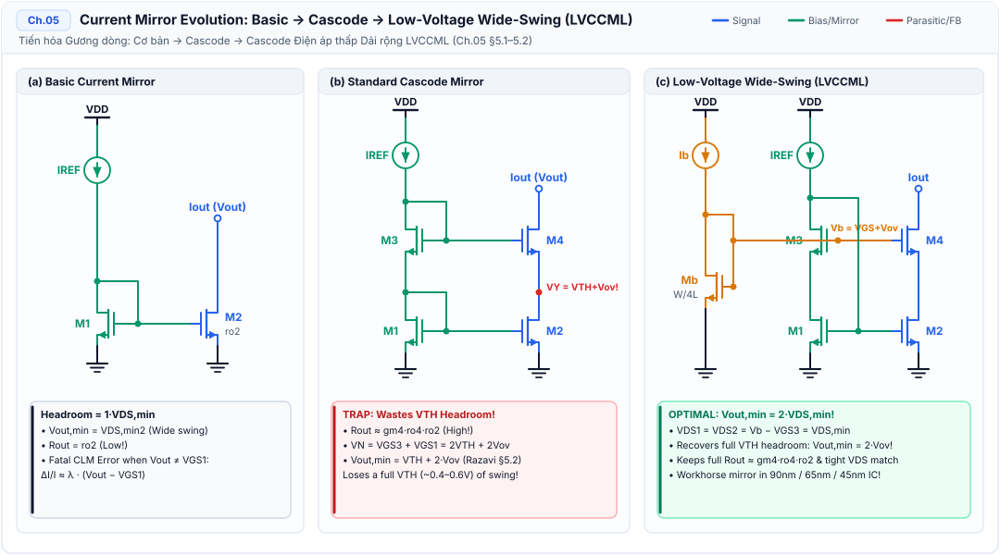

---
{
  "id": "tech-stage-biasing-rules",
  "kind": "technique",
  "domain": "stages-and-mirrors",
  "title_vi": "Quy tắc Phân cực Các Tầng Khuếch đại CMOS: CS, CG, SF & Cặp vi sai (Stage Biasing Rules: AC vs. DC Coupling & Mirror Biasing)",
  "title_en": "CMOS Amplifier Stage Biasing Rules: CS, CG, SF, Differential Pairs, and AC vs. Direct Coupling",
  "summary": "Hệ thống hóa nguyên tắc thiết lập điểm làm việc DC bền vững qua PVT bằng gương dòng cho bốn tầng cơ bản (CS, CG, SF, cặp vi sai), phân giải xung đột giữa nguồn dòng trở kháng cao, tối ưu ghép tụ AC đối trọng với ghép trực tiếp DC và chứng minh lý do bộ chia áp điện trở cực cổng thất bại.",
  "diagram": "../../diagrams/current-mirrors-evolution.svg",
  "razavi_refs": [
    {
      "chapter": 5,
      "section": "5.1",
      "pages": "135-136",
      "equations": ["5.1", "5.4"]
    },
    {
      "chapter": 5,
      "section": "5.4.1-5.4.4",
      "pages": "160-166",
      "equations": ["5.58", "5.59", "5.60", "5.61", "5.62", "5.63"]
    }
  ],
  "glossary_codes": ["T012", "T021", "T023", "T026", "T082", "T453", "T543", "T586", "T691", "T696", "T706", "T707", "T801", "T803", "T804", "T805", "T808", "T811", "T813", "T814", "T816", "T819", "T826", "T829", "T830"],
  "process_agnostic": true,
  "roles": {
    "mirror_bias_reference": "MB mắc diode cấp dòng IB ~ (0.1..0.2)*ID1 (tự động bù biến thiên VTH và độ linh động theo PVT)",
    "ac_coupling_network": "Tụ ghép CB/Cin kết hợp điện trở lớn RB hoặc giả điện trở MOS vùng triode sâu MR (cách ly DC, truyền nguyên AC)",
    "self_bias_dc_loop": "Điện trở phản hồi DC lớn RG/RF kèm tụ thoát xoay chiều CG/C1 (chấm dứt xung đột giữa hai nguồn dòng trở kháng cao)"
  },
  "symptoms_addressed": [
    "severe-pvt-and-vdd-current-drift-of-resistive-gate-biasing",
    "bias-source-fighting-ac-input-signal-at-gate-or-source",
    "two-high-impedance-current-sources-fighting-and-railing-output-node",
    "interstage-dc-level-incompatible-crushing-upstream-gain-or-downstream-headroom"
  ],
  "limitations": [
    "ac-coupling-capacitors-consume-area-block-dc-signals-and-add-bottom-plate-parasitic-capacitance",
    "direct-dc-coupling-amplifies-pvt-offset-drift-across-high-gain-open-loop-cascades",
    "resistive-cg-source-biasing-attenuates-input-or-starves-voltage-headroom"
  ],
  "checklists": ["common-mos", "single-stage", "current-mirror"]
}
---

## 1. Bản chất Nguyên lý, Sơ đồ Mạch & Vai trò Từng Nhánh Cấu trúc

Mọi công thức độ lợi, băng thông và nhiễu của các tầng khuếch đại ở Chương 3 và Chương 4 đều đặt trên một tiền đề ngầm: khi chưa có tín hiệu xoay chiều, mỗi transistor đã mang đúng dòng phân cực tĩnh $I_D$ (để định đoạt $g_m$ và $r_O$) và duy trì đúng điện thế tại ba cực $V_G, V_D, V_S$ (để bảo đảm khoảng dự trữ điện áp bão hòa $V_{DS} \ge V_{DS,\min}$). Mục 5.4 sách Razavi (trang 160–166) tổng hợp các **kỹ thuật phân cực** (*biasing techniques*) thiết yếu nhằm đưa sơ đồ nguyên lý trừu tượng thành mạch tích hợp hoạt động ổn định trên silicon thực.



Bốn mâu thuẫn vật lý trung tâm mà mạng phân cực phải hóa giải đồng thời:
1. **Tại sao bộ chia áp điện trở cực cổng thất bại qua PVT (Mục 5.1 Hình 5.2, Phương trình 5.1):** Cố định $V_G = \frac{R_2}{R_1+R_2}V_{DD}$ làm $V_{OV} = V_G - V_{TH}$ dao động trực tiếp theo cả $\Delta V_{DD}$ lẫn $\Delta V_{TH}$ ($50 - 100\text{ mV}$ giữa các lô wafer) và $\mu_n(T) \propto T^{-3/2}$. Ở $V_{OV} = 200\text{ mV}$, chỉ $\Delta V_{TH} = 50\text{ mV}$ đã gây sai số dòng $44\%$! Do đó **nguyên tắc tối thượng số 1** là: điện áp cổng phân cực $V_B$ không bao giờ được giữ hằng số tuyệt đối, mà bắt buộc phải sinh ra từ một **transistor mắc diode** $M_B$ mang dòng tham chiếu $I_B$ (Hình 5.43(c)), thường chọn $I_B \approx \left(\frac{1}{10} \to \frac{1}{5}\right)I_{D1}$ để tiết kiệm công suất tĩnh.
2. **Tránh xung đột giữa nguồn tín hiệu $V_{in}$ và nguồn phân cực $V_B$:** Không thể nối trực tiếp nguồn áp lý tưởng $V_B$ chung nút với $V_{in}$ (Hình 5.43(a) — hai nguồn áp đánh nhau!). Phải tách miền tần số bằng **ghép AC** (*ac coupling* qua tụ $C_B$ + trở lớn $R_B$) hoặc dùng **ghép trực tiếp** (*direct coupling*) lấy mức DC từ tầng đứng trước có kiểm soát.
3. **Chấm dứt xung đột giữa hai nguồn dòng trở kháng cao (*High-impedance current sources fighting*):** Khi tầng nguồn chung dùng tải nguồn dòng PMOS hoặc tầng đẩy–kéo bù CMOS (Hình 5.45(b), 5.47(a)), hai nguồn dòng NMOS và PMOS mắc nối tiếp không bao giờ khớp nhau tuyệt đối; độ lệch $\Delta I$ dù nhỏ cũng đẩy nút ngõ ra trôi kịch trần/đáy làm một transistor sập vào vùng triode — bắt buộc phải có vòng **tự phân cực** (*self-biasing*) ở DC!
4. **Tương thích mức DC liên tầng (*Interstage DC compatibility*):** Tối ưu hóa cực đại độ lợi tầng đầu (hạ thấp cực máng DC) thường bóp chết dự trữ điện áp đầu vào của tầng thứ hai nếu ghép trực tiếp (Hình 5.50, 5.51).

---

## 2. Hệ Phương trình Cốt lõi & Tư duy "Nhìn Mạch Đọc Nhanh" (Analysis by Inspection)

### 2.1. Phân cực Tầng Nguồn Chung — CS Biasing (Mục 5.4.1, Hình 5.43–5.47, Phương trình 5.58–5.62)

1. **Tầng CS đơn giản ghép tụ AC & Giả điện trở MOS vùng triode sâu (Hình 5.43(b)–(e)):**
   - Mạng $C_B\text{–}R_B$ tạo **bộ lọc thông cao** (*high-pass filter*) có **tần số cắt** (*corner frequency*) $f_{\text{HPF}} = \frac{1}{2\pi R_B C_B}$ phải chọn thấp hơn hẳn **tần số tín hiệu thấp nhất** (*lowest signal frequency*, $f_{\min}$).
   - Khi $f_{\min}$ rất thấp (âm thanh, y sinh Hz–kHz) đòi hỏi tích $R_B C_B$ lớn, thay điện trở thụ động tốn diện tích bằng một MOSFET hẹp và dài $M_R$ làm việc ở vùng triode sâu ($V_{DS,R} = 0$ ở DC!), còn điện áp vượt ngưỡng nhỏ của $M_R$ được khóa bám theo $V_{TH}$ nhờ transistor mắc diode rộng $M_C$ (Hình 5.43(e)). Trong miền đảo mạnh kênh dài, **điện trở khi dẫn** (*on-resistance*) của $M_R$ tuân theo **Phương trình (5.58)**:

$$R_{on,R} = \frac{(W/L)_C}{(W/L)_R}\cdot\frac{1}{g_{m,C}}$$

   Tối đa hóa $(W/L)_C$ và tối thiểu hóa $(W/L)_R$ dễ dàng tạo ra $R_{on,R}$ hàng chục megôm–gigôm cực kỳ gọn nhẹ trên silicon!
2. **Tầng CS tải nguồn dòng: Tự phân cực DC + Dịch mức cân bằng biên độ (Hình 5.45–5.46, Ví dụ 5.14):**
   - Để $M_1$ (NMOS nhận dòng gương từ $I_{B1}$) và $M_2$ (tải PMOS) không đánh nhau, nối điện trở lớn $R_G$ từ cực máng $V_{out}$ về cực cổng $N$ của $M_2$ và nối tụ thoát $C_G$ từ nút $N$ xuống đất/nguồn AC (Hình 5.45(c)). Ở DC, $M_2$ biến thành diode vui vẻ nhận đúng dòng $I_{D1}$ đặt xuống ($V_{out,\text{DC}} = V_{DD} - \lvert V_{GS2} \rvert$); ở tần số tín hiệu $\omega \gg \frac{1}{R_G C_G}$, $C_G$ ngắn mạch cổng $M_2$ trả lại độ lợi cao (Phương trình 5.59):

$$A_v = -g_{m1}(r_{O1} \parallel r_{O2} \parallel R_G) \approx -g_{m1}(r_{O1} \parallel r_{O2}) \quad (\text{khi } R_G \gg r_{O1} \parallel r_{O2})$$

   - *Tối ưu hóa dải dao động bằng dòng dịch mức $I_G$ (Hình 5.45(d), Phương trình 5.60–5.61):* Trong Hình 5.45(c), điểm tĩnh $V_{out,\text{DC}} = V_{DD} - \lvert V_{GS2} \rvert$ thường nằm lệch nên biên độ hướng xuống bị chặn ở $V_{DD} - \lvert V_{GS2} \rvert - V_{OV1}$, giới hạn biên độ đỉnh–đỉnh đối xứng chỉ còn $2(V_{DD} - \lvert V_{GS2} \rvert - V_{OV1})$. Hút thêm dòng tĩnh nhỏ $I_G \ll I_{D1}$ từ nút $N$ qua $R_G$ nâng điểm tĩnh ngõ ra lên $V_{out,\text{DC}} = V_N + I_G R_G = V_{DD} - \lvert V_{GS2} \rvert + I_G R_G$. Cân bằng biên độ lên và xuống (Phương trình 5.60–5.61, với $V_{OV1} \approx \lvert V_{OV2} \rvert$):

$$I_G R_G \approx \lvert V_{GS2} \rvert - \frac{V_{DD}}{2}$$

   Kỹ thuật này vừa đưa $V_{out,\text{DC}}$ về chính giữa $V_{DD}/2$ (đạt biên độ đỉnh–đỉnh cực đại $2(V_{DD}/2 - V_{OV1})$), vừa cho phép giữ $\lvert V_{OV2} \rvert$ lớn để giảm nhiễu nhiệt của nguồn dòng tải $M_2$ (Chương 7)!
3. **Tầng CS bù đẩy–kéo (*Complementary CS Stage*, Hình 5.47(a)–(d), Phương trình 5.62):**
   - Nối điện trở phản hồi lớn $R_F$ từ $V_{out}$ về cổng chung $X$ giúp tự cân bằng $V_{out,\text{DC}} = V_X$; chèn nguồn dòng chuẩn $I_1$ ở cực nguồn PMOS $M_2$ để khóa chính xác dòng tĩnh (tránh trôi theo $V_{DD}$ do $V_{GS1} + \lvert V_{GS2} \rvert = V_{DD}$), và nối tắt xoay chiều cực nguồn $M_2$ lên $V_{DD}$ bằng tụ $C_1$ thỏa mãn điều kiện không suy biến nguồn tại $\omega_{\min}$ (Phương trình 5.62):

$$\frac{1}{\omega_{\min} C_1} \ll \frac{1}{g_{m2}}$$

   - Kết hợp tụ ghép ngõ vào $C_{in}$ (chú ý do hiệu ứng Miller qua $R_F$, trở kháng ngõ vào mà $C_{in}$ nhìn thấy bị hạ thấp thành $R_{in} \approx \frac{R_F}{1 + (g_{m1}+g_{m2})(r_{O1}\parallel r_{O2})}$ — Bài tập 5.25!), mạch giữ trọn độ lợi đẩy–kéo $-\,(g_{m1} + g_{m2})(r_{O1} \parallel r_{O2})$.

### 2.2. Phân cực Tầng Cổng Chung — CG Biasing (Mục 5.4.2, Hình 5.48, Phương trình 5.63)

Cực nguồn tầng CG vừa phải nhận tín hiệu xoay chiều từ tầng kích có **trở kháng ngõ ra của tầng kích** (*driving impedance*) $R_1$, vừa phải có đường thoát dòng phân cực DC xuống đất:
- **Phân cực bằng điện trở cực nguồn $R_S$ (Hình 5.48(a)):** Để gương dòng $M_B\text{–}M_1$ sao chép đúng $\frac{I_{D1}}{I_B} = \frac{(W/L)_1}{(W/L)_B} = K$, hai điện trở cực nguồn phải tỷ lệ nghịch để cùng thế nguồn: $\frac{R_B}{R_S} = \frac{I_{D1}}{I_B} = K$. Tuy nhiên, tín hiệu từ $V_{in}$ vào cực nguồn $X$ bị phân áp suy hao (Phương trình 5.63):

$$\frac{V_X}{V_{in}} = \frac{\dfrac{1}{g_{m1} + g_{mb1}} \parallel R_S}{\left(\dfrac{1}{g_{m1} + g_{mb1}} \parallel R_S\right) + R_1}$$

Muốn tránh mất tín hiệu phải chọn $R_S \gg \frac{1}{g_{m1} + g_{mb1}}$; nhưng vì độ lợi tầng là $(g_{m1}+g_{mb1})R_D$, điều đó kéo theo $R_S$ lớn xấp xỉ $R_D$, gây **sụt áp DC** (*dc voltage drop*) $I_{D1}R_S$ khổng lồ bóp chết dự trữ điện áp của $R_D$!
- **Giải pháp chuẩn (Hình 5.48(b)–(c)):** Thay $R_S$ bằng nguồn dòng gương $M_2$ (trở kháng AC cao $r_{O2}$ nhưng chỉ tốn $V_{DS2,\min}$ DC), và khi cần triệt tiêu sai số CLM do $V_{DS2} < V_{DS,B}$ ở điện áp thấp thì nâng cấp ngay sang **gương dòng cascode điện áp thấp LVCCML** (`topo-lvccml-wide-swing-mirror`, Hình 5.48(c))!

### 2.3. Phân cực Tầng Bám Nguồn (SF) & Cặp Vi sai — Tương thích Liên tầng (Mục 5.4.3–5.4.4, Hình 5.49–5.51)

- **Tầng bám nguồn (*Source follower biasing*, Hình 5.49–5.50):** Nguồn dòng $M_2$ ấn định dòng cho $M_1$, khiến dòng phân cực ít nhạy với $V_{in,\text{DC}}$ và cho phép **kết nối trực tiếp** (*direct connection*) từ tầng trước. Song **Ví dụ 5.15 (Hình 5.50)** chỉ ra cái bẫy chí mạng khi ghép trực tiếp tầng CS ($M_3, R_D$) lái tầng bám nguồn NMOS ($M_1, M_2$): cực máng $X$ của $M_3$ không được tụt xuống dưới $V_{X,\min} = V_{GS1} + V_{DS2,\min}$, ép sụt áp tối đa trên $R_D$ chỉ còn $V_{DD} - V_{GS1} - V_{DS2,\min}$ và bóp nghẹt độ lợi tầng CS! Tách hai tầng bằng tụ ghép $C_C$ + trở $R_B$ (Hình 5.50(b)) hoặc đổi sang tầng bám nguồn PMOS giải phóng hoàn toàn độ lợi tầng CS.
- **Cặp vi sai (*Differential pair biasing*, Hình 5.51):** Chọn mức CM cổng tối ưu thấp nhất $V_{in,CM,\text{opt}} = V_{GS1,2} + V_{DS3,\min}$ cho phép cực máng $X, Y$ xuống thấp tới $V_{OV1,2} + V_{DS3,\min} \approx 2V_{OV}$, tối đa hóa $R_D$ và độ lợi. Tuy nhiên, nếu mắc nối tiếp hai cặp vi sai NMOS ghép trực tiếp (**các cặp vi sai mắc nối tầng** — *cascaded pairs*, Hình 5.51(b)), việc đặt $V_{X,Y}$ của tầng 1 ở mức thấp $2V_{OV}$ sẽ **vi phạm cận dưới ICMR** ($V_{TH} + 2V_{OV}$) của cặp vi sai tầng 2! Giải pháp là dùng tầng 2 đầu vào PMOS (gập mức DC tự nhiên), dịch mức hoặc ghép tụ AC.

---

## 3. Bất biến Cấu trúc & Các Bẫy Lỗi Kinh điển (Structural Invariants & Traps)

- **`[INV-BIAS-01]` Bất biến đường dẫn DC tới mọi cực cổng (*Mandatory Gate DC Path Rule*):** Không một cực cổng MOSFET khuếch đại liên tục nào được phép chỉ nối thuần túy với các tụ điện! Như Razavi nhấn mạnh ở Nhận xét (1) & Chú thích 5 trang 161, nếu bỏ $R_B$ trong Hình 5.43(b), nút cổng $X$ bị thả nổi (*floating*): điện tích bẫy trong quá trình khắc plasma chế tạo và **dòng rò cực cổng** (*gate leakage current*) xuyên hầm qua oxit mỏng ở 65nm/45nm sẽ kéo trôi $V_X$ về $0\text{ V}$ hoặc mức bất định, làm tắt hoàn toàn tầng khuếch đại!
- **`[INV-BIAS-02]` Bất biến một chủ – một tớ tại nút trở kháng cao:** Tại bất kỳ nút tĩnh nào nối giữa nhánh kéo lên PMOS và nhánh kéo xuống NMOS mà không có hồi tiếp DC toàn cục bên ngoài, chỉ **một** phía được phép hoạt động như nguồn dòng độc lập ở DC; phía còn lại bắt buộc phải khép vòng tự phân cực DC (như $R_G$ ở Hình 5.45(c), $R_F$ ở Hình 5.47(b), hoặc mạch CMFB ở cấu trúc vi sai).

- **`[TRAP-BIAS-01]` Ghép trực tiếp chuỗi nhiều tầng độ lợi cao vòng hở (Hình 5.44):** Trong chuỗi CS ghép trực tiếp không hồi tiếp âm DC, sai số điểm tĩnh $\Delta V_X$ do biến thiên PVT của tầng đầu không thể phân biệt được với tín hiệu thật, nên bị các tầng sau nhân lên gấp $A_{v2} A_{v3}\dots$ lần và kẹp cứng các tầng cuối vào đường nguồn! Ghép trực tiếp vòng hở chỉ an toàn khi độ lợi mỗi tầng nhỏ ($\approx 2 - 3$); nếu độ lợi cao bắt buộc phải dùng hồi tiếp âm DC toàn cục, khử offset động (AC coupling / Auto-Zeroing) hoặc vòng servo DC.
- **`[TRAP-BIAS-02]` Bỏ quên điện dung ký sinh tấm đáy (*Bottom-plate parasitic*) của tụ ghép AC (Nhận xét 5 trang 161):** Tụ MIM/MOM/MOS tích hợp trên chip luôn có tụ ký sinh từ một bản cực xuống đế bán dẫn bằng $2\% - 15\%$ giá trị tụ chính. Đặt tụ ghép $C_B$ quá lớn không chỉ tốn diện tích chip mà còn gắn một tụ ký sinh lớn ngay trên đường tín hiệu làm sụt băng thông tần số cao (luôn quay bản cực đáy nhiều ký sinh về phía nguồn kích trở kháng thấp, bản cực đỉnh ít ký sinh về phía cực cổng nhạy cảm!).
- **`[TRAP-BIAS-03]` Quên hệ số nhân Miller lên điện trở phản hồi tự phân cực $R_F$ (Hình 5.47(d)):** Khi dùng $R_F$ nối từ máng về cổng tầng CS/đẩy–kéo độ lợi $-A_0$, trở kháng vào xoay chiều tại cổng không còn là $R_F$ mà bị định lý Miller chia nhỏ thành $\frac{R_F}{1 + A_0}$! Nếu tính tần số cắt $f_{\text{HPF}}$ theo $\frac{1}{2\pi R_F C_{in}}$ thay vì $\frac{1 + A_0}{2\pi R_F C_{in}}$, mạch thực tế sẽ mất sạch dải tần thấp cao gấp $(1 + A_0)$ lần dự tính!

---

## 4. Lộ trình Nâng cấp Cấu trúc & Bát giác Đánh đổi (Upgrade Paths & Design Octagon)

Trên Bát giác Thiết kế (`concept-analog-design-octagon`), mạng phân cực định hình biên giới khả thi của mọi chỉ tiêu (Độ lợi, Dải dao động, Công suất tĩnh qua tỷ lệ $I_B / I_D$, Nhiễu và Diện tích tụ/trở):
1. **Nguồn gốc tạo dòng tham chiếu gốc $I_{REF}$ độc lập nguồn cấp và nhiệt độ (thay vì giả sử $I_B$ có sẵn)** $\rightarrow$ `tech-supply-independent-bias-and-startup`, `topo-bandgap-reference-core`, `tech-ptat-current-and-constant-gm`.
2. **Nâng cấp gương dòng phân cực từ cơ bản lên chính xác cao, dự trữ điện áp thấp** $\rightarrow$ `topo-basic-current-mirror` $\to$ `topo-cascode-current-mirror` $\to$ `topo-lvccml-wide-swing-mirror`.
3. **Ứng dụng trực tiếp quy tắc tương thích DC liên tầng trong thiết kế Op-Amp đa tầng:**
   - Điều kiện vàng ghép trực tiếp tầng 1 (5T-OTA `topo-five-transistor-ota`) sang tầng 2 CS mà không sinh lệch hệ thống ($V_{GS6} = V_{DS4}$) $\rightarrow$ `topo-two-stage-opamp`.
   - Dùng cặp vi sai PMOS gập sang nhánh NMOS hoặc ngược lại để giải bài toán dịch mức DC liên tầng mà không cần tụ ghép $\rightarrow$ `topo-folded-cascode-ota`.
4. **Thay thế tụ ghép AC khổng lồ bằng kỹ thuật lấy mẫu triệt lệch DC rời rạc thời gian** $\rightarrow$ `tech-dynamic-offset-cancellation-az-cds`.

---

## 5. Thích ứng Đa Tiến trình (90nm / 65nm / 45nm) & Cách Kiểm chứng trong Cadence / Spectre

### 5.1. Những Lưu ý Sống Còn Khi Phân cực trên 90nm / 65nm / 45nm

- **Dòng rò cực cổng xuyên hầm oxit (*Gate tunneling leakage* $I_G$) ở 65nm / 45nm:** Đây là khác biệt vật lý cực lớn so với công nghệ $0{,}5\,\mu\text{m}$ cổ điển! Ở $45\text{ nm}$ / $65\text{ nm}$ dùng oxit cổng mỏng (`core/thin-oxide`), mật độ dòng rò cực cổng $I_G$ có thể đạt hàng trăm picoampe đến vài nanoampe trên một transistor rộng! Nếu dùng giả điện trở vùng triode sâu $M_R$ quá lớn ($R_{on,R} = 1\text{ G}\Omega$, Hình 5.43(d)–(e)), chỉ riêng dòng rò $I_G = 100\text{ pA}$ chảy qua $1\text{ G}\Omega$ đã tạo **sụt áp lỗi DC tới $100\text{ mV}$** ngay tại cực cổng $M_1$!
  - *Quy tắc bắt buộc ở 65nm/45nm:* Kiểm tra sụt áp $I_{G,\max}(\text{FF}, 125^\circ\text{C}) \cdot R_B < 5\text{ mV}$, hoặc dùng transistor oxit dày (`thick-oxide I/O device`) nếu cần hằng số thời gian giây cho tín hiệu y sinh.
- **Định cỡ tỷ lệ gương phân cực $I_B : I_D = 1 : K$:** Không chọn $K$ quá lớn (giữ $K \le 5 - 10$) với chiều dài kênh đồng nhất và dùng bội nguyên ngón đơn vị `m = 1` vs `m = K` (`tech-nanometer-vdsmin-gmid-sizing`, `tech-common-centroid-sti-wpe-layout`). Dẫn **dòng điện** đi xa giữa các khối trên chip rồi mới dựng gương cục bộ tại từng khối — **tuyệt đối không kéo dây điện áp $V_{GS}$ đi xuyên chip**!

### 5.2. Quy trình Kiểm chứng Mạng Phân cực trên Cadence Virtuoso IC617 & Spectre

1. **Kiểm tra Nút Thả nổi & Hội tụ DC (`dc` check & `checklimit`):**
   - Xem nhật ký Spectre (`spectre.out`): nếu thấy cảnh báo `Gmin = 1 pS added to floating node ...` tại bất kỳ cực cổng nào, đó là lỗi thiếu đường dẫn DC (`[INV-BIAS-01]`) — phải sửa ngay trên schematic, tuyệt đối không dựa vào điện dẫn ảo `gmin` của trình mô phỏng!
2. **Quét 15–25 Tổ hợp Góc PVT (`TT, FF, SS, FS, SF` $\times$ `VDD +- 10%` $\times$ `[-40°C, 27°C, 125°C]`):**
   - Xác minh độ trôi dòng phân cực $\Delta I_D / I_{D,\text{nom}}$ bám sát nguồn chuẩn $I_B$, mọi transistor khuếch đại và nguồn dòng đều giữ `region == 2` với `abs(vds) - abs(vdsat) >= 50 mV`, đặc biệt kiểm tra các tầng ghép trực tiếp không đẩy nhau vào triode ở `SS, -40°C, VDD_min` và `FF, 125°C, VDD_max`.
3. **Kiểm chứng Tần số Cắt Dưới & Băng thông Thực (`ac` & `noise`):**
   - Quét `ac` từ $0{,}1\text{ Hz}$ đến $10\text{ GHz}$ để kiểm tra tần số cắt thông cao $f_{-3\text{dB,low}}$ (nhất là khi có hiệu ứng Miller trên $R_F$ ở Hình 5.47(d)!) và chạy phân tích `noise` để chắc chắn điện trở phân cực $R_B, R_G, R_F$ hoặc nhánh $M_B$ (nếu chưa lọc tụ tại cổng) không bơm nhiễu nhiệt vượt quá $10\%$ nhiễu nền của transistor chính.

### 5.3. Bảng Tổng hợp Kiến trúc Phân cực Chuẩn cho Bốn Họ Tầng Khuếch đại CMOS (Mục 5.4.1 – 5.4.4)

| Họ Tầng Khuếch đại | Cấu hình Phân cực Khuyến nghị | Điều kiện Hằng số Thời gian / KCL Cốt lõi | Mức DC Ngõ ra Tĩnh | Ràng buộc Ghép Liên tầng & Cách Hóa giải |
|---|---|---|---|---|
| **CS tải điện trở $R_D$** (Hình 5.43c,e) | Gương dòng $M_B$ ($I_B \approx 0{,}1 I_D$) qua trở lớn $R_B$ (hoặc giả trở $M_R$) + tụ $C_B$ | $\dfrac{1}{2\pi R_B C_B} \ll f_{\min}$ và $I_{G,\text{leak}} R_B < 5\text{ mV}$ | $V_{DD} - I_{D1} R_D$ | Ghép trực tiếp chỉ khi $\lvert A_v \rvert \le 3$; nếu cao hơn phải dùng tụ $C_B$ hoặc vòng hồi tiếp âm DC |
| **CS tải nguồn dòng PMOS** (Hình 5.45c,d) | Tự phân cực DC qua $R_G$ + tụ thoát $C_G$ + dòng dịch mức $I_G$ | $R_G \gg r_{O1}\parallel r_{O2}$ và $\dfrac{1}{2\pi R_G C_G} \ll f_{\min}$ | $V_{DD} - \lvert V_{GS2} \rvert + I_G R_G \approx \dfrac{V_{DD}}{2}$ | Chấm dứt xung đột hai nguồn dòng; dịch $I_G R_G$ giúp đối xứng hóa biên độ đỉnh–đỉnh |
| **CS đẩy–kéo bù CMOS** (Hình 5.47d) | Hồi tiếp DC $R_F$ máng–cổng + nguồn dòng $I_1$ thoát tụ $C_1$ + tụ vào $C_{in}$ | $\dfrac{1}{\omega_{\min} C_1} \ll \dfrac{1}{g_{m2}}$ và $\dfrac{1 + A_0}{2\pi R_F C_{in}} \ll f_{\min}$ | Tự khóa tại $V_X = V_{GS1}$ | Phải tính hiệu ứng chia trở Miller $R_F/(1+A_0)$ khi chọn $C_{in}$! |
| **Cổng chung (CG)** (Hình 5.48b,c) | Nguồn dòng gương $M_2$ hoặc gương điện áp thấp LVCCML tại cực nguồn | $r_{O,\text{bias}} \gg \dfrac{1}{g_{m1} + g_{mb1}}$ | $V_{DD} - I_{D1} R_D$ | Tránh dùng điện trở nguồn $R_S$ vì vừa suy hao biên độ đầu vào vừa ngốn sụt áp $I_{D1}R_S$ |
| **Bám nguồn (SF)** (Hình 5.49–5.50) | Nguồn dòng gương đáy $M_2$ (ghép trực tiếp hoặc ghép AC cổng) | $V_{in,\text{DC}} \ge V_{GS1} + V_{DS2,\min}$ | $V_{in,\text{DC}} - V_{GS1}$ | Không nối thẳng sau tầng CS cần độ lợi cao nếu $V_{GS1}+V_{DS2,\min}$ ép nhỏ $I_{D3}R_D$ (dùng $C_C$ hoặc PMOS SF) |
| **Cặp vi sai** (Hình 5.51a,b) | Nguồn dòng đuôi $M_3$ + đặt $V_{in,CM} = V_{GS1,2} + V_{DS3,\min}$ | $I_{D1} + I_{D2} = I_{SS}$ | $V_{DD} - \dfrac{I_{SS}}{2} R_D$ | Hai cặp NMOS nối tầng trực tiếp bị kẹt ICMR nếu tầng 1 tối ưu cực đại $R_D$ $\to$ đổi tầng 2 sang PMOS! |

**Các kiểm tra nhanh bằng lệnh Spectre / OCEAN khi rà soát mạch phân cực:**
1. Tìm mọi cực cổng có nguy cơ rò/thả nổi: kiểm tra `abs(IG("/M1/G")) * RB < 0.005`.
2. Kiểm tra bất biến không xung đột dòng ở tầng tải chủ động: quét lệch mismatch $+3\sigma$ cho nhánh NMOS và $-3\sigma$ cho nhánh PMOS xem `abs(v("/Vout") - VDD/2)` có bị văng quá $100\text{ mV}$ hay không; nếu văng mạnh là thiếu vòng tự phân cực DC hoặc thiếu CMFB!

```lisp
; Đoạn kiểm tra OCEAN rà soát dòng rò cực cổng 65nm/45nm và dự trữ bão hòa toàn tuyến
selectResult('dcOpInfo)
foreach( instName list("/M1" "/M2" "/MB")
  let( (reg vdsMar igLeak)
    reg    = pv(instName "region")
    vdsMar = abs(pv(instName "vds")) - abs(pv(instName "vdsat"))
    igLeak = abs(pv(instName "ig"))
    printf("Inst %s: region=%d, vds_margin=%.1fmV, gate_leakage=%.3enA\n"
           instName reg vdsMar*1e3 igLeak*1e9)
  )
)
```
3. Kiểm tra đồng bộ hệ số nhân đơn vị CDF trên schematic Virtuoso trước khi xuất netlist (`PasCdfFormInit` + kiểm tra `m` nguyên giữa $M_B$ và $M_1$) để ngăn sai số chu vi/diện tích tiếp giáp `as/ad/ps/pd`.

---

## 6. Mốc Đối chiếu Sách Razavi & Thuật ngữ Chuẩn CLB

| Mốc Sách Razavi (2nd Ed.) | Trang Sách (PDF Ch.05) | Nội dung & Phương trình Đối chiếu | Mã Thuật ngữ Chuẩn CLB (`terms-vi-en.json`) |
|---|---|---|---|
| **Mục 5.1 & 5.4 (Mở đầu)**, Hình 5.2, 5.43(a)–(c) | tr. 135, 160–161 (PDF 2, 27–28) | Lỗi PVT của bộ chia áp điện trở **(5.1)**, xung đột nguồn áp $V_B$ với $V_{in}$, ghép tụ AC & phân cực bằng gương dòng $I_B \approx (0{,}1 - 0{,}2)I_{D1}$ | `T012` (phân cực), `T691` (kỹ thuật phân cực), `T696` (mạch phân cực), `T706` (bộ chia áp điện trở), `T707` (phân cực bằng điện trở), `T801` (phân cực tầng nguồn chung), `T804` (ghép AC), `T805` (đường dẫn DC), `T808` (dòng rò cực cổng) |
| **Mục 5.4.1 (CS nâng cao & Đẩy–kéo)**, Hình 5.43(d)–(e), 5.44–5.47, Ví dụ 5.14 | tr. 161–164 (PDF 28–31) | Giả điện trở triode $R_{on,R}$ **(5.58)**, ghép trực tiếp Hình 5.44, tự phân cực tải nguồn dòng **(5.59)**, dòng dịch mức $I_G R_G$ **(5.60)–(5.61)**, tầng CS bù đẩy–kéo & tụ $C_1$ **(5.62)** | `T543` (ghép trực tiếp), `T811` (tụ ghép ngõ vào), `T813` (tự phân cực), `T814` (nguồn dòng trở kháng cao), `T816` (cấu trúc tự phân cực), `T817` (được ghép qua tụ điện), `T818` (tần số cắt) |
| **Mục 5.4.2–5.4.4 (CG, SF & Cặp vi sai)**, Hình 5.48–5.51, Ví dụ 5.15 | tr. 164–166 (PDF 31–33) | Suy hao nguồn tầng CG do $R_S$ **(5.63)** & giải pháp gương LVCCML, bẫy ghép trực tiếp CS–SF Hình 5.50, chọn $V_{in,CM,\min}$ & bẫy nối tầng cặp vi sai Hình 5.51 | `T021` / `T819` (tầng cổng chung / phân cực CG), `T823` (trở kháng ngõ ra của tầng kích), `T824` (sự suy giảm biên độ), `T082` / `T826` (tầng theo nguồn / phân cực SF), `T829` (phân cực cặp vi sai), `T830` (các cặp vi sai mắc nối tầng) |
