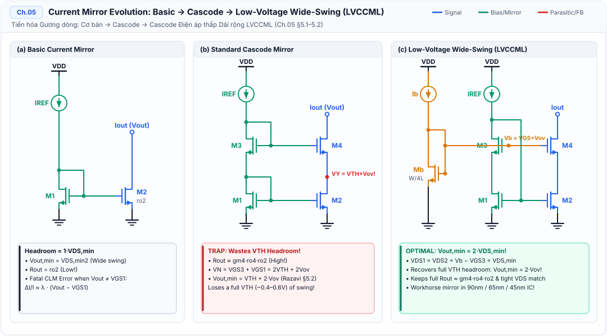

---
{
  "id": "topo-basic-current-mirror",
  "kind": "topology",
  "domain": "stages-and-mirrors",
  "title_vi": "Gương dòng Cơ bản, Nhân bản Đơn vị M:N & Sai số Hệ thống do VDS (Basic Current Mirror)",
  "title_en": "Basic CMOS Current Mirror, Unit-Transistor Ratioing, and CLM Systematic Error",
  "summary": "Sao chép và nhân chia dòng tham chiếu IREF độc lập bậc nhất với PVT thông qua nguyên lý hàm ngược VGS = f^-1(IREF) của transistor mắc diode và tỷ số bội nguyên M:N của transistor đơn vị cùng chiều dài L, chỉ tốn một điện áp tuân thủ tối thiểu VDS,min nhưng chịu sai số hệ thống lambda*(VDS2 - VDS1).",
  "diagram": "../../diagrams/current-mirrors-evolution.svg",
  "razavi_refs": [
    {
      "chapter": 5,
      "section": "5.1",
      "pages": "134-139",
      "equations": ["5.1", "5.2", "5.3", "5.4"]
    },
    {
      "chapter": 5,
      "section": "5.2",
      "pages": "139",
      "equations": ["5.5", "5.6", "5.7"]
    }
  ],
  "glossary_codes": ["T026", "T183", "T207", "T216", "T257", "T510", "T697", "T705", "T706", "T707", "T708", "T712", "T717", "T718", "T719", "T722", "T727", "T730", "T731", "T733", "T735", "T737"],
  "process_agnostic": true,
  "roles": {
    "reference_diode": "M1 mắc diode cổng nối máng (máy giải hàm ngược chuyển dòng tham chiếu IREF thành điện áp VGS1)",
    "output_mirror": "M2 nhận chung VGS2 = VGS1 (tái tạo dòng ngõ ra Iout = (N/M)*IREF với trở kháng ngõ ra rO2)",
    "unit_cell_array": "Mảng M đơn vị song song phía tham chiếu và N đơn vị song song phía ngõ ra có cùng W0 và L"
  },
  "symptoms_addressed": [
    "severe-pvt-and-vdd-current-drift-of-resistive-gate-biasing",
    "need-to-clone-and-scale-multiple-isolated-dc-bias-currents-from-single-iref",
    "tight-minimum-compliance-voltage-requirement-down-to-single-vdsmin"
  ],
  "limitations": [
    "systematic-current-copying-error-due-to-vds-mismatch-and-clm",
    "modest-output-impedance-limited-to-single-ro",
    "lithographic-ld-and-vth-errors-if-length-or-drawn-width-scaled-non-uniformly",
    "cumulative-random-mismatch-in-long-mirror-chains"
  ],
  "checklists": ["common-mos", "current-mirror"]
}
---

## 1. Bản chất Nguyên lý, Sơ đồ Mạch & Vai trò Từng Nhánh Cấu trúc

Trong toàn bộ vi mạch tương tự CMOS, nguồn dòng đóng vai trò kép: vừa xác lập điểm làm việc DC cho mọi tầng khuếch đại, vừa làm tải động có trở kháng nhỏ tín hiệu lớn mà không tốn sụt áp $IR$ khổng lồ. Một ý tưởng ngây thơ nhưng sai lầm nghiêm trọng là định nghĩa dòng của MOSFET bằng **bộ chia áp điện trở** (*resistive divider*) từ $V_{DD}$ đưa vào cực cổng (Hình 5.2, Phương trình 5.1 sách Razavi trang 135):

$$I_{out} \approx \frac{1}{2}\mu_n C_{ox}\frac{W}{L}\left(\frac{R_2}{R_1 + R_2}V_{DD} - V_{TH}\right)^2$$

Cách **phân cực bằng điện trở** (*resistive biasing*) này thất bại hoàn toàn trên silicon thương mại vì dòng $I_{out}$ bị trói trực tiếp vào cả ba biến thiên **PVT** (*process, voltage, temperature variations*): $V_{DD}$ dao động $\pm 10\%$, điện áp ngưỡng $V_{TH}$ lệch $50 - 100\text{ mV}$ giữa các tấm wafer, và cả $\mu_n(T) \propto T^{-3/2}$ lẫn $V_{TH}(T)$ đều trôi theo nhiệt độ. Razavi chỉ ra con số cảnh tỉnh: nếu thiết kế điện áp vượt ngưỡng danh định $V_{OV} = 200\text{ mV}$ để tiết kiệm khoảng dự trữ điện áp, chỉ riêng sai số $\Delta V_{TH} = 50\text{ mV}$ đã gây ra **sai số dòng điện tới $44\%$**! Thậm chí ngay cả khi ghim cứng được $V_{GS}$ không phụ thuộc $V_{DD}$, $I_D$ vẫn trôi dữ dội theo quy trình và nhiệt độ.

Giải pháp nền tảng của vi mạch tích hợp là tách bạch bài toán thành hai khâu (Hình 5.3–5.5): dùng một **bộ tạo tham chiếu** (*reference generator* dựa trên kỹ thuật vùng cấm — Chương 12) sinh ra một **dòng điện tham chiếu** (*reference current*) chuẩn xác duy nhất $I_{REF}$, sau đó dùng các **gương dòng** (*current mirrors*) để **sao chép dòng điện** (*copying currents*) và nhân/chia tỷ lệ ra hàng chục nhánh trên toàn chip.

Nguyên lý cốt lõi của **gương dòng cơ bản** (*basic current mirror*, Hình 5.5(b)) dựa trên **quan hệ nhân quả của hàm ngược** (*inverse function*, trang 135–136):
- **Nhánh tham chiếu — Transistor mắc diode ($M_1$, *diode-connected device*):** Cực cổng nối tắt vào cực máng buộc $V_{DS1} = V_{GS1}$, tự động đảm bảo $M_1$ luôn nằm trong vùng bão hòa khi $I_{REF} > 0$ (vì $V_{GD1} = 0 < V_{TH}$). Nếu đặc tuyến truyền đạt bất kỳ của MOSFET bão hòa là $I_D = f(V_{GS})$, thì việc ép dòng $I_{REF}$ chảy qua $M_1$ buộc mạch tự giải phương trình hàm ngược để sinh ra $V_{GS1} = f^{-1}(I_{REF})$. Ở đây **$I_{REF}$ là nguyên nhân, $V_{GS1}$ là kết quả**. (Đó là lý do mạch Hình 5.6 thất bại: $V_b$ không do $I_{REF}$ sinh ra nên $I_{out}$ mất khả năng bám theo $I_{REF}$).
- **Nhánh sao chép ngõ ra ($M_2$):** Nhận điện áp cổng–nguồn $V_{GS2} = V_{GS1} = f^{-1}(I_{REF})$ (với cực nguồn hai nhánh nối chung cùng một đường tham chiếu $GND$ hoặc $V_{DD}$) và tái tạo hàm thuận $I_{out} = f(V_{GS2}) = f[f^{-1}(I_{REF})]$. Ở đây **$V_{GS2}$ là nguyên nhân, $I_{out}$ là kết quả**. Nhờ phép hợp $f \circ f^{-1}$ triệt tiêu bản thân hàm vật lý $f(\cdot)$, tỷ số sao chép dòng độc lập bậc nhất với $\mu C_{ox}$, $V_{TH}$ và nhiệt độ $T$ — đúng trong **mọi vùng đảo kênh** (đảo mạnh luật bình phương, bão hòa vận tốc hay dưới ngưỡng)!

---

## 2. Hệ Phương trình Cốt lõi & Tư duy "Nhìn Mạch Đọc Nhanh" (Analysis by Inspection)

### 2.1. Tỷ số Sao chép Lý tưởng & Sai số Hệ thống do Điều biến Chiều dài Kênh (Phương trình 5.2–5.7)

Khi bỏ qua điều biến chiều dài kênh ($\lambda = 0$), viết phương trình dòng cho $M_1, M_2$ cùng $V_{GS}$ và cùng $V_{TH}$ (Phương trình 5.2–5.4):

$$I_{REF} = \frac{1}{2}\mu_n C_{ox}\!\left(\frac{W}{L}\right)_1 (V_{GS} - V_{TH})^2, \quad I_{out} = \frac{1}{2}\mu_n C_{ox}\!\left(\frac{W}{L}\right)_2 (V_{GS} - V_{TH})^2 \implies I_{out} = \frac{(W/L)_2}{(W/L)_1}\,I_{REF}$$

Khi ghép nối tiếp nhiều tầng gương NMOS $\to$ PMOS (**chuỗi gương dòng** — *current mirror chains*, Ví dụ 5.1 Hình 5.7), các hệ số nhân nối tiếp nhau: $\lvert I_{D4} \rvert = \alpha\beta I_{REF}$ với $\alpha = \frac{(W/L)_2}{(W/L)_1}, \beta = \frac{(W/L)_4}{(W/L)_3}$, cho phép nhân dòng lớn (ví dụ $5 \times 5 = 25$) hoặc chia dòng nhỏ ($0{,}2 \times 0{,}2 = 0{,}04$).

Tuy nhiên, trong thực tế $\lambda > 0$ (nhất là ở transistor kênh ngắn), việc $M_1$ bị khóa cứng ở $V_{DS1} = V_{GS1}$ trong khi điện áp máng $V_{DS2}$ của $M_2$ bị áp đặt bởi mạch tải bên ngoài (ví dụ điện thế nút đuôi $V_P = V_{in,CM} - V_{GS,\text{in}}$ trong Hình 5.8) dẫn tới phương trình chính xác (Phương trình 5.5–5.7, trang 139):

$$\frac{I_{out}}{I_{REF}} = \frac{I_{D2}}{I_{D1}} = \frac{(W/L)_2}{(W/L)_1}\cdot\frac{1 + \lambda V_{DS2}}{1 + \lambda V_{DS1}} \approx \frac{(W/L)_2}{(W/L)_1}\Bigl[1 + \lambda(V_{DS2} - V_{DS1})\Bigr] \quad (\text{khi } \lambda V_{DS1} \ll 1)$$

Viết dưới dạng tham số độc lập mô hình là độ lợi nội tại hoặc điện áp Early $V_A = 1/\lambda = I_{D2}r_{O2}$, sai số tương đối hệ thống bằng:

$$\frac{\Delta I_{out}}{I_{out,\text{nom}}} \approx \lambda(V_{DS2} - V_{GS1}) = \frac{V_{DS2} - V_{GS1}}{I_{out,\text{nom}}\,r_{O2}}$$

### 2.2. Điện áp Tuân thủ Tối thiểu ($V_{DS,\min}$), Trở kháng & Xử lý Tín hiệu Nhỏ

- **Điện áp cho phép tối thiểu tại ngõ ra (*Minimum compliance / headroom voltage*):** Để $M_2$ duy trì vùng bão hòa, cực máng của nó chỉ cần cao hơn cực nguồn một điện áp vượt ngưỡng duy nhất:

$$V_{out,\min} = V_{DS2,\min} = V_{GS} - V_{TH} = V_{OV}$$

Đây chính là ưu điểm lớn nhất của gương dòng cơ bản: tiêu tốn ít dự trữ điện áp nhất có thể của một MOSFET đơn ($1 \times V_{DS,\min} \approx 120 - 200\text{ mV}$).
- **Mô hình tín hiệu nhỏ nhìn nhanh (Ví dụ 5.2, Hình 5.11):**
  - Trở kháng nhìn vào cực máng nhánh tham chiếu mắc diode $M_1$: $R_{in,\text{mirror}} = \frac{1}{g_{m1}} \parallel r_{O1} \approx \frac{1}{g_{m1}}$.
  - Trở kháng ngõ ra nhìn vào cực máng nhánh sao chép $M_2$: $R_{out} = r_{O2} = \frac{1}{\lambda I_{out}}$.
  - Khi dùng làm bộ khuếch đại dòng tín hiệu nhỏ $i_{in}$ bơm vào nhánh $M_1$: hệ số khuếch đại dòng tần số thấp bằng $A_i = \frac{i_{out}}{i_{in}} = \frac{g_{m2}}{g_{m1} + r_{O1}^{-1}} \approx \frac{g_{m2}}{g_{m1}} = \frac{(W/L)_2}{(W/L)_1}$ (đánh đổi bằng việc dòng phân cực DC cũng tăng đúng tỷ lệ đó).

### 2.3. Quy tắc Vàng Chọn Kích thước Hình học & Nhân bản Đơn vị $M:N$ (Mục 5.1, Hình 5.9–5.10)

Để phương trình $I_{out}/I_{REF} = (W/L)_2 / (W/L)_1$ đạt độ chính xác phần nghìn trên tấm bán dẫn thực, Razavi thiết lập ba quy tắc vật lý bất di bất dịch (trang 138–139):
1. **Giữ CÙNG chiều dài kênh bản vẽ $L_{\text{drawn},1} = L_{\text{drawn},2} = L$:** Do vùng nguồn và máng khuếch tán ngang dưới cực cổng một đoạn $L_D$ (*side-diffusion*), chiều dài kênh hiệu dụng là $L_{\text{eff}} = L_{\text{drawn}} - 2L_D$. Nếu tăng gấp đôi $L_{\text{drawn}}$, $L_{\text{eff}}$ **không** tăng gấp đôi! Nghiêm trọng hơn, ở kênh ngắn, $V_{TH}$ phụ thuộc mạnh vào $L$ (hiệu ứng sụt áp ngưỡng $V_{TH}$ roll-off và hiệu ứng kênh ngắn ngược RSCE — Chương 17), nên $L_1 \neq L_2$ lập tức phá vỡ giả thiết $V_{TH1} = V_{TH2}$!
2. **Không nhân trực tiếp chiều rộng liền khối $W_{\text{drawn}}$ — Bắt buộc dùng bội số nguyên $M:N$ của Transistor Đơn vị (*Unit Transistor*, Hình 5.9(b)–(c)):** Tại hai mép rìa oxit cách ly (góc cổng — *gate corner* / biên STI), điện trường rìa và độ thu hẹp kênh $\Delta W$ làm $W_{\text{eff}} = W_{\text{drawn}} - 2\Delta W$. Nếu vẽ một khối $W_2 = 2W_1$, $W_{\text{eff},2} \neq 2W_{\text{eff},1}$! Thay vào đó, định nghĩa một ô đơn vị chuẩn $(W_0, L_0)$ rồi ghép song song $M$ đơn vị cho $M_1$ và $N$ đơn vị cho $M_2$:

$$\frac{I_{out}}{I_{REF}} = \frac{N \cdot W_{\text{eff},0} / L_{\text{eff},0}}{M \cdot W_{\text{eff},0} / L_{\text{eff},0}} = \frac{N}{M}$$

Mọi sai số biên $\Delta W$ và $2L_D$ triệt tiêu hoàn hảo giữa tử và mẫu! Muốn tạo $I_{REF}/2$ và $2I_{REF}$ từ $I_{REF}$ (Hình 5.10(a)), ta đặt $M = 2$ đơn vị ở nhánh diode (mỗi đơn vị mang $I_{REF}/2$), $N_a = 1$ đơn vị cho nhánh $I_{REF}/2$ và $N_b = 4$ đơn vị cho nhánh $2I_{REF}$.
3. **Mẹo ghép nối tiếp đơn vị để chia nhỏ dòng mà không lỗi $L_D$ (Hình 5.10(b)):** Khi cần tỷ số chia lớn mà không muốn tốn quá nhiều đơn vị ở nhánh tham chiếu, ghép nối tiếp hai transistor đơn vị chung cổng $V_{GS}$ tạo thành một **transistor ghép tương đương** (*composite device*) có chiều dài hiệu dụng đúng bằng $2(L_{\text{drawn}} - 2L_D)$, giảm dòng còn một nửa mà không vướng lỗi $L_D$!

---

## 3. Bất biến Cấu trúc & Các Bẫy Lỗi Kinh điển (Structural Invariants & Traps)

- **`[INV-CMIR-01]` Bất biến hướng nhân quả $I_{REF} \to V_{GS} \to I_{out}$:** Nhánh nhận dòng chuẩn bắt buộc phải có vòng hồi tiếp âm nội tại nối cực máng về cực cổng (trực tiếp hoặc qua bộ đệm/cascode) để tự xác lập $V_{GS} = f^{-1}(I_{REF})$; mọi hai cực cổng phải tham chiếu tới hai cực nguồn có cùng điện thế DC tuyệt đối (chú ý sụt áp $IR$ trên đường đất/nguồn kim loại!).
- **`[INV-CMIR-02]` Bất biến đồng nhất chiều dài & hình học ngón đơn vị:** Trong cùng một cụm gương dòng, mọi nhánh phải dùng chung `L` và chung bề rộng ngón đơn vị `wf = W0`, chỉ thay đổi hệ số nhân song song nguyên `m` (`M:N`).

- **`[TRAP-CMIR-01]` Nhận diện nhầm hai đơn vị mắc nối tiếp chung cổng (Hình 5.10(b)) là mạch Cascode:** Đây là câu hỏi kiểm tra kinh điển của Razavi (trang 139)! Khi hai transistor đơn vị nối tiếp có cực cổng nối chung vào cùng mức $V_{GS}$, để dòng qua transistor trên khác không thì nút giữa $X$ phải dương ($V_X > 0$), nên transistor trên có $V_{GS,\text{top}} = V_{GS} - V_X < V_{GS}$. Do đó cực máng của transistor dưới nằm ở $V_X$, khiến $V_{GD,\text{bot}} = V_{GS} - V_X > V_{TH}$ (vì transistor trên đang dẫn cần $V_{GS} - V_X > V_{TH}$)! Nghĩa là **transistor phía dưới chắc chắn nằm trong vùng triode**, đóng vai trò điện trở suy biến kênh chứ **không phải cấu trúc cascode bão hòa**!
- **`[TRAP-CMIR-02]` Dùng transistor chiều dài tối thiểu $L_{\min}$ cho gương dòng phân cực chính xác:** Chọn $L = L_{\min}$ để giảm diện tích và tụ ngõ ra sẽ đẩy hệ số $\lambda$ (và DIBL ở nanomet) lên rất lớn ($g_m r_O \sim 5 - 8$), khiến độ chênh lệch $V_{DS2} - V_{GS1} = 0{,}5\text{ V}$ dễ dàng gây sai số dòng $15\% - 30\%$!
- **`[TRAP-CMIR-03]` Nối chuỗi gương dòng quá dài (*Long Mirror Chains*):** Mỗi lần lật dòng NMOS $\to$ PMOS $\to$ NMOS cộng dồn phương sai sai lệch ngẫu nhiên Pelgrom $\sigma_{\text{tot}}^2 = \sum_k \sigma_k^2$ lẫn sai số hệ thống $\lambda \Delta V_{DS}$. Quy tắc thực tế: phân phối từ nguồn chính dạng hình sao (*star current distribution* dẫn dòng chứ không dẫn áp $V_{GS}$ đi xa trên chip) với tối đa $1 - 2$ bậc gương.
- **`[TRAP-CMIR-04]` Sụt áp $IR$ trên đường kim loại đất/nguồn ($V_{SS}/V_{DD}$):** Nếu nhánh $M_1$ và $M_2$ đặt cách xa nhau trên sàn chip mà dùng đường dẫn dòng thay vì dẫn dòng tham chiếu cục bộ, chỉ $5\text{ mV}$ sụt áp $IR$ lệch tại cực nguồn ($\Delta V_S = 5\text{ mV}$) ở vùng $g_m/I_D = 15\text{ V}^{-1}$ đã làm lệch dòng $7{,}5\%$!

---

## 4. Lộ trình Nâng cấp Cấu trúc & Bát giác Đánh đổi (Upgrade Paths & Design Octagon)

Trên Bát giác Thiết kế (`concept-analog-design-octagon`), gương dòng cơ bản tối ưu hóa **Dự trữ điện áp / Biên độ dao động** ($V_{out,\min} = V_{DS,\min}$) và **Độ đơn giản**, nhưng trả giá đắt ở **Trở kháng ngõ ra** ($R_{out} = r_O$) và **Độ chính xác sao chép DC** ($\Delta I/I \approx \lambda \Delta V_{DS}$).

Lộ trình nâng cấp chuẩn theo hai nhánh nguyên lý của Razavi (Mục 5.2, trang 140):
1. **Nguyên lý 1 — Che chắn cực máng $M_2$ để ép $V_{DS2} = V_{DS1}$ và nhân trở kháng ngõ ra lên $\approx g_m r_O^2$:**
   - Nâng cấp trực tiếp bằng hai diode xếp chồng $\rightarrow$ `topo-cascode-current-mirror` (triệt tiêu lỗi $\Delta V_{DS}$ đi $g_m r_O$ lần, nhưng lãng phí mất $1 \times V_{TH}$ dự trữ điện áp!).
   - Khôi phục phần $V_{TH}$ lãng phí về đúng giới hạn vật lý $2V_{DS,\min}$ $\rightarrow$ `topo-lvccml-wide-swing-mirror` (cấu trúc chuẩn mực công nghiệp cho 90nm/65nm/45nm!).
2. **Nguyên lý 2 — Hạ $V_{DS1}$ xuống bằng $V_{DS2}$ khi ngân sách điện áp không cho phép chồng cascode ($\le 1 \times V_{DS,\min}$):**
   - Dùng mạch bản sao cặp vi sai (*differential-pair replica*, Ví dụ 5.6 Hình 5.20 trang 145) hoặc điện trở dịch mức $R_1 I_{REF}$ nối tiếp cực máng $M_1$ (Hình 5.16(a)).
3. **Biến gương dòng thành tải chủ động nhân đôi $G_m$ cho cặp vi sai** $\rightarrow$ `topo-five-transistor-ota` (và lưu ý cực gương tạo cặp cực–không tại `concept-diffpair-mirror-pole-doublet`).
4. **Quy tắc chọn $V_{OV}$ lớn (low $g_m/I_D$) để dập nhiễu và sai lệch ngẫu nhiên của gương dòng** $\rightarrow$ `law-stage-and-mirror-noise-rules`, `law-pelgrom-mismatch-and-sizing-duality`, `tech-common-centroid-sti-wpe-layout`, và bộ tạo dòng gốc $I_{REF}$ tại `tech-supply-independent-bias-and-startup`.

---

## 5. Thích ứng Đa Tiến trình (90nm / 65nm / 45nm) & Cách Kiểm chứng trong Cadence / Spectre

### 5.1. Định cỡ Gương dòng trên 90nm / 65nm / 45nm (`tech-nanometer-vdsmin-gmid-sizing`)

- **Đối ngẫu định cỡ bắt buộc so với cặp vi sai:** Trong khi cặp đầu vào khuếch đại cần $g_m/I_D$ cao ($V_{OV}$ nhỏ), **mọi gương dòng phân cực và tải nguồn dòng phải được định cỡ ở vùng đảo mạnh vừa phải ($g_m/I_D \approx 6 - 10\text{ V}^{-1}$, tương ứng $V_{DS,\min} \approx 180 - 250\text{ mV}$)** với chiều dài kênh lớn **$L \ge 4 - 10 L_{\min}$** (ví dụ $L = 0{,}4 - 1{,}0\,\mu\text{m}$ ở tiến trình 65nm/45nm):
  1. $L$ dài làm giảm mạnh DIBL và CLM, tăng $r_{O2}$ và giảm sai số hệ thống $\lambda(V_{DS2} - V_{DS1})$.
  2. $g_m/I_D$ thấp làm giảm trực tiếp độ lệch dòng tương đối do $\Delta V_{TH}$ theo công thức tổng quát đúng cho mọi tiến trình:

$$\sigma\!\left(\frac{\Delta I_D}{I_D}\right) = \sqrt{\sigma^2\!\left(\frac{\Delta \beta}{\beta}\right) + \left(\frac{g_m}{I_D}\right)^2 \sigma^2(\Delta V_{TH})}$$

  3. $g_m$ nhỏ đồng thời giảm mật độ phổ nhiễu dòng nhiệt ngõ ra $\overline{I_n^2} = 4kT\gamma g_m$ bơm vào mạch chính!
- **Tham số CDF trên Virtuoso:** Luôn cố định `l` và `wf` (ví dụ `wf = 1u` hoặc `2u`), đặt `nf = 1` (hoặc chẵn cố định) trên ô đơn vị và dùng tham số nhân bản **`m = M`** cho $M_1$, **`m = N`** cho $M_2$ kèm ít nhất $1$ cột dummy mỗi đầu dãy interdigitated. Không bao giờ chỉ sửa `w` tổng mà quên gọi hàm callback CDF (`PasCdfFormInit`) khiến diện tích/chu vi vùng máng–nguồn `ad, as, pd, ps` tính sai ký sinh!

### 5.2. Quy trình Kiểm chứng trên Cadence Virtuoso IC617 & Spectre

1. **Quét Đặc tuyến Tuân thủ Điện áp (`dc` compliance sweep):**
   - Nối cực máng $M_2$ vào nguồn thử `Vtest`, quét `Vtest` từ $0\text{ V}$ đến $V_{DD}$ trên cả 5 góc PVT:
     - Vẽ $I_{out}(V_{\text{test}})$ và điện trở ngõ ra tức thời $R_{out}(V_{\text{test}}) = 1 / \text{deriv}(I_{out})$.
     - Xác nhận điểm gãy tuân thủ thực tế $V_{\text{comp}}$ (nơi `region == 2` và $R_{out}$ đạt $> 80\%$ giá trị phẳng, đi kèm `vds - vdsat >= 50 mV`) nằm thấp hơn điện áp làm việc nhỏ nhất của nút tải thực tế.
     - Kiểm tra đúng tại $V_{\text{test}} = V_{GS1}$: tỷ số $I_{out} / I_{REF}$ phải khớp chính xác $N / M$ đến $< 0{,}05\%$ (nếu lệch ngay tại $V_{DS2} = V_{DS1}$, chắc chắn đã vi phạm quy tắc nhân bản đơn vị `m` hoặc khác kết nối cực thân $V_{BS}$!).
2. **Đánh giá Sai số Tổng hợp (`mc` Monte Carlo process + mismatch):**
   - Chạy 200 mẫu Monte Carlo tại điện áp làm việc thực của nút tải để kiểm tra độ lệch tổng $\mu \pm 3\sigma$ (gồm cả lệch hệ thống do $V_{DS2} \neq V_{GS1}$ lẫn lệch ngẫu nhiên Pelgrom).

### 5.3. Bảng Tổng hợp Quy tắc Lập Tỷ số Dòng Đơn vị $M:N$ & Phép Kiểm Tra Layout/CDF

Để sao chép dòng $I_{REF} = 50\,\mu\text{A}$ thành nhiều nhánh phân cực trên cùng một khối analog (ví dụ nhánh đuôi $150\,\mu\text{A}$, nhánh phụ $25\,\mu\text{A}$ và nhánh dòng siêu nhỏ $12{,}5\,\mu\text{A}$) mà không phạm lỗi $L_D$ hay góc cổng:

| Nhánh Dòng Mục tiêu | Tỷ số $I_{out}/I_{REF}$ | Cấu hình Ô Đơn vị Chuẩn ($W_0 = 2\,\mu\text{m}, L_0 = 0{,}5\,\mu\text{m}$) | Tham số CDF Virtuoso (`wf`, `l`, `nf`, `m`) | Sai số Cần Kiểm tra trên Spectre |
|---|---|---|---|---|
| **Nhánh chuẩn $M_{REF}$** | $1{,}0\times$ ($50\,\mu\text{A}$) | $M = 2$ ô đơn vị mắc song song (mỗi ô mang $25\,\mu\text{A}$) | `wf=2u, l=500n, nf=1, m=2` | Xác nhận $V_{GS1} = V_{DS1} \approx V_{TH} + 200\text{ mV}$ |
| **Nhánh đuôi $I_{\text{tail}}$** | $3{,}0\times$ ($150\,\mu\text{A}$) | $N_1 = 6$ ô đơn vị mắc song song xen kẽ đối xứng quanh $M_{REF}$ | `wf=2u, l=500n, nf=1, m=6` | Kiểm tra `vds - vdsat >= 50 mV` và lệch hệ thống $(V_{DS}-V_{GS1})/V_A$ |
| **Nhánh phụ $I_{\text{aux}}$** | $0{,}5\times$ ($25\,\mu\text{A}$) | $N_2 = 1$ ô đơn vị duy nhất (không bao giờ cưa đôi $W_0$ thành $1\,\mu\text{m}$!) | `wf=2u, l=500n, nf=1, m=1` | Kiểm tra khớp mật độ dòng $J_D = I_D / W_{\text{tot}} = 12{,}5\,\mu\text{A}/\mu\text{m}$ |
| **Nhánh dòng nhỏ $I_{\text{bleed}}$** | $0{,}25\times$ ($12{,}5\,\mu\text{A}$) | Ghép nối tiếp $2$ ô đơn vị chung cổng $V_{GS1}$ (Hình 5.10b: ô dưới ở vùng triode, $L_{\text{eq}} = 2L_{\text{eff}}$) | Hai instance nối tiếp, mỗi chiếc `wf=2u, l=500n, nf=1, m=1` | Ô trên phải có `region == 2`, ô dưới có `region == 1` (triode — bình thường!) |

**Biểu thức ADE Calculator kiểm toán nhanh gương dòng:**
- Độ lệch tỷ số sao chép thực tế (%): `100.0 * ((ID("/M2/D") / ID("/M1/D")) - (N / M)) / (N / M)`
- Điện áp Early hiệu dụng tại điểm làm việc: `ID("/M2/D") / OP("/M2", "gds")`
- Điện áp tuân thủ tối thiểu ước lượng: `OP("/M2", "vdsat") + 0.05`

---

## 6. Mốc Đối chiếu Sách Razavi & Thuật ngữ Chuẩn CLB

| Mốc Sách Razavi (2nd Ed.) | Trang Sách (PDF Ch.05) | Nội dung & Phương trình Đối chiếu | Mã Thuật ngữ Chuẩn CLB (`terms-vi-en.json`) |
|---|---|---|---|
| **Mục 5.1 (Mở đầu & Nguyên lý)**, Hình 5.1–5.6 | tr. 134–137 (PDF 1–4) | Lỗi PVT 44% của chia áp điện trở **(5.1)**, nguyên lý hàm ngược $f[f^{-1}(I_{REF})]$, tỷ số $(W/L)_2/(W/L)_1$ **(5.2)–(5.4)**, mạch mất nhân quả Hình 5.6 | `T026` (Gương dòng), `T697` (gương dòng cơ bản), `T706` (bộ chia áp điện trở), `T707` (phân cực bằng điện trở), `T708` (PVT), `T712` (dòng điện tham chiếu), `T717` (sao chép dòng điện), `T718` (hàm ngược), `T510` (transistor mắc diode) |
| **Mục 5.1 (Chuỗi gương & Định cỡ)**, Hình 5.7–5.11, Ví dụ 5.1–5.2 | tr. 137–139 (PDF 4–6) | Chuỗi gương dòng nhân/chia, lỗi khuếch tán ngang $L_D$ & góc cổng, transistor đơn vị $M:N$, ghép nối tiếp hai đơn vị (dưới ở triode!), khuếch đại dòng nhỏ | `T719` (tỉ số kích thước transistor), `T722` (chuỗi gương dòng), `T727` (vấn đề chọn kích thước transistor), `T730` (thiết lập tỉ số dòng), `T731` (transistor đơn vị), `T733` (góc cổng), `T735` (transistor mắc nối tiếp), `T737` (chiều dài hiệu dụng) |
| **Mục 5.2 (Đầu mục & Ví dụ 5.6)**, Hình 5.20 | tr. 139, 145 (PDF 6, 12) | Sai số hệ thống do điều biến chiều dài kênh $\frac{1+\lambda V_{DS2}}{1+\lambda V_{DS1}}$ **(5.5)–(5.7)**, kỹ thuật bản sao cặp vi sai (*replica*) khi thiếu dự trữ điện áp | `T257` (điều biến chiều dài kênh), `T207` (điện áp máng–nguồn tối thiểu duy trì bão hòa), `T705` (độ tương hợp thông số), `T752` (mạch bản sao) |
