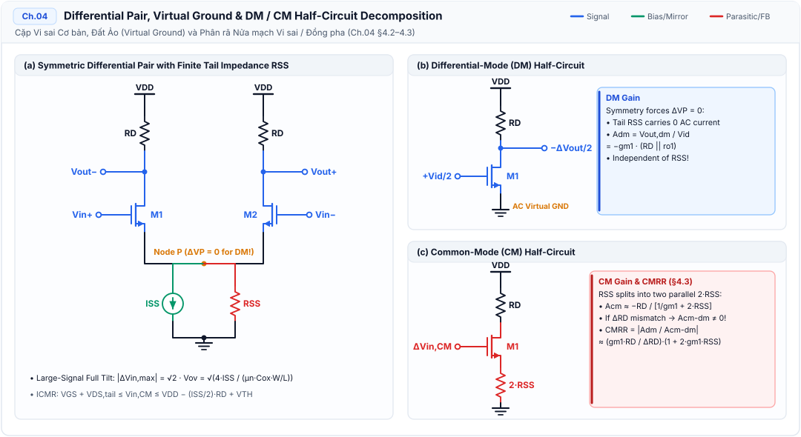

---
{
  "id": "topo-basic-differential-pair",
  "kind": "topology",
  "domain": "stages-and-mirrors",
  "title_vi": "Cặp vi sai cơ bản, Dải chế độ chung đầu vào & Phương pháp Mạch nửa (Basic Differential Pair & Half-Circuit Lemma)",
  "title_en": "Basic CMOS Differential Pair, ICMR Bounds, and Half-Circuit Lemma",
  "summary": "Tầng khuếch đại vi sai nền tảng dùng nguồn dòng đuôi ISS cố định tổng dòng phân cực độc lập với mức chế độ chung đầu vào, đạt dải lái dòng toàn phần sqrt(2)*Vov, khử nhiễu nguồn/ghép cặp đối xứng và cho phép tách phân tích tín hiệu nhỏ qua đất ảo tại nút đuôi.",
  "diagram": "../../diagrams/diff-pair-half-circuit.svg",
  "razavi_refs": [
    {
      "chapter": 4,
      "section": "4.1",
      "pages": "100-102",
      "equations": []
    },
    {
      "chapter": 4,
      "section": "4.2.1-4.2.2",
      "pages": "103-116",
      "equations": ["4.1", "4.2", "4.5", "4.9", "4.10", "4.11", "4.12", "4.14", "4.15", "4.18", "4.19", "4.20", "4.23", "4.26", "4.27", "4.30"]
    }
  ],
  "glossary_codes": ["T012", "T022", "T091", "T094", "T095", "T183", "T208", "T558", "T560", "T563", "T564", "T567", "T572", "T581", "T586", "T593", "T624", "T628", "T629"],
  "process_agnostic": true,
  "roles": {
    "input_pair": "M1, M2 (cặp ghép cực nguồn chuyển đổi điện áp vi sai thành dòng đầu ra vi sai)",
    "tail_current_source": "M3 / ISS (nguồn dòng đuôi khóa tổng dòng ID1 + ID2 = ISS độc lập mức chế độ chung)",
    "load_network": "RD1, RD2 (cặp tải điện trở đối xứng chuyển dòng vi sai thành điện áp vi sai VX - VY)"
  },
  "symptoms_addressed": [
    "single-ended-supply-and-substrate-noise-corruption",
    "coupled-clock-aggressor-interference",
    "bias-current-and-gain-sensitivity-to-input-cm-level",
    "limited-single-ended-voltage-swing-under-low-vdd",
    "even-order-harmonic-distortion"
  ],
  "limitations": [
    "narrow-differential-input-linear-range-sqrt2-vov",
    "tail-current-source-consumes-vdsmin-headroom",
    "transconductance-halved-per-unit-current-in-weak-inversion-or-reduced-by-sqrt2-in-square-law",
    "output-swing-constrained-by-input-cm-level-without-folded-or-ac-coupling",
    "double-device-area-and-routing-complexity"
  ],
  "checklists": ["common-mos", "differential-pair"]
}
---

## 1. Bản chất Nguyên lý, Sơ đồ Mạch & Vai trò Từng Nhánh Cấu trúc

Trong mạch tích hợp hỗn hợp hiện đại, tín hiệu **đơn đầu** (*single-ended*) được đo so với một điện thế cố định (thường là đất — *ground*), khiến mọi nhiễu trên đường nguồn cấp $V_{DD}$ hoặc nhiễu ghép điện dung (*capacitive coupling*) từ **đường gây nhiễu** (*aggressors* như đường xung nhịp $CK$) đều cộng trực tiếp vào **đường bị nhiễu** (*victims*). Ngược lại, **tín hiệu vi sai** (*differential signal*) được định nghĩa giữa hai nút đối xứng có trở kháng bằng nhau đối với đất và biến thiên ngược pha $\pm V_0 \cos\omega t$ quanh **mức chế độ chung** (*common-mode level*, $V_{CM}$). Cách truyền dẫn này mang lại bốn lợi thế vật lý cốt lõi (Razavi Mục 4.1, trang 100–102):
1. **Khử nhiễu chế độ chung (*common-mode noise*):** Nhiễu nguồn $\Delta V_{DD}$ hoặc nhiễu ghép đối xứng làm dịch đồng thời $V_X$ và $V_Y$ cùng một lượng, nên hiệu vi sai $V_{out,\text{DM}} = V_X - V_Y$ được bảo toàn. Khi cả đường gây nhiễu lẫn đường nhạy đều đi vi sai, kỹ thuật đảo chéo định tuyến giữa chừng kiểu **cặp dây xoắn** (*twisted pairs*, Hình 4.5(b)) triệt tiêu hoàn toàn điện tích ghép trên từng nhánh.
2. **Nhân đôi khoảng dao động đỉnh–đỉnh (*peak-to-peak swing*):** Nếu mỗi nút $X, Y$ dao động biên độ đỉnh $V_0$ (đỉnh–đỉnh đơn đầu $2V_0$), hiệu $V_X - V_Y = 2V_0\cos\omega t$ đạt khoảng dao động đỉnh–đỉnh vi sai $4V_0$. Nhờ vậy, mạch dùng nguồn cấp $V_{DD} = 1{,}0\text{ V}$ hoàn toàn có thể xuất $1{,}6\text{ V}_{pp}$ vi sai.
3. **Triệt tiêu méo hài bậc chẵn** do đặc tuyến vào–ra vi sai là hàm lẻ đối xứng tâm, đồng thời đơn giản hóa ghép tầng trực tiếp.

Tuy nhiên, nếu chỉ ghép song song hai **tầng nguồn chung** (*common-source stages*) độc lập nối nguồn xuống đất (cặp giả vi sai — Hình 4.6), mọi biến thiên của **mức chế độ chung đầu vào** (*input common-mode level*, $V_{in,CM}$) sẽ làm trôi dòng phân cực $I_D$, kéo theo sự thay đổi mạnh của **độ hỗ dẫn** (*transconductance*, $g_m$) và **mức chế độ chung đầu ra** (*output common-mode level*, $V_{out,CM}$), thậm chí làm ngắt transistor hoặc đẩy chúng vào **vùng triode** (*triode region*) gây **xén tín hiệu** (*clipping*).

**Cặp vi sai** (*differential pair*, còn gọi là **cặp ghép cực nguồn** — *source-coupled pair*) trong Hình 4.7 giải quyết triệt để bài toán trên bằng cách nối chung hai cực nguồn tại nút $P$ và khóa tổng dòng qua một **nguồn dòng đuôi** (*tail current source*) $I_{SS}$ (thực hiện bởi NFET $M_3$ phân cực cổng $V_b$):
- **Nhánh cặp vi sai đầu vào ($M_1, M_2$):** Có kích thước đồng nhất $(W/L)_1 = (W/L)_2 = W/L$. Hai cực cổng nhận $V_{in1}, V_{in2}$; nút chung cực nguồn $P$ tự động dịch chuyển theo mức DC chung giống một tầng bám nguồn (*source follower*), giữ $I_{D1} + I_{D2} = I_{SS}$ bất chấp $V_{in,CM}$ dao động trong dải cho phép. Ở **trạng thái cân bằng** (*equilibrium*, $V_{in1} = V_{in2}$), mỗi nhánh mang chính xác $I_{D1} = I_{D2} = I_{SS}/2$.
- **Nhánh nguồn dòng đuôi ($M_3$ tạo $I_{SS}$):** Cung cấp tổng dòng cố định ở DC và đóng vai trò trở kháng cao $R_{SS} = r_{O3}$ ở chế độ xoay chiều để chặn dòng chế độ chung. Đổi lại, $M_3$ tiêu tốn một **dự trữ điện áp** (*voltage headroom*) tối thiểu $V_{DS3,\min} = V_{GS3} - V_{TH3}$.
- **Nhánh mạng tải đối xứng ($R_{D1} = R_{D2} = R_D$):** Chuyển dòng máng thành điện áp tại hai nút $X, Y$: $V_{out1} = V_X = V_{DD} - R_D I_{D1}$ và $V_{out2} = V_Y = V_{DD} - R_D I_{D2}$, cố định mức cân bằng đầu ra tại $V_{out,CM} = V_{DD} - R_D I_{SS}/2$ và hai ngưỡng kẹp cứng tại $V_{DD}$ cùng $V_{DD} - R_D I_{SS}$.

---

## 2. Hệ Phương trình Cốt lõi & Tư duy "Nhìn Mạch Đọc Nhanh" (Analysis by Inspection)

### 2.1. Đặc tính Tín hiệu lớn (Large-Signal Current Steering) & Ngưỡng Ngắt $\sqrt{2}V_{OV}$

Giả sử mạch đối xứng, $M_1, M_2$ bão hòa và bỏ qua **điều biến chiều dài kênh** (*channel-length modulation*, $\lambda = 0$) cùng hiệu ứng thân ($\gamma = 0$). Cùng nối vào nút đuôi $P$, hiệu điện áp cổng chính bằng hiệu điện áp cổng–nguồn (Phương trình 4.2):

$$\Delta V_{in} = V_{in1} - V_{in2} = V_{GS1} - V_{GS2}$$

Với linh kiện tuân theo luật bình phương (*square-law device*), $V_{GS1,2} = V_{TH} + \sqrt{\frac{2I_{D1,2}}{\mu_n C_{ox}(W/L)}}$ (Phương trình 4.4–4.5). Bình phương hai lần và kết hợp bất biến KCL nút đuôi $I_{D1} + I_{D2} = I_{SS}$ thông qua hằng đẳng thức $4I_{D1}I_{D2} = (I_{D1} + I_{D2})^2 - (I_{D1} - I_{D2})^2 = I_{SS}^2 - \Delta I_D^2$, ta thu được phương trình đặc tuyến **dòng đầu ra vi sai** (*differential output current*, $\Delta I_D = I_{D1} - I_{D2}$) theo Phương trình (4.9)–(4.10):

$$\Delta I_D = I_{D1} - I_{D2} = \frac{1}{2}\mu_n C_{ox}\frac{W}{L}\,\Delta V_{in}\sqrt{\frac{4I_{SS}}{\mu_n C_{ox}(W/L)} - \Delta V_{in}^2} = \sqrt{\mu_n C_{ox}\frac{W}{L}I_{SS}}\,\Delta V_{in}\sqrt{1 - \frac{\mu_n C_{ox}(W/L)}{4I_{SS}}\Delta V_{in}^2}$$

Mặc dù từng nhánh $I_{D1}, I_{D2}$ là hàm bậc hai theo $V_{GS}$, hiệu $\Delta I_D(\Delta V_{in})$ là một **hàm lẻ hoàn hảo**, triệt tiêu toàn bộ thành phần bậc chẵn quanh $\Delta V_{in} = 0$. Lấy đạo hàm $\partial \Delta I_D / \partial \Delta V_{in}$ cho **hỗ dẫn tương đương** (*equivalent transconductance*, $G_m$) tín hiệu lớn (Phương trình 4.11):

$$G_m(\Delta V_{in}) = \frac{\partial \Delta I_D}{\partial \Delta V_{in}} = \frac{1}{2}\mu_n C_{ox}\frac{W}{L}\,\frac{\dfrac{4I_{SS}}{\mu_n C_{ox}(W/L)} - 2\Delta V_{in}^2}{\sqrt{\dfrac{4I_{SS}}{\mu_n C_{ox}(W/L)} - \Delta V_{in}^2}}$$

- **Tại điểm cân bằng ($\Delta V_{in} = 0$):** $I_{D1} = I_{D2} = I_{SS}/2$, điện áp vượt ngưỡng cân bằng là $V_{OV,\text{eq}} = (V_{GS} - V_{TH})_{1,2,\text{eq}} = \sqrt{\frac{I_{SS}}{\mu_n C_{ox}(W/L)}}$ (Phương trình 4.15). Độ hỗ dẫn đạt cực đại $G_{m,\max} = \sqrt{\mu_n C_{ox}(W/L)I_{SS}} = g_m$, cho **độ lợi điện áp vi sai tín hiệu nhỏ** (*small-signal differential voltage gain*, Phương trình 4.12 & 4.23):

$$A_{v,\text{DM}} = \frac{V_{out1} - V_{out2}}{V_{in1} - V_{in2}} = \frac{-R_D(I_{D1} - I_{D2})}{\Delta V_{in}} = -g_m R_D = -\sqrt{\mu_n C_{ox}\frac{W}{L}I_{SS}}\,R_D$$

*(Lưu ý quy ước dấu trang 107–108 sách Razavi: do $V_{out1} - V_{out2} = R_D(I_{D2} - I_{D1}) = -R_D\Delta I_D$, độ lợi từ $V_{in1}-V_{in2}$ sang $V_{out1}-V_{out2}$ mang dấu âm; Phương trình 4.12 xét độ lớn $\lvert A_v \rvert = g_m R_D$.)*

- **Giới hạn lái hết dòng đuôi $\Delta V_{in1}$ (Phương trình 4.14–4.15):** Công thức (4.9) chỉ có hiệu lực khi cả hai transistor cùng dẫn. Ngay khi một transistor (ví dụ $M_1$) chiếm trọn $I_{D1} = I_{SS}$ và nhánh kia vừa chạm ngưỡng ngắt ($I_{D2} = 0 \Rightarrow V_{GS2} = V_{TH}$), điện áp vi sai đạt ngưỡng tới hạn:

$$\Delta V_{in1} = (V_{GS1})\big|_{I_{D1}=I_{SS}} - V_{TH} = \sqrt{\frac{2I_{SS}}{\mu_n C_{ox}(W/L)}} = \sqrt{2}\,V_{OV,\text{eq}}$$

Tại đúng $\lvert \Delta V_{in} \rvert = \Delta V_{in1}$, tử số của (4.11) bằng $0$ ($G_m = 0$) và với $\lvert \Delta V_{in} \rvert > \Delta V_{in1}$, dòng vi sai bão hòa cứng ở $\pm I_{SS}$. Muốn mở rộng dải đầu vào tuyến tính $\Delta V_{in1}$, ta bắt buộc phải tăng $V_{OV,\text{eq}}$ — tức giảm $W/L$ (chấp nhận giảm $g_m$ và độ lợi) hoặc tăng $I_{SS}$ (tốn công suất và sụt áp $I_{SS}R_D$).

### 2.2. Dải Chế độ Chung Đầu vào (ICMR) & Giới hạn Dao động Đầu ra

Quét $V_{in1} = V_{in2} = V_{in,CM}$ từ $0$ lên $V_{DD}$ với $I_{SS}$ thực hiện bởi $M_3$ (Hình 4.9, Phương trình 4.1):
- **Cận dưới ICMR ($M_3$ giữ bão hòa):** Vì $V_P = V_{in,CM} - V_{GS1}$, để cực máng $M_3$ không rơi xuống dưới $V_{DS3,\min} = V_{GS3} - V_{TH3}$:

$$V_{in,CM,\min} = V_{GS1} + V_{DS3,\min} = V_{GS1} + (V_{GS3} - V_{TH3})$$

- **Cận trên ICMR ($M_1, M_2$ giữ bão hòa):** Khi tín hiệu vi sai nhỏ, cực máng $M_1, M_2$ đứng ở $V_{out,CM} = V_{DD} - R_D I_{SS}/2$. Để $V_{GD1,2} \le V_{TH}$:

$$V_{in,CM,\max} = \min\!\left(V_{DD} - R_D\frac{I_{SS}}{2} + V_{TH},\; V_{DD}\right)$$

- **Ràng buộc biên độ đầu ra theo $V_{in,CM}$ (Hình 4.11 & Nanometer Design Note trang 106):** Nếu độ lợi lớn (biên độ đầu vào nhỏ), mỗi đầu ra đơn đầu lên được tới $V_{DD}$ và xuống thấp nhất tới $V_{in,CM} - V_{TH}$. Chọn $V_{in,CM} = V_{in,CM,\min}$ cho phép $V_{X,\min} = V_{OV1} + V_{DS3,\min}$, đạt dải đỉnh–đỉnh đơn đầu tối đa $V_{DD} - V_{OV1} - V_{DS3,\min}$ và **dải đỉnh–đỉnh vi sai tối đa** $2(V_{DD} - V_{OV1} - V_{DS3,\min})$. Ngược lại, trong công nghệ nanomet khi độ lợi thấp ($\lvert A_v \rvert \lesssim 5$) và đầu vào dao động biên độ đỉnh $V_0$ đáng kể, tại đỉnh dương cổng $V_{in,CM} + V_0$ kéo máng xuống cực tiểu, điều kiện không vào vùng triode thắt chặt thành:

$$V_{out,\min} = V_{in,CM} + V_0 - V_{TH}$$

### 2.3. Tư duy "Nhìn Mạch Đọc Nhanh" — Chồng chập (Method I) vs. Bổ đề Mạch nửa (Method II)

Razavi trang bị hai công cụ giải tích bổ trợ nhau cho chế độ tín hiệu nhỏ:

1. **Phương pháp I — Chồng chập tổng quát (Hình 4.17–4.18, Phương trình 4.18–4.25):** Dùng được ngay cả khi hai nhánh mất cân xứng ($g_{m1} \neq g_{m2}$) hoặc chỉ kích một bên cổng ($V_{in2} = 0$). Nhìn từ $V_{in1}$, $M_1$ là tầng nguồn chung bị **suy giảm tại cực nguồn** (*degenerated*) bởi trở kháng nhìn vào cực nguồn $M_2$ là $R_{S,\text{eq}} = 1/g_{m2}$, còn $M_2$ được lái qua tương đương Thévenin ($V_T = V_{in1}, R_T = 1/g_{m1}$) như một **tầng cổng chung** (*common-gate stage*):

$$\frac{V_X}{V_{in1}} = -\frac{R_{D1}}{\dfrac{1}{g_{m1}} + \dfrac{1}{g_{m2}}}, \qquad \frac{V_Y}{V_{in1}} = +\frac{R_{D2}}{\dfrac{1}{g_{m1}} + \dfrac{1}{g_{m2}}} \implies \frac{V_X - V_Y}{V_{in1} - V_{in2}}\Bigg|_{R_{D1}=R_{D2}=R_D} = -\frac{2R_D}{\dfrac{1}{g_{m1}} + \dfrac{1}{g_{m2}}}$$

Khi $g_{m1} = g_{m2} = g_m$, biểu thức thu gọn về $-g_m R_D$ bất kể kích cân xứng $\pm V_{in}/2$ hay kích đơn đầu một cổng! Nếu chỉ lấy **ngõ ra đơn đầu** (*single-ended output*, chỉ đọc $V_X$ hoặc $V_Y$ so với đất), độ lợi lập tức mất đi một nửa ($\lvert A_{v,\text{SE}} \rvert = \frac{1}{2}g_m R_D$).

2. **Phương pháp II — Bổ đề Đất ảo (*Virtual Ground Lemma*) & Phương pháp Mạch nửa (*Half-Circuit Concept*, Hình 4.20–4.25):**
   - **Bổ đề:** Trong mạch đối xứng hoàn toàn kích bởi hai tín hiệu ngược dấu $V_0 \pm \Delta V_{in}$ đủ nhỏ để $g_{m1} = g_{m2}$, nút chung $P$ đứng yên ($\Delta V_P = 0$) và trở thành **đất ảo** (*virtual ground* / đất xoay chiều). Bổ đề vẫn đúng tuyệt đối khi: (a) nguồn dòng đuôi có trở kháng hữu hạn $R_{SS}$ (vì không có dòng tín hiệu nhỏ đi qua $R_{SS}$ khi $\Delta V_P = 0$), (b) kể cả $\lambda \neq 0$ miễn $r_{O1} = r_{O2} = r_O$ và tải hai bên bằng nhau (Ví dụ 4.7), và (c) kể cả hiệu ứng thân $\gamma \neq 0$ vì $v_{bs1} = v_{bs2} = -\Delta V_P = 0$!
   - **Phép tách đầu vào bất kỳ (Phương trình 4.26–4.30):** Mọi cặp điện áp $V_{in1}, V_{in2}$ đều tách duy nhất thành tổ hợp tuyến tính của thành phần vi sai $\pm \frac{V_{in1}-V_{in2}}{2}$ và thành phần chế độ chung $V_{in,CM} = \frac{V_{in1}+V_{in2}}{2}$:

$$V_{in1} = +\frac{V_{in1}-V_{in2}}{2} + V_{in,CM}, \qquad V_{in2} = -\frac{V_{in1}-V_{in2}}{2} + V_{in,CM}$$

Áp dụng **mạch nửa** (*half circuit*) cho phần vi sai với $\lambda \neq 0$ đọc ngay tức khắc trong một dòng:

$$A_{v,\text{DM}} = \frac{V_X - V_Y}{V_{in1} - V_{in2}} = -g_m (R_D \parallel r_O)$$

---

## 3. Bất biến Cấu trúc & Các Bẫy Lỗi Kinh điển (Structural Invariants & Traps)

- **`[INV-DP-01]` Bất biến bảo toàn tổng dòng đuôi & hiệu suất hỗ dẫn:** $I_{D1} + I_{D2} = I_{SS}$ trong toàn bộ vùng bão hòa của $M_3$. So với một transistor nguồn chung đơn lẻ cùng kích thước $W/L$ mang toàn bộ dòng $I_{SS}$, mỗi nhánh cặp vi sai chỉ nhận $I_{SS}/2$, nên trong miền luật bình phương $g_{m,\text{diff}} = g_{m,\text{CS}}/\sqrt{2}$ (và trong miền đảo yếu hoặc giữ hằng mật độ $g_m/I_D$, $g_{m,\text{diff}} = g_{m,\text{CS}}/2$).
- **`[INV-DP-02]` Bất biến diện tích dưới đường cong $G_m(\Delta V_{in})$:** Tích phân $\int_{-\infty}^{+\infty} G_m(\Delta V_{in})\,d(\Delta V_{in}) = \Delta I_D(+\infty) - \Delta I_D(-\infty) = 2I_{SS}$ là hằng số vật lý chỉ phụ thuộc dòng đuôi $I_{SS}$ (Bài tập 4.33)! Tăng $W/L$ làm nhọn đỉnh $G_{m,\max}$ nhưng bắt buộc phải bóp hẹp bề rộng tuyến tính $2\Delta V_{in1}$ sao cho diện tích không đổi bằng $2I_{SS}$.
- **`[INV-DP-03]` Bất biến cửa sổ ICMR hai đầu:** Mạch chỉ khuếch đại vi sai chuẩn xác khi cả ba transistor $M_1, M_2, M_3$ cùng bão hòa: $V_{GS1,2} + V_{DS3,\min} \le V_{in,CM} \le V_{DD} - R_D I_{SS}/2 + V_{TH1,2}$.

- **`[TRAP-DP-01]` Ngộ nhận công thức căn bậc hai tới $\sqrt{4I_{SS}/(\mu_n C_{ox}W/L)}$:** Sinh viên thường giải nhầm phần trong căn của Phương trình (4.9) bằng $0$ để tìm ngưỡng ngắt. Thực tế một nhánh đã tắt hoàn toàn từ $\Delta V_{in1} = \sqrt{2I_{SS}/(\mu_n C_{ox}W/L)} = \sqrt{2}V_{OV,\text{eq}}$; vượt mốc này phương trình bậc bốn hết hiệu lực vật lý.
- **`[TRAP-DP-02]` Áp dụng sai đất ảo cho nhiễu ngẫu nhiên hoặc tải lệch:** Đất ảo tại nút $P$ chỉ tồn tại cho kích thích vi sai đối xứng trên sơ đồ đối xứng! Với nhiễu nhiệt/nhấp nháy không tương quan của từng transistor (Chương 7) hoặc tải gương dòng tích cực bất đối xứng (Chương 5 Mục 5.3.2), $\Delta V_P \neq 0$ nên tuyệt đối không được nối đất nút $P$ một cách máy móc.
- **`[TRAP-DP-03]` Suy giảm độ lợi tĩnh do độ mất cân bằng DC đầu vào ($V_{OS}$):** Như chứng minh tại Ví dụ 4.5 (Phương trình 4.16–4.17), nếu đầu vào bị lệch một áp tĩnh $V_{OS} = \Delta V_{in1}/2$, dòng hai nhánh lập tức lệch thành $0{,}83 I_{SS}$ và $0{,}17 I_{SS}$, làm độ lợi tín hiệu nhỏ tụt $\approx 20\%$ (xuống $\frac{3}{\sqrt{14}}g_m R_D$) và méo bậc hai xuất hiện trở lại do phá vỡ đối xứng lẻ!
- **`[TRAP-DP-04]` Mất nửa biên độ hoặc xén sớm ở công nghệ nanomet:** Đặt $V_{in,CM}$ quá cao sát $V_{DD}$ làm thu hẹp thảm hại khoảng dao động đầu ra $V_{DD} - (V_{in,CM} + V_0 - V_{TH})$ do $M_1, M_2$ chớm chui vào vùng triode ở nửa chu kỳ âm của đầu ra.

---

## 4. Lộ trình Nâng cấp Cấu trúc & Bát giác Đánh đổi (Upgrade Paths & Design Octagon)

Trong **Bát giác Thiết kế Mạch tương tự** (`concept-analog-design-octagon`), cặp vi sai tải điện trở đứng ở giao điểm căng thẳng giữa **Độ lợi** (*Gain*), **Độ tuyến tính** (*Linearity*), **Dải dao động điện áp** (*Voltage swings*), **Công suất** (*Power*) và **Nhiễu** (*Noise*):
- Để tăng độ lợi $g_m R_D$ với cùng nguồn cấp $V_{DD}$, tăng tích $I_{SS}R_D$ sẽ đè thấp $V_{out,CM} = V_{DD} - R_D I_{SS}/2$, ép giảm $V_{in,CM,\max}$ và bóp nghẹt dải dao động đầu ra.

Từ các giới hạn cấu trúc này, bản đồ nâng cấp chuẩn trong hệ sinh thái Razavi dẫn thẳng tới:
1. **Phân tích sâu lỗi bất đối xứng & trở kháng đuôi hữu hạn** $\rightarrow$ `concept-cm-response-and-cmrr` (định lượng chuyển đổi CM-sang-DM và CMRR theo tần số).
2. **Mở rộng dải đầu vào tuyến tính vượt rào cản $\sqrt{2}V_{OV,\text{eq}}$ hoặc điều khiển độ lợi biến thiên** $\rightarrow$ `topo-degenerated-diffpair-and-gilbert` (thêm điện trở suy giảm tại cực nguồn $R_S$, nguồn dòng đuôi tách đôi, tải MOS và nhân bốn góc phần tư bằng mạch Gilbert).
3. **Chuyển đổi vi sai sang đơn đầu giữ nguyên toàn bộ hỗ dẫn $g_m$ và nâng độ lợi lên cỡ $g_m r_O$** $\rightarrow$ `topo-five-transistor-ota` (dùng gương dòng tích cực làm tải nhưng chú ý cặp cực–không doublet ở `concept-diffpair-mirror-pole-doublet`).
4. **Tăng vọt độ lợi lên cỡ $(g_m r_O)^2$ cho Op-Amp vi sai thực thụ:**
   - Khi ưu tiên tốc độ cao, công suất thấp và chấp nhận cửa sổ ICMR/swing hẹp $\rightarrow$ `topo-telescopic-cascode-opamp`.
   - Khi cần mở rộng ICMR chạm đường nguồn và tách rời ràng buộc $V_{in,CM}$ – $V_{out}$ $\rightarrow$ `topo-folded-cascode-ota`.
   - Khi cần cả độ lợi cao lẫn dải dao động đầu ra sát đường nguồn $V_{DD} - 2V_{DS,\min}$ $\rightarrow$ `topo-two-stage-opamp`.
5. **Tối ưu nhiễu, lệch không (offset) và hình học layout đối xứng** $\rightarrow$ `law-stage-and-mirror-noise-rules`, `law-pelgrom-mismatch-and-sizing-duality`, `tech-common-centroid-sti-wpe-layout` và quy tắc phân cực DC `tech-stage-biasing-rules`.

---

## 5. Thích ứng Đa Tiến trình (90nm / 65nm / 45nm) & Cách Kiểm chứng trong Cadence / Spectre

### 5.1. Chiến lược Định cỡ Độc lập Tiến trình ($g_m/I_D$ & $V_{DS,\min}$)

Trong các nút công nghệ 90nm, 65nm và 45nm ($V_{DD} = 1{,}0\text{ V} - 1{,}2\text{ V}$, xem `tech-nanometer-vdsmin-gmid-sizing` và Nanometer Design Notes trang 106, 109):
- Luật bình phương cổ điển lệch xa thực tế do bão hòa vận tốc và dẫn đảo vừa/yếu, song quan hệ định tính giữa $V_{DS,\min}$ cân bằng và ngưỡng lái $90\%$ dòng đuôi vẫn xấp xỉ hệ số $\sqrt{2}$ (Razavi trang 109 minh họa trên tiến trình $40\text{ nm}$ với $W/L = 5\,\mu\text{m}/40\text{ nm}, I_{SS} = 0{,}25\text{ mA}$).
- **Đối ngẫu định cỡ cặp đầu vào – nguồn dòng đuôi (`law-pelgrom-mismatch-and-sizing-duality`):**
  - **Cặp vi sai đầu vào ($M_1, M_2$):** Chọn vùng đảo vừa đến đảo yếu ($g_m/I_D \approx 14 - 20\text{ V}^{-1}$, tương ứng $V_{DS,\min} \approx 80 - 120\text{ mV}$) để tối đa hóa $g_m$ trên mỗi đơn vị dòng phân cực, giảm nhiễu nhiệt quy về ngõ vào và giảm lệch không điện áp ($\sigma_{V_{OS}}$), trừ khi bài toán yêu cầu dải tuyến tính đầu vào rộng (khi đó hạ $g_m/I_D \approx 8 - 10\text{ V}^{-1}$). Chọn chiều dài kênh $L_{1,2} \approx 2 - 4 L_{\min}$ để tránh sụp đổ $r_O$ do DIBL và cải thiện đối xứng Pelgrom $\propto 1/\sqrt{WL}$.
  - **Nguồn dòng đuôi ($M_3$):** Chọn $L_3 \ge 4 - 8 L_{\min}$ để tăng $R_{SS} = r_{O3}$ (nâng CMRR tần số thấp), với $g_m/I_D \approx 8 - 12\text{ V}^{-1}$ ($V_{DS3,\min} \approx 150 - 200\text{ mV}$) nhằm cân bằng giữa độ chính xác sao chép dòng từ gương dòng và khoảng dự trữ điện áp đáy.
- **Chia ngón (*Multi-finger*) & đối xứng tâm:** Bắt buộc dùng số ngón chẵn bằng nhau (`nf` chẵn, hoặc `m` đơn vị chẵn) ghép xen kẽ ABBA common-centroid cho $M_1, M_2$ để triệt tiêu gradient nhiệt và ứng suất cơ học STI (`tech-common-centroid-sti-wpe-layout`).

### 5.2. Quy trình Kiểm chứng trên Cadence Virtuoso IC617 & Spectre

1. **Kiểm tra Điểm làm việc DC (`dc` OP):**
   - Kẹp ngõ vào thông qua phần tử tách AC/DC lý tưởng (`analogLib/balun` hoặc nguồn `vdc` có `vcm` và `vdm=0`), kiểm tra thuộc tính OP trên cả $M_1, M_2, M_3$:
     - `region == 2` (vùng bão hòa — *saturation* trong Spectre BSIM4).
     - Dự trữ bão hòa `vds - vdsat >= 50 mV` trên $M_1, M_2$ và `>= 60 mV` trên nguồn dòng đuôi $M_3$ qua cả 5 góc PVT (`TT, FF, SS, FS, SF`, $-40^\circ\text{C} \to 125^\circ\text{C}$).
     - Đối xứng dòng tĩnh: $\lvert I_{D1} - I_{D2} \rvert / (I_{SS}/2) < 0{,}1\%$ ở schematic danh định; kiểm tra tổng số ngón hiệu dụng `m * nf` khớp hoàn toàn trên CDF (`PasCdfFormInit`).
2. **Quét Đặc tuyến Tín hiệu lớn & ICMR (`dc` sweep):**
   - Quét `vdm` từ $-0{,}4\text{ V}$ đến $+0{,}4\text{ V}$: vẽ $I_{D1}, I_{D2}$, hiệu $V_X - V_Y$ và đạo hàm `deriv(v("/VX") - v("/VY"))` để xác nhận đỉnh $A_{v,\text{DM}}$ nằm đúng tại `vdm = 0` và đo biên độ lái $90\%$ dòng đuôi ($\Delta V_{in,90\%}$) cũng như điểm nén độ lợi $1\text{ dB}$.
   - Quét `vcm` từ $0$ đến $V_{DD}$ (với kích thích `ac` vi sai biên độ $1$ qua `balun`): vẽ hàm truyền vi sai $\lvert A_{v,\text{DM}}(V_{in,CM}) \rvert$ giống Hình 4.10 để đọc chính xác cửa sổ phẳng $[V_{in,CM,\min}, V_{in,CM,\max}]$ trên từng góc PVT.
3. **Phân tích Tần số & Đất ảo (`ac` / `xf`):**
   - Trong bài chạy `ac` vi sai thuần, đo biên độ xoay chiều tại nút đuôi `mag(v("/VP"))`: tại tần số thấp và mạch đối xứng, giá trị này phải nằm ở mức nhiễu số ($\lesssim 10^{-9}\text{ V}$), xác nhận trực tiếp Bổ đề Đất ảo!

---

## 6. Mốc Đối chiếu Sách Razavi & Thuật ngữ Chuẩn CLB

| Mốc Sách Razavi (2nd Ed.) | Trang Sách (PDF Ch.04) | Nội dung & Phương trình Đối chiếu | Mã Thuật ngữ Chuẩn CLB (`terms-vi-en.json`) |
|---|---|---|---|
| **Mục 4.1**, Hình 4.1–4.5, Ví dụ 4.1 | tr. 100–102 (PDF 1–3) | Truyền tín hiệu đơn đầu vs. vi sai, khử nhiễu nguồn/ghép xung nhịp, cặp dây xoắn, dao động đỉnh–đỉnh $4V_0$ | `T558` (Bộ khuếch đại vi sai), `T560` (hoạt động vi sai), `T563` (đơn đầu), `T564` (tín hiệu vi sai), `T567` (mức chế độ chung), `T568` (khoảng dao động đỉnh–đỉnh), `T572` (nhiễu chế độ chung), `T580` (cặp dây xoắn) |
| **Mục 4.2 & 4.2.1**, Hình 4.6–4.11, Ví dụ 4.2–4.3 | tr. 103–106 (PDF 4–7) | Vai trò nguồn dòng đuôi $I_{SS}$, đặc tuyến kẹp dòng, cửa sổ ICMR Phương trình **(4.1)**, giới hạn dao động nanomet $V_{in,CM}+V_0-V_{TH}$ | `T581` (mức chế độ chung đầu vào), `T586` (cặp vi sai), `T587` (cặp ghép cực nguồn), `T591` (trạng thái cân bằng), `T593` (nguồn dòng đuôi), `T208` (khoảng dự trữ điện áp), `T095` (dải dao động điện áp) |
| **Mục 4.2.2 (Tín hiệu lớn)**, Hình 4.12–4.15, Ví dụ 4.4–4.5 | tr. 106–110 (PDF 7–11) | Phương trình lái dòng vi sai **(4.2)–(4.10)**, độ dốc $G_m$ **(4.11)–(4.12)**, ngưỡng ngắt $\Delta V_{in1} = \sqrt{2}V_{OV,\text{eq}}$ **(4.14)–(4.15)**, lệch tĩnh $V_{OS}$ **(4.16)–(4.17)** | `T601` (phân tích tín hiệu lớn), `T603` (dòng đầu ra vi sai), `T604` (độ lợi điện áp vi sai tín hiệu nhỏ), `T605` (hỗ dẫn tổng thể), `T183` (điện áp vượt ngưỡng), `T607` (đánh đổi độ lợi lấy độ tuyến tính) |
| **Mục 4.2.2 (Tín hiệu nhỏ)**, Hình 4.16–4.26, Ví dụ 4.6–4.8 | tr. 110–116 (PDF 11–17) | Phương pháp I chồng chập **(4.18)–(4.25)**, Bổ đề đất ảo nút $P$, Phương pháp II mạch nửa & tách DM/CM **(4.26)–(4.30)** | `T612` (nguyên lý chồng chập), `T619` (ngõ ra đơn đầu), `T620` (độ lệch / offset), `T624` (mạch nửa), `T628` (đất ảo), `T629` (phương pháp mạch nửa), `T634` (các thành phần vi sai và chế độ chung) |
