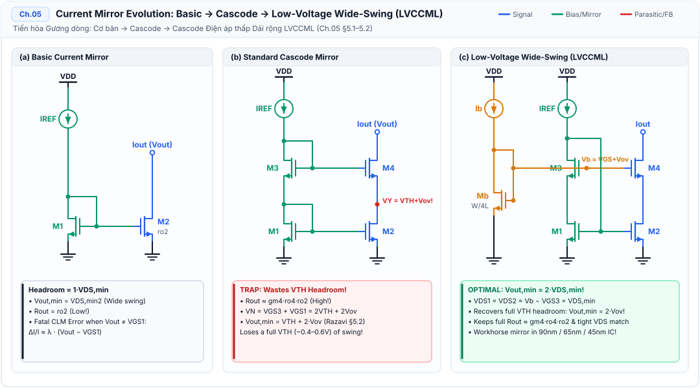

---
{
  "id": "topo-cascode-current-mirror",
  "kind": "topology",
  "domain": "stages-and-mirrors",
  "title_vi": "Gương dòng Cascode Tiêu chuẩn & Nghịch lý Lãng phí Dự trữ Điện áp VTH (Standard Cascode Current Mirror)",
  "title_en": "Standard Two-Diode-Stacked Cascode Current Mirror and the Wasted-VTH Headroom Paradox",
  "summary": "Che chắn cực máng transistor nguồn dòng bằng tầng cascode để nén sai số VDS xuống gm*rO lần và nâng trở kháng ngõ ra lên ~gm*rO^2, nhưng cách tạo điện áp phân cực bằng hai diode xếp chồng lại ép VDS2 = VGS1 và làm lãng phí trọn một điện áp ngưỡng VTH trong khoảng dự trữ điện áp (VY,min = VTH + 2*Vov).",
  "diagram": "../../diagrams/current-mirrors-evolution.svg",
  "razavi_refs": [
    {
      "chapter": 5,
      "section": "5.2",
      "pages": "139-142, 146",
      "equations": ["5.7", "5.8", "5.9", "5.10", "5.11", "5.12", "5.13"]
    }
  ],
  "glossary_codes": ["T026", "T208", "T257", "T503", "T549", "T698", "T742", "T743", "T744", "T745", "T746"],
  "process_agnostic": true,
  "roles": {
    "mirror_bottom_pair": "M1, M2 (cặp sao chép dòng gốc quyết định tỷ số nhân bản N/M và mức nhiễu nền)",
    "cascode_shield": "M3 (transistor cascode cổng chung che chắn cực máng M2 khỏi biến thiên điện áp nút tải)",
    "diode_stack_bias": "M0 mắc diode chồng lên M1 (tự động tạo Vb = VGS0 + VGS1 để khóa cứng VDS2 = VDS1 = VGS1)"
  },
  "symptoms_addressed": [
    "systematic-current-copying-error-due-to-vds-mismatch-and-clm",
    "insufficient-single-transistor-output-impedance-ro-degrading-gain-or-cmrr"
  ],
  "limitations": [
    "wastes-one-full-vth-of-output-voltage-headroom-vy-min-equals-vth-plus-2vov",
    "reference-branch-consumes-2vth-plus-2vov-limiting-max-iref-at-low-vdd",
    "output-impedance-collapses-precipitously-once-top-cascode-enters-triode"
  ],
  "checklists": ["common-mos", "current-mirror"]
}
---

## 1. Bản chất Nguyên lý, Sơ đồ Mạch & Vai trò Từng Nhánh Cấu trúc

Gương dòng cơ bản hai transistor vấp phải hai nhược điểm cố hữu do **điều biến chiều dài kênh** (*channel-length modulation*): (1) trở kháng ngõ ra hữu hạn $R_{out} = r_{O2}$ làm suy giảm độ lợi hoặc CMRR của khối mạch được cấp dòng, và (2) sai số sao chép hệ thống $\frac{I_{D2}}{I_{D1}} = \frac{(W/L)_2}{(W/L)_1}\frac{1 + \lambda V_{DS2}}{1 + \lambda V_{DS1}}$ (Phương trình 5.7) khi điện áp cực máng $V_{DS2}$ ở ngõ ra chênh lệch lớn so với $V_{DS1} = V_{GS1}$.

Để triệt tiêu sai số trên, Razavi nêu rõ hai con đường nguyên lý tại đầu Mục 5.2 (trang 140): **(Cách 1) ép $V_{DS2}$ cố định và bằng $V_{DS1}$**, hoặc **(Cách 2) hạ $V_{DS1}$ xuống bằng $V_{DS2}$**. Thẻ này phân tích **Cách thứ nhất** — dẫn tới cấu trúc **gương dòng cascode** (*cascode current mirror*) tiêu chuẩn dùng hai diode xếp chồng (Hình 5.12(c)).



Cơ chế hình thành và vai trò của 4 transistor trong Hình 5.12(c):
1. **Nhánh che chắn ngõ ra (**nguồn dòng cascode** — *cascode current source*, $M_2 + M_3$):** Đặt **transistor cascode** (*cascode device*) $M_3$ mắc cổng chung chồng lên trên cực máng $Y$ của transistor nguồn dòng $M_2$. Nhờ **tính chất che chắn** (*shielding property*), dù mạch tải bên ngoài kéo nút ngõ ra $P$ dao động hàng trăm milivolt, biến thiên lọt xuống cực máng $V_Y$ của $M_2$ bị nén nhỏ đi $(g_{m3} + g_{mb3})r_{O3}$ lần.
2. **Nhánh tạo điện áp phân cực hai diode xếp chồng ($M_1 + M_0$):** Muốn không chỉ giữ $V_Y$ cố định mà còn phải ép chính xác $V_{DS2} = V_Y = V_{DS1} = V_X$ $(= V_{GS1})$, điện áp cổng $V_b$ của $M_3$ phải thỏa mãn $V_b - V_{GS3} = V_{GS1} \implies V_b = V_{GS3} + V_{GS1}$. Cách tự nhiên nhất là mắc nối tiếp thêm một transistor mắc diode $M_0$ ngay phía trên $M_1$ trong nhánh dòng tham chiếu $I_{REF}$ (Hình 5.12(b)). Nút đỉnh $N$ tự khắc xác lập **điện áp phân cực** (*bias voltage*) $V_N = V_b = V_{GS0} + V_{GS1}$.
3. **Tính tự khử hiệu ứng thân tuyệt đẹp (Câu hỏi tư duy trang 140 sách Razavi):** Tại sao mạch Hình 5.12(c) vẫn sao chép dòng chính xác ngay cả khi có hiệu ứng thân ($\gamma \neq 0$)? Vì cực nguồn của $M_0$ nằm ở $V_X$ và cực nguồn của $M_3$ nằm ở $V_Y$. Khi chọn đúng tỷ số kích thước $\frac{(W/L)_3}{(W/L)_0} = \frac{(W/L)_2}{(W/L)_1} = \frac{N}{M}$, nghiệm tự nhất quán $V_Y = V_X$ kéo theo $V_{SB3} = V_{SB0} \implies V_{TH3} = V_{TH0}$ và $V_{GS3} = V_{GS0}$ khớp nhau hoàn hảo!

---

## 2. Hệ Phương trình Cốt lõi & Tư duy "Nhìn Mạch Đọc Nhanh" (Analysis by Inspection)

### 2.1. Trở kháng Ngõ ra & Mức Nén Sai số Sao chép Dòng

- **Trở kháng ngõ ra tín hiệu nhỏ:** Nhìn vào cực máng $P$ của $M_3$, đây chính xác là một tầng cổng chung bị suy biến tại cực nguồn bởi $r_{O2}$ (Chương 3 Phương trình 3.98):

$$R_{out} = \bigl[1 + (g_{m3} + g_{mb3})r_{O3}\bigr]r_{O2} + r_{O3} \approx (g_{m3} + g_{mb3})r_{O3}r_{O2}$$

Trở kháng ngõ ra được khuếch đại thêm một bậc độ lợi nội tại $(g_{m3} + g_{mb3})r_{O3}$.
- **Độ chính xác sao chép dòng DC khi điện áp nút tải $V_P$ lệch khỏi $V_N$:** Nếu nút ngõ ra $P$ thay đổi một lượng lớn $\Delta V_P = V_P - V_N$, độ trôi lọt xuống nút $Y$ chỉ là $\Delta V_Y \approx \frac{\Delta V_P}{1 + (g_{m3} + g_{mb3})r_{O3}}$, nên sai số dòng tương đối giảm từ $\lambda_2 \Delta V_P$ xuống còn:

$$\frac{\Delta I_{out}}{I_{out}} \approx \frac{\lambda_2 \Delta V_P}{1 + (g_{m3} + g_{mb3})r_{O3}} = \frac{\Delta V_P}{I_{out} R_{out}}$$

### 2.2. Trần Dòng Tham chiếu $I_{REF,\max}$ trên Nhánh Hai Diode (Ví dụ 5.3, Phương trình 5.8–5.11)

Ở nhánh chuẩn bên trái (Hình 5.13), nút đỉnh $N$ chồng hai điện áp cổng–nguồn đầy đủ (Phương trình 5.8–5.9):

$$V_N = V_{GS0} + V_{GS1} = \sqrt{\frac{2I_{REF}}{\mu_n C_{ox}}}\left[\sqrt{\left(\frac{L}{W}\right)_0} + \sqrt{\left(\frac{L}{W}\right)_1}\,\right] + V_{TH0} + V_{TH1}$$

Nếu bản thân mạch nguồn tạo $I_{REF}$ phía trên nút $N$ cần tối thiểu điện áp tuân thủ $V_{\text{head},I_{REF}}$ (ví dụ $0{,}5\text{ V}$ trong Ví dụ 5.3), điều kiện $V_{DD} - V_N \ge V_{\text{head},I_{REF}}$ khóa chặt dòng tham chiếu tối đa (Phương trình 5.10–5.11):

$$I_{REF,\max} = \frac{\mu_n C_{ox}}{2}\,\frac{\left(V_{DD} - V_{\text{head},I_{REF}} - V_{TH0} - V_{TH1}\right)^2}{\left(\sqrt{(L/W)_0} + \sqrt{(L/W)_1}\,\right)^2}$$

Dễ thấy trên nguồn cấp thấp ($V_{DD} \le 1{,}2\text{ V}$), chỉ riêng tổng $V_{TH0} + V_{TH1}$ (đặc biệt khi $V_{TH0}$ bị đội lên bởi hiệu ứng thân!) đã ngốn gần hết $V_{DD}$!

### 2.3. Giải phẫu Nghịch lý Lãng phí $1 \times V_{TH}$ Dự trữ Điện áp ở Ngõ ra (Phương trình 5.12–5.13)

Xét **điện áp cho phép tối thiểu** (*minimum allowable voltage*) tại ngõ ra $P$ để cả $M_2$ và $M_3$ duy trì vùng bão hòa (Hình 5.14(b), bỏ qua hiệu ứng thân để thấy rõ bản chất nhưng lưu ý $V_{TH0} = V_{TH3}$ nên $V_{TH0} - V_{TH3}$ thực tế cũng tự khử!):
- Cực cổng của $M_3$ bị giữ ở $V_N = V_{GS0} + V_{GS1}$.
- Để $M_3$ không rơi vào vùng triode, cực máng $P$ của nó không được tụt xuống dưới $V_N - V_{TH3}$ (Phương trình 5.12–5.13):

$$V_{P,\min} = V_N - V_{TH3} = V_{GS0} + V_{GS1} - V_{TH3} = \underbrace{(V_{GS0} - V_{TH0})}_{V_{OV0}} + \underbrace{(V_{GS1} - V_{TH1})}_{V_{OV1}} + V_{TH1}$$

Tức là:

$$V_{P,\min} = V_{TH} + 2V_{OV} = V_{TH} + 2V_{DS,\min}$$

**Tại sao lại xuất hiện số hạng lãng phí $+V_{TH}$ này?** Đối chiếu Hình 5.14(a) và 5.14(b) cho câu trả lời vật lý tức thì:
- Về mặt vật lý bán dẫn, hai transistor $M_2$ và $M_3$ mắc chồng chỉ cần mỗi linh kiện gánh một điện áp vượt ngưỡng để bão hòa, nghĩa là **khoảng dự trữ điện áp tối thiểu** (*minimum headroom voltage*) lý tưởng của ngăn xếp cascode chỉ bằng **$2V_{OV}$** (khi đặt $V_b = V_{GS3} + V_{OV2}$, Hình 5.14(a)).
- Thế nhưng, vì Hình 5.12(c) dùng $M_1$ mắc diode trực tiếp nên cực máng $M_1$ bị treo cứng ở $V_{DS1} = V_{GS1} = V_{TH} + V_{OV}$. Khi ép $V_{DS2} = V_{DS1}$, transistor dưới $M_2$ buộc phải "ôm" điện áp máng–nguồn bằng $V_{TH} + V_{OV}$ thay vì $V_{OV}$ — **dư thừa hoàn toàn một lượng $V_{TH}$ không mang lại bất kỳ lợi ích khuếch đại nào** ngoài việc khớp với $M_1$!

### 2.4. Trình tự Sụp đổ Tín hiệu Lớn khi Ngõ ra Sụt Áp (Ví dụ 5.4, Hình 5.15)

Khi quét điện áp ngõ ra (ký hiệu $V_X$ trong Hình 5.15(a), tương đương nút $P$) giảm dần từ mức cao về $0\text{ V}$, **transistor nào đi vào vùng triode trước: transistor trên $M_3$ hay transistor dưới $M_2$?**
- **Chứng minh phản chứng của Razavi (trang 142):** Giả sử $M_2$ vào triode trước khi $M_3$ vào triode. Muốn vậy, $V_B$ (máng $M_2$) phải giảm, kéo $I_{D2}$ giảm nhẹ (do $V_{GS2}$ cố định). Nhưng dòng $I_{D3} = I_{D2}$ giảm trong khi $V_N$ cố định lại đồng nghĩa $V_B = V_N - V_{GS3}$ phải *tăng* (nếu $M_3$ còn bão hòa) — mâu thuẫn hoàn toàn!
- **Diễn biến 3 giai đoạn chuẩn xác (Hình 5.15(b)–(c)):**
  1. $V_{\text{out}} \ge V_N - V_{TH3} = V_{TH} + 2V_{OV}$: Cả $M_2, M_3$ bão hòa; $I_{\text{out}} = I_{REF}$, $R_{\text{out}} \approx g_m r_O^2$.
  2. $2V_{OV} \lesssim V_{\text{out}} < V_{TH} + 2V_{OV}$: **$M_3$ đi vào vùng triode trước!** Để vẫn tải đủ dòng $I_{D2}$ khi $V_{DS3}$ nhỏ, $M_3$ đòi hỏi $V_{GS3}$ lớn hơn, ép nút giữa $V_B$ tụt dần từ $V_{TH} + V_{OV}$ xuống về $V_{OV}$. Trong dải này, dòng $I_{\text{out}}$ chỉ giảm rất nhẹ (do $M_2$ vẫn còn bão hòa!), **nhưng $R_{\text{out}}$ sụp đổ thê thảm** vì $g_{m3}$ và $r_{O3}$ của $M_3$ suy biến trong vùng triode!
  3. $V_{\text{out}} < 2V_{OV}$: Nút giữa $V_B$ tụt xuống dưới $V_{OV2}$, đẩy nốt **$M_2$ vào vùng triode**, làm dòng $I_{\text{out}}$ lao dốc thẳng về $0$.

---

## 3. Bất biến Cấu trúc & Các Bẫy Lỗi Kinh điển (Structural Invariants & Traps)

- **`[INV-CCMIR-01]` Bất biến tỷ lệ đồng thời hai tầng ($M_0\text{–}M_3$ và $M_1\text{–}M_2$):** Điều kiện bắt buộc để $V_{DS2} = V_{DS1}$ là cả hai cặp trên và dưới phải cùng tỷ số nhân bản đơn vị:

$$L_1 = L_2, \quad L_0 = L_3, \quad \frac{W_3 / L_3}{W_0 / L_0} = \frac{W_2 / L_2}{W_1 / L_1} = \frac{N}{M}$$

Thông thường chọn $L_1 = L_2$ dài (để tối ưu $r_O$, giảm nhiễu $1/f$ và sai lệch Pelgrom — Chú thích 1 trang 140), còn $L_0 = L_3$ có thể ngắn hơn (nhưng vẫn $\ge 2 L_{\min}$ ở nanomet) để giảm bề rộng $W_{0,3}$ và điện dung ký sinh tại nút ngõ ra.
- **`[INV-CCMIR-02]` Bất biến đánh đổi kinh điển của Hình 5.14:** Với hai transistor mắc chồng đơn thuần không có nhánh phân cực phụ, bạn **không thể** đạt đồng thời cả hai mục tiêu: (a) Hình 5.14(a) đặt $V_b = V_{GS3} + V_{OV2}$ đạt dự trữ tối thiểu $2V_{OV}$ nhưng chịu lỗi hệ thống $I_{out} \neq I_{REF}$ do $V_{DS2} = V_{OV} < V_{DS1} = V_{GS1}$; (b) Hình 5.14(b) nối hai diode đạt $I_{out} = I_{REF}$ nhưng mất $V_{TH} + 2V_{OV}$.

- **`[TRAP-CCMIR-01]` Bị đánh lừa bởi đường cong dòng $I_{out}$ phẳng mà quên kiểm tra $R_{out}$ (Ví dụ 5.4):** Trong mô phỏng DC, ngay cả khi $V_{\text{out}}$ đã tụt xuống vùng $[2V_{OV},\; V_{TH} + 2V_{OV}]$ làm $M_3$ chui vào triode, dòng DC $I_{out}$ trông vẫn gần như đúng bằng $I_{REF}$ (chỉ hụt $1\% - 3\%$ vì $M_2$ còn dư cả một khoảng $V_{TH}$ trước khi chạm triode!). Nếu kỹ sư chỉ nhìn dòng DC mà không kiểm tra `region == 2` của $M_3$ hoặc không đo $R_{out}$, độ lợi AC của cả bộ khuếch đại sẽ sụt mất $20 - 30\text{ dB}$ mà không hiểu tại sao!
- **`[TRAP-CCMIR-02]` Bẫy tắt dòng ở biên độ cao của gương dòng hồi tiếp phụ (Ví dụ 5.7, Hình 5.21):** Một biến thể không chồng cascode dùng transistor cảm biến $M_3$ nối cổng vào cực máng ngõ ra $X$ và hút dòng từ nút $N$ để điều tiết cổng $M_1$ (Hình 5.21(a)): ngoài việc vẫn đòi $V_X > V_{TH3} > V_{DS,\text{sat}}$, khi $V_X$ lên quá cao, $M_3$ hút cạn toàn bộ dòng $I_{REF}$ và **làm $M_1$ tắt hẳn**!
- **`[TRAP-CCMIR-03]` Chủ quan dùng $L = L_{\min}$ cho toàn bộ gương dòng cascode ở 40nm/65nm (Nanometer Design Note trang 146):** Ở tiến trình $40\text{ nm}$ với $W/L = 5\,\mu\text{m}/40\text{ nm}$, do DIBL quá mạnh ($g_m r_O$ nhỏ), ngay cả khi cả 4 transistor đều bão hòa ($V_X > 0{,}4\text{ V}$), dòng ngõ ra $I_X$ vẫn dốc lên rõ rệt theo $V_X$. Cascode không thể thay thế hoàn toàn việc chọn $L > L_{\min}$!

---

## 4. Lộ trình Nâng cấp Cấu trúc & Bát giác Đánh đổi (Upgrade Paths & Design Octagon)

Trên Bát giác Thiết kế (`concept-analog-design-octagon`), gương dòng cascode hai diode giải quyết triệt để **Trở kháng ngõ ra** và **Độ chính xác DC** từ `topo-basic-current-mirror`, nhưng tạo ra điểm nghẽn nghiêm trọng trên trục **Điện áp nguồn cấp** (*Supply voltage*) và **Dải dao động điện áp** (*Voltage swings*) do khoản phạt $+V_{TH}$.

Lộ trình nâng cấp tất yếu trong hệ thống Razavi:
1. **Khắc phục trực tiếp khoản phạt $+V_{TH}$ để thu hồi dải dao động về đúng $2V_{DS,\min}$** $\rightarrow$ **`topo-lvccml-wide-swing-mirror`** (Gương dòng cascode điện áp thấp / dải rộng — cấu trúc thay thế gần như hoàn toàn gương cascode hai diode trong mọi chip CMOS từ $0{,}35\,\mu\text{m}$ xuống $45\text{ nm}$!).
2. **Nâng tiếp trở kháng ngõ ra lên cỡ $A_{\text{aux}} g_m r_O^2$ khi công nghệ nanomet làm suy yếu $g_m r_O$ đơn** $\rightarrow$ `topo-gain-boosted-cascode`.
3. **Ứng dụng làm tải/đuôi trong các bộ khuếch đại thuật toán một tầng độ lợi cao** $\rightarrow$ `topo-cascode-stage`, `topo-telescopic-cascode-opamp`, `topo-folded-cascode-ota`.
4. **Phân tích tính chất nhiễu của transistor cascode ($M_3$ gần như không đóng góp nhiễu ở tần số thấp!)** $\rightarrow$ `law-stage-and-mirror-noise-rules`.

---

## 5. Thích ứng Đa Tiến trình (90nm / 65nm / 45nm) & Cách Kiểm chứng trong Cadence / Spectre

### 5.1. Khi Nào Còn Dùng Được Gương Cascode Hai Diode ở 90nm / 65nm / 45nm?

- Với các miền nguồn I/O dày oxit ($V_{DD,\text{IO}} = 1{,}8\text{ V},\; 2{,}5\text{ V}$ hoặc $3{,}3\text{ V}$), gương dòng cascode hai diode Hình 5.12(c) vẫn cực kỳ hữu dụng làm nguồn dòng đuôi hoặc nguồn bơm dòng DAC vì nó **không cần thêm nhánh tạo $V_b$ phụ**, tự bù hiệu ứng thân và tuyệt đối không lo $M_0$ vào vùng triode khi PVT dịch chuyển.
- Ngược lại, trong miền lõi điện áp thấp ($V_{DD,\text{core}} = 1{,}0\text{ V} - 1{,}2\text{ V}$ ở 90nm/65nm/45nm), với $V_{TH} \approx 0{,}35 - 0{,}45\text{ V}$ (cộng hiệu ứng thân lên $\approx 0{,}5\text{ V}$ ở góc `SS, -40°C`) và $2V_{DS,\min} \approx 0{,}30\text{ V}$, mức tuân thủ $V_{P,\min} \approx 0{,}75 - 0{,}80\text{ V}$ khiến gương cascode tiêu chuẩn **không thể dùng làm tải cho tầng khuếch đại ngõ ra** (và nhánh chuẩn $V_N = 2V_{TH} + 2V_{DS,\min} > 1{,}1\text{ V}$ thậm chí không khởi động nổi dưới $V_{DD} = 1{,}0\text{ V}$!). Trong miền lõi này, bắt buộc chuyển sang `topo-lvccml-wide-swing-mirror`.
- Ngay cả ở miền $1{,}8\text{ V}/2{,}5\text{ V}$, luôn chọn $L_1 = L_2 \ge 4 L_{\min}$ ($g_m/I_D \approx 7 - 10\text{ V}^{-1}$) cho cặp đáy và $L_0 = L_3 \ge 2 L_{\min}$ ($g_m/I_D \approx 12 - 14\text{ V}^{-1}$) cho cặp cascode để giữ $V_{OV0,3}$ nhỏ gọn và ngăn DIBL xuyên thấu.

### 5.2. Quy trình Kiểm chứng trên Cadence Virtuoso IC617 & Spectre

1. **Kiểm tra Hai Ngưỡng Dự trữ Điện áp (`dc` OP & sweep):**
   - Kiểm tra đồng thời nhánh tham chiếu ($V_{DD} - V_N \ge V_{DS,\min,\text{Iref\_src}}$ ở góc xấu nhất **`SS, -40°C, VDD_min`** nơi $V_{TH0} + V_{TH1}$ đạt cực đại!) và nhánh ngõ ra (`region == 2` trên **cả $M_2$ lẫn $M_3$**, chú ý đặc biệt `M3:region == 2` và `M3:vds - M3:vdsat >= 50 mV`).
2. **Đo Trở kháng Ngõ ra Tần số Thấp & Cao (`ac` / `xf` hoặc `dc` đạo hàm):**
   - Kẹp nguồn AC biên độ $1\text{ V}$ nối tiếp nguồn DC tại nút ngõ ra $P$, vẽ $Z_{out}(f) = 1 / \text{imag\_or\_mag}(I_P(f))$:
     - Ở tần số thấp: xác nhận $R_{out,\text{DC}} \approx (g_{m3} + g_{mb3})r_{O3}r_{O2}$ cao hơn gương đơn đúng cỡ $(g_{m3}+g_{mb3})r_{O3}$ lần; thử hạ DC tại $P$ xuống dưới $V_N - V_{TH3}$ để quan sát trực quan sự sụp đổ tức khắc của $R_{out,\text{DC}}$ dù dòng DC chưa sập!

### 5.3. Bảng Đối chiếu Định lượng Các Kiến trúc Gương Dòng Trở kháng Cao (Mục 5.1 – 5.2)

Đặt $V_{OV} = V_{DS,\min} \approx 150\text{ mV}$, $V_{TH} \approx 400\text{ mV}$ (ở góc `SS` tính cả hiệu ứng thân lên $\approx 480\text{ mV}$) và độ lợi nội tại đơn $g_m r_O \approx 12$:

| Kiến trúc Gương dòng | Điện áp Đỉnh Nhánh Chuẩn | Điện áp Tuân thủ Ngõ ra $V_{\text{out},\min}$ | Trở kháng Ngõ ra $R_{out}$ | Sai số Hệ thống $\Delta I / I$ | Khả năng Chạy ở $V_{DD} = 1{,}0\text{ V}$ |
|---|---|---|---|---|---|
| **Gương cơ bản** (`topo-basic-current-mirror`, Hình 5.5b) | $V_{TH} + V_{OV} \approx 0{,}55\text{ V}$ | $V_{OV} \approx 0{,}15\text{ V}$ | $r_O$ ($1\times$) | Lớn: $\lambda(V_{\text{out}} - V_{GS1}) \sim 5\% - 15\%$ | Rất tốt (dải ngõ ra rộng $0{,}85\text{ V}$) |
| **Gương Cascode Hai Diode** (Thẻ này — Hình 5.12c) | $2V_{TH} + 2V_{OV} \approx 1{,}18\text{ V}$ (`SS`) | $V_{TH} + 2V_{OV} \approx 0{,}70 - 0{,}78\text{ V}$ | $\approx (g_m + g_{mb})r_O^2$ ($\sim 15\times$) | Rất nhỏ: $< 0{,}3\%$ khi $V_{\text{out}} \ge V_{\text{out},\min}$ | **Thất bại!** ($V_N > V_{DD}$ ở góc `SS`) |
| **Gương Hồi tiếp Cảm biến $M_3$** (Ví dụ 5.7 — Hình 5.21a) | $V_{TH} + 2V_{OV} \approx 0{,}70\text{ V}$ | $> V_{TH3} \approx 0{,}45\text{ V}$ | Cao cục bộ quanh điểm cân bằng | Sai lệch mạnh & **tắt hẳn $M_1$** khi $V_{\text{out}}$ lên cao! | Kém (cửa sổ điện áp hoạt động quá hẹp) |
| **Gương Cascode Điện áp thấp LVCCML** (`topo-lvccml-wide-swing-mirror`, Hình 5.18b) | $V_{TH} + V_{OV} \approx 0{,}55\text{ V}$ | **$2V_{OV} \approx 0{,}30\text{ V}$** | $\approx (g_m + g_{mb})r_O^2$ ($\sim 15\times$) | Rất nhỏ: $< 0{,}3\%$ nhờ ép $V_{DS1} = V_{DS2} \approx V_{OV}$ | **Chuẩn mực tối ưu** (cần thêm nhánh tạo $V_b$) |

**Biểu thức ADE Calculator & Kịch bản OCEAN chẩn đoán nhanh bẫy sập $R_{out}$ ẩn (`[TRAP-CCMIR-01]`):**
- Kiểm tra dự trữ bão hòa cascode trên `M3`: `OP("/M3", "vds") - OP("/M3", "vdsat")` (phải dương $\ge 50\text{ mV}$; nếu âm trong khi `ID("/M3/D")` vẫn gần bằng `Iref` thì $M_3$ đã sập vào vùng triode làm mất che chắn!).
- Hệ số khuếch đại trở kháng thực tế so với transistor đáy: `(1.0 / deriv(IS("/M3/D"))) / (1.0 / OP("/M2", "gds"))`.

```lisp
; Đoạn kiểm tra OCEAN tự động cho Gương dòng Cascode (Virtuoso IC617 / Spectre)
selectResult('dcOpInfo)
let( (reg2 reg3 margin2 margin3 vdsErr)
  reg2    = pv("/M2" "region")
  reg3    = pv("/M3" "region")
  margin2 = abs(pv("/M2" "vds")) - abs(pv("/M2" "vdsat"))
  margin3 = abs(pv("/M3" "vds")) - abs(pv("/M3" "vdsat"))
  vdsErr  = abs(pv("/M2" "vds") - pv("/M1" "vds"))
  printf("Cascode Mirror Check: M2_reg=%d (margin=%.1fmV), M3_reg=%d (margin=%.1fmV), |VDS2-VDS1|=%.2fmV\n"
         reg2 margin2*1e3 reg3 margin3*1e3 vdsErr*1e3)
)
```

---

## 6. Mốc Đối chiếu Sách Razavi & Thuật ngữ Chuẩn CLB

| Mốc Sách Razavi (2nd Ed.) | Trang Sách (PDF Ch.05) | Nội dung & Phương trình Đối chiếu | Mã Thuật ngữ Chuẩn CLB (`terms-vi-en.json`) |
|---|---|---|---|
| **Mục 5.2 — Cách thứ nhất**, Hình 5.12–5.13, Ví dụ 5.3 | tr. 140–141 (PDF 7–8) | Che chắn cực máng bằng $M_3$, chồng hai diode $M_0+M_1$ tạo $V_b = V_{GS0}+V_{GS1}$, tự bù hiệu ứng thân, giới hạn $I_{REF,\max}$ **(5.8)–(5.11)** | `T698` (gương dòng cascode), `T503` (transistor cascode), `T549` (tính chất che chắn), `T742` (nguồn dòng cascode), `T743` (điện áp phân cực) |
| **Mục 5.2 — Phân tích Dự trữ Điện áp**, Hình 5.14 | tr. 141–142 (PDF 8–9) | Chứng minh $V_{P,\min} = V_{GS0}+V_{GS1}-V_{TH} = 2V_{OV}+V_{TH}$ **(5.12)–(5.13)**, đối chiếu $2V_{OV}$ lý tưởng vs. lãng phí $1\times V_{TH}$ | `T208` (khoảng dự trữ điện áp), `T744` (điện áp cho phép tối thiểu), `T745` (khoảng dự trữ điện áp tối thiểu), `T746` (điện áp vượt ngưỡng cổng–nguồn) |
| **Mục 5.2 — Đặc tính Tín hiệu lớn & Nanomet**, Hình 5.15, 5.21, Ví dụ 5.4, 5.7 | tr. 142, 146 (PDF 9, 13) | Chứng minh phản chứng $M_3$ vào triode trước $M_2$ làm sập $R_{out}$, gương hồi tiếp $M_3$ làm ngắt $M_1$, Nanometer Design Note 40nm | `T257` (điều biến chiều dài kênh), `T754` (đặc tính tín hiệu lớn), `T776` (công nghệ nanomet) |
