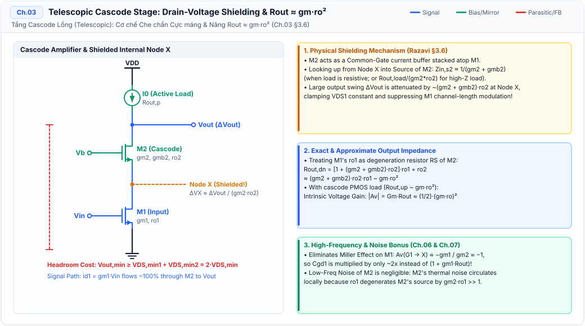

---
{
  "id": "topo-cascode-stage",
  "kind": "topology",
  "domain": "stages-and-mirrors",
  "title_vi": "Tầng Cascode (Telescopic & Folded Cascode): Khuếch đại trở kháng ra, Tính chất che chắn & Đánh đổi dự trữ điện áp",
  "title_en": "Cascode Stage (Telescopic and Folded Cascode)",
  "summary": "Mắc nối tầng một transistor đầu vào nguồn chung (CS) truyền dòng vào cực nguồn của một transistor cascode cổng chung (CG) — ở dạng xếp chồng cùng loại hạt tải (telescopic) hoặc gập nhánh bổ sung (folded) — giữ nguyên hỗ dẫn Gm xấp xỉ gm1 nhưng nhân trở kháng đầu ra lên Rout = [1+(gm2+gmb2)rO2]rO1 + rO2 ~ gm2*rO2*rO1 để đạt độ lợi cỡ (gm*rO)^2 và che chắn biến thiên điện áp máng, đổi lấy chi phí xếp chồng khoảng dự trữ điện áp tối thiểu 2*VDS,min mỗi phía.",
  "diagram": "../../diagrams/cascode-shielding.svg",
  "razavi_refs": [
    {
      "chapter": 3,
      "section": "3.6",
      "pages": "82-90",
      "equations": ["3.124", "3.125", "3.126", "3.127", "3.128", "3.129", "3.130", "3.131", "3.132", "3.133", "3.134", "3.135", "3.136", "3.138", "3.139", "3.140", "3.141", "3.142"]
    },
    {
      "chapter": 3,
      "section": "3.6.1",
      "pages": "90-92",
      "equations": ["3.143", "3.144", "3.145", "3.146"]
    },
    {
      "chapter": 3,
      "section": "3.7",
      "pages": "92-93",
      "equations": []
    }
  ],
  "glossary_codes": [
    "T091", "T094", "T095", "T208", "T233", "T352", "T355", "T394",
    "T451", "T496", "T498", "T499", "T500", "T501", "T502", "T503",
    "T504", "T505", "T506", "T518", "T535", "T549", "T551", "T552",
    "T553"
  ],
  "process_agnostic": true,
  "roles": {
    "input_device_M1": "Transistor đầu vào cấu hình nguồn chung (CS) chuyển đổi điện áp tín hiệu Vin thành dòng điện máng tín hiệu nhỏ gm1*vin với trở kháng đầu vào cao và tạp âm thấp.",
    "cascode_device_M2": "Transistor cascode cấu hình cổng chung (CG, cực cổng neo ở Vb) thu nhận dòng tín hiệu từ cực máng M1, ghim gần cứng điện thế nút trung gian VX để che chắn M1 khỏi biến thiên Vout và nhân trở kháng đầu ra lên hệ số [1+(gm2+gmb2)rO2].",
    "cascode_current_source_load": "Nhánh nguồn dòng cascode đối xứng phía tải (PMOS M3-M4) cung cấp trở kháng tải tương đương cỡ gm3*rO3*rO4 để không làm sập Rout cao của nhánh khuếch đại.",
    "fold_node_bias_source_I1": "Trong biến thể cascode gập (folded cascode), nguồn dòng I1 đặt tại nút gập cung cấp tổng dòng tĩnh |ID1| + ID2, cho phép ghép transistor đầu vào và transistor cascode khác loại hạt tải (PMOS-NMOS hoặc NMOS-PMOS)."
  },
  "symptoms_addressed": [
    "single-transistor-intrinsic-gain-gmro-too-low-in-nanometer-cmos",
    "output-voltage-swing-modulating-drain-current-of-current-source",
    "miller-multiplication-of-cgd1-degrading-cs-input-bandwidth",
    "thin-oxide-transistor-overvoltage-stress-under-high-vdd"
  ],
  "limitations": [
    "headroom-stack-cost-of-2vdsmin-per-cascode-side",
    "requires-accurate-cascode-gate-bias-vb-across-pvt",
    "ill-defined-dc-output-without-negative-feedback-loop",
    "folded-cascode-consumes-extra-bias-branch-current-and-lowers-rout"
  ],
  "checklists": [
    "common-mos",
    "single-stage"
  ]
}
---

## 1. Bản chất Nguyên lý, Sơ đồ Mạch & Vai trò Từng Nhánh Cấu trúc

Trong `topo-cs-source-degeneration`, ta đã thấy việc đặt một điện trở $R_S$ dưới cực nguồn nhân điện trở đầu ra lên $[1 + (g_m + g_{mb})r_O]R_S + r_O$, nhưng lại làm sụt độ hỗ dẫn $G_m$ cùng tỷ lệ nên không tăng được độ lợi cực đại $-g_m r_O$. Làm thế nào để vừa hưởng trọn độ hỗ dẫn nguyên vẹn $G_m \approx g_{m1}$ của một transistor nối đất cực nguồn, vừa nhân bội trở kháng đầu ra (output impedance, `T518`) lên hàng chục lần? Câu trả lời rực rỡ nhất của kỹ thuật mạch tương tự nằm ở Mục 3.6: **tầng cascode** (cascode stage, `T499` — xuất phát từ chữ *cascaded triodes* thời đèn chân không ba cực ở Chú thích 4, tuyệt đối không dịch nhầm thành mắc nối tầng *cascade* `T498`, cũng không nhầm với vùng triode của MOSFET!).



Cấu trúc cascode ghép nối tiếp một tầng nguồn chung ở dưới với một tầng cổng chung (`topo-common-gate-stage`) ở trên theo hai hình thái kiến trúc chủ đạo:

1. **Cascode telescopic / Cascode xếp chồng (telescopic cascode, `T501` — Hình 3.59 & Hình 3.70):** **Transistor đầu vào** (input device, `T502`) NMOS $M_1$ nhận $V_{in}$ tại cổng và tạo dòng tín hiệu $g_{m1} v_{in}$; **transistor cascode** (cascode device, `T503`) NMOS $M_2$ được **mắc chồng** (stacked, `T504`) trực tiếp trên cực máng của $M_1$ với cực cổng giữ ở điện áp tĩnh $V_b$. Hai transistor dùng chung một nhánh dòng tĩnh duy nhất — gọi là tái sử dụng dòng phân cực (`T553`). Vì cực nguồn của $M_2$ nhìn xuống cực máng $M_1$ có trở kháng thấp $\sim 1/(g_{m2} + g_{mb2})$, gần như toàn bộ dòng $g_{m1} v_{in}$ chảy thẳng qua $M_2$ lên tải, đồng thời nút trung gian $X$ được ghim gần đứng yên!
2. **Cascode gập (folded cascode, `T500` — Mục 3.6.1, Hình 3.74 & Hình 3.77):** Khi $M_1$ và $M_2$ được chọn **khác loại hạt tải** (ví dụ PMOS $M_1$ làm transistor đầu vào gập dòng sang NMOS $M_2$ làm transistor cổng chung ở Hình 3.74b, hoặc NMOS $M_1$ gập lên PMOS $M_2$ ở Hình 3.74c), ta đặt một nguồn dòng phân cực $I_1$ tại nút gập $X$ sao cho $|I_{D1}| + I_{D2} = I_1$. Dòng tín hiệu nhỏ $\Delta I_{D1}$ được "gập" ngược chiều đi vào cực nguồn $M_2$ mà không xếp chồng $M_1$ và $M_2$ trên cùng một cột áp DC, mở rộng linh hoạt dải điện áp đầu vào chế độ chung đổi lấy tổng dòng tiêu thụ cao hơn.

## 2. Hệ Phương trình Cốt lõi & Tư duy "Nhìn Mạch Đọc Nhanh" (Analysis by Inspection)

### 2.1. Điều kiện phân cực $V_b$, chi phí xếp chồng $2V_{DS,min}$ và trở kháng ra $R_{out}$
Trong Hình 3.59 và Hình 3.61 (tạm xét $\lambda = \gamma = 0$), để $M_1$ giữ bão hòa cần $V_X \ge V_{in} - V_{TH1}$. Do $M_2$ đóng vai trò tầng bám nguồn đối với điện áp tĩnh $V_b$ ($V_X = V_b - V_{GS2}$), ta phải chọn $V_b \ge V_{GS2} + (V_{in} - V_{TH1}) = V_{GS2} + V_{DS1,min}$. Để tối đa hóa dải dao động phía dưới, ta đặt $V_b$ đúng bằng giới hạn đưa $M_1$ tới **ranh giới vùng bão hòa** (edge of saturation, `T552`), khi đó $M_2$ giữ bão hòa chừng nào $V_{out} \ge V_b - V_{TH2}$, dẫn tới phương trình (3.124)–(3.125):
$$
V_{out,min} = (V_{GS1} - V_{TH1}) + (V_{GS2} - V_{TH2}) = V_{DS1,min} + V_{DS2,min} \approx 2 V_{DS,min}
$$
Mắc chồng $M_2$ tiêu tốn thêm ít nhất một điện áp vượt ngưỡng $V_{DS2,min}$ (nếu xếp ba tầng — **cascode ba transistor** `T506`, Hình 3.66 — sẽ tốn $3 V_{DS,min}$).

**Điện trở đầu ra chính xác và xấp xỉ (Hình 3.65, phương trình (3.128)):**
Khi tính $R_{out}$ với $V_{in} = 0$, $M_1$ có $V_{GS1} = V_{bs1} = 0$ nên thu gọn thành một điện trở thuần $r_{O1}$ nối dưới cực nguồn của $M_2$! Áp dụng ngay công thức (3.66) của `topo-cs-source-degeneration` với $R_S = r_{O1}$:
$$
R_{out} = [1 + (g_{m2} + g_{mb2})r_{O2}]r_{O1} + r_{O2} \approx (g_{m2} + g_{mb2})r_{O2} r_{O1} \approx g_{m2} r_{O2} r_{O1}
$$
Transistor cascode $M_2$ đã **nhân bội** điện trở ra $r_{O1}$ của $M_1$ lên một hệ số bằng độ lợi nội tại $(g_{m2} + g_{mb2})r_{O2}$!

### 2.2. Độ lợi chính xác $A_v = -G_m R_{out}$: Nguồn dòng cascode so với Bộ khuếch đại cascode
Áp dụng bổ đề Norton cho tầng cascode mang tải nguồn dòng lý tưởng (Ví dụ 3.22, Hình 3.67–3.68, phương trình (3.129)–(3.132)): khi ngắn mạch đầu ra xuống đất xoay chiều, dòng $g_{m1} V_{in}$ chia đôi giữa $r_{O1}$ và điện trở nhìn vào cực nguồn $M_2$ là $\frac{1}{g_{m2} + g_{mb2}} \parallel r_{O2}$ theo (3.129), cho độ hỗ dẫn tương đương (`T451`) toàn mạch:
$$
G_m = \frac{g_{m1} r_{O1}[(g_{m2} + g_{mb2})r_{O2} + 1]}{r_{O1} r_{O2}(g_{m2} + g_{mb2}) + r_{O1} + r_{O2}} \approx g_{m1}
$$
Nhân $-G_m$ với $R_{out}$ ở (3.128) triệt tiêu hoàn toàn mẫu số phức tạp, thu được kết quả gọn đẹp bất ngờ (chú ý ghi chú biên tập `NG03-03` và `NG03-04`: độ lợi của tầng cascode mang dấu **âm** đảo pha, còn phương trình (3.131)–(3.132) trong sách ghi theo độ lớn $|A_v|$):
$$
A_v = -G_m R_{out} = -g_{m1} r_{O1}[(g_{m2} + g_{mb2})r_{O2} + 1] \approx -g_{m1} r_{O1}(g_{m2} + g_{mb2})r_{O2}
$$
Độ lợi điện áp cực đại tăng vọt lên **bình phương độ lợi nội tại** $\sim (g_m r_O)^2$! (Nếu tại nút nội $X$ có điện trở rò $R_P$ xuống đất với $\lambda = 0$, phép chia dòng ở Ví dụ 3.21 cho $A_v = -\frac{g_{m1}(g_{m2}+g_{mb2})R_P R_D}{1 + (g_{m2}+g_{mb2})R_P}$, phương trình (3.126)–(3.127)).

**Phân biệt rạch ròi Nguồn dòng cascode và Bộ khuếch đại cascode (Hình 3.69–3.70):**
- **Tại sao thêm cascode tốt hơn gấp bội so với tăng chiều dài $L_1$ lên $4$ lần? (Hình 3.69, phương trình (3.133)):** Ở cùng dòng $I_D$ và chiều rộng $W_1$, tăng $L_1 \to 4 L_1$ làm $V_{OV1}$ tăng gấp đôi (tốn cùng khoảng dự trữ điện áp $2 V_{OV}$ như cascode!), nhưng $g_{m1}$ bị giảm một nửa và $g_{m1} r_{O1}$ chỉ tăng vỏn vẹn $2$ lần; trong khi thêm cascode giữ nguyên $g_{m1}$ cao và đẩy $R_{out}$ lên $g_m r_O^2$!
- **Bộ khuếch đại cascode hoàn chỉnh (Hình 3.70, phương trình (3.134)–(3.136), Ví dụ 3.23):** Nếu nhánh dưới là cascode NMOS ($R_{out,N} \sim g_{m2}r_{O2}r_{O1}$) mà tải trên chỉ là một PMOS đơn ($r_{O3}$), thì $R_{out,N} \parallel r_{O3} \approx r_{O3}$ sẽ đánh mất toàn bộ lợi ích cascode! Do đó, tải phía trên **bắt buộc phải là một nguồn dòng cascode PMOS** ($M_3 - M_4$), cho:
$$
R_{out} = \big\{[1 + (g_{m2} + g_{mb2})r_{O2}]r_{O1} + r_{O2}\big\} \parallel \big\{[1 + (g_{m3} + g_{mb3})r_{O3}]r_{O4} + r_{O3}\big\}
$$
$$
A_v \approx -g_{m1}\big[(g_{m2} r_{O2} r_{O1}) \parallel (g_{m3} r_{O3} r_{O4})\big]
$$
Dải dao động điện áp đầu ra cho phép (`T095`) khi phân cực tối ưu cả $V_{b1}$ và $V_{b2}$ bằng $V_{DD}$ trừ đi bốn lần điện áp bão hòa tối thiểu (3.136):
$$
V_{out,max} - V_{out,min} = V_{DD} - V_{DS1,min} - V_{DS2,min} - |V_{DS3,min}| - |V_{DS4,min}| \approx V_{DD} - 4 V_{DS,min}
$$

### 2.3. Tính chất che chắn (Shielding Property) & Cascode gập (Folded Cascode)
1. **Định lượng tính chất che chắn (`T549` — Hình 3.72, Ví dụ 3.24, phương trình (3.137)–(3.141)):** Khi nút đầu ra trên cực máng cascode $M_3$ thay đổi một lượng lớn $\Delta V$, độ biến thiên truyền lọt xuống cực máng $P$ của transistor nguồn dòng/đầu vào $M_1$ bị suy giảm mạnh theo (3.139)–(3.140):
$$
\Delta V_P = \Delta V \frac{r_{O1}}{[1 + (g_{m3} + g_{mb3})r_{O3}]r_{O1} + r_{O3}} \approx \frac{\Delta V}{(g_{m3} + g_{mb3})r_{O3}}
$$
Nhờ đó, sai lệch dòng điện giữa hai nguồn dòng do chênh lệch điện áp máng $\Delta V$ giảm từ $\frac{1}{2}\mu_n C_{ox}\frac{W}{L}(V_b - V_{TH})^2 \lambda \Delta V$ (3.138) xuống còn bị chia cho $(g_{m3} + g_{mb3})r_{O3}$ theo (3.141)! Đồng thời, vì $\Delta V_X \approx -\frac{g_{m1}}{g_{m2}+g_{mb2}}\Delta V_{in}$ rất nhỏ, hiệu ứng nhân tụ Miller trên $C_{GD1}$ chỉ còn $\sim 2 C_{GD1}$ thay vì $(1 + |A_v|)C_{GD1}$ (`concept-high-freq-cs-cg-cascode`), và $M_2$ còn gánh hộ điện áp lớn bảo vệ $M_1$ khỏi quá áp đánh thủng oxit nanomet (*Nanometer Design Note 5*, trang 64).
2. **Cascode gập (Hình 3.74–3.76, Ví dụ 3.25, phương trình (3.143)–(3.146)):** Với PMOS đầu vào $M_1$, NMOS cascode $M_2$ và nguồn dòng đáy $M_3$ mang dòng $I_1 = |I_{D1}| + I_{D2}$:
   - Quét tín hiệu lớn (Hình 3.75): khi $V_{in} > V_{DD} - |V_{TH1}|$, $M_1$ ngắt và $M_2$ gánh toàn bộ $I_1$; khi $V_{in}$ giảm dưới $V_{DD} - |V_{TH1}|$, dòng $I_{D2} = I_1 - \frac{1}{2}\mu_p C_{ox}(W/L)_1(V_{DD} - V_{in} - |V_{TH1}|)^2$ (3.143) giảm dần và chạm $0$ tại mức tới hạn (3.145):
$$
V_{in1} = V_{DD} - \sqrt{\frac{2 I_1}{\mu_p C_{ox}(W/L)_1}} - |V_{TH1}|
$$
   Nếu $V_{in} < V_{in1}$, $|I_{D1}|$ đòi vượt quá $I_1$ làm $M_2$ tắt hẳn, đẩy $M_1$ sụp vào vùng triode và kéo $V_X \to V_{DD}$!
   - Điện trở đầu ra của nhánh cascode gập (nhìn vào cực máng $M_2$, nơi nút gập $X$ có cả $r_{O1}$ của PMOS đầu vào lẫn $r_{O3}$ của nguồn dòng NMOS nối đất AC — phương trình (3.146)):
$$
R_{out,\text{folded}} = [1 + (g_{m2} + g_{mb2})r_{O2}](r_{O1} \parallel r_{O3}) + r_{O2}
$$
Vì $(r_{O1} \parallel r_{O3}) < r_{O1}$, cascode gập luôn có trở kháng đầu ra (và độ lợi một tầng) thấp hơn khoảng $2\text{–}3$ lần so với cascode telescopic cùng kích thước!

### 2.4. Bảng đối chiếu trực diện Cascode Telescopic (Xếp chồng) và Cascode Gập (Folded)

| Thuộc tính so sánh | Cascode Telescopic (Hình 3.70) | Cascode Gập — Folded Cascode (Hình 3.74 / 3.77) |
| :--- | :--- | :--- |
| **Loại hạt tải cặp CS – CG** | Cùng loại (NMOS–NMOS hoặc PMOS–PMOS) | Khác loại bổ sung (PMOS–NMOS hoặc NMOS–PMOS) |
| **Phân bổ dòng tĩnh DC** | Tái sử dụng dòng (`T553`): $I_{D1} = I_{D2} = I_{bias}$ | Hai nhánh cộng tại nút gập: $|I_{D1}| + I_{D2} = I_1$ (tốn công suất hơn) |
| **Trở kháng ra nhánh tín hiệu** | $[1 + (g_{m2} + g_{mb2})r_{O2}]r_{O1} + r_{O2}$ (cao hơn) | $[1 + (g_{m2} + g_{mb2})r_{O2}](r_{O1} \parallel r_{O3}) + r_{O2}$ (thấp hơn $2\text{–}3\times$) |
| **Dải mức DC đầu vào & Nối tắt** | Hẹp, bị khóa chặt với mức đầu ra | Rộng (chạm một thanh nguồn cấp), dễ dàng nối hồi tiếp đơn vị |
| **Nhiễu quy về ngõ vào** | Chỉ có nhiễu của $M_1$ và nguồn dòng tải trên | Cộng thêm nhiễu nhiệt & $1/f$ của nguồn dòng nút gập $M_3$ ($I_1$) |

## 3. Bất biến Cấu trúc & Các Bẫy Lỗi Kinh điển (Structural Invariants & Traps)

- **`[INV-CASC-01]` Bất biến cửa sổ phân cực cổng cascode $V_b$:** Trong mọi cấu trúc cascode xếp chồng hoặc cascode gập, điện áp phân cực cổng $V_b$ bắt buộc phải nằm lọt trong khe an toàn $V_{GS2} + V_{DS1,min} \le V_b \le V_{out,min} + V_{TH2}$ qua **tất cả các góc PVT** để đồng thời giữ $M_1$ thoát khỏi triode và không làm $M_2$ chạm triode sớm khi $V_{out}$ xuống thấp.
- **`[INV-CASC-02]` Bất biến KCL tại nút gập của Cascode gập (`|ID1| + ID2 = I1`):** Trong cấu hình cascode gập (Hình 3.74b), dòng phân cực của nguồn dòng nút gập bắt buộc phải thỏa mãn $I_1 > |I_{D1,\text{quiescent}}|$ để nhánh cascode luôn duy trì dòng tĩnh dương $I_{D2} = I_1 - |I_{D1}| > 0$ (nhưng không được chọn $I_1$ quá lớn làm $V_{GS2}$ tăng đẩy $M_2$ và $M_3$ vào vùng triode sâu như Chú thích 5 trang 91 cảnh báo!).
- **`[TRAP-CASC-01]` Bẫy "Cascode giản lược" (Poor Man's Cascode, `T505` — Hình 3.71, trang 88–89):** Để đỡ phải tạo nguồn áp phân cực $V_b$ riêng, người mới thiết kế hay nối chung cổng của $M_2$ vào cổng của $M_1$ ($V_{G2} = V_{G1}$). Nếu $M_1$ và $M_2$ cùng loại ngưỡng ($V_{TH1} = V_{TH2}$), vì $V_{GS1} > V_{TH1}$ nên $V_{DS2} = V_{GS2} - V_{GS1}$ luôn nhỏ hơn $V_{GS2} - V_{TH2}$, tức **$M_2$ bị kẹt cứng trong vùng triode** (hai transistor đồng kích thước rút gọn thành một transistor chiều dài $2L$ — *không hề phải là cascode*!). Mẹo duy nhất để biến Hình 3.71 thành cascode thật trong CMOS hiện đại là chọn **$M_1$ dùng ngưỡng thấp (LVT) và $M_2$ dùng ngưỡng chuẩn/cao (SVT/HVT)** sao cho $V_{TH2} - V_{TH1} > V_{DS1,min}$ (ví dụ $V_{TH2} - V_{TH1} = 150\text{ mV} > V_{OV1} = 100\text{ mV}$)!
- **`[TRAP-CASC-02]` Bẫy mất tác dụng che chắn khi $M_2$ chớm vào vùng triode (Hình 3.73, phương trình (3.142) & *Note 6* trang 85):** Ngay khi $V_{out}$ sụt xuống dưới $V_b - V_{TH2}$, $M_2$ rơi vào vùng triode làm $r_{O2}$ sụp đổ; nút trung gian $V_X$ lập tức trượt theo $V_{out}$ và kéo sập luôn $M_1$ vào vùng triode. Trên tiến trình 40nm (*Note 6*, trang 85), khi điện áp đầu ra xuống dưới $0{,}2\text{ V}$, nguồn dòng cascode hầu như không còn tốt hơn một transistor đơn!
- **`[TRAP-CASC-03]` Bẫy độ lợi bằng không từ cổng cascode $V_b$ tới $V_{out}$ và thả nổi DC đầu ra:** Khi $r_{O1}$ lớn, biến thiên nhỏ trên $V_b$ chỉ làm $V_X$ nhấp nhô theo kiểu bám nguồn mà hầu như không đổi được dòng $I_{D1}$ (Hình 3.60b, độ lợi từ $V_b$ tới $V_{out}$ xấp xỉ $0$ — vì vậy không dùng $M_2$ làm ngõ vào chính!). Đồng thời, bộ khuếch đại cascode tải cascode (Hình 3.70) là hai siêu nguồn dòng đấu đầu nên **bắt buộc phải đặt trong vòng hồi tiếp âm** (`T535`) để ấn định điểm làm việc DC đầu ra.
- **`[TRAP-CASC-04]` Cảnh báo Mục 3.7 — "Đừng trở thành một con khỉ SPICE!" (`T551`, trang 92–93):** Khi phân tích mạch lớn, luôn tách mạch thành các khối quen thuộc (CS, CG, SF, cascode), nhẩm nhanh bậc một với nguồn $g_m V_{gs}$, thêm $r_O$ chỉ tại các nút trở kháng cao nơi hai cực máng gặp nhau, và thêm $g_{mb}$ chỉ cho transistor có cực nguồn không ở đất xoay chiều trước khi bấm chạy mô phỏng!

## 4. Lộ trình Nâng cấp Cấu trúc & Bát giác Đánh đổi (Upgrade Paths & Design Octagon)

Trên **bát giác thiết kế mạch tương tự** (`concept-analog-design-octagon`), tầng cascode đánh đổi trực diện **Khoảng dự trữ điện áp ($4V_{DS,min}$ cho hai phía) và Độ phức tạp mạch phân cực** để gặt hái **Độ lợi một tầng cực lớn $\sim (g_m r_O)^2$, Tốc độ cao (khử Miller trên $M_1$) và Cách ly/Che chắn xuất sắc**:
- **Từ tầng cascode đơn đầu lên các bộ khuếch đại thuật toán kinh điển (Chương 9):**
  - Vi sai hóa cascode telescopic (Hình 3.70) tạo thành `topo-telescopic-cascode-opamp` (tốc độ nhanh nhất, công suất và nhiễu thấp nhất, nhưng dải dao động và ghép nối đơn vị bị bó hẹp).
  - Vi sai hóa cascode gập (Hình 3.77) tạo thành `topo-folded-cascode-ota` (mở rộng ICMR chạm một thanh nguồn, cho phép nối tắt hồi tiếp đơn vị dễ dàng, đổi lấy dòng tĩnh gấp đôi và độ lợi thấp hơn một chút do $r_{O1} \parallel r_{O3}$).
- **Khi $(g_m r_O)^2$ vẫn chưa đủ độ lợi ở 65nm/45nm nhưng không còn dự trữ điện áp cho cascode ba tầng (`T506`):**
  - Bọc thêm bộ khuếch đại phụ điều hòa điện thế nút nguồn $M_2$ (regulated cascode) để nhân tiếp $R_{out}$ lên $(1 + A_{aux}) g_{m2} r_{O2} r_{O1}$ mà không tốn thêm tầng xếp chồng DC tại `topo-gain-boosted-cascode`!
  - Hoặc dùng tầng cascode làm tầng thứ nhất độ lợi cao rồi ghép sang tầng thứ hai CS tải nguồn dòng biên độ rộng tại `topo-two-stage-opamp`!
- **Phân cực cổng cascode tiết kiệm từng milivôn dự trữ điện áp:** Tuyệt đối không dùng hai MOSFET mắc diode chồng nhau (lãng phí mất thêm một $V_{TH}$!), mà phải dùng mạng phân cực cascode điện áp thấp / dải rộng tại `topo-cascode-current-mirror` và `topo-lvccml-wide-swing-mirror`. Về mặt nhiễu (`law-stage-and-mirror-noise-rules`), ở tần số thấp nhiễu của transistor cascode $M_2$ bị suy biến bởi $r_{O1}$ nên đóng góp không đáng kể vào ngõ vào (chỉ bắt đầu rò nhiễu ở tần số cao khi tụ ký sinh nút $X$ nối tắt $r_{O1}$ — xem `concept-high-freq-cs-cg-cascode`).

## 5. Thích ứng Đa Tiến trình (90nm / 65nm / 45nm) & Cách Kiểm chứng trong Cadence / Spectre

### 5.1. Ngân sách dự trữ điện áp dưới nguồn $1{,}0\text{–}1{,}2\text{ V}$ & Định cỡ bất biến tiến trình
Đối chiếu trực tiếp *Nanometer Design Note 7* (trang 90) của Razavi trên tiến trình 40nm ($V_{DD} = 1{,}0\text{ V}$):
1. **Ngân sách dải dao động đỉnh–đỉnh đơn đầu (`T496`):** Với bốn transistor xếp chồng trong bộ khuếch đại cascode tải cascode (Hình 3.70), nếu định cỡ mỗi transistor theo `tech-nanometer-vdsmin-gmid-sizing` có $V_{DS,min} \approx 110\text{–}125\text{ mV}$, tổng áp rơi dự trữ là $4 V_{DS,min} \approx 0{,}45\text{–}0{,}50\text{ V}$, để lại đúng khoảng **$0{,}50\text{–}0{,}55\text{ V}_{pp}$ dải dao động đầu ra đơn đầu** (hoặc $1{,}0\text{–}1{,}1\text{ V}_{pp}$ nếu chạy vi sai hoàn toàn!) trước khi độ lợi tín hiệu nhỏ sụt quá $20\%$.
2. **Chiến lược chọn chiều dài kênh $L$ và $g_m/I_D$ từng cặp linh kiện:**
   - **Transistor đầu vào $M_1$:** Đặt ở $g_{m1}/I_D = 16\text{–}20\text{ V}^{-1}$ ($V_{DS1,min} \approx 90\text{–}110\text{ mV}$) và $L_1 \approx (2\text{–}4)L_{min}$ để tối đa hóa $G_m$, giảm nhiễu và giữ $f_T$ cao.
   - **Transistor cascode $M_2$ & $M_3$:** Đặt ở $g_m/I_D = 12\text{–}15\text{ V}^{-1}$ ($V_{DS,min} \approx 120\text{ mV}$) với chiều dài kênh vừa phải $L_2 \approx (1{,}5\text{–}2{,}5)L_{min}$ để cực phụ tại nút trung gian $\omega_{p,X} \approx (g_{m2} + g_{mb2})/C_X$ nằm ở tần số rất cao không làm hỏng dự trữ pha!
   - **Nguồn dòng tải $M_4$ (và nguồn dòng nút gập $M_3$ ở folded cascode):** Chọn chiều dài lớn $L_4 \ge (4\text{–}8)L_{min}$ (như Razavi lưu ý ở cuối *Note 7* trang 90: *"cần các linh kiện PMOS dài hơn nếu muốn độ lợi cao hơn"*) và $g_{m4}/I_D$ thấp hơn ($8\text{–}11\text{ V}^{-1}$) để vừa nâng $r_{O4}$, vừa nén nhiễu nhiệt bơm xuống mạch.
   - Có thể dùng tổ hợp đa ngưỡng **LVT cho $M_1$ + SVT cho $M_2$** để nới rộng biên phân cực cho $V_{b1}$ mà không cần nguồn áp quá sát trần.

### 5.2. Quy trình kiểm chứng chuẩn trong Cadence Virtuoso IC617 / Spectre
- **Kiểm tra đồng thời vùng bão hòa của toàn bộ cột xếp chồng (`dc` OP):**
  - Xác nhận tất cả $4$ transistor đều ở vùng bão hòa: `pv("M1" "region") == 2`, `pv("M2" "region") == 2`, `pv("M3" "region") == 2`, `pv("M4" "region") == 2`.
  - Kiểm tra biên độ dự trữ $V_{DS} - V_{DS,sat}$ tại từng nút trung gian (nút dễ bị chèn ép nhất là $M_1$ và $M_4$ ở góc SS nhiệt độ thấp hoặc FF nhiệt độ cao!): `pv("M1" "vds") - pv("M1" "vdsat") >= 0.06` và `abs(pv("M4" "vds")) - abs(pv("M4" "vdsat")) >= 0.06`.
  - Với cascode gập: kiểm tra tỷ lệ dòng tĩnh nút gập `pv("M3" "id")` so với `abs(pv("M1" "id")) + pv("M2" "id")` (thường chọn $I_{D2} \approx (0{,}8\text{–}1{,}0)|I_{D1}|$ để tránh tắt nhánh cascode khi có xung lớn).
- **Định lượng biên độ dao động tuyến tính bằng đạo hàm độ lợi (`dc` sweep — theo đúng phương pháp *Note 7* trang 90 của Razavi):**
  - Đặt mạch trong cấu hình khuếch đại phản hồi DC nhẹ hoặc quét vi sai đầu vào, vẽ đường cong độ lợi tức thời `Av_vs_Vout` (lấy `deriv(VS("/vout"))` theo `VS("/vout")`).
  - Đo khoảng $[V_{out,low}, V_{out,high}]$ mà trong đó $|A_v(V_{out})| \ge 0{,}8 \cdot |A_{v,\text{peak}}|$ — đây mới là dải dao động tuyến tính thực sự, nhỏ hơn khoảng cách tới ray nguồn!
- **Kiểm chứng tính chất che chắn, cực nút nội và bố trí gập ngón chung (`ac`, `xf`, CDF layout):**
  - Chạy `ac` đo tỷ số biến thiên nút nội `mag(VF("/vx") / VF("/vout"))` khi kích thích từ phía đầu ra để xác nhận độ che chắn $\sim 1/[(g_{m2}+g_{mb2})r_{O2}]$.
  - Khi vẽ layout / nhập CDF cho cặp $M_1 - M_2$ của cascode telescopic cùng chiều rộng $W$, có thể dùng chung vùng khuếch tán nguồn/máng trung gian (shared junction `T299`) giữa máng $M_1$ và nguồn $M_2$ với cùng số ngón `fingers` để cắt giảm một nửa điện dung tiếp giáp $C_X$ tại nút nội, đẩy cực phụ $\omega_{p,X}$ lên tần số cao nhất!

```text
; Mẫu biểu thức ADE / Spectre kiểm chứng tầng Cascode (Hình 3.70 & Cascode gập):
All_Sat_4T     = (pv("M1" "region")==2) && (pv("M2" "region")==2) && (pv("M3" "region")==2) && (pv("M4" "region")==2)
M1_Bot_Margin  = pv("M1" "vds") - pv("M1" "vdsat")                                       ; >= 0.06 V qua PVT
M2_Casc_Margin = pv("M2" "vds") - pv("M2" "vdsat")                                       ; >= 0.08 V
ro1            = 1.0 / pv("M1" "gds")
ro2            = 1.0 / pv("M2" "gds")
Rout_N_Exact   = (1.0 + (pv("M2" "gm") + pv("M2" "gmbs")) * ro2) * ro1 + ro2             ; Đối chiếu (3.128)
Shield_Factor  = mag(VF("/vx") / VF("/vout"))                                            ; Đối chiếu (3.140)
Av_vs_Swing    = deriv(VS("/vout"))                                                      ; Kiểm tra dải |Av| >= 0.8*Av0
```

## 6. Mốc Đối chiếu Sách Razavi & Thuật ngữ Chuẩn CLB

| Mục / Trang (Razavi 2nd Ed.) | Phương trình & Hình đối chiếu | Nội dung cốt lõi & Ghi chú biên dịch CLB |
| :--- | :--- | :--- |
| **§3.6 (Nguyên lý, Phân cực & $R_{out}$)**, tr. 82–88 (PDF 38–44) | PT (3.124)–(3.136); Hình 3.59–3.70; Ví dụ 3.21–3.23; *Note 6* | Ghép CS–CG thành cascode telescopic (`T501`), chi phí $2V_{DS,min}$ (3.125), $R_{out} = [1+(g_{m2}+g_{mb2})r_{O2}]r_{O1}+r_{O2}$ (3.128), độ lợi chính xác (3.132, ghi chú `NG03-03`, `NG03-04`), so sánh với tăng $4L$ (Hình 3.69) và dải dao động $V_{DD}-4V_{DS,min}$ (3.136). |
| **§3.6 (Poor Man's Cascode & Che chắn)**, tr. 88–90 (PDF 44–46) | PT (3.137)–(3.142); Hình 3.71–3.73; Ví dụ 3.24; *Note 7* | Bẫy cascode giản lược làm $M_2$ vào triode trừ khi dùng đa ngưỡng $V_{TH2}>V_{TH1}$ (Hình 3.71), tính chất che chắn nén $\Delta V$ đi $(g_{m3}+g_{mb3})r_{O3}$ lần (3.140), sụp che chắn khi vào triode (3.142) và dải dao động 40nm (*Note 7*). |
| **§3.6.1 & §3.7 (Cascode gập & Chọn mô hình)**, tr. 90–93 (PDF 46–49) | PT (3.143)–(3.146); Hình 3.74–3.77; Ví dụ 3.25 | Cascode gập (`T500`), bất biến $|I_{D1}|+I_{D2}=I_1$, điểm gãy triode (3.145), $R_{out}$ có $(r_{O1}\parallel r_{O3})$ (3.146), Chú thích 5 và triết lý chọn mô hình từng bước tránh làm "con khỉ SPICE". |

**Đối chiếu Thuật ngữ Chuẩn CLB (`THUẬT NGỮ CHUẨN.md`):**
- `T499` **tầng cascode** (*cascode stage* — tuyệt đối phân biệt với `T498` **mắc nối tầng** / *cascade*), `T501` **cascode telescopic** (*telescopic cascode*), `T500` **cascode gập** (*folded cascode*).
- `T502` **transistor đầu vào** (*input device*), `T503` **transistor cascode** (*cascode device*), `T504` **mắc chồng** (*stacked*), `T505` **cascode giản lược** (*Poor Man's Cascode*), `T506` **cascode ba transistor** (*triple cascode*).
- `T549` **tính chất che chắn** (*shielding property*), `T553` **tái sử dụng dòng phân cực** (*current reuse*), `T496` **dải dao động điện áp đầu ra đỉnh–đỉnh đơn đầu** (*single-ended peak-to-peak output swing*), `T551` **mô phỏng mạch** (*simulation of circuits*).
