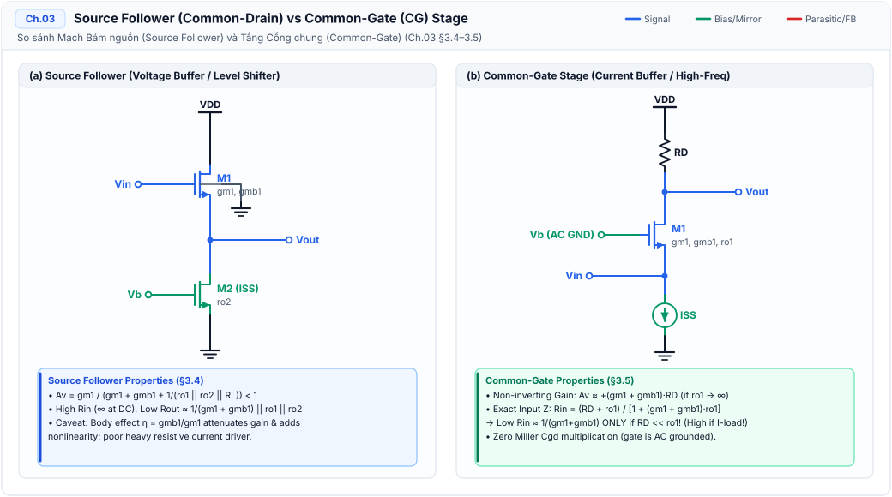

---
{
  "id": "topo-common-gate-stage",
  "kind": "topology",
  "domain": "stages-and-mirrors",
  "title_vi": "Tầng cổng chung: Phối hợp trở kháng thấp, Biến đổi trở kháng & Bẫy tải nguồn dòng (Common-Gate Stage)",
  "title_en": "Common-Gate Stage",
  "summary": "Nhận tín hiệu vào tại cực nguồn với cực cổng ghim ở đất xoay chiều và xuất đầu ra đồng pha tại cực máng, tầng cổng chung cung cấp độ lợi dương +(gm+gmb+1/rO)*(RD||rO), không bị nhân điện dung Miller và tạo trở kháng đầu vào thấp xấp xỉ 1/(gm+gmb) + RD/[(gm+gmb)rO] — nhưng mang cạm bẫy kinh điển: khi RD là nguồn dòng trở kháng cao (RD -> vô cực), điện trở đầu vào Rin phóng vọt tới vô cực làm mất hoàn toàn khả năng phối hợp trở kháng!",
  "diagram": "../../diagrams/source-follower-and-cg.svg",
  "razavi_refs": [
    {
      "chapter": 3,
      "section": "3.5",
      "pages": "75-82",
      "equations": ["3.102", "3.103", "3.104", "3.106", "3.107", "3.111", "3.114", "3.116", "3.117", "3.118", "3.119", "3.120", "3.121", "3.122", "3.123"]
    }
  ],
  "glossary_codes": [
    "T021", "T091", "T094", "T095", "T239", "T257", "T352", "T355",
    "T453", "T515", "T516", "T539", "T540", "T541", "T543", "T544",
    "T546", "T548"
  ],
  "process_agnostic": true,
  "roles": {
    "cg_transistor_M1": "Transistor cổng chung có cực cổng neo ở điện áp phân cực tĩnh Vb (đất xoay chiều), tiếp nhận áp hoặc dòng tín hiệu tại cực nguồn và chuyển tiếp dòng lên cực máng.",
    "source_bias_network": "Đường thoát dòng phân cực DC tại cực nguồn: hoặc đi thẳng qua nguồn tín hiệu ghép trực tiếp, hoặc được hút bởi nguồn dòng tĩnh I1 (hay điện trở RP) kết hợp ghép tín hiệu qua tụ điện.",
    "drain_load_RD": "Tải cực máng chuyển dòng tín hiệu thành điện áp đầu ra đồng pha, đồng thời phản chiếu ngược về cực nguồn qua hệ số chia [1+(gm+gmb)rO] để quyết định trực tiếp điện trở đầu vào Rin."
  },
  "symptoms_addressed": [
    "transmission-line-50ohm-wave-reflection-at-amplifier-input",
    "miller-capacitance-bandwidth-bottleneck-in-cs-stage",
    "need-current-buffer-from-low-impedance-source-to-high-impedance-drain"
  ],
  "limitations": [
    "input-resistance-blows-up-when-loaded-by-high-impedance-current-source",
    "tight-dc-voltage-headroom-stack-with-source-bias-current-source",
    "input-bias-current-source-injects-direct-thermal-and-flicker-noise",
    "low-input-impedance-loads-high-resistance-voltage-sensors"
  ],
  "checklists": [
    "common-mos",
    "single-stage"
  ]
}
---

## 1. Bản chất Nguyên lý, Sơ đồ Mạch & Vai trò Từng Nhánh Cấu trúc

Trong khi tầng nguồn chung (`topo-cs-resistive-and-diode-load`) và tầng bám nguồn (`topo-source-follower`) đều đưa tín hiệu vào cực cổng cách điện, **tầng cổng chung** (common-gate stage — CG, `T021`, Mục 3.5) xoay trục kích thích sang **cực nguồn**: cực cổng của $M_1$ được neo cứng vào một điện áp một chiều tĩnh $V_b$ (đóng vai trò đất xoay chiều `T437`), tín hiệu đầu vào đi vào cực nguồn, và điện áp đầu ra lấy tại cực máng trên tải $R_D$ (Hình 3.48).



Cách bố trí ba cực này mang lại ba đặc tính vật lý đặc trưng khiến tầng cổng chung trở thành mảnh ghép không thể thay thế trong mạch cao tần, bộ đệm dòng và cấu trúc cascode:
1. **Độ lợi điện áp đồng pha (dương) và được hiệu ứng thân trợ lực:** Khi $V_{in}$ tại cực nguồn giảm một lượng $\Delta V$, điện áp $V_{GS1} = V_b - V_{in}$ tăng lên $+\Delta V$, đồng thời điện áp nguồn–thân $V_{SB1} = V_{in}$ giảm làm $V_{TH1}$ giảm xuống! Do đó dòng máng giảm ít hơn hoặc khi $V_{in}$ tăng làm dòng máng giảm kéo $V_{out} = V_{DD} - I_D R_D$ **tăng cùng pha** với $V_{in}$, với cả $g_m$ lẫn $g_{mb}$ cộng hưởng cùng chiều $(g_m + g_{mb})$.
2. **Phối hợp trở kháng đầu vào thấp không gây phản xạ sóng (`T541`):** Trong Ví dụ 3.17 (Hình 3.50), khi cần kết cuối (`T540`) đường truyền (`T539`) $Z_0 = 50\,\Omega$, đặt một điện trở $50\,\Omega$ thuần túy ở đầu thu bị khóa độ lợi ở $-g_{m1}\cdot 50\,\Omega$; ngược lại, dùng cực nguồn của tầng cổng chung thiết kế $1/(g_{m2} + g_{mb2}) = 50\,\Omega$ vừa triệt tiêu phản xạ sóng tại nút đầu vào, vừa tự do dùng $R_D \gg 50\,\Omega$ ở cực máng để nhân cao độ lợi điện áp (với điều kiện $r_O$ đủ lớn!).
3. **Hai phương thức ghép đầu vào (Hình 3.48a–b):** Nếu **ghép trực tiếp** (direct coupling, `T543` — Hình 3.48a), nguồn tín hiệu trước phải có đường dẫn DC hút trọn dòng phân cực $I_{D1}$. Nếu nguồn tín hiệu không gánh được dòng DC, phải dùng **ghép tín hiệu qua tụ điện** (capacitive coupling, `T453` — Hình 3.48b) và đặt thêm một nguồn dòng không đổi $I_1$ (hoặc điện trở $R_P$) dưới cực nguồn để nuôi $M_1$, chấp nhận đánh đổi khoảng dự trữ điện áp và nhiễu của $I_1$.

## 2. Hệ Phương trình Cốt lõi & Tư duy "Nhìn Mạch Đọc Nhanh" (Analysis by Inspection)

### 2.1. Đặc tuyến tín hiệu lớn, ranh giới vùng triode và tối ưu dưới ngân sách công suất
Khảo sát Hình 3.48(a) và Hình 3.49 khi $V_{in}$ quét giảm dần từ $V_{DD}$ xuống $0$ ($\lambda = 0$):
- **Vùng ngắt ($V_{in} \ge V_b - V_{TH1}$):** $M_1$ tắt, $I_D = 0 \implies V_{out} = V_{DD}$.
- **Vùng bão hòa:** Khi $V_{in} < V_b - V_{TH1}$, $M_1$ dẫn bão hòa theo phương trình (3.102) và (3.104):
$$V_{out} = V_{DD} - \frac{1}{2}\mu_n C_{ox}\frac{W}{L}(V_b - V_{in} - V_{TH1})^2 R_D$$
Lấy đạo hàm theo $V_{in}$ với $\frac{\partial V_{TH1}}{\partial V_{in}} = \frac{\partial V_{TH1}}{\partial V_{SB1}} = \eta$ cho độ lợi tín hiệu nhỏ khi $\lambda = 0, R_S = 0$ — phương trình (3.106)–(3.107):
$$A_v = \frac{\partial V_{out}}{\partial V_{in}} = +g_m(1 + \eta)R_D = +(g_m + g_{mb})R_D$$
- **Điều kiện chạm ranh giới vùng triode (phương trình (3.103) & Ví dụ 3.16):** Khi $V_{in}$ tiếp tục giảm sâu làm dòng $I_D$ tăng lớn, $V_{out}$ sụt xuống chạm $V_b - V_{TH1}$, đẩy $M_1$ vào vùng triode tại nghiệm của:
$$V_{DD} - \frac{1}{2}\mu_n C_{ox}\frac{W}{L}(V_b - V_{in} - V_{TH1})^2 R_D = V_b - V_{TH1}$$
Để $M_1$ giữ bão hòa trên toàn dải $V_{in} \in [0, V_{DD}]$, phải chọn $V_{DD} - I_D(V_{in}=0)R_D > V_b - V_{TH1}$ (xem thêm ghi chú biên tập `NG03-02` cho trường hợp giả định lý thuyết $V_b > V_{DD} + V_{TH1}$ ở Ví dụ 3.16b). Trong mạch phân cực nguồn dòng $I_1$ (Hình 3.48b), mức đầu ra thấp nhất cho phép bằng $V_{out,min} = (V_{GS1} - V_{TH1}) + V_{I1,min}$. Dưới ngân sách công suất (`T545`) cố định $(I_D, V_{DD})$, muốn cực đại hóa độ lợi ta mở rộng mạnh $W/L$ đưa $M_1$ tiến về vùng **hoạt động dưới ngưỡng** (subthreshold operation, `T544`) nơi $g_m \approx \frac{I_D}{\xi V_T}$ đạt cực đại vật lý!

### 2.2. Hệ phương trình chính xác có $r_O$ hữu hạn: Độ lợi, $R_{in}$, $R_{out}$ & Luật biến đổi trở kháng
Xét mạch cổng chung tổng quát có trở kháng nguồn tín hiệu $R_S$ nối tiếp $V_{in}$ tại cực nguồn và tải $R_D$ tại cực máng, kể đầy đủ $g_m, g_{mb}, r_O$ (Hình 3.51, phương trình (3.108)–(3.111)):
1. **Độ lợi điện áp chính xác từ nguồn $V_{in}$ (sau $R_S$) tới $V_{out}$ — phương trình (3.108)–(3.111):**
Lưu ý dòng qua $R_S$ hướng từ nguồn lên bằng $-V_{out}/R_D$, nên thế tại cực nguồn là $V_X = V_{in} + (V_{out}/R_D)R_S \implies V_1 = V_{bs} = -V_X = -V_{in} - V_{out}R_S/R_D$ (3.108). Dòng chảy từ trên xuống qua $r_O$ bằng $-V_{out}/R_D - (g_m + g_{mb})V_1$; cân bằng thế $V_{out} = V_X - I_{rO}\cdot r_O$ theo (3.109)–(3.110) dẫn tới công thức tổng quát (3.111):
$$
\frac{V_{out}}{V_{in}} = \frac{[(g_m + g_{mb})r_O + 1]R_D}{r_O + (g_m + g_{mb})r_O R_S + R_S + R_D}
$$
Khi lái trực tiếp bằng nguồn áp lý tưởng ngay tại cực nguồn ($R_S = 0$), công thức rút gọn thành:
$$
\left.\frac{V_{out}}{V_{in}}\right|_{R_S = 0} = \frac{[1 + (g_m + g_{mb})r_O]R_D}{r_O + R_D} = \left(g_m + g_{mb} + \frac{1}{r_O}\right)(R_D \parallel r_O)
$$
Đối chiếu (3.111) với phương trình (3.77) của `topo-cs-source-degeneration`: mẫu số $R_D + R_S + r_O + (g_m + g_{mb})R_S r_O$ **giống hệt nhau tuyệt đối**, còn tử số của CG dương và lớn hơn CS một lượng $(g_{mb} r_O + 1)R_D$! Nhờ công thức (3.111), mọi mạch ghép tầng SF–CG như cặp vi sai nhìn từ một nhánh (Ví dụ 3.18, Hình 3.52, phương trình (3.112)–(3.114)) hoặc mạch đệm dòng có trở kháng nguồn $R_P$ (Ví dụ 3.20, Hình 3.58, phương trình (3.122)) đều đọc ra kết quả ngay lập tức bằng phép thế tương đương Thévenin $V_{Thev} = I_{in} R_P$:
$$
\frac{V_{out}}{I_{in}} = \frac{[(g_m + g_{mb})r_O + 1] R_D R_P}{r_O + (g_m + g_{mb})r_O R_P + R_P + R_D}
$$

2. **Điện trở đầu vào $R_{in}$ nhìn vào cực nguồn — phương trình (3.115)–(3.117) (Hình 3.53):**
Đặt áp thử $V_X$ tại cực nguồn với tải $R_D$ ở cực máng, dòng qua $r_O$ là $I_X - (g_m + g_{mb})V_X$, cộng áp rơi trên $R_D$ và $r_O$ theo $R_D I_X + r_O[I_X - (g_m + g_{mb})V_X] = V_X$ (3.115) cho:
$$
R_{in} = \frac{V_X}{I_X} = \frac{R_D + r_O}{1 + (g_m + g_{mb})r_O} \approx \frac{1}{g_m + g_{mb}} + \frac{R_D}{(g_m + g_{mb})r_O}
$$
Bảng dưới đây định lượng trực diện sự biến thiên của $R_{in}$ theo bản chất tải cực máng $R_D$:

| Loại tải cực máng $R_D$ | Biểu thức $R_{in}$ theo (3.116) | Giá trị điển hình ở 65nm ($1/(g_m+g_{mb}) = 50\,\Omega$, $(g_m+g_{mb})r_O = 10$) | Hệ quả phối hợp trở kháng $50\,\Omega$ |
| :--- | :--- | :--- | :--- |
| **Ngắn mạch AC ($R_D = 0$)** | $\frac{r_O}{1 + (g_m+g_{mb})r_O}$ (3.118) | $\approx 45{,}5\,\Omega$ | Trùng với $R_{out}$ tầng bám nguồn. |
| **Điện trở vừa ($R_D = 0{,}5 r_O = 250\,\Omega$)** | $\frac{1{,}5 r_O}{1 + (g_m+g_{mb})r_O}$ | $\approx 68\,\Omega$ (tăng $36\%$!) | Phải tăng $g_m$ bù phản chiếu để kéo về $50\,\Omega$. |
| **Tải nguồn dòng đơn ($R_D = r_{OP} \approx r_O$)** | $\frac{2 r_O}{1 + (g_m+g_{mb})r_O}$ | $\approx 91\,\Omega$ (gần gấp đôi!) | Mất phối hợp ($S_{11} \approx -10\text{ dB}$) nếu bỏ quên $r_O$. |
| **Tải cascode / nguồn dòng lý tưởng ($R_D \to \infty$)** | $\to \infty$ (Hình 3.54) | Hàng $\text{k}\Omega \to \infty$! | **Phá hủy hoàn toàn phối hợp trở kháng thấp!** |

Khi $R_D \to \infty$ (Hình 3.55), vì $R_{in} \to \infty$ nên không có dòng xoay chiều trên $R_S$ ($V_X = V_{in}$), cho độ lợi cực đại $A_v = (g_m + g_{mb})r_O + 1$ hoàn toàn độc lập với $R_S$ (Ví dụ 3.19, phương trình (3.120)). Ngược lại, nếu ép điều kiện phối hợp chính xác $R_{in} = R_S$ với $\lambda, \gamma > 0$ (Bài 3.33, phương trình (3.149)–(3.150), trang 99), tải $R_D$ bị khóa theo $R_S[1 + (g_m + g_{mb})r_O] - r_O$, kéo theo $R_{out,drain} = 2[1 + (g_m + g_{mb})r_O]R_S - r_O \approx R_D + 2r_O$ và độ lợi toàn mạch từ nguồn $V_{in}$ bị chặn ở đúng $\frac{1}{2}\frac{[1 + (g_m + g_{mb})r_O]R_D}{R_D + r_O}$!

3. **Điện trở đầu ra $R_{out}$ & Nguyên lý Biến đổi trở kháng bằng MOSFET (`T546`, Hình 3.56–3.57):**
Nhìn từ cực máng xuống khi cực nguồn nối điện trở $R_S$ (hoặc $R_P$), sơ đồ hệt như tầng CS suy biến nên phương trình (3.121) và (3.123) cho:
$$
R_{out,\text{drain}} = [1 + (g_m + g_{mb})r_O]R_S + r_O, \qquad R_{out,total} = \big\{[1 + (g_m + g_{mb})r_O]R_S + r_O\big\} \parallel R_D
$$
Từ (3.116) và (3.121), Razavi đúc kết **Định luật Biến đổi trở kháng tổng quát của MOSFET** (Hình 3.56, trang 81):
- Nhìn vào **cực máng**, MOSFET **nhân tăng** điện trở ở cực nguồn lên theo hệ số $[1 + (g_m + g_{mb})r_O]$.
- Nhìn vào **cực nguồn**, MOSFET **chia giảm** điện trở ở cực máng $(R_D + r_O)$ xuống theo đúng hệ số $[1 + (g_m + g_{mb})r_O]$!

### 2.3. Bảng so sánh đối xứng Tầng nguồn chung (CS) và Tầng cổng chung (CG)

| Đặc trưng kỹ thuật | Tầng nguồn chung (CS) | Tầng cổng chung (CG) |
| :--- | :--- | :--- |
| **Điện trở đầu vào $R_{in}$ (tần số thấp)** | $\infty$ (cực cổng cách điện oxit) | $\frac{R_D + r_O}{1 + (g_m + g_{mb})r_O}$ (phụ thuộc mạnh vào $R_D$!) |
| **Điện trở đầu ra nhánh transistor** | $r_O$ (nếu $R_S = 0$) | $[1 + (g_m + g_{mb})r_O]R_S + r_O$ (được tăng cường bởi $R_S$) |
| **Độ lợi điện áp ($R_S = 0$)** | $-g_m(R_D \parallel r_O)$ (đảo pha) | $+\left(g_m + g_{mb} + \frac{1}{r_O}\right)(R_D \parallel r_O)$ (đồng pha) |
| **Hiệu ứng Miller trên $C_{GD}$** | Bị nhân lên $(1 + |A_v|)C_{GD}$ làm hẹp băng thông | **Không có hiệu ứng Miller** (cực cổng ở đất AC cách ly vào–ra!) |

## 3. Bất biến Cấu trúc & Các Bẫy Lỗi Kinh điển (Structural Invariants & Traps)

- **`[INV-CG-01]` Bất biến phản chiếu tải cực máng về cực nguồn (Không cách ly chiều ngược khi $r_O$ hữu hạn):** Trái với trực giác sơ cấp rằng $R_{in} \approx 1/(g_m + g_{mb})$ cố định, trong thực tế $R_{in} = \frac{R_D + r_O}{1 + (g_m + g_{mb})r_O}$ luôn chứa thành phần phản chiếu $R_D / [1 + (g_m + g_{mb})r_O]$. Tầng CG chỉ có trở kháng vào thấp khi $R_D$ không vượt quá nhiều lần tích $(g_m + g_{mb})r_O \cdot R_{in,\text{target}}$.
- **`[INV-CG-02]` Bất biến không nhân điện dung Miller và cực đầu vào tần số rất cao (`concept-high-freq-cs-cg-cascode`):** Vì cực cổng nằm cố định ở đất xoay chiều, điện dung cổng–máng $C_{GD1}$ nối thẳng từ đầu ra xuống đất AC thay vì bắc cầu hồi tiếp giữa đầu ra và đầu vào! Nhờ đó, điện dung nhìn tại cực nguồn chỉ gồm $C_{GS1} + C_{SB1}$ đi kèm điện trở nút thấp $R_S \parallel R_{in}$, đẩy cực đầu vào lên tần số gần $f_T$:
$$
\omega_{p,in} \approx \frac{1}{(R_S \parallel R_{in})(C_{GS1} + C_{SB1})}
$$
- **`[INV-CG-03]` Bất biến truyền thẳng dòng tín hiệu (Unity Current Buffer):** Khi $r_O$ đủ lớn hơn $R_D$, gần như $100\%$ dòng tín hiệu đi vào cực nguồn đều xuất hiện nguyên vẹn ở cực máng ($\alpha_{CG} = I_{out}/I_{in} \approx 1$), biến tầng cổng chung thành bộ đệm dòng điện lý tưởng từ nút trở kháng thấp sang nút trở kháng cao.
- **`[TRAP-CG-01]` CẠM BẪY KINH ĐIỂN CỦA RAZAVI: Thay $R_D$ bằng tải nguồn dòng làm $R_{in} \to \infty$ phá hỏng phối hợp $50\,\Omega$! (Hình 3.54, trang 80 & Bài 3.33):** Nhiều người thiết kế LNA cổng chung thấy $R_D$ vật lý giới hạn độ lợi và dự trữ điện áp liền thay $R_D$ bằng tải nguồn dòng PMOS (hoặc tải cascode PMOS có $R_D \approx g_{mP} r_{OP}^2$) với hy vọng "vừa giữ $R_{in} = 50\,\Omega$, vừa được độ lợi cực cao"! Phương trình (3.116) chỉ rõ sai lầm chết người này:
  - Với nguồn dòng lý tưởng $R_D \to \infty$, dòng qua $M_1$ bị khóa cứng ở $I_1$ không đổi nên dù lắc $V_X$ thế nào cũng không có dòng xoay chiều đi vào cực nguồn ($I_X = 0 \implies R_{in} = \infty$)!
  - Với tải nguồn dòng PMOS đơn giản ($R_D = r_{OP} \approx r_{ON}$) trên công nghệ nanomet, $R_{in} = \frac{r_{ON} + r_{OP}}{1 + (g_m+g_{mb})r_{ON}} \approx \frac{2}{g_m + g_{mb}}$ — **tăng gấp đôi** lên $100\,\Omega$ nếu bạn lỡ tính $1/(g_m+g_{mb}) = 50\,\Omega$! Còn nếu đặt tải cascode PMOS ($R_D \sim g_m r_O^2$), $R_{in}$ vọt lên cỡ $r_O$ (hàng kilô-ôm), đánh mất hoàn toàn phối hợp trở kháng $50\,\Omega$! (Bài 3.33 phương trình (3.149)–(3.150) chứng minh khi ép $R_{in} = R_S$ với $\lambda > 0$, cả $R_{out}$ và độ lợi tối đa đều bị ràng buộc chặt bởi $g_m r_O$).
- **`[TRAP-CG-02]` Bẫy điện dung và nhiễu của nguồn dòng phân cực $I_1$ ở cực nguồn (Hình 3.48b):** Khi ghép tụ đầu vào, nguồn dòng dưới đáy $I_1$ (thực hiện bởi NMOS $M_b$) nằm nối trực tiếp vào nút đầu vào cực nguồn! Toàn bộ nhiễu nhiệt $4kT\gamma g_{mb\_bias}$ và nhiễu $1/f$ của $M_b$ bơm thẳng vào nút nguồn (`law-stage-and-mirror-noise-rules`), đồng thời $r_{Ob}$ mắc song song làm rò tín hiệu và tụ $C_{DBb} + C_{DGb}$ cộng thẳng vào nút $50\,\Omega$ gây lệch điện kháng (`T542`) ở tần số GHz!
- **`[TRAP-CG-03]` Bẫy tụ thoát cực cổng $V_b$ không đủ lớn (Imperfect AC Ground at Gate):** Mọi công thức của tầng CG đều giả thiết cực cổng đứng yên tuyệt đối ở đất xoay chiều. Nếu đường cấp áp phân cực $V_b$ có trở kháng cao mà thiếu tụ thoát (decoupling capacitor) đủ lớn tại chân cổng ngay sát $M_1$, cặp tụ $C_{GS1}$ và $C_{GD1}$ sẽ kéo cực cổng dao động theo cực nguồn/máng, làm tăng $R_{in}$, giảm độ lợi và có thể gây mất ổn định cao tần!

## 4. Lộ trình Nâng cấp Cấu trúc & Bát giác Đánh đổi (Upgrade Paths & Design Octagon)

Trên **bát giác thiết kế mạch tương tự** (`concept-analog-design-octagon`), tầng cổng chung tỏa sáng ở **Tốc độ tần số cao (không bị Miller) và Phối hợp trở kháng đầu vào thấp**, nhưng chịu thiệt ở **Ngân sách dòng/nhiễu của nhánh phân cực nguồn và Phản chiếu tải ở kênh ngắn**:
- **Ghép tầng CS + CG để hưởng ưu điểm của cả hai họ:** Đặt một transistor nguồn chung $M_1$ ở dưới (nhận áp đầu vào trở kháng cao, nhiễu thấp, không cần nguồn dòng $I_1$ phụ) bơm dòng thẳng lên cực nguồn của transistor cổng chung $M_2$ ở trên chính là cấu trúc **tầng cascode** tại `topo-cascode-stage` (và các op-amp `topo-telescopic-cascode-opamp`, `topo-folded-cascode-ota`)!
- **Khắc phục phản chiếu tải $R_D / [(g_m + g_{mb})r_O]$ trong tiến trình nanomet:** Nếu cần đồng thời $R_{in} = 50\,\Omega$ ở đầu vào VÀ tải trở kháng cao ở đầu ra trên tiến trình 65nm/45nm (nơi $g_m r_O$ nhỏ), phải chèn thêm một transistor cascode phụ ở trên cực máng hoặc dùng kỹ thuật khuếch đại phụ điều hòa cực cổng (`topo-gain-boosted-cascode`) / kỹ thuật nâng $g_m$ đảo pha cổng–nguồn ($g_m$-boosted CG LNA, nhân $(g_m + g_{mb})$ lên $(1 + A_{aux})g_m$ để vừa chia nhỏ thành phần phản chiếu $R_D$ vừa giảm dòng phân cực và hệ số nhiễu!).
- **Mở rộng sang cấu trúc vi sai để khử nhiễu nguồn cấp và hài chẵn:** Dùng cặp CG vi sai cân bằng (cross-coupled capacitor $g_m$-boosted differential CG) kết hợp quy tắc giảm nhiễu gương dòng tại `law-stage-and-mirror-noise-rules` và phân tích cực tần số cao tại `concept-high-freq-cs-cg-cascode`.

| Hạn chế của Tầng cổng chung đơn | Lộ trình nâng cấp cấu trúc chính tắc | Cơ chế khắc phục & Đánh đổi thiết kế |
| :--- | :--- | :--- |
| **Trở kháng vào thấp không hợp nguồn áp trở kháng cao** | `topo-cascode-stage` (đặt CS $M_1$ trước CG $M_2$) | Khôi phục $R_{in} = \infty$ tại cổng $M_1$, giữ nguyên ưu thế không bị Miller và nhân $R_{out} \sim g_m r_O^2$. |
| **Phản chiếu tải lớn $R_D / [(g_m+g_{mb})r_O]$ ở 65nm/45nm** | Chèn thêm tầng cascode chắn tải hoặc `topo-gain-boosted-cascode` | Hạ trở kháng nhìn vào nhánh tải hoặc nhân $(g_m+g_{mb})$ bằng khuếch đại phụ $(1 + A_{aux})$. |
| **Hệ số nhiễu cao khi khóa cứng $g_m + g_{mb} = 1/R_S$** | Cặp CG vi sai nâng hỗ dẫn chéo tụ ($g_m$-boosted CG) | Tách điều kiện phối hợp trở kháng khỏi dòng tĩnh và nén hệ số nhiễu kênh xuống dưới giới hạn $1 + \gamma/\alpha$. |

## 5. Thích ứng Đa Tiến trình (90nm / 65nm / 45nm) & Cách Kiểm chứng trong Cadence / Spectre

### 5.1. Định cỡ bất biến tiến trình có bù phản chiếu $r_O$ kênh ngắn
Trong công nghệ 90nm / 65nm / 45nm (`tech-nanometer-vdsmin-gmid-sizing`), độ lợi nội tại $A_{int} = (g_m + g_{mb})r_O$ của linh kiện kênh ngắn chỉ đạt $6\text{–}12$. Khi thiết kế tầng CG phối hợp trở kháng $R_{in} = R_S$ (ví dụ $50\,\Omega$) với tải $R_D$, **tuyệt đối không dùng công thức ngây thơ $g_m + g_{mb} = 1/R_S$**, mà phải giải trực tiếp từ phương trình chính xác (3.116):
$$g_m + g_{mb} = \frac{R_D + r_O - R_S}{R_S \cdot r_O} = \frac{1}{R_S}\left(1 + \frac{R_D}{r_O}\right) - \frac{1}{r_O}$$
- **Ví dụ thực tế trên 65nm:** Giả sử cần $R_{in} = 50\,\Omega$, tải $R_D = 500\,\Omega$, và tại dòng phân cực chọn có $r_O = 1\text{ k}\Omega$. Tỷ số $R_D / r_O = 0{,}5$ buộc bạn phải thiết kế $g_m + g_{mb} = \frac{1}{50}(1 + 0{,}5) - \frac{1}{1000} = 29\text{ mS}$ (lớn hơn gần $50\%$ so với mức $20\text{ mS}$ của sách kênh dài!).
- **Lựa chọn vùng làm việc (Ví dụ 3.17b, trang 77):**
  - Nếu ưu tiên **băng thông GHz / giảm phản xạ điện kháng $S_{11}$:** Chọn $L = L_{min}$ hoặc $1{,}5 L_{min}$ và đặt ở $g_m/I_D$ vừa–thấp ($8\text{–}12\text{ V}^{-1}$) để giữ $W$ nhỏ, cực tiểu hóa $C_{GS1} + C_{SB1}$ tại nút $50\,\Omega$ (nhớ kiểm tra trần $V_{GS1}$ dưới $V_{DD} = 1{,}0\text{ V}$!).
  - Nếu ưu tiên **độ lợi điện áp dưới ngân sách dòng chặt** (không cần băng thông cực cao): Tăng $W/L$ đưa $M_1$ vào vùng nghịch đảo yếu / dưới ngưỡng ($g_m/I_D \approx 22\text{–}26\text{ V}^{-1}$) như Razavi chỉ dẫn ở trang 76, kết hợp dùng cuộn cảm cộng hưởng song song (inductive choke) hoặc điện trở lớn gánh dòng tĩnh thay cho nguồn dòng NMOS đáy để tiết kiệm $V_{DS,min}$ dưới nguồn $1{,}0\text{ V}$.

### 5.2. Quy trình kiểm chứng chuẩn trong Cadence Virtuoso IC617 / Spectre
- **Kiểm tra điểm làm việc DC (`dc` OP):**
  - Xác minh `pv("M1" "region") == 2` (và transistor nguồn dòng đáy `pv("Mb" "region") == 2` nếu dùng Hình 3.48b).
  - Kiểm tra dự trữ bão hòa hai tầng chồng nhau: `VS("/vsource") - pv("Mb" "vdsat") >= 0.08` và `(VS("/vout") - VS("/vsource")) - pv("M1" "vdsat") >= 0.08`.
- **Kiểm chứng chính xác $R_{in}(f)$, hệ số phản xạ $S_{11}$ và bẫy tải nguồn dòng (`sp` & `ac`):**
  - Đặt một cổng `port` (`R = 50 ohm`) của thư viện `analogLib` tại đầu vào cực nguồn (qua tụ ghép AC thực tế), chạy phân tích tham số tán xạ **`sp` (S-parameter)** từ $10\text{ MHz}$ đến $20\text{ GHz}$:
    - Vẽ `real(zin(1))` và `imag(zin(1))` để xác nhận phần thực khớp đúng $50\,\Omega$ (kiểm chứng trực tiếp sự dịch chuyển của `real(zin(1))` khi quét tham số `RD` theo phương trình (3.116)!).
    - Kiểm tra `dB20(sp(1 1))` ($S_{11} < -15\text{ dB}$) trên toàn băng tần mục tiêu.
  - Chạy `noise` (hoặc `sp` noise figure `NF`): kiểm tra bảng `Noise Summary` xem nguồn dòng phân cực đáy `Mb` và điện trở cổng phân bố `RG` chiếm bao nhiêu phần trăm tổng nhiễu, từ đó chia nhiều ngón cổng (`fingers`) tiếp xúc hai đầu để giảm `RG` và tăng $L_{Mb}$ để nén $g_{m,Mb}$.

```text
; Mẫu biểu thức ADE / Spectre kiểm chứng tầng cổng chung (Common-Gate Stage):
OP_Sat_CG      = pv("M1" "region")                                               ; Bắt buộc == 2
Vds_Margin_CG  = (VS("/vout") - VS("/vsource")) - pv("M1" "vdsat")               ; >= 0.08 V
ro_M1          = 1.0 / pv("M1" "gds")
g_eff_M1       = pv("M1" "gm") + pv("M1" "gmbs")
Rin_Exact_Calc = (RD + ro_M1) / (1.0 + g_eff_M1 * ro_M1)                         ; Đối chiếu (3.116)
Zin_SP_Real    = real(zin(1 ?result "sp"))                                       ; Kiểm tra == 50 Ohm
S11_dB         = dB20(mag(sp(1 1 ?result "sp")))                                 ; Mục tiêu < -15 dB
Av_Exact_Calc  = ((g_eff_M1 * ro_M1 + 1.0) * RD) / (ro_M1 + g_eff_M1*ro_M1*RS + RS + RD)
NF_dB          = getData("NF" ?result "sp_noise")                                ; Hệ số nhiễu (dB)
```

## 6. Mốc Đối chiếu Sách Razavi & Thuật ngữ Chuẩn CLB

| Mục / Trang (Razavi 2nd Ed.) | Phương trình & Hình đối chiếu | Nội dung cốt lõi & Ghi chú biên dịch CLB |
| :--- | :--- | :--- |
| **§3.5 (Tín hiệu lớn & Phối hợp $50\,\Omega$)**, tr. 75–77 (PDF 31–33) | PT (3.102)–(3.107); Hình 3.48–3.50; Ví dụ 3.16–3.17 | Ghép trực tiếp vs ghép tụ điện, điều kiện vào triode (3.103), độ lợi dương $g_m(1+\eta)R_D$ (3.107), tối ưu dưới ngưỡng $g_m \approx I_D/(\xi V_T)$, ghi chú `NG03-02` và kết cuối đường truyền $50\,\Omega$ không phản xạ. |
| **§3.5 (Độ lợi chính xác có $r_O, R_S$)**, tr. 77–79 (PDF 33–35) | PT (3.108)–(3.114); Hình 3.51–3.52; Ví dụ 3.18 | Biểu thức chính xác $V_{out}/V_{in}$ (3.111), sự tương đồng mẫu số với CS suy biến (3.77) và kỹ thuật rút gọn Thévenin cho tầng ghép SF–CG (Ví dụ 3.18). |
| **§3.5 ($R_{in}$, Bẫy $R_D \to \infty$ & $R_{out}$)**, tr. 79–82 (PDF 35–38) | PT (3.115)–(3.123); Hình 3.53–3.58; Ví dụ 3.19–3.20; Bài 3.33 | Công thức $R_{in} = (R_D+r_O)/[1+(g_m+g_{mb})r_O]$ (3.116), **cảnh báo cốt tử $R_D \to \infty \implies R_{in} \to \infty$** (Hình 3.54), định luật biến đổi trở kháng MOSFET (Hình 3.56), $R_{out}$ (3.121) và kích dòng (3.122). |

**Đối chiếu Thuật ngữ Chuẩn CLB (`THUẬT NGỮ CHUẨN.md`):**
- `T021` **tầng cổng chung** (*common-gate stage, CG*), `T543` **ghép trực tiếp** (*direct coupling*), `T453` **ghép tín hiệu qua tụ điện** (*capacitive coupling*).
- `T515` **điện trở đầu vào** (*input resistance*), `T546` **biến đổi trở kháng** (*impedance transformation*), `T548` **nguồn dòng lý tưởng** (*ideal current source*).
- `T539` **đường truyền** (*transmission line*), `T540` **kết cuối** (*termination*), `T541` **phản xạ sóng** (*wave reflection*), `T544` **hoạt động dưới ngưỡng** (*subthreshold operation*).
