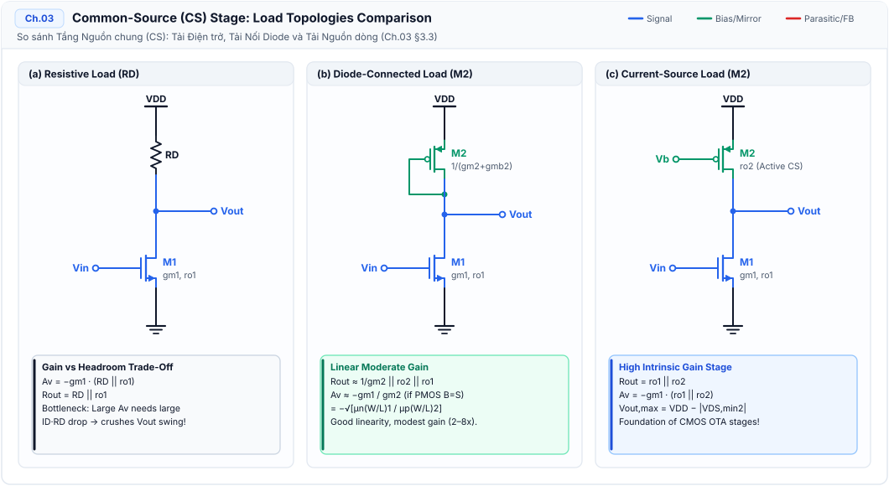

---
{
  "id": "topo-cs-current-source-and-active-load",
  "kind": "topology",
  "domain": "stages-and-mirrors",
  "title_vi": "Tầng nguồn chung với tải nguồn dòng, tải chủ động và tải vùng triode (CS Stage with Current-Source, Active, and Triode Loads)",
  "title_en": "Common-Source Stage with Current-Source, Active (CMOS Push-Pull), and Triode Loads",
  "summary": "Ba biến thể tải nâng cao của tầng nguồn chung nhằm thoát khỏi sự trói buộc của định luật Ohm: tải nguồn dòng đạt độ lợi cỡ độ lợi nội tại -gm1*(rO1||rO2) với tổn hao dự trữ điện áp chỉ một VDS,min; tải chủ động bổ sung (CMOS push-pull) nhân đôi hiệu suất hỗ dẫn thành -(gm1+gm2)*(rO1||rO2); và tải MOS vùng triode giữ trần Vout sát VDD nhưng nhạy mạnh với biến thiên PVT.",
  "diagram": "../../diagrams/cs-loads-comparison.svg",
  "razavi_refs": [
    {
      "chapter": 3,
      "section": "3.3.3",
      "pages": "58-59",
      "equations": ["3.46", "3.47"]
    },
    {
      "chapter": 3,
      "section": "3.3.4",
      "pages": "59-60",
      "equations": ["3.48", "3.49", "3.50"]
    },
    {
      "chapter": 3,
      "section": "3.3.5",
      "pages": "60-61",
      "equations": ["3.51"]
    }
  ],
  "glossary_codes": [
    "T023", "T024", "T069", "T091", "T094", "T095", "T112", "T183",
    "T185", "T188", "T198", "T208", "T216", "T233", "T257", "T352",
    "T394", "T495", "T507", "T511", "T512", "T513", "T528", "T529",
    "T534", "T552"
  ],
  "process_agnostic": true,
  "roles": {
    "input_transconductor_M1": "Transistor NMOS đầu vào chuyển đổi điện áp tín hiệu Vin thành dòng điện máng gm1*vin, quyết định phần lớn độ hỗ dẫn của cấu hình tải nguồn dòng và tải triode.",
    "current_source_load_M2": "Transistor PMOS phân cực cổng cố định hoạt động trong vùng bão hòa, cung cấp dòng tĩnh I_D với sụt áp tối thiểu chỉ |VDS2,min| nhưng mang trở kháng tín hiệu nhỏ lớn rO2.",
    "active_complementary_load_M2": "Transistor PMOS nhận cùng tín hiệu Vin tại cực cổng (tầng nguồn chung bổ sung), vừa cấp dòng phân cực vừa đóng góp thêm hỗ dẫn gm2 song song với M1.",
    "triode_load_M2": "Transistor PMOS có cực cổng phân cực thấp Vb để duy trì trong vùng triode sâu, đóng vai trò điện trở điều khiển bằng điện áp Ron2 kéo thẳng lên VDD."
  },
  "symptoms_addressed": [
    "ohms-law-gain-swing-tradeoff-in-resistive-cs",
    "diode-load-severe-vth-headroom-loss",
    "low-single-stage-voltage-gain",
    "insufficient-transconductance-per-unit-bias-current"
  ],
  "limitations": [
    "ill-defined-open-loop-dc-output-voltage",
    "gain-limited-to-single-transistor-intrinsic-gain",
    "severe-pvt-bias-current-sensitivity-in-push-pull-stage",
    "poor-power-supply-noise-rejection-in-active-load",
    "triode-load-resistance-pvt-and-swing-nonlinearity"
  ],
  "checklists": [
    "common-mos",
    "single-stage"
  ]
}
---

## 1. Bản chất Nguyên lý, Sơ đồ Mạch & Vai trò Từng Nhánh Cấu trúc

Trong `topo-cs-resistive-and-diode-load`, cả tải điện trở $R_D$ lẫn tải MOSFET mắc diode đều vấp phải rào cản vật lý cốt lõi: để tăng trở kháng tải tín hiệu nhỏ $R_{load}$, ta buộc phải chịu một độ sụt áp một chiều lớn trên tải ($I_D R_D$ hoặc $|V_{TH2}| + |V_{OV2}|$), làm co hẹp dải dao động điện áp cho phép (allowable voltage swings, `T495`). Chìa khóa đột phá của Mục 3.3.3–3.3.5 nằm ở việc **tách rời trở kháng vi phân tín hiệu nhỏ $\partial V / \partial I$ khỏi điện áp rơi một chiều $V_{DC}$** bằng cách khai thác đặc tuyến phi tuyến của transistor PMOS $M_2$ trên nhánh phía trên nguồn cấp $V_{DD}$.



Ba biến thể cấu trúc trong nhóm này giải quyết bài toán tải theo ba triết lý thiết kế khác nhau:

1. **Tầng CS với tải nguồn dòng (current-source load, `T511` — Mục 3.3.3, Hình 3.18):** Transistor PMOS $M_2$ được giữ cực cổng ở mức phân cực tĩnh cố định $V_b$ và hoạt động trong vùng bão hòa (saturation region, `T198`). Vì nguồn dòng (current source, `T216`) không tuân theo định luật Ohm, $M_2$ trình diện ra nút đầu ra một điện trở vi phân rất lớn $r_{O2}$ (do điều biến chiều dài kênh — channel-length modulation, `T257`), trong khi chỉ đòi hỏi một khoảng dự trữ điện áp (voltage headroom, `T208`) tối thiểu $|V_{DS2,min}| = |V_{GS2} - V_{TH2}|$ (có thể thiết kế xuống $80\text{–}150\text{ mV}$ độc lập với $r_{O2}$).
2. **Tầng CS với tải chủ động / Tầng nguồn chung bổ sung (active load, `T512` / complementary CS stage, `T507` — Mục 3.3.4, Hình 3.20):** Thay vì lãng phí cực cổng của PMOS $M_2$ ở mức tĩnh $V_b$, ta nối chung cổng của cả NMOS $M_1$ và PMOS $M_2$ vào tín hiệu đầu vào $V_{in}$ (hình thái mạch giống một bộ đảo CMOS — MOS bổ sung `T024` — nhưng được phân cực để cả hai cùng nằm trong vùng bão hòa). Khi $V_{in}$ tăng nhẹ $\Delta V_{in}$, $M_1$ hút thêm dòng $g_{m1}\Delta V_{in}$ kéo $V_{out}$ xuống, đồng thời $M_2$ giảm dòng bơm một lượng $g_{m2}\Delta V_{in}$ hỗ trợ $V_{out}$ hạ xuống nhanh hơn. Mạch tái sử dụng hoàn toàn dòng phân cực tĩnh để ghép song song hai nguồn hỗ dẫn $g_{m1} + g_{m2}$.
3. **Tầng CS với tải làm việc ở vùng triode (triode load, `T513` — Mục 3.3.5, Hình 3.22):** Cực cổng của PMOS $M_2$ được kéo xuống điện áp phân cực $V_b$ đủ thấp sao cho $M_2$ luôn nằm trong vùng triode sâu (deep triode region, `T188`) suốt toàn bộ hành trình của $V_{out}$. Khi đó $M_2$ đóng vai trò một điện trở tích hợp gọn nhẹ không mất ngưỡng $|V_{THP}|$ như tải mắc diode ($V_{out,max} = V_{DD}$), nhưng phải trả giá bằng độ trôi giá trị điện trở lớn theo biến thiên PVT (process, voltage, temperature variations, `T069`).

## 2. Hệ Phương trình Cốt lõi & Tư duy "Nhìn Mạch Đọc Nhanh" (Analysis by Inspection)

### 2.1. Tầng CS với tải nguồn dòng: Độ lợi nội tại kép, quy luật chọn $L$ và dải dao động
Nhìn từ nút đầu ra của Hình 3.18 khi cả $M_1$ và $M_2$ bão hòa, cực nguồn của cả hai đều nằm ở đất xoay chiều ($V_{DD}$ và đất), nên không có hiệu ứng thân tín hiệu nhỏ ($V_{bs1} = V_{bs2} = 0$). Tổng trở kháng tải nhìn từ nút máng đơn giản là $r_{O1} \parallel r_{O2}$, cho độ lợi điện áp tín hiệu nhỏ (small-signal voltage gain, `T494`) theo phương trình (3.46):
$$
A_v = -g_{m1}(r_{O1} \parallel r_{O2}) = -g_{m1}\frac{r_{O1} r_{O2}}{r_{O1} + r_{O2}}
$$
Làm thế nào $V_{in}$ thay đổi được dòng điện của $M_1$ khi KCL buộc tổng dòng máng hai linh kiện luôn bằng nhau ($I_{D1} = |I_{D2}|$)? Đối chiếu phương trình (3.19)–(3.20) của Ví dụ 3.3: dòng tổng $I_{D1} = \frac{1}{2}\mu_n C_{ox}(W/L)_1 (V_{in} - V_{TH1})^2 (1 + \lambda_1 V_{out})$ gồm nhân tử bình phương theo $V_{in}$ và nhân tử bậc nhất yếu $(1 + \lambda_1 V_{out})$ theo $V_{out}$. Một biến thiên rất nhỏ $\Delta V_{in} > 0$ buộc $V_{out}$ phải sụt một lượng lớn gấp $|A_v|$ lần theo chiều âm để giảm thừa số $(1 + \lambda_1 V_{out})$ và tăng nhẹ thừa số $(1 + \lambda_2(V_{DD} - V_{out}))$ của $M_2$ cho tới khi hai dòng cân bằng trở lại!

**Quy luật co giãn chiều dài kênh $L$ và dòng phân cực $I_D$:** Với xấp xỉ bậc nhất $\lambda \propto 1/L \implies r_O = 1/(\lambda I_D) \propto L/I_D$:
- Nếu giữ $W_1$ cố định và tăng $L_1$ tại dòng $I_D$ cho trước, độ lợi nội tại (intrinsic gain, `T394`) của $M_1$ tuân theo phương trình (3.47):
$$
g_{m1} r_{O1} = \sqrt{2\mu_n C_{ox}\frac{W_1}{L_1}I_D}\cdot\frac{1}{\lambda_1 I_D} \propto \frac{\sqrt{L_1}}{\sqrt{I_D}}
$$
Vì $r_{O1}$ tăng theo $L_1$ nhanh hơn mức giảm $1/\sqrt{L_1}$ của $g_{m1}$, tích $g_{m1} r_{O1}$ **tăng khi tăng $L_1$** và **giảm khi tăng dòng phân cực $I_D$** (đổi lại $V_{OV1}$ tăng theo $\sqrt{L_1}$ và $g_{m1}$ giảm).
- Nếu nhân đồng thời cả $W$ và $L$ của $M_1$ hoặc $M_2$ lên $\alpha > 1$ lần tại cùng $I_D$: tỷ số $W/L$, $g_m$ và điện áp vượt ngưỡng $|V_{GS} - V_{TH}|$ được bảo toàn nguyên vẹn, trong khi $r_O$ tăng xấp xỉ $\alpha$ lần! Giá phải trả duy nhất là diện tích và điện dung ký sinh tại nút đầu ra tăng lên.
- **Dải dao động điện áp đầu ra cực đại (Ví dụ 3.8, Hình 3.19b):** $M_1$ giữ bão hòa khi $V_{out} \ge V_{in} - V_{TH1} = V_{DS1,min}$, còn $M_2$ chạm ranh giới vùng bão hòa (`T552`) khi $V_{out} = V_{DD} - |V_{GS2} - V_{TH2}| = V_{DD} - |V_{DS2,min}|$. Toàn bộ dải dao động điện áp đầu ra bằng:
$$
V_{out,max} - V_{out,min} = V_{DD} - V_{DS1,min} - |V_{DS2,min}|
$$
So với tải điện trở (nơi $V_{out,max}$ đạt tới $V_{DD}$ khi $M_1$ gần ngắt nhưng bị mất rất nhiều sụt áp DC nếu cần độ lợi lớn), tải nguồn dòng chỉ hy sinh đúng một lượng nhỏ $|V_{DS2,min}|$ ở phía trên nhưng cho phép đạt độ lợi cao hơn gấp nhiều lần bằng cách tăng $L_1, L_2$.

### 2.2. Tầng CS với tải chủ động (Push-Pull CMOS) & Độ nhạy nhiễu nguồn cấp
Trong Hình 3.20(a)–(c), khi cả $M_1$ và $M_2$ nhận $V_{in}$ tại cổng và cùng hoạt động trong vùng bão hòa, sơ đồ tương đương tín hiệu nhỏ gom hai linh kiện song song thành một nguồn hỗ dẫn tổng $G_m = g_{m1} + g_{m2}$ lái tải $r_{O1} \parallel r_{O2}$, cho phương trình (3.48):
$$
A_v = -(g_{m1} + g_{m2})(r_{O1} \parallel r_{O2})
$$
Với cùng dòng tĩnh $I_D$ và cùng kích thước điện trở ra $r_{O1} \parallel r_{O2}$, cấu trúc này tăng gần gấp đôi độ hỗ dẫn và độ lợi so với tải nguồn dòng thụ động. Tuy nhiên, hãy chứng minh chi tiết độ nhạy với nguồn cấp (supply sensitivity, `T529` — Hình 3.21, Bài 3.31): đặt nhiễu nguồn cấp (supply noise, `T528`) $\Delta V_{DD}$ lên cực nguồn $M_2$ trong khi nối đất xoay chiều $V_{in}$ và giữ cực cổng $M_2$ ở thế xoay chiều bằng $0$. Khi đó $V_{sg2} = +\Delta V_{DD}$, dòng xoay chiều từ $M_2$ đổ xuống nút $V_{out}$ là $g_{m2}\Delta V_{DD} + (\Delta V_{DD} - V_{out})/r_{O2} = V_{out}/r_{O1}$. Giải phương trình KCL này thu được chính xác phương trình (3.49)–(3.50) (xem thêm ghi chú biên tập `NG03-05`):
$$
\left.\frac{V_{out}}{V_{DD}}\right|_{V_{in}=0} = \frac{(g_{m2} r_{O2} + 1) r_{O1}}{r_{O1} + r_{O2}} = \left(g_{m2} + \frac{1}{r_{O2}}\right)(r_{O1} \parallel r_{O2}) \approx g_{m2}(r_{O1} \parallel r_{O2})
$$
Nghĩa là mọi gợn nhiễu trên $V_{DD}$ đều bị khuếch đại thẳng ra đầu ra với độ lợi xấp xỉ **một nửa $|A_v|$ của đường tín hiệu** (tỷ số khử nhiễu nguồn cấp $\text{PSRR}^+ = |A_{v,\text{sig}} / A_{v,VDD}| \approx (g_{m1} + g_{m2})/g_{m2} \approx 2$, tức chỉ vỏn vẹn $6\text{ dB}$!).

### 2.3. Tầng CS với tải làm việc ở vùng triode & Bảng tổng hợp 5 họ tải CS
Trong Hình 3.22, PMOS $M_2$ có cực cổng đặt ở $V_b$ đủ thấp sao cho $|V_{DS2}| = V_{DD} - V_{out} \ll 2(V_{DD} - V_b - |V_{THP}|)$ trên toàn dải tín hiệu. Điện trở dẫn (`T112`) của $M_2$ tuân theo phương trình (3.51):
$$
R_{on2} = \frac{1}{\mu_p C_{ox}\left(\frac{W}{L}\right)_2 (V_{DD} - V_b - |V_{THP}|)}, \qquad A_v = -g_{m1}(R_{on2} \parallel r_{O1})
$$

| Cấu hình tải tầng CS | Độ lợi tín hiệu nhỏ $A_v$ | Trần / Đáy $V_{out}$ cho phép | Ưu điểm nổi bật & Điểm yếu chí mạng |
| :--- | :--- | :--- | :--- |
| **Tải nguồn dòng ($M_2$ bão hòa)** | $-g_{m1}(r_{O1} \parallel r_{O2})$ | $[V_{DS1,min},\; V_{DD} - |V_{DS2,min}|]$ | Tách độ lợi khỏi sụt áp DC; **cần hồi tiếp giữ DC đầu ra**. |
| **Tải chủ động (CMOS Push-Pull)** | $-(g_{m1} + g_{m2})(r_{O1} \parallel r_{O2})$ | $[V_{DS1,min},\; V_{DD} - |V_{DS2,min}|]$ | Gấp đôi hiệu suất $G_m/I_D$; **dòng tĩnh trôi mạnh theo PVT & PSRR kém**. |
| **Tải PMOS vùng triode sâu** | $-g_{m1}(R_{on2} \parallel r_{O1})$ | $[V_{DS1,min},\; V_{DD}]$ | Không mất $|V_{THP}|$, tự giữ DC; **$R_{on2}$ trôi mạnh theo PVT & phi tuyến**. |

## 3. Bất biến Cấu trúc & Các Bẫy Lỗi Kinh điển (Structural Invariants & Traps)

- **`[INV-CSACT-01]` Bất biến cân bằng dòng của nút trở kháng cao:** Tại nút đầu ra nối giữa hai cực máng bão hòa ($M_1$ và $M_2$), điện áp tĩnh $V_{out,DC}$ cực kỳ nhạy với bất kỳ sai lệch dòng nào $\Delta I = |I_{D20}| - I_{D10}$ theo quan hệ $\Delta V_{out,DC} \approx \Delta I \cdot (r_{O1} \parallel r_{O2})$. Chỉ cần lệch $1\%$ dòng phân cực khi $g_m r_O \approx 40$ cũng làm $V_{out,DC}$ trôi hàng trăm milivôn và ép một trong hai transistor sụp vào vùng triode!
- **`[INV-CSACT-02]` Bất biến tái sử dụng dòng trong bộ khuếch đại đẩy–kéo bổ sung:** Trong cấu hình tải chủ động (Hình 3.20), cùng một dòng phân cực $I_D$ chảy nối tiếp từ $V_{DD}$ qua $M_2$ xuống $M_1$, tạo ra tổng hiệu suất hỗ dẫn $(g_{m1} + g_{m2})/I_D$ cao gấp gần hai lần giới hạn của một transistor đơn lẻ ở cùng vùng nghịch đảo (lên tới $35\text{–}45\text{ V}^{-1}$ nếu cả hai hoạt động gần vùng nghịch đảo yếu).
- **`[TRAP-CSACT-01]` Bẫy thả nổi phân cực vòng hở của tầng CS tải nguồn dòng:** Tuyệt đối không dùng tầng CS tải nguồn dòng đơn độc ở chế độ vòng hở ghép một chiều mà không có vòng hồi tiếp (feedback loop, `T534`) xác định điểm làm việc DC đầu ra (hoặc mạch hồi tiếp chế độ chung CMFB ở biến thể vi sai). Trong mô phỏng SPICE lý tưởng bạn có thể "gọt" $V_b$ tới từng microvôn để đặt $V_{out} = V_{DD}/2$, nhưng trên silicon thực tế sai lệch linh kiện sẽ lập tức đẩy $V_{out}$ kẹt sát $V_{DD}$ hoặc đất!
- **`[TRAP-CSACT-02]` Bẫy trôi dòng xuyên nhánh theo PVT của bộ khuếch đại đảo CMOS (`VGS1 + |VGS2| = VDD`):** Trong Hình 3.20(a), tổng điện áp cổng–nguồn bị ghim cứng bởi $V_{GS1} + |V_{GS2}| = V_{DD}$. Ở góc công nghệ nhanh (FF), nhiệt độ cao hoặc khi $V_{DD}$ tăng $10\%$, $(V_{DD} - V_{TH1} - |V_{TH2}|)$ tăng vọt làm dòng tĩnh xuyên nhánh (crowbar current) bùng nổ theo hàm mũ/bình phương; ngược lại ở góc chậm (SS) hoặc $V_{DD}$ thấp dưới $V_{TH1} + |V_{TH2}|$, mạch rơi vào vùng dưới ngưỡng làm băng thông sụp đổ. Muốn dùng bộ đảo CMOS làm khuếch đại tương tự, bắt buộc phải tự phân cực qua điện trở hồi tiếp DC nối từ $V_{out}$ về cổng và ghép tụ đầu vào, hoặc cấp nguồn cho nó từ một nhánh LDO / gương dòng tự theo dõi PVT (`tech-stage-biasing-rules`).
- **`[TRAP-CSACT-03]` Bẫy dùng chiều dài kênh tối thiểu $L_{min}$ cho tầng CS tải nguồn dòng (*Nanometer Design Note 4*, trang 60):** Nhiều người thiết kế tưởng thay tải $R_D$ bằng tải nguồn dòng PMOS sẽ tự động cho độ lợi lớn ($>20\text{ dB}$). Razavi chứng minh trên công nghệ 40nm với $L_1 = L_2 = 40\text{ nm}$ và $V_{DD} = 1\text{ V}$ rằng hiệu ứng DIBL và điều biến chiều dài kênh làm $|A_v|$ cực đại **chỉ đạt vỏn vẹn $2{,}5$ lần ($8\text{ dB}$)**! Muốn khai thác tải nguồn dòng, bắt buộc phải tăng $L$ vượt xa $L_{min}$.
- **`[TRAP-CSACT-04]` Bẫy thoát khỏi vùng triode sâu của tải $M_2$ (Bài 3.25–3.26):** Với tải PMOS vùng triode ở Hình 3.22, khi $V_{out}$ dao động xuống thấp, $|V_{DS2}| = V_{DD} - V_{out}$ lớn dần làm vi phạm điều kiện triode sâu; nếu $V_{out} < V_b + |V_{THP}|$, $M_2$ bất ngờ chuyển sang vùng bão hòa làm trở kháng tải vọt từ $R_{on2}$ lên $r_{O2}$ và gây méo phi tuyến gãy khúc nghiêm trọng.

## 4. Lộ trình Nâng cấp Cấu trúc & Bát giác Đánh đổi (Upgrade Paths & Design Octagon)

Trên **bát giác thiết kế mạch tương tự** (`concept-analog-design-octagon`), nhóm ba cấu trúc này định hình rõ bản đồ tiến hóa từ mạch đơn tầng lên các bộ khuếch đại thuật toán hiện đại:
- **Từ tải điện trở/diode lên tải nguồn dòng:** Giải phóng dải dao động khỏi định luật Ohm (`topo-cs-resistive-and-diode-load` $\to$ `topo-cs-current-source-and-active-load`), giữ biên độ đầu ra cực đại $V_{DD} - 2V_{DS,min}$ — chính là lý do **tầng thứ hai** của bộ khuếch đại thuật toán hai tầng (`topo-two-stage-opamp`) luôn chọn cấu trúc CS tải nguồn dòng (hoặc push-pull lớp AB)!
- **Vượt qua trần độ lợi nội tại $g_m(r_{O1} \parallel r_{O2})$:** Khi một tầng CS tải nguồn dòng dù đã tăng $L$ vẫn không đủ độ lợi (ví dụ cần $50\text{–}70\text{ dB}$ ở tiến trình 65nm/45nm) hoặc bị giới hạn tần số bởi tụ Miller $C_{GD1}(1 + |A_v|)$ (`law-miller-theorem-and-rhp-zero`, `concept-high-freq-cs-cg-cascode`), có hai nhánh nâng cấp chính tắc:
  1. **Xếp chồng cascode** trên cả nhánh khuếch đại lẫn nhánh nguồn dòng tải tại `topo-cascode-stage` (và vi sai hóa thành `topo-telescopic-cascode-opamp`, `topo-folded-cascode-ota`, hoặc khuếch đại phụ `topo-gain-boosted-cascode`) để nhân độ lợi lên cỡ $(g_m r_O)^2$, đánh đổi lấy khoảng dự trữ điện áp $4V_{DS,min}$.
  2. **Mắc nối tầng (cascade)** hai tầng CS thông qua bù Miller phân tách cực tại `topo-two-stage-opamp` nếu bắt buộc phải bảo toàn dải dao động đầu ra rộng $V_{DD} - 2V_{DS,min}$.
- **Khắc phục trôi phân cực DC, nhiễu nguồn cấp $V_{DD}$ và nhiễu tải:** Để định nghĩa chắc chắn mức DC và triệt tiêu nhiễu chế độ chung/nguồn cấp (3.50), ghép đối xứng thành cặp vi sai với tải gương dòng tích cực tại `topo-basic-differential-pair` và `topo-five-transistor-ota` (hoặc cấp dòng phân cực ổn định độc lập nguồn từ `tech-supply-independent-bias-and-startup` và `topo-basic-current-mirror`). Đồng thời, theo `law-stage-and-mirror-noise-rules`, nguồn dòng tải $M_2$ bơm nhiễu nhiệt tỉ lệ với $g_{m2}/g_{m1}^2$ quy về cổng $M_1$:
$$
\overline{V_{n,in}^2} = 4kT\gamma_{\text{noise}}\left(\frac{1}{g_{m1}} + \frac{g_{m2}}{g_{m1}^2}\right) + \frac{K_N}{C_{ox} W_1 L_1 f} + \frac{K_P}{C_{ox} W_2 L_2 f}\cdot\frac{g_{m2}^2}{g_{m1}^2}
$$
Biểu thức này chứng minh tại sao $M_2$ bắt buộc phải được định cỡ với $g_{m2} \ll g_{m1}$ (chiều dài $L_2$ lớn, $g_{m2}/I_D$ nhỏ hơn $M_1$ — đồng bộ với quy luật đối ngẫu định cỡ tại `law-pelgrom-mismatch-and-sizing-duality`)!

## 5. Thích ứng Đa Tiến trình (90nm / 65nm / 45nm) & Cách Kiểm chứng trong Cadence / Spectre

### 5.1. Chiến lược định cỡ bất biến tiến trình (90nm / 65nm / 45nm)
Trong các tiến trình nanomet có $V_{DD} = 1{,}2\text{ V}$ (90nm) xuống $1{,}0\text{–}1{,}1\text{ V}$ (65nm/45nm), phương pháp định cỡ dựa trên hiệu suất hỗ dẫn $g_m/I_D$ và $V_{DS,min}$ (`tech-nanometer-vdsmin-gmid-sizing`) áp dụng đối ngẫu bất đối xứng giữa transistor đầu vào $M_1$ và nguồn dòng tải $M_2$:
1. **Chọn chiều dài kênh $L$ để đạt mục tiêu $g_m r_O$:** Khảo sát họ đường cong $g_m r_O$ theo $L$ của PDK: ở $L = L_{min}$, $g_m r_O \approx 5\text{–}8$; tăng lên $L = (4\text{–}8)L_{min}$ (ví dụ $L = 250\text{–}500\text{ nm}$ trên tiến trình 65nm) nâng $g_m r_O$ lên $20\text{–}35$, cho phép tầng CS tải nguồn dòng đạt $|A_v| = g_{m1}(r_{O1}\parallel r_{O2}) \approx 12\text{–}22\text{ V/V}$ ($21\text{–}27\text{ dB}$).
2. **Định cỡ bất đối xứng $g_m/I_D$ giữa $M_1$ và $M_2$ (Đối ngẫu Độ lợi – Nhiễu – Dải dao động):**
   - **Transistor khuếch đại $M_1$:** Đặt ở vùng nghịch đảo vừa đến yếu ($g_{m1}/I_D \approx 15\text{–}20\text{ V}^{-1}$, $V_{DS1,min} \approx 80\text{–}120\text{ mV}$) để cực đại hóa $g_{m1}$, giảm nhiễu quy về ngõ vào và mở rộng biên dao động phía dưới.
   - **Nguồn dòng tải $M_2$:** Nếu chỉ tối ưu dải dao động thuần túy thì muốn $|V_{DS2,min}|$ nhỏ ($\sim 120\text{ mV}$), nhưng nếu tối ưu nhiễu và độ chính xác sao chép dòng gương (`law-stage-and-mirror-noise-rules`) thì cần $g_{m2} < g_{m1}$, tức đặt $M_2$ ở vùng nghịch đảo mạnh hơn ($g_{m2}/I_D \approx 7\text{–}10\text{ V}^{-1}$, $|V_{DS2,min}| \approx 180\text{–}240\text{ mV}$) với chiều dài kênh lớn $L_2 \ge L_1$ để giữ $r_{O2}$ cao.
3. **Với tầng CS tải chủ động (CMOS inverter amplifier):** Khi ứng dụng làm LNA hoặc bộ khuếch đại tự phân cực băng rộng ở 65nm/45nm, luôn dùng một điện trở hồi tiếp lớn $R_F$ nối từ $V_{out}$ về cực cổng chung ($V_{G,DC} = V_{out,DC}$ tự khóa cả $M_1, M_2$ vào vùng bão hòa quanh $V_{DD}/2$) và cấp dòng qua gương dòng tự chỉnh (current-starved / LDO-regulated inverter) để khử biến thiên dòng theo PVT và tăng PSRR.

| Hạt nhân linh kiện | Vùng làm việc mục tiêu ($g_m/I_D$) | Điện áp bão hòa $V_{DS,min}$ | Chiều dài kênh khuyến nghị $L$ | Lý do vật lý & Tác động hệ thống |
| :--- | :--- | :--- | :--- | :--- |
| **NMOS đầu vào $M_1$** | $15\text{–}20\text{ V}^{-1}$ (nghịch đảo vừa–yếu) | $80\text{–}120\text{ mV}$ | $(3\text{–}6)L_{min}$ | Cực đại hóa $g_{m1}$, giảm nhiễu cổng và mở rộng biên dưới $V_{out,min}$. |
| **PMOS tải nguồn dòng $M_2$** | $7\text{–}11\text{ V}^{-1}$ (nghịch đảo mạnh–vừa) | $160\text{–}220\text{ mV}$ | $(5\text{–}10)L_{min}$ | Giữ $r_{O2}$ cao, nén nhiễu nhiệt tải $g_{m2}/g_{m1}$ và giảm sai lệch dòng gương. |
| **Cặp $M_1, M_2$ tải chủ động** | $14\text{–}18\text{ V}^{-1}$ (đối xứng quanh $V_{DD}/2$) | $100\text{–}140\text{ mV}$ | $(2\text{–}4)L_{min}$ | Cân bằng điểm lật DC $V_{M} \approx V_{DD}/2$ và nhân đôi $G_m = g_{m1} + g_{m2}$. |

### 5.2. Quy trình kiểm chứng chuẩn trong Cadence Virtuoso IC617 / Spectre
- **Thiết lập testbench không trôi DC cho tầng tải nguồn dòng:** Khi kiểm chứng riêng lẻ tầng CS tải nguồn dòng trong Spectre trước khi ghép vào op-amp hoàn chỉnh, tuyệt đối không để hở vòng DC! Hãy đặt một điện trở hồi tiếp lớn $R_{FB} = 1\text{ G}\Omega$ từ `vout` về cổng `M1` nối tiếp tụ chặn DC lớn $C_{in} = 1\,\mu\text{F}$ từ nguồn AC `vin` (tạo điểm tự phân cực `Vout,DC = Vin,DC` cho `ac`/`noise`) hoặc dùng vòng servo DC lý tưởng `vcvs` ở tần số rất thấp.
- **Kiểm tra điểm làm việc (`dc` OP):**
  - Xác nhận cả hai transistor đều bão hòa: `pv("M1" "region") == 2` và `pv("M2" "region") == 2`.
  - Biên độ dự trữ bão hòa hai đầu: `pv("M1" "vds") - pv("M1" "vdsat") >= 0.08` và `abs(pv("M2" "vds")) - abs(pv("M2" "vdsat")) >= 0.08`.
  - Đối chiếu công thức (3.46) / (3.48) từ tham số BSIM trích xuất: `gm1 = pv("M1" "gm")`, `gds1 = pv("M1" "gds")`, `gds2 = pv("M2" "gds")` $\implies |A_{v,\text{calc}}| = g_{m1}/(g_{ds1} + g_{ds2})$ (hoặc $(g_{m1}+g_{m2})/(g_{ds1}+g_{ds2})$ cho tải chủ động) phải khớp sát kết quả `ac` ở tần số thấp trong phạm vi $< 0{,}1\text{ dB}$.
- **Kiểm tra dải dao động hữu ích & PSRR (`dc` sweep, `xf`):**
  - Quét `dc` biến thiên `vin` quanh điểm lật và vẽ `deriv(VS("/vout"))` như *Nanometer Design Note 4* (trang 60) để xác định biên độ `Vout,min` và `Vout,max` thực tế nơi $|A_v|$ còn giữ trên $80\%$ giá trị trung tâm.
  - Chạy phân tích hàm truyền ngược `xf` với đầu ra tại `/vout` để đọc đồng thời cả độ lợi tín hiệu `XF("/vin")` lẫn độ nhạy nhiễu nguồn cấp `XF("/VDD")` — kiểm chứng trực tiếp công thức (3.49)–(3.50) qua các góc PVT (`TT`, `SS`, `FF`, `SF`, `FS`).

```text
; Mẫu biểu thức ADE / Spectre kiểm chứng tầng CS tải nguồn dòng & tải chủ động CMOS:
OP_Sat_Check   = (pv("M1" "region") == 2) && (pv("M2" "region") == 2)
Headroom_Low   = pv("M1" "vds") - pv("M1" "vdsat")                       ; >= 0.08 V
Headroom_High  = abs(pv("M2" "vds")) - abs(pv("M2" "vdsat"))             ; >= 0.08 V
Intrinsic_M1   = pv("M1" "gm") / pv("M1" "gds")                          ; gm1 * rO1
Rout_Total     = 1.0 / (pv("M1" "gds") + pv("M2" "gds"))                 ; rO1 || rO2
Av_Active_Calc = -(pv("M1" "gm") + pv("M2" "gm")) / (pv("M1" "gds") + pv("M2" "gds"))
Supply_Gain    = mag(XF("/VDD"))                                         ; Đối chiếu (3.49)-(3.50)
PSRR_Plus_dB   = dB20(mag(XF("/vin")) / mag(XF("/VDD")))                 ; Khả năng khử nhiễu VDD
```

## 6. Mốc Đối chiếu Sách Razavi & Thuật ngữ Chuẩn CLB

| Mục / Trang (Razavi 2nd Ed.) | Phương trình & Hình đối chiếu | Nội dung cốt lõi & Ghi chú biên dịch CLB |
| :--- | :--- | :--- |
| **§3.3.3**, tr. 58–59 (PDF 14–15) | PT (3.46)–(3.47); Hình 3.18–3.19; Ví dụ 3.8 | Tầng CS tải nguồn dòng $A_v = -g_{m1}(r_{O1}\parallel r_{O2})$, tách rời $r_{O2}$ khỏi $|V_{DS2,min}|$, quy luật $g_m r_O$ tăng theo $L$, yêu cầu bắt buộc có vòng hồi tiếp giữ DC đầu ra và so sánh dải dao động với tải $R_D$. |
| **§3.3.4**, tr. 59–60 (PDF 15–16) | PT (3.48)–(3.50); Hình 3.20–3.21; Bài 3.31 | Tầng nguồn chung bổ sung / tải chủ động $A_v = -(g_{m1}+g_{m2})(r_{O1}\parallel r_{O2})$, bẫy nhạy PVT do $V_{GS1}+|V_{GS2}|=V_{DD}$ và khuếch đại nhiễu nguồn cấp $V_{out}/V_{DD}$ (ghi chú `NG03-05`). |
| **§3.3.5**, tr. 60–61 (PDF 16–17) | PT (3.51); Hình 3.22; *Note 4* (tr. 60) | Tải PMOS vùng triode sâu $R_{on2}$, ưu điểm trần $V_{out,max}=V_{DD}$, nhược điểm trôi theo PVT và *Nanometer Design Note 4* chứng minh $L_{min}=40\text{ nm}$ chỉ đạt $|A_v|\approx 2{,}5$. |

**Đối chiếu Thuật ngữ Chuẩn CLB (`THUẬT NGỮ CHUẨN.md`):**
- `T511` **tải nguồn dòng** (*current-source load*), `T512` **tải chủ động** (*active load* — trong Chương 3 chỉ PMOS cùng nhận tín hiệu vào khuếch đại; không đánh đồng mọi tải nguồn dòng tĩnh là tải chủ động theo nghĩa §3.3.4), `T507` **tầng nguồn chung bổ sung** (*complementary CS stage*), `T513` **tải làm việc ở vùng triode** (*triode load*).
- `T528` **nhiễu nguồn cấp** (*supply noise*), `T529` **độ nhạy với nguồn cấp** (*supply sensitivity*), `T069` **biến thiên PVT** (*process, voltage, temperature variations*), `T552` **ranh giới vùng bão hòa** (*edge of saturation*), `T495` **dải dao động điện áp cho phép** (*allowable voltage swings*).
