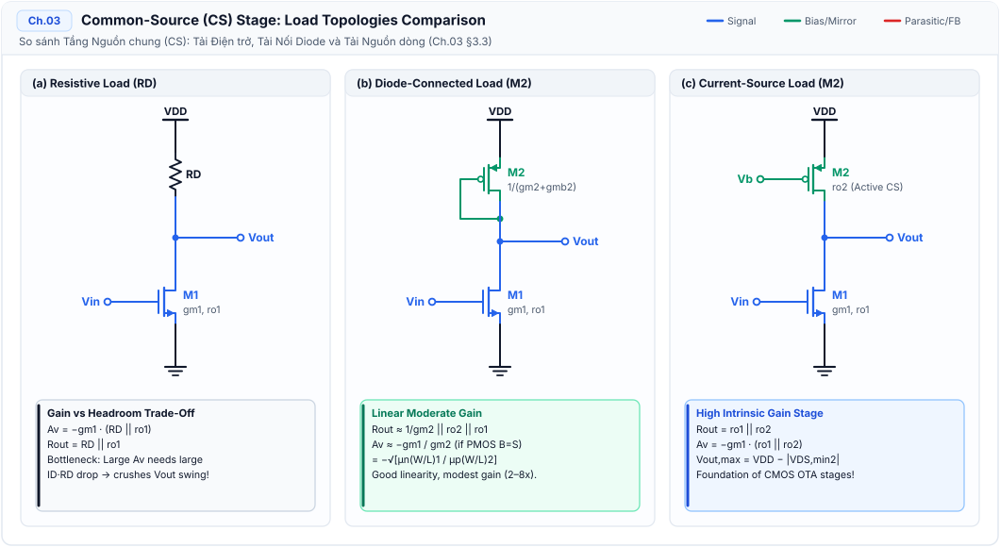

---
{
  "id": "topo-cs-resistive-and-diode-load",
  "kind": "topology",
  "domain": "stages-and-mirrors",
  "title_vi": "Tầng nguồn chung với tải điện trở và tải MOSFET mắc diode (CS Stage with Resistive and Diode-Connected Loads)",
  "title_en": "Common-Source Stage with Resistive and Diode-Connected Loads",
  "summary": "Cấu trúc khuếch đại đảo cơ bản nhất trong CMOS biến đổi điện áp cổng–nguồn thành dòng điện máng qua độ hỗ dẫn gm rồi chuyển thành điện áp đầu ra trên điện trở tải RD hoặc tải MOSFET mắc diode (trở kháng 1/(gm+gmb)||rO), làm lộ rõ giới hạn định luật Ohm giữa độ lợi, dải dao động điện áp và băng thông cũng như trần độ lợi do hiệu ứng thân và tỷ số kích thước.",
  "diagram": "../../diagrams/cs-loads-comparison.svg",
  "razavi_refs": [
    {
      "chapter": 3,
      "section": "3.1-3.3.1",
      "pages": "45-52",
      "equations": ["3.1", "3.2", "3.3", "3.4", "3.5", "3.6", "3.7", "3.8", "3.9", "3.10", "3.11", "3.12", "3.13", "3.14", "3.17", "3.18"]
    },
    {
      "chapter": 3,
      "section": "3.3.2",
      "pages": "52-58",
      "equations": ["3.21", "3.22", "3.23", "3.24", "3.26", "3.27", "3.28", "3.30", "3.32", "3.35", "3.37", "3.39", "3.43", "3.45"]
    }
  ],
  "glossary_codes": [
    "T002", "T023", "T080", "T085", "T086", "T090", "T091", "T094", "T095",
    "T183", "T185", "T188", "T198", "T208", "T221", "T239", "T257", "T352",
    "T355", "T359", "T394", "T487", "T490", "T493", "T494", "T508", "T509",
    "T510", "T533", "T550"
  ],
  "process_agnostic": true,
  "roles": {
    "input_transconductor_M1": "Transistor đầu vào NMOS cảm nhận điện áp đầu vào Vin tại cực cổng (trở kháng đầu vào tần số thấp gần vô hạn) và chuyển đổi thành dòng điện máng tín hiệu nhỏ gm1*vin.",
    "resistive_load_RD": "Tải điện trở tuyến tính chuyển dòng điện máng thành điện áp đầu ra Vout = VDD - ID*RD, tuân theo định luật Ohm nên khóa chặt độ sụt áp một chiều VRD với độ lợi điện áp.",
    "diode_connected_load_M2": "MOSFET mắc diode (cổng nối tắt với máng) luôn tự giữ trong vùng bão hòa khi dẫn dòng, tạo trở kháng tải tín hiệu nhỏ thấp xấp xỉ 1/(gm2+gmb2)||rO2 (với NMOS) hoặc (1/gm2)||rO2 (với PMOS nối thân vào VDD)."
  },
  "symptoms_addressed": [
    "need-simple-inverting-voltage-gain",
    "resistor-area-unavailable-in-digital-cmos",
    "large-signal-square-law-nonlinearity-with-diode-cancellation",
    "well-defined-dc-output-operating-point"
  ],
  "limitations": [
    "ohms-law-gain-swing-bandwidth-lock",
    "diode-load-vth-plus-overdrive-headroom-loss",
    "body-effect-gain-ceiling-on-nmos-diode-load",
    "disproportionate-aspect-ratio-for-moderate-diode-load-gain",
    "miller-cgd-input-capacitance-multiplication"
  ],
  "checklists": [
    "common-mos",
    "single-stage"
  ]
}
---

## 1. Bản chất Nguyên lý, Sơ đồ Mạch & Vai trò Từng Nhánh Cấu trúc

Trong chuỗi thu phát vô tuyến hay giao diện cảm biến (Mục 3.1–3.2), một bộ khuếch đại (amplifier, `T002`) lý tưởng tạo ra đáp ứng tuyến tính $y(t) = \alpha_0 + \alpha_1 x(t)$ chồng lên điểm phân cực (bias point, `T345`) $\alpha_0$. Khi biên độ tín hiệu lớn làm xáo trộn điểm làm việc của transistor, đặc tuyến vào–ra (input-output characteristic, `T490`) bị uốn cong thành chuỗi đa thức $y(t) = \alpha_0 + \alpha_1 x(t) + \alpha_2 x^2(t) + \cdots + \alpha_n x^n(t)$ — phương trình (3.2), sinh ra méo hài và xuyên điều chế giữa tín hiệu mong muốn với các tín hiệu gây nhiễu (interferers, `T532`). Trong bốn họ bộ khuếch đại một tầng (single-stage amplifiers, `T487`) ở Bảng 3.1, **tầng nguồn chung** (common-source stage — CS, `T023`) là hạt nhân phổ biến nhất: cực nguồn (source terminal, `T080` — tuyệt đối phân biệt với nguồn cấp `T085` $V_{DD}$) nối đất xoay chiều, cực cổng nhận điện áp đầu vào $V_{in}$ với trở kháng đầu vào (input impedance, `T517`) tần số thấp cực lớn, còn cực máng xuất điện áp đầu ra $V_{out}$.



Cơ chế khuếch đại gồm hai bước vật lý tách bạch: (1) transistor đầu vào $M_1$ hoạt động như phần tử chuyển đổi điện áp thành dòng điện (transconductor, `T225`) với độ hỗ dẫn (transconductance, `T091`) $g_{m1}$; (2) nhánh tải biến biến thiên dòng máng $\Delta I_D$ thành biến thiên điện áp đầu ra ngược dấu $\Delta V_{out} = -Z_{load}\,\Delta I_D$. Hai cấu hình tải nền tảng đầu tiên của Chương 3 có vai trò cấu trúc đối lập nhau:

1. **Tải điện trở (resistive load, `T508` — Hình 3.4a):** Điện trở vật lý $R_D$ nối giữa $V_{DD}$ và cực máng của $M_1$. Nhánh tải không tiêu tốn điện áp ngưỡng $V_{TH}$, cho phép $V_{out}$ chạm sát $V_{DD}$ khi $M_1$ ngắt, nhưng bị trói buộc cứng bởi định luật Ohm $V_{RD} = I_D R_D$: muốn $R_D$ lớn để tăng độ lợi điện áp (voltage gain, `T094`) tại một dòng phân cực (bias current, `T233`) cố định thì sụt áp một chiều $V_{RD}$ tăng tương ứng, ép $V_{out}$ xuống thấp và đẩy $M_1$ về phía ranh giới vùng triode (edge of triode region, `T221`).
2. **Tải MOSFET mắc diode (diode-connected load, `T509` — Hình 3.13 với NMOS $M_2$ và Hình 3.16 với PMOS $M_2$):** Khi điện trở поли-silic chính xác tốn diện tích quá lớn trên phiến bán dẫn, ta thay $R_D$ bằng một MOSFET mắc diode (diode-connected device, `T510`) có cực cổng nối trực tiếp vào cực máng ($V_{GS2} = V_{DS2}$). Vì điều kiện bão hòa $V_{DS2} \ge V_{GS2} - V_{TH2}$ luôn thỏa mãn với mọi $V_{TH2} > 0$ ngay khi linh kiện dẫn dòng, $M_2$ tự khóa trong vùng bão hòa (saturation region, `T198`) và đóng vai trò một điện trở vi phân nhỏ cỡ $1/g_{m2}$. Nhờ cả hai nhánh cùng mang đặc tính MOSFET, hàm bình phương $V \to I$ của $M_1$ và hàm căn bậc hai $I \to V$ của $M_2$ bù trừ lẫn nhau $f^{-1}(f(x)) = x$, tạo nên độ tuyến tính tín hiệu lớn đáng ngạc nhiên kèm một mức phân cực DC đầu ra tự xác định chắc chắn, đổi lại là trần độ lợi rất thấp và tổn hao khoảng dự trữ điện áp (voltage headroom, `T208`) cỡ $|V_{TH2}| + |V_{OV2}|$.

## 2. Hệ Phương trình Cốt lõi & Tư duy "Nhìn Mạch Đọc Nhanh" (Analysis by Inspection)

### 2.1. Quét đặc tuyến tín hiệu lớn và ranh giới vùng triode của tầng CS tải điện trở
Khảo sát $V_{in}$ tăng dần từ $0$ đến $V_{DD}$ trên Hình 3.4(a)–(b) (tạm bỏ qua điều biến chiều dài kênh — channel-length modulation, `T257`, $\lambda = 0$):
- **Vùng ngắt ($V_{in} < V_{TH1}$):** $I_{D1} = 0 \implies V_{out} = V_{DD}$.
- **Khởi dẫn và vùng bão hòa ($V_{TH1} < V_{in} \le V_{in1}$):** Ngay khi $V_{in}$ vượt $V_{TH1}$, $V_{out}$ đang ở gần $V_{DD} > V_{in} - V_{TH1}$, nên $M_1$ **luôn bắt đầu dẫn trong vùng bão hòa** bất kể giá trị $V_{DD}$ và $R_D$. Trong mô hình luật bình phương (square-law model, `T264`), phương trình (3.3) cho:
$$
V_{out} = V_{DD} - \frac{1}{2}\mu_n C_{ox}\frac{W}{L}(V_{in} - V_{TH1})^2 R_D
$$
- **Điểm chuyển tiếp ranh giới vùng triode (Điểm A, $V_{in} = V_{in1}$):** $M_1$ chạm ranh giới vùng bão hòa (`T552`) khi $V_{out} = V_{in1} - V_{TH1}$, dẫn đến phương trình bậc hai xác định điểm gãy (3.4):
$$
V_{in1} - V_{TH1} = V_{DD} - \frac{1}{2}\mu_n C_{ox}\frac{W}{L}(V_{in1} - V_{TH1})^2 R_D
$$
- **Vùng triode ($V_{in} > V_{in1}$, vùng triode `T185`) và vùng triode sâu (deep triode region, `T188`):** Khi $V_{out} < V_{in} - V_{TH1}$, dòng máng tuân theo phương trình (3.5):
$$
V_{out} = V_{DD} - \frac{1}{2}\mu_n C_{ox}\frac{W}{L}\big[2(V_{in} - V_{TH1})V_{out} - V_{out}^2\big]R_D
$$
Độ dốc đặc tuyến — tức độ lợi tín hiệu nhỏ (small-signal gain, `T493`) — suy giảm đơn điệu theo Ví dụ 3.1, phương trình (3.11):
$$
A_v(\text{triode}) = \frac{\partial V_{out}}{\partial V_{in}} = \frac{-\mu_n C_{ox}(W/L)R_D V_{out}}{1 + \mu_n C_{ox}(W/L)R_D(V_{in} - V_{TH1} - V_{out})}
$$
Lưu ý rằng $|A_v|$ đạt cực đại đúng tại Điểm A ($V_{out} = V_{in} - V_{TH1}$) rồi đổ dốc khi vào triode. Khi $V_{in}$ rất lớn sao cho $V_{out} \ll 2(V_{in} - V_{TH1})$, $M_1$ trở thành điện trở dẫn (on-resistance, `T112`) $R_{on1} = [\mu_n C_{ox}(W/L)(V_{in} - V_{TH1})]^{-1}$ tạo cầu phân áp (3.6)–(3.7):
$$
V_{out} = V_{DD}\frac{R_{on1}}{R_{on1} + R_D} = \frac{V_{DD}}{1 + \mu_n C_{ox}\frac{W}{L}R_D(V_{in} - V_{TH1})}
$$

### 2.2. Độ lợi tín hiệu nhỏ, phương trình đánh đổi định luật Ohm và độ lợi nội tại
Lấy đạo hàm (3.3) trong vùng bão hòa ($\lambda = 0$) cho $A_v = -g_{m1} R_D$ (3.10). Khi kể đến điều biến chiều dài kênh ($\lambda \ne 0$, điện trở đầu ra $r_O$ của transistor `T352` song song với $R_D$, Hình 3.7), phương trình (3.14)–(3.17) cho:
$$
A_v = -g_{m1}(r_{O1} \parallel R_D) = -g_{m1}\frac{r_{O1} R_D}{r_{O1} + R_D}
$$
Nếu đẩy $R_D \to \infty$ (thay bằng nguồn dòng lý tưởng, Ví dụ 3.3, Hình 3.8), độ lợi chạm giới hạn của một transistor đơn lẻ (3.18):
$$
A_v = -g_{m1} r_{O1}
$$
Đại lượng $g_m r_O$ là **độ lợi nội tại** (intrinsic gain, `T394`) của MOSFET (chỉ đạt cỡ $5\text{–}15$ ở linh kiện kênh ngắn nanomet; xem ghi chú biên tập `NG03-01`: đây là trần của tầng CS một linh kiện, không phải trần của mọi cấu trúc vì cascode ở `topo-cascode-stage` sẽ nâng lên cỡ $(g_m r_O)^2$). Ngoài ra, nếu giữ cực cổng cố định và đưa tín hiệu vào cực thân (cổng sau — back gate, `T557`, Ví dụ 3.4, Hình 3.9), nguồn phụ thuộc $g_{mb1} V_{bs1}$ tạo độ lợi $A_{v,\text{bulk}} = -g_{mb1}(R_D \parallel r_{O1})$.

Để thấy rõ sự khóa chặt của định luật Ohm khi $r_{O1} \gg R_D$, viết lại $|A_v| = g_{m1} R_D$ theo độ sụt áp một chiều trên điện trở $V_{RD} = I_D R_D$ — phương trình (3.12)–(3.13) kết hợp dạng tổng quát theo hiệu suất hỗ dẫn $g_m/I_D$:
$$
|A_v| = g_{m1}\frac{V_{RD}}{I_D} = \left(\frac{g_{m1}}{I_D}\right) V_{RD} \xrightarrow{\text{luật bình phương}} \frac{2 V_{RD}}{V_{GS1} - V_{TH1}} = \sqrt{2\mu_n C_{ox}\frac{W}{L}}\frac{V_{RD}}{\sqrt{I_D}}
$$
Phương trình này cô đọng toàn bộ đánh đổi: với ngân sách $V_{DD}$ cố định, sụt áp $V_{RD}$ bị chặn trên bởi $V_{DD} - V_{DS1,min}$; muốn $|A_v|$ cao thì hoặc phải tăng $g_{m1}/I_D$ (giảm điện áp vượt ngưỡng — overdrive voltage `T183` — bằng cách tăng mạnh $W$, làm tăng điện dung cổng), hoặc phải giảm $I_D$ đồng thời tăng $R_D$ tương ứng (làm hằng số thời gian đầu ra $R_D C_L$ phình to, bóp nghẹt băng thông `T521`).

### 2.3. Quy tắc "Nhìn vào cực nguồn" và tầng CS dùng tải MOSFET mắc diode
Đặt áp thử $V_X$ vào cực nguồn (hoặc cực cổng–máng nối chung của PMOS/NMOS mắc diode, Hình 3.10–3.12) khi có hiệu ứng thân (body effect, `T239`, độ hỗ dẫn thân $g_{mb}$ `T355`, điện áp thân–nguồn tín hiệu nhỏ $V_{bs} = -V_X$ `T358`) và $r_O$ hữu hạn, định luật dòng điện Kirchhoff (KCL, `T555`) tại nút thử cho $(g_m + g_{mb})V_X + V_X/r_O = I_X$ — phương trình (3.21)–(3.24):
$$
Z_{\text{diode}} = \frac{V_X}{I_X} = \frac{1}{g_m + g_{mb} + r_O^{-1}} = \frac{1}{g_m + g_{mb}} \parallel r_O \approx \frac{1}{g_m + g_{mb}}
$$
Quy tắc phân tích bằng quan sát trực tiếp (by inspection, `T550` — Ví dụ 3.5, phương trình (3.26)): **khi $\lambda = 0$, điện trở nhìn vào cực nguồn của một MOSFET có cổng ở đất xoay chiều luôn bằng $\frac{1}{g_m + g_{mb}}$** (hiệu ứng thân làm giảm trở kháng nhìn vào cực nguồn vì khi $V_X$ tăng, cả $V_{GS}$ giảm lẫn $V_{TH}$ tăng cùng kéo dòng máng giảm mạnh hơn).

Ghép tải NMOS mắc diode $M_2$ lên tầng CS $M_1$ (Hình 3.13, đầu ra lấy tại cực nguồn của $M_2$ nên chịu hiệu ứng thân $\eta = g_{mb2}/g_{m2}$ `T359`), công thức tổng quát kể cả điều biến chiều dài kênh và hiệu ứng kênh ngắn — phương trình (3.45) mở rộng — là:
$$
A_v = -g_{m1}\left(\frac{1}{g_{m2} + g_{mb2}} \parallel r_{O1} \parallel r_{O2}\right)
$$
Trong miền kênh dài ($\lambda = 0$, $I_{D1} = I_{D2}$), phương trình (3.27)–(3.30) và (3.32) rút gọn thành:
$$
A_v = -\frac{g_{m1}}{g_{m2}}\frac{1}{1 + \eta} = -\sqrt{\frac{(W/L)_1}{(W/L)_2}}\frac{1}{1 + \eta}, \qquad V_{out} = V_{DD} - V_{TH2} - \sqrt{\frac{(W/L)_1}{(W/L)_2}}(V_{in} - V_{TH1})
$$
Nếu thay $M_2$ bằng **PMOS mắc diode** có cực nguồn và thân nối chung lên $V_{DD}$ (Hình 3.16), hiệu ứng thân bị triệt tiêu hoàn toàn ($V_{SB2} = 0 \implies g_{mb2} = 0, \eta = 0$), cho phương trình (3.35) và ràng buộc điện áp vượt ngưỡng (3.37):
$$
A_v = -\frac{g_{m1}}{g_{m2}} = -\sqrt{\frac{\mu_n (W/L)_1}{\mu_p (W/L)_2}}, \qquad |A_v| = \frac{|V_{GS2} - V_{TH2}|}{V_{GS1} - V_{TH1}}
$$
Để giải tỏa mâu thuẫn giữa $|A_v|$ và sụt áp $|V_{GS2} - V_{TH2}|$, Ví dụ 3.6 (Hình 3.17, phương trình (3.40)–(3.43)) bơm một nguồn dòng phụ $I_S = \alpha I_1$ (ví dụ $\alpha = 0{,}75 \implies |I_{D2}| = 0{,}25 I_1$) gánh bớt dòng tĩnh cho tải diode:
$$
|A_v| = \frac{g_{m1}}{g_{m2}} = \frac{1}{1 - \alpha}\cdot\frac{|V_{GS2} - V_{TH2}|}{V_{GS1} - V_{TH1}}
$$
Với $\alpha = 0{,}75$, cùng một dự trữ điện áp trên $M_2$ đạt độ lợi lớn gấp $4$ lần (hoặc cùng độ lợi chỉ tốn $1/4$ điện áp vượt ngưỡng tải).

### 2.4. Bảng đối chiếu nhanh ba phương án tải cơ bản của tầng nguồn chung

| Tiêu chí so sánh | Tải điện trở $R_D$ (Hình 3.4) | Tải NMOS mắc diode (Hình 3.13) | Tải PMOS mắc diode (Hình 3.16) |
| :--- | :--- | :--- | :--- |
| **Trở kháng tải tín hiệu nhỏ** | $R_D \parallel r_{O1}$ | $\frac{1}{g_{m2} + g_{mb2}} \parallel r_{O2} \parallel r_{O1}$ | $\frac{1}{g_{m2}} \parallel r_{O2} \parallel r_{O1}$ |
| **Độ lợi xấp xỉ ($\lambda = 0$)** | $-g_{m1} R_D = -(g_{m1}/I_D)V_{RD}$ | $-\sqrt{\frac{(W/L)_1}{(W/L)_2}}\frac{1}{1 + \eta}$ | $-\sqrt{\frac{\mu_n (W/L)_1}{\mu_p (W/L)_2}}$ |
| **Trần điện áp đầu ra $V_{out,max}$** | $V_{DD}$ (khi $M_1$ ngắt) | $V_{DD} - V_{TH2}$ (kẹt đuôi dưới ngưỡng) | $V_{DD} - |V_{TH2}|$ (mất ngưỡng PMOS) |
| **Độ tuyến tính tín hiệu lớn** | Kém ($g_{m1}$ đổi mạnh theo $V_{in}$) | Tốt ($f^{-1}(f(x))=x$, trừ biến thiên $\eta$) | Rất tốt (không bị hiệu ứng thân $\eta = 0$) |

## 3. Bất biến Cấu trúc & Các Bẫy Lỗi Kinh điển (Structural Invariants & Traps)

- **`[INV-CS-01]` Bất biến vùng bão hòa của cả transistor khuếch đại và tải diode:** Để tầng CS khuếch đại tuyến tính mà không sụp $g_{m1}$, điện áp đầu ra tức thời phải luôn thỏa mãn $V_{out}(t) \ge V_{in}(t) - V_{TH1}$ (tổng quát mọi tiến trình: $V_{DS1} \ge V_{DS1,min}$). Ở nhánh trên, MOSFET mắc diode có $V_{GD2} = 0$ nên luôn tự thỏa mãn điều kiện bão hòa với mọi $V_{TH2} > 0$ ngay khi có dòng dẫn lớn hơn vùng dưới ngưỡng.
- **`[INV-CS-02]` Bất biến tỷ lệ sụt áp – độ lợi của tải thuần trở và tải diode:** Với tải điện trở, $|A_v| = (g_{m1}/I_D) V_{RD}$; với tải PMOS mắc diode mang toàn bộ dòng $I_{D1}$, $|A_v| = (g_{m1}/I_D) / (g_{m2}/I_D) \approx |V_{OV2}| / V_{OV1}$. Cả hai đều khóa chặt độ lợi vào khoảng dự trữ điện áp bị mất ở nhánh tải.
- **`[TRAP-CS-01]` Nghịch lý công thức $g_m = \mu C_{ox}(W/L)V_{OV}$ ở phương trình (3.37) và (3.39):** Nhiều người mới học thấy (3.39) viết $|A_v| = \frac{\mu_n C_{ox}(W/L)_1 V_{OV1}}{\mu_p C_{ox}(W/L)_2 |V_{OV2}|}$ liền tưởng giảm $|V_{OV2}|$ sẽ làm tăng $|A_v|$, trái ngược với (3.37) $|A_v| = |V_{OV2}|/V_{OV1}$! Chìa khóa hóa giải nghịch lý nằm ở ràng buộc KCL $I_{D1} = |I_{D2}|$: $\mu_n(W/L)_1 V_{OV1}^2 = \mu_p(W/L)_2 |V_{OV2}|^2 \implies \frac{\mu_n(W/L)_1}{\mu_p(W/L)_2} = \left(\frac{|V_{OV2}|}{V_{OV1}}\right)^2$. Thay tỷ số này vào (3.39) lập tức thu lại đúng $|A_v| = |V_{OV2}|/V_{OV1}$! Ví dụ muốn $|A_v| = 5$ với $\mu_n \approx 2\mu_p$, ta buộc phải thiết kế $(W/L)_1 = 12{,}5(W/L)_2$ VÀ chấp nhận $|V_{OV2}| = 5 V_{OV1}$ (nếu $V_{OV1} = 100\text{ mV}, |V_{TH2}| = 0{,}3\text{ V}$ thì $|V_{GS2}| = 0{,}8\text{ V}$, gần như nuốt trọn nguồn $1{,}0\text{ V}$!).
- **`[TRAP-CS-02]` Bẫy lấy đạo hàm sai khi có nguồn dòng gánh phụ $I_S$ (Ví dụ 3.7, phương trình (3.44)):** Trong mạch có dòng gánh phụ $I_S = 0{,}75 I_1$ (Hình 3.17), phương trình cân bằng tĩnh $(W/L)_1 V_{OV1}^2 = 4(\mu_p/\mu_n)(W/L)_2 |V_{OV2}|^2$ (3.42) **chỉ đúng tại duy nhất điểm phân cực tĩnh** nơi $I_{D1} = I_1$. Khi có tín hiệu xoay chiều $\Delta V_{in}$, nguồn dòng $I_S$ không đổi nên toàn bộ $\Delta I_{D1}$ phải chảy qua $M_2$ ($\Delta |I_{D2}| = \Delta I_{D1}$, không phải $\Delta I_{D1}/4$!). Lấy đạo hàm trực tiếp hai vế (3.42) sẽ ra kết quả sai $-g_{m1}/(4g_{m2})$ (nhỏ hơn thực tế $4$ lần).
- **`[TRAP-CS-03]` Đuôi dẫn dưới ngưỡng làm treo mức cao tại $V_{DD} - V_{TH2}$ (Hình 3.14):** Khi $M_1$ ngắt đột ngột ($I_{D1} \to 0$), tải NMOS/PMOS mắc diode rơi vào vùng dẫn dưới ngưỡng (subthreshold conduction, `T270`) với dòng nạp cực nhỏ chảy vào tụ ký sinh đầu ra $C_L$, khiến $V_{out}$ tăng cực chậm từ $V_{DD} - |V_{TH2}|$ lên $V_{DD}$. Trong mạch chuyển mạch hoặc tốc độ cao, mức trần thực tế bị kẹt quanh $V_{DD} - |V_{TH2}|$.
- **`[TRAP-CS-04]` Méo biên độ tín hiệu lớn do $g_m(t)$ biến thiên tuần hoàn (Ví dụ 3.2, Hình 3.6):** Ở tầng CS tải $R_D$, vì $g_{m1}$ tỉ lệ với $V_{in} - V_{TH1}$ trong vùng bão hòa và sụp nhanh trong vùng triode, biên độ tín hiệu lớn làm độ lợi tức thời $-g_{m1}(t)R_D$ biến thiên mạnh trong từng chu kỳ sóng sin, sinh hài bậc chẵn và bậc lẻ nặng nề.

## 4. Lộ trình Nâng cấp Cấu trúc & Bát giác Đánh đổi (Upgrade Paths & Design Octagon)

Đặt trên **bát giác thiết kế mạch tương tự** (analog design octagon, `T533` — `concept-analog-design-octagon`), tầng CS tải điện trở và tải diode bộc lộ rõ các mũi tên xung đột:
- **Độ lợi so với Dải dao động điện áp (`T095`) & Điện áp nguồn cấp (`T086`):** Bị khóa bởi $V_{RD} = |A_v|/(g_m/I_D)$ (tải $R_D$) hoặc $|V_{TH2}| + |A_v|V_{OV1}$ (tải diode). Khi cần độ lợi một tầng từ $15\text{–}30$ mà vẫn giữ dải dao động rộng dưới nguồn cấp thấp, lộ trình nâng cấp bắt buộc là phá bỏ định luật Ohm bằng tải nguồn dòng hoặc tải chủ động tại `topo-cs-current-source-and-active-load`.
- **Độ lợi cực đại vượt trần $g_m r_O$ & Tốc độ tần số cao:** Khi một tầng đơn bị chặn bởi $g_m r_O$ và hiệu ứng nhân điện dung cổng–máng $C_{GD1}(1 + |A_v|)$ theo định lý Miller (`law-miller-theorem-and-rhp-zero`, `concept-high-freq-cs-cg-cascode`), nâng cấp lên cấu trúc xếp chồng CS–CG tại `topo-cascode-stage` (hoặc cấp op-amp `topo-telescopic-cascode-opamp`, `topo-folded-cascode-ota`, `topo-gain-boosted-cascode`; nếu ưu tiên dải dao động đầu ra gần đường nguồn thì tách thành hai tầng tại `topo-two-stage-opamp`).
- **Tính tuyến tính (`T523`) so với Nhiễu (`T527`):** Tải diode tuyến tính hơn tải $R_D$ nhờ triệt tiêu luật bình phương nhưng bị giới hạn độ lợi và bơm nhiễu nhiệt $4kT\gamma g_{m2}$ vào đầu ra (`law-stage-and-mirror-noise-rules`). Khi cần tuyến tính hóa chủ động với điện trở tải kiểm soát được, chèn điện trở cực nguồn tại `topo-cs-source-degeneration`. Khi cần triệt tiêu hài bậc chẵn và khử nhiễu nguồn cấp $V_{DD}$, chuyển từ cấu trúc đơn đầu (`T563`) sang vi sai tại `topo-basic-differential-pair`.
- **Phối hợp trở kháng ra/vào:** Tầng CS tải $R_D$ có trở kháng ra cao $R_D \parallel r_{O1}$ không thể lái trực tiếp tải trở kháng thấp nếu không đệm qua `topo-source-follower`, còn khi cần phối hợp trở kháng đầu vào $50\,\Omega$ ở cao tần mà không chịu hiệu ứng Miller thì chuyển sang `topo-common-gate-stage`.

## 5. Thích ứng Đa Tiến trình (90nm / 65nm / 45nm) & Cách Kiểm chứng trong Cadence / Spectre

### 5.1. Hành vi trong công nghệ nanomet & Phương pháp định cỡ bất biến tiến trình
Trong các nút công nghệ 90nm, 65nm và 45nm (đối chiếu *Nanometer Design Notes* ở trang 49, 52 và 56 của Razavi cho nút 40nm với $V_{DD} = 1{,}0\text{ V}$):
1. **Sụp đổ luật bình phương và trần độ lợi:** Do bão hòa vận tốc hạt tải và suy giảm độ linh động cùng DIBL (`tech-nanometer-vdsmin-gmid-sizing`), căn bậc hai $\sqrt{(W/L)_1/(W/L)_2}$ không còn đúng chính xác — ví dụ mô phỏng của Razavi ở trang 56 với $(W/L)_N = 5\,\mu\text{m}/40\text{ nm}$ và $(W/L)_P = 1\,\mu\text{m}/40\text{ nm}$ chỉ cho $|A_v| \approx 1{,}5$ trong cửa sổ hẹp $V_{in} \in [0{,}4\text{ V}, 0{,}5\text{ V}]$! Luôn phải tính theo biểu thức tổng quát (3.45) từ đường cong $g_m/I_D$ và $g_m r_O$ thực tế của PDK.
2. **Quy trình định cỡ theo $(g_m/I_D, V_{DS,min})$:**
   - Với **tầng CS tải $R_D$** (như *Note 2* trang 52): Chọn $g_{m1}/I_D$ ở vùng nghịch đảo vừa ($12\text{–}16\text{ V}^{-1}$, tương ứng $V_{DS1,min} \approx 100\text{–}150\text{ mV}$) để tối đa hóa độ lợi trên mỗi volt sụt áp $|A_v| = (g_{m1}/I_D) V_{RD} \cdot \frac{r_{O1}}{r_{O1}+R_D}$. Chọn $L_1 \ge (2\text{–}3)L_{min}$ (ví dụ $120\text{–}180\text{ nm}$ ở 65nm) để tránh $r_{O1}$ quá nhỏ làm mất độ lợi song song với $R_D$.
   - Với **tầng CS tải diode** (thường chỉ dùng làm tầng tiền khuếch đại băng rộng độ lợi thấp $|A_v| \approx 2\text{–}4$ hoặc nhánh tạo áp phân cực gương dòng): Thiết kế $M_1$ ở $g_m/I_D$ cao ($15\text{–}18\text{ V}^{-1}$, nhiều ngón cổng — multi-finger) và $M_2$ ở $g_m/I_D$ thấp ($5\text{–}8\text{ V}^{-1}$, kênh dài $L_2 > L_1$) hoặc dùng dòng gánh phụ $I_S$ để bảo toàn dải dao động mà không ép $V_{DD}$. Luôn ưu tiên PMOS mắc diode nối thân vào $V_{DD}$ để loại bỏ suy hao $1/(1+\eta)$ của hiệu ứng thân.

### 5.2. Quy trình kiểm chứng chuẩn trong Cadence Virtuoso IC617 / Spectre
Khi dựng schematic và chạy ADE L / ADE Explorer với Spectre:
- **Kiểm tra điểm làm việc DC (`dc` operating point):** Bật lưu thông số điểm làm việc và xác minh trên Results Browser / Calculator:
  - `pv("M1" "region") == 2` (và `pv("M2" "region") == 2` với tải diode; trong Spectre BSIM4: `0`=cutoff, `1`=triode, `2`=saturation, `3`=subthreshold).
  - Dự trữ bão hòa thực tế: kiểm tra `pv("M1" "vds") - pv("M1" "vdsat") >= 0.08` ($80\text{ mV}$ biên an toàn qua các góc PVT SS/FF và nhiệt độ $-40^\circ\text{C} \dots 125^\circ\text{C}$).
  - Tỷ số dòng và hiệu ứng thân: đọc trực tiếp `pv("M1" "gm")`, `pv("M1" "gds")` ($1/r_{O1}$), `pv("M2" "gm")`, `pv("M2" "gmbs")` ($g_{mb2}$) để đối chiếu công thức tay (3.17) và (3.45).
- **Quét DC đặc tuyến vào–ra (`dc` sweep `vin` từ `0` đến `VDD`):** Vẽ đồng thời `VS("/vout")` và đạo hàm `deriv(VS("/vout"))` (chính là $A_v(V_{in})$ như *Nanometer Design Note 1 & 7* của Razavi) để đo chính xác cửa sổ dao động đầu ra mà tại đó $|A_v|$ không tụt quá $20\%$ so với đỉnh phân cực.
- **Phân tích tần số & nhiễu (`ac`, `xf`, `noise`):** Chạy `ac` lấy `dB20(VF("/vout")/VF("/vin"))` và tần số cắt $-3\text{ dB}$; chạy `noise` kiểm tra phần đóng góp nhiễu nhiệt và nhiễu nhấp nháy $1/f$ (`T392`) của $R_D$ hoặc $M_2$ quy về cổng $M_1$.
- **Kiểm tra tham số hình học CDF (`fingers`, `m`):** Khi tỷ số $(W/L)_1 / (W/L)_2$ lớn (ví dụ $12:1$), không vẽ một dải cổng cực rộng; hãy dùng cùng chiều rộng ngón đơn vị $W_f$ và đặt hệ số bội `m` (multiplicity) hoặc `fingers` nguyên, sau đó chạy hàm callback CDF (`PasCdfFormInit` / `schCheck`) để diện tích và chu vi tiếp giáp `ad`, `as`, `pd`, `ps` cập nhật đúng trước khi netlist.

```text
; Mẫu biểu thức Calculator / ADE Outputs kiểm chứng nhanh tầng CS tải RD / Diode trong Spectre:
OP_Region_M1   = pv("M1" "region")                          ; Bắt buộc == 2 (Saturation)
Vds_Margin_M1  = pv("M1" "vds") - pv("M1" "vdsat")          ; Bắt buộc >= 0.08 V qua mọi góc PVT
gm_over_Id_M1  = pv("M1" "gm") / pv("M1" "id")              ; Mục tiêu 12..18 V^-1
Av_DC_Calc     = -pv("M1" "gm") / (pv("M1" "gds") + 1/RD)   ; Đối chiếu công thức (3.17)
Av_AC_dB       = dB20(VF("/vout") / VF("/vin"))             ; Độ lợi tần số thấp và băng thông -3dB
Av_LargeSig    = deriv(VS("/vout"))                         ; Đường cong độ lợi tức thời theo Vin
In_Ref_Noise   = getData("in" ?result "noise")              ; Mật độ nhiễu quy về cổng (V/sqrt(Hz))
```

## 6. Mốc Đối chiếu Sách Razavi & Thuật ngữ Chuẩn CLB

| Mục / Trang (Razavi 2nd Ed.) | Phương trình & Hình đối chiếu | Nội dung cốt lõi & Ghi chú biên dịch CLB |
| :--- | :--- | :--- |
| **§3.1–3.2**, tr. 45–47 (PDF 1–3) | PT (3.1)–(3.2); Hình 3.1–3.3; Bảng 3.1 | Vai trò LNA (`T530`), PA (`T531`), méo đa thức tín hiệu lớn và bát giác thiết kế mạch tương tự (`T533`). |
| **§3.3.1**, tr. 47–52 (PDF 3–8) | PT (3.3)–(3.20); Hình 3.4–3.9; Ví dụ 3.1–3.4 | Đặc tuyến lớn CS tải điện trở, điểm gãy triode (3.4), độ lợi trong triode (3.11), đánh đổi $V_{RD}$ (3.13), độ lợi nội tại $g_m r_O$ (3.18, ghi chú `NG03-01`) và *Nanometer Design Notes* 1–2 (40nm). |
| **§3.3.2**, tr. 52–58 (PDF 8–14) | PT (3.21)–(3.45); Hình 3.10–3.17; Ví dụ 3.5–3.7 | Trở kháng MOSFET mắc diode $[1/(g_m+g_{mb})]\parallel r_O$ (3.23), bù phi tuyến $f^{-1}(f(x))=x$ (3.32), đuôi dưới ngưỡng (Hình 3.14), nghịch lý điện áp vượt ngưỡng (3.37)/(3.39), nguồn dòng phụ $I_S$ (3.43), bẫy đạo hàm (3.44) và tổng quát kênh ngắn (3.45). |

**Đối chiếu Thuật ngữ Chuẩn CLB (`THUẬT NGỮ CHUẨN.md`):**
- `T023` **tầng nguồn chung** (*common-source stage, CS*) — phân biệt `T080` **cực nguồn** (*source terminal*) với `T085` **nguồn cấp** (*supply*).
- `T508` **tải điện trở** (*resistive load*), `T509` **tải MOSFET mắc diode** (*diode-connected load*), `T510` **MOSFET mắc diode** (*diode-connected device* — không dịch là diode tiếp giáp rời).
- `T091` **độ hỗ dẫn** (*transconductance*, $g_m$), `T355` **độ hỗ dẫn thân** (*body transconductance*, $g_{mb}$), `T359` tỷ số $\eta = g_{mb}/g_m$ (phân biệt với hệ số hiệu ứng thân $\gamma$, `T244`), `T394` **độ lợi nội tại** (*intrinsic gain*, $g_m r_O$).
- `T094` **độ lợi điện áp** (*voltage gain*), `T095` **dải dao động điện áp** (*voltage swing*), `T208` **khoảng dự trữ điện áp** (*voltage headroom*), `T221` **ranh giới vùng triode** (*edge of triode region*), `T550` **phân tích bằng quan sát trực tiếp** (*by inspection*).
