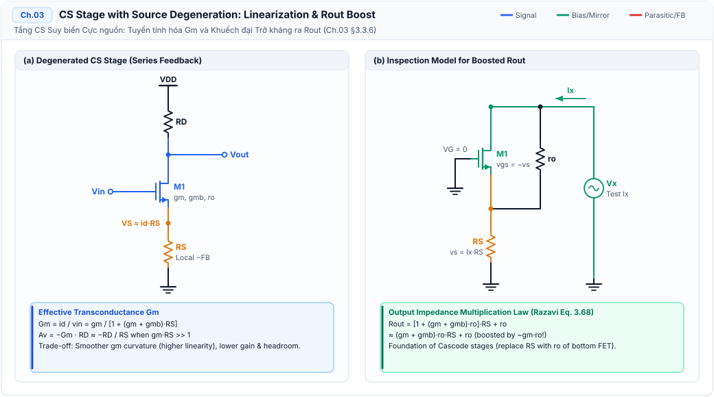

---
{
  "id": "topo-cs-source-degeneration",
  "kind": "topology",
  "domain": "stages-and-mirrors",
  "title_vi": "Tầng nguồn chung có suy biến nguồn và bổ đề Norton (CS Stage with Source Degeneration & Gm-Rout Lemma)",
  "title_en": "Common-Source Stage with Source Degeneration",
  "summary": "Chèn điện trở suy biến RS nối tiếp vào cực nguồn tạo hồi tiếp âm cục bộ ngay trong nhánh dẫn dòng: vừa tuyến tính hóa độ hỗ dẫn tương đương thành Gm = gm/(1+(gm+gmb)RS), vừa nhân điện trở đầu ra lên Rout = [1+(gm+gmb)rO]RS + rO, đồng thời đặt nền móng cho quy tắc nhìn mạch đọc nhanh và bổ đề Norton Av = -Gm*Rout.",
  "diagram": "../../diagrams/cs-source-degeneration.svg",
  "razavi_refs": [
    {
      "chapter": 3,
      "section": "3.3.6",
      "pages": "61-67",
      "equations": ["3.52", "3.55", "3.56", "3.57", "3.61", "3.62", "3.63", "3.65", "3.66", "3.67", "3.68", "3.69", "3.72", "3.77", "3.79", "3.80", "3.81"]
    }
  ],
  "glossary_codes": [
    "T023", "T042", "T080", "T081", "T091", "T094", "T239", "T257",
    "T347", "T352", "T355", "T451", "T514", "T516", "T523", "T538",
    "T550", "T556"
  ],
  "process_agnostic": true,
  "roles": {
    "input_transistor_M1": "Transistor NMOS cảm nhận hiệu điện áp thực VGS = Vin - ID*RS, đóng vai trò phần tử khuếch đại trong vòng hồi tiếp âm cục bộ nối tiếp–nối tiếp.",
    "degeneration_resistor_RS": "Điện trở suy biến nguồn chuyển một phần biến thiên dòng máng thành điện áp rơi âm hồi tiếp lên cực nguồn, làm phẳng độ hỗ dẫn tương đương Gm và tăng cường điện trở đầu ra nhìn vào cực máng.",
    "drain_load_RD": "Tải cực máng chuyển dòng tín hiệu đã được tuyến tính hóa thành điện áp đầu ra; khi RD hữu hạn cho độ lợi xấp xỉ -RD/(RS + 1/gm), còn khi RD tiến tới vô hạn thì sự tăng Rout triệt tiêu sự giảm Gm."
  },
  "symptoms_addressed": [
    "excessive-nonlinearity-and-harmonic-distortion-in-cs-stage",
    "gain-variation-over-large-input-signal-excursions",
    "insufficient-output-resistance-of-current-source-or-driver"
  ],
  "limitations": [
    "reduced-effective-transconductance-and-voltage-gain",
    "dc-ir-drop-across-rs-consumes-voltage-headroom",
    "thermal-noise-contribution-from-degeneration-resistor",
    "body-effect-activated-at-ungrounded-source-node"
  ],
  "checklists": [
    "common-mos",
    "single-stage"
  ]
}
---

## 1. Bản chất Nguyên lý, Sơ đồ Mạch & Vai trò Từng Nhánh Cấu trúc

Trong tầng nguồn chung cơ bản (`topo-cs-resistive-and-diode-load`), dòng điện máng phụ thuộc phi tuyến mạnh vào điện áp vượt ngưỡng cổng–nguồn khiến độ hỗ dẫn $g_m$ biến thiên lớn theo mức tín hiệu đầu vào $V_{in}$, gây méo phi tuyến nghiêm trọng. Thay vì dùng tải diode để bù phi tuyến ở đầu ra, Mục 3.3.6 đưa một **điện trở suy biến nguồn** (degeneration resistor, `T514`) $R_S$ mắc nối tiếp trực tiếp từ cực nguồn (source terminal, `T080`) của $M_1$ xuống đất để thực hiện kỹ thuật **suy biến nguồn** (source degeneration, `T081`). Về bản chất vật lý, đây là một vòng **hồi tiếp** (feedback, `T042`) âm cục bộ cảm nhận dòng điện và hồi về điện áp nối tiếp: bất kỳ khi nào $V_{in}$ tăng làm $I_D$ có xu hướng tăng vọt, độ sụt áp $I_D R_S$ tại cực nguồn lập tức dâng lên theo, gánh lấy phần lớn độ tăng của $V_{in}$ thay vì để nó đổ dồn vào $V_{GS} = V_{in} - I_D R_S$. Nhờ đó, đường cong $I_D(V_{in})$ được "làm mềm" hay **tuyến tính hóa** (linearization, `T347` — Hình 3.25b).



Cấu trúc ba nhánh đơn giản trên Hình 3.23 mở khóa đồng thời **ba trụ cột giải tích quan trọng bậc nhất** của toàn bộ giáo trình Razavi:
1. **Tuyến tính hóa độ hỗ dẫn tương đương $G_m$ (`T451`):** Khi hệ số vòng cục bộ $g_m R_S \gg 1$, độ hỗ dẫn toàn mạch tiệm cận $1/R_S$ — một hằng số hình học của điện trở thụ động, gần như miễn nhiễm với sự biến thiên của $g_m$ theo dòng và biên độ tín hiệu.
2. **Nhân bội điện trở đầu ra $R_{out}$ (`T516`):** Nhìn ngược từ cực máng xuống $M_1$, điện trở $R_S$ ở cực nguồn bị nhân lên xấp xỉ $(1 + (g_m + g_{mb})r_O)$ lần! Cơ chế này không chỉ làm nền cho gương dòng có suy biến mà còn là chìa khóa toán học trực tiếp suy ra trở kháng ra khổng lồ $g_m r_O^2$ của tầng cascode (`topo-cascode-stage`) khi thay $R_S$ bằng $r_{O1}$.
3. **Bổ đề Norton $A_v = -G_m R_{out}$:** Phân tích tổng quát tầng CS suy biến dẫn Razavi tới bổ đề mạch tương đương Norton (`T538`, Hình 3.32) — công cụ "nhìn mạch đọc nhanh" cho mọi bộ khuếch đại phức tạp từ Chương 3 đến Chương 11.

## 2. Hệ Phương trình Cốt lõi & Tư duy "Nhìn Mạch Đọc Nhanh" (Analysis by Inspection)

### 2.1. Độ hỗ dẫn tương đương $G_m$ và quy tắc nhìn mạch đọc nhanh khi $\lambda = 0$
Theo Chú thích 3 (trang 61) và Hình 3.32(b), độ hỗ dẫn tương đương của mạch được định nghĩa chặt chẽ khi **giữ điện áp đầu ra không đổi** (ngắn mạch xoay chiều đầu ra xuống đất): $G_m = \left.\frac{\partial I_D}{\partial V_{in}}\right|_{V_{out}=\text{const}}$.
- **Khi bỏ qua $\lambda$ và $\gamma$ (Hình 3.23b):** Áp dụng định luật điện áp Kirchhoff (KVL, `T556`) $V_{in} = V_1 + I_D R_S$ với $I_D = g_m V_1$, phương trình (3.55)–(3.57) và (3.62) cho:
$$
G_m = \frac{g_m}{1 + g_m R_S}, \qquad A_v = -G_m R_D = -\frac{g_m R_D}{1 + g_m R_S} = -\frac{R_D}{\frac{1}{g_m} + R_S}
$$
- **Quy tắc phân tích bằng quan sát trực tiếp (by inspection, `T550` — Hình 3.27–3.28):** Khi $\lambda = 0$ và $\gamma = 0$, độ lớn độ lợi điện áp của tầng CS có suy biến bằng **điện trở nhìn thấy tại nút cực máng chia cho tổng điện trở nối tiếp trong đường cực nguồn** (gồm điện trở nội nhìn vào cực nguồn $1/g_m$ cộng với điện trở ngoại vi $R_S$). Ví dụ 3.10 (Hình 3.28): nếu thay $R_S$ bằng một MOSFET mắc diode $M_2$ ($\lambda = \gamma = 0$), ta đọc ngay trong một giây không cần vẽ sơ đồ tương đương (3.63):
$$
A_v = -\frac{R_D}{\frac{1}{g_{m1}} + \frac{1}{g_{m2}}}
$$
- **Biểu thức chính xác của $G_m$ khi kể cả hiệu ứng thân ($g_{mb}$, `T355`) và điều biến chiều dài kênh ($r_O$, `T352`):** Đặt đầu ra ở đất xoay chiều (Hình 3.24, nút cực nguồn là $X$ có $V_X = I_{out} R_S$, nên $V_1 = V_{in} - I_{out} R_S$ và $V_{bs} = -I_{out} R_S$). Viết phương trình KCL tại nút $X$ theo (3.58)–(3.59):
$$
I_{out} = g_m V_1 + g_{mb} V_{bs} - \frac{V_X}{r_O} = g_m(V_{in} - I_{out} R_S) - g_{mb} I_{out} R_S - \frac{I_{out} R_S}{r_O}
$$
Chuyển vế gom $I_{out}$ dẫn tới phương trình (3.60)–(3.61):
$$
G_m = \frac{I_{out}}{V_{in}} = \frac{g_m r_O}{R_S + [1 + (g_m + g_{mb})R_S]r_O} \xrightarrow{r_O \to \infty} \frac{g_m}{1 + (g_m + g_{mb})R_S}
$$
Chú ý chi tiết dấu cực kỳ quan trọng: vì tín hiệu đặt ở cực cổng còn cực nguồn nhấp nhô so với đế nối đất, $g_{mb}$ **chỉ xuất hiện ở mẫu số** $(g_m + g_{mb})R_S$ để tăng cường hồi tiếp âm làm giảm thêm $G_m$, tuyệt đối không xuất hiện trên tử số!

### 2.2. Điện trở đầu ra được tăng cường $R_{out}$ và hai góc nhìn vật lý đối ngẫu
Ngắt $R_D$, nối đất cổng $M_1$ ($V_{in} = 0$) và đặt áp thử $V_X$ hút dòng $I_X$ tại cực máng (Hình 3.29). Vì toàn bộ dòng $I_X$ bắt buộc phải đi qua $R_S$ xuống đất, cực nguồn bị nâng lên $V_S = +I_X R_S$, làm cả $V_1 = -I_X R_S$ và $V_{bs} = -I_X R_S$ đều âm! Hai nguồn dòng phụ thuộc kéo ngược một dòng $(g_m + g_{mb})R_S I_X$ từ dưới lên, buộc nhánh $r_O$ phải gánh dòng lớn gấp $[1 + (g_m + g_{mb})R_S]I_X$. Cộng sụt áp trên $r_O$ và $R_S$ theo $r_O[I_X + (g_m + g_{mb})R_S I_X] + I_X R_S = V_X$ cho kết quả chính xác tuyệt đối — phương trình (3.64)–(3.66):
$$
R_{out} = \frac{V_X}{I_X} = [1 + (g_m + g_{mb})R_S]r_O + R_S = [1 + (g_m + g_{mb})r_O]R_S + r_O
$$
Hai cách nhóm số hạng hoàn toàn tương đương này mang lại hai trực giác vàng tùy tình huống mạch:
1. **Góc nhìn (3.65) — Tăng cường $r_O$:** Điện trở ra nội tại $r_O$ của transistor được nhân lên bởi thừa số hồi tiếp cục bộ $[1 + (g_m + g_{mb})R_S]$, rồi cộng nối tiếp thêm $R_S$. Khi $(g_m + g_{mb})r_O \gg 1$, phương trình (3.68) xấp xỉ $R_{out} \approx [1 + (g_m + g_{mb})R_S]r_O$.
2. **Góc nhìn (3.66) — Tăng cường $R_S$:** Điện trở cực nguồn $R_S$ khi nhìn từ cực máng bị nhân bội lên bởi hệ số độ lợi nội tại $[1 + (g_m + g_{mb})r_O]$, rồi cộng thêm $r_O$. Khi $(g_m + g_{mb})r_O \gg 1$, phương trình (3.67) viết $R_{out} \approx (g_m + g_{mb})r_O R_S + r_O$.

Razavi cũng chứng minh lại (3.65) bằng trực giác phân áp che chắn ở Hình 3.30 và phương trình (3.69)–(3.72) (xem ghi chú biên tập `NG03-07` về vị trí dấu ngoặc in trong sách ở bước trung gian (3.71) so với kết quả chuẩn (3.72)): một biến thiên điện áp $\Delta V$ tại cực máng bị cầu phân áp giữa $r_O$ và $(R_S \parallel \frac{1}{g_m + g_{mb}})$ suy giảm mạnh tại cực nguồn chỉ còn:
$$
\Delta V_{RS} = \Delta V \frac{\frac{1}{g_m + g_{mb}} \parallel R_S}{\left(\frac{1}{g_m + g_{mb}} \parallel R_S\right) + r_O} = \frac{\Delta V \cdot R_S}{[1 + (g_m + g_{mb})R_S]r_O + R_S}
$$
Do đó $\Delta I = \Delta V_{RS} / R_S$ nhỏ đi đúng $[1 + (g_m + g_{mb})R_S]r_O/R_S + 1$ lần!

### 2.3. Độ lợi tổng quát & Bổ đề Norton $A_v = -G_m R_{out,total}$
Khi ghép trở lại tải $R_D$ (Hình 3.31), dòng qua $R_S$ bằng dòng qua $R_D$ là $-V_{out}/R_D$, giải hệ KVL trên nhánh $r_O - R_S$ theo (3.73)–(3.76) cho phương trình chính xác (3.77) và dạng phân tích nhân tử (3.79):
$$
A_v = \frac{V_{out}}{V_{in}} = \frac{-g_m r_O R_D}{R_D + R_S + r_O + (g_m + g_{mb})R_S r_O}
$$
$$
A_v = -\underbrace{\frac{g_m r_O}{R_S + [1 + (g_m + g_{mb})R_S]r_O}}_{G_m} \cdot \underbrace{\Big(R_D \parallel \big\{[1 + (g_m + g_{mb})R_S]r_O + R_S\big\}\Big)}_{R_{out,total}}
$$
Từ cấu trúc tích số này, Razavi phát biểu **Bổ đề Norton** (Hình 3.32, trang 67): *Mọi mạng hai cửa tuyến tính đều có độ lợi điện áp $A_v = -G_m R_{out,total}$, trong đó $G_m = I_{out,sc}/V_{in}$ đo với đầu ra ngắn mạch xoay chiều (chiều dương của $I_{out,sc}$ quy ước chảy từ ngoài đi VÀO cực đầu ra) và $R_{out,total}$ đo với $V_{in} = 0$.*

### 2.4. Bảng chuyển tiếp chế độ hoạt động theo hệ số suy biến $g_m R_S$

| Chế độ suy biến | Độ hỗ dẫn tương đương $G_m$ ($r_O \to \infty$) | Điện trở nhánh máng $R_{out}$ | Độ lợi $A_v$ ($R_D \ll R_{out}$) & Đặc trưng tuyến tính |
| :--- | :--- | :--- | :--- |
| **Không suy biến ($R_S = 0$)** | $g_m$ | $r_O$ | $-g_m R_D$; méo hài cao do $g_m$ biến thiên trực tiếp theo $V_{in}$. |
| **Suy biến vừa ($g_m R_S \approx 1\text{–}2$)** | $\frac{g_m}{1 + (g_m + g_{mb})R_S}$ | $[1 + (g_m + g_{mb})R_S]r_O + R_S$ | Giảm độ lợi $2\text{–}3$ lần; nén biên độ $\Delta V_{GS} = \frac{\Delta V_{in}}{1 + (g_m+g_{mb})R_S}$ (Bài 3.30). |
| **Suy biến mạnh ($g_m R_S \gg 1$)** | $\approx \frac{1}{(1 + \eta)R_S} \xrightarrow{\eta=0} \frac{1}{R_S}$ | $\approx (g_m + g_{mb})r_O R_S$ | $\approx -\frac{R_D}{(1+\eta)R_S}$; độ lợi bám tỷ số hình học điện trở, rất tuyến tính. |

## 3. Bất biến Cấu trúc & Các Bẫy Lỗi Kinh điển (Structural Invariants & Traps)

- **`[INV-CSDEG-01]` Bất biến bảo toàn dòng qua chuỗi nối tiếp $R_S - M_1 - R_D$:** Vì cực cổng và cực thân cách điện ở tần số thấp, toàn bộ dòng điện máng tín hiệu nhỏ chảy vào cực máng bắt buộc bằng dòng chảy qua $R_S$ xuống đất ($I_D = I_{RS}$). Bất kỳ điện dung ký sinh hoặc nhánh rẽ nào tại nút nguồn đều phá vỡ đẳng thức này ở tần số cao (tạo zero cực trái tại $-1/(R_S C_S)$ khôi phục độ lợi ở tần số cao!).
- **`[INV-CSDEG-02]` Bất biến triệt tiêu $R_S$ khi tải là nguồn dòng lý tưởng (Ví dụ 3.11, Hình 3.33, phương trình (3.80)–(3.81)):** Nếu thay $R_D$ bằng nguồn dòng lý tưởng $I_0$ ($R_D \to \infty$), áp dụng bổ đề Norton cho kết quả gây sửng sốt:
$$
A_v = -G_m R_{out} = -\frac{g_m r_O}{R_S + [1 + (g_m + g_{mb})R_S]r_O}\cdot\big\{[1 + (g_m + g_{mb})r_O]R_S + r_O\big\} = -g_m r_O
$$
Độ lợi **hoàn toàn độc lập với $R_S$** và quay về đúng $-g_m r_O$! Giải thích vật lý: vì $I_0$ ghim cứng dòng điện không đổi, dòng qua $R_S$ không thể biến thiên ($\Delta I_{RS} = 0$), khiến sụt áp tín hiệu nhỏ trên $R_S$ luôn bằng $0$ hệt như $R_S = 0$!
- **`[INV-CSDEG-03]` Bất biến nén biên độ biến thiên cổng–nguồn $\Delta V_{GS}$ (Bài 3.30, trang 98):** Với mọi độ biến thiên đầu vào $\Delta V_{in}$, phần điện áp thực sự đặt lên kênh dẫn $V_{GS} = V_{in} - I_D R_S$ bị nén nhỏ đi theo tỷ số $\frac{\Delta V_{GS}}{\Delta V_{in}} = \frac{1}{1 + (g_m + g_{mb})R_S}$ (khi $r_O \to \infty$), cho phép mạch tiếp nhận biên độ đầu vào lớn gấp $[1 + (g_m + g_{mb})R_S]$ lần trước khi đạt cùng mức méo phi tuyến kênh!
- **`[TRAP-CSDEG-01]` Bẫy tưởng suy biến nguồn tăng được độ lợi một tầng:** Nhiều sinh viên thấy $R_S$ nhân bội $R_{out}$ lên $[1 + (g_m + g_{mb})R_S]r_O$ liền tưởng gắn $R_S$ vào tầng CS tải nguồn dòng sẽ tăng độ lợi như cascode! Sai lầm chí mạng: $R_S$ nằm dưới cực nguồn của chính transistor nhận $V_{in}$, nên nó làm giảm $G_m$ cùng đúng hệ số mà nó nhân $R_{out}$! Muốn nhân $R_{out}$ mà **không** làm sụt $G_m$, phần tử nhận $V_{in}$ phải có cực nguồn nối đất cứng ($M_1$), còn việc nhân trở kháng giao cho một transistor thứ hai đặt chồng lên trên ($M_2$) — đó chính là bản chất ra đời của `topo-cascode-stage`.
- **`[TRAP-CSDEG-02]` Bẫy mất khoảng dự trữ điện áp DC $I_D R_S$ và tự đẩy $M_1$ vào triode sớm (Ví dụ 3.9, Hình 3.26):** Để đạt suy biến mạnh $g_m R_S \gg 1$, lưu ý rằng $g_m R_S = (g_m/I_D)\cdot(I_D R_S) \approx \frac{2 V_{RS}}{V_{OV1}}$. Muốn $g_m R_S = 4$ với $V_{OV1} = 150\text{ mV}$, sụt áp DC trên $R_S$ đã mất $V_{RS} = I_D R_S = 300\text{ mV}$! Không chỉ làm tăng mức $V_{in,DC} = V_{GS1} + I_D R_S$, cực nguồn bị nâng cao còn kích hoạt hiệu ứng thân ($V_{SB1} = I_D R_S > 0 \implies V_{TH1}$ tăng) và thu hẹp cửa sổ bão hòa $V_{out} \ge V_{in} - V_{TH1}$ xuống còn $V_{out,min} = I_D R_S + V_{DS1,min}$.
- **`[TRAP-CSDEG-03]` Bẫy quy ước dấu dòng $I_{out}$ khi dùng bổ đề Norton $A_v = -G_m R_{out}$:** Trong Hình 3.32(b), $I_{out}$ được định nghĩa chảy **từ đất xoay chiều đi vào nút đầu ra của mạch** (tức chảy từ trên xuống qua nhánh máng của $M_1$). Nếu định nghĩa ngược chiều dòng chảy ra tải mà vẫn giữ dấu âm trong $-G_m R_{out}$, bạn sẽ đảo ngược dấu độ lợi của các tầng không đảo như `topo-source-follower` và `topo-common-gate-stage` (Bài 3.34–3.35).

## 4. Lộ trình Nâng cấp Cấu trúc & Bát giác Đánh đổi (Upgrade Paths & Design Octagon)

Trên **bát giác thiết kế mạch tương tự** (`concept-analog-design-octagon`), suy biến nguồn thực hiện một cuộc trao đổi trực diện: **đổi Độ lợi, Khoảng dự trữ điện áp ($I_D R_S$) và Nhiễu lấy Tính tuyến tính và Trở kháng đầu ra cao**:
- **Tuyến tính hóa mà không tốn sụt áp DC $I_D R_S$ (ở cao tần):** Trong các bộ khuếch đại tạp âm thấp RF (LNA), người ta thay điện trở $R_S$ bằng cuộn cảm suy biến cực nguồn $L_S$:
  - Ở một chiều (DC), cuộn cảm nối tắt nên sụt áp $V_{DC,LS} = 0$, bảo toàn nguyên vẹn $100\%$ khoảng dự trữ điện áp cho $M_1$ dưới nguồn $1{,}0\text{ V}$.
  - Ở cao tần quanh tần số cộng hưởng, tương tác giữa $L_S$ và tụ cổng–nguồn $C_{GS1}$ sinh ra phần thực trở kháng đầu vào $R_{in,\text{real}} = \frac{g_m L_S}{C_{GS1}} = \omega_T L_S$ phối hợp hoàn hảo với nguồn $50\,\Omega$ mà **không sinh nhiễu nhiệt $4kT R_S$**!
- **Mở rộng sang cấu trúc vi sai & nhân tương tự:** Ghép đối xứng hai nhánh CS có suy biến tạo thành cặp vi sai có suy biến nguồn và bộ nhân/VGA Gilbert tại `topo-degenerated-diffpair-and-gilbert` (nơi hai điện trở $R_S$ có thể đặt nằm ngang giữa hai cực nguồn sao cho dòng tĩnh $I_{SS}/2$ đi thẳng qua hai nguồn dòng đuôi không gây sụt áp DC trên $R_S$!).
- **Biến cơ chế nhân $R_{out}$ thành độ lợi cao hoặc nguồn dòng chuẩn:**
  - Dùng $R_S$ ở đáy gương dòng (`topo-basic-current-mirror`) giúp tăng $R_{out}$ và triệt tiêu sai lệch ngưỡng $\Delta V_{TH}$ giữa các nhánh nguồn dòng (`law-pelgrom-mismatch-and-sizing-duality`).
  - Thay $R_S$ bằng một transistor chủ động $M_1$ nhận tín hiệu cổng để vừa giữ nguyên $G_m \approx g_{m1}$ vừa hưởng trọn $R_{out} \approx g_{m2} r_{O2} r_{O1}$ dẫn thẳng tới `topo-cascode-stage` (cùng đặc tính bảo vệ ứng suất điện áp nanomet nêu tại *Nanometer Design Note 5*, trang 64).
- **Đánh đổi nhiễu (`law-stage-and-mirror-noise-rules`):** Điện trở vật lý $R_S$ cộng trực tiếp mật độ phổ nhiễu nhiệt $4kT R_S$ nối tiếp với nhiễu cổng của $M_1$, làm xấu hệ số nhiễu hơn so với tầng CS không suy biến:
$$
\overline{V_{n,in}^2} \approx 4kT\left(\frac{\gamma_{\text{noise}}}{g_m} + R_S\right) + \frac{4kT}{G_m^2 R_D}
$$
Khi $g_m R_S \gg 1$, số hạng $4kT R_S$ áp đảo hoàn toàn nhiễu kênh của $M_1$, chứng minh rõ ràng quy luật không thể có tuyến tính hóa bằng điện trở thụ động "miễn phí" về mặt nhiễu nhiệt!

| Mục tiêu nâng cấp từ CS suy biến | Nút cấu trúc đích chính tắc | Cơ chế cải tiến & Giá phải trả trên Bát giác thiết kế |
| :--- | :--- | :--- |
| **Tăng độ lợi lên $\sim (g_m r_O)^2$ không mất $G_m$** | `topo-cascode-stage` | Đảo vai trò: đặt transistor nhận tín hiệu ở dưới ($R_S=0$) làm điện trở suy biến $r_{O1}$ cho transistor cổng chung ở trên; tốn $2V_{DS,min}$. |
| **Mở rộng dải tuyến tính vi sai & khử hài chẵn** | `topo-degenerated-diffpair-and-gilbert` | Đặt $2R_S$ giữa hai cực nguồn vi sai (có thể tách hai nguồn dòng đuôi để tránh mất sụt áp DC $I_{SS}R_S/2$). |
| **Giảm sai lệch dòng gương & tăng $R_{out}$ gương** | `topo-basic-current-mirror` | Suy biến cực nguồn gương dòng để át sai lệch ngưỡng $\Delta V_{TH}$ (`law-pelgrom-mismatch-and-sizing-duality`). |

## 5. Thích ứng Đa Tiến trình (90nm / 65nm / 45nm) & Cách Kiểm chứng trong Cadence / Spectre

### 5.1. Định cỡ bất biến tiến trình theo $(g_m/I_D)$ và giới hạn điện áp nanomet
1. **Công thức định cỡ độ sâu hồi tiếp cục bộ không phụ thuộc luật bình phương:** Trong mọi tiến trình 90nm / 65nm / 45nm (`tech-nanometer-vdsmin-gmid-sizing`), tích suy biến $T_{loc} = (g_m + g_{mb})R_S$ liên hệ trực tiếp với sụt áp một chiều $V_{RS} = I_D R_S$ qua:
$$
T_{loc} = (1 + \eta)\left(\frac{g_m}{I_D}\right) V_{RS}
$$
Ví dụ trên tiến trình 65nm ($V_{DD} = 1{,}0\text{ V}$): nếu đặt $M_1$ ở vùng nghịch đảo vừa–yếu với $g_m/I_D = 18\text{ V}^{-1}$ và $\eta \approx 0{,}2$, chỉ cần dành $V_{RS} = 150\text{ mV}$ sụt áp DC là đã đạt $T_{loc} \approx 1{,}2 \times 18 \times 0{,}15 = 3{,}24$ (tăng tuyến tính và nhân $r_O$ lên hơn $4{,}2$ lần!), tiết kiệm một nửa dự trữ điện áp so với thiết kế ở $g_m/I_D = 9\text{ V}^{-1}$.
2. **Độ khớp tỷ số điện trở $R_D / R_S$ qua biến thiên PVT:** Khi $g_m R_S \gg 1$, độ lợi tiến về $-R_D / R_S$. Trên layout thực tế (`tech-common-centroid-sti-wpe-layout`), bắt buộc phải vẽ $R_D$ và $R_S$ bằng **cùng một loại vật liệu điện trở** (ví dụ cùng `rppolywo` — poly không silicide có hệ số nhiệt thấp) và ghép từ cùng một đơn vị điện trở chuẩn (unit resistor) với dải giả (dummy strips) hai đầu để tỷ số $R_D/R_S$ bất biến tuyệt đối dưới biến thiên ăn mòn và nhiệt độ, bất chấp giá trị tuyệt đối điện trở mặt trôi $\pm 20\%$.
3. **Giới hạn ứng suất điện áp nanomet (*Nanometer Design Note 5*, trang 64):** Ở 45nm/40nm, $|V_{GS}|, |V_{DS}|, |V_{GD}|$ đều không được vượt quá $1{,}0\text{–}1{,}1\text{ V}$ (SOA — vùng làm việc an toàn). Khi dùng nguồn cấp cao hơn (ví dụ I/O $1{,}8\text{ V}$), một tầng CS đơn có suy biến vẫn chịu toàn bộ $V_{DD}$ đặt lên $V_{DS1}$ khi $M_1$ ngắt; khi đó phải chèn thêm transistor cascode phân cực cổng trung gian để chia sẻ áp rơi tĩnh và động.

### 5.2. Quy trình kiểm chứng chuẩn trong Cadence Virtuoso IC617 / Spectre
- **Kiểm tra điểm làm việc DC & dự trữ bão hòa (`dc` OP):**
  - Xác minh `pv("M1" "region") == 2`.
  - Chú ý ở mạch có suy biến nguồn, điện áp cực nguồn khác không (`VS("/vs") = ID * RS`), nên phải kiểm tra hiệu điện áp thực giữa hai đầu cực máng và cực nguồn: `(VS("/vout") - VS("/vs")) - pv("M1" "vdsat") >= 0.08` (hoặc trực tiếp `pv("M1" "vds") - pv("M1" "vdsat") >= 0.08`).
  - Trích xuất `pv("M1" "vth")` so với transistor chuẩn có $V_{SB}=0$ để ghi nhận mức tăng ngưỡng do hiệu ứng thân $V_{SB} = V_S$.
- **Đo riêng biệt $G_m$ và $R_{out}$ để kiểm chứng bổ đề Norton (`ac` / `xf`):**
  - **Đo $G_m(f)$:** Kẹp một nguồn áp AC `0 V` nối tiếp tại đầu ra giữ mức DC bằng điểm làm việc tĩnh, chạy `ac` và vẽ tỷ số dòng ngắn mạch `IF("/Vprobe/PLUS") / VF("/vin")` — đối chiếu trực tiếp với công thức (3.61).
  - **Đo $R_{out}(f)$:** Ngắt $R_D$ (hoặc dùng `sp` / nguồn dòng thử AC `1 A` tại cực máng với `vin = 0` AC), vẽ `real(VF("/vdrain"))` ở tần số thấp — xác nhận đúng bằng `[1 + (gm + gmbs)*RS]*ro + RS` (3.65).
- **Kiểm chứng độ tuyến tính (`pss` / `hb` / `tran` DFT):** Quét biên độ đầu vào một tông (`1 tone`) hoặc hai tông (`2 tones` đo `IIP3` / `HD2` / `HD3`) so sánh trực tiếp khi $R_S = 0$ và $R_S > 0$ tại cùng dòng phân cực $I_D$ để định lượng số dB cải thiện méo hài đổi lấy số dB giảm độ lợi và tăng hệ số nhiễu (`noise`).

```text
; Mẫu biểu thức ADE / Spectre kiểm chứng Gm, Rout, bổ đề Norton & méo hài cho tầng CS suy biến:
OP_Sat_M1     = pv("M1" "region")                                               ; Bắt buộc == 2
Vds_Eff_M1    = (VS("/vout") - VS("/vs")) - pv("M1" "vdsat")                    ; >= 0.08 V
ro_M1         = 1.0 / pv("M1" "gds")
Gm_Exact_Calc = (pv("M1" "gm") * ro_M1) / (RS + (1 + (pv("M1" "gm") + pv("M1" "gmbs"))*RS)*ro_M1)
Rout_Br_Calc  = (1 + (pv("M1" "gm") + pv("M1" "gmbs")) * ro_M1) * RS + ro_M1    ; Đối chiếu (3.66)
Rout_Tot_Calc = (RD * Rout_Br_Calc) / (RD + Rout_Br_Calc)
Av_Norton     = -Gm_Exact_Calc * Rout_Tot_Calc                                  ; Đối chiếu (3.79)
HD3_dBc       = dB20(harmonic(v("/vout" ?result "pss_fd") 3) / harmonic(v("/vout" ?result "pss_fd") 1))
```

## 6. Mốc Đối chiếu Sách Razavi & Thuật ngữ Chuẩn CLB

| Mục / Trang (Razavi 2nd Ed.) | Phương trình & Hình đối chiếu | Nội dung cốt lõi & Ghi chú biên dịch CLB |
| :--- | :--- | :--- |
| **§3.3.6 (Phần $G_m$ & Nhìn mạch)**, tr. 61–64 (PDF 17–20) | PT (3.52)–(3.63); Hình 3.23–3.28; Ví dụ 3.9–3.10; *Note 5* | Tuyến tính hóa nhờ suy biến nguồn $G_m = g_m/(1+g_m R_S)$ (3.55), công thức chính xác $G_m$ có $g_{mb}, r_O$ (3.61), quy tắc đọc nhanh $-R_D/(1/g_m + R_S)$ (3.62) và ghi chú ứng suất điện nanomet (*Note 5*). |
| **§3.3.6 (Điện trở đầu ra)**, tr. 64–66 (PDF 20–22) | PT (3.64)–(3.72); Hình 3.29–3.30 | Hai dạng đối ngẫu của $R_{out} = [1+(g_m+g_{mb})R_S]r_O + R_S = [1+(g_m+g_{mb})r_O]R_S + r_O$ (3.65)–(3.66), trực giác phân áp $\Delta V_{RS}$ (3.69) và ghi chú biên tập `NG03-07` về (3.71)–(3.72). |
| **§3.3.6 (Độ lợi tổng quát & Bổ đề)**, tr. 66–67 (PDF 22–23) | PT (3.73)–(3.81); Hình 3.31–3.33; Ví dụ 3.11 | Biểu thức chính xác (3.77), bổ đề Norton $A_v = -G_m R_{out}$ (Hình 3.32) và nghịch lý $R_D \to \infty$ làm $R_S$ tự triệt tiêu về $A_v = -g_m r_O$ (3.81). |

**Đối chiếu Thuật ngữ Chuẩn CLB (`THUẬT NGỮ CHUẨN.md`):**
- `T081` **suy biến nguồn** (*source degeneration* — kỹ thuật hồi tiếp âm cục bộ tại cực nguồn, không nhầm với suy hao tín hiệu thông thường), `T514` **điện trở suy biến nguồn** (*degeneration resistor*).
- `T451` **độ hỗ dẫn tương đương** (*equivalent transconductance*, $G_m$ toàn mạch — phân biệt với $g_m$ của từng transistor `T091`), `T347` **tuyến tính hóa** (*linearization*).
- `T516` **điện trở đầu ra của tầng** (*output resistance*, $R_{out}$ — phân biệt với $r_O$ của một linh kiện `T352`), `T538` **mạch tương đương Norton** (*Norton equivalent*), `T550` **phân tích bằng quan sát trực tiếp** (*by inspection*).
