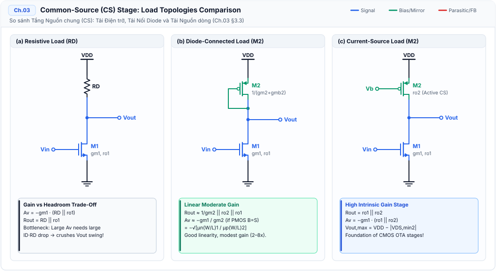

---
{
  "id": "topo-cs-triode-and-current-source-loads",
  "kind": "topology",
  "domain": "stages-and-mirrors",
  "title_vi": "So sánh Chuyên sâu 5 Cấu hình Tải Tầng Nguồn Chung: Định lượng Độ nhạy Điểm Phân cực, Đường Chuyển tiếp Vùng & Ma trận PVT (CS Load Bias-Stability & Triode/Current-Source Analysis)",
  "title_en": "Deep Comparison of Common-Source Loads: Resistive, Diode, Triode PMOS, and Current-Source Bias Sensitivity & Swing Trajectories",
  "summary": "Đối chiếu định lượng toàn diện 5 cấu hình tải của tầng nguồn chung (điện trở RD, MOSFET mắc diode NMOS/PMOS, PMOS vùng triode sâu, nguồn dòng bão hòa và đẩy–kéo CMOS) theo độ nhạy trôi điểm phân cực dVout,DC/dVb, hiện tượng gãy khúc độ lợi khi tải triode chuyển sang bão hòa (Bài tập 3.25–3.26), méo phi tuyến biên độ lớn và quy tắc chọn cơ chế giữ phân cực DC.",
  "diagram": "../../diagrams/cs-loads-comparison.svg",
  "razavi_refs": [
    {
      "chapter": 3,
      "section": "3.3.1-3.3.5",
      "pages": "47-61, 98",
      "equations": ["3.4", "3.6", "3.21", "3.25", "3.30", "3.46", "3.47", "3.48", "3.49", "3.50", "3.51"]
    }
  ],
  "glossary_codes": ["T023", "T095", "T208", "T495", "T508", "T509", "T511", "T512", "T513", "T608"],
  "process_agnostic": true,
  "roles": {
    "ohmic_dc_coupled_load": "Tải điện trở RD và tải PMOS vùng triode sâu cung cấp đường hồi quy dòng–áp bậc nhất tự xác định Vout,DC vòng hở, nhưng đánh đổi trực tiếp độ lợi lấy sụt áp hoặc chịu trôi lớn theo PVT",
    "self_clamping_diode_load": "Tải MOSFET mắc diode tạo trở kháng tự bám 1/(gm2 + gmb2) giúp độ lợi phụ thuộc thuần túy tỉ số kích thước hình học, miễn nhiễm PVT nhưng đánh mất trần VTH2 và giới hạn độ lợi thấp",
    "high_ro_current_source_load": "Tải nguồn dòng PMOS bão hòa phá vỡ ràng buộc định luật Ohm (độ lợi cao đi kèm dự trữ VDS,min nhỏ), nhưng biến nút ra thành nút trở kháng cao bắt buộc có vòng hồi tiếp giữ DC"
  },
  "symptoms_addressed": [
    "cs-output-dc-operating-point-pegged-to-rail-across-corners",
    "triode-pmos-load-abrupt-gain-jump-entering-saturation",
    "diode-load-body-effect-crushing-voltage-gain-and-swing",
    "excessive-resistor-voltage-drop-starving-input-transistor"
  ],
  "limitations": [
    "triode-pmos-ron-tracks-neither-poly-resistor-nor-nmos-gm-across-fs-sf-corners",
    "current-source-load-cannot-operate-open-loop-without-dc-servo-or-cmfb",
    "resistive-load-gain-bounded-by-2-vdd-minus-vdsat-over-vov"
  ],
  "checklists": ["common-mos", "single-stage"]
}
---

## 1. Bản chất Nguyên lý, Sơ đồ Mạch & Vai trò Từng Nhánh Cấu trúc

Trong thiết kế mạch tương tự thực tế, câu hỏi đầu tiên khi đặt một **tầng nguồn chung (`T023`, common-source stage — CS)** vào hệ thống không chỉ là *"Độ lợi tín hiệu nhỏ $A_v$ bằng bao nhiêu?"* mà là câu hỏi sống còn hơn nhiều: **"Điểm phân cực tĩnh một chiều $V_{\text{out,DC}}$ được neo giữ bằng cơ chế vật lý nào, và khi góc công nghệ (`SS/FF/FS/SF`), nguồn $V_{DD}$ hoặc nhiệt độ dịch chuyển thì $V_{\text{out,DC}}$ cùng $A_v$ trôi đi bao xa?"** Trong khi hai thẻ cơ sở `topo-cs-resistive-and-diode-load` và `topo-cs-current-source-and-active-load` đã giới thiệu riêng rẽ từng công thức, thẻ chuyên sâu này hợp nhất toàn bộ 5 họ tải của §3.3.1–§3.3.5 (Razavi Chương 3, tr. 47–61 & Bài tập 3.25–3.26 tr. 98) dưới một lăng kính duy nhất: **Độ nhạy ổn định phân cực (Bias-Stability Sensitivity) đối đầu với Ràng buộc Định luật Ohm và Quỹ đạo Chuyển vùng Tín hiệu Lớn**.



Hãy hình dung giao điểm làm việc tĩnh $Q(I_{D0}, V_{\text{out,DC}})$ trên mặt phẳng đặc tuyến ra $(V_{\text{out}}, I_D)$ giữa đường cong dòng hút của transistor khuếch đại NMOS $M_1$ và đường cong tải phía trên nối từ $V_{DD}$:
1. **Nhóm Tải Tự Neo Điểm Làm việc Vòng Hở (Self-Stabilizing Open-Loop Loads — $R_{\text{load,DC}}$ hữu hạn vừa phải):**
   - **Tải điện trở thụ động (`T508`, resistive load — $R_D$):** Đường tải là đường thẳng dốc $-1/R_D$ cắt chắc chắn đường ngang của $M_1$ tại $V_{\text{out,DC}} = V_{DD} - I_D R_D$. Điểm làm việc ổn định nhưng bị khóa chặt bởi **định luật Ohm**: muốn $|A_v| = g_{m1} R_D$ tăng gấp đôi ở cùng $V_{OV1}$, sụt áp một chiều $I_D R_D$ bắt buộc tăng gấp đôi!
   - **Tải MOSFET mắc diode (`T509`, diode-connected load — NMOS hoặc PMOS $M_2$):** Đường tải dốc đứng với trở kháng vi phân thấp $\approx \frac{1}{g_{m2}}$ (hoặc $\frac{1}{g_{m2} + g_{mb2}}$ với NMOS chung đế). Độ lợi biến thành tỉ số hình học tự bám sát PVT, $V_{\text{out,DC}}$ cực kỳ vững vàng, nhưng mất trắng ngưỡng $V_{TH2}$ trong **dải dao động điện áp cho phép (`T495`)** và độ lợi hiếm khi vượt quá $3\text{–}8\,\text{V/V}$.
   - **Tải PMOS làm việc ở vùng triode (`T513`, triode load — Hình 3.22):** Cực cổng PMOS $M_2$ được kéo xuống mức phân cực thấp $V_b$ (thậm chí nối thẳng đất $V_b = 0\,\text{V}$!) sao cho $M_2$ làm việc như một điện trở dẫn $R_{on2}$ không mất ngưỡng $|V_{THP}|$ ($V_{\text{out,max}} = V_{DD}$), nhưng giá trị $R_{on2}$ trôi mạnh theo $\mu_p C_{ox}$, $|V_{THP}|$ và tiềm ẩn cú nhảy vùng nguy hiểm nếu $V_{\text{out}}$ sụt sâu!
2. **Nhóm Tải Trở kháng Vi phân Cao Nhạy Cực Đoan Điểm Tĩnh (High-Impedance Loads — $R_{\text{load}} \sim r_O$):**
   - **Tải nguồn dòng bão hòa (`T511`, current-source load)** và **Tải chủ động đẩy–kéo (`T512`, active push-pull load):** Hai đường cong gần như nằm ngang cắt nhau dưới góc cực hẹp! Độ lợi đạt mức nội tại $g_m (r_{O1} \parallel r_{O2})$ với **khoảng dự trữ điện áp (`T208`, headroom)** tối thiểu, nhưng giao điểm $V_{\text{out,DC}}$ "trôi lơ lửng" cực nhạy với sai lệch dòng $\Delta I_D$, bắt buộc phải khóa bằng vòng hồi tiếp âm DC hoặc CMFB!

---

## 2. Hệ Phương trình Cốt lõi & Tư duy "Nhìn Mạch Đọc Nhanh" (Analysis by Inspection)

### 2.1. Định lý Trần Độ lợi Ohm của Tải Điện trở vs. Tải Nguồn Dòng
Xét tầng CS tải điện trở $R_D$ (Phương trình 3.4 & 3.6, tr. 48): viết $g_{m1} = \frac{2 I_D}{V_{OV1}}$ (hoặc tổng quát $I_D \cdot (g_m/I_D)_1$), độ lợi tín hiệu nhỏ gắn liền trực tiếp với độ sụt áp một chiều $\Delta V_{RD} \triangleq V_{DD} - V_{\text{out,DC}} = I_D R_D$:

$$|A_{v,\text{res}}| = g_{m1} R_D = \frac{2 I_D}{V_{OV1}} R_D = \frac{2(V_{DD} - V_{\text{out,DC}})}{V_{OV1}} = \left(\frac{g_m}{I_D}\right)_1 (V_{DD} - V_{\text{out,DC}})$$

**Đọc nhanh giới hạn tuyệt đối dưới nguồn thấp:** Trên công nghệ $65\,\text{nm}$ với $V_{DD} = 1{,}0\,\text{V}$, nếu cần giữ $V_{\text{out,DC}} = 0{,}5\,\text{V}$ để dao động đối xứng, ta chỉ có $\Delta V_{RD} = 0{,}5\,\text{V}$. Ngay cả khi đẩy $M_1$ lên biên nghịch đảo yếu $(g_m/I_D)_1 = 24\,\text{V}^{-1}$, trần độ lợi vật lý tuyệt đối của tải điện trở **không bao giờ vượt quá $24 \times 0{,}5 = 12\,\text{V/V}$ ($21{,}6\,\text{dB}$)**! Muốn đạt $|A_v| = 40\,\text{V/V}$ với tải $R_D$, sụt áp $I_D R_D$ đòi hỏi $40 / 24 = 1{,}67\,\text{V} > V_{DD}$ — hoàn toàn bất khả thi!

Trong khi đó, với **tải nguồn dòng PMOS bão hòa** (Phương trình 3.46):
$$|A_{v,\text{CS-I}}| = g_{m1}(r_{O1} \parallel r_{O2}) = \frac{(g_m/I_D)_1}{\lambda_1 + \lambda_2}$$
Biểu thức hoàn toàn **tách rời khỏi sụt áp DC $(V_{DD} - V_{\text{out,DC}})$**, cho phép chọn $V_{\text{out,DC}} = 0{,}5\,\text{V}$ tùy ý và kéo dài $L_1, L_2$ để giảm $\lambda_1 + \lambda_2$ nâng độ lợi lên $25\text{–}45\,\text{V/V}$ dưới nguồn $1{,}0\,\text{V}$!

### 2.2. Giải phẫu Sâu Tải PMOS Vùng Triode & Hai Kịch bản Chuyển Vùng Kinh điển (Bài tập 3.25 & 3.26, tr. 60 & 98)
Xét Hình 3.22: NMOS $M_1$ khuếch đại ở dưới, PMOS $M_2$ làm tải nối từ $V_{DD}$ xuống $V_{\text{out}}$ có cổng buộc vào áp tĩnh $V_b$. Điện áp vượt ngưỡng cổng–nguồn của $M_2$ là $V_{SG2} - |V_{THP}| = V_{DD} - V_b - |V_{THP}| \triangleq V_{OV2}$.
- **Điều kiện để $M_2$ nằm trong vùng Triode:** Điện thế cực máng $V_{\text{out}}$ của PMOS $M_2$ không được tụt thấp hơn $V_b + |V_{THP}|$:
  $$V_{SD2} = V_{DD} - V_{\text{out}} < V_{OV2} = V_{DD} - V_b - |V_{THP}| \quad \Longleftrightarrow \quad V_{\text{out}} > V_b + |V_{THP}|$$
  Khi $V_{\text{out}}$ nằm gần $V_{DD}$ ($V_{DD} - V_{\text{out}} \ll 2 V_{OV2}$, vùng triode sâu), điện trở tương đương của $M_2$ là Phương trình (3.51):
  $$R_{on2} = \frac{1}{\mu_p C_{ox}\left(\dfrac{W}{L}\right)_2 (V_{DD} - V_b - |V_{THP}|)}, \qquad A_v \approx -g_{m1}(R_{on2} \parallel r_{O1})$$
- **Chuyện gì xảy ra khi $V_{in}$ tăng (hoặc $V_b$ quét tăng từ $0$ lên $V_{DD}$ như Bài tập 3.26, tr. 98)?** Khi $V_{\text{out}}$ hạ dần xuống từ $V_{DD}$, có **hai biên ranh giới cạnh tranh nhau** quyết định hình dáng đường cong độ lợi $|A_v|$:
  1. Biên $M_2$ rời Triode nhảy vào **Bão hòa**: tại $V_{\text{out,sat2}} = V_b + |V_{THP}|$.
  2. Biên $M_1$ rời Bão hòa sập vào **Triode**: tại $V_{\text{out,tri1}} = V_{in} - V_{THN}$.
  - **Kịch bản A ($V_b$ rất thấp, ví dụ $V_b = 0\,\text{V}$ sao cho $V_b + |V_{THP}| < V_{in} - V_{THN}$):** $M_1$ sập vào vùng triode *trước khi* $M_2$ kịp bão hòa $\implies$ độ lợi $|A_v|$ giảm đơn điệu về $0$ khi $V_{\text{out}}$ chạm đáy mà không có đỉnh vọt.
  - **Kịch bản B ($V_b$ cao hơn sao cho $V_b + |V_{THP}| > V_{in} - V_{THN}$ — Điểm bẫy phi tuyến gãy khúc!):** Khi $V_{\text{out}}$ hạ xuống vượt qua mốc $V_b + |V_{THP}|$, trong khi $M_1$ vẫn còn bão hòa thì **tải PMOS $M_2$ đột ngột chuyển từ vùng Triode sang vùng Bão hòa**! Trở kháng tải của $M_2$ phóng vọt từ giá trị nhỏ $R_{on2}$ (vài $\text{k}\Omega$) lên $r_{O2}$ (hàng chục–trăm $\text{k}\Omega$), khiến **độ lợi tín hiệu nhỏ $|A_v|$ đột ngột vọt vống lên thành đỉnh nhọn $g_{m1}(r_{O1} \parallel r_{O2})$** trước khi sụp đổ về $0$ lúc $M_1$ chạm triode! Sự biến thiên trở kháng tải gấp $10\times$ ngay giữa hành trình tín hiệu này gây méo hài tổng (THD) khổng lồ nếu người thiết kế không đảm bảo $V_{\text{out,min}} > V_b + |V_{THP}| + 100\,\text{mV}$!

### 2.3. Định lượng Ma trận Độ nhạy Điểm Phân cực DC ($\partial V_{\text{out,DC}} / \partial \text{PVT}$) Qua 5 Cấu hình Tải
Giả sử dòng phân cực nhánh $I_{D1}$ hoặc tham số tải bị lệch tương đối một lượng $\frac{\Delta I}{I_D}$ (do sai lệch gương dòng, trôi $V_{TH}$, hoặc góc tiến trình chéo `FS/SF` làm lệch NMOS so với PMOS). Độ trôi điện áp tĩnh ngõ ra $\Delta V_{\text{out,DC}}$ bằng tích sai lệch dòng nhân với trở kháng vi phân tại điểm làm việc:

| Cấu hình Tải Tầng CS | Độ lợi tín hiệu nhỏ $A_v$ | Trần – Sàn $V_{\text{out}}$ | Độ trôi DC $\Delta V_{\text{out,DC}}$ khi lệch dòng $\frac{\Delta I}{I_D}$ | Tính bám sát PVT của Độ lợi $|A_v|$ |
|---|---|---|---|---|
| **1. Điện trở $R_D$ (§3.3.1)** | $-g_{m1}(R_D \parallel r_{O1})$ | $[V_{DS1,\min},\; V_{DD}]$ | $(V_{DD} - V_{\text{out,DC}})\cdot \dfrac{\Delta I}{I_D}$ *(Vừa phải: lệch $5\% \to \sim 25\,\text{mV}$)* | Kém nếu phân cực cố định; **rất tốt** nếu phân cực bằng dòng Constant-$g_m$ bám cùng loại điện trở $R_S$! |
| **2. NMOS/PMOS mắc Diode (§3.3.2)** | $-\dfrac{g_{m1}}{g_{m2} + g_{mb2}} = -\sqrt{\dfrac{\mu_1(W/L)_1}{\mu_2(W/L)_2}}\dfrac{1}{1+\eta}$ | $[V_{DS1,\min},\; V_{DD} - V_{TH2}]$ *(NMOS)* | $\dfrac{V_{OV2}}{2(1+\eta)}\cdot \dfrac{\Delta I}{I_D}$ *(Cực nhỏ: lệch $10\% \to \sim 10\,\text{mV}$!)* | **Xuất sắc nhất** cho cùng loại hạt tải ($\mu_n/\mu_n$ triệt tiêu hoàn toàn theo nhiệt độ & góc công nghệ!). |
| **3. PMOS vùng Triode sâu (§3.3.5)** | $-g_{m1}(R_{on2} \parallel r_{O1})$ | $[V_{DS1,\min},\; V_{DD}]$ *(nhưng phải $> V_b+|V_{THP}|$)* | $I_D R_{on2}\left(\dfrac{\Delta I}{I_D} + \dfrac{\Delta R_{on2}}{R_{on2}}\right)$ *(Lớn ở góc chéo FS/SF!)* | **Rất kém** nếu $V_b$ cố định (vì $R_{on2}$ trôi $\pm 40\%$ theo $\mu_p, V_{THP}, V_{DD}$), bắt buộc dùng mạch *replica bias* tạo $V_b$! |
| **4. Nguồn dòng PMOS Bão hòa (§3.3.3)** | $-g_{m1}(r_{O1} \parallel r_{O2})$ | $[V_{DS1,\min},\; V_{DD} - |V_{DS2,\min}|]$ | $I_D(r_{O1}\parallel r_{O2})\cdot \dfrac{\Delta I}{I_D}$ **(Nổ tung: lệch $2\%$ trôi hết cả $V_{DD}$!)** | Cao nhưng phụ thuộc $\lambda(L, V_{DS})$; **bắt buộc đóng vòng hồi tiếp DC / CMFB**. |
| **5. Đẩy–kéo Bổ sung CMOS (§3.3.4)** | $-(g_{m1}+g_{m2})(r_{O1}\parallel r_{O2})$ | $[V_{DS1,\min},\; V_{DD} - |V_{DS2,\min}|]$ | Tự lật cực nhanh quanh $V_M \approx V_{DD}/2$; dòng tĩnh trôi mũ/bình phương theo $V_{DD}$! | $\text{PSRR}^+ \approx 6\,\text{dB}$ cực xấu (Phương trình 3.50); bắt buộc tự phân cực bằng điện trở $R_F$ nối $V_{\text{out}} \to V_G$. |

---

## 3. Bất biến Cấu trúc & Các Bẫy Lỗi Kinh điển (Structural Invariants & Traps)

- **[INV-CSLOAD-01] Định lý Đối ngẫu Giữa Độ lợi DC Vòng hở và Độ bất định Điểm Tĩnh:** Trong mọi tầng khuếch đại không có tụ chặn DC, tích giữa độ nhạy điểm tĩnh đối với sai lệch ngưỡng $\frac{\partial V_{\text{out,DC}}}{\partial V_{TH1}}$ và nghịch đảo độ lợi $|A_v|^{-1}$ luôn xấp xỉ hằng số $1$: tức là **$\Delta V_{\text{out,DC}} \approx -|A_v|\,\Delta V_{TH1}$**! Mạch có độ lợi một chiều $|A_v| = 40$ sẽ khuếch đại một sai lệch $\Delta V_{TH} = 10\,\text{mV}$ thành độ trôi ngõ ra $400\,\text{mV}$ — chứng minh toán học vì sao không thể tách rời bài toán độ lợi cao khỏi bài toán vòng hồi tiếp ổn định DC!
- **[INV-CSLOAD-02] Kỹ thuật Bơm Dòng Phụ (Current-Bleeding / Helper Current Source — Hình 3.16, Phương trình 3.30, tr. 55):** Với tầng CS tải mắc diode $M_2$ bị kẹt độ lợi thấp do $g_{m2} \propto \sqrt{I_{D2}}$, nếu ta treo thêm một nguồn dòng tĩnh phụ $I_S = \alpha I_{D1}$ (ví dụ $\alpha = 0{,}8$) cấp thẳng $80\%$ dòng cho $M_1$ để chỉ chừa lại $I_{D2} = 0{,}2 I_{D1}$ chảy qua diode $M_2$, thì $g_{m2}$ giảm đi $\sqrt{5}$ lần ở cùng $(W/L)_2$ (hoặc giảm $5$ lần ở cùng $V_{OV2}$), **nhân vọt độ lợi của tải diode lên $2{,}2\text{–}5$ lần** mà vẫn giữ điểm làm việc tự neo ổn định!

- **[TRAP-CSLOAD-01] Bẫy Góc Tiến trình Chéo (`FS` / `SF`) Giết Chết Tải PMOS Triode Có $V_b$ Cố định:**
  Nếu bạn buộc cổng PMOS tải triode $M_2$ xuống đất ($V_b = 0\,\text{V}$) như bài tập sách giáo khoa, ở góc `SF` (NMOS chậm, PMOS nhanh: $|V_{THP}|$ thấp, $\mu_p$ cao), $R_{on2}$ sụt giảm $35\%$, kéo tụt độ lợi $|A_v|$; ngược lại ở góc `FS` (NMOS nhanh, PMOS chậm: $|V_{THP}|$ cao, $\mu_p$ thấp) kết hợp $V_{DD} - 10\%$, lượng $(V_{DD} - |V_{THP}|)$ bị bóp nghẹt làm $R_{on2}$ tăng vọt gấp đôi và đẩy $M_2$ lao thẳng vào vùng bão hòa hoặc đẩy $M_1$ sập vào triode! **Cách giải duy nhất trên silicon:** tạo $V_b$ từ một nhánh gương bản sao (*replica biasing*) ép $R_{on2}$ bám theo một điện trở chuẩn hoặc theo $1/g_{m1}$.
- **[TRAP-CSLOAD-02] Bẫy Hiệu ứng Thân $\eta = g_{mb2}/g_{m2}$ Của Tải NMOS Mắc Diode Chung Đế (Phương trình 3.21–3.25):** Khi dùng NMOS $M_2$ mắc diode làm tải phía trên trên công nghệ một giếng $p$-substrate chung, cực nguồn của $M_2$ nối vào chính nút $V_{\text{out}} > 0$, nên $V_{SB2} = V_{\text{out}}$ vừa tạo $g_{mb2}$ làm sụt độ lợi đi $(1+\eta) \approx 1{,}25$ lần, vừa làm tăng vọt $V_{TH2}(V_{\text{out}})$ ăn mất thêm $150\text{–}250\,\text{mV}$ trần dao động ngõ ra! Nếu bắt buộc dùng tải mắc diode ở phía trên, hãy ưu tiên dùng **PMOS mắc diode trong giếng $n$-well nối nguồn lên $V_{DD}$** ($V_{SB2} = 0 \Rightarrow g_{mb2} = 0$, Phương trình 3.26) và dùng cặp tỉ số dòng/kích thước phù hợp!

---

## 4. Lộ trình Nâng cấp Cấu trúc & Bát giác Đánh đổi (Upgrade Paths & Design Octagon)

Từ bảng phân tích 5 cấu hình tải tầng CS này, mọi lộ trình tiến hóa kiến trúc trong chương sau đều hiện ra tất yếu trên `concept-analog-design-octagon`:
- **Cần độ lợi vừa phải ($6\text{–}15\,\text{dB}$), băng thông cực rộng (nhiều $\text{GHz}$) và điểm DC tự đứng vững không cần CMFB phức tạp** (ví dụ bộ đệm tiền khuếch đại so sánh tốc độ cao, CML buffer): chọn **CS tải điện trở $R_D$** hoặc **CS tải diode có nguồn dòng phụ trợ (bleeding current)** (`topo-cs-resistive-and-diode-load`), kết hợp biến thể vi sai `topo-basic-differential-pair`.
- **Cần khử nhiễu nguồn cấp $V_{DD}$ của tải triode / tải nguồn dòng và loại bỏ trôi DC đối xứng:** Ghép đôi hai tầng CS thành cặp vi sai tải triode / tải suy biến tại `topo-diff-pair-with-degeneration-and-triode-loads`, hoặc khôi phục độ lợi đơn đầu bằng gương dòng tích cực tại `topo-diff-pair-active-current-mirror-load` (5T-OTA).
- **Cần dùng tải PMOS vùng triode để tự cảm nhận và điều chỉnh chế độ chung mà không cần bộ chia điện trở tốn diện tích:** Ý tưởng tải triode Hình 3.22 tiến hóa trực tiếp thành **Op-Amp vi sai có CMFB bằng MOSFET vùng triode sâu** tại `topo-fully-differential-cmfb-topologies-comparison` (Chương 9, §9.7.3, Hình 9.54)!
- **Cần vượt qua độ lợi nội tại đơn tầng $g_m(r_{O1}\parallel r_{O2})$:** Chồng thêm lá chắn cổng chung lên cả hai phía tại `topo-cascode-stage` và khuếch đại phụ tại `topo-regulated-cascode-super-source-follower`.

---

## 5. Thích ứng Đa Tiến trình (90nm / 65nm / 45nm) & Cách Kiểm chứng trong Cadence / Spectre

### 5.1. Quy tắc Thích ứng trên Công nghệ 90nm / 65nm / 45nm ($V_{DD} = 0{,}9\text{–}1{,}2\,\text{V}$)
1. **Sự tuyệt chủng của tải NMOS mắc diode phía trên dưới nguồn $\le 1{,}2\,\text{V}$:** Với $V_{DD} = 1{,}0\,\text{V}$ và $V_{THN}\text{ (có hiệu ứng thân)} \approx 0{,}50\,\text{V}$, trần ngõ ra $V_{DD} - V_{THN2} - V_{OV2}$ rớt xuống còn $0{,}35\,\text{V}$, không đủ cả khoảng dự trữ cho $M_1$ ở dưới! Trên 65nm/45nm, tải diode ở phía nguồn dương chỉ còn dùng **PMOS LVT** hoặc cấu trúc điện trở nối cổng diode tự phân cực.
2. **Điện trở Polysilicon không silicide (`rppolywo` / `rppo1`) thắng thế tải PMOS Triode trong khối CML tốc độ cao:** Ở 65nm/45nm, điện trở poly không silicide có điện trở suất mặt $R_{\square} \approx 500\text{–}1000\,\Omega/\square$, hệ số nhiệt độ thấp và tụ ký sinh nhỏ hơn nhiều so với giếng $n$-well của PMOS vùng triode, lại tuyến tính tuyệt đối đến tận $V_{DD}$! Tải PMOS triode chỉ dùng khi cần **điều chỉnh băng thông/độ lợi liên tục bằng điện áp analog $V_{\text{tune}}$**!

### 5.2. Kịch bản Kiểm chứng Độ nhạy PVT & Quỹ đạo Vùng Trên Cadence Virtuoso / Spectre
Để phơi bày sự gãy khúc độ lợi của tải triode (Bài tập 3.26) và độ trôi điểm tĩnh qua 5 góc PVT (`TT, FF, SS, FS, SF`), chạy đồng thời quét DC đặc tuyến truyền đạt $V_{\text{out}}(V_{\text{in}})$ kèm đạo hàm bậc nhất `deriv(VS("/vout"))`:

```ocean
; Script OCEAN kiểm định độ nhạy PVT và biên chuyển vùng của tầng CS (Tải Triode / Nguồn dòng):
analysis('dc ?dev "/VIN" ?param "dc" ?start 0.0 ?stop 1.1 ?step 0.002)
run()

vout_wf = VS("/vout")
av_wf   = deriv(vout_wf)                       ; Độ lợi tín hiệu nhỏ tức thời Av(Vin)
reg_m1  = getData("M1:region" ?result "dc")    ; Phải = 2 trong vùng khuếch đại
reg_m2  = getData("M2:region" ?result "dc")    ; Tải Triode phải giữ = 1; Tải Nguồn dòng phải giữ = 2!

; Đo biên độ đỉnh-đỉnh hữu ích nơi |Av| không sụt (hoặc vọt) quá 20% so với điểm giữa VDD/2:
vin_mid = cross(vout_wf 0.55 1 'falling)
av_mid  = abs(value(av_wf vin_mid))
printf("Vin_mid = %.3f V | |Av_mid| = %.2f V/V (%.1f dB)\n" vin_mid av_mid 20*log10(av_mid))
```

- **Tiêu chuẩn nghiệm thu bắt buộc:**
  - Với **tải PMOS vùng triode**: trên toàn bộ dải dao động ngõ ra yêu cầu $[V_{\text{out,min}}, V_{\text{out,max}}]$ ở cả 5 góc PVT, `M2:region` phải giữ nguyên bằng `1` (không được nhảy sang `2`), và tỉ số $|V_{DS2}| / |V_{\text{dsat2}}|$ không vượt quá $0{,}6$ nếu yêu cầu méo hài $\text{THD} < -40\,\text{dB}$.
  - Với **tải nguồn dòng / đẩy–kéo**: bắt buộc kiểm tra điểm tĩnh $V_{\text{out,DC}}$ sau khi đóng vòng hồi tiếp hệ thống qua Monte Carlo 200 mẫu không làm $|V_{DS}| - |V_{\text{dsat}}|$ của $M_1$ hay $M_2$ tụt dưới $50\,\text{mV}$.

---

## 6. Mốc Đối chiếu Sách Razavi & Thuật ngữ Chuẩn CLB

### 6.1. Đối chiếu Sách Gốc Razavi (2nd Edition)
- **Chương 3:**
  - §3.3.1 *Common-Source Stage with Resistive Load* (tr. 47–52, Phương trình 3.3–3.20, Ví dụ 3.1–3.3, Hình 3.5–3.8).
  - §3.3.2 *CS Stage with Diode-Connected Load* (tr. 52–57, Phương trình 3.21–3.45, Ví dụ 3.4–3.7, Hình 3.13–3.17 — bao gồm kỹ thuật nguồn dòng phụ trợ *current bleeding* Hình 3.16, Phương trình 3.30).
  - §3.3.3 *CS Stage with Current-Source Load* (tr. 58–59, Phương trình 3.46–3.47, Ví dụ 3.8, Hình 3.18–3.19).
  - §3.3.4 *CS Stage with Active Load* (tr. 59–60, Phương trình 3.48–3.50, Hình 3.20–3.21).
  - §3.3.5 *CS Stage with Triode Load* (tr. 60–61, Phương trình 3.51, Hình 3.22, *Nanometer Design Note 4*).
  - **Bài tập 3.25 & 3.26** (tr. 98): Phân tích định lượng điểm gãy độ lợi khi tải PMOS triode $M_2$ chạm biên bão hòa trước hoặc sau khi $M_1$ chạm biên triode.
- **Chú giải Hiệu đính Học thuật CLB (`NG03`):**
  - **`NG03-01` (tr. 51, Ví dụ 3.3, Phương trình 3.18):** Khẳng định $|A_v|_{\max} = g_m r_O$ chỉ là trần độ lợi nội tại của một transistor đơn bão hòa với nguồn dòng lý tưởng, chưa phải trần của cấu trúc xếp chồng cascode.
  - **`NG03-05` (tr. 60, Phương trình 3.49–3.50):** Làm rõ phép lấy xấp xỉ $g_{m2} r_{O2} \gg 1$ trong độ lợi truyền nhiễu nguồn cấp $V_{\text{out}}/V_{DD} \approx g_{m2}(r_{O1}\parallel r_{O2})$ của tầng CS tải chủ động.

### 6.2. Bảng Thuật ngữ Chuẩn CLB Vi Mạch Sử dụng trong Thẻ
| Mã CLB | Thuật ngữ Tiếng Anh | Thuật ngữ Tiếng Việt Chuẩn | Ghi chú Ngữ cảnh |
|---|---|---|---|
| `T023` | common-source stage, CS | tầng nguồn chung | Khối khuếch đại đảo pha cơ bản nhận áp ở cổng, xuất áp ở máng |
| `T508` | resistive load | Tải điện trở | Tự neo DC ổn định nhưng bị khóa chặt độ lợi vào sụt áp $I_D R_D$ |
| `T509` | diode-connected load | Tải MOSFET mắc diode | Trở kháng $\approx 1/(g_m + g_{mb})$, độ lợi bám theo căn tỉ số $W/L$ |
| `T511` | current-source load | Tải nguồn dòng | Phá vỡ ràng buộc Ohm, đòi hỏi vòng hồi tiếp xác định $V_{\text{out,DC}}$ |
| `T512` | active load | Tải chủ động | Trong §3.3.4 chỉ PMOS nhận chung $V_{in}$ tạo tầng nguồn chung bổ sung |
| `T513` | triode load | Tải làm việc ở vùng triode | Không mất ngưỡng $|V_{THP}|$ nhưng nhạy mạnh với biến thiên PVT |
| `T495` | allowable voltage swings | Dải dao động điện áp cho phép | Quỹ đạo $V_{\text{out}}$ giữ tất cả transistor đúng vùng thiết kế |
| `T608` | headroom constraints | ràng buộc về dự trữ điện áp | Yếu tố loại bỏ tải diode NMOS và định luật Ohm dưới nguồn $\le 1\,\text{V}$ |
