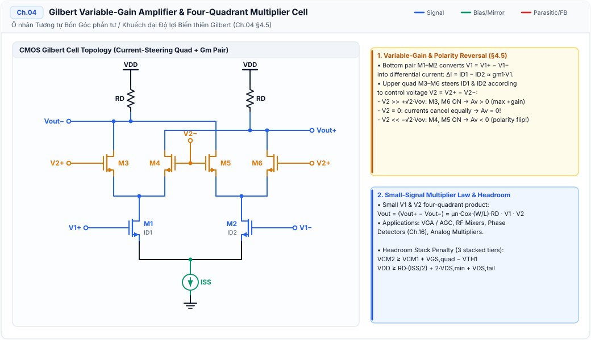

---
{
  "id": "topo-degenerated-diffpair-and-gilbert",
  "kind": "topology",
  "domain": "stages-and-mirrors",
  "title_vi": "Cặp vi sai Suy giảm Nguồn, Tải MOS & Mạch Nhân Tương tự Gilbert (Degenerated Diff-Pair, MOS Loads & Gilbert Cell)",
  "title_en": "Source-Degenerated Differential Pair, MOS Loads, and Gilbert VGA / Four-Quadrant Multiplier",
  "summary": "Mở rộng dải đầu vào tuyến tính của cặp vi sai thêm +-RS*ISS qua hỗ dẫn hiệu dụng Gm = gm/(1 + gm*RS), hệ thống hóa các kiểu tải MOS (mắc diode, nguồn dòng, bơm dòng phụ trợ, cascode) và tổng hợp mạch Gilbert cho khuếch đại độ lợi biến thiên liên tục lẫn nhân tương tự bốn góc phần tư.",
  "diagram": "../../diagrams/gilbert-cell.svg",
  "razavi_refs": [
    {
      "chapter": 4,
      "section": "4.2.3",
      "pages": "116-117",
      "equations": ["4.31", "4.32", "4.33", "4.34", "4.35"]
    },
    {
      "chapter": 4,
      "section": "4.4",
      "pages": "123-126",
      "equations": ["4.59", "4.60", "4.61", "4.62", "4.63", "4.64", "4.65"]
    },
    {
      "chapter": 4,
      "section": "4.5",
      "pages": "126-128",
      "equations": []
    }
  ],
  "glossary_codes": ["T028", "T081", "T636", "T637", "T638", "T639", "T664", "T666", "T667", "T670", "T673", "T675", "T677", "T678", "T679", "T681", "T682", "T684"],
  "process_agnostic": true,
  "roles": {
    "degeneration_network": "RS1, RS2 hoặc cầu 2*RS với nguồn đuôi tách đôi (tuyến tính hóa V-sang-I bằng hồi tiếp âm cục bộ cực nguồn)",
    "mos_load_network": "Tải PMOS mắc diode, nguồn dòng PMOS, nhánh bơm dòng phụ trợ 0.8*ISS/2 hoặc ngăn xếp cascode",
    "gilbert_bottom_pair": "M5, M6 (cặp vi sai tầng dưới chuyển đổi tín hiệu hoặc dòng điều khiển độ lợi)",
    "gilbert_top_quad": "M1-M2 & M3-M4 nối chéo cực máng (chuyển hướng dòng đuôi & cộng dòng đổi cực tính liên tục)"
  },
  "symptoms_addressed": [
    "narrow-differential-input-linear-range-sqrt2-vov",
    "gain-sensitivity-to-gm-pvt-drift",
    "diode-load-gain-versus-headroom-deadlock",
    "need-for-continuous-bipolar-variable-gain-or-analog-multiplication"
  ],
  "limitations": [
    "series-rs-consumes-dc-headroom-while-split-tail-injects-differential-noise-and-offset",
    "high-impedance-mos-loads-leave-output-cm-undefined-without-cmfb",
    "gilbert-stacking-consumes-extra-vgs-minus-vth-cm-level-shift"
  ],
  "checklists": ["common-mos", "differential-pair"]
}
---

## 1. Bản chất Nguyên lý, Sơ đồ Mạch & Vai trò Từng Nhánh Cấu trúc

Cặp vi sai cơ bản dùng tải điện trở thuần bị khóa chặt bởi ba giới hạn cấu trúc: (1) dải đầu vào tuyến tính hẹp $\Delta V_{in1} = \sqrt{2}V_{OV,\text{eq}}$, (2) điện trở tích hợp diện tích lớn hoặc không đạt trở kháng cao để nâng độ lợi, và (3) độ lợi cố định một cực tính. Ba mục cuối của Chương 4 sách Razavi (Mục 4.2.3, 4.4, 4.5) giải quyết lần lượt từng nút thắt bằng ba bước tiến hóa hình thái mạch:

1. **Cặp vi sai có suy giảm tại cực nguồn (*Degenerated Differential Pair* — Mục 4.2.3, Hình 4.27–4.28):** Chèn cặp **điện trở suy giảm tại cực nguồn** (*degeneration resistors*) $R_{S1} = R_{S2} = R_S$ nối tiếp với cực nguồn $M_1, M_2$. Một phần đáng kể điện áp vi sai đầu vào rơi trên $R_S$ tuyến tính thay vì dồn hết lên tiếp giáp phi tuyến $V_{GS}$, làm "dịu" đặc tuyến chuyển đổi điện áp sang dòng điện. Để loại bỏ sụt áp tĩnh $R_S I_{SS}/2$ tốn dự trữ điện áp, Hình 4.28 tách nguồn dòng đuôi thành **nguồn dòng đuôi tách đôi** (*split tail current source*) gồm hai nguồn $I_{SS}/2$ nối thẳng vào cực nguồn $M_1, M_2$ và nối cầu một điện trở $2R_S$ ở giữa (dòng DC qua $2R_S$ bằng $0$ ở cân bằng!).
2. **Cặp vi sai với tải MOS (*Differential Pair with MOS Loads* — Mục 4.4, Hình 4.37–4.40):** Thay điện trở bằng PMOS **tải mắc diode** (*diode-connected loads*, xác lập độ lợi bằng tỷ số hình học và khóa sẵn mức CM ngõ ra), **tải nguồn dòng** (*current-source loads*, nâng độ lợi lên cỡ $g_{mN}(r_{ON}\parallel r_{OP})$), **các nguồn dòng phụ trợ** (*auxiliary current sources* / *current bleeding*, Hình 4.39 gánh bớt $80\%$ dòng DC để phá vỡ đánh đổi độ lợi – dự trữ điện áp), và **cặp vi sai cascode** (*cascode differential pair*, Hình 4.40 nâng độ lợi lên cỡ $(g_m r_O)^2$).
3. **Mạch Gilbert (*Gilbert Cell* — Mục 4.5, Hình 4.41–4.43):** Kết hợp hai thuộc tính bản chất của cặp vi sai — độ lợi phụ thuộc dòng đuôi và khả năng **chuyển hướng dòng đuôi** (*steering the tail current*) — để tạo **bộ khuếch đại độ lợi biến thiên** (*variable-gain amplifier*, VGA) đổi dấu liên tục và **bộ nhân điện áp tương tự** (*analog voltage multiplier*) bốn góc phần tư.

Vai trò từng nhánh trong lõi **mạch Gilbert** hoàn chỉnh (Hình 4.42(d) & 4.43(a)):
- **Hai cặp vi sai tầng trên nối chéo máng ($M_1\text{–}M_2$ và $M_3\text{–}M_4$):** Nhận cùng cặp điện áp vi sai nhưng đấu ngược pha tại cực máng ($I_{out+} = I_{D1} + I_{D4}$ và $I_{out-} = I_{D2} + I_{D3}$), thực hiện **phép cộng trong miền dòng điện** (*summation in the current domain*) trước khi đi qua tải $R_D$.
- **Cặp vi sai tầng dưới ($M_5\text{–}M_6$) & nguồn dòng đuôi $I_{SS}$:** Trong cấu hình Hình 4.42(d), $M_5\text{–}M_6$ nhận điện áp điều khiển $V_{cont} = V_{cont1} - V_{cont2}$ để phân bổ ngược chiều hai dòng đuôi $I_1 + I_2 = I_{SS}$ cho hai cặp trên. Ngược lại, trong cấu hình Hình 4.43(a) (thông dụng hơn ở mạch trộn tần RF và VGA tuyến tính cao), $M_5\text{–}M_6$ (thường kèm suy giảm nguồn $R_S$) chuyển đổi tuyến tính tín hiệu $V_{in}$ thành dòng vi sai, còn bộ tứ $M_1\text{–}M_4$ ở trên nhận $V_{cont}$ để điều hướng dòng tới tải.

---

## 2. Hệ Phương trình Cốt lõi & Tư duy "Nhìn Mạch Đọc Nhanh" (Analysis by Inspection)

### 2.1. Tuyến tính hóa bằng Suy giảm tại Cực nguồn (Phương trình 4.31–4.35)

- **Mở rộng ngưỡng ngắt tín hiệu lớn:** Giả sử tại $\Delta V_{in} = V_{in1} - V_{in2} = \Delta V_{in2}$, nhánh $M_2$ vừa chớm tắt ($I_{D2} = 0, V_{GS2} = V_{TH}$) và $M_1$ mang trọn $I_{D1} = I_{SS}$ (Phương trình 4.31–4.34):

$$V_{in1} - V_{GS1} - R_S I_{SS} = V_{in2} - V_{TH} \implies \Delta V_{in2} = \underbrace{\sqrt{\frac{2I_{SS}}{\mu_n C_{ox}(W/L)}}}_{\Delta V_{in1}} + R_S I_{SS}$$

Dải đầu vào tuyến tính được nới rộng thêm đúng $\pm R_S I_{SS}$ (tức thêm $\pm 2(I_{SS}/2)R_S$ — gấp đôi sụt áp DC trên mỗi điện trở $R_S$ ở trạng thái cân bằng!).
- **Hỗ dẫn hiệu dụng & độ lợi tín hiệu nhỏ qua mạch nửa (Phương trình 4.35):** Vì tâm nút đuôi (hoặc trung điểm điện trở cầu $2R_S$ trong Hình 4.28) là đất ảo vi sai, mỗi nửa mạch chính là một tầng CS suy biến nguồn bởi $R_S$. Với $\lambda = \gamma = 0$:

$$G_{m,\text{eff}} = \frac{g_m}{1 + g_m R_S} = \frac{1}{\dfrac{1}{g_m} + R_S} \implies A_{v,\text{DM}} = -\frac{R_D}{\dfrac{1}{g_m} + R_S}$$

Khi kể thêm hiệu ứng thân ($\gamma \neq 0$, do cực nguồn $M_1, M_2$ cách nút đất ảo qua $R_S$ nên $v_{bs} \neq 0$!), $G_{m,\text{eff}} = \frac{g_m}{1 + (g_m + g_{mb})R_S}$ (bỏ qua $r_O$). Khi thiết kế $g_m R_S \gg 1$, độ lợi hội tụ về tỷ số hai điện trở đồng loại trên chip $A_{v,\text{DM}} \approx -R_D / R_S$, cực kỳ bền vững trước biến thiên nhiệt độ và góc tiến trình PVT!

### 2.2. Hệ Công thức Độ lợi các Cấu hình Tải MOS bằng Mạch nửa (Phương trình 4.59–4.65)

Áp dụng trực tiếp **phương pháp mạch nửa** (nút đuôi là đất ảo) cho từng cấu trúc tải đối xứng tại Mục 4.4:
1. **Tải PMOS mắc diode (Hình 4.37(a), Phương trình 4.59–4.61, $\gamma_P = 0$ khi thân PMOS nối $V_{DD}$):**

$$A_{v,\text{DM}} = -g_{mN}\!\left(\frac{1}{g_{mP}} \parallel r_{ON} \parallel r_{OP}\right) \approx -\frac{g_{mN}}{g_{mP}} = -\sqrt{\frac{\mu_n(W/L)_N}{\mu_p(W/L)_P}}$$

Nếu ghép thêm **nguồn dòng phụ trợ** (*current bleeding*) $M_5, M_6$ gánh tỷ lệ $\alpha \in (0,1)$ dòng nhánh (ví dụ $\alpha = 0{,}8$ trong Hình 4.39(a), để lại $(1-\alpha)I_{SS}/2 = 0{,}2(I_{SS}/2)$ qua $M_3, M_4$): giữ cùng điện áp vượt ngưỡng $\lvert V_{OV,P} \rvert$ cho phép giảm $(W/L)_P$ đi $\frac{1}{1-\alpha} = 5$ lần, hạ $g_{mP}$ đi $5$ lần và **nhân độ lợi lên $\frac{1}{1-\alpha} = 5$ lần** mà không mất thêm dự trữ điện áp! Nếu thay diode bằng điện trở $R_D$ kết hợp bơm dòng phụ trợ $\alpha = 0{,}8$ (Hình 4.39(b), Phương trình 4.64), với cùng $V_{out,CM}$ ta được tăng $R_D$ gấp $5$ lần và đạt đỉnh ngõ ra tới $V_{DD} - \lvert V_{OV,P} \rvert$:

$$\lvert A_{v,\text{DM}} \rvert = g_{mN}(R_D \parallel r_{ON} \parallel r_{OP})$$

2. **Tải nguồn dòng PMOS & Tự phân cực qua điện trở lớn (Hình 4.37(b) & Hình 4.38, Phương trình 4.62–4.63):**
   - Phân cực cổng độc lập $V_b$: $A_{v,\text{DM}} = -g_{mN}(r_{ON} \parallel r_{OP})$.
   - Tự phân cực (*self-biased*, Ví dụ 4.12 Hình 4.38(a)) dùng hai điện trở lớn $R_1 = R_2$ nối từ hai cực máng $X, Y$ vào nút cổng chung $N$ của $M_3, M_4$: ở DC không có dòng qua $R_1, R_2$ nên $V_X = V_Y = V_N = V_{DD} - \lvert V_{GS3,4} \rvert$; ở chế độ vi sai, do $V_X = -V_Y$ đối xứng nên **nút $N$ đứng yên làm đất ảo**, cho mạch nửa (Phương trình 4.63):

$$\lvert A_{v,\text{DM}} \rvert = g_{m1}(r_{O1} \parallel R_1 \parallel r_{O3}) \approx g_{m1}(r_{O1} \parallel r_{O3}) \quad (\text{khi } R_1 \gg r_{O1} \parallel r_{O3})$$

3. **Cặp vi sai Cascode xếp chồng (Hình 4.40, Phương trình 4.65):** Chồng tầng cổng chung NMOS ($M_3, M_4$) và cascode PMOS ($M_5, M_6$ trên nguồn dòng $M_7, M_8$), mạch nửa cho ngay:

$$\lvert A_{v,\text{DM}} \rvert \approx g_{m1}\bigl[(g_{m3}r_{O3}r_{O1}) \parallel (g_{m5}r_{O5}r_{O7})\bigr]$$

### 2.3. Giải tích Mạch Gilbert: VGA Đổi Cực tính & Bộ Nhân Bốn Góc Phần tư (Mục 4.5)

Xét sơ đồ Hình 4.42(c)–(d): $V_{out} = V_{out1} + V_{out2} = R_D(I_{D1} + I_{D4}) - R_D(I_{D2} + I_{D3})$.
- **Trường hợp 1 ($V_{in}$ nhỏ ở bộ tứ trên $M_1\text{–}M_4$, $V_{cont} = V_{cont1} - V_{cont2}$ điều khiển ở cặp dưới $M_5\text{–}M_6$):**
  Cặp trên thứ nhất mang dòng đuôi $I_1 = I_{D5}$ cho hỗ dẫn $+g_{m,\text{top}1}$, cặp trên thứ hai mang dòng đuôi $I_2 = I_{D6}$ nhưng tráo chéo máng nên đóng góp hỗ dẫn $-g_{m,\text{top}2}$. Tổng điện áp vi sai đầu ra đối với $V_{in}$ nhỏ là:

$$V_{out} = -R_D\bigl(g_{m1}(I_1) - g_{m3}(I_2)\bigr)V_{in}$$

*(hoặc mang dấu $+$ tùy cực lấy $V_{out}$ như Hình 4.41(b): $A_v = (g_{m,\text{pair2}} - g_{m,\text{pair1}})R_D$).*
  - Khi $V_{cont}$ rất dương ($I_1 = I_{SS}, I_2 = 0$): toàn bộ dòng chuyển sang cặp $M_1\text{–}M_2$, $A_v = -g_{m,\max}R_D$.
  - Khi $V_{cont} = 0$ ($I_1 = I_2 = I_{SS}/2$): hai dòng tín hiệu triệt tiêu hoàn toàn tại nút máng nối chéo, **$A_v = 0$**!
  - Khi $V_{cont}$ rất âm ($I_1 = 0, I_2 = I_{SS}$): toàn bộ dòng chuyển sang cặp $M_3\text{–}M_4$, **$A_v = +g_{m,\max}R_D$**!
- **Trường hợp 2 ($V_{in}$ ở cặp dưới $M_5\text{–}M_6$, $V_{cont}$ ở bộ tứ trên $M_1\text{–}M_4$ — Hình 4.43):**
  Cặp dưới tạo hai dòng tín hiệu ngược pha $I_{D5} = \frac{I_{SS}}{2} + \frac{1}{2}G_{m5,6}V_{in}$ và $I_{D6} = \frac{I_{SS}}{2} - \frac{1}{2}G_{m5,6}V_{in}$. Bộ tứ trên chia mỗi dòng này theo hệ số chuyển hướng $\eta(V_{cont}) \in [-1, +1]$:
  - Với cả $V_{in}$ và $V_{cont}$ đều nhỏ quanh điểm cân bằng (khai triển Taylor bậc nhất theo Ví dụ 4.13): $V_{out} = V_{in}\cdot f(V_{cont}) \approx \alpha\,V_{in}\,V_{cont}$. Trong miền luật bình phương không suy biến nguồn, phép nhân giải tích tường minh quanh gốc cho:

$$V_{out} \approx \frac{1}{2}\sqrt{\frac{1}{2}\mu_n C_{ox}\!\left(\frac{W}{L}\right)_{1\text{–}4}\mu_n C_{ox}\!\left(\frac{W}{L}\right)_{5,6}}\,R_D\,V_{in}\,V_{cont}$$

  Vì dấu của $V_{out}$ tuân thủ đúng quy tắc dấu đại số ở cả bốn tổ hợp $(+V_{in}, +V_{cont})$, $(+V_{in}, -V_{cont})$, $(-V_{in}, +V_{cont})$, $(-V_{in}, -V_{cont})$, mạch hoạt động như một **bộ nhân tương tự bốn góc phần tư** (*four-quadrant analog multiplier*).
- **Điều kiện phân cực xếp chồng (Stacking Headroom):** Gọi $V_{CM,in}$ là mức CM cổng tầng trên ($M_1\text{–}M_4$) và $V_{CM,cont}$ là mức CM cổng tầng dưới ($M_5\text{–}M_6$). Điện thế nút nguồn chung tầng trên là $V_A = V_B = V_{CM,in} - V_{GS1}$. Để $M_5, M_6$ không rơi vào vùng triode ($V_{GD5,6} \le V_{TH5,6}$):

$$V_{CM,cont} \le V_{CM,in} - V_{GS1} + V_{TH5,6} \approx V_{CM,in} - V_{OV1}$$

---

## 3. Bất biến Cấu trúc & Các Bẫy Lỗi Kinh điển (Structural Invariants & Traps)

- **`[INV-GIL-01]` Bất biến bảo toàn dòng tổng qua hai tầng ghép chồng:** Trong mạch Gilbert, bất kể $V_{in}$ và $V_{cont}$ biến thiên lớn hay nhỏ, tổng dòng qua hai nhánh tải luôn bằng $I_{D,\text{left}} + I_{D,\text{right}} = (I_{D1} + I_{D4}) + (I_{D2} + I_{D3}) = I_{D5} + I_{D6} = I_{SS}$, giữ mức chế độ chung đầu ra $V_{out,CM} = V_{DD} - R_D I_{SS}/2$ **hoàn toàn bất biến** không bị giật (glitch DC) khi quét độ lợi qua $0$!
- **`[INV-GIL-02]` Bất biến khoảng dịch mức chế độ chung giữa hai cổng xếp chồng:** Cổng của cặp vi sai tầng trên bắt buộc phải phân cực cao hơn cổng cặp vi sai tầng dưới ít nhất một điện áp vượt ngưỡng ($V_{CM,\text{upper}} - V_{CM,\text{lower}} \ge V_{GS,\text{upper}} - V_{TH,\text{lower}} \approx V_{DS,\min,\text{lower}} + V_{TH}$ lệch nếu có hiệu ứng thân).

- **`[TRAP-GIL-01]` Cái giá ẩn của nguồn dòng đuôi tách đôi (Chú thích 7 trang 117 sách Razavi):** Mạch Hình 4.28 khôi phục hoàn hảo dự trữ điện áp DC $R_S I_{SS}/2$, nhưng rất nhiều người thiết kế quên rằng hai nguồn dòng đuôi rời $I_{SS1} = I_{SS}/2$ và $I_{SS2} = I_{SS}/2$ nay nằm ở hai phía của điện trở $2R_S$! Sai lệch tĩnh $\Delta I_{\text{tail}}$ và nhiễu nhiệt/nhấp nháy của hai nguồn dòng này **không còn là chế độ chung** nữa mà đi thẳng qua $M_1, M_2$ thành nhiễu và điện áp lệch vi sai quy về ngõ vào ($\Delta V_{in,\text{eq}} \approx \Delta I_{\text{tail}} \cdot R_S$ khi $g_m R_S \gg 1$)!
- **`[TRAP-GIL-02]` Thả nổi mức chế độ chung đầu ra khi dùng tải nguồn dòng PMOS (Hình 4.37(b) & 4.40):** Khi thay tải diode bằng nguồn dòng PMOS hoặc cascode để lấy độ lợi cao, hai nguồn dòng NMOS dưới và PMOS trên đối đầu nhau ở trở kháng cao. Chỉ cần lệch $0{,}1\%$ dòng gương là cả $V_X, V_Y$ trôi kẹp cứng lên $V_{DD}$ hoặc sập xuống đất làm transistor chui vào vùng triode — **bắt buộc** phải đi kèm mạch hồi tiếp chế độ chung (`tech-common-mode-feedback-cmfb`) hoặc điện trở tự phân cực $R_1, R_2$ như Hình 4.38!
- **`[TRAP-GIL-03]` Đặt tín hiệu lớn vào bộ tứ trên của Gilbert Cell gây méo nặng:** Ở cấu hình Hình 4.42(d), bộ tứ trên $M_1\text{–}M_4$ rất khó gắn điện trở suy biến nguồn (vì gồm 4 nhánh nguồn tách rời tốn diện tích và ký sinh). Nếu cần xử lý biên độ $V_{in}$ lớn với độ tuyến tính cao, luôn ưu tiên đưa $V_{in}$ xuống cặp dưới $M_5\text{–}M_6$ có suy biến nguồn $R_S$ (Hình 4.43(a)) và đưa tín hiệu điều khiển / dao động nội (LO) lên bộ tứ chuyển mạch phía trên!

---

## 4. Lộ trình Nâng cấp Cấu trúc & Bát giác Đánh đổi (Upgrade Paths & Design Octagon)

Trên Bát giác Thiết kế (`concept-analog-design-octagon`), thẻ này thể hiện rõ hai nghệ thuật tháo gỡ đánh đổi kinh điển của Razavi:
- **Đánh đổi Độ lợi $\leftrightarrow$ Tuyến tính $\leftrightarrow$ Nhiễu:** Suy giảm cực nguồn $R_S$ nới rộng dải tuyến tính thêm $\pm R_S I_{SS}$ nhưng hạ độ lợi đi $(1 + g_m R_S)$ lần và cộng thêm nhiễu nhiệt điện trở $4kT(2R_S)$ trực tiếp vào ngõ vào vi sai (`law-stage-and-mirror-noise-rules`, `law-differential-nonlinearity-and-feedback`).
- **Phá vỡ khóa chết Độ lợi $\leftrightarrow$ Dự trữ điện áp:** Kỹ thuật bơm dòng phụ trợ (*current bleeding*, Hình 4.39) tách rời dòng DC qua tải khỏi dòng DC qua cặp đầu vào (nhờ đó giữ $g_{mN}$ lớn trong khi giảm $g_{mP}$ hoặc sụt áp $I_{R}R_D$).

Lộ trình liên kết sang các cấu trúc lân cận trong kho tri thức:
1. **Từ cặp vi sai cơ bản tiến tới thẻ này** $\leftarrow$ `topo-basic-differential-pair` và nền tảng một tầng `topo-cs-source-degeneration`.
2. **Từ cặp vi sai cascode Hình 4.40 tiến tới Op-Amp hoàn chỉnh kèm CMFB:**
   - Giữ xếp chồng trực tiếp $\rightarrow$ `topo-telescopic-cascode-opamp` + `tech-common-mode-feedback-cmfb`.
   - Gập nhánh dòng tín hiệu để giải phóng dự trữ điện áp xếp chồng (cùng tư tưởng với current bleeding!) $\rightarrow$ `topo-folded-cascode-ota`.
3. **Ứng dụng mạch Gilbert làm bộ tách pha (Phase Detector) trong vòng khóa pha** $\rightarrow$ `topo-type1-simple-pll`.
4. **Kỹ thuật tuyến tính hóa bậc cao (ghép chéo cặp lệch kích thước) & định luật méo hài** $\rightarrow$ `law-differential-nonlinearity-and-feedback`.

---

## 5. Thích ứng Đa Tiến trình (90nm / 65nm / 45nm) & Cách Kiểm chứng trong Cadence / Spectre

### 5.1. Thích ứng trên Công nghệ Nanomet Điện áp Thấp ($V_{DD} = 1{,}0\text{ V} - 1{,}2\text{ V}$)

- **Thách thức xếp chồng 3 tầng của Gilbert Cell chuẩn:** Mạch Gilbert cổ điển chồng 3 lớp MOSFET bão hòa ($I_{SS}$ + $M_{5,6}$ + $M_{1\text{–}4}$) cộng thêm tải $R_D$. Ở 65nm/45nm với $V_{DD} = 1{,}0\text{ V}$:
  - Phải định cỡ từng lớp theo $V_{DS,\min} \approx 120 - 150\text{ mV}$ (`tech-nanometer-vdsmin-gmid-sizing`, tức $g_m/I_D \approx 12 - 15\text{ V}^{-1}$); tổng ba lớp tiêu thụ $\approx 400 - 450\text{ mV}$, để lại $\approx 300\text{ mV}$ sụt áp DC trên $R_D$ và $\pm 250\text{ mV}$ biên độ mỗi nhánh ($\approx 1{,}0\text{ V}_{pp}$ vi sai).
  - Nếu ngân sách điện áp dưới $0{,}9\text{ V}$ không đủ chồng 3 lớp: dùng cấu trúc **gập dòng (Folded Gilbert Cell)** — cặp dưới NMOS $M_{5,6}$ bơm dòng vào tải nguồn dòng, rồi gập sang bộ tứ chuyển mạch PMOS $M_{1\text{–}4}$, hoặc dùng cầu suy biến nguồn tách đôi (Hình 4.28) kết hợp transistor đuôi diện tích lớn $L \ge 6 L_{\min}$ để nén nhiễu nhiệt.
- **Hiệu ứng thân mạnh trên bộ tứ trên $M_1\text{–}M_4$:** Do cực nguồn của $M_1\text{–}M_4$ nằm cao ở $V_A, V_B \approx 0{,}4 - 0{,}6\text{ V}$, $V_{SB} > 0$ làm tăng $V_{TH1\text{–}4}$ thêm $80 - 150\text{ mV}$ ở góc `SS` nhiệt độ thấp ($-40^\circ\text{C}$)! Trong tiến trình có tùy chọn **Deep N-Well (Triple-Well)**, đặt bộ tứ $M_1\text{–}M_4$ vào giếng p riêng nối với nguồn hoặc kiểm tra sát sao điều kiện $V_{CM,in}$ ở góc `SS, -40C`.

### 5.2. Quy trình Kiểm chứng trên Cadence Virtuoso IC617 & Spectre

1. **Kiểm tra Điểm làm việc Đa nhánh (`dc` OP):**
   - Với mạch Gilbert ở $V_{cont} = 0, V_{in} = 0$: xác nhận $I_{D1} = I_{D2} = I_{D3} = I_{D4} = I_{SS}/4$, $I_{D5} = I_{D6} = I_{SS}/2$, toàn bộ 7 transistor ($M_1\text{–}M_6$ và $M_{\text{tail}}$) đều có `region == 2` và `vds - vdsat >= 50 mV` ngay cả khi quét $V_{cont}$ tới hai biên cực đại $\pm \Delta V_{cont,\max}$.
2. **Kiểm tra Mở rộng Dải Tuyến tính & IIP3 / HD3 (`dc` sweep, `pss` + `pac` / `hb`):**
   - Cho cặp vi sai suy biến nguồn: quét `dc` biến `vdm` và vẽ hàm $G_m(\Delta V_{in}) = \text{deriv}(I_{D1} - I_{D2})$; đối chiếu bề rộng đỉnh phẳng (giảm $1\text{ dB}$) trước và sau khi có $R_S$ theo quy luật $\Delta V_{in2} - \Delta V_{in1} \approx R_S I_{SS}$.
   - Chạy hai tông tần số gần nhau bằng `hb` hoặc `pss`/`qpnoise` để đo điểm cắt bậc ba `IIP3` và độ nén `P1dB`.
3. **Kiểm tra Đặc tuyến VGA & Nhân Bốn Góc Phần tư (`dc` parametric sweep & `tran`):**
   - Chạy `ac` với tham số quét `vcont` từ $-0{,}3\text{ V}$ đến $+0{,}3\text{ V}$: vẽ họ đường cong độ lợi có dấu `real(VF("/Vout+") - VF("/Vout-"))` đi mượt qua $0$ và đổi pha $180^\circ$ khi `vcont` đổi dấu; đồng thời vẽ $V_{out,CM} = (V_X + V_Y)/2$ để xác nhận mức DC chung đứng im tuyệt đối!

---

## 6. Mốc Đối chiếu Sách Razavi & Thuật ngữ Chuẩn CLB

| Mốc Sách Razavi (2nd Ed.) | Trang Sách (PDF Ch.04) | Nội dung & Phương trình Đối chiếu | Mã Thuật ngữ Chuẩn CLB (`terms-vi-en.json`) |
|---|---|---|---|
| **Mục 4.2.3**, Hình 4.27–4.28, Chú thích 7 | tr. 116–117 (PDF 17–18) | Cặp vi sai suy giảm nguồn, mở rộng dải $\Delta V_{in2} = \Delta V_{in1} + R_S I_{SS}$ **(4.31)–(4.34)**, độ lợi **(4.35)**, nguồn dòng đuôi tách đôi & bẫy nhiễu/offset vi sai | `T028` (cặp vi sai có suy biến / suy giảm tại cực nguồn), `T081` (suy biến nguồn), `T636` (suy giảm tại cực nguồn bằng điện trở), `T637` (dải đầu vào tuyến tính), `T639` (nguồn dòng đuôi tách đôi) |
| **Mục 4.4**, Hình 4.37–4.40, Ví dụ 4.12 | tr. 123–126 (PDF 24–27) | Tải mắc diode **(4.59)–(4.61)**, tải nguồn dòng **(4.62)**, tự phân cực qua $R_{1,2}$ **(4.63)**, nguồn dòng phụ trợ bơm dòng **(4.64)**, cặp vi sai cascode **(4.65)** | `T664` (cặp vi sai với tải MOS), `T666` (tải mắc diode), `T667` (tải nguồn dòng), `T670` (tự phân cực), `T673` (các nguồn dòng phụ trợ), `T675` (cặp vi sai cascode) |
| **Mục 4.5**, Hình 4.41–4.43, Ví dụ 4.13 | tr. 126–128 (PDF 27–29) | Tổng hợp VGA đổi dấu liên tục bằng cộng miền dòng điện, hai cấu hình Gilbert Cell (tín hiệu tầng trên vs. tầng dưới), bộ nhân bốn góc phần tư & điều kiện dịch mức CM xếp chồng | `T677` (mạch Gilbert), `T678` (chuyển hướng dòng đuôi), `T679` (bộ khuếch đại độ lợi biến thiên — VGA), `T681` (phép cộng trong miền dòng điện), `T682` (bộ nhân điện áp tương tự) |
