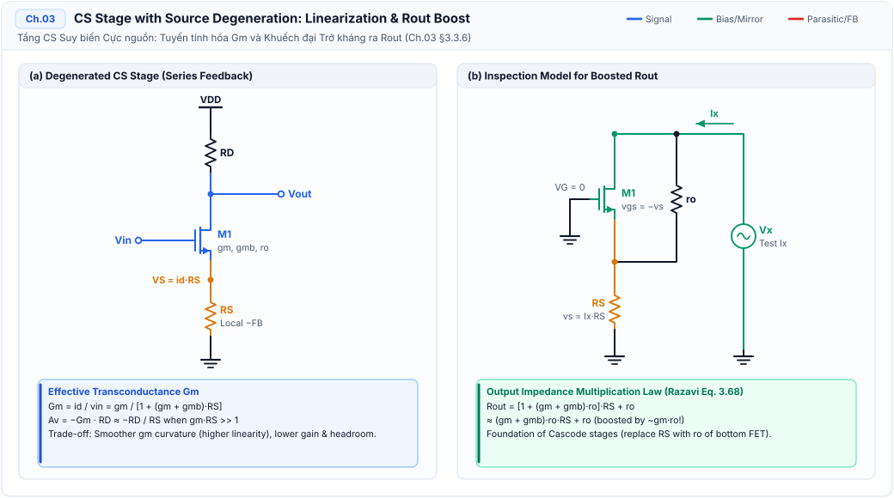

---
{
  "id": "topo-diff-pair-with-degeneration-and-triode-loads",
  "kind": "topology",
  "domain": "stages-and-mirrors",
  "title_vi": "Cặp vi sai có suy biến cực nguồn & Tải vùng triode (Source-Degenerated Differential Pair & Triode/MOS Loads)",
  "title_en": "Source-Degenerated Differential Pair, Triode Degeneration/Loads, and CMRR Asymmetry Analysis",
  "summary": "Khai thác hồi tiếp âm cục bộ cực nguồn (hai cấu hình nối tiếp RS đơn đuôi và cầu 2RS tách đuôi, hoặc MOSFET vùng triode sâu) để mở rộng dải đầu vào tuyến tính lên +-(ISS*RS + sqrt(2)*VOV), nén méo hài bậc ba HD3 theo lũy thừa của (1 + gm*RS), kết hợp hệ tải MOS/triode và giải tích chính xác sự suy giảm CMRR dưới bất đối xứng tải Delta_RD và hỗ dẫn Delta_gm.",
  "diagram": "../../diagrams/cs-source-degeneration.svg",
  "razavi_refs": [
    {
      "chapter": 4,
      "section": "4.2.3, 4.3, 4.4",
      "pages": "116-126",
      "equations": ["4.31", "4.32", "4.33", "4.34", "4.35", "4.52", "4.58", "4.59", "4.60", "4.63", "4.65"]
    }
  ],
  "glossary_codes": ["T028", "T057", "T081", "T185", "T513", "T523", "T576", "T607", "T661"],
  "process_agnostic": true,
  "roles": {
    "input_transconductors_M1_M2": "Cặp transistor vi sai chuyển đổi phần điện áp dư sau suy biến nguồn thành dòng điện vi sai +-Delta_I, triệt tiêu méo bậc chẵn nhờ đối xứng cấu trúc.",
    "series_or_bridge_degeneration_RS": "Mạng điện trở suy biến nguồn (hai nhánh nối tiếp RS tụ về một nguồn đuôi ISS, hoặc một cầu 2RS nối giữa hai nguồn đuôi tách đôi ISS/2) tạo hồi tiếp âm cục bộ để mở rộng dải tuyến tính.",
    "triode_mos_degeneration_MR": "Transistor MOS làm việc ở vùng triode sâu mắc cầu giữa hai cực nguồn S1-S2, cho phép điều chỉnh điện tử hỗ dẫn hiệu dụng Gm theo điện áp cổng Vtune.",
    "triode_and_mos_loads_M3_M4": "Tải PMOS vùng triode sâu (điện trở tích hợp không mất sụt áp VTH, giữ DC ngõ ra không cần CMFB) hoặc tải diode / nguồn dòng tự phân cực / cascode.",
    "tail_current_network_ISS": "Nguồn dòng đuôi trở kháng RSS quyết định khả năng khử chế độ chung và giới hạn chuyển đổi CM sang DM khi xuất hiện lệch tải hoặc lệch gm."
  },
  "symptoms_addressed": [
    "narrow-differential-input-linear-range-sqrt2-vov",
    "excessive-third-harmonic-distortion-hd3-in-vga-or-filter",
    "severe-gain-drift-across-pvt-in-gm-c-stages",
    "ohms-law-or-vth-headroom-loss-with-passive-or-diode-loads"
  ],
  "limitations": [
    "series-rs-sacrifices-dc-voltage-headroom-iss-rs-over-2",
    "bridge-2rs-split-tail-injects-uncorrelated-tail-noise-and-offset",
    "degeneration-reduces-differential-gain-and-can-lower-cmrr-under-load-mismatch",
    "triode-pmos-load-resistance-tracks-pvt-poorly-and-bends-near-saturation"
  ],
  "checklists": ["common-mos", "differential-pair"]
}
---

## 1. Bản chất Nguyên lý, Sơ đồ Mạch & Vai trò Từng Nhánh Cấu trúc

Trong một cặp vi sai cơ bản (`topo-basic-differential-pair`), toàn bộ điện áp vi sai đầu vào $\Delta V_{in} = V_{in1} - V_{in2}$ đặt trực tiếp lên hiệu điện áp cổng–nguồn $V_{GS1} - V_{GS2}$ của hai MOSFET bão hòa. Do đặc tuyến truyền đạt bị chi phối bởi tính phi tuyến (`T057`, *nonlinearity*) bậc hai/hàm mũ của kênh dẫn, một nhánh sẽ ngắt hoàn toàn ngay khi $|\Delta V_{in}| = \sqrt{2}\,V_{OV,\text{eq}}$, bó hẹp nghiêm trọng tính tuyến tính (`T523`, *linearity*) trong các bộ lọc thời gian liên tục $G_m\text{-}C$, bộ khuếch đại độ lợi biến thiên (VGA) và đầu vào ADC. Để phá vỡ giới hạn này, Razavi (Mục 4.2.3, trang 116–117) áp dụng nguyên lý **đánh đổi độ lợi tín hiệu nhỏ lấy độ tuyến tính (`T607`, *trading small-signal gain for linearity*)** thông qua kỹ thuật **suy biến nguồn (`T081`, *source degeneration*)**, hình thành **cặp vi sai có suy biến (`T028`, *degenerated differential pair*)**.



Bốn nhánh kiến trúc cốt lõi của họ mạch này (kết hợp Mục 4.2.3, 4.3 và 4.4, trang 116–126) được phân hóa rõ rệt theo bài toán dự trữ điện áp, nhiễu và khả năng tinh chỉnh:

1. **Cấu hình I — Hai điện trở nối tiếp $R_{S1} = R_{S2} = R_S$ tụ về một nguồn đuôi duy nhất $I_{SS}$ (Hình 4.27a & 4.28a):** Mỗi cực nguồn $S_1, S_2$ nối qua một điện trở $R_S$ rồi mới chụm vào nút đuôi chung $P$ của nguồn dòng $I_{SS}$. Cấu trúc này giữ nguyên tính chất tuyệt vời của nguồn đuôi đơn: mọi nhiễu nhiệt, nhiễu nhấp nháy $1/f$ và sai lệch DC của nguồn dòng $I_{SS}$ đều chia đều thành chế độ chung trên hai nhánh và tự triệt tiêu ở đầu ra vi sai. Đổi lại, ở trạng thái cân bằng tĩnh mỗi điện trở phải gánh dòng $I_{SS}/2$, gây sụt áp một chiều $\frac{1}{2} I_{SS} R_S$ đẩy cả hai cực nguồn lên cao và ăn mòn khoảng dự trữ điện áp ICMR.
2. **Cấu hình II — Một điện trở cầu $2R_S$ nối giữa hai nguồn dòng đuôi tách đôi $I_{SS}/2$ (Hình 4.28b):** Tách nguồn dòng đuôi thành hai nguồn độc lập có giá trị danh định $I_{SS}/2$ cấp trực tiếp vào $S_1$ và $S_2$, đồng thời mắc bắc cầu một điện trở nổi có giá trị $2R_S$ nối giữa $S_1$ và $S_2$. Tại điểm cân bằng $\Delta V_{in} = 0$, do đối xứng $V_{S1} = V_{S2}$ nên **dòng một chiều chạy qua cầu $2R_S$ bằng $0$ tuyệt đối**, khôi phục hoàn toàn $\frac{1}{2} I_{SS} R_S$ dự trữ điện áp! Về mặt tín hiệu nhỏ vi sai, trung điểm của điện trở $2R_S$ là đất ảo xoay chiều nên mỗi nửa mạch vẫn nhìn thấy đúng $R_S$ xuống đất. Tuy nhiên, cái giá phải trả cực đắt là hai nguồn đuôi $I_{SS1}, I_{SS2}$ không còn chung nút: bất kỳ sai lệch dòng tĩnh $\Delta I_{\text{tail}}$ hoặc dòng nhiễu không tương quan nào của chúng đều bơm thẳng vào cầu $2R_S$ và xuất hiện trực tiếp ở ngõ ra vi sai!
3. **Biến thể Suy biến bằng MOSFET Vùng Triode Sâu ($M_R$ mắc cầu giữa $S_1$ và $S_2$):** Trên vi mạch CMOS không có điện trở tinh chỉnh được, điện trở cầu $2R_S$ trong Cấu hình II được thay bằng một transistor NMOS $M_R$ làm việc trong **vùng triode (`T185`, *triode region*)** với cực cổng nhận áp điều khiển $V_{\text{tune}}$. Hơn thế nữa, nhờ hai đầu cực máng–nguồn của $M_R$ dao động đối xứng ngược pha quanh thế tĩnh $V_{S0}$ ($V_{S1} = V_{S0} + \Delta v_s$, $V_{S2} = V_{S0} - \Delta v_s$), số hạng phi tuyến bậc hai $\frac{1}{2}(V_{S1}^2 - V_{S2}^2) = V_{S0}(V_{S1} - V_{S2})$ trong phương trình dòng triode tự động rút gọn thành tuyến tính bậc nhất theo $(V_{S1} - V_{S2})$ khi $V_{S0}$ đứng yên!
4. **Hệ Tải Phía Trên — Từ Tải PMOS Vùng Triode (`T513`) đến Tải MOS Trở kháng Cao (Mục 4.4, Hình 4.37–4.40):** Để biến dòng vi sai đã tuyến tính hóa thành điện áp ra mà không cần diện tích điện trở polysilicon lớn và không mất ngưỡng $|V_{THP}|$ như tải mắc diode, cặp PMOS $M_3, M_4$ được phân cực cổng ở mức thấp $V_b$ để hoạt động như **tải làm việc ở vùng triode (`T513`, *triode load*)** kéo thẳng lên $V_{DD}$ (tự cố định mức CM ngõ ra mà không cần CMFB). Khi cần độ lợi cao thay vì dải tuyến tính rộng, tải được nâng cấp sang PMOS mắc diode, nguồn dòng tự phân cực qua điện trở lớn $R_1, R_2$, hoặc ngăn xếp cascode.

---

## 2. Hệ Phương trình Cốt lõi & Tư duy "Nhìn Mạch Đọc Nhanh" (Analysis by Inspection)

### 2.1. Mở rộng Dải Đầu vào Tuyến tính Tín hiệu Lớn (Phương trình 4.31–4.34)
Xét Hình 4.27(a) với hai transistor khớp nhau ($\lambda = \gamma = 0$). Ta tìm ngưỡng điện áp vi sai cực đại $\Delta V_{in2} = V_{in1} - V_{in2}$ làm nhánh $M_2$ vừa chớm tắt ($I_{D2} = 0 \implies V_{GS2} = V_{TH}$) và nhánh $M_1$ dẫn trọn dòng đuôi ($I_{D1} = I_{SS}$). Viết phương trình Kirchhoff điện áp đi từ $V_{in1}$ qua $M_1, R_{S1}, R_{S2}, M_2$ sang $V_{in2}$ (lưu ý lúc này dòng qua $R_{S2}$ bằng $0$ còn dòng qua $R_{S1}$ bằng $I_{SS}$, hoặc trong mạch cầu $2R_S$ dòng $I_{SS}/2$ từ nguồn đuôi phải chạy ngược toàn bộ qua $2R_S$ sang $M_1$ tạo cùng độ chênh áp $2R_S \cdot \frac{I_{SS}}{2} = R_S I_{SS}$!), ta thu được chính xác chuỗi Phương trình (4.31)–(4.34):

$$
V_{in1} - V_{GS1} - R_S I_{SS} = V_{in2} - V_{TH} \implies \Delta V_{in2} = (V_{GS1} - V_{TH})\big|_{I_{D1}=I_{SS}} + R_S I_{SS}
$$

$$
\Delta V_{in2} = \underbrace{\sqrt{\frac{2 I_{SS}}{\mu_n C_{ox}\left(\dfrac{W}{L}\right)}}}_{\Delta V_{in1} = \sqrt{2}\,V_{OV,\text{eq}}} + R_S I_{SS} \implies \Delta V_{in2} - \Delta V_{in1} = R_S I_{SS}
$$

trong đó $V_{OV,\text{eq}} = \sqrt{\frac{I_{SS}}{\mu_n C_{ox}(W/L)}}$ là điện áp vượt ngưỡng tĩnh của mỗi transistor tại điểm cân bằng $I_{D1} = I_{D2} = I_{SS}/2$. Như vậy, suy biến nguồn mở rộng biên độ đầu vào cần thiết để ngắt hoàn toàn một nhánh từ $\pm\sqrt{2}\,V_{OV,\text{eq}}$ lên **$\pm\left(\sqrt{2}\,V_{OV,\text{eq}} + I_{SS} R_S\right)$** — tức nới rộng thêm đúng hai lần độ sụt áp tĩnh $V_{RS,\text{DC}} = \frac{1}{2} I_{SS} R_S$ trên mỗi điện trở!

### 2.2. Hỗ dẫn Hiệu dụng $G_m$, Khai triển Chuỗi Lũy thừa & Quy luật Nén Méo Hài $HD_3$ (Phương trình 4.35)
Áp dụng bổ đề mạch nửa vi sai quanh mặt phẳng đối xứng (nút chung $P$ ở Hình 4.27a hoặc trung điểm cầu $2R_S$ ở Hình 4.28b là đất ảo xoay chiều), mỗi nửa mạch là một tầng CS suy biến nguồn bởi $R_S$. Với $\lambda = \gamma = 0$, Phương trình (4.35) cho ngay độ lợi vi sai bằng tư duy nhìn mạch (tỉ số tổng trở tại cực máng chia cho tổng điện trở trên đường cực nguồn):

$$
G_m = \frac{g_m}{1 + g_m R_S} = \frac{1}{\dfrac{1}{g_m} + R_S}, \qquad \left|A_{v,\text{DM}}\right| = G_m R_D = \frac{R_D}{\dfrac{1}{g_m} + R_S}
$$

Nếu xét đầy đủ hiệu ứng thân ($\gamma \neq 0$, cực nguồn $M_1, M_2$ dao động so với đế nối đất nên xuất hiện $g_{mb} v_{sb}$) và điện trở kênh hữu hạn $r_O$, trở kháng ra của nửa mạch tăng vọt lên $R_{out,\text{half}} = [1 + (g_m + g_{mb})r_O]R_S + r_O$, còn hỗ dẫn ngắn mạch chính xác là:

$$
G_{m,\text{exact}} = \frac{g_m r_O}{r_O + \left[1 + (g_m + g_{mb})r_O\right] R_S} \xrightarrow{r_O \to \infty} \frac{g_m}{1 + (g_m + g_{mb})R_S}
$$

**Chứng minh định lượng sự nén méo hài bậc ba ($HD_3$):** Đặt $\Delta I = \frac{I_{D1} - I_{D2}}{2}$ quanh dòng tĩnh $I_0 = I_{SS}/2$ (với $I_{D1} + I_{D2} = 2I_0$ và $g_m = \frac{2I_0}{V_{OV,\text{eq}}}$). Phương trình KVL vi sai chính xác cho mô hình luật bình phương là:

$$
\Delta V_{in} = V_{OV,\text{eq}}\!\left(\sqrt{1 + \frac{\Delta I}{I_0}} - \sqrt{1 - \frac{\Delta I}{I_0}}\right) + 2 R_S \Delta I = \frac{2(1 + g_m R_S)}{g_m}\,\Delta I + \frac{V_{OV,\text{eq}}}{8 I_0^3}\,\Delta I^3 + \mathcal{O}(\Delta I^5)
$$

Đảo chuỗi lũy thừa bậc ba ($\Delta V_{in} = a_1 \Delta I + a_3 \Delta I^3 \implies \Delta I = \frac{1}{a_1}\Delta V_{in} - \frac{a_3}{a_1^4}\Delta V_{in}^3$) và thế kích thích hình sin $\Delta V_{in}(t) = V_p \cos(\omega t)$ (dùng $\cos^3\omega t = \frac{3}{4}\cos\omega t + \frac{1}{4}\cos 3\omega t$), ta thu được biểu thức $HD_3$ dưới hai chuẩn so sánh thiết kế:
- **Tại cùng biên độ điện áp đầu vào đỉnh $V_p$:** $HD_3\big|_{V_p} \approx \dfrac{V_p^2}{32\,V_{OV,\text{eq}}^2\,(1 + g_m R_S)^3}$ (cho kênh dài luật bình phương; trong kênh ngắn vận tốc bão hòa hoặc khi tồn tại điều biến $g_{mb}(V_{SB})$, bậc nén hiệu dụng nằm trong khoảng $(1 + g_m R_S)^2$ đến $(1 + g_m R_S)^3$).
- **Khi chuẩn hóa theo biên độ điện áp ra hoặc giữ tích tín hiệu – hỗ dẫn hiệu dụng:** Khi tăng $V_p$ tỉ lệ với $\sqrt{1 + g_m R_S}$ (hoặc so sánh hệ số phi tuyến bậc ba chuẩn hóa trên dải công suất cố định), hệ số nén méo hài bậc ba thực tế tỉ lệ nghịch với **$(1 + g_m R_S)^2$** (tương đương giảm $12\text{ dB}$ méo $HD_3$ mỗi khi tăng nhân tử hồi tiếp cục bộ $1 + g_m R_S$ gấp đôi!).

### 2.3. Tải PMOS Vùng Triode Sâu & Phổ Tải MOS (Mục 4.4, Phương trình 4.59–4.65)
Khi thay tải điện trở $R_D$ bằng cặp PMOS $M_3, M_4$ phân cực cổng tại $V_b$ thấp để vận hành làm **tải làm việc ở vùng triode (`T513`)**, miễn là biên độ ngõ ra giữ $|V_{DS3,4}| = V_{DD} - V_{out} \ll 2(V_{DD} - V_b - |V_{THP}|)$, điện trở dẫn tín hiệu nhỏ mỗi nhánh và độ lợi vi sai là:

$$
R_{on3,4} = \frac{1}{\mu_p C_{ox}\left(\dfrac{W}{L}\right)_{3,4}\!\left(V_{DD} - V_b - |V_{THP}|\right)}, \qquad A_{v,\text{DM}} = -\frac{R_{on3,4} \parallel R_{out,\text{half}}}{\dfrac{1}{g_{m1,2}} + R_S} \approx -\frac{g_{m1,2} R_{on3,4}}{1 + g_{m1,2} R_S}
$$

Đối chiếu với ba cấu trúc tải MOS bão hòa trong Mục 4.4 (trang 123–126) khi $R_S = 0$ (hoặc thay $g_{mN} \to G_{m,\text{eff}}$ khi $R_S > 0$):
1. **Tải PMOS mắc diode (Hình 4.37a, Phương trình 4.59–4.60):** $A_v = -g_{mN}\!\left(g_{mP}^{-1} \parallel r_{ON} \parallel r_{OP}\right) \approx -\dfrac{g_{mN}}{g_{mP}}$, xác định chặt mức DC ngõ ra $V_{DD} - |V_{GS,P}|$ nhưng mất dự trữ điện áp $|V_{THP}|$.
2. **Tải nguồn dòng PMOS tự phân cực qua cặp điện trở lớn $R_1 = R_2$ (Ví dụ 4.12, Hình 4.38, Phương trình 4.63):** Nút cổng chung $N$ đứng yên ở đất ảo vi sai nhưng tự khóa mức CM ngõ ra bằng $V_{DD} - |V_{GS3,4}|$ ở DC, cho $|A_v| = g_{m1}(r_{O1} \parallel R_1 \parallel r_{O3})$.
3. **Cặp vi sai Cascode (Hình 4.40, Phương trình 4.65):** $|A_v| \approx g_{m1}\bigl[(g_{m3}r_{O3}r_{O1}) \parallel (g_{m5}r_{O5}r_{O7})\bigr]$, nhưng chú ý nếu chèn thêm $R_S$ ở đáy cặp cascode thì độ lợi tổng vẫn giảm theo $1/(1 + g_{m1}R_S)$ khi trở kháng tải nhỏ hơn trở kháng nhánh cascode.

### 2.4. Giải tích Suy giảm CMRR dưới Trở kháng Đuôi $R_{SS}$ & Bất đối xứng $\Delta R_D, \Delta g_m$ (Mục 4.3, Phương trình 4.52, 4.58)
Khả năng khử chế độ chung (`T576`, *common-mode rejection*) được định lượng qua **tỷ số khử chế độ chung (`T661`, *common-mode rejection ratio — CMRR*)** $\text{CMRR} = \left|\frac{A_{\text{DM}}}{A_{\text{CM-DM}}}\right|$. Khi chưa có suy biến ($R_S = 0$), Razavi chứng minh hai cơ chế chuyển đổi CM sang DM cốt lõi:
- **Do bất đối xứng hỗ dẫn $\Delta g_m = g_{m1} - g_{m2}$ (Phương trình 4.52 & 4.58):** Biến thiên đồng pha $V_{in,\text{CM}}$ sinh ra ngõ ra vi sai $V_X - V_Y = -\dfrac{g_{m1} - g_{m2}}{(g_{m1} + g_{m2})R_{SS} + 1} R_D V_{in,\text{CM}}$, dẫn tới:

$$
\text{CMRR}_{\Delta g_m}\big|_{R_S=0} = \frac{g_{m1} + g_{m2} + 4 g_{m1} g_{m2} R_{SS}}{2|\Delta g_m|} \approx \frac{g_m}{|\Delta g_m|}\left(1 + 2 g_m R_{SS}\right)
$$

- **Tác động hai mặt cực kỳ thú vị khi thêm suy biến nguồn $R_S > 0$ (cấu hình đơn đuôi Hình 4.27a):** Thay mỗi transistor bằng nhánh suy biến có hỗ dẫn hiệu dụng $G_{m,i} = \frac{g_{m,i}}{1 + g_{m,i} R_{S,i}}$:
  1. *Đối với lệch tải $\Delta R_D = R_{D1} - R_{D2}$ (hoặc lệch tải triode $\Delta R_{on,P}$):* Độ lợi chuyển đổi CM sang DM là $\left|A_{\text{CM-DM},\Delta R_D}\right| = \dfrac{|\Delta R_D|}{2 R_{SS} + R_S + 1/g_m} \approx \dfrac{|\Delta R_D|}{2 R_{SS}}$ (hầu như không giảm vì $2R_{SS} \gg R_S$), trong khi độ lợi vi sai $\left|A_{\text{DM}}\right| = \dfrac{R_D}{R_S + 1/g_m}$ **bị chia nhỏ đi $(1 + g_m R_S)$ lần**! Do đó:

$$
\text{CMRR}_{\Delta R_D}\big|_{R_S > 0} = \frac{R_D}{|\Delta R_D|} \cdot \frac{1 + g_m(R_S + 2 R_{SS})}{1 + g_m R_S} \approx \frac{R_D}{|\Delta R_D|} \cdot \frac{2 g_m R_{SS}}{1 + g_m R_S}
$$

  Nghĩa là suy biến nguồn $R_S$ **làm suy giảm $\text{CMRR}$ do lệch tải đi $(1 + g_m R_S)$ lần**!
  2. *Đối với lệch hỗ dẫn $\Delta g_m$:* Nhờ hồi tiếp cục bộ nén sai lệch tương đối $\frac{\Delta G_m}{G_m} \approx \frac{\Delta g_m / g_m}{1 + g_m R_S} + \frac{g_m R_S}{1 + g_m R_S}\frac{\Delta R_S}{R_S}$, suy biến nguồn lại **cải thiện độ khớp nhánh đầu vào** nếu hai điện trở $R_{S1}, R_{S2}$ được ghép hình học chính xác hơn cặp MOSFET!

**Ví dụ số minh họa (theo chuẩn thông số Chương 4, Ví dụ 4.8–4.11):** Cho cặp vi sai NMOS có $I_{SS} = 1\text{ mA}$, $V_{OV,\text{eq}} = 200\text{ mV}$ ($\implies g_m = \frac{2 I_D}{V_{OV}} = 5\text{ mS}$, $\Delta V_{in1} = \sqrt{2}\times 0{,}2 = 283\text{ mV}$), $R_D = 2\text{ k}\Omega$ (sai lệch $\Delta R_D / R_D = 1\%$), và nguồn đuôi có $R_{SS} = 20\text{ k}\Omega$.
- Khi $R_S = 0$: $|A_{\text{DM}}| = 5\text{ mS} \times 2\text{ k}\Omega = 10\text{ V/V}$ ($20\text{ dB}$); dải ngắt $\pm 283\text{ mV}$; $\text{CMRR}_{\Delta R_D} \approx 100 \times (1 + 2 \times 5\text{ mS} \times 20\text{ k}\Omega) = 20\,100$ ($86{,}1\text{ dB}$).
- Khi chèn $R_S = 600\,\Omega$ ($g_m R_S = 3 \implies 1 + g_m R_S = 4$): dải đầu vào mở rộng vọt lên $\pm(283\text{ mV} + 1\text{ mA}\times 600\,\Omega) = \pm 883\text{ mV}$ (tăng $>3{,}1$ lần!) và $HD_3$ giảm $\ge (1+3)^2 = 16$ lần ($24\text{ dB}$); đổi lại $|A_{\text{DM}}|$ giảm còn $2{,}5\text{ V/V}$ ($8\text{ dB}$), mất $\frac{1}{2} I_{SS} R_S = 300\text{ mV}$ dự trữ áp (trừ khi dùng cầu $2R_S = 1{,}2\text{ k}\Omega$ tách đuôi), và $\text{CMRR}_{\Delta R_D}$ giảm khoảng $12\text{ dB}$ xuống $\frac{1 + 5\text{ mS}(0{,}6 + 40)\text{ k}\Omega}{4} \times 100 \approx 5\,100$ ($74{,}2\text{ dB}$).

---

## 3. Bất biến Cấu trúc & Các Bẫy Lỗi Kinh điển (Structural Invariants & Traps)

- **`[INV-DEGDP-01]` Định luật Bảo toàn Tích Hỗ dẫn – Dải Tuyến tính ($G_m \cdot \Delta V_{\text{lin}} \approx I_{SS}$):** Dù thay đổi $W/L$ hay thay đổi $R_S$, tích giữa hỗ dẫn vi sai tín hiệu nhỏ $G_m = \frac{g_m}{1 + g_m R_S}$ và nửa biên độ đầu vào tuyến tính $\approx V_{OV,\text{eq}} + \frac{1}{2} I_{SS} R_S = \frac{I_{SS}}{g_m}(1 + \frac{1}{2} g_m R_S)$ luôn bị đóng khung quanh hằng số dòng phân cực đuôi $I_{SS}$! Không thể đồng thời tăng cả $G_m$ lẫn dải tuyến tính $\Delta V_{\text{lin}}$ nếu không tăng dòng $I_{SS}$ hoặc dùng vòng hồi tiếp khuếch đại phụ (`topo-regulated-cascode-super-source-follower`).
- **`[INV-DEGDP-02]` Bất biến Cộng Nhiễu Cực nguồn và Nhân Đôi Nhiễu Đuôi Tách Đôi:** Trong cấu hình cầu $2R_S$ tách đôi nguồn đuôi (Hình 4.28b), mật độ phổ nhiễu điện áp quy về ngõ vào vi sai nhận trọn nhiễu nhiệt của điện trở cầu $4kT(2R_S)$ **cộng thêm** nhiễu dòng không tương quan từ hai nguồn đuôi $M_{\text{tail}1}, M_{\text{tail}2}$ đi qua điện trở cầu:

$$
\overline{V_{n,\text{in,bridge}}^2} \approx 8kT\gamma\frac{1}{g_{m1,2}} + 4kT(2R_S) + 2 \cdot \left(4kT\gamma g_{m,\text{tail}}\right) \cdot \left(\frac{1}{g_{m1,2}} + R_S\right)^2
$$

Nếu $g_m R_S = 3$ và $g_{m,\text{tail}} \approx g_{m1,2}$, số hạng thứ ba lớn gấp **hàng chục lần** nhiễu của chính cặp vi sai đầu vào!
- **`[TRAP-DEGDP-01]` Bẫy CMRR Sụp Đổ ở Cấu hình Tách Đôi Nguồn Đuôi (Hình 4.28b):** Khác với nguồn đuôi đơn nơi nút $P$ buộc tổng dòng $I_{D1} + I_{D2} = I_{SS}$, trong cấu hình hai nguồn đuôi $I_{SS}/2$ rời nhau với trở kháng hữu hạn $R_{SS1}, R_{SS2}$, khi có kích thích chế độ chung $V_{in,\text{CM}}$, cầu $2R_S$ hoàn toàn không dẫn dòng chế độ chung ($I_{2R_S,\text{CM}} = 0$). Bất kỳ sai lệch nhỏ nào $\Delta R_{SS} = R_{SS1} - R_{SS2}$ giữa hai nguồn đuôi đều biến thẳng $\Delta V_{in,\text{CM}}$ thành dòng lệch nhánh $\Delta I_{\text{DM}} \approx \Delta V_{in,\text{CM}} \frac{\Delta R_{SS}}{R_{SS}^2}$, đánh sập CMRR ngay cả khi cặp đầu vào và cặp tải khớp tuyệt đối!
- **`[TRAP-DEGDP-02]` Bẫy Rơi Khỏi Vùng Triode Sâu của Tải PMOS $M_3, M_4$ hoặc Cầu $M_R$:** Với tải PMOS vùng triode (`T513`), khi tín hiệu vi sai lớn kéo một nhánh ngõ ra xuống thấp hơn $V_b + |V_{THP}|$, transistor PMOS bên đó trượt sang vùng bão hòa làm trở kháng tải tăng đột biến từ $R_{on,P}$ lên $r_{OP}$ và sinh méo gãy khúc nghiêm trọng. Tương tự, với cầu suy biến triode $M_R$, nếu mức chế độ chung ngõ vào $V_{in,\text{CM}}$ trôi lên cao làm $V_{S0} = V_{in,\text{CM}} - V_{GS1,2}$ tăng theo mà cổng $V_{\text{tune}}$ đứng yên, điện áp vượt ngưỡng $V_{\text{tune}} - V_{S0} - V_{TH,R}$ của $M_R$ bị bóp nghẹt khiến $G_m$ trôi mạnh theo $V_{in,\text{CM}}$!

---

## 4. Lộ trình Nâng cấp Cấu trúc & Bát giác Đánh đổi (Upgrade Paths & Design Octagon)

Trên **bát giác thiết kế mạch tương tự** (`concept-analog-design-octagon`), cặp vi sai suy biến nguồn và tải triode định vị ở góc ưu tiên **Độ tuyến tính & Băng thông mở** đánh đổi lấy **Độ lợi, Nhiễu và Dự trữ điện áp**:

| Nút thắt hiện tại của Cặp vi sai Suy biến / Tải Triode | Cấu trúc Nâng cấp Chính tắc (Canonical Node) | Cơ chế Giải quyết Vật lý | Đánh đổi trên Bát giác Thiết kế |
| :--- | :--- | :--- | :--- |
| Suy biến nguồn bằng $R_S$ bị giới hạn bởi $g_m$ hữu hạn nên $HD_3$ chưa đủ thấp (cần $>70\text{ dB}$ SFDR) | `topo-regulated-cascode-super-source-follower` (Super-Gm / Gain-Boosted Degenerated Diff-Pair) | Dùng khuếch đại phụ khóa chặt $V_{GS1,2}$ hằng định, ép $100\%$ $\Delta V_{in}$ rơi lên $2R_S$ chính xác ($G_m = 1/R_S$ bất biến!) | Tăng công suất, diện tích và phải ổn định vòng hồi tiếp cục bộ tần số cao |
| Cần xuất tín hiệu ra đơn đầu mà không mất $6\text{ dB}$ hỗ dẫn và không cần CMFB | `topo-diff-pair-active-current-mirror-load` / `topo-five-transistor-ota` | Tải gương dòng tích cực PMOS phản chiếu và cộng đồng pha hai nhánh dòng đã suy biến | Xuất hiện cực gương $\omega_m$ + doublet $2\omega_m$ và bất đối xứng biên độ ra |
| Cần điều khiển độ lợi liên tục đổi được cả dấu ($-$ sang $+$) cho VGA hoặc trộn tần | `topo-degenerated-diffpair-and-gilbert` (Gilbert Cell với tầng đáy suy biến nguồn) | Ghép bộ tứ chuyển hướng dòng nối chéo cực máng phía trên cặp vi sai suy biến nguồn | Chồng thêm một tầng $V_{GS}$ làm thu hẹp cửa sổ dự trữ điện áp ở $V_{DD}$ thấp |
| Tải triode PMOS trôi giá trị quá mạnh theo góc công nghệ PVT và nhiệt độ | `topo-fully-differential-cmfb-topologies-comparison` (Tải nguồn dòng bão hòa + CMFB cảm biến triode) | Chuyển PMOS tải chính sang vùng bão hòa để lấy độ lợi cao, chỉ dùng FET triode làm cảm biến điều khiển cổng qua vòng CMFB | Đòi hỏi kiểm chứng độ ổn định pha của vòng CMFB (`skill-cmfb-continuous-and-sc-testbench`) |

---

## 5. Thích ứng Đa Tiến trình (90nm / 65nm / 45nm) & Cách Kiểm chứng trong Cadence / Spectre

### 5.1. Chiến lược Định cỡ $g_m/I_D$ & $V_{DS,\min}$ trên Tiến trình Nanomet (90nm / 65nm / 45nm)
Ở nguồn cấp $1{,}0\text{–}1{,}2\text{ V}$, sụt áp tĩnh trên $R_S$ nối tiếp không được phép vượt quá $100\text{–}150\text{ mV}$. Quy trình định cỡ chuẩn (`tech-nanometer-vdsmin-gmid-sizing`) phân bổ từng linh kiện như sau:
1. **Chọn cấu hình suy biến:** Nếu chỉ cần $g_m R_S \le 1{,}5$ ($\Delta V_{RS,\text{DC}} \le 100\text{ mV}$), ưu tiên **cấu hình nối tiếp một nguồn đuôi** (Hình 4.27a) để tránh hoàn toàn nhiễu và offset từ nguồn đuôi. Nếu cần $g_m R_S \ge 2\text{–}5$ trên nguồn $1{,}0\text{ V}$, bắt buộc dùng **cầu $2R_S$ tách đôi đuôi** (Hình 4.28b) và ép hai nguồn đuôi $M_{\text{tail}1,2}$ hoạt động ở $g_m/I_D$ rất thấp ($V_{DS,\min} \approx 220\text{–}280\text{ mV}$, $L$ dài) để giảm tối đa nhiễu dòng đuôi $4kT\gamma g_{m,\text{tail}}$!
2. **Đặt $M_1, M_2$ trong vùng nghịch đảo vừa–yếu ($g_m/I_D \approx 16\text{–}20\text{ V}^{-1}$):** Cực đại hóa $g_{m1,2}$ tại dòng $I_{SS}/2$ cho phép đạt hệ số hồi tiếp cục bộ $1 + g_m R_S$ lớn nhất có thể, nhờ đó $G_m \approx 1/R_S$ bám sát điện trở polysilicon không silic hóa (`rppolywo`) ít phụ thuộc nhiệt độ, đồng thời giữ $V_{DS,\min,1,2} \le 100\text{ mV}$.
3. **Ổn định cầu suy biến Triode $M_R$ theo ICMR:** Khi dùng $M_R$ vùng triode thay cho $2R_S$, tạo điện áp cổng $V_{\text{tune}} = V_{\text{S,replica}} + V_{\text{ctrl}}$ qua một nhánh sao chép mức nguồn (*source-tracking replica*) để hiệu $V_{GS,R} - V_{TH,R}$ độc lập với biến thiên $V_{in,\text{CM}}$ và $V_{TH}$ qua các góc PVT!

| Phần tử cấu trúc | Mục tiêu $g_m/I_D$ hoặc $V_{OV}$ | Dự trữ áp $V_{DS,\min}$ | Chiều dài kênh $L$ | Nguyên tắc Vật lý & Layout |
| :--- | :--- | :--- | :--- | :--- |
| **Cặp đầu vào $M_1, M_2$** | $16\text{–}20\text{ V}^{-1}$ ($V_{OV} \approx 100\text{ mV}$) | $90\text{–}110\text{ mV}$ | $(2\text{–}4)L_{\min}$ | Nâng $g_m R_S$ để tăng độ tuyến tính; bọc Deep N-Well nối nguồn nếu muốn khử $g_{mb}$. |
| **Điện trở $R_S$ / Cầu $2R_S$** | $g_m R_S \approx 1{,}5\text{–}4{,}0$ | $\Delta V_{\text{DC}} = 0$ (cầu) hoặc $\le 120\text{ mV}$ | $W_R \ge 1\,\mu\text{m}$ (poly) | Ghép đan xen tâm đối xứng (*common-centroid*) kèm dải giả hai biên để $\Delta R_S / R_S < 0{,}2\%$. |
| **Nguồn đuôi tách đôi $M_{5A,5B}$** | $6\text{–}9\text{ V}^{-1}$ ($V_{OV} \approx 220\text{–}280\text{ mV}$) | $220\text{–}260\text{ mV}$ | $(6\text{–}12)L_{\min}$ | Giảm tối đa $g_{m,\text{tail}}$ để chặn nhiễu nhiệt và offset bơm vào cầu $2R_S$. |
| **Tải PMOS Triode $M_3, M_4$** | $\|V_{SG} - \|V_{THP}\|\| \ge 350\text{ mV}$ | $\|V_{DS,\text{swing}}\| \le 0{,}25\,\|V_{OV,P}\|$ | $(4\text{–}8)L_{\min}$ | Giữ sâu trong vùng triode suốt biên độ ngõ ra để hạn chế méo bậc ba từ tải. |

### 5.2. Quy trình Kiểm chứng Chuẩn trong Cadence Virtuoso / Spectre
1. **Đo đặc tuyến $G_m(\Delta V_{in})$ bằng Quét DC Vi sai (`dc` sweep):** Đặt nguồn vi sai lý tưởng `vdiff` qua balun đối xứng quanh $V_{in,\text{CM}}$, quét `vdiff` từ $-1{,}0\text{ V}$ đến $+1{,}0\text{ V}$ và vẽ đạo hàm `deriv(IS("/M1/D") - IS("/M2/D"))`. Vùng phẳng nơi $G_m(\Delta V_{in})$ suy giảm chưa quá $1\text{ dB}$ ($-11\%$) cho biết trực tiếp dải đầu vào tuyến tính thực tế so với công thức $\pm(\sqrt{2}\,V_{OV} + I_{SS} R_S)$.
2. **Kiểm chứng độ nén méo hài $HD_3$ (`pss` / `hb` hoặc `tran` + `dft`):** Kích thích hình sin vi sai biên độ $V_p = 200\text{–}400\text{ mV}$ tại tần số $f_0 = 1\text{ MHz}$, chạy `pss` (SpectreRF) đọc hài bậc nhất $H_1$ và hài bậc ba $H_3$ của $(V_X - V_Y)$ khi quét tham số `RS` từ $0$ lên $4/g_m$ để xác nhận độ dốc nén $HD_3$, đồng thời kiểm tra $HD_2 = -\infty\text{ dBc}$ (ở nominal) và dưới Monte Carlo mismatch.
3. **Đo phổ CMRR dưới lệch tải & lệch $g_m$ (`xf` / `ac` + `montecarlo`):** Dùng hai kích thích độc lập `vdm = 1` và `vcm = 1` (hoặc phân tích Monte Carlo 200 mẫu) để đo tỉ số $|A_{\text{DM}} / A_{\text{CM-DM}}|$ qua tần số và xác nhận tác động của $R_S$ lên $\text{CMRR}$.

```text
; Mẫu biểu thức ADE / OCEAN kiểm chứng Cặp Vi sai Suy biến Nguồn & Tải Triode:
Gm_Zero_Diff    = value(deriv(IS("/M1/D") - IS("/M2/D")) 0.0)             ; Doi chieu gm/(1 + (gm+gmb)*RS)
Triode_Margin_P = abs(pv("M3" "vgs")) - abs(pv("M3" "vth")) - 2.0*abs(pv("M3" "vds")) ; > 0 de giu triode sau
Av_DM_dB        = dB20(mag(VF("/vout_p") - VF("/vout_n")))                ; Khi dat vdm = 1 V, vcm = 0 V
Av_CM2DM_dB     = dB20(mag(VF("/vout_p") - VF("/vout_n")))                ; Khi dat vdm = 0 V, vcm = 1 V (co mismatch)
CMRR_dB         = Av_DM_dB - Av_CM2DM_dB                                  ; Doi chieu PT (4.58) co suy bien RS
HD3_dBc         = dB20(harmonic(v("/vout_diff" ?result "pss_fd") 3) / harmonic(v("/vout_diff" ?result "pss_fd") 1))
```

---

## 6. Mốc Đối chiếu Sách Razavi & Thuật ngữ Chuẩn CLB

### 6.1. Đối chiếu Sách Gốc Razavi (2nd Edition)
| Mục / Trang (Razavi 2nd Ed.) | Phương trình & Hình đối chiếu | Nội dung cốt lõi & Điểm nhấn Kỹ thuật |
| :--- | :--- | :--- |
| **§4.2.3**, tr. 116–117 (PDF 17–18) | PT (4.31)–(4.35); Hình 4.27–4.28 | Cặp vi sai suy biến cực nguồn: mở rộng dải đầu vào ngắt thêm $+R_S I_{SS}$ (PT 4.31–4.34), độ lợi mạch nửa $|A_v| = R_D/(g_m^{-1} + R_S)$ (PT 4.35), và đối chiếu cấu hình nối tiếp đơn đuôi với cấu hình cầu $2R_S$ tách đôi nguồn đuôi (Hình 4.28b). |
| **§4.3**, tr. 118–123 (PDF 19–24) | PT (4.52), (4.58); Hình 4.29–4.36; Ví dụ 4.8–4.11 | Đáp ứng chế độ chung dưới $R_{SS}$ hữu hạn, chuyển đổi CM sang DM do lệch tải $\Delta R_D$ và lệch hỗ dẫn $\Delta g_m$ (PT 4.52), biểu thức tổng hợp $\text{CMRR} \approx \frac{g_m}{\Delta g_m}(1 + 2g_m R_{SS})$ (PT 4.58). |
| **§4.4**, tr. 123–126 (PDF 24–27) | PT (4.59)–(4.60), (4.63), (4.65); Hình 4.37–4.40; Ví dụ 4.12 | Cặp vi sai với tải MOS: tải mắc diode $-g_{mN}/g_{mP}$ (PT 4.59–4.60), tải nguồn dòng tự phân cực qua điện trở lớn $R_1, R_2$ giữ đất ảo tại nút cổng chung $N$ (PT 4.63), tải triode/nguồn dòng phụ trợ và cặp vi sai cascode (PT 4.65). |

*(Lưu ý hồ sơ hiệu đính CLB: Chương 04 không phát sinh mục lỗi in gốc `source_issues.json`; cần tuân thủ nghiêm quy ước thuật ngữ của chương để phân biệt "vùng triode / vùng tuyến tính của MOSFET" `T185` với "tính tuyến tính của bộ khuếch đại" `T523`).*

### 6.2. Bảng Thuật ngữ Chuẩn CLB Vi Mạch Sử dụng trong Thẻ
| Mã CLB | Thuật ngữ Tiếng Anh | Thuật ngữ Tiếng Việt Chuẩn | Ghi chú Ngữ cảnh |
| :--- | :--- | :--- | :--- |
| `T028` | degenerated differential pair | Cặp vi sai có suy biến | Trong văn cảnh Chương 4 còn diễn giải là *cặp vi sai có suy giảm tại cực nguồn* (tr. 116) |
| `T081` | source degeneration | suy biến nguồn | Kỹ thuật hồi tiếp âm cục bộ tại cực nguồn, không nhầm với suy hao thụ động thông thường |
| `T607` | trading small-signal gain for linearity | đánh đổi độ lợi tín hiệu nhỏ lấy độ tuyến tính | Nguyên lý cốt lõi của hệ số hồi tiếp cục bộ $(1 + g_m R_S)$ |
| `T523` / `T057` | linearity / nonlinearity | Tính tuyến tính / Tính phi tuyến | Đặc trưng độ thẳng hàm truyền đạt và méo hài bậc ba $HD_3$ |
| `T185` | Triode region | Vùng triode, còn gọi là vùng tuyến tính | Miền làm việc $V_{DS} < V_{GS} - V_{TH}$ của MOSFET (không dịch là "ba cực") |
| `T513` | triode load | Tải làm việc ở vùng triode | PMOS phân cực cổng thấp đóng vai trò điện trở tải không mất ngưỡng $\|V_{THP}\|$ |
| `T576` / `T661` | common-mode rejection / CMRR | khả năng khử chế độ chung / tỷ số khử chế độ chung (CMRR) | Đo lường mức triệt tiêu chuyển đổi nhiễu đồng pha sang ngõ ra vi sai |
