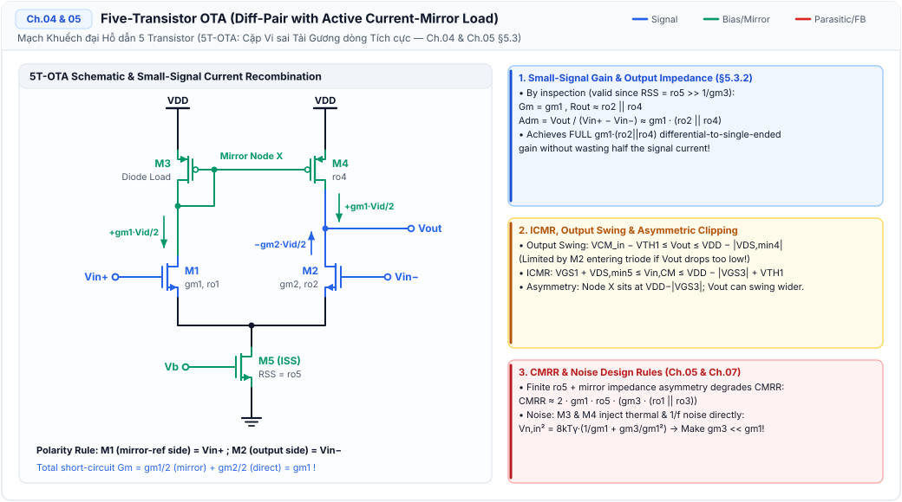

---
{
  "id": "topo-five-transistor-ota",
  "kind": "topology",
  "domain": "stages-and-mirrors",
  "title_vi": "Bộ khuếch đại Hỗ dẫn Thuật toán Năm Transistor (Five-Transistor Active-Load OTA — 5T-OTA)",
  "title_en": "Five-Transistor Operational Transconductance Amplifier (Differential Pair with Active Current-Mirror Load)",
  "summary": "Kết hợp cặp vi sai với tải gương dòng tích cực để tái sử dụng dòng nhánh phản pha, nhân đôi hỗ dẫn ngắn mạch lên trọn vẹn gmN và đạt độ lợi đơn đầu gmN*(rON || rOP) mà không cần mạch CMFB, đổi lại chịu bất đối xứng biên độ nút gương, CMRR hữu hạn ngay cả khi khớp lý tưởng và PSRR+ gần 0 dB.",
  "diagram": "../../diagrams/five-transistor-ota.svg",
  "razavi_refs": [
    {
      "chapter": 5,
      "section": "5.3",
      "pages": "146-149",
      "equations": ["5.20", "5.21", "5.22", "5.23", "5.24", "5.25", "5.26"]
    },
    {
      "chapter": 5,
      "section": "5.3.1-5.3.2",
      "pages": "149-156",
      "equations": ["5.27", "5.28", "5.29", "5.30", "5.31", "5.32", "5.33", "5.34", "5.35", "5.36", "5.37", "5.38"]
    },
    {
      "chapter": 5,
      "section": "5.3.3-5.3.4",
      "pages": "156-160",
      "equations": ["5.39", "5.40", "5.41", "5.42", "5.43", "5.44", "5.45", "5.46", "5.47", "5.48", "5.49", "5.50", "5.55", "5.56", "5.57"]
    }
  ],
  "glossary_codes": ["T022", "T026", "T060", "T512", "T563", "T597", "T628", "T661", "T699", "T755", "T756", "T758", "T759", "T763", "T764", "T768", "T770", "T772", "T774", "T794", "T798"],
  "process_agnostic": true,
  "roles": {
    "input_diff_pair": "M1 (cổng không đảo Vin1 dưới nhánh diode), M2 (cổng đảo Vin2 dưới nút ngõ ra X)",
    "active_mirror_load": "M3 mắc diode tại nút F, M4 sao chép dòng đẩy vào nút ngõ ra X tạo tác động đẩy-kéo với M2",
    "tail_current_source": "M5 / ISS (khóa dòng phân cực đuôi và quyết định khả năng chặn chế độ chung qua RSS)"
  },
  "symptoms_addressed": [
    "half-gm-loss-when-taking-single-ended-output-from-passive-load-diffpair",
    "need-for-compact-differential-to-single-ended-conversion-without-cmfb",
    "undefined-output-dc-level-of-passive-current-source-loads"
  ],
  "limitations": [
    "asymmetric-drain-swings-invalidate-strict-virtual-ground-at-tail-node",
    "output-swing-constrained-at-both-ends-by-input-cm-and-pmos-diode-headroom",
    "finite-cmrr-even-with-perfect-device-matching-and-near-unity-vdd-to-vout-feedthrough",
    "mirror-node-capacitance-creates-pole-zero-doublet-and-degrades-high-freq-cmrr"
  ],
  "checklists": ["common-mos", "differential-pair", "current-mirror"]
}
---

## 1. Bản chất Nguyên lý, Sơ đồ Mạch & Vai trò Từng Nhánh Cấu trúc

Khi hệ thống cần chuyển đổi một tín hiệu vi sai thành **ngõ ra đơn đầu** (*single-ended output*, tham chiếu với đất) để lái tầng khuếch đại kế tiếp, công tắc lấy mẫu hoặc bộ đệm ra chân chip, cách làm thô sơ nhất là bỏ trống một nửa của **cặp vi sai dùng tải thụ động** (*differential pair with passive load*, Hình 5.23(a) trang 147). Cách này bỏ phí toàn bộ dòng tín hiệu nhỏ của nhánh $M_1$, làm **hỗ dẫn ngắn mạch** (*short-circuit transconductance*) tụt mất một nửa ($G_m = g_{m1}/2$), điện trở ngõ ra bằng $(2r_{O2}) \parallel r_{O4}$ và độ lợi chỉ còn $\lvert A_v \rvert = \frac{1}{2}g_{m1}[(2r_{O2})\parallel r_{O4}]$ (Phương trình 5.20, 5.25–5.26), đồng thời điện thế DC ngõ ra lơ lửng không xác định!

**OTA năm transistor** (*five-transistor operational transconductance amplifier* — 5T-OTA, còn gọi là **cặp vi sai dùng gương dòng tích cực** — *differential pair with active current mirror*, Hình 5.22 & 5.26–5.27) giải quyết xuất sắc bài toán này bằng cách thay cặp nguồn dòng tĩnh bằng một **gương dòng tích cực** (*active current mirror*) PMOS $M_3\text{–}M_4$:

Cơ chế phối hợp đẩy–kéo dòng tín hiệu và phân định cực tính cổng (Hình 5.26(c) & 5.27(a)):
- **Nhánh trái ($M_1$ nối máng vào nút gương $F$ của $M_3$ mắc diode):** Khi $V_{in1}$ tăng $+\Delta V/2$ và $V_{in2}$ giảm $-\Delta V/2$, dòng máng $I_{D1}$ tăng thêm $+\frac{1}{2}g_{m1}\Delta V$, hút qua $M_3$ kéo nút $F$ hạ xuống và làm $M_4$ **đẩy thêm** một lượng dòng $+\frac{1}{2}g_{m1}\Delta V$ từ $V_{DD}$ vào nút ngõ ra $X$.
- **Nhánh phải ($M_2$ nối máng trực tiếp vào nút ngõ ra $X$):** Cùng lúc đó, dòng máng $I_{D2}$ giảm đi $-\frac{1}{2}g_{m2}\Delta V$, tức $M_2$ **hút ít dòng hơn** từ nút $X$ xuống đất.
- **Tác động đẩy–kéo (*push-pull action*) tại nút $X$:** Hai dòng tín hiệu cộng đồng pha tạo tổng dòng bơm vào tải $\Delta I_{out} = +\frac{1}{2}g_{m1}\Delta V - (-\frac{1}{2}g_{m2}\Delta V) = +g_{m1,2}\Delta V$, khôi phục trọn vẹn $100\%$ hỗ dẫn! Đồng thời:
  - **$V_{in1}$ (cổng $M_1$, dưới nhánh mắc diode $M_3$)** là **ngõ vào không đảo ($+$)** (*in-phase* với $V_{out}$)!
  - **$V_{in2}$ (cổng $M_2$, dưới nút ngõ ra $X$)** là **ngõ vào đảo ($-$)** (ngược pha $180^\circ$ với $V_{out}$)!
- **Nguồn dòng đuôi ($M_5$ tạo $I_{SS}$):** Khóa tổng dòng phân cực tĩnh; nhờ đối xứng DC tại $V_{in1} = V_{in2}$, nút $X$ tự động bám theo nút $F$ ($V_{out,\text{DC}} = V_F = V_{DD} - \lvert V_{GS3} \rvert$) mà **không cần mạch CMFB riêng**.

---

## 2. Hệ Phương trình Cốt lõi & Tư duy "Nhìn Mạch Đọc Nhanh" (Analysis by Inspection)

### 2.1. Bất đối xứng Tín hiệu Lớn, Cửa sổ ICMR & Biên độ Ngõ ra (Mục 5.3.1, Hình 5.27–5.30, 5.36)

Quét hiệu $V_{in1} - V_{in2}$ từ âm lớn sang dương lớn trên mạch thực tế có $M_5$ (Hình 5.27):
1. **Biên âm sâu ($V_{in1} \ll V_{in2}$):** $M_1$ ngắt $\implies I_{D3} = 0 \implies M_3, M_4$ cùng ngắt hẳn! Vì không còn nguồn dòng nào cấp từ $V_{DD}$ xuống nút $X$, cả $M_2$ lẫn transistor đuôi $M_5$ (đang có cổng dẫn) đều rơi vào **vùng triode sâu** (*deep triode region*) mang dòng bằng $0$, kéo $V_{out} = 0\text{ V}$ (lưu ý Chú thích 3 & gợi ý Ví dụ 5.8 trang 149–150: khi $M_2, M_5$ vào triode sâu kéo $V_P \to 0$, nếu điện thế tuyệt đối $V_{in1} > V_{TH1}$ thì $M_1$ có thể chớm dẫn lại một dòng nhỏ khiến $V_{out}$ hơi nhích trên $0\text{ V}$; vì thế khi dùng 5T-OTA làm **bộ chuyển đổi vi sai sang đơn đầu** cho mạch số, thường nối thêm cổng đảo CMOS phía sau). *(Ghi chú đối chiếu học thuật `NG05-01`: tại Ví dụ 5.8 trang 150 bản gốc in nhầm "$M_1, M_2$, and $M_4$ turn off" thay vì "$M_1, M_3$, and $M_4$ turn off" trước câu "$M_2$ and $M_5$ remain on with zero current").*
2. **Điểm cân bằng ($V_{in1} = V_{in2}$):** Chứng minh phản chứng chặt chẽ của Razavi (trang 150) xác nhận ngay cả khi $\lambda \neq 0$, nếu các cặp linh kiện khớp hoàn hảo thì bắt buộc **$V_{out} = V_F = V_{DD} - \lvert V_{GS3} \rvert$** (vì giả sử $V_{out} < V_F$ thì do CLM $I_{D1} > I_{D2}$ và $\lvert I_{D4} \rvert > \lvert I_{D3} \rvert$; nhưng $I_{D1} > I_{SS}/2$ lại kéo theo $\lvert I_{D3} \rvert = I_{D1} > I_{SS}/2 > I_{D2} = \lvert I_{D4} \rvert$, mâu thuẫn!).
3. **Biên dương sâu ($V_{in1} \gg V_{in2}$):** $M_2$ ngắt, $M_1$ hút trọn dòng đuôi qua $M_3$; $M_4$ có cổng mở nhưng không có đường thoát dòng xuống đất tại $X$ nên rơi vào **vùng triode sâu** với dòng bằng $0$, kéo $V_{out} = V_{DD}$ (lưu ý nếu $V_{in1} > V_F + V_{TH1}$ thì $M_1$ cũng vào triode).
4. **Cửa sổ ICMR và dải dao động ngõ ra bão hòa:**
   - **ICMR ngõ vào:** Cận dưới do $M_5$ bão hòa; cận trên do $M_1$ (cực máng ghim ở $V_F = V_{DD} - \lvert V_{GS3} \rvert$) không vào triode:

$$V_{GS1,2} + V_{DS5,\min} \le V_{in,CM} \le V_{DD} - \lvert V_{GS3} \rvert + V_{TH1}$$

   - **Dải dao động ngõ ra giữ độ lợi cao ($M_2$ và $M_4$ cùng bão hòa):**

$$V_{in,CM} - V_{TH2} \le V_{out} \le V_{DD} - \lvert V_{GS4} - V_{TH4} \rvert = V_{DD} - \lvert V_{OV4} \rvert$$

   Muốn nới rộng $V_{in,CM,\max}$ ở điện áp thấp, Hình 5.36 (trang 155–156) chèn điện trở dịch mức $R_1$ nối tiếp cực cổng $M_3\text{–}M_4$ và hút dòng nhỏ $I_1 \ll I_{SS}/2$ để nâng $V_F$ lên cao hơn cổng $G$ một lượng $R_1 I_1 \le \lvert V_{TH3} \rvert$ (chú ý dòng phụ $I_1$ rút lệch khỏi nút $F$ sẽ sinh điện áp lệch quy về ngõ vào $V_{OS,\text{sys}} \approx \frac{I_1}{g_{m1}}$!). Khi mắc hồi tiếp âm $100\%$ làm **bộ đệm độ lợi đơn vị** (*unity-gain buffer*, Ví dụ 5.10 Hình 5.30: $V_{in2} = V_{out}$), mạch bám tuyến tính $V_{out} \approx V_{in}$ trong khoảng $V_{GS1} + V_{DS5,\min} \le V_{in} \le V_{DD} - \lvert V_{OV4} \rvert$.

### 2.2. Giải tích Tín hiệu Nhỏ: Gần đúng "Nhìn Nhanh" vs. Lời giải Chính xác (Mục 5.3.2, Phương trình 5.27–5.38)

**Tại sao không được áp dụng trực tiếp phương pháp mạch nửa cho 5T-OTA?** Như Hình 5.31 chỉ rõ, tải tại nút $F$ là diode trở kháng thấp $r_d = \frac{1}{g_{m3}} \parallel r_{O3}$ (biên độ $V_F$ rất nhỏ), còn tải tại nút $X$ là trở kháng cao $r_{O2} \parallel r_{O4}$ (biên độ $V_X$ rất lớn). Do đó dòng phản hồi từ $F$ và $X$ qua $r_{O1}$ và $r_{O2}$ về nút đuôi $P$ không triệt tiêu nhau — **nút $P$ không phải là đất ảo chặt chẽ**! Thay vào đó ta dùng bổ đề hai bước $\lvert A_v \rvert = \lvert G_m \rvert R_{out}$:

1. **Phân tích gần đúng bằng tư duy nhìn mạch (Hình 5.32–5.33, Phương trình 5.27–5.28):**
   - **Tính $G_m$ (ngắn mạch AC nút $X$ xuống đất):** Khi $V_X = 0$, bất đối xứng biên độ lớn tại $X$ biến mất (cả $V_X = 0$ và $V_F$ đều rất nhỏ so với $r_{O1}$), nên xấp xỉ $P$ gần như đất ảo, đọc ngay $\lvert G_m \rvert \approx g_{m1,2}$.
   - **Tính $R_{out}$ (ngắt nguồn độc lập, đặt áp thử $V_X$ đo dòng $I_X$ — điểm tinh tế nhất của Chương 5!):** Nhiều người đoán nhầm $R_{out} = (2r_{O2}) \parallel r_{O4}$ giống tải thụ động. Sai! Với $I_{SS}$ hở mạch tín hiệu nhỏ (Hình 5.33), cặp $M_1\text{–}M_2$ nối tiếp nhau tạo thành cầu điện trở $R_{XY} = 2r_{O1,2}$ nối từ nút $X$ sang nút gương $F$. Khi $V_X$ dâng lên, dòng $i_1 = \frac{V_X}{2r_{O1,2} + r_d}$ không chỉ tự rút khỏi nút $X$, mà khi chảy vào nút $F$ nó làm giảm thế cổng $M_4$ và bị gương $M_3\text{–}M_4$ **nhân bản quay ngược trở lại hút thêm một dòng bằng chính nó** qua cực máng $M_4$! Viết KCL tại $X$ (Phương trình 5.27):

$$I_X = \frac{V_X}{2r_{O1,2} + r_d}(1 + g_{m4}r_d) + \frac{V_X}{r_{O4}} \xrightarrow[g_{m3}=g_{m4},\; 2r_{O1,2} \gg r_d]{} \frac{V_X}{2r_{O1,2}}(2) + \frac{V_X}{r_{O4}} = V_X\!\left(\frac{1}{r_{O2}} + \frac{1}{r_{O4}}\right)$$

   Hai nhánh $2r_{O1,2}$ được nhân đôi dẫn nạp thành đúng $1/r_{O2}$! Vậy:

$$R_{out} \approx r_{O2} \parallel r_{O4} = r_{ON} \parallel r_{OP} \implies \lvert A_{v,\text{approx}} \rvert = g_{m1,2}(r_{O2} \parallel r_{O4}) = g_{mN}(r_{ON} \parallel r_{OP})$$

2. **Phân tích chính xác không nối đất nút $P$ (Hình 5.34, Phương trình 5.29–5.38):**
   Giải hệ phương trình nút tổng quát với $r_d = \frac{1}{g_{m3}} \parallel r_{O3} = \frac{r_{O3}}{1 + g_{m3}r_{O3}}$, $g_{m1}=g_{m2}$, $r_{O1}=r_{O2}$, $g_{m3}=g_{m4}$, $r_{O3}=r_{O4}$ cho nghiệm đóng chính xác (Phương trình 5.32, 5.33, 5.38):

$$\lvert G_{m,\text{exact}} \rvert = g_{m1}r_{O1}\frac{g_{m4}r_d + 1}{2r_{O1} + r_d}, \qquad R_{out,\text{exact}} = \frac{(2r_{O1} + r_d)r_{O4}}{(1 + g_{m4}r_d)r_{O4} + 2r_{O1} + r_d}$$

$$\lvert A_{v,\text{exact}} \rvert = \lvert G_{m,\text{exact}} \rvert R_{out,\text{exact}} = g_{m1}(r_{O1} \parallel r_{O4})\cdot\frac{2g_{m4}r_{O4} + 1}{2(g_{m4}r_{O4} + 1)}$$

   Biểu thức chính xác chính bằng công thức nhìn nhanh $g_{m1}(r_{O1} \parallel r_{O4})$ nhân với **hệ số hiệu chỉnh** $\frac{2g_{m4}r_{O4}+1}{2(g_{m4}r_{O4}+1)} \in (0{,}5,\; 1)$. Ở công nghệ kênh dài ($g_{m4}r_{O4} \gg 1$) hệ số tiệm cận $1$; ở nanomet ngay cả khi $g_{m4}r_{O4} = 5$, hệ số vẫn bằng $11/12 \approx 0{,}92$ (chỉ lệch $8\%$!).

### 2.3. CMRR Hữu hạn Khi Đối xứng Hoàn hảo, Bẫy Chứng minh Sai & PSRR+ Kém (Mục 5.3.3–5.3.4, Phương trình 5.39–5.57)

1. **Độ lợi chế độ chung & CMRR khi linh kiện khớp hoàn hảo (Hình 5.37–5.38, Phương trình 5.39–5.44):**
   Khi $V_{in1} = V_{in2} = V_{in,CM}$ thay đổi trên mạch đối xứng, $V_{out} = V_F$ nên được phép nối tắt $F$ và $X$, gộp $M_1+M_2$ (hỗ dẫn $2g_{m1,2}$, suy giảm nguồn bởi $R_{SS}$) lái tải diode gộp $M_3+M_4$ (trở kháng $\frac{1}{2g_{m3,4}} \parallel \frac{r_{O3,4}}{2} \approx \frac{1}{2g_{m3,4}}$):

$$A_{\text{CM}} = \frac{\Delta V_{out}}{\Delta V_{in,\text{CM}}} \approx -\frac{1}{1 + 2g_{m1,2}R_{SS}}\cdot\frac{g_{m1,2}}{g_{m3,4}} \implies \text{CMRR}_{\text{sym}} = \left\lvert \frac{A_{\text{DM}}}{A_{\text{CM}}} \right\rvert \approx (1 + 2g_{m1,2}R_{SS})\,g_{m3,4}(r_{O1,2} \parallel r_{O3,4})$$

   Với $R_{SS} \sim r_O$, **ngay cả khi không hề có bất kỳ sai lệch linh kiện nào, $\text{CMRR}$ của 5T-OTA vẫn bị giới hạn hữu hạn ở bậc $\sim (g_m r_O)^2$** (chỉ khoảng $35 - 50\text{ dB}$ ở nanomet!).
   - **Giải mã chứng minh ngụy biện "$A_{\text{CM}} = 0$" (Ví dụ 5.13, Hình 5.39, Phương trình 5.45–5.49):** Lập luận sai cho rằng $\Delta V_{in,CM}$ làm tăng $\Delta I_1 = \Delta I_2 = \Delta I$, rồi $M_3$ sao chép nguyên $\Delta I$ sang $M_4$ triệt tiêu sạch $\Delta I_2$ tại $X$. Chỗ sai nằm ở **$r_{O3}$ hữu hạn**: biến thiên tại nút $F$ là $\Delta V_F = -\Delta I\left(\frac{1}{g_{m3}} \parallel r_{O3}\right)$, nên dòng $M_4$ tăng thêm chỉ bằng $\lvert \Delta I_{D4} \rvert = g_{m4}\lvert \Delta V_F \rvert = \Delta I\frac{g_{m4}r_{O3}}{1 + g_{m3}r_{O3}} < \Delta I$, để lọt phần dòng hụt $-\frac{\Delta I}{1 + g_{m3}r_{O3}}$ chạy qua $r_{O4}$ kéo $\Delta V_{out} = -\frac{\Delta I\,r_{O4}}{1 + g_{m3}r_{O3}} = \Delta V_F \neq 0$!
   - **Khi có thêm sai lệch hỗ dẫn $\Delta g_m = g_{m1} - g_{m2}$ (Hình 5.40, Phương trình 5.55–5.57):** Tử số $A_{\text{CM}}$ xuất hiện thêm số hạng lớn $(g_{m1} - g_{m2})r_{O3}$:

$$A_{\text{CM}}\Big|_{\Delta g_m} \approx \frac{(g_{m1} - g_{m2})r_{O3} - g_{m2}/g_{m3}}{1 + (g_{m1} + g_{m2})R_{SS}}\cdot\frac{r_{O4}}{r_{O3}}$$

2. **Độ khử nhiễu nguồn cấp $V_{DD}$ kém ($\text{PSRR}^+ \approx 0\text{ dB}$ — Mục 5.3.4, Hình 5.42(a)):**
   Giữ cổng $M_1, M_2$ cố định và nhích $V_{DD}$ một lượng $\Delta V_{DD}$: vì $M_1$ hoạt động như nguồn dòng tĩnh hút dòng không đổi qua $M_3$, điện áp rơi $V_{SG3}$ giữ nguyên nên nút $F$ nảy lên trọn vẹn $\Delta V_F \approx \Delta V_{DD}$! Do đối xứng gương, cực máng $X$ cũng đi theo $\Delta V_{out} \approx 1 \cdot \Delta V_{DD}$ — nghĩa là nhiễu từ $V_{DD}$ truyền thẳng $1:1$ ra ngõ ra ở dải tần thấp–trung!

---

## 3. Bất biến Cấu trúc & Các Bẫy Lỗi Kinh điển (Structural Invariants & Traps)

- **`[INV-5T-01]` Bất biến gán cực cổng không đảo / đảo:** Nhánh cặp vi sai nối vào **diode gương ($M_3$)** luôn là cổng **không đảo ($+$)** đối với $V_{out}$ (cùng bên với diode là $+$, cùng bên với nút ra là $-$ cho cả bản đầu vào NMOS lẫn đối ngẫu đầu vào PMOS!). Đấu lộn hai cổng này khi khép vòng hồi tiếp âm sẽ biến mạch thành mạch chốt dương (*latch*) bão hòa cứng về đường nguồn!
- **`[INV-5T-02]` Bất biến kẹp đối xứng DC $V_{out,\text{eq}} = V_F = V_{DD} - \lvert V_{GS3} \rvert$:** Để tránh lệch không hệ thống (*systematic offset*) do điều biến chiều dài kênh $\lambda_2, \lambda_4$, điện áp DC kỳ vọng của nút ngõ ra $X$ (ví dụ điện áp cổng tầng CS thứ hai trong Op-Amp 2 tầng!) **bắt buộc phải được thiết kế bằng $V_F = V_{DD} - \lvert V_{GS3} \rvert$**.

- **`[TRAP-5T-01]` Suy thoái kép ở tần số cao do tụ nút gương $C_F$ và tụ nút đuôi $C_P$:** Ngoài tụ đuôi $C_P$ nối tắt $R_{SS}$ làm xấu $A_{\text{CM}}(j\omega)$ như Mục 4.3, tại nút gương $F$ còn có điện dung lớn $C_F \approx C_{GS3} + C_{GS4} + C_{DB1} + C_{DB3} \approx 2C_{GS3,4}$. Ở tần số cao: (a) với tín hiệu vi sai, cực gương $\omega_m \approx \frac{g_{m3}}{C_F}$ sinh ra **cặp cực–không (pole-zero doublet)** tại $\omega_m$ và $2\omega_m$ gây đuôi xác lập chậm (`concept-diffpair-mirror-pole-doublet`); (b) với tín hiệu chế độ chung, nhánh trái qua $C_F$ bị làm trễ khác nhánh phải đi thẳng ra $X$, phá vỡ cân bằng dòng CM sớm hơn nhiều so với DC!
- **`[TRAP-5T-02]` Định cỡ $M_3, M_4$ có $g_{m3,4}$ lớn khiến nhiễu và lệch không bùng nổ:** Mọi nhiễu nhiệt và $\Delta V_{TH3,4}$ của cặp gương $M_3, M_4$ khi quy về ngõ vào của 5T-OTA đều bị nhân với hệ số $\left(\frac{g_{m3,4}}{g_{m1,2}}\right)^2$ (đối với công suất nhiễu) và $\frac{g_{m3,4}}{g_{m1,2}}$ (đối với offset)! Nếu lỡ chọn $(W/L)_{3,4}$ lớn làm $g_{m3,4} \ge g_{m1,2}$, tải gương dòng sẽ nuốt chửng ngân sách nhiễu của toàn bộ bộ khuếch đại!
- **`[TRAP-5T-03]` Dùng 5T-OTA vòng hở để khuếch đại tín hiệu nhỏ:** Với độ lợi $25 - 35\text{ dB}$ và $\sigma_{V_{OS}} \sim 3 - 8\text{ mV}$, đặt vòng hở không hồi tiếp DC dễ làm điểm tĩnh ngõ ra văng lệch hàng trăm milivolt đẩy $M_2$ hoặc $M_4$ vào vùng triode (Nanometer Design Note trang 152).

---

## 4. Lộ trình Nâng cấp Cấu trúc & Bát giác Đánh đổi (Upgrade Paths & Design Octagon)

Trên Bát giác Thiết kế (`concept-analog-design-octagon`), 5T-OTA là viên gạch bản lề nối thế giới tầng đơn/cặp vi sai (`topo-basic-differential-pair`, `topo-basic-current-mirror`) với thế giới Op-Amp thực thụ Chương 9–10:
1. **Khi độ lợi 1 tầng $g_{mN}(r_{ON}\parallel r_{OP}) \sim 15 - 30\text{ dB}$ ở nanomet không đủ và dải dao động bị khóa bởi $V_{in,CM} - V_{TH2}$:**
   - Gắn thêm tầng nguồn chung thứ hai ($M_6, M_7$) ngay sau nút $X$ kèm tụ bù tách cực Miller $C_C$ + điện trở triệt điểm không $R_z$ $\rightarrow$ **`topo-two-stage-opamp`** (tận dụng quy tắc vàng $V_{GS6} = V_{GS3,4}$ để triệt tiêu lệch không hệ thống và mở rộng dải ngõ ra tới $V_{DD} - 2V_{DS,\min}$!).
2. **Khi cần độ lợi một tầng cao $\sim (g_m r_O)^2$, băng thông cao và giải phóng ràng buộc giữa ICMR với dải ngõ ra:**
   - Nâng cấp sang **`topo-folded-cascode-ota`** (hoặc `topo-telescopic-cascode-opamp` nếu ICMR cố định hẹp) sử dụng gương tải `topo-lvccml-wide-swing-mirror`.
3. **Phân tích chuyên sâu động học tần số cao, nhiễu và sai lệch của 5T-OTA:**
   - Cực gương & doublet $\rightarrow$ `concept-diffpair-mirror-pole-doublet`.
   - Quy tắc nén nhiễu tải gương $g_{m3,4} \ll g_{m1,2}$ $\rightarrow$ `law-stage-and-mirror-noise-rules`.
   - Đối ngẫu định cỡ Pelgrom giữa cặp $M_{1,2}$ và gương $M_{3,4}$ $\rightarrow$ `law-pelgrom-mismatch-and-sizing-duality`.

---

## 5. Thích ứng Đa Tiến trình (90nm / 65nm / 45nm) & Cách Kiểm chứng trong Cadence / Spectre

### 5.1. Quy tắc Định cỡ 5T-OTA Đa Tiến trình (90nm / 65nm / 45nm)

Nanometer Design Note trang 152 minh họa trên tiến trình $40\text{ nm}$ ($V_{DD} = 1{,}0\text{ V}, W/L = 5\,\mu\text{m}/40\text{ nm}, I_{SS} = 0{,}25\text{ mA}$): nếu dùng $L_{\min}$ đồng loạt, độ lợi đỉnh của 5T-OTA chỉ đạt $\lvert A_v \rvert \approx 5{,}5$ ($\approx 15\text{ dB}$) và rơi dốc đứng ngay khi $V_{out}$ chệch khỏi trung điểm! Để thiết kế 5T-OTA chuẩn công nghiệp trên 90nm/65nm/45nm (`tech-nanometer-vdsmin-gmid-sizing`):
- **Cặp vi sai đầu vào ($M_1, M_2$):** Đặt ở đảo vừa/yếu ($g_m/I_D \approx 16 - 20\text{ V}^{-1}$, $V_{DS,\min} \approx 80 - 100\text{ mV}$), chiều dài kênh $L_{1,2} \approx 3 - 5 L_{\min}$ để tăng $g_{m1,2}r_{O1,2}$ và giảm diện tích lệch không Pelgrom.
- **Gương dòng tích cực tải ($M_3, M_4$):** Bắt buộc định cỡ ở đảo mạnh ($g_m/I_D \approx 6 - 8\text{ V}^{-1}$, $\lvert V_{DS,\min} \rvert \approx 220 - 260\text{ mV}$) với chiều dài lớn $L_{3,4} \ge 6 - 10 L_{\min}$:
  - Tỷ số $\frac{g_{m3,4}}{g_{m1,2}} \approx \frac{7}{18} \approx 0{,}39$ giúp nhiễu nhiệt và offset từ gương dòng chỉ đóng góp $< 20\% - 35\%$ tổng ngân sách so với cặp đầu vào, đồng thời $r_{O4}$ lớn bảo toàn độ lợi $g_{m1}(r_{O2}\parallel r_{O4}) \approx 28 - 36\text{ dB}$ ngay trên 65nm/45nm!
  - Đổi lại, chú ý kiểm tra cực gương $\omega_m \approx \frac{g_{m3}}{2C_{GS3,4}} \propto \frac{1}{L_{3,4}^2}$ vẫn nằm cao hơn tối thiểu $3\times$ tần số độ lợi đơn vị $\omega_u = \frac{g_{m1}}{C_L}$ để không ăn mòn dự trữ pha.

### 5.2. Quy trình Kiểm chứng trên Cadence Virtuoso IC617 & Spectre

1. **Testbench Hồi tiếp Âm Độ lợi Đơn vị hoặc Servo DC (`dc`, `ac`, `stb`):**
   - Không test AC vòng hở với hai cổng ghim áp cứng nếu có mismatch vì ngõ ra dễ kẹp biên! Khép vòng bộ đệm độ lợi đơn vị ($V_{in-} = V_{out}$, đặt `analogLib/iprobe` nối tiếp trong nhánh hồi tiếp từ $V_{out}$ về cổng $M_2$) để kiểm tra đồng thời điểm tĩnh tự cân bằng và dự trữ pha bằng phân tích **`stb`**.
2. **Kiểm tra Điểm làm việc & Lệch Hệ thống (`dc` OP):**
   - Kiểm tra cả 5 transistor `M1..M5` có `region == 2` và `abs(vds) - abs(vdsat) >= 50 mV` trên toàn bộ dải `Vin` yêu cầu và 5 góc PVT.
   - Tại $V_{in+} = V_{in-} = V_{in,CM}$, kiểm tra `abs(v("/Vout") - v("/VF")) < 2 mV`.
3. **Kiểm chứng CMRR, PSRR+ & PSRR- trong một lượt bằng `xf`:**
   - Chạy `xf` tới nút `/Vout`: vẽ đồng thời `ADM = mag(xf("/Vdm"))`, `ACM = mag(xf("/Vcm"))`, `PSRR_plus = db20(ADM / mag(xf("/VDD")))`. Quan sát trực tiếp $\lvert \text{xf}("/VDD") \rvert \approx 0\text{ dB}$ đúng như tiên đoán lý thuyết Mục 5.3.4, và chạy `mc` 200 mẫu để đo phân bố $\sigma_{V_{OS}}$ và $\text{CMRR}_{3\sigma}(f)$.

---

## 6. Mốc Đối chiếu Sách Razavi & Thuật ngữ Chuẩn CLB

| Mốc Sách Razavi (2nd Ed.) | Trang Sách (PDF Ch.05) | Nội dung & Phương trình Đối chiếu | Mã Thuật ngữ Chuẩn CLB (`terms-vi-en.json`) |
|---|---|---|---|
| **Mục 5.3 (Tải thụ động vs. Tải tích cực)**, Hình 5.22–5.26 | tr. 146–149 (PDF 13–16) | Độ lợi tải thụ động $\frac{g_{m1}}{2}[(2r_{O2})\parallel r_{O4}]$ **(5.20)–(5.26)** (ghi chú `NG05-02`), nguyên lý tái hợp dòng đẩy–kéo 5T-OTA | `T699` / `T779` (gương dòng tích cực), `T755` (OTA năm transistor), `T756` (bộ khuếch đại hỗ dẫn thuật toán — OTA), `T758` (cặp vi sai dùng tải thụ động), `T759` (hỗ dẫn ngắn mạch), `T763` (cặp vi sai dùng tải tích cực) |
| **Mục 5.3.1 (Tín hiệu lớn)**, Hình 5.27–5.30, Ví dụ 5.8–5.10 | tr. 149–152 (PDF 16–19) | Ngắt bất đối xứng ($M_2, M_5$ triode sâu vs. $M_4$ triode sâu, ghi chú `NG05-01`), $V_{out}=V_F$ cân bằng, ICMR & swing, bộ đệm độ lợi đơn vị, Nanometer Note 40nm | `T764` (cặp vi sai dùng gương dòng tích cực), `T766` (cùng pha), `T768` (biên độ dao động ngõ ra), `T770` (bộ chuyển đổi vi sai sang đơn đầu), `T772` (tác động đẩy–kéo), `T774` (bộ đệm độ lợi đơn vị) |
| **Mục 5.3.2 (Tín hiệu nhỏ & Dịch mức)**, Hình 5.31–5.36, Ví dụ 5.11–5.12 | tr. 152–156 (PDF 19–23) | Lý do nút $P$ mất đất ảo chặt, $R_{out} \approx r_{O2}\parallel r_{O4}$ **(5.27)–(5.28)**, nghiệm chính xác $\lvert A_v \rvert$ **(5.29)–(5.38)**, dịch mức cổng $R_1 I_1$ | `T628` (đất ảo), `T597` (độ lợi vi sai), `T781` (phân tích chính xác), `T782` (dẫn nạp ngõ ra), `T788` (điện áp lệch quy về ngõ vào) |
| **Mục 5.3.3–5.3.4 (CMRR & PSRR)**, Hình 5.37–5.42, Ví dụ 5.13 | tr. 156–160 (PDF 23–27) | $A_{\text{CM}}$ & $\text{CMRR}$ đối xứng **(5.39)–(5.44)**, bác bỏ chứng minh sai $A_{\text{CM}}=0$ **(5.45)–(5.49)**, sai lệch $\Delta g_m$ **(5.50)–(5.57)**, $\Delta V_{out}\approx \Delta V_{DD}$ | `T661` (CMRR), `T791` (độ lợi chế độ chung), `T794` (điện dung mắc song song với nguồn dòng đuôi), `T796` (sai lệch hỗ dẫn), `T798` (độ khử nhiễu nguồn cấp) |
