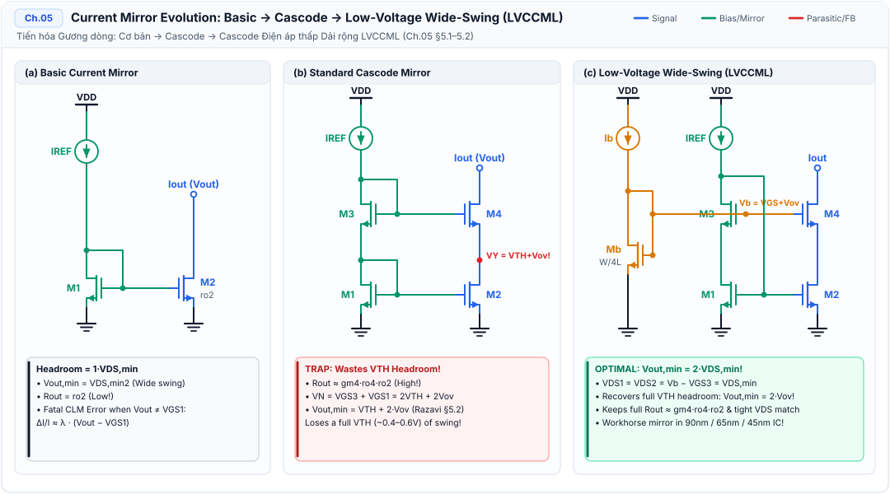

---
{
  "id": "topo-lvccml-wide-swing-mirror",
  "kind": "topology",
  "domain": "stages-and-mirrors",
  "title_vi": "Gương dòng Cascode Điện áp thấp / Dải rộng (Low-Voltage Wide-Swing Cascode Mirror — LVCCML)",
  "title_en": "Low-Voltage (Wide-Swing) Cascode Current Mirror (LVCCML)",
  "summary": "Thu hồi trọn vẹn điện áp ngưỡng VTH bị lãng phí của gương cascode cổ điển để đưa điện áp tuân thủ ngõ ra về sát giới hạn vật lý 2*VDS,min nhờ nối cổng M1 lên máng cascode M0 và định cỡ nhánh phân cực Vb = VGS0 + VDS1,min trong cửa sổ bão hòa nghiêm ngặt.",
  "diagram": "../../diagrams/current-mirrors-evolution.svg",
  "razavi_refs": [
    {
      "chapter": 5,
      "section": "5.2",
      "pages": "141-145, 169",
      "equations": ["5.14", "5.15", "5.16", "5.17", "5.18", "5.19"]
    }
  ],
  "glossary_codes": ["T012", "T026", "T183", "T208", "T525", "T552", "T698", "T745", "T746", "T747", "T748", "T749", "T750", "T751"],
  "process_agnostic": true,
  "roles": {
    "mirror_core": "M1, M2 (cặp sao chép dòng đáy đều được ghim cực máng sát ranh giới bão hòa VDS1 = VDS2 ~ VDS,min)",
    "cascode_pair": "M0, M3 (cặp cascode dùng chung Vb: M0 khép vòng hồi tiếp xác lập VGS1 tại nút X, M3 che chắn ngõ ra)",
    "vb_bias_generator": "Nhánh tạo Vb = VGS0 + VDS1,min + Vmargin (dùng diode 1/4*(W/L) M7, chuỗi M5+M6+Rb, hoặc mạch Sooch)"
  },
  "symptoms_addressed": [
    "cascode-mirror-wasted-vth-headroom",
    "vds-mismatch-current-error",
    "insufficient-output-swing-under-low-supply-voltage-1v"
  ],
  "limitations": [
    "requires-dedicated-vb-bias-branch-and-extra-bias-current",
    "strict-feasibility-bound-vov0-less-than-vth1-or-m0-enters-triode",
    "body-effect-mismatch-between-grounded-bias-diode-and-elevated-cascode-can-push-m1-m2-into-triode"
  ],
  "checklists": ["common-mos", "current-mirror"]
}
---

## 1. Bản chất Nguyên lý, Sơ đồ Mạch & Vai trò Từng Nhánh Cấu trúc

Trong `topo-cascode-current-mirror`, việc chồng hai transistor mắc diode buộc cực máng transistor đáy phải gánh $V_{DS2} = V_{DS1} = V_{GS1} = V_{TH} + V_{OV}$, đánh mất oan uổng một điện áp ngưỡng $V_{TH}$ ở cả nhánh chuẩn lẫn nhánh ngõ ra. Để xóa bỏ khoản phạt $V_{TH}$ này trên công nghệ điện áp thấp ($1{,}0\text{ V} - 1{,}8\text{ V}$) mà không hy sinh độ chính xác sao chép dòng hay trở kháng cao $R_{out} \approx g_m r_O^2$, **Cách thứ hai** trong Mục 5.2 sách Razavi (trang 142–145, Hình 5.14–5.19) đảo ngược tư duy thiết kế:
- Trước hết, hạ điện áp phân cực cổng cascode $V_b$ xuống đúng mức tối ưu $V_b = V_{GS3} + V_{DS2,\min}$ để transistor đáy $M_2$ chỉ gánh $V_{DS2} = V_{DS2,\min} = V_{OV2}$, đưa điện áp tuân thủ ngõ ra xuống sát giới hạn vật lý lý tưởng **$2V_{DS,\min} = 2V_{OV}$** (Hình 5.14(a)).
- Sau đó, giải bài toán cốt lõi: **làm thế nào ép cực máng $V_{DS1}$ của transistor chuẩn $M_1$ cũng giảm xuống bằng đúng $V_{DS2} \approx V_{OV1}$, trong khi cực cổng của $M_1$ vẫn phải cao ở $V_{GS1} = V_{TH1} + V_{OV1}$?**



Razavi dẫn dắt qua hai thế hệ mạch để đi tới kiến trúc **cascode điện áp thấp** (*low-voltage cascode* / *wide-swing cascode current mirror* — **LVCCML**, Hình 5.18(b)):
1. **Bước đệm dịch mức bằng điện trở $R_1$ (Hình 5.16–5.17):** Chèn điện trở $R_1$ giữa cực cổng và cực máng của $M_1$ sao cho **sụt áp IR** (*IR drop*) $R_1 I_{REF} \approx V_{TH1}$, tạo chênh lệch $V_{DS1} = V_{GS1} - R_1 I_{REF} \approx V_{OV1}$. Tuy nhiên, vì tích $R_1 I_{REF}$ và $V_{TH1}$ trôi theo hai quy luật vật lý khác hẳn nhau qua các góc PVT, ở góc nhiệt/quy trình cực đoan $R_1 I_{REF}$ dễ vượt quá $V_{TH1}$ và đẩy $M_1$ tụt vào vùng triode!
2. **Kiến trúc chuẩn LVCCML dùng chính vòng Cascode Dịch mức (Hình 5.18(a)–(b)):** Bỏ hoàn toàn $R_1$; đặt transistor cascode chuẩn $M_0$ lên trên $M_1$, cấp chung điện áp phân cực $V_b$ cho cổng của cả $M_0$ lẫn $M_3$, và **nối cực cổng của $M_1, M_2$ lên cực máng đỉnh $X$ của $M_0$** (nơi đón dòng $I_{REF}$):
   - **Cặp lõi sao chép dòng ($M_1, M_2$):** Cực cổng nối vào nút $X$ nên $V_{GS1} = V_{GS2} = V_X$. Cực máng của chúng lần lượt là nút $A$ và nút $B$.
   - **Cặp cascode đồng bộ ($M_0, M_3$):** Cùng nhận $V_b$ ở cực cổng và có tỷ số nhân bản khớp với cặp đáy ($\frac{(W/L)_3}{(W/L)_0} = \frac{(W/L)_2}{(W/L)_1} = \frac{N}{M}$). Do $V_{GS0} = V_{GS3}$, mạch tự động khóa cứng hai cực máng đáy bằng nhau: **$V_{DS1} = V_A = V_b - V_{GS0} = V_b - V_{GS3} = V_B = V_{DS2}$** (kể cả khi $\gamma \neq 0$, hiệu ứng thân của $M_0$ và $M_3$ vẫn tự triệt tiêu vì $V_A = V_B$!).
   - **Nhánh tạo điện áp phân cực $V_b$ chuyên dụng (Hình 5.19):** Bơm mức $V_b \approx V_{GS0} + V_{DS1,\min} + \Delta V_{\text{margin}}$ để neo cả $A$ và $B$ ngay sát trên **ranh giới vùng bão hòa** (*edge of saturation*).

---

## 2. Hệ Phương trình Cốt lõi & Tư duy "Nhìn Mạch Đọc Nhanh" (Analysis by Inspection)

### 2.1. Trở kháng Nhánh $M_1\text{–}R_1$ (Ví dụ 5.5, Phương trình 5.14–5.18)

Trước khi bỏ $R_1$, phép giải KCL cho nhánh diode có điện trở nối tiếp cổng–máng $R_1$ (Hình 5.17, Phương trình 5.14–5.15) mang lại một kết quả giải tích rất đáng nhớ (và xuất hiện lại trong tự phân cực CS Chương 5 & phản hồi điện trở):

$$\frac{V_X - I_X R_1}{r_O} + g_m V_X = I_X \implies Z_{in} = \frac{V_X}{I_X} = \frac{R_1 + r_O}{1 + g_m r_O}$$

Biểu thức này trùng khít với trở kháng nhìn vào cực nguồn tầng cổng chung có tải máng $R_1$ ($\gamma = 0$)! Khi $\lambda \to 0$ ($r_O \to \infty$), $Z_{in} \to 1/g_m$ độc lập với $R_1$; còn khi tạo $V_b$ bằng nhánh bù Hình 5.16(c), ta cần thỏa mãn cặp điều kiện bám theo (Phương trình 5.16–5.18): $V_{GS5} = V_{GS3}$ và $V_{GS6} - R_6 I_6 = V_{GS1} - R_1 I_{REF} \approx V_{GS1} - V_{TH1}$.

### 2.2. Cửa sổ Điện áp Phân cực $V_b$ Nghiêm ngặt của LVCCML (Phương trình 5.19)

Xét nhánh chuẩn LVCCML Hình 5.18(a) với $V_X = V_{GS1}$ và $V_A = V_b - V_{GS0}$. Khác với gương cascode hai diode luôn tự bão hòa vô điều kiện, ở đây **cả cận dưới lẫn cận trên của $V_b$ đều bị chặn cứng**:
1. **Cận dưới của $V_b$ (để $M_1$ và $M_2$ bão hòa):** Điện áp máng $V_A$ của $M_1$ phải đạt ít nhất một điện áp vượt ngưỡng:

$$V_A = V_b - V_{GS0} \ge V_{GS1} - V_{TH1} \implies V_b \ge V_{GS0} + (V_{GS1} - V_{TH1})$$

2. **Cận trên của $V_b$ (để chính cascode chuẩn $M_0$ bão hòa!):** Vì cực máng của $M_0$ bị ghim cố định bởi cổng $M_1$ tại $V_X = V_{GS1}$, nếu dâng $V_b$ lên quá cao sẽ làm $V_{GD0} = V_b - V_X > V_{TH0}$, đẩy **$M_0$ rơi vào vùng triode**:

$$V_b - V_{TH0} \le V_X = V_{GS1} \implies V_b \le V_{GS1} + V_{TH0}$$

Gộp hai bất đẳng thức thu được **Phương trình (5.19)** trứ danh của Razavi (trang 144):

$$V_{GS0} + (V_{GS1} - V_{TH1}) \le V_b \le V_{GS1} + V_{TH0}$$

- **Điều kiện tồn tại nghiệm (Feasibility Condition):** Để khoảng đóng (5.19) không rỗng, vế trái phải nhỏ hơn vế phải:

$$V_{GS0} + V_{GS1} - V_{TH1} < V_{GS1} + V_{TH0} \iff V_{GS0} - V_{TH0} < V_{TH1} \iff V_{OV0} < V_{TH1}$$

Nghĩa là ta bắt buộc phải chọn kích thước $M_0$ (và $M_3$) đủ rộng để điện áp vượt ngưỡng $V_{OV0}$ của tầng cascode nằm **thấp hơn hẳn** điện áp ngưỡng $V_{TH1}$ của tầng đáy!
- **Điện áp tuân thủ ngõ ra tối thiểu:** Khi đặt $V_b$ sát cận dưới tối ưu $V_b = V_{GS3} + V_{DS2,\min} + \Delta V_{\text{margin}}$ (với dự trữ an toàn $\Delta V_{\text{margin}} \approx 30 - 50\text{ mV}$), nút ngõ ra xuống thấp được tới:

$$V_{\text{out},\min} = V_b - V_{TH3} = (V_{GS3} - V_{TH3}) + V_{DS2,\min} + \Delta V_{\text{margin}} = V_{DS3,\min} + V_{DS2,\min} + \Delta V_{\text{margin}} \approx 2V_{DS,\min}$$

Toàn bộ khoản phạt $V_{TH}$ đã được xóa sổ hoàn toàn!

### 2.3. Ba Phương pháp Tạo $V_b$ Thực tế & Đánh đổi Kỹ thuật (Hình 5.19, Bài tập 5.14–5.15)

1. **Transistor mắc diode tỷ lệ $\frac{1}{4}(W/L)$ (Hình 5.19(b) — Gọn nhất, phổ biến nhất trong sách giáo khoa):**
   - Cho dòng $I_1 = I_{REF}$ chảy qua một transistor mắc diode duy nhất $M_7$. Nếu cả $M_0, M_1, M_2, M_3$ cùng kích thước $(W/L)$ có điện áp vượt ngưỡng $V_{OV}$, theo luật bình phương việc chọn $(W/L)_7 = \frac{1}{4}(W/L)$ làm tăng điện áp vượt ngưỡng của $M_7$ lên $\sqrt{4} = 2$ lần ($V_{OV7} = 2V_{OV}$), tạo ra:

$$V_b = V_{GS7} = V_{TH7} + 2V_{OV} = \underbrace{(V_{TH} + V_{OV})}_{V_{GS0}} + \underbrace{V_{OV}}_{V_{DS1,\min}}$$

   - *Hiệu chỉnh thực chiến bắt buộc:* Vì cực nguồn $M_7$ nối đất ($V_{SB7} = 0$) còn cực nguồn $M_0, M_3$ nằm cao ở $V_A \approx V_{OV}$ nên chịu hiệu ứng thân làm $V_{TH0,3} = V_{TH7} + \Delta V_{TH,\text{body}}$! Nếu giữ cứng tỷ lệ $1/4$, điện áp rơi thực tế trên $M_1, M_2$ bị hụt còn $V_A = V_b - V_{GS0} = V_{OV} - \Delta V_{TH,\text{body}} < V_{OV}$, đẩy $M_1, M_2$ chớm vào vùng triode! Do đó trên thực tế phải chọn $(W/L)_7 \approx \frac{1}{5}(W/L) \to \frac{1}{7}(W/L)$ (ví dụ ghép **5 đến 6 transistor đơn vị mắc nối tiếp** để tránh lỗi $L_D$ và lỗi $V_{TH}(L)$!) sao cho $V_{OV7} \approx 2V_{OV} + \Delta V_{TH,\text{body}} + 40\text{ mV}$.
2. **Nhánh Diode cộng Dịch mức Điện trở $M_5 + M_6 + R_b$ (Hình 5.19(a)):**
   - Dòng $I_1$ chảy qua $M_5$ mắc diode phía trên nối tiếp $R_b$ và $M_6$ phía dưới (cổng $M_6$ nối lên nút đỉnh $V_b$). Khi đó $M_5$ tạo $V_{GS5} \approx V_{GS0}$, còn nhánh dưới tạo $V_{DS6} = V_{GS6} - R_b I_1 \approx V_{OV1} + \Delta V_{\text{margin}}$, nhưng vẫn tồn tại **sai số bám theo** (*tracking error*) do $R_b I_1$ biến thiên khác $V_{TH}$ và $M_5$ khác thế thân nhẹ so với $M_0$.
3. **Mạch Phân cực Cascode kiểu Sooch / Triode thuần MOS (Hình 5.57, Bài tập 5.14 trang 169):**
   - Dùng hai transistor cùng cổng mắc chồng trong nhánh phụ sao cho transistor dưới bị ép vào vùng triode sâu để tự sinh sụt áp thuần tỷ lệ $V_{OV}$ cộng với một $V_{GS}$ của transistor trên — không dùng điện trở thụ động nên bám sát $V_{OV}$ qua mọi góc PVT, đổi lại cần thêm $1 - 2$ transistor ở nhánh phân cực.

---

## 3. Bất biến Cấu trúc & Các Bẫy Lỗi Kinh điển (Structural Invariants & Traps)

- **`[INV-LVCM-01]` Bất biến kẹp song phương của $V_b$:** Điện áp $V_b$ phải nằm lọt hoàn toàn trong khe an toàn $[V_{GS0} + V_{DS1,\min},\; V_{GS1} + V_{TH0} - \Delta V_{\text{margin},0}]$ trên **tất cả 5 góc PVT và toàn bộ dải nhiệt độ**.
- **`[INV-LVCM-02]` Bất biến khớp $V_{DS1} = V_{DS2}$ tự động:** Dù $V_b$ có dao động nhẹ vài chục milivolt trong khe an toàn làm $V_A$ dịch chuyển từ $V_{DS,\min}$ lên $V_{DS,\min} + 50\text{ mV}$, miễn cả 4 transistor chính còn bão hòa và $\frac{(W/L)_3}{(W/L)_0} = \frac{(W/L)_2}{(W/L)_1}$, ta vẫn luôn có $V_{DS2} = V_B = V_A = V_{DS1}$, nên **độ chính xác sao chép dòng không hề bị phá hỏng** bởi sai số nhỏ của $V_b$!

- **`[TRAP-LVCM-01]` Bẫy hiệu ứng thân trên $M_7$ tỷ lệ $1/4$ đẩy $M_1, M_2$ vào triode:** Đây là lỗi thiết kế phổ biến số 1 khi dựng LVCCML từ công thức sách vở! Quên cộng bù $\Delta V_{TH,\text{body}} = \gamma(\sqrt{2\phi_F + V_{OV}} - \sqrt{2\phi_F}) \approx 40 - 80\text{ mV}$ của $M_0, M_3$ khiến $V_A = V_B < V_{DS,\min}$, làm cả $M_1, M_2$ rơi vào vùng triode và đánh sập $R_{out}$ xuống chỉ còn $\sim g_m r_O R_{\text{triode}}$.
- **`[TRAP-LVCM-02]` Bẫy $M_0$ rơi vào vùng triode ở góc `FF, 125°C` với transistor LVT (Low-$V_{TH}$):** Ở các tiến trình 65nm/45nm dùng linh kiện ngưỡng thấp (`lvt`), tại góc nhanh và nóng (`FF, 125°C`), $V_{TH1}$ có thể tụt xuống chỉ còn $180 - 220\text{ mV}$. Nếu định cỡ $V_{OV0} \approx 180\text{ mV}$ cộng thêm biên an toàn của $V_b$, điều kiện $V_{OV0} < V_{TH1}$ bị vi phạm! Khi đó $M_0$ rơi vào triode, làm $V_X$ vọt lên và gây sai lệch nghiêm trọng giữa nhánh chuẩn và nhánh ra. Giải pháp: dùng linh kiện chuẩn/ngưỡng cao (`svt`/`rvt`) cho gương dòng, hoặc thiết kế cascode $M_0, M_3$ có $V_{DS,\min,0} \approx 100 - 120\text{ mV}$ nhỏ hơn đáy $M_1, M_2$.
- **`[TRAP-LVCM-03]` Nối tắt cổng $M_1$ vào nút $A$ thay vì nút $X$ theo thói quen:** Vẽ nhầm cổng $M_1$ xuống máng $A$ của chính nó biến $M_0$ thành công tắc mở vô tác dụng và biến mạch quay về gương đơn lệch áp! Luôn kiểm tra: trong LVCCML, vòng diode của $M_1$ phải ôm vòng qua trên đỉnh cực máng $X$ của $M_0$ (tạo vòng hồi tiếp âm 2 transistor ổn định nhờ cực tại nút $X$ thấp hơn cực tại nút nguồn $A$ có trở kháng $1/g_{m0}$).

---

## 4. Lộ trình Nâng cấp Cấu trúc & Bát giác Đánh đổi (Upgrade Paths & Design Octagon)

Trong Bát giác Thiết kế (`concept-analog-design-octagon`), LVCCML là một trong những "điểm ngọt cấu trúc" (*architectural sweet spots*) vĩ đại nhất của vi mạch tương tự CMOS: nâng cấp trực tiếp từ `topo-basic-current-mirror` và sửa triệt để khuyết tật dự trữ điện áp của `topo-cascode-current-mirror` mà chỉ tốn thêm một nhánh dòng phụ nhỏ $I_1 \approx (0{,}1 - 0{,}25)I_{out}$.

Các mối ghép nối kiến trúc trực tiếp trên toàn đồ thị:
1. **Làm khối tải và nguồn dòng đuôi tiêu chuẩn cho mọi Op-Amp hiện đại:**
   - Ghép làm tải cascode PMOS và nguồn dòng cascode NMOS trong **Folded-Cascode OTA** $\rightarrow$ `topo-folded-cascode-ota` (giúp ngõ ra của Folded-Cascode đạt dải dao động rộng $V_{DD} - 4V_{DS,\min}$ thay vì mất trắng $2V_{TH}$!).
   - Ghép vào tầng đầu hoặc nguồn đuôi của `topo-telescopic-cascode-opamp` và `topo-two-stage-opamp`.
2. **Phân cực nguồn dòng cực nguồn điện áp thấp cho tầng cổng chung** $\rightarrow$ `tech-stage-biasing-rules` (Mục 5.4.2 Hình 5.48(c)).
3. **Khi ngay cả $R_{out} \approx g_m r_O^2$ ở 45nm vẫn chưa đủ cho độ lợi $> 80\text{ dB}$ một tầng** $\rightarrow$ nâng cấp sang cascode điều tiết chủ động `topo-gain-boosted-cascode` (nơi bộ khuếch đại phụ $A_{\text{aux}}$ trực tiếp đóng vai trò khép vòng đặt $V_{DS1} = V_{DS2} \approx V_{DS,\min}$!).
4. **Định cỡ tối ưu $V_{DS,\min}$, nhiễu và đối xứng layout** $\rightarrow$ `tech-nanometer-vdsmin-gmid-sizing`, `law-stage-and-mirror-noise-rules`, `law-pelgrom-mismatch-and-sizing-duality`, `tech-common-centroid-sti-wpe-layout`.

---

## 5. Thích ứng Đa Tiến trình (90nm / 65nm / 45nm) & Cách Kiểm chứng trong Cadence / Spectre

### 5.1. Công thức Định cỡ LVCCML Bất biến Tiến trình (90nm / 65nm / 45nm)

Trong miền công nghệ nanomet bão hòa vận tốc (`tech-nanometer-vdsmin-gmid-sizing`), quy tắc bình phương $(W/L)_7 = \frac{1}{4}(W/L)$ **không còn chính xác số học** (vì khi mật độ dòng tăng $4$ lần, $V_{GS} - V_{TH}$ có thể tăng nhiều hơn hoặc ít hơn $2$ lần tùy mức bão hòa vận tốc và suy giảm độ linh động trường dọc!). Quy trình định cỡ chuẩn xác 4 bước cho 90nm/65nm/45nm:
1. **Định cỡ cặp lõi đáy ($M_1, M_2$):** Chọn $L_{1,2} \ge 4 - 8 L_{\min}$ (ví dụ $300 - 500\text{ nm}$ ở 65nm) và $g_m/I_D \approx 8 - 10\text{ V}^{-1}$ ($V_{DS1,\min} \approx 160 - 200\text{ mV}$) để tối ưu độ khớp Pelgrom và nhiễu thấp; dùng nhân bản đơn vị `m = M` và `m = N`.
2. **Định cỡ cặp cascode ($M_0, M_3$):** Chọn $L_{0,3} \approx 2 - 3 L_{\min}$ và $g_m/I_D \approx 12 - 15\text{ V}^{-1}$ ($V_{DS0,\min} \approx 110 - 130\text{ mV}$). Cách chọn bất đối xứng theo chiều dọc này mang lại **lợi ích kép**: (a) tổng dự trữ điện áp giảm xuống chỉ còn $V_{DS1,\min} + V_{DS3,\min} + 40\text{ mV} \approx 320\text{ mV}$ (cho phép chạy thoải mái ở $V_{DD} = 1{,}0\text{ V}$!), và (b) $V_{DS0,\min} \approx 120\text{ mV} \ll V_{TH1}$ đảm bảo khe cửa sổ Phương trình (5.19) luôn mở rộng an toàn ở cả góc `FF, 125°C`!
3. **Định cỡ nhánh tạo $V_b$ ($M_7$ hoặc chuỗi đơn vị nối tiếp):** Đặt mục tiêu $V_A = V_B = V_{DS1,\min} + 50\text{ mV}$ tại `TT, 27°C`, sau đó quét kiểm tra $(W/L)_7$ (hoặc số đơn vị nối tiếp $K \in \{5, 6, 7\}$) qua cả 5 góc PVT.
4. **Tụ lọc nhiễu tại nút $V_b$:** Nếu một nhánh tạo $V_b$ cấp chung cho nhiều khối, gắn tụ MOS tách nhiễu nhỏ ($0{,}5 - 2\text{ pF}$) từ $V_b$ về nguồn tham chiếu tương ứng ($GND$ cho gương NMOS, **$V_{DD}$ cho gương PMOS** — tuyệt đối không nối tụ lọc cổng gương PMOS xuống đất vì sẽ bơm thẳng nhiễu $\Delta V_{DD}$ vào $V_{SG}$ làm hỏng PSRR!).

### 5.2. Quy trình Kiểm chứng trên Cadence Virtuoso IC617 & Spectre

1. **Bảng kiểm 5 Bất biến Điểm làm việc (`dc` OP qua 5 góc `TT, FF, SS, FS, SF` $\times$ `[-40°C, 27°C, 125°C]`):**
   - `M1:region == 2`, `M2:region == 2`, `M3:region == 2`, và **đặc biệt không được quên `M0:region == 2`**!
   - Dự trữ bão hòa đáy: `v("/A") - OP("/M1","vdsat") >= 40 mV` và `v("/B") - OP("/M2","vdsat") >= 40 mV`.
   - Dự trữ bão hòa cascode chuẩn: `v("/X") - v("/A") - OP("/M0","vdsat") >= 40 mV` (kiểm tra ngặt nghèo nhất tại `FF, 125°C`).
   - Độ khớp điện thế nút chắn: `abs(v("/A") - v("/B")) < 5 mV` khi ngõ ra ở mức DC danh định.
2. **Quét Đường cong Tuân thủ & $R_{out}$ (`dc` sweep):**
   - Quét điện áp ngõ ra từ $0\text{ V}$ lên $V_{DD}$, đặt con trỏ tại $V_{\text{out}} = 0{,}32 - 0{,}35\text{ V}$: xác nhận $R_{out} = 1/\text{deriv}(I_{out})$ đã đạt đỉnh phẳng megôm và sai số $\lvert I_{out}/I_{REF} - N/M \rvert / (N/M) < 0{,}2\%$.
3. **Kiểm tra Ổn định Vòng nội bộ Nhánh Chuẩn (`stb` hoặc `tran` step):**
   - Do vòng hồi tiếp cục bộ $M_1 \to X \to M_1$ ôm qua cực nguồn $M_0$, kiểm tra nhanh đáp ứng bước dòng $I_{REF}$ bằng `tran` khi có tụ lọc gắn trên đường cổng chung $X$ để đảm bảo không có rung chuông tần số cao.

### 5.3. Ma trận Đối chiếu 4 Mạch Tạo Điện áp Phân cực $V_b$ & Bài Toán Định cỡ Mẫu 65nm

| Mạch Tạo Điện áp $V_b$ | Sơ đồ Razavi | Công thức $V_b$ Danh định | Bám theo PVT ($V_{TH}, T$) | Chi phí Diện tích / Phụ kiện | Rủi ro Thiết kế Cần Kiểm soát |
|---|---|---|---|---|---|
| **Dịch mức cổng $R_1$ + nhánh $M_5, M_6, R_6$** | Hình 5.16(a),(c) | $V_{GS5} + (V_{GS6} - R_6 I_6)$ | Trung bình (phụ thuộc khớp $R_1 I_{REF} \approx V_{TH}$) | Tốn 2 điện trở $R_1, R_6$ + dòng phụ $I_6$ | $R_1 I_{REF} > V_{TH1}$ ở góc nóng/nhanh đẩy $M_1$ vào triode |
| **Diode $M_5$ + Dịch mức $M_6, R_b$** | Hình 5.19(a) | $V_{GS5} + (V_{GS6} - R_b I_1)$ | Khá (nhưng $R_b I_1$ không tự bám $V_{OV}$) | Tốn 1 điện trở $R_b$ + 2 MOSFET + dòng $I_1$ | $M_5$ không chịu hiệu ứng thân như $M_0$, lệch áp ở góc `SS` |
| **Một Diode $M_7$ tỷ lệ $\frac{1}{5}\dots\frac{1}{7}(W/L)$** | Hình 5.19(b) (đã bù thân) | $V_{TH7} + V_{OV7} \approx V_{GS0} + V_{DS1,\min} + \Delta V_m$ | Tốt (thuần MOS cùng loại hạt tải) | Rất gọn: 1 cụm đơn vị nối tiếp + dòng nhỏ $I_1$ | Phải ghép nối tiếp đơn vị để tránh lỗi $L_D$ và phải cộng dư bù $\Delta V_{TH,\text{body}}$ |
| **Mạch Sooch thuần MOS (Triode + Diode)** | Hình 5.57 (Bài 5.14) | $V_{GS,\text{top}} + V_{DS,\text{triode}}$ | **Rất tốt** (tự bám $V_{OV}$ qua mọi góc PVT) | 3–4 MOSFET đơn vị, không cần điện trở | Định cỡ cẩn thận tỷ số triode dưới để không lấn cấn cận trên $V_{GS1} + V_{TH0}$ |

**Ví dụ Định cỡ Chuẩn Thực chiến trên Tiến trình CMOS 65nm ($V_{DD} = 1{,}0\text{ V}$, $I_{REF} = 20\,\mu\text{A} \to I_{out} = 80\,\mu\text{A}$, tỷ số $1:4$):**
1. Chọn ô đơn vị đáy $M_1, M_2$ (`svt`): `wf = 1.5u, l = 400n` ($g_m/I_D \approx 9{,}5\text{ V}^{-1}$, $V_{DS1,\min} \approx 170\text{ mV}$, $V_{TH1} \approx 380\text{ mV}$ tại `TT`). Đặt `M1: m = 2` ($20\,\mu\text{A}$), `M2: m = 8` ($80\,\mu\text{A}$). Khi đó $V_X = V_{GS1} \approx 550\text{ mV}$.
2. Chọn ô đơn vị cascode $M_0, M_3$ (`svt`): `wf = 2.0u, l = 180n` ($g_m/I_D \approx 13{,}5\text{ V}^{-1}$, $V_{DS0,\min} \approx 115\text{ mV} \ll V_{TH1}$). Đặt `M0: m = 2`, `M3: m = 8`. Do hiệu ứng thân tại $V_A \approx 210\text{ mV}$, $V_{TH0} \approx 430\text{ mV} \implies V_{GS0} \approx 545\text{ mV}$.
3. Kiểm tra khe cửa sổ Phương trình (5.19) tại `TT`:
   - Cận dưới: $V_{b,\min} = V_{GS0} + V_{DS1,\min} = 545 + 170 = 715\text{ mV}$.
   - Cận trên: $V_{b,\max} = V_{GS1} + V_{TH0} = 550 + 430 = 980\text{ mV}$ (bề rộng khe an toàn mở rộng tới $265\text{ mV}$!).
4. Chọn mục tiêu $V_b = 760\text{ mV}$ (đặt $V_A = V_B = 215\text{ mV}$, dư $45\text{ mV}$ trên $V_{DS1,\min}$ và cách trần triode của $M_0$ tới $220\text{ mV}$!). Điện áp tuân thủ ngõ ra đạt $V_{\text{out},\min} = 215 + 115 = 330\text{ mV}$, tiết kiệm trọn vẹn $> 380\text{ mV}$ so với gương cascode hai diode!

```lisp
; Đoạn kiểm tra OCEAN xác minh cửa sổ Phương trình (5.19) của LVCCML qua các góc PVT
selectResult('dcOpInfo)
let( (reg0 reg1 reg2 reg3 m0_mar m1_mar m2_mar m3_mar ab_diff)
  reg0 = pv("/M0" "region")   reg1 = pv("/M1" "region")
  reg2 = pv("/M2" "region")   reg3 = pv("/M3" "region")
  m0_mar = abs(pv("/M0" "vds")) - abs(pv("/M0" "vdsat"))
  m1_mar = abs(pv("/M1" "vds")) - abs(pv("/M1" "vdsat"))
  m2_mar = abs(pv("/M2" "vds")) - abs(pv("/M2" "vdsat"))
  m3_mar = abs(pv("/M3" "vds")) - abs(pv("/M3" "vdsat"))
  ab_diff = abs(v("/A" ?result 'dcOp) - v("/B" ?result 'dcOp))
  printf("LVCCML Check: reg=[%d %d %d %d] min_margin=%.1fmV |VA-VB|=%.2fmV\n"
         reg0 reg1 reg2 reg3 min(m0_mar m1_mar m2_mar m3_mar)*1e3 ab_diff*1e3)
)
```

---

## 6. Mốc Đối chiếu Sách Razavi & Thuật ngữ Chuẩn CLB

| Mốc Sách Razavi (2nd Ed.) | Trang Sách (PDF Ch.05) | Nội dung & Phương trình Đối chiếu | Mã Thuật ngữ Chuẩn CLB (`terms-vi-en.json`) |
|---|---|---|---|
| **Mục 5.2 — Cách thứ hai (Mở đầu & Dịch mức R)**, Hình 5.14(a), 5.16–5.17, Ví dụ 5.5 | tr. 141–144 (PDF 8–11) | Nguyên lý ép $V_{DS1}=V_{DS2}\approx V_{OV}$, sụt áp $R_1 I_{REF}\approx V_{TH1}$, trở kháng $(R_1+r_O)/(1+g_m r_O)$ **(5.14)–(5.15)**, điều kiện bám theo **(5.16)–(5.18)** | `T745` (khoảng dự trữ điện áp tối thiểu), `T747` (sụt áp IR), `T525` (dịch mức điện áp), `T750` (sai số bám theo) |
| **Mục 5.2 — Cascode Điện áp thấp**, Hình 5.18 | tr. 144 (PDF 11) | Kiến trúc LVCCML nối cổng $M_1$ lên máng $M_0$, cửa sổ tồn tại $V_{GS0}+(V_{GS1}-V_{TH1}) \le V_b \le V_{GS1}+V_{TH0}$ **(5.19)** và điều kiện $V_{OV0} < V_{TH1}$ | `T748` (cascode điện áp thấp), `T749` (hoạt động điện áp thấp), `T552` (ranh giới vùng bão hòa) |
| **Mục 5.2 — Tạo điện áp $V_b$ & Bài tập nâng cao**, Hình 5.19, 5.57–5.58, Bài 5.6, 5.14–5.15 | tr. 144–145, 167, 169 (PDF 11–12, 34, 36) | Nhánh tạo $V_b$ dùng $M_5+M_6+R_b$ (Hình 5.19a), dùng diode $M_7$ tỷ lệ $\frac{1}{4}(W/L)$ (Hình 5.19b), sai lệch hiệu ứng thân & các biến thể Sooch / bám nguồn | `T012` (phân cực), `T751` (mạng phân cực), `T746` (điện áp vượt ngưỡng cổng–nguồn), `T208` (khoảng dự trữ điện áp) |
