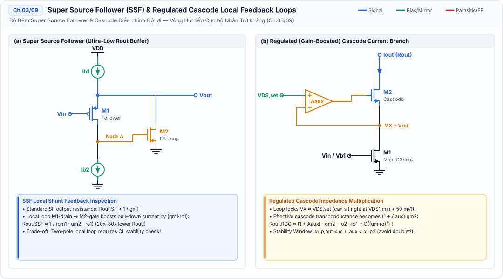

---
{
  "id": "topo-regulated-cascode-super-source-follower",
  "kind": "topology",
  "domain": "stages-and-mirrors",
  "title_vi": "Cascode Điều chỉnh (Gain-Boosted Cascode) & Bộ Theo Nguồn Siêu cấp (Super Source Follower / FVF): Biến đổi Trở kháng Bằng Vòng Hồi tiếp Cục bộ",
  "title_en": "Regulated Cascode (RGC) and Super Source Follower (SSF / Flipped Voltage Follower): Local Feedback Impedance Multiplication and Compression",
  "summary": "Giải phẫu cặp cấu trúc đối ngẫu kinh điển dùng vòng hồi tiếp âm cục bộ hai transistor để biến đổi trở kháng cực đoan mà không tốn thêm tầng xếp chồng dọc: Regulated Cascode nhân vọt trở kháng ra lên gm1*gm2*rO^3 (hoặc A_aux*gm*rO^2) làm lá chắn siêu cứng, trong khi Super Source Follower (và Flipped Voltage Follower) nén trở kháng ra xuống cỡ miliohm–vài ohm ~(gm1*gm2*rO)^-1 làm bộ đệm điện áp chịu tải nặng.",
  "diagram": "../../diagrams/regulated-cascode-ssf.svg",
  "razavi_refs": [
    {
      "chapter": 3,
      "section": "3.4, 3.6",
      "pages": "68-75, 82-90",
      "equations": ["3.88", "3.99", "3.135", "3.136"]
    },
    {
      "chapter": 8,
      "section": "8.6.4",
      "pages": "327",
      "equations": ["8.184", "8.185"]
    },
    {
      "chapter": 9,
      "section": "9.4.1-9.4.2",
      "pages": "364-371",
      "equations": ["9.20", "9.21", "9.23", "9.26", "9.34", "9.35"]
    }
  ],
  "glossary_codes": ["T051", "T082", "T499", "T503", "T518", "T685", "T698"],
  "process_agnostic": true,
  "roles": {
    "local_shunt_series_rgc_loop": "Khuếch đại phụ cảm nhận điện áp cực nguồn của transistor cascode và điều khiển ngược lại cực cổng cascode, ghim cứng VDS1 và nhân trở kháng ra lên (1 + A_aux) lần",
    "local_shunt_shunt_ssf_loop": "Transistor CS phụ cảm nhận sai số dòng/áp tại cực máng của transistor bám nguồn M1 và bơm dòng bù cực lớn ở ngõ ra, nén trở kháng ra xuống đi (gm2*rO1) lần",
    "headroom_preserving_impedance_engine": "Đạt trở kháng tương đương cascode 3 tầng (RGC) hoặc transistor khổng lồ gấp 50 lần (SSF) trong khi chỉ tiêu tốn khoảng dự trữ dọc ngang bằng cấu trúc 2 tầng cơ bản"
  },
  "symptoms_addressed": [
    "triple-cascode-impossible-under-low-supply-headroom",
    "standard-source-follower-droops-and-distorts-driving-resistive-load",
    "cascode-shielding-insufficient-in-short-channel-45nm-65nm-cmos",
    "high-input-impedance-tia-front-end-needed-for-large-photodiode-cap"
  ],
  "limitations": [
    "local-two-pole-feedback-loop-prone-to-ringing-or-oscillation-with-capacitive-load",
    "rgc-introduces-pole-zero-doublet-degrading-fast-step-settling",
    "fvf-and-simple-rgc-lock-internal-node-at-one-vgs-eating-some-compliance-unless-level-shifted"
  ],
  "checklists": ["common-mos", "single-stage", "feedback-and-stb"]
}
---

## 1. Bản chất Nguyên lý, Sơ đồ Mạch & Vai trò Từng Nhánh Cấu trúc

Trên các tiến trình CMOS nanomet ($90\text{nm}/65\text{nm}/45\text{nm}$) nơi độ lợi nội tại của mỗi transistor sụt xuống chỉ còn $g_m r_O \approx 6\text{–}15$ và nguồn cấp hạ xuống $V_{DD} \approx 1{,}0\text{–}1{,}2\,\text{V}$, hai bài toán đối cực cùng lúc rơi vào ngõ cụt nếu chỉ dùng các ghép nối thụ động cơ bản:
- **Bài toán Cực đại hóa $R_{\text{out}}$ (Nguồn dòng / Khuếch đại độ lợi siêu cao):** Một tầng cascode thường (`topo-cascode-stage`) chỉ đạt $R_{\text{out}} \approx g_{m2} r_{O2} r_{O1} \sim 100\,\text{k}\Omega$, còn việc chồng thêm transistor thứ ba thành **cascode ba tầng (`T506`, triple cascode)** ăn mất $3\,V_{DS,\min}$ mỗi phía (tổng cộng $6\,V_{DS,\min}$ cho cả nhánh trên và dưới!), làm nghẹt thở hoàn toàn dải dao động ngõ ra!
- **Bài toán Cực tiểu hóa $R_{\text{out}}$ (Bộ đệm điện áp lái tải nặng):** Một **mạch bám nguồn (`T082`, source follower — SF)** đơn chuẩn (`topo-source-follower`, §3.4) có trở kháng ra $R_{\text{out,SF}} = \frac{1}{g_{m1} + g_{mb1}} \parallel r_{O1} \approx 200\text{–}1000\,\Omega$. Khi phải lái tải điện trở nhỏ $R_L = 50\text{–}200\,\Omega$ (hoặc giữ áp tham chiếu trước xung dòng lấy mẫu SAR ADC), độ lợi sụt thảm hại theo bộ chia áp $\frac{R_L}{R_L + 1/g_{m1}}$ và sinh méo hài nặng; muốn giảm $R_{\text{out,SF}}$ xuống $5\,\Omega$ bằng cách phình $W_1$ và $I_D$ lên $50$ lần sẽ đốt cháy hàng chục mili-ampe công suất và làm nổ tung điện dung cổng $C_{GS1}$!

Chìa khóa vạn năng giải cứu đồng thời cả hai cực đoan mà **không tốn thêm tầng xếp chồng dọc** chính là cài một **vòng hồi tiếp âm cục bộ 1 transistor (hoặc 1 OTA phụ)** ôm quanh linh kiện chính (Razavi Chương 3 §3.4 & §3.6, Chương 8 Ví dụ 8.26 tr. 327, và Chương 9 §9.4 tr. 364–371):



1. **Cascode Điều chỉnh (Regulated Cascode — RGC / Gain-Boosted Cascode, Hình 9.24–9.28 & Hình 8.79):**
   - Trong cascode thường ($M_2$ chồng trên $M_1$), cực cổng $M_2$ buộc vào điện áp tĩnh $V_b$, nên khi $V_{\text{out}}$ biến thiên, cực nguồn $X$ của $M_2$ vẫn nhúc nhích một lượng nhỏ $\Delta V_X \approx \frac{\Delta V_{\text{out}}}{g_{m2} r_{O2}}$.
   - Trong **Regulated Cascode**, ta thêm bộ khuếch đại đảo pha phụ $A_{\text{aux}}$ (dạng tối giản Sackinger 1 transistor CS $M_3$ tải nguồn dòng $I_b$, hoặc 1 cặp vi sai phụ): ngõ vào $A_{\text{aux}}$ dò trực tiếp điện thế nút nội $V_X$ (cực máng $M_1$), còn ngõ ra lái ngược lại cực cổng của **transistor cascode (`T503`)** $M_2$! Hễ $V_{\text{out}}$ kéo $V_X$ nhích lên $\Delta V_X > 0$, $A_{\text{aux}}$ lập tức kéo cổng $M_2$ tụt xuống $-A_{\text{aux}}\Delta V_X$, khóa chặt dòng thoát và **ghim chết $V_{DS1} = V_X$ cứng gấp $(1 + A_{\text{aux}})$ lần**!
2. **Bộ Theo Nguồn Siêu cấp (Super Source Follower — SSF & Biến thể Flipped Voltage Follower — FVF):**
   - Bắt đầu từ mạch bám nguồn PMOS $M_1$ nhận $V_{\text{in}}$ ở cổng, nút ngõ ra nằm ở cực nguồn $V_{\text{out}} = V_{S1}$ (được bơm dòng tĩnh bởi nguồn dòng $I_1$ từ $V_{DD}$). Thay vì nối cực máng $M_1$ thẳng xuống đất làm lãng phí tín hiệu sai lệch dòng, ta đặt nguồn dòng $I_2$ ở dưới cực máng $M_1$ (nút $Y$) và dùng một **transistor nguồn chung NMOS đối cực $M_2$** có cổng nối vào nút trở kháng cao $Y$ và cực máng quay ngược lên hút dòng thẳng tại nút ngõ ra $V_{\text{out}}$!
   - Khi tải ngoài đột ngột đẩy $V_{\text{out}}$ nhích lên $+\Delta V_{\text{out}}$: $V_{SG1} = V_{\text{out}} - V_{\text{in}}$ tăng $\implies M_1$ đổ thêm dòng $g_{m1}\Delta V_{\text{out}}$ xuống nút trở kháng cao $Y$ $\implies$ điện thế $V_Y$ vọt lên $+g_{m1}(r_{O1}\parallel r_{O,I2})\Delta V_{\text{out}}$ $\implies$ NMOS $M_2$ mở toang hút một dòng khổng lồ $g_{m2} V_Y$ kéo $V_{\text{out}}$ trở lại vị trí cũ! Vòng hồi tiếp âm điện áp–dòng cục bộ có **độ lợi vòng (`T051`)** $T_{\text{SSF}} \approx g_{m2}(r_{O1} \parallel r_{O,I2})$ nén trở kháng ra của $M_1$ nhỏ đi đúng $(1 + T_{\text{SSF}})$ lần!
   - Ở biến thể cùng cực tính gọi là **Flipped Voltage Follower (FVF)**: $M_1$ (PMOS) có dòng tĩnh không đổi $I_b$ chảy qua kênh từ trên xuống, cực máng $M_1$ lái thẳng cực cổng của PMOS $M_2$ (cực nguồn $M_2$ nối vào cực nguồn $M_1$ chính là $V_{\text{out}}$, cực máng $M_2$ xuống đất) — toàn bộ biến thiên dòng tải do $M_2$ gánh trọn, giữ $I_{D1} \equiv I_b \Rightarrow V_{SG1} \equiv \text{const}$ với độ chính xác cực cao!

---

## 2. Hệ Phương trình Cốt lõi & Tư duy "Nhìn Mạch Đọc Nhanh" (Analysis by Inspection)

### 2.1. Chứng minh Trở kháng Ra & Hỗ dẫn của Regulated Cascode (Phương trình 8.184–8.185 & 9.20–9.26)
Đặt nguồn áp thử $V_{\text{test}}$ tại cực máng của $M_2$ (nối cổng $M_1$ xuống đất xoay chiều $\Rightarrow M_1$ tương đương điện trở $r_{O1}$ nối từ nút $X$ xuống đất). Vì không có đường rẽ dòng DC/tần số thấp nào khác tại nút $X$, toàn bộ dòng thử $I_{\text{test}}$ chảy qua $r_{O1}$, cho ngay $V_X = I_{\text{test}} r_{O1}$.
Bộ khuếch đại phụ tạo áp cổng $V_{G2} = -A_{\text{aux}} V_X$, suy ra điện áp điều khiển cổng–nguồn tổng cộng của $M_2$ là:
$$V_{gs2} = V_{G2} - V_X = -(1 + A_{\text{aux}}) V_X$$
Viết KCL cho nhánh transistor cascode $M_2$ (gồm cả hiệu ứng thân $V_{bs2} = -V_X$):
$$I_{\text{test}} = g_{m2} V_{gs2} + g_{mb2} V_{bs2} + \frac{V_{\text{test}} - V_X}{r_{O2}} = -\big[g_{m2}(1 + A_{\text{aux}}) + g_{mb2}\big] I_{\text{test}} r_{O1} + \frac{V_{\text{test}} - I_{\text{test}} r_{O1}}{r_{O2}}$$
Giải tỉ số $R_{\text{out,RGC}} = V_{\text{test}} / I_{\text{test}}$ thu được biểu thức chính xác tuyệt đối (Phương trình 9.21 & 8.185):

$$R_{\text{out,RGC}} = \Big\{\big[g_{m2}(1 + A_{\text{aux}}) + g_{mb2}\big] r_{O2} + 1\Big\} r_{O1} + r_{O2} \approx (1 + A_{\text{aux}})\,g_{m2} r_{O2} r_{O1}$$

- **Trong mạch RGC 1-transistor tối giản (BJT/MOS RGC cổ điển Sackinger, Hình 9.27a):** Bản thân $A_{\text{aux}} = g_{m3}(r_{O3} \parallel r_{O,Ib})$, nên trở kháng ra đạt bậc **ba lũy thừa độ lợi nội tại**:
  $$R_{\text{out,RGC-1T}} \approx (g_{m3} r_{O3})\,(g_{m2} r_{O2})\,r_{O1} \sim g_m^2 r_O^3$$
  ngang ngửa một cột **Triple Cascode**, nhưng nếu dùng OTA vi sai dịch mức làm $A_{\text{aux}}$ (Hình 9.28–9.31, Phương trình 9.26), khoảng dự trữ điện áp tối thiểu tại ngõ ra vẫn giữ nguyên chỉ bằng **$V_{\text{out,min}} = V_{DS1,\min} + V_{DS2,\min} = 2\,V_{DS,\min}$**!
- **Ứng dụng Ngược của RGC làm Tầng Đầu vào Băng rộng Trở kháng Cực thấp (RGC TIA Front-End):** Nếu đưa dòng tín hiệu $I_{\text{in}}$ vào thẳng **nút nội $X$** (thay vì nhìn từ cực máng $M_2$!), vòng hồi tiếp âm $A_{\text{aux}}$ chia nhỏ trở kháng nhìn vào cực nguồn $M_2$ đi $(1 + A_{\text{aux}})$ lần:
  $$R_{\text{in,RGC-TIA}} \approx \frac{1}{g_{m2}(1 + A_{\text{aux}})}$$
  Nhờ đó một photodiode có điện dung lớn $C_{PD} = 1\,\text{pF}$ vẫn đạt băng thông hàng $\text{GHz}$ chỉ với dòng phân cực nhỏ!

### 2.2. Chứng minh Trở kháng Ra Siêu Thấp & Triệt Hiệu ứng Thân của Super Source Follower
Xét mạch Super Source Follower chuẩn (PMOS $M_1$ nhận $V_{\text{in}}$, cực nguồn nối $V_{\text{out}}$, cực máng tại nút $Y$ lái cổng NMOS phản hồi $M_2$ có cực máng nối lên $V_{\text{out}}$):
1. **Trở kháng ngõ ra vòng kín $R_{\text{out,SSF}}$:** Giữ $V_{\text{in}} = 0$ (AC), đặt áp thử $V_t$ tại $V_{\text{out}}$. Điện áp cổng–nguồn của PMOS $M_1$ là $V_{sg1} = +V_t$ (kèm $V_{sb1} = -V_t$ nếu thân nối $V_{DD}$, hoặc $0$ nếu giếng $n$-well nối nguồn). Dòng tín hiệu từ $M_1$ đổ vào tổng trở nút $Y$ là $R_Y = r_{O1} \parallel r_{O,I2}$, tạo điện thế $V_Y \approx (g_{m1} + g_{mb1}) R_Y V_t$. Điện thế này kích hoạt NMOS $M_2$ hút dòng $g_{m2} V_Y$ ngay tại nút thử $V_{\text{out}}$! Tổng dòng rút từ nguồn thử là:
   $$I_t \approx (g_{m1} + g_{mb1}) V_t + g_{m2}\big[(g_{m1} + g_{mb1}) R_Y V_t\big] \quad \Longrightarrow \quad R_{\text{out,SSF}} = \frac{V_t}{I_t} \approx \frac{1}{(g_{m1} + g_{mb1})\big[1 + g_{m2}(r_{O1} \parallel r_{O,I2})\big]}$$
   **Ví dụ số ấn tượng:** Với $g_{m1} = 2\,\text{mS}$ (nên SF thường có $R_{\text{out}} = 500\,\Omega$), chỉ cần thêm nhánh phụ nhỏ có $g_{m2} = 2\,\text{mS}$ và $R_Y = 50\,\text{k}\Omega$ ($g_{m2} R_Y = 100$), trở kháng ra sụt thốc từ **$500\,\Omega$ xuống chỉ còn $5{,}0\,\Omega$** (nhỏ hơn $100$ lần!) và dễ dàng lái tải $R_L = 100\,\Omega$ mà không hề suy hao!
2. **Độ lợi điện áp tiến sát đơn vị:** Áp dụng bổ đề $A_v = G_m R_{\text{out}}$ (nếu nối thân–nguồn $B\text{–}S$ cho PMOS $M_1$ nên $g_{mb1} = 0$): hỗ dẫn ngắn mạch tổng từ $V_{\text{in}}$ tới $V_{\text{out}}$ là $G_{m,\text{SSF}} = g_{m1}(1 + g_{m2} R_Y)$. Ngay cả khi mang tải điện trở $R_L$, độ lợi vòng kín đạt:
   $$A_{v,\text{SSF}} = \frac{R_L}{R_L + R_{\text{out,SSF}}} \approx \frac{1}{1 + \dfrac{1}{g_{m1} R_L (1 + g_{m2} R_Y)}} \longrightarrow 1{,}000$$
   Hơn nữa, vì dòng qua $M_1$ được giữ cố định bởi nguồn dòng cố định $I_2$ ở cực máng của nó ($I_{D1} \equiv I_2$!), mọi dòng tải biến thiên $I_L = V_{\text{out}}/R_L$ đều do $M_2$ cung cấp $\implies V_{SG1}$ **hầu như không bị điều chế bởi dòng tải**, nên độ méo hài bậc hai/ba ($\text{HD}_2, \text{HD}_3$) giảm đi hàng chục $\text{dB}$ so với SF truyền thống!

### 2.3. Bảng Đối Chiếu Toàn Diện: SF Thường vs. SSF/FVF và Cascode Thường vs. RGC

| Tiêu chí Kỹ thuật | Source Follower Thường (`topo-source-follower`) | Super Source Follower (SSF / FVF) | Cascode Thường (`topo-cascode-stage`) | Regulated Cascode (RGC) |
|---|---|---|---|---|
| **Mục đích biến đổi trở kháng** | Hạ $R_{\text{out}}$ bậc một | **Nén sâu $R_{\text{out}}$ bằng hồi tiếp song song** | Tăng $R_{\text{out}}$ bậc một | **Nhân vọt $R_{\text{out}}$ bằng hồi tiếp nối tiếp** |
| **Công thức $R_{\text{out}}$ tần số thấp** | $\dfrac{1}{g_{m1} + g_{mb1}}$ | $\dfrac{1}{(g_{m1}+g_{mb1})(1 + g_{m2} R_Y)}$ | $(g_{m2}+g_{mb2}) r_{O2} r_{O1}$ | $(1 + A_{\text{aux}}) g_{m2} r_{O2} r_{O1}$ |
| **Giá trị điển hình (65nm)** | $300\text{–}1000\,\Omega$ | **$2\text{–}15\,\Omega$** | $80\text{–}250\,\text{k}\Omega$ | **$5\text{–}50\,\text{M}\Omega$** |
| **Dự trữ áp tối thiểu trên đường chính** | $V_{GS1} + V_{DS,\text{bias}}$ | $V_{SG1} + V_{DS,I2}$ (hoặc $V_{SG1}+V_{DS2,\min}$ ở FVF) | $2\,V_{DS,\min}$ (dùng LVCCML) | **$2\,V_{DS,\min}$** (khi $A_{\text{aux}}$ dùng đầu vào gấp/PMOS!) |
| **Rủi ro động học tần số cao** | Trở kháng ra cảm kháng nếu $R_S > 1/g_{m1}$ | **Vòng lặp 2 cực $(Y, \text{out})$ cực dễ tự dao động khi lái $C_L$ vừa!** | Rất ổn định (1 cực nội cao $g_{m2}/C_X$) | **Sinh cặp cực–zero gần trùng (doublet)** + ổn định vòng $A_{\text{aux}}$! |

---

## 3. Bất biến Cấu trúc & Các Bẫy Lỗi Kinh điển (Structural Invariants & Traps)

- **[INV-RGCSSF-01] Quy luật Cửa sổ Tần số Vàng Của Vòng Khuếch đại Phụ RGC (§9.4.3, Phương trình 9.38–9.42):**
  Để vòng hồi tiếp cục bộ $A_{\text{aux}}$ trong Regulated Cascode vừa không tự mất ổn định vừa hạn chế đuôi xác lập chậm do doublet, tần số cắt độ lợi đơn vị $\omega_{u,\text{aux}}$ của bộ khuếch đại phụ bắt buộc phải kẹp chặt giữa cực vòng kín bậc hai của mạch chính và cực phụ nút nội cascode:
  $$\beta_{\text{main}}\,\omega_{u,\text{main}} < \omega_{u,\text{aux}} < \omega_{p,X} \approx \frac{g_{m2} + g_{mb2}}{C_X}$$
- **[INV-RGCSSF-02] Bất biến Bất đối xứng Khả năng Đẩy – Kéo (Push vs. Pull Slew Asymmetry) của SSF & FVF:**
  Trong SSF dùng PMOS $M_1$ + NMOS phản hồi $M_2$ (nuôi bởi nguồn dòng trên $I_1$ và nguồn dòng dưới $I_2 < I_1$): khả năng **hút dòng (sink)** xuống đất qua $M_2$ là gần như không giới hạn (Class-A/AB một chiều!), nhưng khả năng **bơm dòng (source)** ra tải bị kẹp cứng ở trần $I_{\text{source,max}} = I_1 - I_2$! Nếu bước nhảy dương trên tụ tải $C_L$ đòi hỏi $C_L \frac{dV}{dt} > I_1 - I_2$, $M_2$ tắt hẳn, vòng hồi tiếp cục bộ bị đứt và mạch rơi vào slewing tuyến tính chậm chạp!

- **[TRAP-RGCSSF-01] Bẫy Dao động Vòng Cục bộ 2 Cực Khi Super Source Follower Lái Tụ Tải $C_L$!**
  Đây là cái bẫy làm cháy hàng loạt bộ đệm tham chiếu ADC trên silicon! Vòng hồi tiếp cục bộ của SSF đi qua **hai nút có tụ**: nút nội trở kháng cao $Y$ ($\omega_{p,Y} = \frac{1}{R_Y C_Y}$) và nút ngõ ra $V_{\text{out}}$ ($\omega_{p,\text{out}} \approx \frac{g_{m1} + 1/R_L}{C_L}$). Với độ lợi vòng $T_0 = g_{m2} R_Y \approx 30\text{–}80$, tần số cắt độ lợi vòng nằm ở $\omega_{GX,\text{SSF}} \approx \frac{g_{m2}}{C_Y}$. Nếu tụ tải $C_L$ rơi vào "vùng tử thần" vài trăm $\text{fF}$ đến vài $\text{pF}$ khiến $\omega_{p,\text{out}} \lesssim \omega_{GX,\text{SSF}}$, hai cực tạo góc lệch pha $-180^\circ$ làm **SSF rung chuông dữ dội hoặc tự dao động hình sin**! *Cách bù chuẩn:* mắc một tụ bù Miller nhỏ $C_c$ (hoặc nối tiếp $R_z + C_c$) giữa nút nội $Y$ và ngõ ra $V_{\text{out}}$ (hoặc đất) để đặt nút $Y$ làm cực trội an toàn!
- **[TRAP-RGCSSF-02] Bẫy Lãng phí Khoảng Dự trữ $V_{GS3}$ Của RGC 1-Transistor Đơn Giản (§9.4.2, Hình 9.27a):**
  Nếu dùng một NMOS nguồn chung đơn độc $M_3$ làm bộ khuếch đại phụ cảm nhận nút $X$ của cascode NMOS, cực nguồn $M_3$ nối đất buộc $V_{DS1} = V_X = V_{GS3} = V_{TH3} + V_{OV3} \approx 0{,}5\text{–}0{,}7\,\text{V}$ — tức đánh mất nguyên một ngưỡng $V_{TH}$ y hệt cascode nối diode kiểu cũ! Muốn giữ trọn ưu thế $V_{DS1} = V_{DS1,\min} \approx 120\,\text{mV}$ dưới nguồn thấp, bắt buộc dùng **cặp vi sai đầu vào PMOS** (hoặc cascode gập PMOS-in, Hình 9.29–9.31) làm $A_{\text{aux}}$ cho nhánh cascode NMOS phía đáy (và ngược lại dùng **NMOS-in** làm $A_{\text{aux}}$ cho nhánh cascode PMOS phía đỉnh)!

---

## 4. Lộ trình Nâng cấp Cấu trúc & Bát giác Đánh đổi (Upgrade Paths & Design Octagon)

Hai cấu trúc hồi tiếp cục bộ này là trạm trung chuyển chiến lược trên `concept-analog-design-octagon`:
- **Lộ trình của nhánh nhân trở kháng (Regulated Cascode):**
  - Nâng cấp từ `topo-cascode-stage` và `topo-lvccml-wide-swing-mirror` thành gương dòng siêu chính xác tại `topo-wilson-and-regulated-current-mirrors` (dùng trong Charge Pump PLL để triệt vạch phổ giả `topo-pfd-deadzone-and-charge-pump-nonidealities`).
  - Ghép lên bốn nhánh cascode của Telescopic hoặc Folded-Cascode để tạo nên Op-Amp 1 tầng độ lợi $85\text{–}100\,\text{dB}$ tốc độ cao tại `topo-gain-boosted-cascode`, với lưu ý phải kiểm soát đuôi doublet tại `law-slewing-vs-linear-settling-time-budget`.
- **Lộ trình của nhánh nén trở kháng (Super Source Follower / FVF):**
  - Nâng cấp trực tiếp từ `topo-source-follower` khi cần đệm điện áp tham chiếu $V_{\text{REF}}$ cho mảng tụ DAC của SAR ADC (`topo-sar-adc-charge-redistribution-architecture`), làm tầng đệm ngõ ra lái tải trở thấp hoặc làm khối tạo chuẩn áp nhanh cho LDO không tụ ngoài (`topo-cmos-ldo-regulator`).
  - Phương pháp đo độ lợi vòng không cắt dây cho các vòng cục bộ 2 transistor này bắt buộc dùng bơm kép Middlebrook / Spectre `stb` tại `tech-bode-blackman-middlebrook-stb`.

---

## 5. Thích ứng Đa Tiến trình (90nm / 65nm / 45nm) & Cách Kiểm chứng trong Cadence / Spectre

### 5.1. Chiến lược Định cỡ Thực chiến ở 90nm / 65nm / 45nm
1. **Dùng MOSFET Ngưỡng Thấp (`LVT`) Cho FVF & RGC 1-Transistor:** Trên công nghệ 65nm/45nm, nếu không muốn tốn diện tích cho cả một OTA vi sai phụ mà vẫn muốn dùng RGC 1-transistor gọn nhẹ cho gương dòng hoặc TIA, hãy chọn $M_3$ thuộc họ `LVT` chạy ở vùng dưới ngưỡng nhẹ ($V_{GS3} \approx 220\text{–}280\,\text{mV}$), vừa đủ đặt $V_{DS1} \approx 250\,\text{mV} > V_{DS1,\min}$!
2. **Định cỡ vòng ổn định SSF theo tải $C_L$:**
   - Nếu $C_L$ nhỏ ($< 200\,\text{fF}$): đặt cực trội tại nút nội $Y$ bằng tụ bù nhỏ $C_c \approx 50\text{–}150\,\text{fF}$ sao cho $\frac{g_{m2}}{C_Y + (1+0)C_c} \le \frac{1}{3}\frac{g_{m1}}{C_L}$.
   - Nếu $C_L$ cực lớn (ví dụ $C_L = 10\text{–}100\,\text{pF}$ của lưới tham chiếu): chính nút ngõ ra $V_{\text{out}}$ trở thành cực trội tự nhiên ($\omega_{p,\text{out}} = \frac{g_{m1} g_{m2} R_Y}{C_L}$ trên vòng kín, hoặc $\frac{1}{(R_L \parallel r_{O2}) C_L}$ trên vòng hở), khi đó phải giữ $L_2$ ngắn và $R_Y$ vừa phải ($g_{m2} R_Y \approx 10\text{–}20$) để đẩy cực nút nội $\omega_{p,Y} = \frac{1}{R_Y C_Y}$ lên cao hơn tần số cắt vòng!

### 5.2. Quy trình Kiểm chứng Độ Ổn định Vòng Cục bộ (`stb`) & $Z_{\text{out}}(f)$ Trong Spectre
**Tuyệt đối KHÔNG chỉ chạy `ac` từ ngõ vào tới ngõ ra** để kết luận RGC hay SSF ổn định, bởi một vòng cục bộ dự trữ pha $15^\circ$ đôi khi chỉ lộ một cái nhô nhẹ $2\,\text{dB}$ trên hàm truyền thẳng nhưng sẽ dao động dữ dội ở góc `FF, -40°C`! Hãy chèn trực tiếp `iprobe` (`analogLib/iprobe`) nối tiếp vào **cực cổng của transistor hồi tiếp** ($M_2$ trong cả RGC lẫn SSF) và chạy phân tích `stb`:

```ocean
; Script OCEAN đo đồng thời Dự trữ Pha vòng cục bộ (STB) và Đường cong Zout(f) (XF/AC):
analysis('stb ?start 1e3 ?stop 50e9 ? dec 30 ?probe "/IPROBE_LOCAL_GATE")
analysis('ac  ?start 1e3 ?stop 50e9 ?dec 30) ; Nguồn dòng AC Itest = 1A đặt tại nút Vout
run()

pm_local  = getData("phaseMargin" ?result "stb_margin")
ugf_local = getData("loopGainUgf" ?result "stb_margin")
zout_wf   = mag(VF("/vout"))                 ; Vì Itest = 1A AC nên |VF("/vout")| chính là |Zout(f)| (Ohm)!
zout_dc   = value(zout_wf 1e3)
zout_peak = ymax(zout_wf)

printf("Local Loop PM = %.1f deg @ UGF = %.2f MHz | Zout(DC) = %.2f Ohm | Zout_peak = %.2f Ohm\n"
       pm_local ugf_local/1e6 zout_dc zout_peak)
```

- **Tiêu chuẩn đạt chuẩn Tape-out:**
  - `pm_local >= 60 deg` trên mọi góc PVT và toàn bộ dải dòng tải / tụ tải $C_L$.
  - Với SSF làm bộ đệm tham chiếu: kiểm tra đỉnh trở kháng cảm kháng $Z_{\text{out,peak}} = \max_f |Z_{\text{out}}(jf)|$ không tạo cộng hưởng sắc với tụ tải, và kiểm tra bước nhảy dòng tải quá độ $\Delta I_{\text{load}}$ không làm $M_2$ tắt rơi vào vùng chết phục hồi.

---

## 6. Mốc Đối chiếu Sách Razavi & Thuật ngữ Chuẩn CLB

### 6.1. Đối chiếu Sách Gốc Razavi (2nd Edition)
- **Chương 3:** §3.4 *Source Follower* (tr. 68–75, Phương trình 3.88, 3.99 — giới hạn trở kháng ra $\frac{1}{g_{m1}+g_{mb1}}$, suy giảm độ lợi và phi tuyến khi lái tải trở của SF cơ bản); §3.6 *Cascode Stage* (tr. 82–90, Phương trình 3.135–3.136, thuộc tính che chắn *shielding property* Hình 3.72).
- **Chương 8:** §8.6.4 *Blackman's Impedance Formula — Ví dụ 8.26* (tr. 327, Hình 8.79, Phương trình 8.184–8.185 — tính chính xác trở kháng ra của Regulated Cascode bằng công thức Blackman không cắt vòng, thu được $R_{\text{out}} = r_{O1}[1 + (g_{m2} + g_{mb2} + A_1 g_{m2})r_{O2}] + r_{O2}$); các bài tập phân tích vòng hồi tiếp cục bộ hạ trở kháng ra của bộ đệm theo nguồn có khuếch đại phụ.
- **Chương 9:** §9.4.1 *Gain Boosting — Basic Idea* (tr. 364–368, Phương trình 9.20–9.26, Hình 9.24–9.26, Ví dụ 9.11–9.12) & §9.4.2 *Circuit Implementation* (tr. 368–371, Phương trình 9.34–9.35, Hình 9.27–9.35, Ví dụ 9.13–9.14 — triển khai RGC 1 transistor, cascode gập phụ trợ giữ dải dao động tối đa).

### 6.2. Bảng Thuật ngữ Chuẩn CLB Vi Mạch Sử dụng trong Thẻ
| Mã CLB | Thuật ngữ Tiếng Anh | Thuật ngữ Tiếng Việt Chuẩn | Ghi chú Ngữ cảnh |
|---|---|---|---|
| `T082` | source follower | Mạch bám nguồn | Tầng đệm cực máng chung; nâng cấp thành SSF nhờ nhánh CS phản hồi |
| `T499` | cascode stage | Tầng cascode | Ghép nối tiếp CS–CG; nâng cấp thành RGC nhờ vòng khuếch đại phụ |
| `T503` | cascode device | Transistor cascode | Linh kiện cổng chung chắn áp cực máng cho transistor chính |
| `T518` | output impedance | Trở kháng đầu ra | Được nhân lên $(1+A_{\text{aux}})$ ở RGC hoặc chia nhỏ $(1+g_{m2}R_Y)$ ở SSF |
| `T051` | loop gain | Độ lợi vòng | Đại lượng quyết định hệ số biến đổi trở kháng và dự trữ pha cục bộ |
| `T685` | cascode structure | cấu trúc cascode | Nền tảng bảo toàn khoảng dự trữ dọc $2 V_{DS,\min}$ dưới nguồn thấp |
| `T698` | cascode mirror | gương dòng cascode | Ứng dụng trọng yếu của RGC để đạt sai số sao chép dòng gần bằng không |
