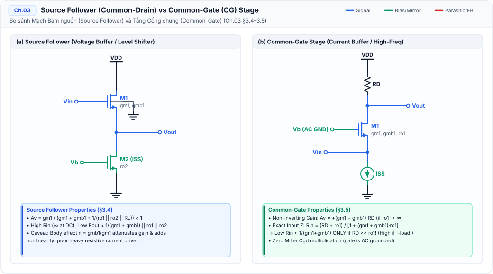

---
{
  "id": "topo-source-follower",
  "kind": "topology",
  "domain": "stages-and-mirrors",
  "title_vi": "Tầng bám nguồn / Máng chung: Bộ đệm điện áp & Mạch dịch mức (Source Follower / Common-Drain Stage)",
  "title_en": "Source Follower (Common-Drain Stage)",
  "summary": "Nhận tín hiệu tại cực cổng và xuất đầu ra tại cực nguồn với cực máng nối nguồn cấp AC, tầng bám nguồn đóng vai trò bộ đệm điện áp trở kháng vào rất cao – trở kháng ra thấp cỡ 1/(gm+gmb) và mạch dịch mức một chiều VGS, nhưng chịu trần độ lợi dưới 1 do hiệu ứng thân gm/(gm+gmb+1/RL), méo phi tuyến ngưỡng phụ thuộc VSB, hao hụt dự trữ điện áp lớn và kém hiệu quả khi lái dòng tải nặng.",
  "diagram": "../../diagrams/source-follower-and-cg.svg",
  "razavi_refs": [
    {
      "chapter": 3,
      "section": "3.4",
      "pages": "68-75",
      "equations": ["3.82", "3.84", "3.86", "3.88", "3.91", "3.92", "3.95", "3.96", "3.97", "3.99", "3.100", "3.101"]
    }
  ],
  "glossary_codes": [
    "T080", "T082", "T091", "T094", "T095", "T130", "T198", "T208",
    "T239", "T242", "T244", "T352", "T355", "T359", "T497", "T498",
    "T516", "T517", "T519", "T524", "T525", "T526", "T537", "T540"
  ],
  "process_agnostic": true,
  "roles": {
    "follower_transistor_M1": "Transistor đầu vào nhận điện áp tại cực cổng, cực máng nối cố định lên VDD (hoặc đất với PMOS), cho phép điện thế cực nguồn bám sát biến thiên cực cổng với độ lệch một chiều VGS1.",
    "current_source_bias_M2": "Transistor nguồn dòng phân cực đặt dưới cực nguồn giữ dòng tĩnh ID1 gần như hằng định trên toàn dải tín hiệu, tránh sự biến thiên VGS1 mạnh của kiểu phân cực bằng điện trở RS.",
    "isolated_well_connection": "Kết nối thân–nguồn riêng trong giếng n (với PMOS M1 hoặc NMOS ba giếng Triple-Well) triệt tiêu VSB = 0 để khử độ hỗ dẫn thân gmb, đưa độ lợi hở mạch tiến sát 1 và xóa méo hiệu ứng thân."
  },
  "symptoms_addressed": [
    "high-impedance-gain-stage-loaded-by-low-resistance",
    "dc-common-mode-level-mismatch-between-cascaded-stages",
    "need-high-input-impedance-low-output-impedance-voltage-buffer"
  ],
  "limitations": [
    "sub-unity-voltage-gain-due-to-body-effect-divider",
    "body-effect-threshold-nonlinearity-in-shared-substrate-nmos",
    "consumes-full-vgs-dc-level-shift-and-compresses-swing",
    "poor-voltage-gain-and-slew-starvation-into-heavy-50ohm-loads",
    "potential-inductive-output-impedance-ringing-with-capacitive-load"
  ],
  "checklists": [
    "common-mos",
    "single-stage"
  ]
}
---

## 1. Bản chất Nguyên lý, Sơ đồ Mạch & Vai trò Từng Nhánh Cấu trúc

Khi một tầng khuếch đại trở kháng cao như `topo-cs-current-source-and-active-load` hoặc `topo-cascode-stage` phải lái trực tiếp một trở kháng tải (load impedance, `T519`) thấp — chẳng hạn tải điện trở ngoại vi hoặc tải kết cuối $50\,\Omega$ (termination, `T540`) — điện trở tải mắc song song với $R_{out}$ sẽ kéo sập hoàn toàn độ lợi điện áp của tầng trước. Giải pháp kinh điển ở Mục 3.4 là chèn một **bộ đệm điện áp** (voltage buffer, `T524`) vào giữa: **tầng bám nguồn** (source follower, `T082`), còn gọi là **tầng máng chung** (common-drain, `T497` — tuyệt đối không nhầm với tầng nguồn chung `T023`, và không dịch *source* là nguồn cấp `T085`).



Sơ đồ cấu trúc chuẩn gồm hai nhánh nối tiếp làm việc ăn ý trên cùng một trục dòng một chiều (Hình 3.34 và Hình 3.37b):

1. **Transistor bám nguồn $M_1$ (NMOS hoặc PMOS):** Cảm nhận tín hiệu tại cực cổng với trở kháng đầu vào (input impedance, `T517`) tần số thấp cực cao, cực máng ghim thẳng vào nguồn cấp $V_{DD}$ (đất xoay chiều), và lấy tín hiệu ra ngay tại cực nguồn (source terminal, `T080`). Nhờ hồi tiếp âm nối tiếp điện áp $100\%$ nội tại ($V_{GS1} = V_{in} - V_{out}$), mọi nỗ lực của $V_{in}$ đi lên đều kéo dòng $I_{D1}$ tăng để nâng $V_{out}$ đuổi theo sát $V_{in}$, cách nhau một khoảng **dịch mức điện áp** (level shift, `T525`) một chiều bằng $V_{GS1}$. Do $V_{D1} = V_{DD}$, $M_1$ luôn duy trì trong vùng bão hòa (saturation region, `T198`) chừng nào $V_{in} \le V_{DD} + V_{TH1}$.
2. **Nhánh phân cực dòng cực nguồn ($R_S$ ở Hình 3.34a hoặc nguồn dòng $M_2$ ở Hình 3.37b):** Nếu chỉ dùng điện trở $R_S$ nối xuống đất, dòng máng $I_{D1} = V_{out}/R_S$ thay đổi mạnh theo mức một chiều của $V_{in}$, làm $V_{GS1} - V_{TH1} \propto \sqrt{I_{D1}}$ biến thiên lớn và gây méo phi tuyến nặng ngay cả khi chưa xét hiệu ứng thân. Vì vậy, thiết kế vi mạch thực tế hầu như luôn thay $R_S$ bằng một nguồn dòng không đổi (`T547`) thực hiện bởi transistor bão hòa $M_2$: khi $I_{D1} \approx I_1$ được giữ cố định (Ví dụ 3.13, Hình 3.38), $V_{GS1}$ muốn giữ hằng số nên $\Delta V_{out}$ buộc phải sao chép sát $\Delta V_{in}$. Ngoài chức năng đệm trở kháng, mạch còn hoạt động như một **mạch dịch mức điện áp** (level shifter, `T526` — Ví dụ 3.15, Hình 3.47b; Bài 3.27) hạ mức chế độ chung DC xuống một lượng $V_{GS}$ trước khi đưa vào tầng kế tiếp.

## 2. Hệ Phương trình Cốt lõi & Tư duy "Nhìn Mạch Đọc Nhanh" (Analysis by Inspection)

### 2.1. Đặc tuyến tín hiệu lớn & Phép lặp ngưỡng phụ thuộc điện áp nguồn–thân $V_{SB}$
Trên Hình 3.34(a)–(c), khi $V_{in} < V_{TH1}$ thì $M_1$ ngắt và $V_{out} = 0$. Khi $V_{in} > V_{TH1}$, $M_1$ bật thẳng vào vùng bão hòa với phương trình tín hiệu lớn (3.82) (bỏ qua $\lambda$):
$$\frac{1}{2}\mu_n C_{ox}\frac{W}{L}(V_{in} - V_{TH1} - V_{out})^2 R_S = V_{out}$$
Điểm tinh tế quyết định độ chính xác DC của tầng bám nguồn NMOS nằm ở chỗ cực nguồn nối ra $V_{out} > 0$ trong khi đế bán dẫn nối đất, sinh ra điện áp nguồn–thân (source-bulk voltage, `T242`) $V_{SB1} = V_{out}$. Theo phương trình (3.88) (Ví dụ 3.12, trang 70), điện áp ngưỡng $V_{TH1}$ tăng phi tuyến theo $V_{out}$ thông qua hệ số hiệu ứng thân (body-effect coefficient $\gamma$, `T244`):
$$
V_{TH1}(V_{out}) = V_{TH0} + \gamma\left(\sqrt{2\Phi_F + V_{SB}} - \sqrt{2\Phi_F}\right)
$$
Khi tính tay mức dịch DC $V_{out} = V_{in} - V_{GS1}$ cho mạch phân cực nguồn dòng $I_1$ (Hình 3.37b), ta thực hiện $1\text{–}2$ vòng lặp nhanh (minh họa đúng thông số Ví dụ 3.12 của Razavi: $(W/L)_1 = 20/0{,}5$, $I_1 = 200\,\mu\text{A}$, $V_{TH0} = 0{,}6\text{ V}$, $2\Phi_F = 0{,}7\text{ V}$, $\mu_n C_{ox} = 50\,\mu\text{A/V}^2$, $\gamma = 0{,}4\text{ V}^{1/2}$, $V_{in} = 1{,}2\text{ V}$):
1. Ước lượng sơ bộ bỏ qua hiệu ứng thân ($V_{TH1}^{(0)} = 0{,}6\text{ V}$): phương trình (3.87) cho $V_{OV1} = \sqrt{\frac{2 \times 200\,\mu\text{A}}{50\,\mu\text{A/V}^2 \times 40}} = 0{,}447\text{ V} \implies V_{out}^{(0)} = 1{,}2 - 0{,}6 - 0{,}447 = 0{,}153\text{ V}$.
2. Thay $V_{SB} = 0{,}153\text{ V}$ vào (3.88)–(3.89): $V_{TH1}^{(1)} = 0{,}6 + 0{,}4(\sqrt{0{,}7 + 0{,}153} - \sqrt{0{,}7}) = 0{,}635\text{ V}$, cập nhật $V_{out}^{(1)} \approx 0{,}153 - 0{,}035 = 0{,}118\text{ V}$!
Đồng thời, để nguồn dòng $M_2$ không sụp vào vùng triode ở mức đầu ra thấp $0{,}118\text{ V}$ đó, bắt buộc phải thiết kế $(V_{GS} - V_{TH})_2 \le 0{,}118\text{ V}$, ép $(W/L)_2 \ge 287/0{,}5$ và bơm một điện dung tiếp giáp máng $C_{DB2}$ cùng điện dung chồng lấn $C_{GD2}$ khổng lồ vào nút đầu ra!

### 2.2. Điện trở đầu ra, Mô hình tương đương Thévenin và Độ lợi chính xác
Lấy đạo hàm hai vế (3.82) theo $V_{in}$ với lưu ý $\frac{\partial V_{TH1}}{\partial V_{in}} = \frac{\partial V_{TH1}}{\partial V_{SB1}}\frac{\partial V_{out}}{\partial V_{in}} = \eta \frac{\partial V_{out}}{\partial V_{in}}$ (trong đó $\eta = g_{mb1}/g_{m1}$, `T359`) cho độ lợi khi $\lambda = 0$ — phương trình (3.84)–(3.86):
$$
A_v = \frac{g_{m1} R_S}{1 + (g_{m1} + g_{mb1})R_S} \xrightarrow{R_S \to \infty} \frac{g_{m1}}{g_{m1} + g_{mb1}} = \frac{1}{1 + \eta} < 1
$$
Ngay cả khi tải hở mạch ($R_S = \infty$), độ lợi của tầng bám nguồn có hiệu ứng thân **không bao giờ đạt tới $1$** (với $\eta \approx 0{,}2\text{–}0{,}3$ điển hình, $A_v$ bị chặn ở $0{,}77\text{–}0{,}83$).

**Tư duy nhìn mạch độc nhất của Tầng bám nguồn — Biến $g_{mb}$ thành điện trở thuần $1/g_{mb}$ (Hình 3.39–3.41):**
Khi đo điện trở đầu ra của tầng bám nguồn nội tại với $V_{in} = 0$ ($\lambda = 0$, Hình 3.39–3.40), nguồn dòng hiệu ứng thân mang giá trị $g_{mb1} V_{bs1} = -g_{mb1} V_X$ tỉ lệ thuận trực tiếp với chính điện áp đặt trên hai đầu của nó! Vì vậy, **riêng đối với tầng bám nguồn**, hiệu ứng thân tương đương chính xác với một điện trở vật lý $1/g_{mb1}$ nối thẳng từ nút đầu ra xuống đất xoay chiều. Nhờ đó:
1. Điện trở đầu ra nội tại giảm xuống theo phương trình (3.91)–(3.93):
$$
R_{out,\text{intrinsic}} = \frac{1}{g_{m1}} \parallel \frac{1}{g_{mb1}} = \frac{1}{g_{m1} + g_{mb1}}
$$
2. Toàn bộ transistor $M_1$ ($\lambda = 0$) rút gọn thành một **mạch tương đương Thévenin** (Thevenin equivalent, `T537` — Hình 3.41, phương trình (3.94)–(3.95)) gồm nguồn áp bị suy hao nối tiếp với điện trở ra:
$$
V_{Thev} = \frac{\frac{1}{g_{mb1}}}{\frac{1}{g_{m1}} + \frac{1}{g_{mb1}}} V_{in} = \frac{g_{m1}}{g_{m1} + g_{mb1}} V_{in} = \frac{1}{1 + \eta} V_{in}, \qquad R_{Thev} = \frac{1}{g_{m1} + g_{mb1}}
$$

**Biểu thức đầy đủ có điều biến chiều dài kênh, nguồn dòng phân cực $M_2$ và tải ngoài $R_{load}$ (Hình 3.42, phương trình (3.96)):**
Gộp tất cả các nhánh nối từ nút đầu ra xuống đất xoay chiều thành $R_L = r_{O1} \parallel r_{O2} \parallel R_{load}$ và $R_{eq} = \frac{1}{g_{mb1}} \parallel R_L$:
$$
A_v = \frac{R_{eq}}{R_{eq} + \frac{1}{g_{m1}}} = \frac{g_{m1}}{g_{m1} + g_{mb1} + \frac{1}{R_L}} = \frac{g_{m1}}{g_{m1} + g_{mb1} + \frac{1}{r_{O1}} + \frac{1}{r_{O2}} + \frac{1}{R_{load}}}
$$
$$
R_{out,total} = \frac{1}{g_{m1}} \parallel \frac{1}{g_{mb1}} \parallel r_{O1} \parallel r_{O2} = \frac{1}{g_{m1} + g_{mb1} + r_{O1}^{-1} + r_{O2}^{-1}}
$$
Ví dụ 3.14 (Hình 3.43): nếu thay tải dưới bằng MOSFET mắc diode $M_2$, chỉ cần đặt $R_L = r_{O1} \parallel r_{O2} \parallel \frac{1}{g_{m2} + g_{mb2}}$ vào công thức trên là thu ngay phương trình (3.97) trong tích tắc! (Cũng có thể kiểm chứng qua bổ đề Norton ở Bài 3.34 với $I_{out,sc} = -g_{m1} V_{in} \implies G_m = -g_{m1}$ nên $A_v = -G_m(R_{out,total} \parallel R_{load}) = +g_{m1}(R_{out,total} \parallel R_{load})$).

### 2.3. Bảng đối chiếu các biến thể Tầng bám nguồn và Mạch lái tải thấp

| Cấu hình mạch đệm / lái tải | Độ lợi hở mạch ($R_{load} = \infty$) | Trở kháng ra $R_{out}$ | Hiệu ứng thân & Đặc điểm Layout / Dự trữ điện áp |
| :--- | :--- | :--- | :--- |
| **NMOS SF trên đế p chung** | $\frac{g_{m1}}{g_{m1} + g_{mb1} + r_{O1}^{-1} + r_{O2}^{-1}} \approx 0{,}78$ | $\approx \frac{1}{g_{m1} + g_{mb1}}$ (thấp nhất) | Không thể nối thân–nguồn; méo hài bậc hai lớn do $\eta(V_{out})$; dịch mức xuống $-V_{GS1}$. |
| **PMOS SF trong hai giếng n riêng** | $\frac{g_{m1}}{g_{m1} + r_{O1}^{-1} + r_{O2}^{-1}} \approx 0{,}93$ | $\approx \frac{1}{g_{m1}}$ (cao hơn NMOS do $\mu_p < \mu_n$) | Triệt tiêu $g_{mb1} = 0$ nhờ nối giếng n vào $V_{out}$ (Hình 3.44); dịch mức lên $+|V_{GS1}|$; tụ giếng lớn. |
| **NMOS SF trong giếng ba lớp (DNW)** | $\frac{g_{m1}}{g_{m1} + r_{O1}^{-1} + r_{O2}^{-1}} \approx 0{,}95$ | $\approx \frac{1}{g_{m1}}$ (nhanh và nhỏ gọn) | Khử $g_{mb1} = 0$ VÀ giữ $V_{TH1}$ thấp cho nguồn $1{,}0\text{ V}$; cần quy tắc cách ly vòng Deep N-Well. |
| **Tầng CS lái thẳng $R_L = 1/g_{m1}$** | $-g_{m1}(r_{O1} \parallel R_L) \approx -1{,}0$ | $r_{O1} \parallel R_L$ | Độ lợi lớn gấp đôi SF ($1{,}0$ so với $0{,}5$) ở cùng dòng phân cực khi lái $R_L = 50\,\Omega$ (Hình 3.46). |

## 3. Bất biến Cấu trúc & Các Bẫy Lỗi Kinh điển (Structural Invariants & Traps)

- **`[INV-SF-01]` Cửa sổ bão hòa của cặp transistor trong tầng bám nguồn:** Tại mọi thời điểm, tín hiệu phải giữ đồng thời hai bất đẳng thức: (1) ở phía dưới, $V_{out}(t) \ge V_{DS2,min}$ để nguồn dòng $M_2$ không sụp vào triode; (2) ở phía trên, $V_{in}(t) \le V_{DD} + V_{TH1}$ để $M_1$ không bị đẩy vào triode ($V_{DS1} = V_{DD} - V_{out} \ge V_{in} - V_{out} - V_{TH1} \iff V_{in} \le V_{DD} + V_{TH1}$).
- **`[INV-SF-02]` Điều kiện dịch mức an toàn khi ghép nối tầng (Ví dụ 3.15, Hình 3.47, phương trình (3.101)):** Khi dùng tầng bám nguồn NMOS $M_3$ dịch mức đầu vào từ $V_{DD}$ xuống nuôi cổng tầng CS $M_1$ có tải PMOS mắc diode $M_2$ (nơi $V_{out,CS} = V_{DD} - |V_{GS2}|$), điều kiện bất biến để $M_1$ không rơi vào triode tại $V_{in} = V_{DD}$ là $V_{GS3} + V_{TH1} \ge |V_{GS2}|$.
- **`[INV-SF-03]` Bất biến chia áp điện dung cổng–nguồn ở tần số cao:** Nhờ tụ $C_{GS1}$ nối trực tiếp giữa ngõ vào cực cổng và ngõ ra cực nguồn, ở tần số rất cao $C_{GS1}$ tạo đường truyền thẳng không đảo pha giúp tầng bám nguồn không gặp zero nửa mặt phẳng phải (RHP zero) như tầng CS (`law-miller-theorem-and-rhp-zero`), đồng thời điện dung nhìn vào cực cổng được giảm nhẹ thành:
$$
C_{in,SF} = C_{GD1} + (1 - A_v)C_{GS1} + C_{GB1}
$$
Khi $A_v \to 1$, hiệu ứng bootstrapping tự động làm biến mất gần hết $C_{GS1}$ khỏi tải của tầng đứng trước!
- **`[TRAP-SF-01]` Bẫy tưởng tầng bám nguồn là mạch lái tải nặng / tải $50\,\Omega$ hiệu quả (Hình 3.46, phương trình (3.98)–(3.100)):** Đây là ngộ nhận kinh điển được Razavi cảnh báo trực diện ở trang 73–74! Giả sử với cùng một ngân sách dòng phân cực cho $1/g_{m1} = R_L = 50\,\Omega$:
  - Dùng tầng bám nguồn lái $R_L$: $A_{v,SF} \approx \frac{R_L}{R_L + 1/g_{m1}} = \frac{g_{m1} R_L}{1 + g_{m1} R_L} = 0{,}5$ (mất $6\text{ dB}$ biên độ!).
  - Dùng tầng nguồn chung lái thẳng $R_L$: $|A_{v,CS}| \approx g_{m1} R_L = 1{,}0$ (lớn gấp đôi!).
  Tệ hơn nữa về mặt tín hiệu lớn: ở bán kỳ âm khi $V_{in}$ sụt nhanh, $M_1$ ngắt hoàn toàn nên dòng rút khỏi tải bị **kẹp cứng bởi nguồn dòng tĩnh $I_1$** ($V_{out,min\text{-swing}} = -I_1 R_L$ hoặc tốc độ biến thiên âm bị khóa ở $-I_1 / C_L$), gây xén đáy bất đối xứng nặng nề!
- **`[TRAP-SF-02]` Bẫy "ăn cắp" một $V_{GS}$ khoảng dự trữ điện áp của tầng trước (Hình 3.45):** Khi mắc nối tầng (`T498`) một tầng CS $M_1$ với bộ đệm bám nguồn NMOS $M_2$ phân cực bởi $M_3$, điện áp cực tiểu tại nút giao tiếp $X$ bị đội từ $V_{DS1,min}$ lên thành $V_{X,min} = V_{GS2} + V_{DS3,min} = V_{TH2} + V_{OV2} + V_{DS3,min}$, tức cướp mất trọn một điện áp cổng–nguồn $V_{GS2}$ ($\sim 0{,}5\text{–}0{,}7\text{ V}$) khỏi dải dao động của tầng khuếch đại trước!
- **`[TRAP-SF-03]` Bẫy nối thân vào nguồn sai quy tắc công nghệ (Hình 3.44):** Trong công nghệ CMOS đơn giếng tiêu chuẩn (p-substrate chung nối đất), **không thể nối cực thân của NMOS $M_1$ vào cực nguồn $V_{out}$** vì sẽ làm ngắn mạch $V_{out}$ xuống đất đế chung! Giải pháp loại bỏ hiệu ứng thân trên công nghệ chuẩn là chuyển sang **tầng bám nguồn PMOS đặt trong hai giếng n riêng biệt** (separate n-wells, `T130` — Hình 3.44: giếng n của $M_1$ nối vào cực nguồn $V_{out}$, giếng n của nguồn dòng PMOS nối lên $V_{DD}$). Đổi lại, độ linh động lỗ trống $\mu_p < \mu_n$ làm $1/g_{m1}$ cao hơn và tụ tiếp giáp giếng n – đế p lớn làm chậm nút đầu ra.
- **`[TRAP-SF-04]` Bẫy trở kháng ra mang tính cảm gây rung chuông và nhiễu lớn:** Khi tầng bám nguồn được lái bởi nguồn có trở kháng cao $R_S > 1/g_{m1}$, điện dung $C_{GS1}$ biến trở kháng đầu ra $Z_{out}(s)$ thành tương đương **cuộn cảm** gây vọt lố/dao động khi gặp tụ tải $C_L$ (`concept-source-follower-inductive-zout`, Chương 6 §6.3); đồng thời cặp $M_1, M_2$ cộng thêm nhiễu đáng kể nên không đặt trước LNA (`law-stage-and-mirror-noise-rules`). Quy tắc vàng của Razavi (trang 74): *"Tránh dùng tầng bám nguồn trừ khi thực sự bắt buộc!"*

## 4. Lộ trình Nâng cấp Cấu trúc & Bát giác Đánh đổi (Upgrade Paths & Design Octagon)

Đặt trên **bát giác thiết kế mạch tương tự** (`concept-analog-design-octagon`), tầng bám nguồn hy sinh **Độ lợi ($<1$), Dải dao động điện áp (mất $V_{GS}$), Tính tuyến tính ($\eta(V_{out}), r_O(V_{DS})$) và Nhiễu** để đổi lấy **Cách ly trở kháng (cao sang thấp) và Dịch mức một chiều**:
- **Khử méo hiệu ứng thân và suy hao $1/(1+\eta)$:** Chuyển từ NMOS đế chung sang PMOS giếng n riêng (Hình 3.44) hoặc NMOS trong giếng p cô lập bằng Deep N-Well (Triple-Well ở 90nm/65nm/45nm), đưa $g_{mb1} \to 0$ và nâng $A_v \to \frac{g_{m1}}{g_{m1} + r_{O1}^{-1} + r_{O2}^{-1}}$.
- **Tăng khả năng lái tải nặng mà không bị đói dòng âm (Slew / Current Starvation):** Thay nguồn dòng tĩnh $M_2$ bằng tầng đẩy–kéo bổ sung lớp AB (complementary / push-pull source followers hoặc bộ đệm hồi tiếp âm vòng kín dùng `topo-two-stage-opamp` / `tech-slew-rate-and-class-ab-opamps`).
- **Tăng độ tuyến tính vượt giới hạn $r_O$ kênh ngắn:** Nếu $r_{O1}$ và $r_{O2}$ biến thiên mạnh theo $V_{DS}$ làm méo hài trong tiến trình nanomet, bọc nguồn dòng $M_2$ bằng cascode (`topo-cascode-stage` / `topo-lvccml-wide-swing-mirror`) hoặc dùng vòng hồi tiếp âm bao ngoài (super source follower / unity-gain feedback buffer).
- **Tránh tự kích và vọt lố với tải dung lớn:** Kiểm soát tỷ số $R_{source}$ và $1/g_{m1}$ theo `concept-source-follower-inductive-zout` thay vì tăng mù quáng tụ tải.

| Vấn đề / Giới hạn của Tầng bám nguồn | Cấu trúc nâng cấp / Giải pháp chính tắc | Bản chất cải tiến & Cái giá phải trả |
| :--- | :--- | :--- |
| **Độ lợi $< 0{,}8$ và méo hài do $\eta(V_{out})$** | PMOS giếng n riêng (Hình 3.44) hoặc NMOS Deep N-Well | Nối thân vào nguồn ($V_{BS} = 0 \implies g_{mb} = 0$); tốn diện tích giếng và tăng tụ đáy giếng. |
| **Mất quá nhiều dự trữ điện áp DC ($V_{GS1}$)** | Transistor LVT / Native hoặc đệm vi sai gập mức | Hạ $V_{TH1}$ xuống $0\text{–}0{,}25\text{ V}$; cần kiểm tra dòng rò ngắt và giới hạn điện áp cổng. |
| **Đói dòng âm ($-I_1/C_L$) & kém khi lái $50\,\Omega$** | Đệm đẩy–kéo lớp AB hoặc `topo-two-stage-opamp` vòng kín | Cấp dòng động hai chiều lớn gấp nhiều lần $I_{bias}$; phức tạp hóa phân cực tĩnh và bù pha. |
| **Rung chuông khi lái tụ $C_L$ với $R_S > 1/g_{m1}$** | Giảm $R_S$, thêm điện trở dập nối tiếp hoặc bù theo `concept-source-follower-inductive-zout` | Triệt tiêu đỉnh cộng hưởng của $Z_{out}(s)$ mang tính cảm. |

## 5. Thích ứng Đa Tiến trình (90nm / 65nm / 45nm) & Cách Kiểm chứng trong Cadence / Spectre

### 5.1. Thiết kế tầng bám nguồn trên tiến trình 90nm / 65nm / 45nm ($V_{DD} = 1{,}0\text{–}1{,}2\text{ V}$)
1. **Bài toán nghẹt thở khoảng dự trữ điện áp khi $V_{DD} = 1{,}0\text{ V}$:** Một $V_{GS}$ của transistor ngưỡng chuẩn (SVT, $V_{TH} \approx 0{,}38\text{–}0{,}45\text{ V}$ cộng hiệu ứng thân lên $\sim 0{,}55\text{ V}$) chiếm tới hơn nửa nguồn $1{,}0\text{ V}$! Trong 90nm/65nm/45nm, giải pháp chuẩn gồm:
   - Dùng **transistor ngưỡng thấp (LVT)** hoặc transistor ngưỡng gần không (native/zero-$V_{TH}$ nếu PDK hỗ trợ) cho $M_1$ khi cần bộ đệm mất ít dịch mức DC nhất ($V_{GS1} \approx 200\text{–}300\text{ mV}$).
   - Dùng **Deep N-Well (DNW / Triple-Well NMOS)** nối cực thân P-well cục bộ vào cực nguồn `vout` (và phân cực vòng DNW lên `VDD`) để đạt đồng thời hai lợi ích: triệt tiêu hoàn toàn $g_{mb1} = 0$ (tăng độ lợi lên $\sim 0{,}92\text{–}0{,}96$, xóa méo $\eta$) VÀ giữ $V_{TH1}$ thấp không bị đội lên bởi $V_{SB}$, mở rộng biên dao động! (Lưu ý kiểm tra tụ ký sinh P-well tới DNW nạp thêm vào `vout`).
2. **Định cỡ theo $(g_m/I_D)$ (`tech-nanometer-vdsmin-gmid-sizing`):**
   - Để đạt $R_{out} \approx 1/g_{m1}$ thấp và giảm độ dịch mức $V_{GS1}$, đặt $M_1$ ở $g_{m1}/I_D$ cao ($16\text{–}20\text{ V}^{-1}$) với $L_1 = (2\text{–}3)L_{min}$ (để $r_{O1}$ không kéo tụt $A_v$; như Razavi nhấn mạnh ở trang 73, sự biến thiên của $r_O$ theo $V_{DS}$ trong công nghệ dưới micromet là nguồn gây phi tuyến lớn thứ hai sau hiệu ứng thân!).
   - Đặt nguồn dòng $M_2$ với $V_{DS2,min} \approx 100\text{–}130\text{ mV}$ và $L_2 \ge 3 L_{min}$ để giữ $r_{O2}$ cao mà không cộng quá nhiều tụ $C_{DB2}$ vào đầu ra.

### 5.2. Quy trình kiểm chứng chuẩn trong Cadence Virtuoso IC617 / Spectre
- **Kiểm tra điểm làm việc DC & hiệu ứng thân (`dc` OP):**
  - Xác nhận `pv("M1" "region") == 2` và `pv("M2" "region") == 2`.
  - Kiểm tra biên an toàn của nguồn dòng đáy khi đầu vào ở mức thấp nhất: `VS("/vout") - pv("M2" "vdsat") >= 0.06`.
  - Kiểm tra mức đội ngưỡng thực tế: so sánh `pv("M1" "vth")` và tỷ số `eta = pv("M1" "gmbs") / pv("M1" "gm")` (nếu đã nối thân–nguồn trong giếng riêng / DNW thì `pv("M1" "gmbs")` phải bằng `0`!).
- **Kiểm tra độ lợi, méo hài & trở kháng đầu ra theo tần số (`dc`, `ac`, `pss`/`thd`, `tran`):**
  - Quét `dc` `vin` vẽ đạo hàm `deriv(VS("/vout"))`: quan sát độ phẳng của đường cong độ lợi quanh vùng làm việc (nếu nối thân–nguồn đúng và $L$ đủ dài, đường cong phẳng gần $0{,}95$; nếu để đế chung, độ lợi thấp $\sim 0{,}8$ và nghiêng rõ rệt).
  - Đo trở kháng đầu ra phức $Z_{out}(f)$ bằng nguồn dòng AC `1 A` bơm vào `/vout`: vẽ cả biên độ `mag(VF("/vout"))` lẫn pha `phase(VF("/vout"))` từ DC đến $f_T$ để phát hiện sớm hiện tượng pha dương (tính cảm gây đỉnh cộng hưởng khi mang tải tụ $C_L$).
  - Chạy `tran` với xung bậc thang biên độ lớn cả sườn lên lẫn sườn xuống để kiểm tra tốc độ sườn xuống có bị giới hạn tuyến tính (slew-rate clipping) bởi dòng tĩnh $I_1 / C_L$ hay không.

```text
; Mẫu biểu thức ADE / Spectre kiểm chứng tầng bám nguồn (Source Follower):
OP_Sat_Both    = (pv("M1" "region") == 2) && (pv("M2" "region") == 2)
M2_Bot_Margin  = VS("/vout") - pv("M2" "vdsat")                          ; >= 0.06 V tại Vin,min
DC_Level_Shift = VS("/vin") - VS("/vout")                                ; Độ dịch mức VGS1 thực tế
Eta_Body       = pv("M1" "gmbs") / pv("M1" "gm")                         ; == 0 nếu nối thân-nguồn giếng riêng
Rout_SF_Calc   = 1.0 / (pv("M1" "gm") + pv("M1" "gmbs") + pv("M1" "gds") + pv("M2" "gds"))
Av_SF_Calc     = pv("M1" "gm") / (pv("M1" "gm") + pv("M1" "gmbs") + pv("M1" "gds") + pv("M2" "gds") + 1.0/Rload)
Zout_Phase_Deg = phase(VF("/vout"))                                      ; Kiểm tra pha dương gây rung chuông!
Slew_Neg_Limit = pv("M2" "id") / C_load                                  ; Giới hạn tốc độ sườn xuống V/s
```

## 6. Mốc Đối chiếu Sách Razavi & Thuật ngữ Chuẩn CLB

| Mục / Trang (Razavi 2nd Ed.) | Phương trình & Hình đối chiếu | Nội dung cốt lõi & Ghi chú biên dịch CLB |
| :--- | :--- | :--- |
| **§3.4 (Đặc tuyến & Phân cực)**, tr. 68–70 (PDF 24–26) | PT (3.82)–(3.89); Hình 3.34–3.38; Ví dụ 3.12–3.13 | Vai trò bộ đệm điện áp (`T524`), dịch mức $V_{GS}$ (`T525`), công thức độ lợi có hiệu ứng thân (3.86), phép lặp $V_{TH}(V_{SB})$ (3.88) và phân cực bằng nguồn dòng $M_2$. |
| **§3.4 (Trở kháng ra & Thévenin)**, tr. 70–73 (PDF 26–29) | PT (3.90)–(3.97); Hình 3.39–3.43; Ví dụ 3.14 | Mô hình hóa $g_{mb}$ thành điện trở song song $1/g_{mb}$ (chỉ đúng cho SF!), $R_{out} = 1/(g_m+g_{mb})$ (3.91), tương đương Thévenin (Hình 3.41) và công thức đầy đủ có $r_{O1}, r_{O2}, R_L$ (3.96). |
| **§3.4 (Phi tuyến, Giếng n & Lái tải)**, tr. 73–75 (PDF 29–31) | PT (3.98)–(3.101); Hình 3.44–3.47; Ví dụ 3.15; Bài 3.27 | Triệt tiêu hiệu ứng thân bằng PMOS trong hai giếng n riêng (Hình 3.44, ghi chú đơn vị $\gamma$ ở `NG03-06` cho Bài 3.27b), mất dự trữ điện áp $V_{GS2}$ khi nối tầng (Hình 3.45), so sánh bất lợi với CS khi lái tải thấp (3.98)–(3.100) và dịch mức ghép tầng (Ví dụ 3.15). |

**Đối chiếu Thuật ngữ Chuẩn CLB (`THUẬT NGỮ CHUẨN.md`):**
- `T082` **mạch bám nguồn / tầng bám nguồn** (*source follower* — Chương 3 dùng nhất quán *tầng bám nguồn* khi chỉ một tầng khuếch đại), `T497` **tầng máng chung** (*common-drain*).
- `T524` **bộ đệm điện áp** (*voltage buffer*), `T525` **dịch mức điện áp** (*level shift*), `T526` **mạch dịch mức điện áp** (*level shifter*).
- `T130` **giếng n** (*n-well* — hai giếng n riêng biệt cho PMOS SF), `T242` **điện áp nguồn–thân** (*source-bulk voltage*, $V_{SB}$ phân cực/tín hiệu lớn, phân biệt với $V_{bs}$ tín hiệu nhỏ `T358`), `T537` **mạch tương đương Thévenin** (*Thevenin equivalent*), `T540` **kết cuối** (*termination*, ví dụ tải kết cuối $50\,\Omega$).
