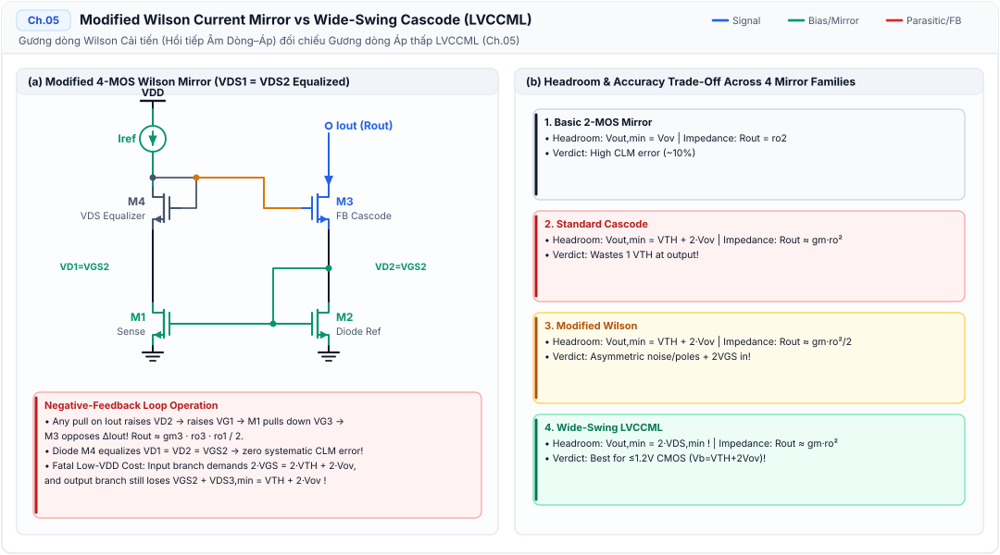

---
{
  "id": "topo-wilson-and-regulated-current-mirrors",
  "kind": "topology",
  "domain": "stages-and-mirrors",
  "title_vi": "Gương dòng Wilson, Wilson Cải tiến & Cascode Điều chỉnh bằng Hồi tiếp (Wilson, Modified Wilson & Regulated Cascode Current Mirrors)",
  "title_en": "Wilson, Modified Wilson, and Regulated-Cascode (Gain-Boosted) Current Mirrors vs. LVCCML",
  "summary": "Hệ thống hóa các kiến trúc gương dòng siêu trở kháng ra bằng vòng hồi tiếp âm cục bộ: mổ xẻ vòng hồi tiếp cảm biến dòng - trả áp của gương Wilson 3-FET (Rout ~ gm*rO^2/2), khuyết điểm lệch áp hệ thống VDS1 = VGS != VDS2 = 2*VGS và cách sửa bằng diode cân bằng ở Wilson 4-FET, nâng cấp lên gương Regulated Cascode đạt Rout ~ A_aux*gm*rO^2 với điện áp tuân thủ tối thiểu Vref + VDS,min, đặt cạnh chuẩn đối chiếu Cascode và LVCCML.",
  "diagram": "../../diagrams/wilson-current-mirror.svg",
  "razavi_refs": [
    {
      "chapter": 5,
      "section": "5.2",
      "pages": "139-146, 167-172",
      "equations": ["5.8", "5.10", "5.13", "5.14", "5.18", "5.19"]
    },
    {
      "chapter": 9,
      "section": "9.4.1",
      "pages": "364-368",
      "equations": ["9.20", "9.23"]
    }
  ],
  "glossary_codes": ["T026", "T208", "T257", "T499", "T503", "T608", "T685", "T698"],
  "process_agnostic": true,
  "roles": {
    "wilson_diode_sensor_M1": "Transistor đáy nhánh ngõ ra mắc diode (G1 = D1) cảm nhận trực tiếp toàn bộ dòng ngõ ra Iout biến thành điện áp cổng chung VGS1 = VGS2.",
    "wilson_reference_comparator_M2": "Transistor đáy nhánh tham chiếu so sánh dòng phản chiếu ID2 với dòng chuẩn IREF để phát điện áp điều khiển ngược pha lên cực cổng M3.",
    "wilson_feedback_cascode_M3": "Transistor chồng phía trên nhánh ngõ ra đóng vai trò phần tử chấp hành cổng chung/hồi tiếp, hấp thụ biến thiên áp Vout và ổn định Iout.",
    "modified_wilson_equalizer_M4": "Transistor mắc diode thứ tư chèn nối tiếp trên nhánh IREF nhằm hạ VDS2 từ 2*VGS xuống đúng bằng VGS = VDS1, khử sai số hệ thống CLM.",
    "regulated_cascode_amplifier_Aaux": "Bộ khuếch đại phụ trợ so sánh cực máng transistor nguồn dòng đáy với điện áp tham chiếu thấp Vref và lái cổng cascode, nhân trở kháng ra thêm Aaux lần."
  },
  "symptoms_addressed": [
    "severe-current-mirror-error-from-channel-length-modulation",
    "insufficient-output-impedance-of-single-cascode-in-short-channel-cmos",
    "systematic-vds-mismatch-in-basic-three-transistor-wilson-mirror",
    "wasted-vth-voltage-headroom-in-diode-stacked-cascode-and-wilson-mirrors"
  ],
  "limitations": [
    "wilson-and-modified-wilson-lose-one-vth-plus-two-vov-compliance-voltage",
    "wilson-feedback-loop-exhibits-high-frequency-peaking-and-inductive-zin-trap",
    "regulated-cascode-adds-auxiliary-power-noise-and-local-loop-doublet-or-instability"
  ],
  "checklists": ["common-mos", "current-mirror"]
}
---

## 1. Bản chất Nguyên lý, Sơ đồ Mạch & Vai trò Từng Nhánh Cấu trúc

Trong một **gương dòng (`T026`, *current mirror*)** cơ bản (`topo-basic-current-mirror`), hiện tượng **điều biến chiều dài kênh (`T257`, *channel-length modulation*)** làm dòng ngõ ra $I_{out}$ phụ thuộc tuyến tính vào điện áp cực máng theo $r_O = 1/(\lambda I_D)$ — ở tiến trình nanomet ($g_m r_O \approx 6\text{–}15$), sai số sao chép dòng dễ dàng vượt quá $10\text{–}25\%$. Để triệt tiêu hiệu ứng này, kỹ thuật mạch tương tự phát triển hai trường phái nâng cao trở kháng ra lên bậc $g_m r_O^2$ (thậm chí $A_{\text{aux}} g_m r_O^2$): **(1) Che chắn cực máng thụ động** bằng **cấu trúc cascode (`T685`, *cascode structure*; `T499`, *cascode stage*)** sử dụng **transistor cascode (`T503`, *cascode device*)** trong **gương dòng cascode (`T698`, *cascode mirror*, Chương 5 §5.2)**, và **(2) Khóa dòng/áp chủ động bằng hồi tiếp âm cục bộ** thông qua họ **gương dòng Wilson, Wilson cải tiến (Modified Wilson)** và **gương dòng Cascode điều chỉnh bằng hồi tiếp (Regulated / Gain-Boosted Cascode, Chương 9 §9.4.1)**.



Bốn kiến trúc trọng tâm và cơ chế vật lý của từng nhánh được phân định như sau:

1. **Gương dòng Wilson cơ bản 3 transistor ($M_1, M_2, M_3$ — Vòng hồi tiếp âm Cảm biến Nối tiếp – Trả Song song):**
   - Nhánh ngõ ra gồm transistor trên $M_3$ xếp chồng trên transistor đáy mắc diode $M_1$ ($G_1 = D_1$ nối chung sang cực cổng $G_2$ của nhánh tham chiếu). Nguồn dòng chuẩn $I_{REF}$ đổ vào nút chung giữa cực máng $D_2$ và cực cổng $G_3$.
   - *Cơ chế tự sửa sai bằng hồi tiếp âm:* Giả sử $V_{out}$ tăng làm dòng $I_{out} = I_{D3}$ có xu hướng nhích tăng. Toàn bộ dòng này chảy xuống diode $M_1$ làm tăng nhẹ $V_{GS1} = V_{GS2}$, khiến $M_2$ lập tức hút dòng $I_{D2} > I_{REF}$. Phần dòng chênh lệch rút điện tích khỏi nút cổng $G_3$ làm **hạ thấp $V_{G3}$**, khép cổng $M_3$ lại và ép $I_{out}$ quay về bằng $I_{REF}$!
   - *Khuyết tật cấu trúc chí mạng:* Tại trạng thái tĩnh, cực máng $M_1$ chỉ nằm ở $V_{DS1} = V_{GS1} = V_{GS}$, trong khi nút cổng $G_3$ (cũng chính là cực máng $M_2$!) phải dâng lên mức $V_{DS1} + V_{GS3} = 2V_{GS}$. Do đó **$V_{DS1} = V_{GS} \neq V_{DS2} = 2V_{GS}$** — gây ra sai số sao chép dòng hệ thống tĩnh $\Delta I / I_{REF} \approx -\lambda V_{GS}$ ngay cả khi ba transistor giống hệt nhau!
2. **Gương dòng Wilson Cải tiến 4 transistor (Modified Wilson — Chèn diode cân bằng $M_4$):**
   - Để xóa bỏ bất đối xứng $V_{DS}$ trên cặp đáy $M_1\text{–}M_2$, ta chèn thêm transistor thứ tư $M_4$ mắc diode ($G_4 = D_4$) nối tiếp giữa nút cổng $G_3$ (nơi nhận $I_{REF}$ ở mức $2V_{GS}$) và cực máng $D_2$. Độ sụt áp $V_{GS4} = V_{GS}$ qua $M_4$ kéo thế cực máng $M_2$ từ $2V_{GS}$ tụt xuống đúng **$V_{DS2} = 2V_{GS} - V_{GS4} = V_{GS} = V_{DS1}$**, cân bằng tuyệt đối điểm làm việc DC của hai nhánh!
3. **Nỗi đau chung về khoảng dự trữ điện áp (`T208`, *voltage headroom*) & Đối chiếu LVCCML (§5.2, trang 139–146):** Cả gương dòng cascode dùng hai diode chồng nhau (Hình 5.13), Wilson 3-FET lẫn Wilson 4-FET đều mắc kẹt vào **ràng buộc về dự trữ điện áp (`T608`, *headroom constraints*)**: điện áp tối thiểu tại ngõ ra để $M_3$ không rơi vào vùng triode là $V_{out,\min} = V_{GS1} + V_{OV3} = V_{TH} + 2V_{OV}$ — lãng phí mất trọn một ngưỡng $V_{TH}$! Cấu trúc cascode điện áp thấp (`topo-lvccml-wide-swing-mirror`, Hình 5.18) thu hồi lại $V_{TH}$ này bằng cách tách thiên áp cổng cascode $V_b$.
4. **Gương dòng Cascode Điều chỉnh bằng Hồi tiếp / Tăng cường Độ lợi (Regulated Cascode — Chương 9 §9.4.1, Hình 9.30b–9.31):**
   - Thay vì dùng diode $M_1$ ở đáy (gây mất $V_{TH}$) hay giữ cố định cổng cascode $V_b$ (bị giới hạn bởi $g_m r_O$ đơn lẻ ở nanomet), một bộ khuếch đại phụ trợ $A_{\text{aux}}$ cảm nhận trực tiếp điện áp cực máng $V_P$ của transistor nguồn dòng đáy $M_1$, so sánh với điện áp tham chiếu thấp $V_{\text{ref}} \approx V_{DS1,\min}$ và điều khiển cổng cascode $M_2$ theo $V_{G2} = A_{\text{aux}}(V_{\text{ref}} - V_P)$. Cấu trúc này đồng thời đạt **siêu trở kháng ra $R_{out} \approx A_{\text{aux}} g_{m2} r_{O2} r_{O1}$** VÀ **điện áp tuân thủ cực thấp $V_{out,\min} = V_{\text{ref}} + V_{DS2,\min} \approx 2V_{DS,\min}$**!

---

## 2. Hệ Phương trình Cốt lõi & Tư duy "Nhìn Mạch Đọc Nhanh" (Analysis by Inspection)

### 2.1. Giới hạn Dự trữ Điện áp của Gương Cascode Chuẩn & Phép Khử $V_{TH}$ (Phương trình 5.8, 5.10, 5.13, 5.14, 5.18, 5.19)
Trong Mục 5.2 (Hình 5.13, trang 140–141), khi tạo thiên áp cascode bằng hai transistor mắc diode chồng nhau $M_0, M_1$, thế tại nút cổng cascode là $V_N = V_{GS0} + V_{GS1}$ (Phương trình 5.8). Nếu đầu nguồn dòng chuẩn bị giới hạn bởi $V_{DD}$ (Ví dụ 5.3, Phương trình 5.10: $V_{DD} - V_{OV0} - V_{OV1} - V_{TH0} - V_{TH1} = 0{,}5\text{ V}$), dòng $I_{REF,\max}$ bị trần hóa cứng; đồng thời điện áp tuân thủ tối thiểu tại nút ngõ ra $P$ cho bốn transistor giống hệt nhau bị đội lên theo Phương trình (5.12)–(5.13):

$$
V_{P,\min} = V_N - V_{TH} = V_{GS0} + V_{GS1} - V_{TH} = \left(V_{GS0} - V_{TH}\right) + \left(V_{GS1} - V_{TH}\right) + V_{TH} = 2 V_{OV} + V_{TH}
$$

Để hiểu các nhánh hồi tiếp/dịch mức trong họ gương dòng, Razavi xét phần tử cơ sở $M_1$ có điện trở $R_1$ nối giữa cực máng và cổng (Hình 5.17, Phương trình 5.14): $\frac{V_X - I_X R_1}{r_O} + g_m V_X = I_X \implies R_{in} = \frac{R_1 + r_O}{1 + g_m r_O}$ (khi $R_1$ tăng lớn hơn $1/g_m$, trở kháng có tính cảm kháng ở tần số cao nếu có tụ cổng!), từ đó hình thành mạch tạo thiên áp dịch mức $V_{GS6} - R_6 I_6 = V_{GS1} - V_{TH1} = V_{GS1} - R_1 I_{REF}$ (Phương trình 5.17–5.18) và cửa sổ thiên áp vàng của gương cascode điện áp thấp LVCCML (Phương trình 5.19):

$$
V_{GS0} + \left(V_{GS1} - V_{TH1}\right) \le V_b \le V_{GS1} + V_{TH0} \implies V_{P,\min,\text{LVCCML}} = V_{OV3} + V_{OV2} = 2 V_{DS,\min}
$$

### 2.2. Giải tích Chính xác $R_{out}$ và Sai số Hệ thống của Gương Wilson 3-FET & 4-FET
Xét gương dòng Wilson (cả bản 3-FET lẫn 4-FET): ngắt nguồn xoay chiều $i_{\text{ref}} = 0$ (giữ điện trở ra thực tế $R_{\text{ref}}$ của nguồn dòng $I_{REF}$ nối từ nút $G_3$ lên $V_{DD}$!), đặt áp thử $V_X$ vào cực máng $M_3$ hút dòng thử $I_X$:
1. **Dòng qua diode cảm biến $M_1$:** Vì các cực cổng $G_1, G_2$ hở mạch ở tần số thấp, định luật KCL quanh siêu nút $(M_3)$ bắt buộc $100\%$ dòng đi vào máng $M_3$ phải chảy ra khỏi nguồn $M_3$ xuống diode $M_1$: $I_{d1} = I_X$. Điện áp xoay chiều tại nguồn $M_3$ (cũng là cổng $M_1, M_2$) bằng:

$$
V_{S3} = V_{g1} = V_{g2} = I_X\left(\frac{1}{g_{m1}} \parallel r_{O1}\right) \approx \frac{I_X}{g_{m1}}
$$

2. **Độ lợi vòng đảo pha qua $M_2$ lên cổng $G_3$:** Điện áp $V_{g2}$ làm $M_2$ hút dòng $g_{m2} V_{g2} = \frac{g_{m2}}{g_{m1}} I_X$ từ nút $G_3$.
   - Trong **Wilson 3-FET**, nút $G_3$ nhìn thấy trở kháng $r_{O2} \parallel R_{\text{ref}}$.
   - Trong **Wilson 4-FET**, diode $M_4$ (trở kháng nhỏ $1/g_{m4} \ll r_{O2}$) mắc nối tiếp giữa $D_2$ và nút $G_3$, nên dòng từ $M_2$ đi thẳng qua $M_4$ rút khỏi $R_{\text{ref}}$, cho thế xoay chiều tại $G_3$ là $V_{g3} \approx -g_{m2} V_{g2} \left(r_{O2} \parallel R_{\text{ref}}\right)$.
3. **Trở kháng ra tổng hợp nhìn từ máng $M_3$:** Viết phương trình dòng qua $M_3$ với $V_{gs3} = V_{g3} - V_{S3}$ (kể cả hiệu ứng thân $g_{mb3}$):

$$
V_X = V_{S3} + r_{O3}\Big[I_X - g_{m3}\left(V_{g3} - V_{S3}\right) + g_{mb3} V_{S3}\Big] \implies R_{out,\text{Wilson}} \approx r_{O3}\left[1 + \frac{g_{m3}}{g_{m1}} + \frac{g_{mb3}}{g_{m1}} + g_{m3}\frac{g_{m2}}{g_{m1}}\left(r_{O2} \parallel R_{\text{ref}}\right)\right]
$$

Công thức tổng quát này làm sáng tỏ hoàn toàn hai trường hợp biên trong tài liệu CMOS:
- Nếu nguồn $I_{REF}$ lý tưởng ($R_{\text{ref}} \to \infty$) và $g_{m1} = g_{m2}$: $R_{out,\text{Wilson}} \approx g_{m3} r_{O3} r_{O2} = g_m r_O^2$.
- Trong **vi mạch thực tế** nơi $I_{REF}$ được cấp từ một nguồn dòng PMOS đơn giản có trở kháng $R_{\text{ref}} \approx r_O$ bằng với $r_{O2}$: $r_{O2} \parallel R_{\text{ref}} = r_O / 2$, dẫn tới kết quả kinh điển:

$$
R_{out,\text{Wilson,real}} \approx \frac{1}{2}\,g_{m3} r_{O3} r_O = \frac{1}{2}\,g_m r_O^2
$$

*(Chú ý hiệu ứng thân thú vị: khác với cascode thường có $R_{out} = (g_m + g_{mb})r_O^2$, trong gương Wilson dòng đảo pha chủ đạo đi vào **cực cổng** $G_3$ chứ không phải cực nguồn $S_3$, nên hệ số nhân chính chỉ tỉ lệ với $g_{m3}$ mà không được cộng thêm $g_{mb3}$!).*

4. **Sai số dòng một chiều hệ thống — Wilson 3-FET vs. Wilson 4-FET:** Với bốn transistor cùng kích thước, trong Wilson 3-FET ta có $V_{DS1} = V_{GS}$ nhưng $V_{DS2} = V_{GS1} + V_{GS3} \approx 2V_{GS}$, làm $M_2$ dẫn nhiều hơn $M_1$ một lượng $\lambda V_{GS}$:

$$
\left.\frac{I_{out}}{I_{REF}}\right|_{\text{3-FET Wilson}} = \frac{I_{D1}}{I_{D2}} = \frac{1 + \lambda V_{DS1}}{1 + \lambda V_{DS2}} \approx 1 - \lambda V_{GS}, \qquad \left.\frac{I_{out}}{I_{REF}}\right|_{\text{4-FET Mod. Wilson}} \approx 1 + \frac{\lambda\left(V_{out} - 2V_{GS}\right)}{g_m r_O / 2} \approx 1
$$

Ở tiến trình có $\lambda = 0{,}1\text{ V}^{-1}$ và $V_{GS} = 0{,}6\text{ V}$, Wilson 3-FET mắc lỗi tĩnh tới **$-6\%$**, trong khi Wilson 4-FET khử sạch số hạng bậc nhất này nhờ diode $M_4$ ép $V_{DS2} = V_{DS1} = V_{GS}$!

### 2.3. Gương Dòng Regulated Cascode / Tăng cường Độ lợi (Mục 9.4.1, Phương trình 9.20, 9.21, 9.23)
Áp dụng nguyên lý "siêu transistor" (*supertransistor*) của Razavi (§9.4.1, Hình 9.27b & 9.30b, trang 365–367): transistor nguồn dòng đáy $M_1$ đóng vai trò điện trở suy biến $R_S = r_{O1}$, còn bộ khuếch đại phụ $A_{\text{aux}}$ (độ lợi $A_1$ trong ký hiệu sách) cảm nhận biến thiên $\Delta V_P = I_X r_{O1}$ tại cực máng $M_1$ và đặt điện áp hồi tiếp $-A_{\text{aux}} \Delta V_P$ lên cực cổng cascode $M_2$. Viết KCL dòng qua $r_{O2}$ của $M_2$ (Phương trình 9.20–9.21, tổng quát hóa kể cả $g_{mb2}$):

$$
I_X = \frac{V_X - r_{O1} I_X}{r_{O2}} - \left[\left(A_{\text{aux}} + 1\right) g_{m2} + g_{mb2}\right] r_{O1} I_X \implies R_{out,\text{RegCas}} = \Big\{1 + \left[\left(A_{\text{aux}} + 1\right) g_{m2} + g_{mb2}\right] r_{O2}\Big\} r_{O1} + r_{O2} \approx A_{\text{aux}} g_{m2} r_{O2} r_{O1}
$$

Đồng thời, theo Ví dụ 9.11 (Phương trình 9.23), điện trở nhìn ngược vào cực nguồn của $M_2$ khi cực máng mang tải $R_D$ bị nén nhỏ đi $(A_{\text{aux}} + 1)$ lần:

$$
R_{in,S2} = \frac{R_D + r_{O2}}{1 + \left(A_{\text{aux}} + 1\right) g_{m2} r_{O2}} \xrightarrow{R_D = 0} \frac{1}{\left(A_{\text{aux}} + 1\right) g_{m2}}
$$

Do đó một thay đổi lớn $\Delta V_{out}$ tại đầu ra chỉ làm nhúc nhích cực máng $M_1$ một lượng siêu nhỏ $\Delta V_P \approx \frac{\Delta V_{out}}{A_{\text{aux}} g_{m2} r_{O2}}$ (xem thêm chú giải học thuật `NG09-07` ở Mục 6.1!). Quan trọng nhất: vì $A_{\text{aux}}$ khóa cứng $V_P = V_{\text{ref}}$, ta hoàn toàn tự do chọn $V_{\text{ref}} = V_{DS1,\min} + \Delta V_{\text{margin}}$ (ví dụ $V_{\text{ref}} = 120\text{ mV}$), đạt **điện áp tuân thủ tối thiểu $V_{out,\min} = V_{\text{ref}} + V_{DS2,\min}$**!

**Ví dụ số đối chiếu trên tiến trình 65nm ($V_{DD} = 1{,}0\text{ V}$, $I_{REF} = I_{out} = 100\,\mu\text{A}$):** Giả sử mỗi MOSFET có $V_{TH} = 0{,}38\text{ V}$, $V_{OV} = V_{DS,\min} = 0{,}12\text{ V}$ ($\implies V_{GS} = 0{,}50\text{ V}$, $g_m = 1{,}67\text{ mS}$), $r_O = 12\text{ k}\Omega$ ($\implies g_m r_O = 20$), nguồn tham chiếu có $R_{\text{ref}} = 12\text{ k}\Omega$, và khuếch đại phụ một tầng có $A_{\text{aux}} = 25\text{ V/V}$ với $V_{\text{ref}} = 0{,}13\text{ V}$:
- **Gương đơn giản:** $R_{out} = 12\text{ k}\Omega$, $V_{out,\min} = 0{,}12\text{ V}$.
- **Wilson 3-FET:** $R_{out} \approx \frac{1}{2}(20)(12\text{ k}\Omega) = 120\text{ k}\Omega$, nhưng $V_{out,\min} = 0{,}50 + 0{,}12 = 0{,}62\text{ V}$ (chiếm mất $62\%$ nguồn $1\text{ V}$!) và lệch tĩnh $\Delta I / I \approx -4{,}2\%$.
- **Wilson 4-FET:** $R_{out} \approx 120\text{ k}\Omega$, sai số tĩnh $\approx 0\%$, nhưng vẫn mất $V_{out,\min} = 0{,}62\text{ V}$.
- **LVCCML (`topo-lvccml-wide-swing-mirror`):** $R_{out} \approx (g_m + g_{mb})r_O^2 \approx 240\text{–}280\text{ k}\Omega$, $V_{out,\min} = 2 \times 0{,}12 = 0{,}24\text{ V}$!
- **Regulated Cascode:** $R_{out} \approx (25 + 1) \times 20 \times 12\text{ k}\Omega \approx \mathbf{6{,}24\text{ M}\Omega}$ (tăng gấp $>500$ lần gương đơn!), trong khi $V_{out,\min} = 0{,}13 + 0{,}12 = \mathbf{0{,}25\text{ V}}$!

---

## 3. Bất biến Cấu trúc & Các Bẫy Lỗi Kinh điển (Structural Invariants & Traps)

- **`[INV-WILS-01]` Bất biến Bất đối xứng Tụ Ký sinh & Đỉnh Cộng hưởng Tần số Cao trong Gương Wilson (Bài tập 5.19, Hình 5.62):** Khác với gương dòng chuẩn hay gương cascode chỉ có các cực thực thụ động, gương Wilson là một **vòng hồi tiếp âm hai cực** (một cực tại nút diode cổng chung $G_{1,2}$ và một cực trở kháng cao tại nút cổng $G_3$). Khi tần số tăng, sự dịch pha trong vòng làm trở kháng nhìn vào nhánh gương xuất hiện **thành phần cảm kháng hoặc điện trở âm** (như Razavi chứng minh trực tiếp trong Bài tập 5.19 Hình 5.62, trang 170–171, nơi tụ $C_1$ tại nút trong tạo độ tự cảm âm!), gây vọt lố (*peaking* $2\text{–}4\text{ dB}$) trong hàm truyền dòng $I_{out}(s)/I_{REF}(s)$ nếu không bù tụ nối chéo!
- **`[TRAP-WILS-01]` Bẫy Sụp Đổ Toàn Bộ Nhánh Wilson Ở Nguồn Cấp Thấp ($V_{DD} \le 1{,}0\text{ V}$):** Trong Wilson 4-FET, nhánh chuẩn $I_{REF}$ phải vượt qua hai điện áp cổng–nguồn chồng nhau $V_{G3} = V_{GS1} + V_{GS3} = 2V_{TH} + 2V_{OV}$. Ở góc tiến trình chậm nhiệt độ thấp (`SS`, $-40^\circ\text{C}$) nơi $V_{TH}$ dâng lên $0{,}48\text{ V}$ và $V_{OV} = 0{,}12\text{ V}$, riêng $V_{G3}$ đã đòi hỏi $1{,}20\text{ V}$ — lớn hơn cả nguồn cấp $V_{DD} = 1{,}0\text{ V}$, ép nguồn $I_{REF}$ tắt hoàn toàn! Do đó trên CMOS $\le 90\text{ nm}$, gương Wilson chỉ còn dùng trong các khối I/O điện áp cao ($2{,}5\text{ V} / 3{,}3\text{ V}$), còn lõi điện áp thấp bắt buộc dùng **LVCCML** hoặc **Regulated Cascode**.
- **`[TRAP-WILS-02]` Bẫy Cổng Vào $A_{\text{aux}}$ Bị Ngắt Ở Mức Áp Đáy $V_{\text{ref}} \approx 120\text{ mV}$ trong Regulated Cascode (§9.4.2, Hình 9.32–9.34):** Nhiều kỹ sư vẽ sơ đồ khối Regulated Cascode NMOS với bộ khuếch đại phụ $A_{\text{aux}}$ dùng cặp vi sai đầu vào NMOS thông thường! Sai lầm chết người: nút cảm biến $V_P$ chỉ nằm cách đất $V_{\text{ref}} \approx 100\text{–}150\text{ mV} \ll V_{GS,\text{NMOS}} + V_{DS,\text{tail}}$ nên cặp vi sai NMOS của $A_{\text{aux}}$ tắt ngúm hoàn toàn! Muốn cảm nhận nút sát đất $V_P \approx 120\text{ mV}$ cho gương NMOS, bộ khuếch đại phụ $A_{\text{aux}}$ bắt buộc phải dùng **cặp đầu vào PMOS** (hoặc cascode gập PMOS-in Hình 9.34, hoặc một transistor CS đơn có cực nguồn nối đất khi $V_P = V_{GS,\text{aux}}$ nếu chấp nhận nâng $V_P$, hoặc transistor mức $V_{TH}$ thấp / dịch mức)!
- **`[TRAP-WILS-03]` Bẫy Mất Ổn định Vòng Cục bộ & Doublet Tần số của Regulated Cascode (§9.4.3):** Vòng hồi tiếp cục bộ $M_2 \to V_P \to A_{\text{aux}} \to V_{G2}$ chứa cực trội của $A_{\text{aux}}$ và cực nút nguồn $M_2$: nếu băng thông độ lợi đơn vị của $A_{\text{aux}}$ vượt quá cực thứ hai tại nút $P$ (hoặc cực ngõ ra dòng chính khi tải tụ nhỏ), vòng cục bộ sẽ tự dao động ở tần số hàng trăm MHz – vài GHz, đồng thời sinh ra cặp cực–zero doublet làm chậm quá trình xác lập dòng!

---

## 4. Lộ trình Nâng cấp Cấu trúc & Bát giác Đánh đổi (Upgrade Paths & Design Octagon)

Bảng ma trận toàn diện dưới đây đặt 6 họ gương dòng cạnh nhau trên **bát giác thiết kế** (`concept-analog-design-octagon`):

| Kiến trúc Gương Dòng | Trở kháng ra $R_{out}$ | Điện áp tuân thủ $V_{out,\min}$ | Yêu cầu áp nhánh $I_{REF}$ | Sai số DC hệ thống ($V_{DS}$) | Khuyến nghị Ứng dụng Thực tế |
| :--- | :--- | :--- | :--- | :--- | :--- |
| **Cơ bản (`topo-basic-current-mirror`)** | $r_O$ | $V_{OV}$ | $V_{TH} + V_{OV}$ | Cao: $\lambda(V_{out} - V_{GS})$ | Phân cực phụ không nhạy dòng, tiết kiệm headroom tối đa |
| **Cascode 2-Diode (`topo-cascode-current-mirror`)** | $(g_m + g_{mb})r_O^2$ | $V_{TH} + 2V_{OV}$ | $2V_{TH} + 2V_{OV}$ | Thấp (cần $V_{out} \approx 2V_{GS}$) | I/O $1{,}8\text{–}3{,}3\text{ V}$ đơn giản, không cần mạch tạo $V_b$ riêng |
| **Wilson 3-FET** | $\approx \frac{1}{2} g_m r_O^2$ | $V_{TH} + 2V_{OV}$ | $2V_{TH} + 2V_{OV}$ | **Xấu:** $-\lambda V_{GS}$ ($V_{DS1}\neq V_{DS2}$) | Hầu như luôn phải nâng cấp lên bản 4-FET Modified Wilson |
| **Modified Wilson 4-FET** | $\approx \frac{1}{2} g_m r_O^2$ | $V_{TH} + 2V_{OV}$ | $2V_{TH} + 2V_{OV}$ | **Rất tốt** ($V_{DS1} = V_{DS2} = V_{GS}$) | Mạch chuẩn Bandgap/I/O $2{,}5\text{–}3{,}3\text{ V}$ tự phân cực gọn không cần nhánh $V_b$ |
| **Cascode Áp Thấp (`topo-lvccml-wide-swing-mirror`)** | $(g_m + g_{mb})r_O^2$ | **$2V_{OV}$** | $V_{TH} + 2V_{OV}$ (nhánh Sooch/Rb) | Rất tốt khi đặt $V_b = V_{GS2} + V_{OV1}$ | **Tiêu chuẩn vàng công nghiệp** cho mọi khối Analog $0{,}9\text{–}1{,}8\text{ V}$ |
| **Regulated Cascode (`topo-gain-boosted-cascode`)** | **$A_{\text{aux}}(g_m + g_{mb})r_O^2$** | **$V_{\text{ref}} + V_{OV} \approx 2V_{OV}$** | $V_{\text{ref}}$ (từ nhánh replica) | **Xuất sắc nhất** ($V_P$ khóa cứng vào $V_{\text{ref}}$) | Nguồn dòng DAC dòng lái (Current-Steering DAC), Charge Pump PLL cực thấp spur & OTA $>80\text{ dB}$ |

---

## 5. Thích ứng Đa Tiến trình (90nm / 65nm / 45nm) & Cách Kiểm chứng trong Cadence / Spectre

### 5.1. Chiến lược Định cỡ $g_m/I_D$ & $V_{DS,\min}$ trên Tiến trình Nanomet (90nm / 65nm / 45nm)
Khi thiết kế gương dòng độ chính xác cao trên tiến trình 90nm/65nm/45nm (ví dụ nguồn dòng đuôi/tải hoặc ô nguồn dòng DAC / Charge Pump):
1. **Phân vai bất đối xứng giữa Transistor Đáy (Quyết định Độ khớp & Nhiễu) và Transistor Cascode (Quyết định Che chắn & Tốc độ):**
   - **Transistor nguồn dòng đáy ($M_1, M_2$):** Theo định luật Pelgrom (`law-pelgrom-mismatch-and-sizing-duality`), sai lệch dòng ngẫu nhiên tuân theo $\frac{\sigma(\Delta I_D)}{I_D} = \sqrt{\sigma^2(\Delta\beta/\beta) + \left(\frac{g_m}{I_D}\right)^2 \sigma^2(\Delta V_{TH})}$. Do đó **bắt buộc đặt transistor đáy ở vùng nghịch đảo mạnh** ($g_m/I_D \approx 6\text{–}9\text{ V}^{-1}$, $V_{DS,\min} \approx 180\text{–}250\text{ mV}$) với chiều dài kênh lớn $L_1 \ge (5\text{–}10)L_{\min}$ để giảm đồng thời cả $g_m/I_D$ lẫn $\sigma(\Delta V_{TH}) \propto 1/\sqrt{WL}$!
   - **Transistor cascode ($M_3$ hoặc $M_{\text{cas}}$):** Đóng góp nhiễu và mismatch ra ngõ ra bị chia nhỏ đi $(g_{m,\text{cas}} r_{O1})^2$ lần! Vì vậy hãy đặt transistor cascode ở **vùng nghịch đảo vừa–yếu** ($g_m/I_D \approx 14\text{–}18\text{ V}^{-1}$, $V_{DS,\min} \approx 90\text{–}120\text{ mV}$) với chiều dài kênh vừa phải $L_{\text{cas}} \approx (2\text{–}3)L_{\min}$ để cực đại hóa hệ số che chắn $g_{m,\text{cas}} r_{O,\text{cas}}$ mà chỉ tốn tối thiểu dự trữ điện áp!
2. **Định cỡ Khuếch đại Phụ $A_{\text{aux}}$ trong Regulated Cascode:** Dùng cấu trúc Folded-Cascode gọn hoặc cặp vi sai 5T-OTA đầu vào đối cực (PMOS-in cho gương NMOS, NMOS-in cho gương PMOS) tiêu thụ dòng tĩnh chỉ bằng $10\text{–}20\%$ dòng chính $I_{out}$, giữ băng thông độ lợi đơn vị vòng phụ nằm trong cửa sổ an toàn: $\omega_{p,\text{out,main}} < \omega_{u,\text{aux}} \le \frac{1}{3}\,\omega_{p,P}$ (nơi $\omega_{p,P} \approx \frac{g_{m,\text{cas}}}{C_P}$).

| Nhánh linh kiện (Regulated Cascode / LVCCML) | Vùng $g_m/I_D$ mục tiêu | Dự trữ áp $V_{DS,\min}$ | Chiều dài kênh $L$ | Mục tiêu Thiết kế Cốt lõi |
| :--- | :--- | :--- | :--- | :--- |
| **Transistor đáy định dòng ($M_1$)** | $6\text{–}9\text{ V}^{-1}$ (nghịch đảo mạnh) | $180\text{–}240\text{ mV}$ | $(6\text{–}12)L_{\min}$ | Nén nhiễu nhiệt $4kT\gamma g_{m1}$ và giảm sai lệch ngưỡng $\Delta V_{TH1}$ theo Pelgrom. |
| **Transistor cascode che chắn ($M_2$)** | $14\text{–}18\text{ V}^{-1}$ (nghịch đảo vừa–yếu) | $90\text{–}120\text{ mV}$ | $(2\text{–}4)L_{\min}$ | Tiết kiệm headroom tuân thủ, nâng $g_{m2}$ để tăng $R_{out}$ và đẩy cực nút nội lên cao. |
| **Cặp đầu vào OTA phụ ($A_{\text{aux}}$, PMOS-in)** | $16\text{–}20\text{ V}^{-1}$ ($I_{\text{aux}} \approx 0{,}15\,I_{out}$) | $90\text{–}110\text{ mV}$ | $(2\text{–}4)L_{\min}$ | Hoạt động tốt tại ICMR sát đất $V_{\text{ref}} \approx 220\text{ mV}$ và giữ điện áp lệch cổng thấp. |

### 5.2. Quy trình Kiểm chứng Chuẩn trong Cadence Virtuoso / Spectre
1. **Quét Đường cong Tuân thủ $I_{out}(V_{out})$ & $R_{out}(V_{out})$ (`dc` sweep):** Đặt nguồn áp `vout_dc` tại ngõ ra của gương dòng, quét từ $0\text{ V}$ lên $V_{DD}$. Vẽ đồng thời hai đồ thị: sai số sao chép phần trăm `100*(IS("/vout_dc/PLUS") + Iref)/Iref` và trở kháng vi phân `1.0 / deriv(abs(IS("/vout_dc/PLUS")))`. Điểm đầu gối nơi $R_{out}(V_{out})$ sụt mất $50\%$ so với vùng phẳng xác định chính xác $V_{out,\min}$ thực tế qua các góc `TT`, `SS`, `FF`.
2. **Kiểm chứng Vòng Hồi tiếp Cục bộ bằng Phân tích `stb` (`iprobe`):** Với cả gương Wilson (nếu lái tải phức) lẫn Regulated Cascode, chèn `iprobe` nối tiếp vào cực cổng transistor cascode $M_2$ (hoặc $M_3$ ở Wilson) và chạy phân tích `stb` trong Spectre (`skill-spectre-stb-diffstb-middlebrook`): đảm bảo dự trữ pha $\text{PM}_{\text{aux}} \ge 60^\circ$ trên mọi mức dòng $I_{out}$ và mọi góc PVT!
3. **Đo Trở kháng Ra Phụ thuộc Tần số $Z_{out}(jf)$ (`ac`):** Cấp nguồn dòng AC `iac = 1` vào ngõ ra gương dòng và vẽ `dB20(mag(VF("/vout")))` để kiểm tra tần số góc nơi $Z_{out}(jf)$ bắt đầu rơi $-20\text{ dB/dec}$ (do tụ cổng–máng $C_{GD,\text{cas}}$ và băng thông hữu hạn của $A_{\text{aux}}$).

```text
; Mẫu biểu thức ADE / Spectre kiểm chứng Gương Dòng Wilson, LVCCML & Regulated Cascode:
Iout_DC          = abs(IS("/Vmeas_out/PLUS"))
Copy_Err_Pct     = 100.0 * (Iout_DC - VAR("Iref")) / VAR("Iref")           ; Wilson 3-FET vs 4-FET mismatch
Rout_DC_Curve    = 1.0 / deriv(Iout_DC)                                    ; Quet Vout tu 0 -> VDD
Vcompliance_Min  = cross(Rout_DC_Curve (0.5 * value(Rout_DC_Curve 0.7)) 1 "rising")
Zout_AC_Mag      = mag(VF("/vout"))                                        ; Voi nguon thu iac = 1 A tai vout
Aux_Loop_PM_deg  = getData("phaseMargin" ?result "stb_margin")             ; >= 60 deg cho Regulated Cascode
```

---

## 6. Mốc Đối chiếu Sách Razavi & Thuật ngữ Chuẩn CLB

### 6.1. Đối chiếu Sách Gốc Razavi (2nd Edition) & Chú giải Học thuật CLB
| Mục / Trang (Razavi 2nd Ed.) | Phương trình & Hình đối chiếu | Nội dung cốt lõi & Ghi chú Hiệu đính CLB (`NG`) |
| :--- | :--- | :--- |
| **§5.2**, tr. 139–146 (PDF 6–13) | PT (5.8), (5.10), (5.13), (5.14), (5.18), (5.19); Hình 5.12–5.21; Ví dụ 5.3–5.6 | Gương dòng cascode che chắn cực máng, trần dòng $I_{REF,\max}$ (PT 5.8, 5.10), tổn thất dự trữ điện áp một ngưỡng $V_{TH}$ khi chồng hai diode (PT 5.13), trở kháng linh kiện có điện trở cổng–máng (PT 5.14), và điều kiện thiên áp cascode điện áp thấp LVCCML (PT 5.18–5.19). |
| **Chương 5 — Bài tập**, tr. 167–172 (PDF 34–39) | Bài tập 5.5, 5.6, 5.15 (Hình 5.58), 5.19 (Hình 5.62) | Phân tích sai lệch dòng khi lệch $V_b$ hoặc $\gamma \neq 0$ khi chèn mạch bám nguồn dịch mức cổng cascode (Bài 5.15 Hình 5.58), và chứng minh tính cảm kháng âm / tương tác tần số cao của cấu trúc vòng hồi tiếp ba transistor kiểu Wilson khi có tụ nút trong (Bài 5.19 Hình 5.62). |
| **§9.4.1**, tr. 364–368 (PDF 21–25) | PT (9.20), (9.21), (9.23); Hình 9.26–9.31; Ví dụ 9.11–9.12 | Tăng cường độ lợi (*Gain Boosting*) và tầng/gương dòng **Regulated Cascode**: nhân trở kháng ra lên $[1 + (A_1+1)g_m r_O]R_S + r_O$ (PT 9.20–9.21), nén điện trở nhìn vào cực nguồn còn $(R_D+r_O)/[1+(A_1+1)g_m r_O]$ (PT 9.23), giữ nguyên dự trữ áp thấp. **Lưu ý `NG09-07` (tr. 366):** bản in gốc viết $\Delta V_S = R_S/[r_O + (1 + g_m r_O)R_S]$ bị thiếu nhân tử điện áp $\Delta V$ ở vế phải; công thức đúng thứ nguyên phải là $\Delta V_S = \frac{R_S}{r_O + (1 + g_m r_O)R_S}\Delta V$! |

### 6.2. Bảng Thuật ngữ Chuẩn CLB Vi Mạch Sử dụng trong Thẻ
| Mã CLB | Thuật ngữ Tiếng Anh | Thuật ngữ Tiếng Việt Chuẩn | Ghi chú Ngữ cảnh |
| :--- | :--- | :--- | :--- |
| `T026` | current mirror | Gương dòng | Khối sao chép và tỉ lệ hóa dòng điện phân cực hoặc tín hiệu |
| `T257` | Channel-Length Modulation | Điều biến chiều dài kênh | Nguyên nhân gốc làm $r_O$ hữu hạn và gây sai số tĩnh khi $V_{DS1} \neq V_{DS2}$ |
| `T208` / `T608` | Voltage headroom / headroom constraints | Khoảng dự trữ điện áp (headroom) / ràng buộc về dự trữ điện áp | Nút thắt thiết kế số một loại bỏ Wilson 3/4-FET khỏi lõi CMOS $\le 1{,}0\text{ V}$ |
| `T499` / `T685` | cascode stage / cascode structure | Tầng cascode / cấu trúc cascode | Xếp chồng linh kiện cổng chung phía trên linh kiện định dòng |
| `T503` | cascode device | Transistor cascode | Linh kiện phía trên đóng vai trò lá chắn điện áp cực máng |
| `T698` | cascode mirror | gương dòng cascode | Gương dòng nâng $R_{out}$ lên cỡ $g_m r_O^2$ (dạng chuẩn, LVCCML hoặc Regulated Cascode) |
